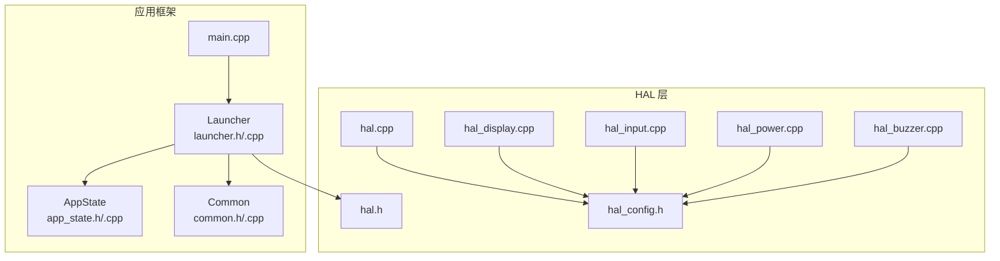
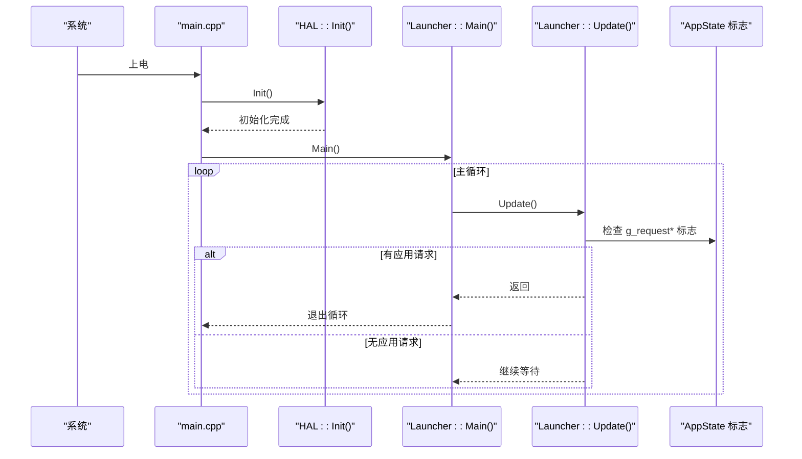
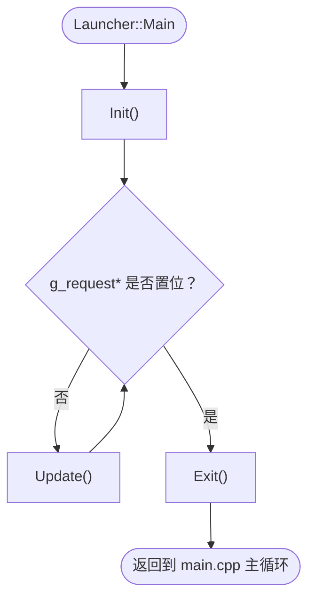
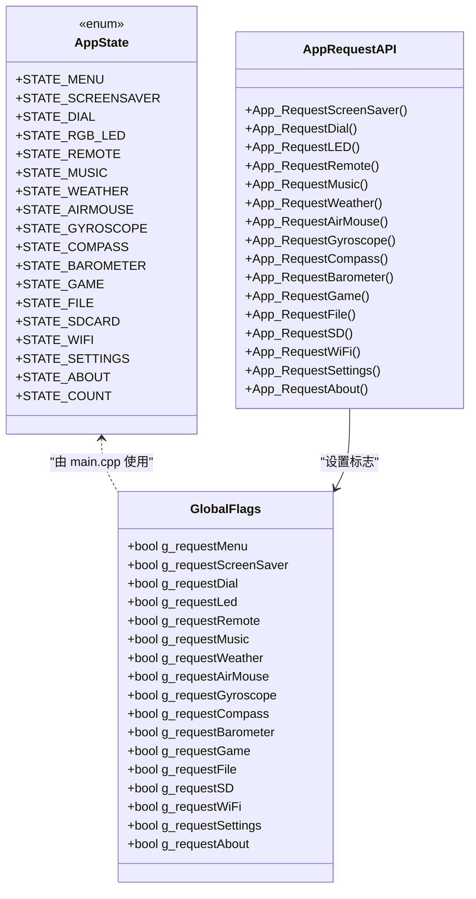
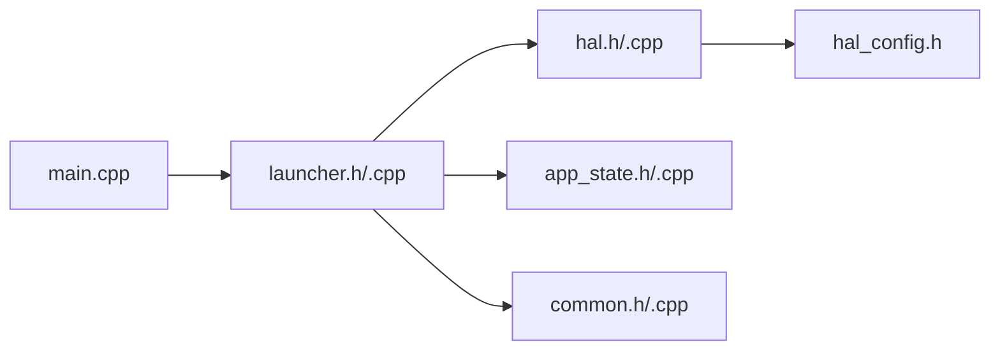

# API 参考文档

<cite>
**本文引用的文件**   
- [main.cpp](file://src/main.cpp)
- [launcher.h](file://src/launcher.h)
- [launcher.cpp](file://src/launcher.cpp)
- [app_state.h](file://src/app_state.h)
- [app_state.cpp](file://src/app_state.cpp)
- [common.h](file://src/common.h)
- [common.cpp](file://src/common.cpp)
- [hal.h](file://src/hal/hal.h)
- [hal.cpp](file://src/hal/hal.cpp)
- [hal_config.h](file://src/hal/hal_config.h)
- [hal_display.cpp](file://src/hal/hal_display.cpp)
- [hal_input.cpp](file://src/hal/hal_input.cpp)
- [hal_power.cpp](file://src/hal/hal_power.cpp)
- [hal_buzzer.cpp](file://src/hal/hal_buzzer.cpp)
</cite>

## 目录
1. [简介](#简介)
2. [项目结构](#项目结构)
3. [核心组件](#核心组件)
4. [架构总览](#架构总览)
5. [详细组件分析](#详细组件分析)
6. [依赖关系分析](#依赖关系分析)
7. [性能与资源特性](#性能与资源特性)
8. [故障排查指南](#故障排查指南)
9. [版本兼容性与迁移指南](#版本兼容性与迁移指南)
10. [结论](#结论)

## 简介
本 API 参考文档面向 ESP32 NullPod 固件，聚焦以下目标：
- 完整文档化 HAL 层公共接口（函数签名、参数、返回值、使用要点）
- 说明 Launcher 的接口规范与应用启动机制
- 文档化 AppState 状态枚举与全局请求标志的使用方式
- 汇总数据结构定义、常量声明与错误处理约定
- 提供代码示例路径，展示如何正确使用各 API
- 给出版本兼容性与迁移建议

该文档以源码为依据，确保所有描述均可追溯到具体实现。

## 项目结构
本项目采用分层组织：
- src/hal：硬件抽象层，封装 LCD、I2C、输入、IMU、MAG、DPS、RTC、SD、电源、蜂鸣器、RGB LED、编码器、音频、蓝牙等子系统
- src：应用框架层，包含 Launcher（菜单与调度）、AppState（应用切换请求）、通用工具
- data：Web 资源（与本 API 参考无直接关联）
- lib：第三方库（如 LovyanGFX、NimBLE 等）
- partitions：分区表配置

图表来源
- [main.cpp:1-24](file://src/main.cpp#L1-L24)
- [launcher.h:1-153](file://src/launcher.h#L1-L153)
- [launcher.cpp:1-79](file://src/launcher.cpp#L1-L79)
- [app_state.h:1-42](file://src/app_state.h#L1-L42)
- [hal.h:1-215](file://src/hal/hal.h#L1-L215)
- [hal.cpp:1-33](file://src/hal/hal.cpp#L1-L33)
- [hal_config.h:1-123](file://src/hal/hal_config.h#L1-L123)

章节来源
- [main.cpp:1-24](file://src/main.cpp#L1-L24)
- [launcher.h:1-153](file://src/launcher.h#L1-L153)
- [launcher.cpp:1-79](file://src/launcher.cpp#L1-L79)
- [app_state.h:1-42](file://src/app_state.h#L1-L42)
- [hal.h:1-215](file://src/hal/hal.h#L1-L215)
- [hal.cpp:1-33](file://src/hal/hal.cpp#L1-L33)
- [hal_config.h:1-123](file://src/hal/hal_config.h#L1-L123)

## 核心组件
- HAL 层：统一对外暴露设备能力，包括显示、输入、传感器、存储、电源、音频、蓝牙等
- Launcher：菜单界面与应用调度器，负责渲染 UI、处理用户输入、触发应用切换
- AppState：跨模块的应用切换请求标志与入口函数
- Common：颜色转换、图标缩放、内存统计等通用工具

章节来源
- [hal.h:101-212](file://src/hal/hal.h#L101-L212)
- [launcher.h:85-148](file://src/launcher.h#L85-L148)
- [app_state.h:4-41](file://src/app_state.h#L4-L41)
- [common.h:27-34](file://src/common.h#L27-L34)

## 架构总览
系统启动流程与主循环控制流如下：

图表来源
- [main.cpp:18-24](file://src/main.cpp#L18-L24)
- [launcher.cpp:57-79](file://src/launcher.cpp#L57-L79)
- [launcher.cpp:81-197](file://src/launcher.cpp#L81-L197)
- [app_state.h:4-41](file://src/app_state.h#L4-L41)

## 详细组件分析

### HAL 层公共接口
HAL 通过命名空间 HAL 暴露统一的硬件访问接口，涵盖以下子系统：

- 初始化与更新
  - void HAL::Init(); 顺序初始化电源、LCD、I2C、输入、编码器、RTC、IMU、SD、磁力计、气压计等
  - void HAL::Update(); 周期性更新（触摸、IMU、磁力计、编码器等），当前默认空实现

- 显示与画布
  - void HAL::LCD_Init(); 初始化 TFT、创建离屏缓冲 canvas、初始化背光并打印 Logo
  - LGFX *HAL::GetDisplay(); 获取底层显示对象指针
  - LGFX_Sprite *HAL::GetCanvas(); 获取离屏缓冲指针

- I2C
  - void HAL::I2C_Init(); 初始化 I2C
  - bool HAL::bsp_i2c_reg8_read(...); 寄存器读
  - bool HAL::bsp_i2c_reg8_write(...); 寄存器写

- 触摸与手势
  - void HAL::Touch_Init();
  - uint8_t HAL::getTouch(uint16_t *x, uint16_t *y, uint16_t threshold);
  - uint8_t HAL::getGesture(uint16_t *x, uint16_t *y, uint16_t threshold, TouchGesture *gesture);

- 按键与输入
  - void HAL::Input_Init();
  - bool HAL::GetButton(uint8_t button);
  - bool HAL::isReturn(); 检测“返回”键（Power）
  - bool HAL::isEnter(); 检测“确认”键（Select）

- IMU（加速度计/陀螺仪）
  - void HAL::IMU_Init();
  - ImuData_t HAL::getImuData();
  - void HAL::updateMouseDelta(float sensitivity);
  - float HAL::imu_get_roll()/pitch()/yaw();
  - int HAL::imu_get_mouse_dx()/dy();

- MAG（磁力计）
  - void HAL::MAG_Init();
  - void HAL::MAG_GetInfo(MAG_Info_t *info);
  - 校准相关：Start/Stop/Clear/GetCalStatus

- DPS（数字气压计）
  - void HAL::DPS_Init();
  - float HAL::dps_get_temperature()/pressure()/altitude();
  - void HAL::dps_set_atmosphere(float atmosphere);

- RTC（实时时钟）
  - void HAL::RTC_Init();
  - tm *HAL::GetLocalTime(); 获取本地时间
  - void HAL::syncNetworkTime(); 网络时间同步

- SD 卡
  - void HAL::SD_Init();
  - bool HAL::SD_isReady();
  - void HAL::SD_ListDir();
  - bool HAL::tryInitSD();

- 电源与背光
  - void HAL::Power_Init();
  - void HAL::PowerOff();
  - void HAL::Reboot();
  - void HAL::Backlight_Init();
  - void HAL::Backlight_Off();
  - void HAL::setBrightness(uint8_t brightness);
  - uint8_t HAL::getVoltage(); 返回电池电量百分比（0~100）

- 蜂鸣器
  - void HAL::beep(float frequency, uint32_t duration);
  - void HAL::beepStop();
  - void HAL::buzz(float frequency, uint32_t duration);

- RGB LED
  - void HAL::RGB_Init();
  - void HAL::RGB_Demo(uint8_t index);

- 编码器
  - void HAL::Encoder_Init();
  - uint8_t HAL::getEncoder(uint8_t *key);
  - void HAL::Encoder_Update();
  - int16_t HAL::Encoder_GetDiff();
  - bool HAL::Encoder_GetIsPush();
  - void HAL::Encoder_SetEnable(bool en);

- 音频与蓝牙
  - void HAL::Audio_Init();
  - bool HAL::Audio_PlayMusic(const char *name);
  - bool HAL::BT_Init();
  - void HAL::BT_Update();

- 系统辅助
  - bool HAL::isSwipeOut(); 检测滑动手势（左滑）
  - void HAL::logMemory(); 输出内存与 Flash 信息

常用数据类型与枚举
- struct ImuData_t：包含加速度、陀螺仪、角度、滚转/俯仰/偏航角、鼠标增量等
- enum TouchGesture：轻点、长按、四向滑动
- enum EncoderEvent：编码器旋转与按键事件
- enum ImuMountDir_t：IMU 安装方向

章节来源
- [hal.h:101-212](file://src/hal/hal.h#L101-L212)
- [hal.h:31-92](file://src/hal/hal.h#L31-L92)
- [hal.cpp:4-33](file://src/hal/hal.cpp#L4-L33)
- [hal_display.cpp:18-52](file://src/hal/hal_display.cpp#L18-L52)
- [hal_input.cpp:7-58](file://src/hal/hal_input.cpp#L7-L58)
- [hal_power.cpp:9-38](file://src/hal/hal_power.cpp#L9-L38)
- [hal_buzzer.cpp:4-28](file://src/hal/hal_buzzer.cpp#L4-L28)

#### HAL 使用示例（路径引用）
- 初始化 HAL 并在 setup 中调用：[main.cpp:18-24](file://src/main.cpp#L18-L24)
- 在 Launcher 中获取显示与画布：[launcher.cpp:45-49](file://src/launcher.cpp#L45-L49)
- 读取电量并绘制电池图标：[launcher.cpp:366-367](file://src/launcher.cpp#L366-L367)
- 检测 Power 键长按关机：[launcher.cpp:110-139](file://src/launcher.cpp#L110-L139)

### Launcher 接口与应用启动机制
Launcher 是菜单与应用调度的核心类，提供以下公共接口：
- void Launcher::Main(); 阻塞式生命周期，内部循环处理输入、绘制与状态栏刷新
- void Launcher::Init(); 初始化菜单项、显示对象、画布与初始绘制
- void Launcher::Exit(); 清理逻辑（当前为空实现）

受保护接口（供子类扩展）：
- void Launcher::Update(); 处理编码器、按键、长按 Power 关机、平滑滚动与状态栏每秒刷新
- void Launcher::Draw(); 分发绘制背景、状态栏、图标区、标签区与提示栏
- 交互处理：handleRotate(int dir)、handleShortPress()
- 绘制子方法：drawBackground/drawStatusBar/drawIconArea/drawLabelArea/drawHintBar

数据成员与常量
- MENU_COUNT、SLOT_SPACING、VISIBLE_SLOTS 等布局常量
- 颜色常量：BG_TOP/BG_BOTTOM/TEXT_* 等
- 状态栏区域常量：STATUS_H/STATUS_Y 等
- 图标区与标签区常量：ICON_AREA_*/LABEL_AREA_* 等
- 菜单项结构 MenuItem：label/iconColor/icon/action
- SlotParams：scale/yOffset/alpha 用于图标缩放与偏移
- 滚动与选中状态：selectedIndex/targetScrollOffset/currentScrollOffset
- 长按 Power 计时与提示状态：powerPressStart/powerLongPressTriggered/powerHintShown

应用启动机制
- Launcher::Main 进入无限循环，直到检测到任意 App_Request* 标志置位
- 每个菜单项绑定一个 action 回调，最终调用 App_Request* 设置对应 volatile 标志
- main.cpp 的主循环根据这些标志切换到对应 STATE_* 分支，执行相应应用后回到菜单

图表来源
- [launcher.cpp:57-79](file://src/launcher.cpp#L57-L79)
- [launcher.cpp:81-197](file://src/launcher.cpp#L81-L197)
- [launcher.cpp:427-443](file://src/launcher.cpp#L427-L443)
- [app_state.h:23-41](file://src/app_state.h#L23-L41)

章节来源
- [launcher.h:44-148](file://src/launcher.h#L44-L148)
- [launcher.cpp:8-79](file://src/launcher.cpp#L8-L79)
- [launcher.cpp:81-197](file://src/launcher.cpp#L81-L197)
- [launcher.cpp:230-238](file://src/launcher.cpp#L230-L238)
- [launcher.cpp:427-443](file://src/launcher.cpp#L427-L443)

### AppState 状态枚举与全局变量
AppState 状态枚举（在 launcher.h 中定义）：
- STATE_MENU、STATE_SCREENSAVER、STATE_DIAL、STATE_RGB_LED、STATE_REMOTE、STATE_MUSIC、STATE_WEATHER、STATE_AIRMOUSE、STATE_GYROSCOPE、STATE_COMPASS、STATE_BAROMETER、STATE_GAME、STATE_FILE、STATE_SDCARD、STATE_WIFI、STATE_SETTINGS、STATE_ABOUT、STATE_COUNT

全局请求标志（volatile，跨中断/多线程安全）：
- g_requestMenu、g_requestScreenSaver、g_requestDial、g_requestLed、g_requestRemote、g_requestMusic、g_requestWeather、g_requestAirMouse、g_requestGyroscope、g_requestCompass、g_requestBarometer、g_requestGame、g_requestFile、g_requestSD、g_requestWiFi、g_requestSettings、g_requestAbout

请求入口函数：
- App_RequestScreenSaver/Dial/LED/Remote/Music/Weather/AirMouse/Gyroscope/Compass/Barometer/Game/File/SD/WiFi/Settings/About

使用方式
- Launcher 的菜单项 action 回调调用 App_Request* 设置标志
- main.cpp 主循环根据标志切换 appState 并运行对应应用

图表来源
- [launcher.h:44-65](file://src/launcher.h#L44-L65)
- [app_state.h:4-41](file://src/app_state.h#L4-L41)
- [app_state.cpp:1-37](file://src/app_state.cpp#L1-L37)
- [main.cpp:15-126](file://src/main.cpp#L15-L126)

章节来源
- [launcher.h:44-65](file://src/launcher.h#L44-L65)
- [app_state.h:4-41](file://src/app_state.h#L4-L41)
- [app_state.cpp:1-37](file://src/app_state.cpp#L1-L37)
- [main.cpp:15-126](file://src/main.cpp#L15-L126)

### 数据结构与常量
- 颜色与布局常量
  - common.h：MENU_BG_COLOR、MENU_HEADER_COLOR、MENU_TEXT_COLOR、ICON_SRC_SIZE 等
  - launcher.h：MENU_COUNT、SLOT_SPACING、VISIBLE_SLOTS、STATUS_H、STATUS_Y、ICON_AREA_*、LABEL_AREA_*、HINT_AREA_*、CENTER_X 等
  - hal_config.h：屏幕分辨率 SCREEN_WIDTH/SCREEN_HEIGHT、引脚定义、NVS Key 名称、日志宏等

- 通用工具函数
  - uint16_t rgb565(r,g,b)：将 RGB 转换为 RGB565
  - uint16_t dim565(c, factor)：对 RGB565 进行变暗
  - int getRamPercent/getPsramPercent/getFlashPercent：内存与 Flash 占用百分比
  - void drawScaledIcon(...)：按缩放比例绘制图标
  - void drawWedgeLine(...)：绘制渐变宽度线条

章节来源
- [common.h:4-34](file://src/common.h#L4-L34)
- [common.cpp:7-151](file://src/common.cpp#L7-L151)
- [launcher.h:9-43](file://src/launcher.h#L9-L43)
- [hal_config.h:7-78](file://src/hal/hal_config.h#L7-L78)

### 错误处理与异常行为
- HAL 层多数函数为 void 或返回布尔值表示成功与否（如 I2C 读写、SD 就绪）
- 长按 Power 关机流程：
  - 检测 isReturn() 持续按下超过阈值（2s）
  - 蜂鸣反馈、关闭背光、清屏、调用 PowerOff()
  - 若未达阈值则显示进度条与提示
- 触摸手势：isSwipeOut() 检测左滑返回

章节来源
- [launcher.cpp:109-155](file://src/launcher.cpp#L109-L155)
- [hal.cpp:35-54](file://src/hal/hal.cpp#L35-L54)
- [hal_input.cpp:50-58](file://src/hal/hal_input.cpp#L50-L58)

## 依赖关系分析
- main.cpp 依赖 Launcher 与多个应用实例；通过 AppState 标志驱动状态机
- Launcher 依赖 HAL 提供的显示、输入、电源、蜂鸣器、时间等能力
- AppState 仅维护全局标志与入口函数，不耦合具体应用实现
- Common 被 Launcher 与 HAL 共同使用（颜色、图标绘制、内存统计）

图表来源
- [main.cpp:1-24](file://src/main.cpp#L1-L24)
- [launcher.h:1-153](file://src/launcher.h#L1-L153)
- [app_state.h:1-42](file://src/app_state.h#L1-L42)
- [common.h:1-36](file://src/common.h#L1-L36)
- [hal.h:1-215](file://src/hal/hal.h#L1-L215)
- [hal_config.h:1-123](file://src/hal/hal_config.h#L1-L123)

章节来源
- [main.cpp:1-24](file://src/main.cpp#L1-L24)
- [launcher.h:1-153](file://src/launcher.h#L1-L153)
- [app_state.h:1-42](file://src/app_state.h#L1-L42)
- [common.h:1-36](file://src/common.h#L1-L36)
- [hal.h:1-215](file://src/hal/hal.h#L1-L215)
- [hal_config.h:1-123](file://src/hal/hal_config.h#L1-L123)

## 性能与资源特性
- 显示与渲染
  - 使用离屏缓冲 canvas 减少闪烁；状态栏每秒刷新一次以提升效率
  - 图标缩放 drawScaledIcon 避免重复计算，边界裁剪优化绘制范围
- 输入与交互
  - 编码器加速机制：快速旋转时提高选择速度
  - 长按 Power 关机带进度条与提示，避免误触
- 内存与存储
  - 提供 getRamPercent/getPsramPercent/getFlashPercent 监控资源使用
  - logMemory 输出堆、PSRAM、Flash 大小与空闲块信息

章节来源
- [launcher.cpp:157-197](file://src/launcher.cpp#L157-L197)
- [launcher.cpp:199-222](file://src/launcher.cpp#L199-L222)
- [common.cpp:27-62](file://src/common.cpp#L27-L62)
- [hal.cpp:56-71](file://src/hal/hal.cpp#L56-L71)

## 故障排查指南
- 无法进入菜单
  - 检查 HAL::Init 是否成功；查看串口日志输出
  - 确认 display.begin 与 canvas.createSprite 已执行
- 触摸/手势无效
  - 检查 Touch_Init 是否调用；确认 getGesture 返回值与手势类型
- 编码器无响应
  - 检查 Input_Init 与 Encoder_Init；确认引脚配置正确
- 电量显示异常
  - 检查 getVoltage 的分压电阻与 ADC 采样；确认电池电压范围
- 长按关机失败
  - 检查 isReturn 与 powerLongPressTriggered 状态；确认蜂鸣与背光控制

章节来源
- [hal_display.cpp:18-42](file://src/hal/hal_display.cpp#L18-L42)
- [hal_input.cpp:7-24](file://src/hal/hal_input.cpp#L7-L24)
- [hal_power.cpp:29-38](file://src/hal/hal_power.cpp#L29-L38)
- [launcher.cpp:109-155](file://src/launcher.cpp#L109-L155)

## 版本兼容性与迁移指南
- 向后兼容
  - HAL 接口保持命名空间 HAL 下的稳定 API；新增功能以追加函数为主
  - AppState 标志与 App_Request* 函数保持稳定，便于上层应用无需修改
- 迁移建议
  - 若升级 HAL 显示接口，优先使用 GetDisplay/GetCanvas 而非直接操作全局 display/canvas
  - 若引入新应用，遵循现有模式：添加 App_RequestXxx 与 STATE_XXX，并在 main.cpp 主循环中添加分支
  - 若调整布局常量，请同步更新 launcher.h 中的区域常量与绘制逻辑
- 废弃与替代
  - 当前 HAL::Update 为空实现；如需启用传感器轮询，请在 HAL::Update 中调用对应 update* 函数
  - 若替换第三方库（如 LovyanGFX），需适配 HAL 层的显示与画布接口

章节来源
- [hal.h:101-212](file://src/hal/hal.h#L101-L212)
- [launcher.h:44-148](file://src/launcher.h#L44-L148)
- [app_state.h:23-41](file://src/app_state.h#L23-L41)
- [main.cpp:29-126](file://src/main.cpp#L29-L126)

## 结论
本 API 参考文档系统化梳理了 ESP32 NullPod 的 HAL 层接口、Launcher 调度机制、AppState 状态管理与通用工具函数。通过清晰的架构图与流程图，读者可以快速理解系统启动流程、应用切换机制与关键交互逻辑。建议在开发新功能时遵循现有模式，保持 HAL 接口稳定，并通过 AppState 标志进行应用间解耦，以确保系统的可维护性与可扩展性。