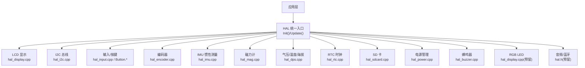
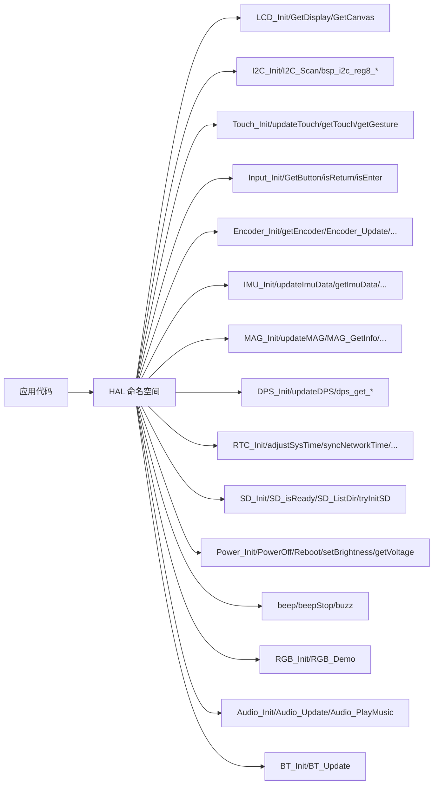
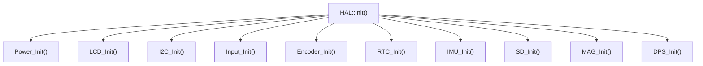

# HAL 接口参考

<cite>
**本文引用的文件**   
- [hal.h](file://src/hal/hal.h)
- [hal.cpp](file://src/hal/hal.cpp)
- [hal_config.h](file://src/hal/hal_config.h)
- [hal_display.cpp](file://src/hal/hal_display.cpp)
- [hal_i2c.cpp](file://src/hal/hal_i2c.cpp)
- [hal_input.cpp](file://src/hal/hal_input.cpp)
- [Button.h](file://src/hal/Button.h)
- [Button.cpp](file://src/hal/Button.cpp)
- [hal_imu.cpp](file://src/hal/hal_imu.cpp)
- [hal_mag.cpp](file://src/hal/hal_mag.cpp)
- [hal_dps.cpp](file://src/hal/hal_dps.cpp)
- [hal_rtc.cpp](file://src/hal/hal_rtc.cpp)
- [hal_sdcard.cpp](file://src/hal/hal_sdcard.cpp)
- [hal_power.cpp](file://src/hal/hal_power.cpp)
- [hal_buzzer.cpp](file://src/hal/hal_buzzer.cpp)
- [hal_encoder.cpp](file://src/hal/hal_encoder.cpp)
</cite>

## 目录
1. [简介](#简介)
2. [项目结构](#项目结构)
3. [核心组件](#核心组件)
4. [架构总览](#架构总览)
5. [详细组件分析](#详细组件分析)
6. [依赖关系分析](#依赖关系分析)
7. [性能与资源考虑](#性能与资源考虑)
8. [故障排查指南](#故障排查指南)
9. [结论](#结论)
10. [附录：数据结构与枚举](#附录数据结构与枚举)

## 简介
本文件为 ESP32 NullPod 硬件抽象层（HAL）的 API 参考文档，覆盖 LCD 显示、I2C 通信、触摸输入、按钮控制、IMU 传感器、磁力计、气压/温度/海拔传感器、RTC 时钟、SD 卡、电源管理、蜂鸣器、RGB LED、编码器、音频与蓝牙等模块。文档面向开发者与非技术读者，提供函数签名说明、参数类型、返回值、使用示例与错误处理建议，并给出关键数据结构的完整定义与图示。

## 项目结构
HAL 相关代码集中在 src/hal 目录下，采用“按功能模块拆分”的组织方式：每个外设或子系统对应一个 .cpp/.h 文件，统一在 hal.h 中声明公共接口，并通过 hal.cpp 提供统一的初始化与更新入口。引脚与分辨率等硬件配置集中在 hal_config.h。

图表来源
- [hal.h:101-212](file://src/hal/hal.h#L101-L212)
- [hal.cpp:4-33](file://src/hal/hal.cpp#L4-L33)

章节来源
- [hal.h:101-212](file://src/hal/hal.h#L101-L212)
- [hal.cpp:4-33](file://src/hal/hal.cpp#L4-L33)

## 核心组件
- 统一入口
  - Init(): 顺序初始化电源、LCD、I2C、输入、编码器、RTC、IMU、SD、磁力计、气压传感器，并播放启动提示音。
  - Update(): 预留的周期性更新入口（触摸、IMU、磁力计、编码器更新可在此启用）。
- 系统工具
  - isSwipeOut(): 基于触摸手势检测左滑返回。
  - logMemory(): 打印堆内存、PSRAM、Flash 容量等信息。

章节来源
- [hal.cpp:4-33](file://src/hal/hal.cpp#L4-L33)
- [hal.cpp:35-71](file://src/hal/hal.cpp#L35-L71)

## 架构总览
下图展示 HAL 对外暴露的命名空间与主要子系统的调用关系。所有外部调用通过 HAL:: 命名空间访问，内部各模块负责具体驱动与状态维护。

图表来源
- [hal.h:101-212](file://src/hal/hal.h#L101-L212)

## 详细组件分析

### LCD 显示
- 初始化与显示
  - LCD_Init(): 初始化 LGFX 显示、创建离屏缓冲 canvas、初始化背光、打印设备信息并显示 Logo。
  - Disp_Logo(): 在 canvas 上绘制 ASCII Logo 并刷新到屏幕。
- 访问接口
  - GetDisplay(): 返回底层显示对象指针。
  - GetCanvas(): 返回离屏缓冲精灵指针。
- 背光控制
  - Backlight_Init(): 初始化 PWM 背光通道，从 Preferences 读取亮度并设置。
  - Backlight_Off(): 关闭背光。
  - setBrightness(brightness): 设置背光亮度（0-255），同时持久化保存。

使用示例（步骤）
- 在应用启动时调用 HAL::LCD_Init()。
- 通过 HAL::GetCanvas() 获取画布进行绘图，完成后 pushSprite 刷新。
- 需要调整亮度时调用 HAL::setBrightness()。

错误处理
- 若背光未正确初始化，setBrightness 可能无效；检查 HAL_PIN_LCD_BL 与 PWM 通道配置。

章节来源
- [hal_display.cpp:18-42](file://src/hal/hal_display.cpp#L18-L42)
- [hal_display.cpp:62-79](file://src/hal/hal_display.cpp#L62-L79)
- [hal_display.cpp:81-127](file://src/hal/hal_display.cpp#L81-L127)
- [hal.h:108-112](file://src/hal/hal.h#L108-L112)

### I2C 通信
- 初始化与扫描
  - I2C_Init(): 初始化 I2C 总线（400kHz），创建递归互斥量用于并发保护。
  - I2C_Scan(): 扫描 1-127 地址，打印发现的设备地址。
- 寄存器读写
  - bsp_i2c_reg8_read(dev_addr, reg_addr, data, len): 读单字节寄存器序列。
  - bsp_i2c_reg8_write(dev_addr, reg_addr, data, len): 写单字节寄存器序列。

使用示例（步骤）
- 先调用 HAL::I2C_Init()。
- 可选调用 HAL::I2C_Scan() 确认设备在线。
- 使用 bsp_i2c_reg8_read/write 对设备进行寄存器级操作。

错误处理
- 读/写失败时返回 false，endTransmission 错误码会打印日志。
- 多线程访问由递归互斥量保护，避免竞态。

章节来源
- [hal_i2c.cpp:14-21](file://src/hal/hal_i2c.cpp#L14-L21)
- [hal_i2c.cpp:23-49](file://src/hal/hal_i2c.cpp#L23-L49)
- [hal_i2c.cpp:64-69](file://src/hal/hal_i2c.cpp#L64-L69)
- [hal_i2c.cpp:71-117](file://src/hal/hal_i2c.cpp#L71-L117)
- [hal.h:114-118](file://src/hal/hal.h#L114-L118)

### 触摸输入
- 接口
  - Touch_Init(): 初始化触摸控制器（实现位于其他文件，此处仅声明）。
  - updateTouch(): 周期更新触摸状态（实现位于其他文件，此处仅声明）。
  - getTouch(x, y, threshold): 获取触摸坐标，threshold 为去抖阈值。
  - getGesture(x, y, threshold, gesture): 识别手势并返回枚举值。

使用示例（步骤）
- 调用 HAL::Touch_Init() 完成初始化。
- 在主循环中调用 HAL::updateTouch() 更新状态。
- 使用 HAL::getGesture() 获取滑动/点击事件。

错误处理
- 若无触摸事件，返回 0；手势枚举 GESTURE_NONE 表示无事件。

章节来源
- [hal.h:120-124](file://src/hal/hal.h#L120-L124)

### 按钮控制
- 接口
  - Input_Init(): 初始化物理按键 GPIO（上拉输入），映射键位。
  - GetButton(button): 非阻塞检测按键按下/释放，带短促蜂鸣反馈。
  - isReturn()/isEnter(): 快捷判断“返回/确认”键。

使用示例（步骤）
- 调用 HAL::Input_Init()。
- 在循环中轮询 HAL::GetButton()，根据按键执行动作。

错误处理
- 按键抖动已通过 INPUT_PULLUP 与软件逻辑抑制。

章节来源
- [hal_input.cpp:7-24](file://src/hal/hal_input.cpp#L7-L24)
- [hal_input.cpp:26-48](file://src/hal/hal_input.cpp#L26-L48)
- [hal_input.cpp:50-58](file://src/hal/hal_input.cpp#L50-L58)
- [hal.h:126-128](file://src/hal/hal.h#L126-L128)

### 编码器与多按键
- 接口
  - Encoder_Init(): 初始化 PCNT 正交解码与多个 Button 实例（确认/上下左右）。
  - getEncoder(key): 统一事件接口，优先级：方向键 > 旋转 > 确认键。
  - Encoder_Update(): 周期性更新（声明）。
  - Encoder_GetDiff()/Encoder_GetIsPush()/Encoder_SetEnable(en): 查询增量/是否按下/使能控制（声明）。

使用示例（步骤）
- 调用 HAL::Encoder_Init()。
- 在循环中调用 HAL::getEncoder(&key)，根据 key 分发事件。

错误处理
- 方向键优先于旋转与确认键，避免冲突。

章节来源
- [hal_encoder.cpp:37-71](file://src/hal/hal_encoder.cpp#L37-L71)
- [hal_encoder.cpp:74-128](file://src/hal/hal_encoder.cpp#L74-L128)
- [hal.h:189-195](file://src/hal/hal.h#L189-L195)

### 非阻塞按键类 Button
- 能力
  - 支持短按/长按、持续按住（held）、连发（repeated）。
  - 高/低电平有效、消抖时间可调。
- 常用方法
  - update(): 必须周期性调用。
  - pressed()/event()/clear(): 事件读取与清除。
  - held()/repeated(firstDelayMs, repeatIntervalMs): 按住与连发。
  - setShortId()/setLongId()/setLongPressTime()/setDebounceTime(): 配置。

使用示例（步骤）
- 构造 Button(pin, activeLow, debounceMs)。
- 在 loop() 中调用 update()，并根据 pressed()/held()/repeated() 分支处理。

章节来源
- [Button.h:48-182](file://src/hal/Button.h#L48-L182)
- [Button.cpp:12-24](file://src/hal/Button.cpp#L12-L24)
- [Button.cpp:28-70](file://src/hal/Button.cpp#L28-L70)
- [Button.cpp:74-128](file://src/hal/Button.cpp#L74-L128)
- [Button.cpp:137-160](file://src/hal/Button.cpp#L137-L160)

### IMU 惯性测量单元（BMI270）
- 接口
  - IMU_Init(): 初始化 BMI270，静置校准陀螺仪零偏。
  - updateImuData(): 以固定频率（100Hz）采集并融合角度（互补滤波）。
  - getImuData(): 返回 ImuData_t 结构体。
  - updateMouseDelta(sensitivity): 计算鼠标增量（dx/dy）。
  - imu_calibrate_gyro(): 重新校准陀螺仪。
  - imu_get_roll()/imu_get_pitch()/imu_get_yaw()/imu_get_mouse_dx()/imu_get_mouse_dy(): 便捷访问。

使用示例（步骤）
- 调用 HAL::IMU_Init()。
- 在循环中调用 HAL::updateImuData()，然后读取角度或鼠标增量。

错误处理
- 初始化失败会打印错误日志；确保 I2C 已初始化且设备地址正确。

章节来源
- [hal_imu.cpp:57-74](file://src/hal/hal_imu.cpp#L57-L74)
- [hal_imu.cpp:88-149](file://src/hal/hal_imu.cpp#L88-L149)
- [hal_imu.cpp:151-181](file://src/hal/hal_imu.cpp#L151-L181)
- [hal.h:130-140](file://src/hal/hal.h#L130-L140)

### 磁力计（QMC5883P）
- 接口
  - MAG_Init(): 初始化磁力计，加载 Flash 中的校准参数。
  - updateMAG(): 读取原始磁场并应用校准，计算方位角。
  - MAG_GetInfo(info): 输出 MAG_Info_t（x/y/z/deg/isCalibrated）。
  - MAG_StartCalibration()/MAG_StopCalibration()/MAG_ClearCalibration()/MAG_GetCalStatus(): 校准流程控制。

使用示例（步骤）
- 调用 HAL::MAG_Init()。
- 在循环中调用 HAL::updateMAG()。
- 需要校准时调用开始/停止校准，并在结束后查看状态。

错误处理
- 校准失败（采样不足或范围不够）会提示重新校准；Flash 存储使用 Preferences。

章节来源
- [hal_mag.cpp:233-246](file://src/hal/hal_mag.cpp#L233-L246)
- [hal_mag.cpp:248-283](file://src/hal/hal_mag.cpp#L248-L283)
- [hal_mag.cpp:285-296](file://src/hal/hal_mag.cpp#L285-L296)
- [hal.h:142-149](file://src/hal/hal.h#L142-L149)

### 数字压力传感器（BMP280）
- 接口
  - DPS_Init(): 初始化 BMP280，设置采样模式与滤波器。
  - updateDPS(): 读取温度、气压、估算海拔并打印。
  - dps_get_temperature()/dps_get_pressure()/dps_get_altitude(): 便捷读取。
  - dps_set_atmosphere(atmosphere): 设置本地海平面气压基准（hPa）。

使用示例（步骤）
- 调用 HAL::DPS_Init()。
- 在循环中调用 HAL::updateDPS() 或直接调用 getter 获取数值。

错误处理
- 初始化失败会打印错误；检查 I2C 地址与连线。

章节来源
- [hal_dps.cpp:10-27](file://src/hal/hal_dps.cpp#L10-L27)
- [hal_dps.cpp:29-56](file://src/hal/hal_dps.cpp#L29-L56)
- [hal.h:151-157](file://src/hal/hal.h#L151-L157)

### RTC 时钟（PCF8563）
- 接口
  - RTC_Init(): 初始化 RTC，若时间异常则从编译时间设置。
  - adjustSysTime(): 将 RTC 时间同步至系统时间。
  - syncNetworkTime(): 连接 WiFi 并通过 NTP 同步时间后写回 RTC。
  - setTimeFromCompileTime(): 使用 __DATE__/__TIME__ 设置 RTC。
  - GetLocalTime(): 返回当前本地时间的 tm* 指针。

使用示例（步骤）
- 调用 HAL::RTC_Init()。
- 需要网络时间时调用 HAL::syncNetworkTime()。
- 业务中通过 HAL::GetLocalTime() 获取时间。

错误处理
- WiFi 连接超时或 NTP 失败会直接返回；RTC 初始化失败会打印错误。

章节来源
- [hal_rtc.cpp:15-39](file://src/hal/hal_rtc.cpp#L15-L39)
- [hal_rtc.cpp:41-48](file://src/hal/hal_rtc.cpp#L41-L48)
- [hal_rtc.cpp:50-97](file://src/hal/hal_rtc.cpp#L50-L97)
- [hal_rtc.cpp:99-132](file://src/hal/hal_rtc.cpp#L99-L132)
- [hal.h:159-163](file://src/hal/hal.h#L159-L163)

### SD 卡
- 接口
  - SD_Init(): 初始化 SPI 与 SD 文件系统，打印卡类型与容量。
  - SD_isReady(): 查询 SD 是否就绪。
  - SD_ListDir(): 列出根目录内容。
  - tryInitSD(): 尝试挂载 SD 卡（动态插入场景）。

使用示例（步骤）
- 调用 HAL::SD_Init()。
- 使用 HAL::SD_isReady() 判断可用性。
- 使用 HAL::SD_ListDir() 浏览文件。

错误处理
- 初始化失败或无卡时会打印错误；tryInitSD 返回布尔值指示结果。

章节来源
- [hal_sdcard.cpp:16-59](file://src/hal/hal_sdcard.cpp#L16-L59)
- [hal_sdcard.cpp:61-80](file://src/hal/hal_sdcard.cpp#L61-L80)
- [hal.h:165-169](file://src/hal/hal.h#L165-L169)

### 电源管理
- 接口
  - Power_Init(): 拉高 Hold 引脚保持供电。
  - PowerOff(): 拉低 Hold 引脚关机。
  - Reboot(): 重启系统。
  - getVoltage(): 通过 ADC 分压读取电池电压百分比（0-100）。

使用示例（步骤）
- 调用 HAL::Power_Init()。
- 需要关机时调用 HAL::PowerOff()。
- 在 UI 中显示电量百分比。

错误处理
- 电压读取受 ADC 精度与分压电阻影响，需合理校准。

章节来源
- [hal_power.cpp:9-38](file://src/hal/hal_power.cpp#L9-L38)
- [hal.h:171-178](file://src/hal/hal.h#L171-L178)

### 蜂鸣器
- 接口
  - beep(frequency, duration): 使用 tone 发声。
  - beepStop(): 停止发声。
  - buzz(frequency, duration): 使用 GPIO 翻转产生声音。

使用示例（步骤）
- 调用 HAL::beep() 或 HAL::buzz() 播放提示音。
- 必要时调用 HAL::beepStop() 停止。

错误处理
- 注意 duration 与频率匹配，避免长时间占用 CPU。

章节来源
- [hal_buzzer.cpp:4-28](file://src/hal/hal_buzzer.cpp#L4-L28)
- [hal.h:180-183](file://src/hal/hal.h#L180-L183)

### RGB LED
- 接口
  - RGB_Init(): 初始化 RGB LED（预留）。
  - RGB_Demo(index): 演示不同颜色/效果（预留）。

使用示例（步骤）
- 调用 HAL::RGB_Init() 后根据需要调用 RGB_Demo()。

章节来源
- [hal.h:185-187](file://src/hal/hal.h#L185-L187)

### 编码器（补充）
- 接口
  - Encoder_Init(): 初始化编码器与按键。
  - getEncoder(key): 获取事件（方向/旋转/确认）。
  - Encoder_Update(): 周期性更新（声明）。
  - Encoder_GetDiff()/Encoder_GetIsPush()/Encoder_SetEnable(en): 查询与配置（声明）。

使用示例（步骤）
- 调用 HAL::Encoder_Init()。
- 在循环中调用 HAL::getEncoder(&key) 并处理事件。

章节来源
- [hal.h:189-195](file://src/hal/hal.h#L189-L195)

### 音频与蓝牙（预留）
- 接口
  - Audio_Init()/Audio_Update()/Audio_PlayMusic(name): 音频播放（预留）。
  - BT_Init()/BT_Update(): 蓝牙初始化与更新（预留）。

使用示例（步骤）
- 调用相应初始化函数后，按需播放音乐或更新蓝牙状态。

章节来源
- [hal.h:197-204](file://src/hal/hal.h#L197-L204)

## 依赖关系分析
- HAL 统一入口依赖各子系统初始化顺序：电源 → LCD → I2C → 输入 → 编码器 → RTC → IMU → SD → 磁力计 → 气压。
- I2C 总线被 IMU、磁力计、RTC、BMP280 共享，需保证初始化与锁机制正确。
- 按键与编码器复用 Button 类，提供一致的非阻塞事件模型。

图表来源
- [hal.cpp:4-25](file://src/hal/hal.cpp#L4-L25)

章节来源
- [hal.cpp:4-25](file://src/hal/hal.cpp#L4-L25)

## 性能与资源考虑
- IMU 更新频率固定为 100Hz，使用互补滤波降低漂移；建议在主循环中稳定调用 updateImuData()。
- I2C 使用 400kHz 速率与递归互斥量，适合多设备并发访问但需注意临界区长度。
- SD 卡初始化可能耗时，建议在启动阶段完成，避免频繁挂载。
- 背光 PWM 占空比计算包含非线性补偿，提升视觉均匀性。

[本节为通用指导，不直接分析具体文件]

## 故障排查指南
- I2C 设备无法发现
  - 检查 HAL_PIN_I2C_SDA/SCL 配置与接线。
  - 使用 HAL::I2C_Scan() 扫描地址，确认设备 ACK。
- IMU 初始化失败
  - 确认 I2C 地址与库初始化返回值；确保设备处于静止状态完成零偏校准。
- 磁力计校准无效
  - 确保旋转覆盖足够范围；检查 Flash 中校准参数是否写入成功。
- SD 卡无法挂载
  - 检查 SPI 引脚与卡类型；使用 tryInitSD() 重试挂载。
- 时间不准确
  - 若 RTC 时间异常，调用 setTimeFromCompileTime() 或 syncNetworkTime() 校正。

章节来源
- [hal_i2c.cpp:23-49](file://src/hal/hal_i2c.cpp#L23-L49)
- [hal_imu.cpp:57-74](file://src/hal/hal_imu.cpp#L57-L74)
- [hal_mag.cpp:141-197](file://src/hal/hal_mag.cpp#L141-L197)
- [hal_sdcard.cpp:16-59](file://src/hal/hal_sdcard.cpp#L16-L59)
- [hal_rtc.cpp:15-39](file://src/hal/hal_rtc.cpp#L15-L39)

## 结论
本 HAL 提供了完整的 ESP32 NullPod 外设抽象，涵盖显示、通信、输入、传感、存储、电源与多媒体等模块。通过统一的 HAL::Init()/Update() 入口与清晰的模块接口，应用层可以专注于业务逻辑，而无需关心底层细节。建议在生产环境中完善触摸与蓝牙/音频的实现，并针对功耗与实时性进行调优。

[本节为总结性内容，不直接分析具体文件]

## 附录：数据结构与枚举
- ImuData_t
  - 字段：accelX/Y/Z、gyro_x/y/z、angle_x/y/z、roll/pitch/yaw、mouse_dx/mouse_dy。
  - 用途：封装 IMU 原始数据、融合角度与鼠标增量。
- MAG_Info_t
  - 字段：deg、x/y/z、isCalibrated。
  - 用途：输出磁力计校准后的三轴磁场与方位角及校准状态。
- TouchGesture 枚举
  - 值：GESTURE_NONE/TAP/LONG_PRESS/SWIPE_UP/DOWN/LEFT/RIGHT。
  - 用途：标识触摸手势类型。
- EncoderEvent 枚举
  - 值：BTN_ENC_CC/CW、BTN_OK_SP/LP、BTN_UP_SP/LP、BTN_DOWN_SP/LP、BTN_LEFT_SP/LP、BTN_RIGHT_SP/LP。
  - 用途：编码器的旋转与按键事件标识。
- ImuMountDir_t 枚举
  - 值：IMU_MOUNT_NORMAL/REAR。
  - 用途：指定 IMU 安装方向，用于坐标变换。

章节来源
- [hal.h:31-47](file://src/hal/hal.h#L31-L47)
- [hal.h:49-64](file://src/hal/hal.h#L49-L64)
- [hal.h:66-75](file://src/hal/hal.h#L66-L75)
- [hal.h:77-92](file://src/hal/hal.h#L77-L92)
- [hal.h:49-54](file://src/hal/hal.h#L49-L54)