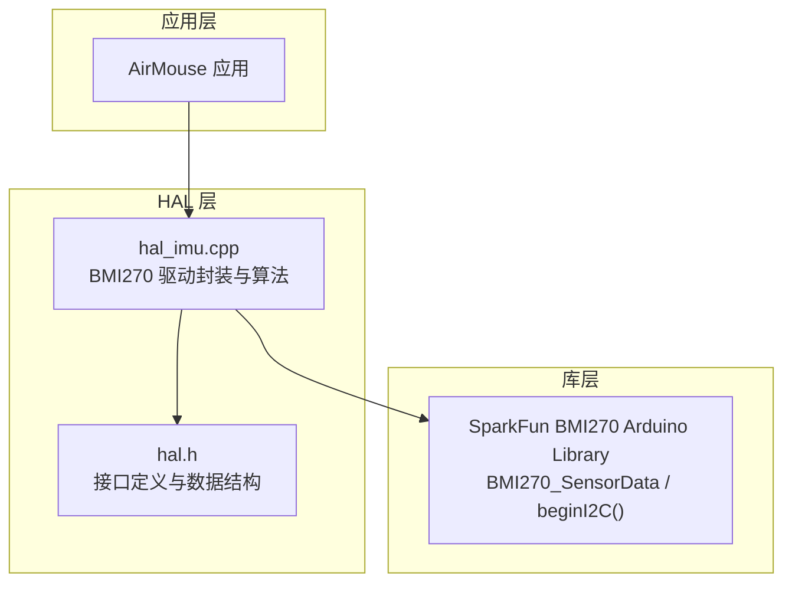
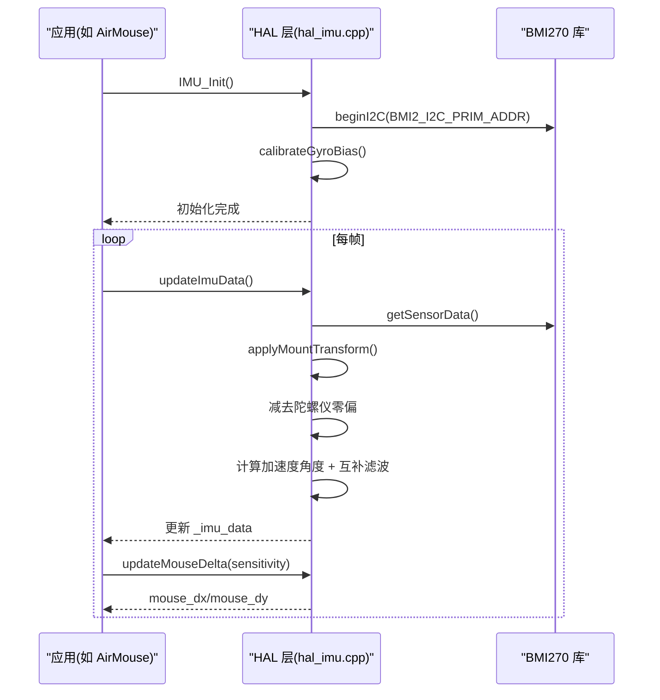
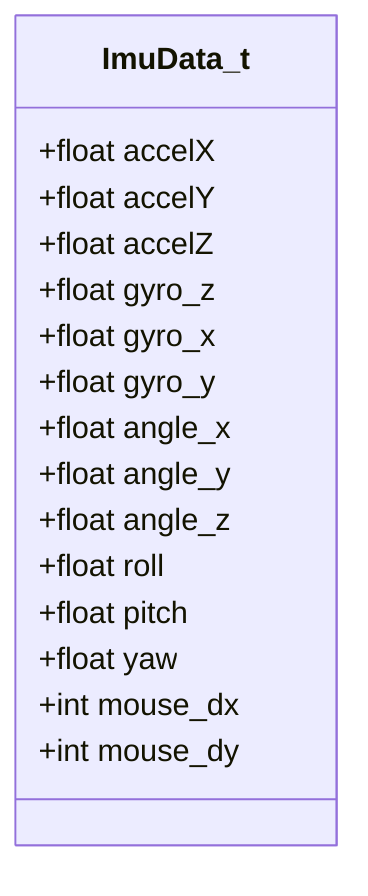
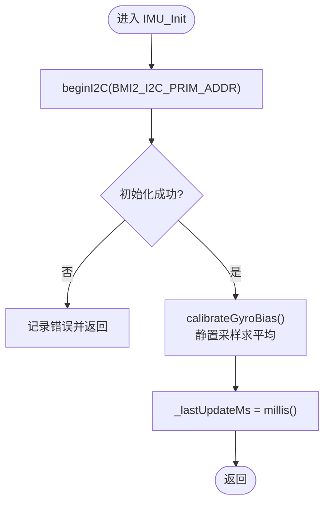
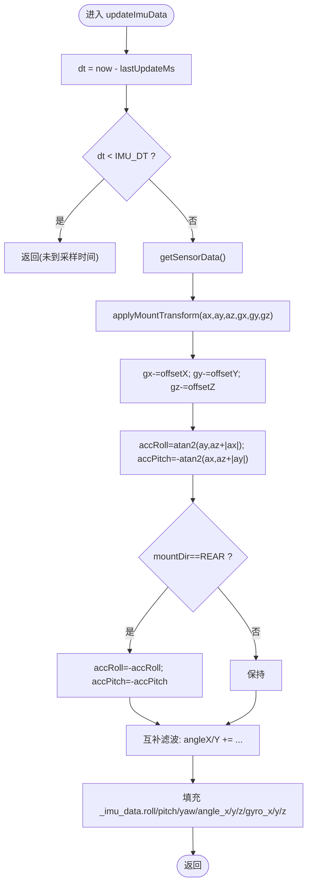
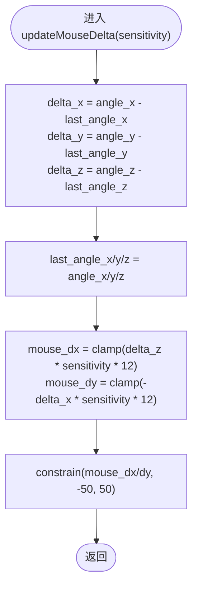
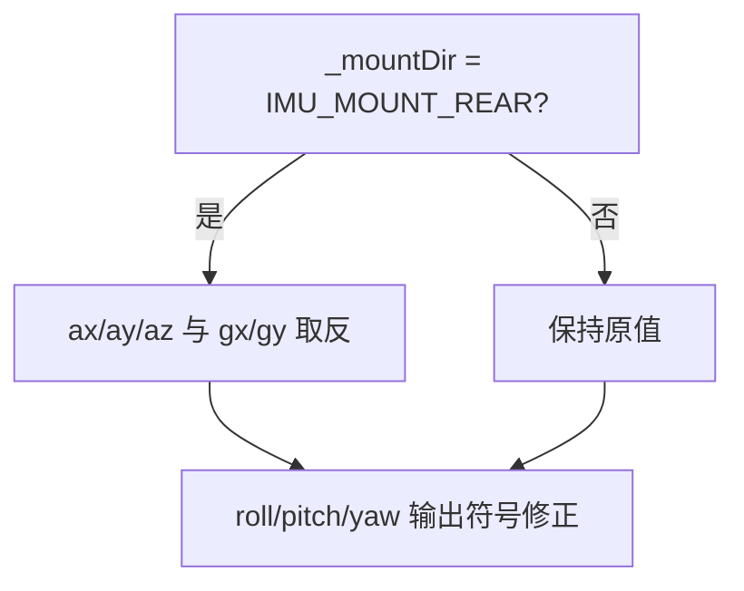
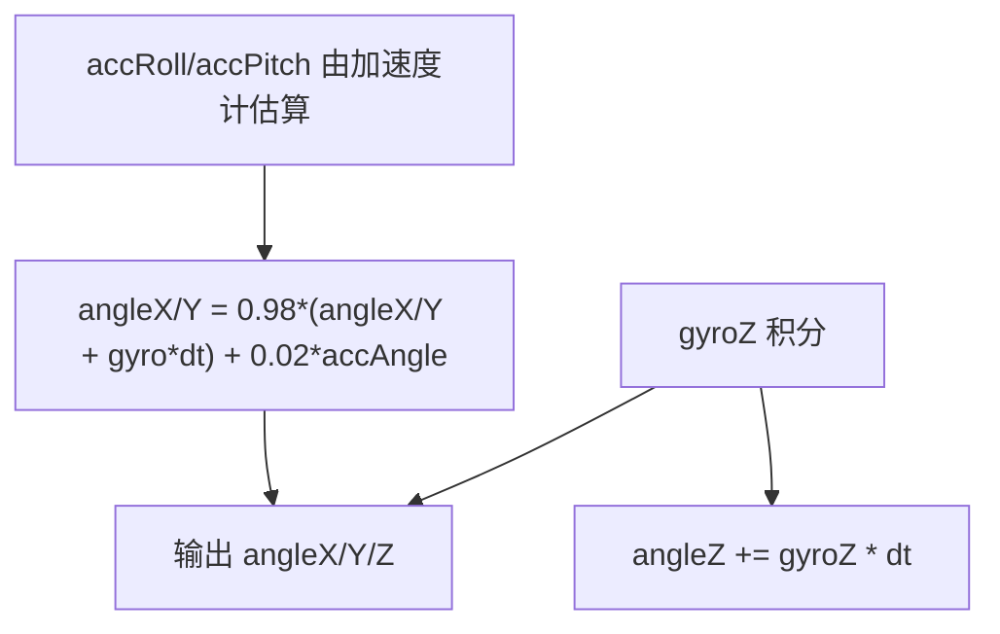
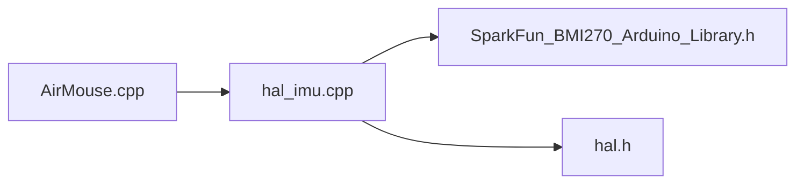

# IMU 接口

<cite>
**本文引用的文件**   
- [hal_imu.cpp](file://src/hal/hal_imu.cpp)
- [hal.h](file://src/hal/hal.h)
- [AirMouse.cpp](file://src/apps/AirMouse.cpp)
- [SparkFun_BMI270_Arduino_Library.h](file://lib/SparkFun BMI270 Arduino Library/src/SparkFun_BMI270_Arduino_Library.h)
</cite>

## 目录
1. [简介](#简介)
2. [项目结构](#项目结构)
3. [核心组件](#核心组件)
4. [架构总览](#架构总览)
5. [详细组件分析](#详细组件分析)
6. [依赖关系分析](#依赖关系分析)
7. [性能与参数配置](#性能与参数配置)
8. [故障排查指南](#故障排查指南)
9. [结论](#结论)
10. [附录：API 参考与示例](#附录api-参考与示例)

## 简介
本文件为 ESP32 NullPod 的 IMU（惯性测量单元）接口文档，聚焦于基于 BMI270 传感器的 HAL 层实现。内容涵盖初始化、数据更新、角度计算、坐标变换、鼠标增量生成、校准流程以及常用 API 的使用方式。读者可据此快速集成 IMU 到应用（如空中鼠标、姿态显示等），并理解互补滤波与安装方向校正的实现细节。

## 项目结构
IMU 相关代码主要位于 HAL 层与应用层：
- HAL 层负责传感器驱动封装、数据融合与对外暴露统一接口
- 应用层通过 HAL 接口读取 IMU 数据并执行手势/鼠标控制逻辑

图表来源
- [hal_imu.cpp:1-182](file://src/hal/hal_imu.cpp#L1-L182)
- [hal.h:31-54](file://src/hal/hal.h#L31-L54)
- [SparkFun_BMI270_Arduino_Library.h:144-160](file://lib/SparkFun BMI270 Arduino Library/src/SparkFun_BMI270_Arduino_Library.h#L144-L160)

章节来源
- [hal_imu.cpp:1-182](file://src/hal/hal_imu.cpp#L1-L182)
- [hal.h:31-54](file://src/hal/hal.h#L31-L54)

## 核心组件
- HAL::IMU_Init()：初始化 BMI270 I2C 通信，执行陀螺仪零偏校准，记录更新时间戳
- HAL::updateImuData()：固定频率（100Hz）读取原始加速度与角速度，进行安装方向变换、零偏补偿、互补滤波，输出 roll/pitch/yaw 与 angle_x/y/z
- HAL::getImuData()：返回 ImuData_t 结构体快照
- HAL::updateMouseDelta(sensitivity)：基于互补滤波角度差值计算鼠标 dx/dy，并进行限幅
- HAL::imu_calibrate_gyro()：触发一次陀螺仪零偏校准
- 辅助访问器：imu_get_roll()/pitch()/yaw()/mouse_dx()/mouse_dy()

章节来源
- [hal_imu.cpp:57-74](file://src/hal/hal_imu.cpp#L57-L74)
- [hal_imu.cpp:88-149](file://src/hal/hal_imu.cpp#L88-L149)
- [hal_imu.cpp:151-181](file://src/hal/hal_imu.cpp#L151-L181)

## 架构总览
下图展示从应用层到传感器驱动的调用链与数据流：

图表来源
- [hal_imu.cpp:57-74](file://src/hal/hal_imu.cpp#L57-L74)
- [hal_imu.cpp:88-149](file://src/hal/hal_imu.cpp#L88-L149)
- [hal_imu.cpp:151-173](file://src/hal/hal_imu.cpp#L151-L173)

## 详细组件分析

### 数据结构：ImuData_t
ImuData_t 是 HAL 层对 IMU 数据的统一封装，包含原始数据、滤波后角度、欧拉角与鼠标增量字段。

字段说明
- accelX/Y/Z：加速度计原始数据（单位：g）
- gyro_x/y/z：陀螺仪原始数据（单位：°/s），已减去零偏
- angle_x/y/z：互补滤波后的角度（单位：度）
- roll/pitch/yaw：面向应用的欧拉角（单位：度），已根据安装方向修正
- mouse_dx/dy：鼠标移动增量（像素步数），经灵敏度与限幅处理

图表来源
- [hal.h:31-47](file://src/hal/hal.h#L31-L47)

章节来源
- [hal.h:31-47](file://src/hal/hal.h#L31-L47)

### 初始化流程：HAL::IMU_Init()
- 使用 I2C 连接 BMI270（默认地址 BMI2_I2C_PRIM_ADDR）
- 上电静置时执行陀螺仪零偏校准（采样求平均）
- 记录上次更新时间戳，供后续固定频率控制使用

图表来源
- [hal_imu.cpp:57-74](file://src/hal/hal_imu.cpp#L57-L74)
- [hal_imu.cpp:31-55](file://src/hal/hal_imu.cpp#L31-L55)

章节来源
- [hal_imu.cpp:57-74](file://src/hal/hal_imu.cpp#L57-L74)

### 数据更新与融合：HAL::updateImuData()
- 固定频率控制：以 100Hz 为目标频率，未到时间直接返回
- 读取原始数据：加速度与角速度
- 安装方向变换：根据 ImuMountDir_t 调整轴符号
- 零偏补偿：减去陀螺仪零偏
- 角度计算：由加速度计估算 roll/pitch，结合陀螺仪积分进行互补滤波
- 输出：填充 _imu_data 的 roll/pitch/yaw 与 angle_x/y/z

图表来源
- [hal_imu.cpp:88-149](file://src/hal/hal_imu.cpp#L88-L149)
- [hal_imu.cpp:76-86](file://src/hal/hal_imu.cpp#L76-L86)

章节来源
- [hal_imu.cpp:88-149](file://src/hal/hal_imu.cpp#L88-L149)

### 鼠标增量生成：HAL::updateMouseDelta()
- 基于互补滤波角度差值计算 delta_x/y/z
- 将 pitch→dx、roll→dy 映射为鼠标移动增量
- 乘以灵敏度系数并限制最大移动范围

图表来源
- [hal_imu.cpp:151-173](file://src/hal/hal_imu.cpp#L151-L173)

章节来源
- [hal_imu.cpp:151-173](file://src/hal/hal_imu.cpp#L151-L173)

### 坐标系与安装方向
- 安装方向枚举：IMU_MOUNT_NORMAL（正面，Z 朝上）、IMU_MOUNT_REAR（反面，PCB 翻转）
- 当安装方向为 REAR 时，对加速度与角速度进行轴符号反转；同时修正 roll/pitch/yaw 输出符号
- 该机制确保在不同装配方向下，应用层获得的欧拉角保持一致

图表来源
- [hal.h:49-54](file://src/hal/hal.h#L49-L54)
- [hal_imu.cpp:76-86](file://src/hal/hal_imu.cpp#L76-L86)
- [hal_imu.cpp:126-140](file://src/hal/hal_imu.cpp#L126-L140)

章节来源
- [hal.h:49-54](file://src/hal/hal.h#L49-L54)
- [hal_imu.cpp:76-86](file://src/hal/hal_imu.cpp#L76-L86)
- [hal_imu.cpp:126-140](file://src/hal/hal_imu.cpp#L126-L140)

### 互补滤波算法
- 采用标准互补滤波：角度 = α*(角度_prev + 角速度*dt) + (1-α)*加速度角度
- 权重系数：陀螺仪 0.98，加速度计 0.02
- Yaw 无磁力计，仅陀螺仪积分

图表来源
- [hal_imu.cpp:10-12](file://src/hal/hal_imu.cpp#L10-L12)
- [hal_imu.cpp:132-135](file://src/hal/hal_imu.cpp#L132-L135)

章节来源
- [hal_imu.cpp:10-12](file://src/hal/hal_imu.cpp#L10-L12)
- [hal_imu.cpp:132-135](file://src/hal/hal_imu.cpp#L132-L135)

## 依赖关系分析
- HAL 层依赖 SparkFun BMI270 Arduino Library 提供的 BMI270 类与 beginI2C/getSensorData 等方法
- 应用层（如 AirMouse）通过 HAL 接口获取 IMU 数据并转换为 HID 鼠标事件

图表来源
- [AirMouse.cpp:58-71](file://src/apps/AirMouse.cpp#L58-L71)
- [hal_imu.cpp:1-3](file://src/hal/hal_imu.cpp#L1-L3)
- [SparkFun_BMI270_Arduino_Library.h:144-160](file://lib/SparkFun BMI270 Arduino Library/src/SparkFun_BMI270_Arduino_Library.h#L144-L160)

章节来源
- [AirMouse.cpp:58-71](file://src/apps/AirMouse.cpp#L58-L71)
- [hal_imu.cpp:1-3](file://src/hal/hal_imu.cpp#L1-L3)
- [SparkFun_BMI270_Arduino_Library.h:144-160](file://lib/SparkFun BMI270 Arduino Library/src/SparkFun_BMI270_Arduino_Library.h#L144-L160)

## 性能与参数配置
- 采样率：固定 100Hz（IMU_SAMPLE_RATE_HZ），对应时间步长 IMU_DT = 1/100 s
- 互补滤波系数：陀螺仪 0.98，加速度计 0.02
- 校准策略：上电静置采样 IMU_CALIB_SAMPLES=200 次，间隔 IMU_CALIB_DELAY_MS=5ms
- 鼠标增量限幅：±50 像素步
- 灵敏度：应用层传入 sensitivity，用于缩放鼠标增量

章节来源
- [hal_imu.cpp:5-12](file://src/hal/hal_imu.cpp#L5-L12)
- [hal_imu.cpp:31-55](file://src/hal/hal_imu.cpp#L31-L55)
- [hal_imu.cpp:170-172](file://src/hal/hal_imu.cpp#L170-L172)

## 故障排查指南
常见问题与建议
- 初始化失败：检查 I2C 地址与连线；确认 BMI2_I2C_PRIM_ADDR 正确
- 角度漂移：确保上电校准期间设备保持静止；必要时重新触发 imu_calibrate_gyro()
- 鼠标移动异常：检查安装方向设置（IMU_MOUNT_REAR/NORMAL）与灵敏度参数
- 数据未更新：确认应用层循环中调用了 HAL::updateImuData()

章节来源
- [hal_imu.cpp:57-74](file://src/hal/hal_imu.cpp#L57-L74)
- [hal_imu.cpp:175-181](file://src/hal/hal_imu.cpp#L175-L181)

## 结论
本 IMU 接口在 HAL 层提供了稳定、易用的 BMI270 数据访问能力，涵盖初始化、校准、坐标变换、互补滤波与鼠标增量生成。通过统一的 ImuData_t 结构与 HAL 方法，应用层可便捷地实现空中鼠标、姿态显示等交互功能。建议在实际部署中根据装配方向与使用场景微调灵敏度与滤波系数，以获得最佳体验。

## 附录：API 参考与示例

### API 列表
- HAL::IMU_Init()
- HAL::updateImuData()
- HAL::getImuData()
- HAL::updateMouseDelta(float sensitivity)
- HAL::imu_calibrate_gyro()
- HAL::imu_get_roll()
- HAL::imu_get_pitch()
- HAL::imu_get_yaw()
- HAL::imu_get_mouse_dx()
- HAL::imu_get_mouse_dy()

章节来源
- [hal.h:130-140](file://src/hal/hal.h#L130-L140)
- [hal_imu.cpp:57-181](file://src/hal/hal_imu.cpp#L57-L181)

### 典型用法示例（步骤描述）
- 初始化 IMU：在应用启动时调用 HAL::IMU_Init()，等待校准完成
- 主循环中更新数据：每帧调用 HAL::updateImuData()
- 读取角度与鼠标增量：使用 HAL::getImuData() 或 imu_get_* 系列函数
- 空中鼠标应用：在 AirMouse 应用中，调用 HAL::updateMouseDelta(MOUSE_SENSITIVITY)，并将 mouse_dx/dy 发送给 BLE 鼠标

章节来源
- [AirMouse.cpp:58-71](file://src/apps/AirMouse.cpp#L58-L71)