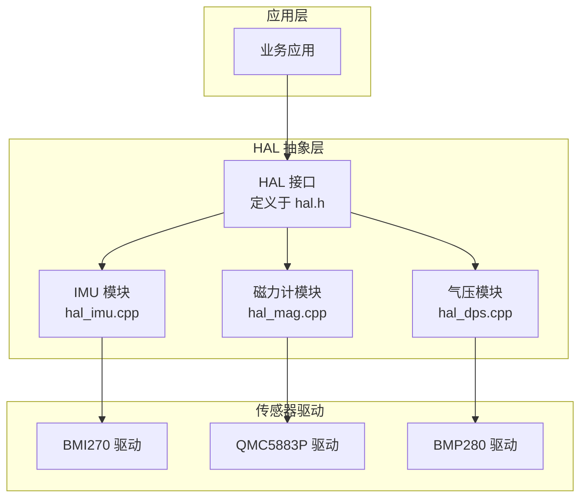
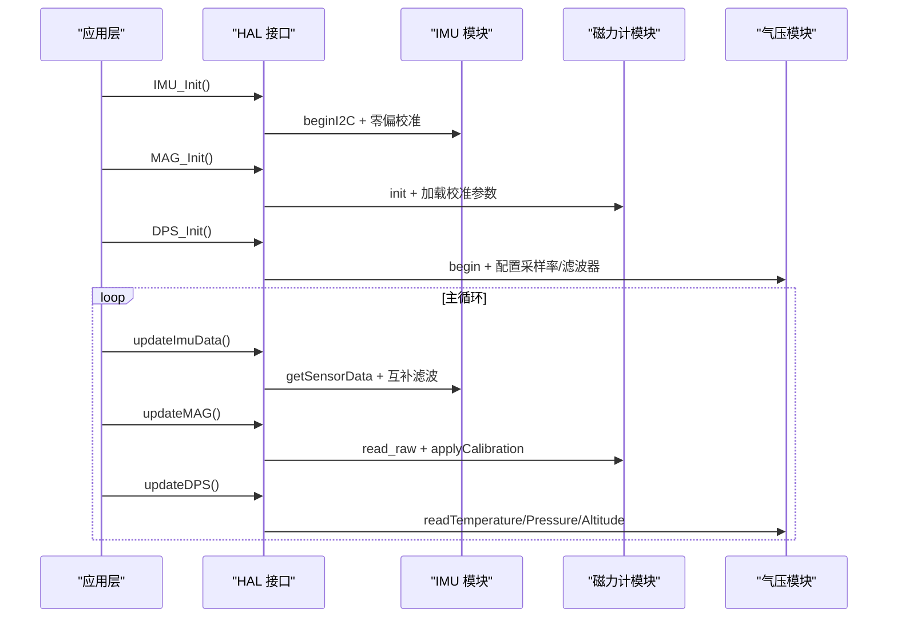
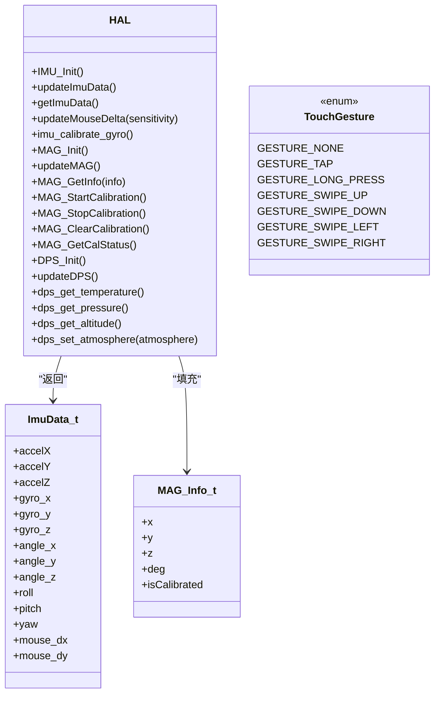

# 传感器接口

<cite>
**本文引用的文件**   
- [hal.h](file://src/hal/hal.h)
- [hal_imu.cpp](file://src/hal/hal_imu.cpp)
- [hal_mag.cpp](file://src/hal/hal_mag.cpp)
- [hal_dps.cpp](file://src/hal/hal_dps.cpp)
</cite>

## 目录
1. [简介](#简介)
2. [项目结构与模块边界](#项目结构与模块边界)
3. [核心数据结构](#核心数据结构)
4. [架构总览](#架构总览)
5. [IMU 接口与实现](#imu-接口与实现)
6. [磁力计接口与实现](#磁力计接口与实现)
7. [气压传感器接口与实现](#气压传感器接口与实现)
8. [坐标系、单位与滤波算法](#坐标系单位与滤波算法)
9. [依赖关系分析](#依赖关系分析)
10. [性能与实时性](#性能与实时性)
11. [故障排查](#故障排查)
12. [结论](#结论)

## 简介
本文件为 ESP32 NullPod 的传感器接口综合文档，覆盖 IMU（加速度计/陀螺仪）、磁力计、气压传感器的全部对外 API。重点说明：
- 数据读取流程、初始化流程、校准流程
- ImuData_t、MAG_Info_t 结构体字段含义
- TouchGesture 枚举值
- 坐标系约定、单位换算、滤波与角度融合策略
- 典型使用示例与常见问题定位方法

## 项目结构与模块边界
传感器相关代码集中在 HAL 层，分别由以下文件实现：
- IMU：基于 BMI270，提供姿态角、角速度、鼠标增量等能力
- 磁力计：基于 QMC5883P，提供磁场向量、方位角与在线校准
- 气压传感器：基于 BMP280，提供温度、气压、海拔估算

图表来源
- [hal.h:101-157](file://src/hal/hal.h#L101-L157)
- [hal_imu.cpp:1-182](file://src/hal/hal_imu.cpp#L1-L182)
- [hal_mag.cpp:1-297](file://src/hal/hal_mag.cpp#L1-L297)
- [hal_dps.cpp:1-57](file://src/hal/hal_dps.cpp#L1-L57)

章节来源
- [hal.h:101-157](file://src/hal/hal.h#L101-L157)
- [hal_imu.cpp:1-182](file://src/hal/hal_imu.cpp#L1-L182)
- [hal_mag.cpp:1-297](file://src/hal/hal_mag.cpp#L1-L297)
- [hal_dps.cpp:1-57](file://src/hal/hal_dps.cpp#L1-L57)

## 核心数据结构
本节集中说明三个关键类型：ImuData_t、MAG_Info_t、TouchGesture。

### ImuData_t
用于承载 IMU 原始量、融合角度、鼠标位移增量等数据。

| 字段 | 类型 | 含义与单位 | 备注 |
|---|---|---|---|
| accelX/Y/Z | float | 三轴加速度，单位通常为 m/s² | 来自 BMI270，已按安装方向变换 |
| gyro_x/y/z | float | 三轴角速度，单位通常为 °/s | 已减去零偏 |
| angle_x/y/z | float | 互补滤波后的欧拉角，单位度 | X/Y 含加速度修正；Z 仅积分 |
| roll/pitch/yaw | float | 最终输出的欧拉角，单位度 | 根据安装方向做符号修正 |
| mouse_dx/dy | int | 鼠标移动增量 | 由角度增量映射得到，带限幅 |

注意：
- roll 对应 Y 轴旋转，pitch 对应 X 轴旋转，yaw 对应 Z 轴旋转。
- 当 IMU_MOUNT_REAR 时，roll/pitch/yaw 会进行符号翻转以适配 PCB 反向安装。

章节来源
- [hal.h:31-47](file://src/hal/hal.h#L31-L47)
- [hal_imu.cpp:138-149](file://src/hal/hal_imu.cpp#L138-L149)

### MAG_Info_t
用于承载磁力计的磁场向量、方位角与校准状态。

| 字段 | 类型 | 含义与单位 | 备注 |
|---|---|---|---|
| x/y/z | int16_t | 三轴磁场强度 | 若已校准，则为硬铁偏移+软铁缩放后的值 |
| deg | int16_t | 方位角（罗盘角度） | 通常 0~359° |
| isCalibrated | bool | 是否已有有效校准参数 | 由内部校准有效性标志决定 |

章节来源
- [hal.h:57-64](file://src/hal/hal.h#L57-L64)
- [hal_mag.cpp:276-283](file://src/hal/hal_mag.cpp#L276-L283)

### TouchGesture
触摸手势枚举，用于上层识别轻点、长按、四向滑动等事件。

| 枚举值 | 数值 | 含义 |
|---|---:|---|
| GESTURE_NONE | 0 | 无手势 |
| GESTURE_TAP | 1 | 轻点（短按抬起） |
| GESTURE_LONG_PRESS | 2 | 长按（按住超过阈值时间） |
| GESTURE_SWIPE_UP | 3 | 上滑 |
| GESTURE_SWIPE_DOWN | 4 | 下滑 |
| GESTURE_SWIPE_LEFT | 5 | 左滑 |
| GESTURE_SWIPE_RIGHT | 6 | 右滑 |

章节来源
- [hal.h:66-75](file://src/hal/hal.h#L66-L75)

## 架构总览
HAL 层为各传感器提供统一的初始化、更新与查询接口。应用层通过 HAL::IMU_Init / HAL::updateImuData / HAL::getImuData 等函数访问 IMU；通过 HAL::MAG_Init / HAL::updateMAG / HAL::MAG_GetInfo 访问磁力计；通过 HAL::DPS_Init / HAL::dps_get_temperature / HAL::dps_get_pressure / HAL::dps_get_altitude 访问气压传感器。

图表来源
- [hal_imu.cpp:57-74](file://src/hal/hal_imu.cpp#L57-L74)
- [hal_mag.cpp:233-246](file://src/hal/hal_mag.cpp#L233-L246)
- [hal_dps.cpp:10-27](file://src/hal/hal_dps.cpp#L10-L27)
- [hal_imu.cpp:88-149](file://src/hal/hal_imu.cpp#L88-L149)
- [hal_mag.cpp:248-274](file://src/hal/hal_mag.cpp#L248-L274)
- [hal_dps.cpp:29-36](file://src/hal/hal_dps.cpp#L29-L36)

## IMU 接口与实现

### 初始化与校准
- HAL::IMU_Init：初始化 BMI270 I2C 通信，执行陀螺仪零偏校准，记录更新时间戳。
- HAL::imu_calibrate_gyro：手动触发一次陀螺仪零偏校准。

关键点：
- 固定采样率 100Hz，DT = 1/100 s。
- 零偏校准通过静置采集若干样本求平均，得到 gyroOffsetX/Y/Z。

章节来源
- [hal_imu.cpp:5-12](file://src/hal/hal_imu.cpp#L5-L12)
- [hal_imu.cpp:31-55](file://src/hal/hal_imu.cpp#L31-L55)
- [hal_imu.cpp:57-74](file://src/hal/hal_imu.cpp#L57-L74)
- [hal_imu.cpp:175-176](file://src/hal/hal_imu.cpp#L175-L176)

### 数据读取与姿态解算
- HAL::updateImuData：定时读取 BMI270 数据，完成安装方向变换、零偏减法、加速度计角度计算、互补滤波融合，输出 roll/pitch/yaw 与 angle_x/y/z。
- HAL::getImuData：返回当前 ImuData_t。
- HAL::updateMouseDelta：将角度增量转换为鼠标 dx/dy，并限幅。

补充：
- 安装方向支持 IMU_MOUNT_NORMAL 与 IMU_MOUNT_REAR，后者对加速度与角速度进行符号翻转。
- 互补滤波系数：陀螺仪 0.98，加速度计 0.02。

章节来源
- [hal_imu.cpp:76-86](file://src/hal/hal_imu.cpp#L76-L86)
- [hal_imu.cpp:88-149](file://src/hal/hal_imu.cpp#L88-L149)
- [hal_imu.cpp:151-173](file://src/hal/hal_imu.cpp#L151-L173)
- [hal.h:49-54](file://src/hal/hal.h#L49-L54)

### IMU 使用示例（步骤）
- 初始化：调用 HAL::IMU_Init。
- 周期更新：在主循环中调用 HAL::updateImuData。
- 获取数据：调用 HAL::getImuData 或 HAL::imu_get_roll / HAL::imu_get_pitch / HAL::imu_get_yaw。
- 鼠标模式：调用 HAL::updateMouseDelta(sensitivity)，再读取 HAL::imu_get_mouse_dx / HAL::imu_get_mouse_dy。
- 重新校准：调用 HAL::imu_calibrate_gyro。

章节来源
- [hal.h:130-140](file://src/hal/hal.h#L130-L140)
- [hal_imu.cpp:175-181](file://src/hal/hal_imu.cpp#L175-L181)

## 磁力计接口与实现

### 初始化与校准
- HAL::MAG_Init：初始化 QMC5883P，开启平滑滤波，从 Flash 加载校准参数。
- HAL::MAG_StartCalibration / HAL::MAG_StopCalibration：进入/退出校准模式。
- HAL::MAG_ClearCalibration：清除已保存的校准参数。
- HAL::MAG_GetCalStatus：打印当前校准有效性及偏移参数。

校准流程要点：
- 用户缓慢旋转设备画“8”字约 30 秒，系统记录各轴最大最小值。
- 计算硬铁偏移（中心点）与软铁缩放（归一化各轴灵敏度）。
- 校验采样次数与范围阈值，通过后写入 Preferences 存储。

章节来源
- [hal_mag.cpp:23-28](file://src/hal/hal_mag.cpp#L23-L28)
- [hal_mag.cpp:81-129](file://src/hal/hal_mag.cpp#L81-L129)
- [hal_mag.cpp:141-197](file://src/hal/hal_mag.cpp#L141-L197)
- [hal_mag.cpp:233-246](file://src/hal/hal_mag.cpp#L233-L246)
- [hal_mag.cpp:285-296](file://src/hal/hal_mag.cpp#L285-L296)

### 数据读取
- HAL::updateMAG：读取原始磁场，若在校准模式则收集极值；应用校准后得到 Mag_x/y/z；计算方位角 deg。
- HAL::MAG_GetInfo：填充 MAG_Info_t，包含 x/y/z、deg、isCalibrated。

章节来源
- [hal_mag.cpp:248-283](file://src/hal/hal_mag.cpp#L248-L283)

### 磁力计使用示例（步骤）
- 初始化：调用 HAL::MAG_Init。
- 周期更新：在主循环中调用 HAL::updateMAG。
- 获取数据：调用 HAL::MAG_GetInfo(&info)，读取 info.x/y/z/deg/isCalibrated。
- 校准：调用 HAL::MAG_StartCalibration，旋转设备后调用 HAL::MAG_StopCalibration。
- 清除校准：调用 HAL::MAG_ClearCalibration。

章节来源
- [hal.h:142-149](file://src/hal/hal.h#L142-L149)
- [hal_mag.cpp:276-296](file://src/hal/hal_mag.cpp#L276-L296)

## 气压传感器接口与实现

### 初始化与配置
- HAL::DPS_Init：初始化 BMP280，设置工作模式、过采样、滤波器与待机时间，目标 ODR 约 10Hz。

章节来源
- [hal_dps.cpp:10-27](file://src/hal/hal_dps.cpp#L10-L27)

### 数据读取
- HAL::updateDPS：读取温度（°C）、气压（hPa）、海拔（m），并打印日志。
- HAL::dps_get_temperature：返回温度（°C）。
- HAL::dps_get_pressure：返回气压（hPa），内部将 Pa 转换为 hPa。
- HAL::dps_get_altitude：返回海拔（m），基于本地海平面气压 local_atmosphere。
- HAL::dps_set_atmosphere：设置本地海平面气压，影响海拔估算精度。

章节来源
- [hal_dps.cpp:29-56](file://src/hal/hal_dps.cpp#L29-L56)
- [hal.h:151-157](file://src/hal/hal.h#L151-L157)

### 气压传感器使用示例（步骤）
- 初始化：调用 HAL::DPS_Init。
- 周期更新：在主循环中调用 HAL::updateDPS。
- 获取数据：调用 HAL::dps_get_temperature / HAL::dps_get_pressure / HAL::dps_get_altitude。
- 调整环境：调用 HAL::dps_set_atmosphere(当地海平面气压)。

章节来源
- [hal_dps.cpp:38-56](file://src/hal/hal_dps.cpp#L38-L56)

## 坐标系、单位与滤波算法

### 坐标系与安装方向
- IMU_MOUNT_NORMAL：正面安装，Z 朝上。
- IMU_MOUNT_REAR：反面安装，PCB 翻转 180°，会对加速度与角速度进行符号翻转，并对 roll/pitch/yaw 输出进行符号修正。

章节来源
- [hal.h:49-54](file://src/hal/hal.h#L49-L54)
- [hal_imu.cpp:76-86](file://src/hal/hal_imu.cpp#L76-L86)
- [hal_imu.cpp:126-140](file://src/hal/hal_imu.cpp#L126-L140)

### 单位与换算
- IMU：
  - 加速度：m/s²（由驱动库解析）
  - 角速度：°/s
  - 角度：度（°）
- 磁力计：
  - 磁场向量：int16_t（内部单位，经校准后更准确）
  - 方位角：度（°）
- 气压传感器：
  - 温度：°C
  - 气压：hPa（内部从 Pa 转换）
  - 海拔：m（基于本地海平面气压）

章节来源
- [hal_imu.cpp:101-149](file://src/hal/hal_imu.cpp#L101-L149)
- [hal_mag.cpp:248-283](file://src/hal/hal_mag.cpp#L248-L283)
- [hal_dps.cpp:29-50](file://src/hal/hal_dps.cpp#L29-L50)

### 滤波与角度融合
- IMU 采用标准互补滤波：
  - 陀螺仪权重 0.98，加速度计权重 0.02
  - roll/pitch 由加速度计角度与陀螺仪积分融合
  - yaw 仅由陀螺仪积分（无磁力计参与）
- 磁力计校准：
  - 硬铁偏移：取各轴 (max+min)/2
  - 软铁缩放：以平均半径归一化各轴灵敏度
- 气压传感器：
  - 内置 IIR 滤波器（FILTER_X4），提高读数稳定性

章节来源
- [hal_imu.cpp:10-12](file://src/hal/hal_imu.cpp#L10-L12)
- [hal_imu.cpp:132-135](file://src/hal/hal_imu.cpp#L132-L135)
- [hal_mag.cpp:180-189](file://src/hal/hal_mag.cpp#L180-L189)
- [hal_dps.cpp:20-26](file://src/hal/hal_dps.cpp#L20-L26)

## 依赖关系分析

图表来源
- [hal.h:31-75](file://src/hal/hal.h#L31-L75)
- [hal.h:101-157](file://src/hal/hal.h#L101-L157)

章节来源
- [hal.h:31-75](file://src/hal/hal.h#L31-L75)
- [hal.h:101-157](file://src/hal/hal.h#L101-L157)

## 性能与实时性
- IMU 固定 100Hz 采样，DT=0.01s，避免高频抖动；角度增量转鼠标位移带限幅（±50）。
- 磁力计校准过程有超时保护（默认 30s），防止长时间阻塞。
- 气压传感器 ODR 约 10Hz，适合低频环境监测。

建议：
- 在主循环中按顺序调用 updateImuData / updateMAG / updateDPS，确保数据新鲜。
- 如需更高实时性，可将 IMU 更新放入更高优先级任务或中断上下文（需评估延迟与功耗）。

[本节为通用指导，不直接分析具体文件]

## 故障排查
- IMU 初始化失败：
  - 检查 I2C 地址与接线；确认 beginI2C 返回值。
  - 若校准耗时过长，确认设备在静置状态下进行。
- 磁力计校准无效：
  - 确认旋转轨迹覆盖多方向，采样次数与范围阈值满足要求。
  - 使用 MAG_ClearCalibration 清除旧参数后重试。
- 气压读数异常：
  - 检查 I2C 地址与接线；确认 setSampling 配置正确。
  - 使用 dps_set_atmosphere 设置当地海平面气压以提高海拔估算精度。

章节来源
- [hal_imu.cpp:62-74](file://src/hal/hal_imu.cpp#L62-L74)
- [hal_mag.cpp:170-197](file://src/hal/hal_mag.cpp#L170-L197)
- [hal_dps.cpp:14-26](file://src/hal/hal_dps.cpp#L14-L26)

## 结论
本仓库为 ESP32 NullPod 提供了完整的传感器 HAL 接口，涵盖 IMU、磁力计与气压传感器。通过统一的结构体与函数封装，应用层可便捷地获取姿态、磁场与气象数据，并利用互补滤波与磁力计校准提升精度。建议在应用中遵循初始化—周期更新—数据读取的流程，并根据实际安装方向与环境条件调整参数以获得最佳效果。