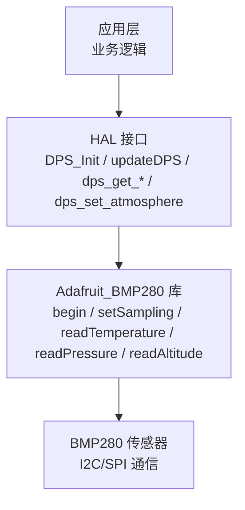
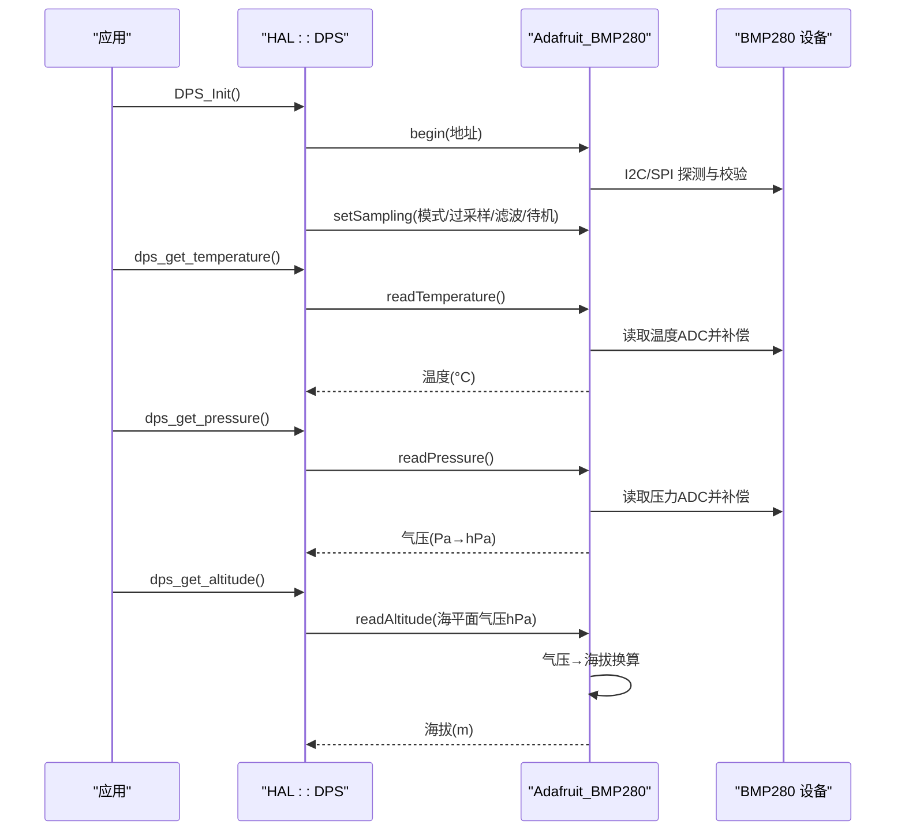
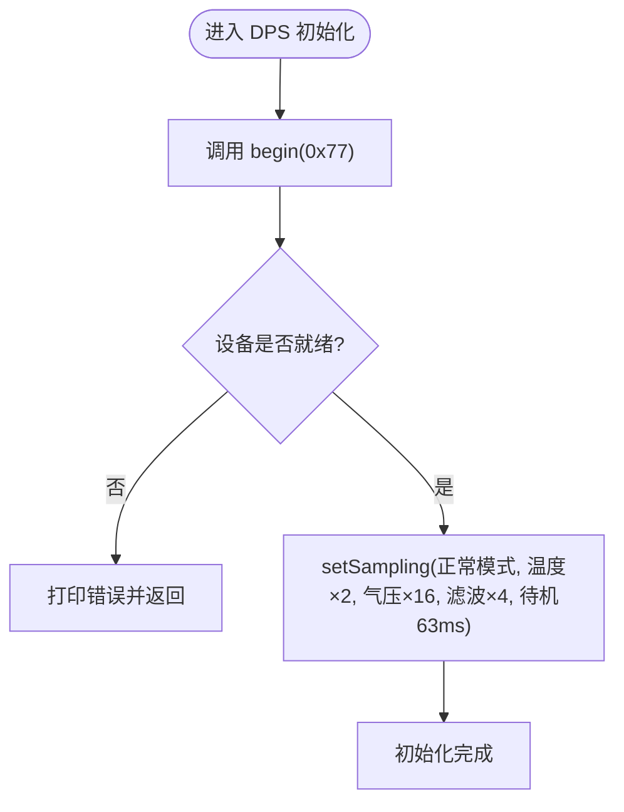
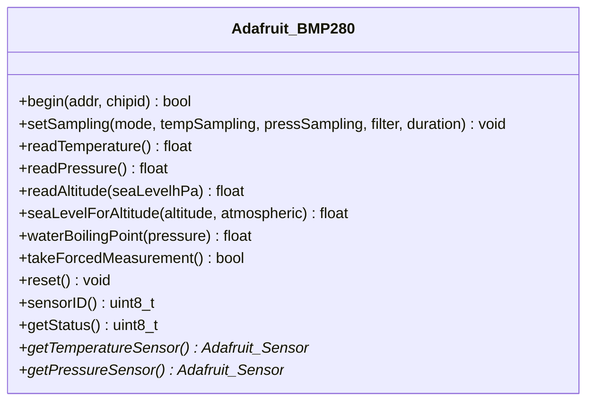

# 气压传感器接口

<cite>
**本文引用的文件**   
- [hal_dps.cpp](file://src/hal/hal_dps.cpp)
- [hal.h](file://src/hal/hal.h)
- [Adafruit_BMP280.cpp](file://lib/Adafruit BMP280 Library/Adafruit_BMP280.cpp)
</cite>

## 目录
1. [简介](#简介)
2. [项目结构](#项目结构)
3. [核心组件](#核心组件)
4. [架构总览](#架构总览)
5. [详细组件分析](#详细组件分析)
6. [依赖关系分析](#依赖关系分析)
7. [性能与功耗特性](#性能与功耗特性)
8. [故障排查指南](#故障排查指南)
9. [结论](#结论)
10. [附录：使用示例与最佳实践](#附录使用示例与最佳实践)

## 简介
本文件为 ESP32 NullPod 项目中基于 BMP280 的气压传感器接口 API 文档。内容覆盖初始化、温度读取、气压测量、海拔高度计算、海平面气压校正、单位换算、校准与安装注意事项，以及典型应用场景（获取环境气压、计算海拔、监测天气变化）的实现思路与参考路径。

## 项目结构
本项目在硬件抽象层（HAL）中封装了 BMP280 气压传感器的驱动调用，具体实现位于 hal_dps.cpp；底层库采用 Adafruit_BMP280 库，提供寄存器访问、采样配置、温度/气压/海拔等算法实现。

图表来源
- [hal_dps.cpp:10-56](file://src/hal/hal_dps.cpp#L10-L56)
- [Adafruit_BMP280.cpp:86-141](file://lib/Adafruit BMP280 Library/Adafruit_BMP280.cpp#L86-L141)

章节来源
- [hal_dps.cpp:1-57](file://src/hal/hal_dps.cpp#L1-L57)
- [hal.h:151-157](file://src/hal/hal.h#L151-L157)

## 核心组件
- HAL 气压传感器封装（DPS）
  - 初始化与采样配置
  - 温度、气压、海拔读取
  - 本地海平面气压设置
- Adafruit_BMP280 库
  - I2C/SPI 设备初始化
  - 工厂校准系数读取与应用
  - 温度补偿与气压解算
  - 海拔高度换算与海平面气压换算工具函数

章节来源
- [hal_dps.cpp:10-56](file://src/hal/hal_dps.cpp#L10-L56)
- [Adafruit_BMP280.cpp:86-141](file://lib/Adafruit BMP280 Library/Adafruit_BMP280.cpp#L86-L141)
- [Adafruit_BMP280.cpp:248-324](file://lib/Adafruit BMP280 Library/Adafruit_BMP280.cpp#L248-L324)

## 架构总览
下图展示了从应用层到传感器底层的调用链路与数据流向。

图表来源
- [hal_dps.cpp:10-56](file://src/hal/hal_dps.cpp#L10-L56)
- [Adafruit_BMP280.cpp:86-141](file://lib/Adafruit BMP280 Library/Adafruit_BMP280.cpp#L86-L141)
- [Adafruit_BMP280.cpp:248-324](file://lib/Adafruit BMP280 Library/Adafruit_BMP280.cpp#L248-L324)

## 详细组件分析

### HAL 气压传感器封装（DPS）
- 初始化
  - 通过 begin(0x77) 完成 I2C 设备发现与基本初始化。
  - 通过 setSampling 配置工作模式、温度与气压过采样倍数、IIR 滤波与待机时间，以获得约 10Hz 的更新速率。
- 数据读取
  - 温度：直接返回摄氏度。
  - 气压：库返回 Pa，封装层转换为 hPa。
  - 海拔：基于当前本地海平面气压进行估算。
- 参数管理
  - 提供 dps_set_atmosphere 设置本地海平面气压，用于海拔换算与 QNH 校正。

图表来源
- [hal_dps.cpp:10-27](file://src/hal/hal_dps.cpp#L10-L27)

章节来源
- [hal_dps.cpp:10-56](file://src/hal/hal_dps.cpp#L10-L56)
- [hal.h:151-157](file://src/hal/hal.h#L151-L157)

### Adafruit_BMP280 库核心算法
- 初始化与配置
  - begin：建立 I2C/SPI 连接，校验芯片 ID，读取工厂校准系数，写入默认采样配置。
  - setSampling：写入配置寄存器与控制寄存器，设置工作模式、过采样、滤波与待机时间。
- 温度读取
  - readTemperature：读取温度 ADC，结合工厂校准系数进行线性补偿，输出摄氏度。
- 气压读取
  - readPressure：先读温度以得到 t_fine，再读取压力 ADC，按多项式补偿公式解算出 Pa。
- 海拔与海平面气压换算
  - readAltitude：根据当前气压与海平面气压 hPa，利用标准大气模型估算海拔。
  - seaLevelForAltitude：根据已知海拔与实测气压反推海平面气压（QNH）。

图表来源
- [Adafruit_BMP280.cpp:86-141](file://lib/Adafruit BMP280 Library/Adafruit_BMP280.cpp#L86-L141)
- [Adafruit_BMP280.cpp:248-324](file://lib/Adafruit BMP280 Library/Adafruit_BMP280.cpp#L248-L324)
- [Adafruit_BMP280.cpp:333-354](file://lib/Adafruit BMP280 Library/Adafruit_BMP280.cpp#L333-L354)

章节来源
- [Adafruit_BMP280.cpp:86-141](file://lib/Adafruit BMP280 Library/Adafruit_BMP280.cpp#L86-L141)
- [Adafruit_BMP280.cpp:248-324](file://lib/Adafruit BMP280 Library/Adafruit_BMP280.cpp#L248-L324)
- [Adafruit_BMP280.cpp:333-354](file://lib/Adafruit BMP280 Library/Adafruit_BMP280.cpp#L333-L354)

## 依赖关系分析
- HAL 层依赖 Adafruit_BMP280 库提供的 begin、setSampling、readTemperature、readPressure、readAltitude 等方法。
- 库内部依赖 I2C/SPI 总线与 BMP280 寄存器映射，并通过工厂校准系数对原始 ADC 值进行温度与气压补偿。
- 应用层通过 HAL 统一接口访问传感器，屏蔽底层差异。

图表来源
- [hal_dps.cpp:1-57](file://src/hal/hal_dps.cpp#L1-L57)
- [Adafruit_BMP280.cpp:86-141](file://lib/Adafruit BMP280 Library/Adafruit_BMP280.cpp#L86-L141)

章节来源
- [hal_dps.cpp:1-57](file://src/hal/hal_dps.cpp#L1-L57)
- [Adafruit_BMP280.cpp:86-141](file://lib/Adafruit BMP280 Library/Adafruit_BMP280.cpp#L86-L141)

## 性能与功耗特性
- 精度
  - 温度分辨率：约 0.01°C（库中温度传感器描述）。
  - 气压分辨率：约 0.12 hPa（库中气压传感器描述）。
  - 气压量程：约 300 ~ 1100 hPa。
- 响应时间
  - 当前采样配置（温度×2、气压×16、滤波×4、待机 63ms）下，更新频率约 10Hz。
- 功耗管理
  - 支持 NORMAL 与 FORCED 模式；FORCED 模式下单次测量后自动休眠，适合低功耗场景。
  - 可通过调整过采样与滤波等级平衡精度与功耗。

章节来源
- [Adafruit_BMP280.cpp:420-474](file://lib/Adafruit BMP280 Library/Adafruit_BMP280.cpp#L420-L474)
- [Adafruit_BMP280.cpp:357-375](file://lib/Adafruit BMP280 Library/Adafruit_BMP280.cpp#L357-L375)
- [hal_dps.cpp:20-26](file://src/hal/hal_dps.cpp#L20-L26)

## 故障排查指南
- 设备未找到
  - 现象：初始化失败，提示未找到设备。
  - 排查：检查 I2C 地址（默认 0x77）、接线与上拉电阻。
- 读数异常
  - 现象：温度或气压为 NaN/0。
  - 排查：确认已调用 begin 与 setSampling；确保未在未初始化状态下读取。
- 海拔偏差大
  - 现象：海拔高度与实际不符。
  - 原因：本地海平面气压未正确设置。
  - 处理：通过 dps_set_atmosphere 设置当地实时海平面气压（可从气象站或网络获取）。

章节来源
- [hal_dps.cpp:14-18](file://src/hal/hal_dps.cpp#L14-L18)
- [Adafruit_BMP280.cpp:248-251](file://lib/Adafruit BMP280 Library/Adafruit_BMP280.cpp#L248-L251)
- [Adafruit_BMP280.cpp:276-279](file://lib/Adafruit BMP280 Library/Adafruit_BMP280.cpp#L276-L279)

## 结论
本项目通过 HAL 层对 BMP280 进行了简洁封装，提供了温度、气压、海拔的标准接口，并在库层实现了完整的温度补偿与气压解算。配合合理采样配置与本地海平面气压校正，可满足环境监测、海拔估算与天气趋势分析等常见需求。

## 附录：使用示例与最佳实践

### 常用 API 说明
- 初始化
  - HAL::DPS_Init：完成设备初始化与采样配置。
- 数据读取
  - HAL::dps_get_temperature：返回温度（°C）。
  - HAL::dps_get_pressure：返回气压（hPa）。
  - HAL::dps_get_altitude：返回海拔（m），基于当前本地海平面气压。
- 参数设置
  - HAL::dps_set_atmosphere：设置本地海平面气压（hPa），用于海拔换算与 QNH 校正。

章节来源
- [hal.h:151-157](file://src/hal/hal.h#L151-L157)
- [hal_dps.cpp:38-56](file://src/hal/hal_dps.cpp#L38-L56)

### 典型应用场景

- 获取环境气压
  - 步骤：初始化 → 读取气压 → 单位转换（库返回 Pa，封装层转 hPa）。
  - 参考路径：[dps_get_pressure:43-46](file://src/hal/hal_dps.cpp#L43-L46)

- 计算海拔高度
  - 步骤：初始化 → 设置本地海平面气压 → 读取海拔。
  - 参考路径：[dps_set_atmosphere:53-56](file://src/hal/hal_dps.cpp#L53-L56)、[dps_get_altitude:48-51](file://src/hal/hal_dps.cpp#L48-L51)

- 监测天气变化
  - 思路：周期性采集气压，观察短时变化趋势（如快速下降可能预示降雨）。
  - 参考路径：[updateDPS:29-36](file://src/hal/hal_dps.cpp#L29-L36)

- 海平面气压校正（QNH）
  - 思路：若已知海拔，可反推海平面气压，用于更准确的海拔换算。
  - 参考路径：[seaLevelForAltitude:333-341](file://lib/Adafruit BMP280 Library/Adafruit_BMP280.cpp#L333-L341)

### 单位换算与数据处理
- 单位
  - 库内气压单位为 Pa；HAL 层对外暴露 hPa。
  - 温度单位为 °C。
  - 海拔单位为 m。
- 温度补偿
  - 库内通过工厂校准系数对温度进行补偿，提升精度。
- 气压补偿
  - 库内先读取温度得到 t_fine，再进行气压多项式补偿，输出 Pa。
- 海拔换算
  - 基于标准大气模型，将当前气压与海平面气压比值代入公式估算海拔。

章节来源
- [Adafruit_BMP280.cpp:248-324](file://lib/Adafruit BMP280 Library/Adafruit_BMP280.cpp#L248-L324)
- [Adafruit_BMP280.cpp:333-341](file://lib/Adafruit BMP280 Library/Adafruit_BMP280.cpp#L333-L341)
- [hal_dps.cpp:31-46](file://src/hal/hal_dps.cpp#L31-L46)

### 校准方法与安装位置影响
- 校准方法
  - 出厂校准：库在 begin 时读取工厂校准系数，无需用户额外校准。
  - 海平面气压校正：通过 dps_set_atmosphere 设置当地实时海平面气压，提高海拔准确度。
- 安装位置影响
  - 避免靠近热源或强风直吹处，以减少温度漂移与动态压力波动。
  - 保持通气孔畅通，避免密封外壳导致静态压力误差。
  - 尽量水平放置，减少机械应力对传感膜的影响。

章节来源
- [hal_dps.cpp:53-56](file://src/hal/hal_dps.cpp#L53-L56)
- [Adafruit_BMP280.cpp:86-109](file://lib/Adafruit BMP280 Library/Adafruit_BMP280.cpp#L86-L109)