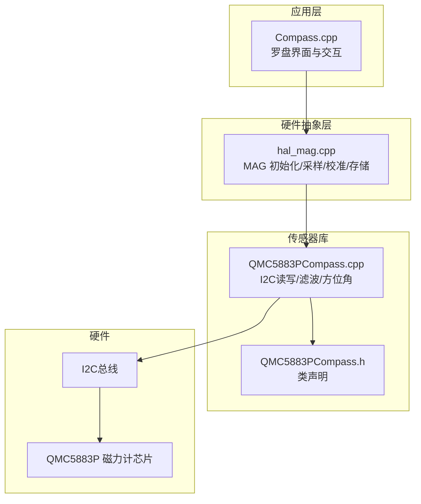
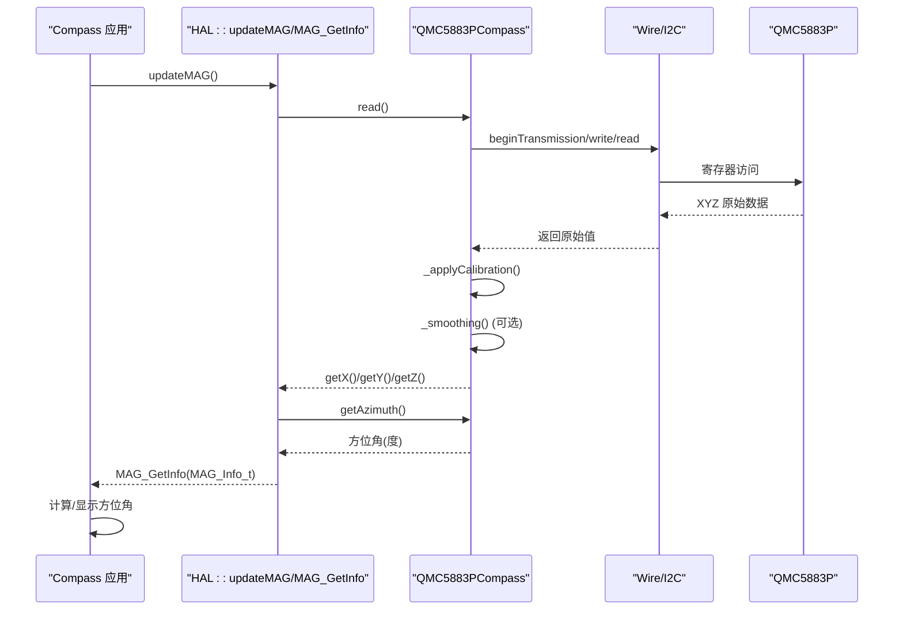
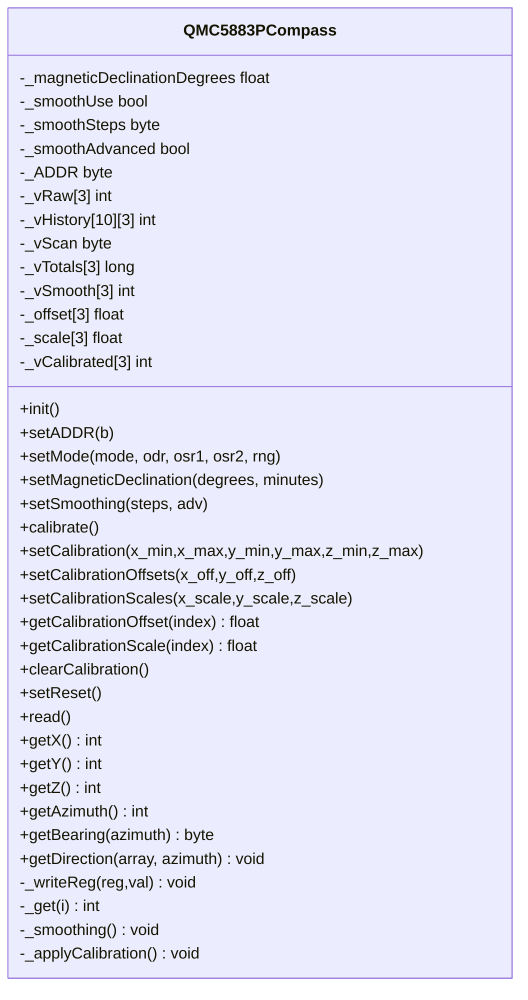
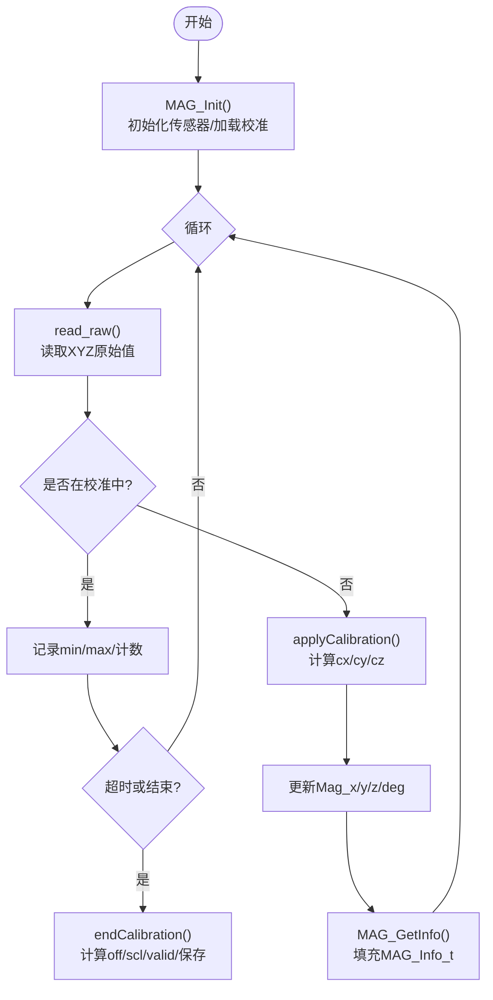
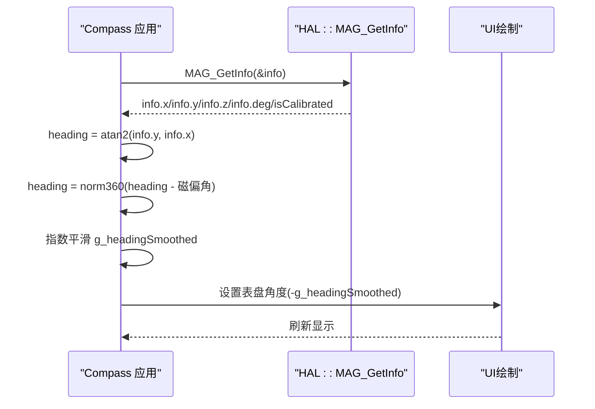
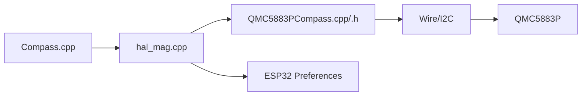

# 磁力计接口

<cite>
**本文引用的文件**   
- [hal_mag.cpp](file://src/hal/hal_mag.cpp)
- [Compass.cpp](file://src/apps/Compass.cpp)
- [QMC5883PCompass.h](file://lib/QMC5883PCompass/src/QMC5883PCompass.h)
- [QMC5883PCompass.cpp](file://lib/QMC5883PCompass/src/QMC5883PCompass.cpp)
</cite>

## 目录
1. [简介](#简介)
2. [项目结构](#项目结构)
3. [核心组件](#核心组件)
4. [架构总览](#架构总览)
5. [详细组件分析](#详细组件分析)
6. [依赖关系分析](#依赖关系分析)
7. [性能与精度说明](#性能与精度说明)
8. [故障排查指南](#故障排查指南)
9. [结论](#结论)
10. [附录：API 参考与使用示例](#附录api-参考与使用示例)

## 简介
本文件为 ESP32 NullPod 的磁力计接口文档，聚焦 QMC5883P 磁力计传感器在固件中的驱动与应用。内容涵盖：
- QMC5883P 库提供的初始化、数据读取、方位角计算等接口
- HAL 层对校准流程、硬铁/软铁补偿、Flash 持久化的封装
- MAG_Info_t 结构体字段定义与用法
- 磁北方向计算、磁偏角处理与环境干扰处理建议
- 面向应用的完整使用示例（获取地磁数据、计算朝向、开发指南针功能）

## 项目结构
本项目中与磁力计相关的代码主要分布在以下位置：
- 硬件抽象层（HAL）：src/hal/hal_mag.cpp
- 应用层（罗盘 App）：src/apps/Compass.cpp
- QMC5883P 第三方库：lib/QMC5883PCompass/src/QMC5883PCompass.{h,cpp}

**图表来源**  
- [Compass.cpp:222-263](file://src/apps/Compass.cpp#L222-L263)
- [hal_mag.cpp:233-296](file://src/hal/hal_mag.cpp#L233-L296)
- [QMC5883PCompass.cpp:73-117](file://lib/QMC5883PCompass/src/QMC5883PCompass.cpp#L73-L117)

**章节来源**  
- [Compass.cpp:1-753](file://src/apps/Compass.cpp#L1-L753)
- [hal_mag.cpp:1-297](file://src/hal/hal_mag.cpp#L1-L297)
- [QMC5883PCompass.h:1-72](file://lib/QMC5883PCompass/src/QMC5883PCompass.h#L1-L72)
- [QMC5883PCompass.cpp:1-498](file://lib/QMC5883PCompass/src/QMC5883PCompass.cpp#L1-L498)

## 核心组件
- QMC5883PCompass 类：封装 QMC5883P 的 I2C 通信、模式配置、原始值读取、校准偏移/缩放、平滑滤波、方位角计算、16方位名称输出等能力。
- HAL 磁力计模块：负责设备初始化、周期性采样、校准数据采集与参数持久化（Preferences）、对外暴露 MAG_GetInfo 等 API。
- Compass 应用：基于 HAL 提供的 MAG_Info_t 数据，实现罗盘表盘旋转、方位角显示、环境信息展示、水平仪等功能。

**章节来源**  
- [QMC5883PCompass.h:7-31](file://lib/QMC5883PCompass/src/QMC5883PCompass.h#L7-L31)
- [hal_mag.cpp:30-49](file://src/hal/hal_mag.cpp#L30-L49)
- [Compass.cpp:16-37](file://src/apps/Compass.cpp#L16-L37)

## 架构总览
下图展示了从应用层到传感器的调用链路与数据流：

**图表来源**  
- [hal_mag.cpp:248-283](file://src/hal/hal_mag.cpp#L248-L283)
- [QMC5883PCompass.cpp:274-316](file://lib/QMC5883PCompass/src/QMC5883PCompass.cpp#L274-L316)
- [QMC5883PCompass.cpp:439-444](file://lib/QMC5883PCompass/src/QMC5883PCompass.cpp#L439-L444)

## 详细组件分析

### QMC5883PCompass 类接口与行为
该类提供磁力计的基础能力：
- 初始化与模式设置：init(), setMode()
- I2C 地址设置：setADDR()
- 磁偏角设置：setMagneticDeclination()
- 平滑滤波：setSmoothing()
- 校准相关：calibrate(), setCalibration(), setCalibrationOffsets(), setCalibrationScales(), clearCalibration()
- 数据读取：read(), getX(), getY(), getZ()
- 方位角与方位名：getAzimuth(), getBearing(), getDirection()

**图表来源**  
- [QMC5883PCompass.h:7-49](file://lib/QMC5883PCompass/src/QMC5883PCompass.h#L7-L49)
- [QMC5883PCompass.cpp:73-117](file://lib/QMC5883PCompass/src/QMC5883PCompass.cpp#L73-L117)
- [QMC5883PCompass.cpp:147-152](file://lib/QMC5883PCompass/src/QMC5883PCompass.cpp#L147-L152)
- [QMC5883PCompass.cpp:219-266](file://lib/QMC5883PCompass/src/QMC5883PCompass.cpp#L219-L266)
- [QMC5883PCompass.cpp:274-316](file://lib/QMC5883PCompass/src/QMC5883PCompass.cpp#L274-L316)
- [QMC5883PCompass.cpp:336-378](file://lib/QMC5883PCompass/src/QMC5883PCompass.cpp#L336-L378)
- [QMC5883PCompass.cpp:387-444](file://lib/QMC5883PCompass/src/QMC5883PCompass.cpp#L387-L444)
- [QMC5883PCompass.cpp:458-497](file://lib/QMC5883PCompass/src/QMC5883PCompass.cpp#L458-L497)

**章节来源**  
- [QMC5883PCompass.h:1-72](file://lib/QMC5883PCompass/src/QMC5883PCompass.h#L1-L72)
- [QMC5883PCompass.cpp:1-498](file://lib/QMC5883PCompass/src/QMC5883PCompass.cpp#L1-L498)

### HAL 磁力计模块（hal_mag.cpp）
HAL 层职责：
- 初始化 QMC5883P 并启用平滑滤波
- 上电加载已保存的校准参数（Preferences）
- 支持“画 8”字校准流程，采集各轴最大最小值，计算硬铁偏移与软铁缩放
- 将校准结果保存到 Flash，并在运行时应用
- 对外暴露 MAG_Init, updateMAG, MAG_GetInfo, MAG_StartCalibration, MAG_StopCalibration, MAG_ClearCalibration, MAG_GetCalStatus

关键数据结构：
- mag_cal_t：包含 X/Y/Z 的 min/max、硬铁偏移 off、软铁缩放 scl、valid 标志
- g_cal：全局校准状态
- Mag_x/y/z/deg：当前磁场分量与方位角
- Mag_isCalibrated：是否已校准（内部标记）

**图表来源**  
- [hal_mag.cpp:233-296](file://src/hal/hal_mag.cpp#L233-L296)
- [hal_mag.cpp:143-197](file://src/hal/hal_mag.cpp#L143-L197)
- [hal_mag.cpp:200-230](file://src/hal/hal_mag.cpp#L200-L230)

**章节来源**  
- [hal_mag.cpp:1-297](file://src/hal/hal_mag.cpp#L1-L297)

### Compass 应用（Compass.cpp）
应用层通过 HAL 提供的 MAG_Info_t 进行罗盘显示与交互：
- refreshHeading：从 MAG_Info_t 的 x/y 计算方位角，叠加磁偏角补偿，指数平滑，驱动表盘旋转
- drawStatusLed：根据是否在校准以及是否已校准，显示状态指示灯
- headingToCn：将方位角映射为中文方位（北/东北/东/东南/南/西南/西/西北）
- 页面切换、编码器输入、串口命令控制校准等

**图表来源**  
- [Compass.cpp:222-263](file://src/apps/Compass.cpp#L222-L263)
- [Compass.cpp:186-196](file://src/apps/Compass.cpp#L186-L196)
- [Compass.cpp:155-183](file://src/apps/Compass.cpp#L155-L183)

**章节来源**  
- [Compass.cpp:1-753](file://src/apps/Compass.cpp#L1-L753)

## 依赖关系分析
- HAL 层依赖 QMC5883PCompass 库进行底层 I2C 操作与基础数据处理
- Compass 应用依赖 HAL 提供的 MAG_GetInfo 接口，不直接访问传感器
- Preferences 用于持久化校准参数（x_min/x_max/y_min/y_max/z_min/z_max/x_off/y_off/z_off/x_scl/y_scl/z_scl/valid）

**图表来源**  
- [hal_mag.cpp:19-21](file://src/hal/hal_mag.cpp#L19-L21)
- [hal_mag.cpp:78-129](file://src/hal/hal_mag.cpp#L78-L129)
- [QMC5883PCompass.cpp:59-61](file://lib/QMC5883PCompass/src/QMC5883PCompass.cpp#L59-L61)

**章节来源**  
- [hal_mag.cpp:19-21](file://src/hal/hal_mag.cpp#L19-L21)
- [hal_mag.cpp:78-129](file://src/hal/hal_mag.cpp#L78-L129)
- [QMC5883PCompass.cpp:59-61](file://lib/QMC5883PCompass/src/QMC5883PCompass.cpp#L59-L61)

## 性能与精度说明
- 数据速率与滤波：QMC5883PCompass 支持 ODR 与过采样率配置；HAL 默认启用滚动平均与去极值的高级平滑，有助于抑制噪声但会增加计算开销。
- 校准有效性：HAL 要求至少一定数量的采样且各轴范围超过阈值才认为有效；未校准时方位角可能漂移。
- 单位与量纲：QMC5883P 原始值为整数计数值，库未直接转换为物理单位（如微特斯拉 μT）。如需 μT，需依据量程与灵敏度换算（例如 2G/8G/12G/30G 量程对应的 LSB/μT 系数），该换算未在库内实现。
- 方位角精度：受安装方向、磁偏角、硬铁/软铁干扰影响。应用层可叠加本地磁偏角（例如青岛约 +7°）并进行角度归一化与平滑。
- 环境干扰：附近金属、电机、扬声器等会产生硬铁/软铁干扰，应通过“画 8”字校准消除；避免强磁场源靠近设备。

**章节来源**  
- [QMC5883PCompass.cpp:27-57](file://lib/QMC5883PCompass/src/QMC5883PCompass.cpp#L27-L57)
- [QMC5883PCompass.cpp:147-152](file://lib/QMC5883PCompass/src/QMC5883PCompass.cpp#L147-L152)
- [hal_mag.cpp:23-28](file://src/hal/hal_mag.cpp#L23-L28)
- [Compass.cpp:240-246](file://src/apps/Compass.cpp#L240-L246)

## 故障排查指南
常见问题与定位方法：
- 无数据或 I2C 错误：检查 Wire 初始化与 I2C 地址；确认 QMC5883P 地址是否为默认（可通过 setADDR 修改）。
- 方位角跳变或不稳定：开启高级平滑；确保已完成校准；检查是否存在强磁干扰。
- 校准失败：确认“画 8”字动作充分，采样次数与范围达到阈值；必要时清除旧校准后重新校准。
- 校准参数丢失：检查 Preferences 命名空间与写入成功日志；确认 Flash 可用。
- 显示异常：确认 Compass 应用正确调用 MAG_GetInfo 并处理 isCalibrated 标志。

**章节来源**  
- [hal_mag.cpp:131-139](file://src/hal/hal_mag.cpp#L131-L139)
- [hal_mag.cpp:170-178](file://src/hal/hal_mag.cpp#L170-L178)
- [Compass.cpp:167-183](file://src/apps/Compass.cpp#L167-L183)

## 结论
本项目通过 QMC5883PCompass 库与 HAL 层的协同，实现了磁力计的初始化、数据读取、平滑滤波、校准与持久化，并在 Compass 应用中完成方位角计算与可视化。对于高精度指南针应用，建议：
- 执行完整的“画 8”字校准，并验证各轴范围与采样次数
- 根据地理位置设置磁偏角
- 合理配置 ODR 与平滑参数以平衡实时性与稳定性
- 注意单位换算（如需 μT）与环境干扰规避

## 附录：API 参考与使用示例

### MAG_Info_t 结构体字段
- x：X 轴磁场强度（校准后的整型值，非物理单位）
- y：Y 轴磁场强度（校准后的整型值，非物理单位）
- z：Z 轴磁场强度（校准后的整型值，非物理单位）
- deg：方位角（度，0-359）
- isCalibrated：是否已校准（布尔标志）

数据来源与填充位置：
- HAL 层在 MAG_GetInfo 中将当前 Mag_x/y/z/deg 与校准状态写入 MAG_Info_t

**章节来源**  
- [hal_mag.cpp:276-283](file://src/hal/hal_mag.cpp#L276-L283)

### QMC5883PCompass 关键函数
- init：初始化 I2C 与芯片模式
- setMode：设置工作模式、输出速率、过采样率、下采样率、量程
- setMagneticDeclination：设置磁偏角（度+分）
- setSmoothing：启用滚动平均与去极值滤波
- calibrate：内置简易校准（记录 min/max 并计算 offset/scale）
- setCalibration/setCalibrationOffsets/setCalibrationScales：设置校准偏移与缩放
- read/getX/getY/getZ：读取原始值与滤波/校准后值
- getAzimuth：计算方位角（含磁偏角修正）
- getBearing/getDirection：16方位索引与名称

**章节来源**  
- [QMC5883PCompass.h:10-31](file://lib/QMC5883PCompass/src/QMC5883PCompass.h#L10-L31)
- [QMC5883PCompass.cpp:73-117](file://lib/QMC5883PCompass/src/QMC5883PCompass.cpp#L73-L117)
- [QMC5883PCompass.cpp:129-152](file://lib/QMC5883PCompass/src/QMC5883PCompass.cpp#L129-L152)
- [QMC5883PCompass.cpp:154-266](file://lib/QMC5883PCompass/src/QMC5883PCompass.cpp#L154-L266)
- [QMC5883PCompass.cpp:274-316](file://lib/QMC5883PCompass/src/QMC5883PCompass.cpp#L274-L316)
- [QMC5883PCompass.cpp:387-444](file://lib/QMC5883PCompass/src/QMC5883PCompass.cpp#L387-L444)
- [QMC5883PCompass.cpp:458-497](file://lib/QMC5883PCompass/src/QMC5883PCompass.cpp#L458-L497)

### HAL 磁力计 API
- HAL::MAG_Init：初始化传感器、启用平滑、加载校准
- HAL::updateMAG：周期采样、校准采集、应用校准、更新 Mag_deg
- HAL::MAG_GetInfo：返回 MAG_Info_t
- HAL::MAG_StartCalibration / MAG_StopCalibration / MAG_ClearCalibration / MAG_GetCalStatus：校准控制与状态查询

**章节来源**  
- [hal_mag.cpp:233-296](file://src/hal/hal_mag.cpp#L233-L296)

### 使用示例（步骤式）
- 获取地磁数据
  - 调用 HAL::updateMAG() 周期采样
  - 调用 HAL::MAG_GetInfo(&info) 获取 x/y/z/deg/isCalibrated
- 计算设备朝向
  - 使用 info.x/info.y 计算 heading = atan2(info.y, info.x)，归一化到 0-360
  - 叠加磁偏角（例如青岛 +7°），再进行指数平滑
- 指南针功能开发
  - 根据 heading 设置表盘旋转角度（负值使 N 朝上）
  - 显示中文方位（北/东北/东/东南/南/西南/西/西北）
  - 根据 isCalibrated 显示状态指示灯（绿/暗灰/黄闪）
- 校准流程
  - 调用 HAL::MAG_StartCalibration()，用户“画 8”字约 30 秒
  - 调用 HAL::MAG_StopCalibration() 结束，系统自动计算硬铁偏移与软铁缩放并保存
  - 若需重置，调用 HAL::MAG_ClearCalibration()

**章节来源**  
- [Compass.cpp:222-263](file://src/apps/Compass.cpp#L222-L263)
- [Compass.cpp:186-196](file://src/apps/Compass.cpp#L186-L196)
- [Compass.cpp:155-183](file://src/apps/Compass.cpp#L155-L183)
- [hal_mag.cpp:143-197](file://src/hal/hal_mag.cpp#L143-L197)

### 注意事项
- 磁场单位：库返回的是计数值，如需 μT 需自行按量程换算
- 精度与稳定性：开启高级平滑可减少抖动，但会引入延迟；校准不充分会导致方位角偏差
- 环境干扰：远离金属与强磁源；必要时重新校准
- 磁偏角：根据地理位置设置，提高真北指向准确性

**章节来源**  
- [QMC5883PCompass.cpp:27-57](file://lib/QMC5883PCompass/src/QMC5883PCompass.cpp#L27-L57)
- [Compass.cpp:240-246](file://src/apps/Compass.cpp#L240-L246)
- [hal_mag.cpp:23-28](file://src/hal/hal_mag.cpp#L23-L28)