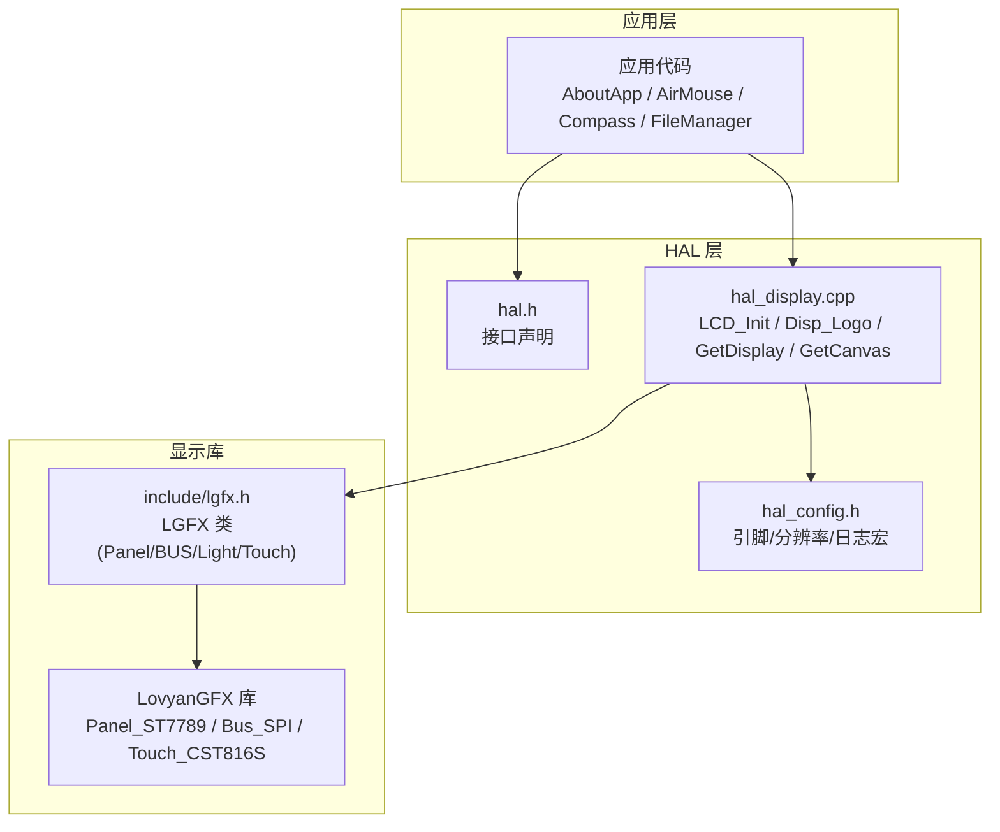
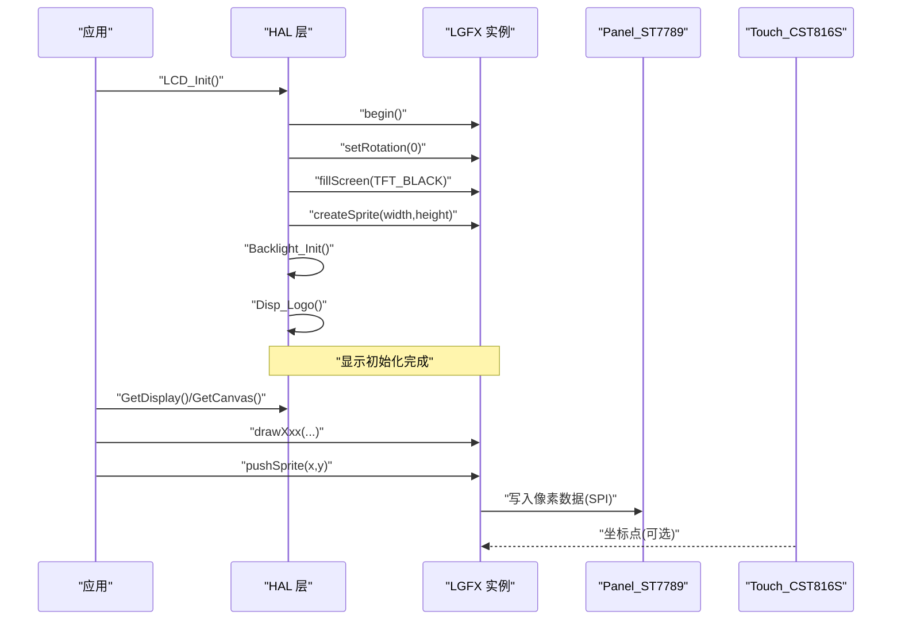
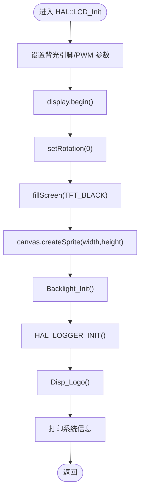
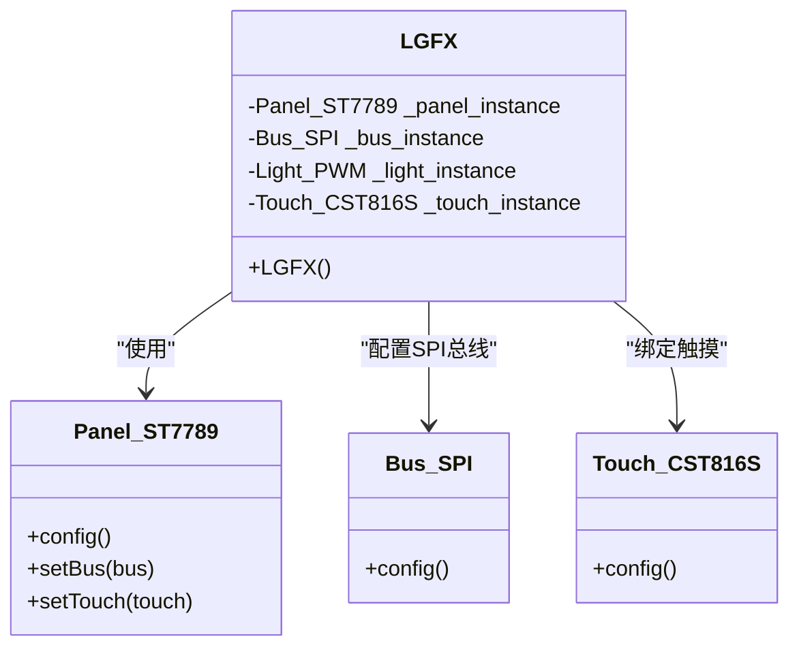
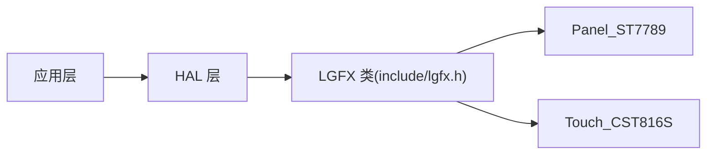

# 显示接口

<cite>
**本文引用的文件**   
- [hal_display.cpp](file://src/hal/hal_display.cpp)
- [lgfx.h](file://include/lgfx.h)
- [hal.h](file://src/hal/hal.h)
- [hal_config.h](file://src/hal/hal_config.h)
- [AboutApp.cpp](file://src/apps/AboutApp.cpp)
- [AirMouse.cpp](file://src/apps/AirMouse.cpp)
- [Compass.cpp](file://src/apps/Compass.cpp)
- [DigitalRainAnimation.cpp](file://src/apps/DigitalRainAnimation.cpp)
- [FileBrowser.cpp](file://src/apps/FileBrowser.cpp)
- [FileManager.cpp](file://src/apps/FileManager.cpp)
- [lcd_panel.cpp](file://src/apps/FluidApp/lcd_panel.cpp)
</cite>

## 目录
1. [简介](#简介)
2. [项目结构](#项目结构)
3. [核心组件](#核心组件)
4. [架构总览](#架构总览)
5. [详细组件分析](#详细组件分析)
6. [依赖关系分析](#依赖关系分析)
7. [性能与优化建议](#性能与优化建议)
8. [故障排查指南](#故障排查指南)
9. [结论](#结论)
10. [附录：API 参考与用法示例](#附录api-参考与用法示例)

## 简介
本文件为 ESP32 NullPod 的 LCD 显示接口提供完整 API 文档，重点覆盖 HAL::LCD_Init()、HAL::Disp_Logo()、HAL::GetDisplay()、HAL::GetCanvas() 等函数。文档说明如何初始化显示器、使用 LGFX 和 LGFX_Sprite 进行图形绘制与屏幕更新，并给出触摸显示集成方法与最佳实践。同时总结分辨率、颜色格式、背光控制等关键配置参数。

## 项目结构
本项目在硬件抽象层（HAL）中封装了 LovyanGFX 的显示驱动与触摸驱动，对外暴露统一的 HAL 接口供上层应用调用。显示相关的关键文件如下：
- include/lgfx.h：定义自定义 LGFX 类，配置 SPI 总线、ST7789 面板、CST816S 触摸以及引脚映射。
- src/hal/hal_display.cpp：实现 HAL 层的显示初始化、Logo 显示、画布创建与背光控制。
- src/hal/hal.h：声明 HAL 命名空间中的显示相关接口。
- src/hal/hal_config.h：定义 LCD 引脚、分辨率、日志宏等全局配置。
- 各应用通过 HAL::GetDisplay()/HAL::GetCanvas() 获取显示对象与离屏缓冲，完成绘制与刷新。

图表来源
- [hal.h:101-112](file://src/hal/hal.h#L101-L112)
- [hal_display.cpp:18-52](file://src/hal/hal_display.cpp#L18-L52)
- [lgfx.h:34-114](file://include/lgfx.h#L34-L114)

章节来源
- [hal.h:101-112](file://src/hal/hal.h#L101-L112)
- [hal_display.cpp:18-52](file://src/hal/hal_display.cpp#L18-L52)
- [lgfx.h:34-114](file://include/lgfx.h#L34-L114)

## 核心组件
- HAL::LCD_Init()
  - 功能：初始化显示设备、设置旋转、清屏、创建离屏画布、初始化背光、打印启动日志并显示 Logo。
  - 关键点：display.begin() 启动 LovyanGFX；canvas.createSprite(width, height) 分配离屏缓冲；Backlight_Init() 初始化 PWM 背光；Disp_Logo() 输出品牌信息。
- HAL::Disp_Logo()
  - 功能：在离屏画布上以 ASCII 艺术形式输出 Logo 与构建信息，并推送到屏幕。
- HAL::GetDisplay()
  - 功能：返回全局 LGFX 实例指针，用于直接绘制到屏幕或作为 LGFX_Sprite 的目标。
- HAL::GetCanvas()
  - 功能：返回全局 LGFX_Sprite 指针，用于离屏绘制后 pushSprite 刷新。

章节来源
- [hal_display.cpp:18-52](file://src/hal/hal_display.cpp#L18-L52)
- [hal_display.cpp:62-79](file://src/hal/hal_display.cpp#L62-L79)
- [hal.h:108-112](file://src/hal/hal.h#L108-L112)

## 架构总览
下图展示从应用到显示驱动的调用链：应用通过 HAL 获取显示对象与画布，进行绘制；最终由 LovyanGFX 驱动 ST7789 面板并通过 SPI 传输像素数据，触摸输入经 CST816S 上报。

图表来源
- [hal_display.cpp:18-52](file://src/hal/hal_display.cpp#L18-L52)
- [lgfx.h:34-114](file://include/lgfx.h#L34-L114)

## 详细组件分析

### HAL::LCD_Init()
- 行为概述
  - 设置背光引脚与 PWM 参数。
  - 调用 display.begin() 初始化 LovyanGFX。
  - 设置旋转角度并清屏。
  - 根据屏幕宽高创建离屏画布 canvas。
  - 初始化背光 Backlight_Init()。
  - 初始化日志输出并显示 Logo。
  - 打印 Flash/RAM/PSRAM 信息以便调试。
- 关键参数与副作用
  - bl_pin = HAL_PIN_LCD_BL（来自 hal_config.h）。
  - bl_freq、bl_pwm_channel、bl_pwm_bits 决定 PWM 背光频率与通道。
  - canvas.createSprite(display.width(), display.height()) 占用内存，需确保足够 PSRAM/SRAM。
- 错误处理
  - 若 display.begin() 失败，后续 draw/pushSprite 可能无效；建议在应用层检查 width()/height() 是否有效。
- 性能影响
  - createSprite 会分配整屏大小的缓冲区，频繁重建会导致内存碎片；建议在初始化时一次性创建并在生命周期内复用。

图表来源
- [hal_display.cpp:18-42](file://src/hal/hal_display.cpp#L18-L42)

章节来源
- [hal_display.cpp:18-42](file://src/hal/hal_display.cpp#L18-L42)
- [hal_config.h:8-22](file://src/hal/hal_config.h#L8-L22)

### HAL::Disp_Logo()
- 行为概述
  - 设置字体与前景/背景色。
  - 逐字符输出 ASCII Logo，每若干字符将画布内容推送到屏幕。
  - 输出作者与构建时间信息，最后再次 pushSprite 刷新。
- 使用建议
  - 适合在启动阶段使用，避免在高频刷新路径中调用。
  - 如需动态更新，建议使用离屏画布批量绘制后再 pushSprite。

章节来源
- [hal_display.cpp:62-79](file://src/hal/hal_display.cpp#L62-L79)

### HAL::GetDisplay() 与 HAL::GetCanvas()
- 行为概述
  - GetDisplay() 返回全局 LGFX 实例指针，可直接调用绘图 API。
  - GetCanvas() 返回全局 LGFX_Sprite 指针，用于离屏绘制。
- 典型用法
  - 应用层在初始化时保存指针，减少重复查找开销。
  - 在动画或复杂 UI 中，优先使用离屏画布绘制，再 pushSprite 刷新，降低闪烁。

章节来源
- [hal_display.cpp:44-52](file://src/hal/hal_display.cpp#L44-L52)
- [hal.h:108-112](file://src/hal/hal.h#L108-L112)

### LGFX 类与显示配置（include/lgfx.h）
- 总线与面板
  - 使用 lgfx::Bus_SPI 配置 MOSI/MISO/SCLK/DC 引脚，写频 40MHz。
  - 使用 lgfx::Panel_ST7789 配置 invert、rgb_order、CS/RST/BUSY 引脚、分辨率与偏移。
- 分辨率与方向
  - PORTRAIT 模式下 screenWidth=240, screenHeight=280；否则为 280x240。
  - offset_y=20，offset_rotation 根据 PORTRAIT 选择。
- 触摸集成
  - 使用 lgfx::Touch_CST816S，I2C 端口 0，地址 0x15，SDA/SCL/INT/RST 引脚已配置。
  - 将触摸实例绑定到面板 setTouch(&_touch_instance)。
- 背光
  - 注释掉的 Light_PWM 配置块表明可通过 LGFX 内部背光管理；当前项目采用 HAL 层独立 PWM 控制。

图表来源
- [lgfx.h:34-114](file://include/lgfx.h#L34-L114)

章节来源
- [lgfx.h:9-31](file://include/lgfx.h#L9-L31)
- [lgfx.h:34-114](file://include/lgfx.h#L34-L114)

### 触摸显示集成（CST816S）
- 初始化流程
  - LGFX 构造器中配置 Touch_CST816S，设置 I2C 端口、地址、引脚与时钟频率。
  - 将触摸实例绑定到面板，LovyanGFX 会在内部执行校准与坐标转换。
- 读取触摸
  - 通过 LovyanGFX 的 getTouch/getTouchRaw 获取坐标；项目未直接使用这些方法，但已在底层准备好。
- 手势识别
  - Touch_CST816S 支持滑动、长按、单击等手势枚举；上层可基于原始坐标自行实现手势逻辑。

章节来源
- [lgfx.h:90-111](file://include/lgfx.h#L90-L111)
- [lib/LovyanGFX/src/lgfx/v1/touch/Touch_CST816S.hpp:28-63](file://lib/LovyanGFX/src/lgfx/v1/touch/Touch_CST816S.hpp#L28-L63)

### 背光控制
- 初始化
  - Backlight_Init() 配置 LEDC PWM 通道、频率与位宽，并从 Preferences 读取亮度值，限制最小亮度。
- 设置亮度
  - setBrightness() 计算占空比并写入 PWM，同时将亮度值持久化到 NVS。
- 关闭背光
  - Backlight_Off() 将 PWM 输出置零。

章节来源
- [hal_display.cpp:81-127](file://src/hal/hal_display.cpp#L81-L127)
- [hal_config.h:67-78](file://src/hal/hal_config.h#L67-L78)

## 依赖关系分析
- 应用层依赖 HAL 接口
  - AboutApp、AirMouse、Compass、FileBrowser、FileManager、FluidApp 等均通过 HAL::GetDisplay()/HAL::GetCanvas() 获取显示对象。
- HAL 层依赖 LovyanGFX
  - HAL 层封装 LGFX 与 LGFX_Sprite，屏蔽底层细节。
- LovyanGFX 依赖具体面板与触摸驱动
  - Panel_ST7789、Bus_SPI、Touch_CST816S 在 include/lgfx.h 中组合成 LGFX 类。

图表来源
- [hal.h:101-112](file://src/hal/hal.h#L101-L112)
- [lgfx.h:34-114](file://include/lgfx.h#L34-L114)

章节来源
- [AboutApp.cpp:78-79](file://src/apps/AboutApp.cpp#L78-L79)
- [AirMouse.cpp:16-17](file://src/apps/AirMouse.cpp#L16-L17)
- [Compass.cpp:67-75](file://src/apps/Compass.cpp#L67-L75)
- [FileBrowser.cpp:17-18](file://src/apps/FileBrowser.cpp#L17-L18)
- [FileManager.cpp:507-546](file://src/apps/FileManager.cpp#L507-L546)
- [lcd_panel.cpp:37-41](file://src/apps/FluidApp/lcd_panel.cpp#L37-L41)

## 性能与优化建议
- 使用离屏画布
  - 复杂界面或动画应先在 LGFX_Sprite 上绘制，再 pushSprite 一次刷新，减少闪烁与 SPI 传输次数。
- 合理设置分辨率与偏移
  - 确认 screenWidth/screenHeight 与实际面板一致，offset_y 与 rotation 正确以避免黑边或错位。
- 控制刷新频率
  - 避免在高频循环中频繁 pushSprite；可采用脏矩形或区域更新策略（LovyanGFX 支持部分刷新）。
- 背光 PWM 调光曲线
  - setBrightness() 已做非线性补偿，但仍建议结合用户感知调整映射表以获得更平滑的亮度变化。
- 内存管理
  - 避免频繁 createSprite；尽量复用全局 canvas 或在应用内缓存 sprite 实例。

[本节为通用指导，不直接分析具体文件]

## 故障排查指南
- 屏幕无显示
  - 检查 display.begin() 是否成功；确认 SPI 引脚与 CS/DC/RST 配置正确。
  - 查看 Serial 输出中 TFT W/H 是否正常。
- 画面倒置或偏移
  - 检查 setRotation 与 panel 的 offset_rotation/offset_x/offset_y 配置。
- 触摸无响应
  - 确认 I2C 引脚与地址（0x15）正确；检查 Touch_CST816S 初始化是否完成。
- 背光异常
  - 检查 LEDC PWM 通道与引脚；确认 Preferences 中亮度值未被设为 0。
- 内存不足导致崩溃
  - 观察 heap_caps_get_free_size 输出；减少 createSprite 尺寸或复用画布。

章节来源
- [hal_display.cpp:28-41](file://src/hal/hal_display.cpp#L28-L41)
- [hal_display.cpp:81-127](file://src/hal/hal_display.cpp#L81-L127)

## 结论
本项目通过 HAL 层统一封装 LovyanGFX 的显示与触摸能力，提供简洁的 API 供上层应用使用。开发者只需调用 HAL::LCD_Init() 完成初始化，再通过 HAL::GetDisplay()/HAL::GetCanvas() 进行绘制与刷新。配合合理的离屏缓冲与背光控制，可在 ESP32 平台上获得流畅的 UI 体验与稳定的触摸交互。

[本节为总结性内容，不直接分析具体文件]

## 附录：API 参考与用法示例

### HAL::LCD_Init()
- 作用：初始化显示、创建画布、初始化背光、显示 Logo。
- 调用时机：系统启动早期。
- 注意事项：确保 SPI 与背光引脚配置正确；留意内存占用。

章节来源
- [hal_display.cpp:18-42](file://src/hal/hal_display.cpp#L18-L42)

### HAL::Disp_Logo()
- 作用：在画布上输出 Logo 与构建信息并刷新屏幕。
- 调用时机：LCD_Init() 末尾。
- 注意事项：避免在高频刷新路径中调用。

章节来源
- [hal_display.cpp:62-79](file://src/hal/hal_display.cpp#L62-L79)

### HAL::GetDisplay()
- 作用：返回 LGFX 指针，用于直接绘制。
- 常见用法：
  - fillScreen()
  - drawLine()/drawRect()/drawCircle()
  - drawString()/printf()
  - setRotation()/setColorDepth()

章节来源
- [hal_display.cpp:44-47](file://src/hal/hal_display.cpp#L44-L47)
- [hal.h:108-112](file://src/hal/hal.h#L108-L112)

### HAL::GetCanvas()
- 作用：返回 LGFX_Sprite 指针，用于离屏绘制。
- 常见用法：
  - createSprite(width, height)
  - setFont()/setTextColor()/setTextSize()
  - drawXxx()/printf()
  - pushSprite(x, y)

章节来源
- [hal_display.cpp:49-52](file://src/hal/hal_display.cpp#L49-L52)
- [hal.h:108-112](file://src/hal/hal.h#L108-L112)

### LGFX 与 LGFX_Sprite 使用要点
- 初始化顺序
  - 先 HAL::LCD_Init()，再在应用中获取 Display/Canvas。
- 绘制流程
  - 在 Canvas 上完成所有绘制，最后 pushSprite(0,0) 刷新。
- 颜色与字体
  - 使用 TFT_* 常量指定颜色；通过 fonts::Font0 等内置字体。
- 触摸集成
  - 触摸驱动已在 LGFX 构造器中配置；上层可通过 LovyanGFX 的触摸 API 获取坐标。

章节来源
- [lgfx.h:34-114](file://include/lgfx.h#L34-L114)
- [hal_display.cpp:62-79](file://src/hal/hal_display.cpp#L62-L79)

### 显示配置参数汇总
- 引脚
  - LCD_MOSI/MISO/SCLK/DC/CS/RST/BL
  - TOUCH_SDA/SCL/RST/IRQ
- 分辨率
  - PORTRAIT: 240x280；LANDSCAPE: 280x240
- 面板参数
  - invert=true, rgb_order=true, offset_y=20
- 触摸参数
  - I2C port=0, address=0x15, freq=400kHz

章节来源
- [lgfx.h:9-31](file://include/lgfx.h#L9-L31)
- [lgfx.h:57-75](file://include/lgfx.h#L57-L75)
- [lgfx.h:90-111](file://include/lgfx.h#L90-L111)