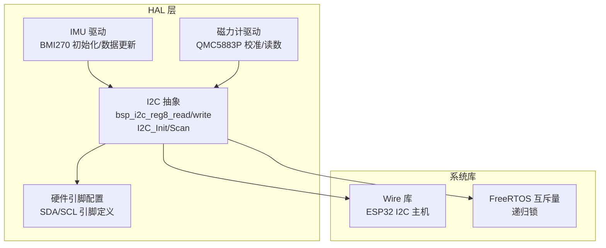
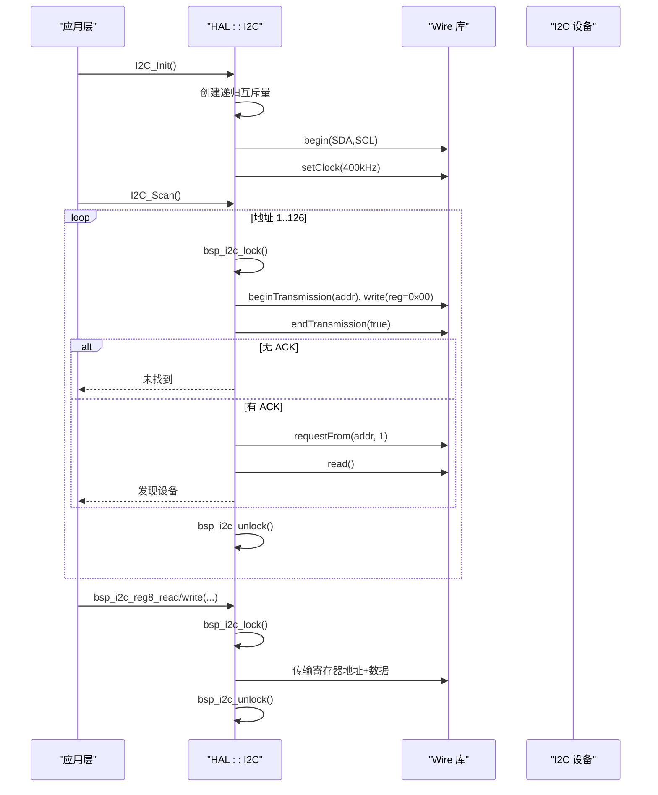
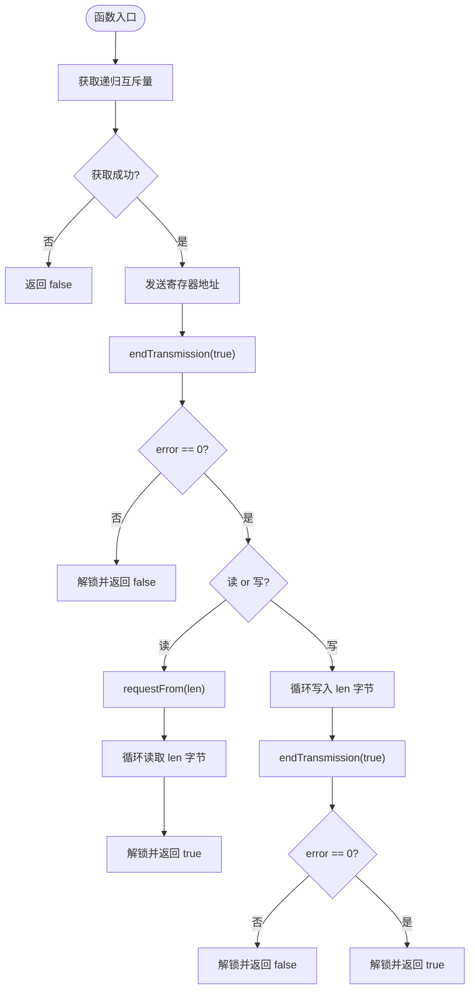
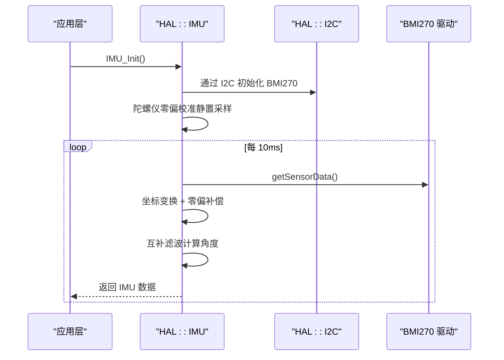
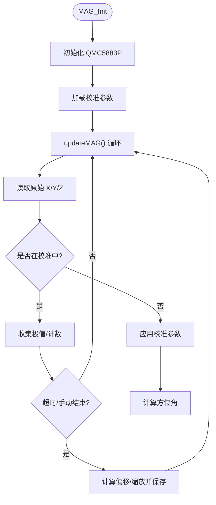
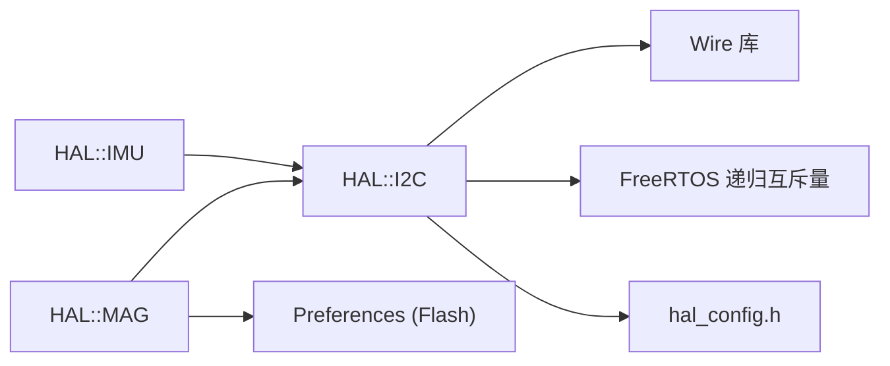

# I2C 通信接口

<cite>
**本文引用的文件**   
- [hal_i2c.cpp](file://src/hal/hal_i2c.cpp)
- [hal.h](file://src/hal/hal.h)
- [hal_config.h](file://src/hal/hal_config.h)
- [hal_imu.cpp](file://src/hal/hal_imu.cpp)
- [hal_mag.cpp](file://src/hal/hal_mag.cpp)
</cite>

## 目录
1. [简介](#简介)
2. [项目结构](#项目结构)
3. [核心组件](#核心组件)
4. [架构总览](#架构总览)
5. [详细组件分析](#详细组件分析)
6. [依赖关系分析](#依赖关系分析)
7. [性能与可靠性优化](#性能与可靠性优化)
8. [故障排查指南](#故障排查指南)
9. [结论](#结论)
10. [附录：使用示例与最佳实践](#附录使用示例与最佳实践)

## 简介
本文件为 ESP32 NullPod 的 I2C 通信接口提供完整 API 文档，覆盖总线初始化、设备扫描、寄存器读写、多设备地址管理、时钟频率配置、错误处理机制，并结合 IMU（BMI270）与磁力计（QMC5883P）的实际用法给出数据读取流程。同时总结总线仲裁、信号完整性与通信可靠性优化要点，帮助开发者在嵌入式场景中稳定高效地使用 I2C。

## 项目结构
I2C 相关代码集中在 HAL 层，负责底层总线抽象与常用外设驱动封装；应用层通过 HAL 提供的统一接口访问 I2C 设备。

图表来源
- [hal_i2c.cpp:14-117](file://src/hal/hal_i2c.cpp#L14-L117)
- [hal_imu.cpp:57-74](file://src/hal/hal_imu.cpp#L57-L74)
- [hal_mag.cpp:233-246](file://src/hal/hal_mag.cpp#L233-L246)
- [hal_config.h:44-50](file://src/hal/hal_config.h#L44-L50)

章节来源
- [hal_i2c.cpp:14-117](file://src/hal/hal_i2c.cpp#L14-L117)
- [hal.h:114-118](file://src/hal/hal.h#L114-L118)
- [hal_config.h:44-50](file://src/hal/hal_config.h#L44-L50)

## 核心组件
- I2C 总线抽象
  - 初始化：创建递归互斥量，绑定 SDA/SCL 引脚，设置时钟频率。
  - 设备扫描：遍历 1–126 地址，尝试读取寄存器以探测 ACK。
  - 寄存器读写：封装 beginTransmission/endTransmission/requestFrom/read/write 流程，返回布尔状态。
- 硬件配置
  - SDA/SCL 引脚常量定义，供初始化调用。
- 外设驱动
  - IMU（BMI270）：通过 I2C 初始化并周期性读取加速度/陀螺仪数据，进行零偏校准与互补滤波。
  - 磁力计（QMC5883P）：通过 I2C 初始化，支持在线校准、参数持久化到 Flash（Preferences），输出方位角。

章节来源
- [hal_i2c.cpp:14-117](file://src/hal/hal_i2c.cpp#L14-L117)
- [hal.h:114-118](file://src/hal/hal.h#L114-L118)
- [hal_config.h:44-50](file://src/hal/hal_config.h#L44-L50)
- [hal_imu.cpp:57-74](file://src/hal/hal_imu.cpp#L57-L74)
- [hal_mag.cpp:233-246](file://src/hal/hal_mag.cpp#L233-L246)

## 架构总览
I2C 通信在 HAL 层实现统一的读/写接口，并通过 FreeRTOS 递归互斥量保证并发安全。上层外设驱动（IMU、磁力计等）复用该接口完成传感器数据采集与处理。

图表来源
- [hal_i2c.cpp:14-117](file://src/hal/hal_i2c.cpp#L14-L117)

## 详细组件分析

### I2C 总线抽象（HAL::I2C）
- 初始化
  - 创建递归互斥量用于线程安全。
  - 调用 Wire.begin 绑定 SDA/SCL 引脚。
  - 设置 I2C 时钟为 400kHz（Fast Mode）。
- 设备扫描
  - 遍历地址 1–126，向每个地址写入任意寄存器（例如 0x00）并请求从机响应。
  - 若 endTransmission 返回成功且可读取字节，则认为设备存在。
- 寄存器读写
  - 读：先发送寄存器地址，再请求指定长度数据，逐字节读取。
  - 写：先发送寄存器地址，再连续写入数据块。
  - 所有操作均受递归互斥量保护，避免并发冲突。
- 错误处理
  - endTransmission 返回值非 0 时记录错误码并返回失败。
  - 获取互斥量失败时直接返回失败，防止死锁或资源竞争。

图表来源
- [hal_i2c.cpp:51-117](file://src/hal/hal_i2c.cpp#L51-L117)

章节来源
- [hal_i2c.cpp:14-117](file://src/hal/hal_i2c.cpp#L14-L117)
- [hal.h:114-118](file://src/hal/hal.h#L114-L118)

### 硬件引脚与时钟配置
- 引脚定义
  - SDA：GPIO11
  - SCL：GPIO10
- 时钟频率
  - 默认 400kHz（Fast Mode），可根据外设能力调整。

章节来源
- [hal_config.h:44-50](file://src/hal/hal_config.h#L44-L50)
- [hal_i2c.cpp:64-69](file://src/hal/hal_i2c.cpp#L64-L69)

### IMU 数据读取（BMI270）
- 初始化
  - 通过 I2C 启动 BMI270，成功后执行陀螺仪零偏校准。
- 数据更新
  - 固定采样率 100Hz，周期读取加速度/陀螺仪原始值。
  - 根据安装方向做坐标变换，减去陀螺仪零偏。
  - 使用互补滤波融合角度，输出 roll/pitch/yaw 及鼠标增量。

图表来源
- [hal_imu.cpp:57-74](file://src/hal/hal_imu.cpp#L57-L74)
- [hal_imu.cpp:88-149](file://src/hal/hal_imu.cpp#L88-L149)

章节来源
- [hal_imu.cpp:57-149](file://src/hal/hal_imu.cpp#L57-L149)

### 磁力计数据读取与校准（QMC5883P）
- 初始化
  - 初始化 QMC5883P，加载已保存的校准参数。
- 校准流程
  - 进入校准模式后采集 X/Y/Z 极值，计算硬铁偏移与软铁缩放。
  - 将校准结果保存到 Flash（Preferences），上电自动加载。
- 数据更新
  - 周期性读取磁场强度，应用校准参数，计算方位角。

图表来源
- [hal_mag.cpp:233-246](file://src/hal/hal_mag.cpp#L233-L246)
- [hal_mag.cpp:143-197](file://src/hal/hal_mag.cpp#L143-L197)
- [hal_mag.cpp:248-274](file://src/hal/hal_mag.cpp#L248-L274)

章节来源
- [hal_mag.cpp:233-297](file://src/hal/hal_mag.cpp#L233-L297)

## 依赖关系分析
- HAL::I2C 依赖
  - Arduino Wire 库：提供 I2C 主机功能。
  - FreeRTOS 递归互斥量：确保并发安全。
  - HAL 配置头：提供 SDA/SCL 引脚常量。
- 外设驱动依赖
  - IMU 驱动依赖 HAL::I2C 进行寄存器访问。
  - 磁力计驱动依赖 HAL::I2C 进行寄存器访问，并使用 Preferences 存储校准参数。

图表来源
- [hal_i2c.cpp:1-3](file://src/hal/hal_i2c.cpp#L1-L3)
- [hal_i2c.cpp:64-69](file://src/hal/hal_i2c.cpp#L64-L69)
- [hal_config.h:44-50](file://src/hal/hal_config.h#L44-L50)
- [hal_mag.cpp:50-129](file://src/hal/hal_mag.cpp#L50-L129)

章节来源
- [hal_i2c.cpp:1-3](file://src/hal/hal_i2c.cpp#L1-L3)
- [hal_i2c.cpp:64-69](file://src/hal/hal_i2c.cpp#L64-L69)
- [hal_config.h:44-50](file://src/hal/hal_config.h#L44-L50)
- [hal_mag.cpp:50-129](file://src/hal/hal_mag.cpp#L50-L129)

## 性能与可靠性优化
- 总线仲裁与并发控制
  - 使用递归互斥量保护所有 I2C 事务，避免多线程/中断上下文下的竞态条件。
  - 建议在上层任务中批量访问 I2C 设备，减少锁切换开销。
- 时钟频率选择
  - 默认 400kHz，适用于大多数传感器；若线缆较长或负载较重，可降低至 100kHz 以提升稳定性。
- 信号完整性
  - 确保 SDA/SCL 走线短而直，远离高频噪声源。
  - 使用合适的上拉电阻（通常 2.2k–4.7kΩ），保证上升沿质量。
- 通信可靠性
  - 对关键设备增加重试机制与超时判断。
  - 在设备扫描后缓存有效地址列表，减少重复探测。
  - 对长包读写分片处理，避免单次传输过大导致丢包。
- 功耗与实时性
  - 合理设置传感器采样率，避免频繁唤醒。
  - 使用 DMA（如平台支持）或批量读取降低 CPU 占用。

[本节为通用指导，不直接分析具体文件]

## 故障排查指南
- 常见问题
  - 设备扫描不到：检查 SDA/SCL 引脚配置是否正确，确认上拉电阻与供电。
  - 读写失败：查看 endTransmission 错误码，确认设备地址与寄存器地址正确。
  - 数据异常：检查传感器初始化顺序、校准流程是否完成。
- 调试建议
  - 启用串口日志，观察 I2C 初始化与扫描输出。
  - 使用逻辑分析仪抓取 SDA/SCL 波形，验证时序与电平。
  - 对关键路径添加重试与超时保护，提升鲁棒性。

章节来源
- [hal_i2c.cpp:71-117](file://src/hal/hal_i2c.cpp#L71-L117)

## 结论
本项目在 HAL 层提供了简洁可靠的 I2C 抽象，结合 FreeRTOS 互斥量确保并发安全，并通过 IMU 与磁力计驱动展示了典型传感器数据读取与校准流程。遵循本文档的配置与优化建议，可在 ESP32 NullPod 平台上稳定扩展更多 I2C 外设。

[本节为总结性内容，不直接分析具体文件]

## 附录：使用示例与最佳实践
- I2C 总线初始化
  - 调用 HAL::I2C_Init() 完成总线初始化与引脚绑定。
- 设备扫描
  - 调用 HAL::I2C_Scan() 打印发现的设备地址列表。
- 寄存器读写
  - 使用 HAL::bsp_i2c_reg8_read/write 进行单字节或多字节读写。
- IMU 数据读取
  - 初始化 HAL::IMU_Init()，周期性调用 updateImuData() 获取角度与姿态。
- 磁力计校准与读取
  - 初始化 HAL::MAG_Init()，根据需要进入校准模式，完成后调用 updateMAG() 获取方位角。

章节来源
- [hal_i2c.cpp:14-49](file://src/hal/hal_i2c.cpp#L14-L49)
- [hal_imu.cpp:57-149](file://src/hal/hal_imu.cpp#L57-L149)
- [hal_mag.cpp:233-297](file://src/hal/hal_mag.cpp#L233-L297)