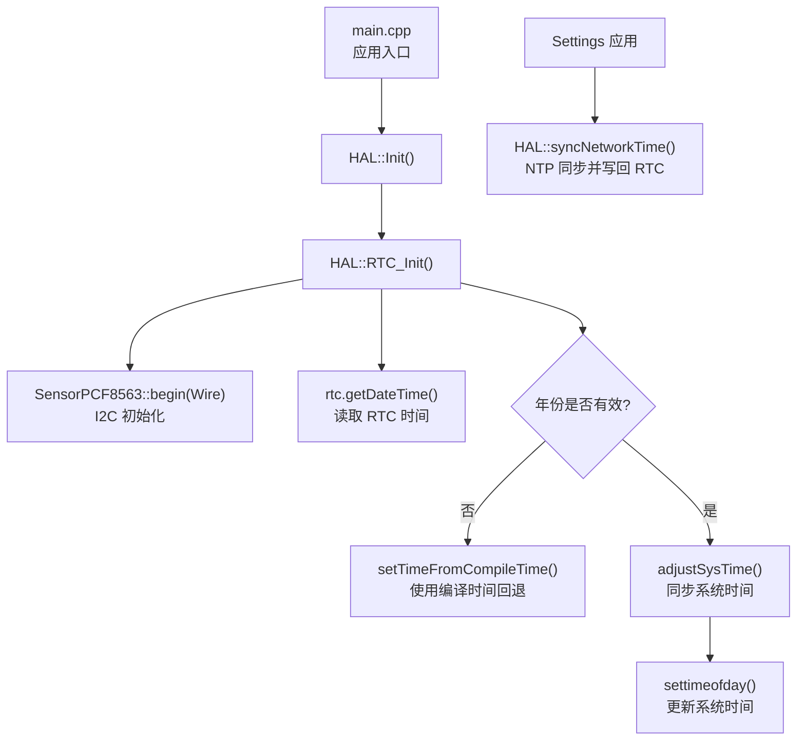
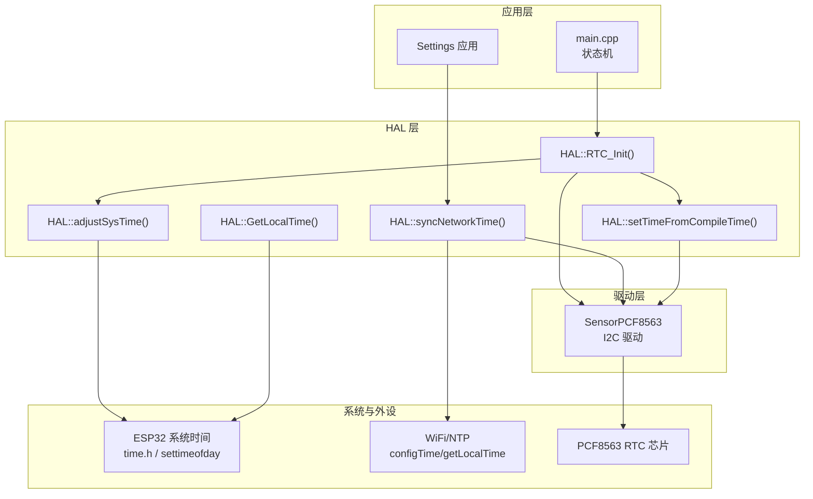
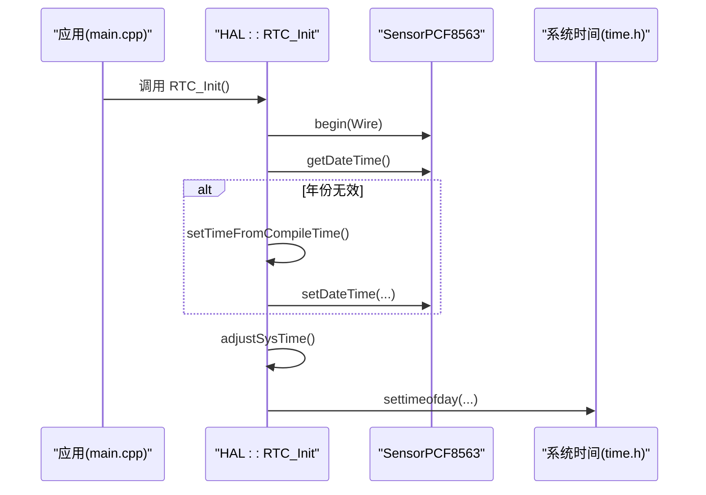
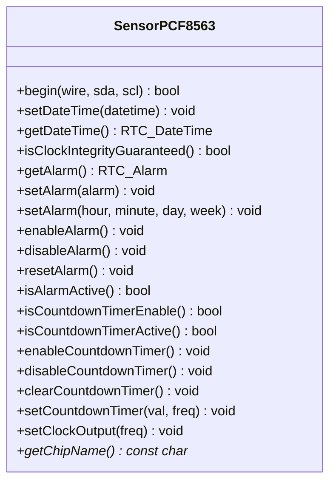
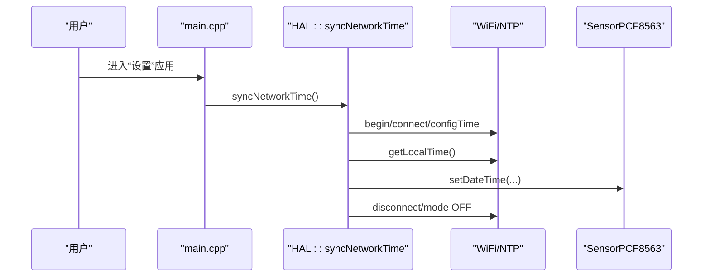
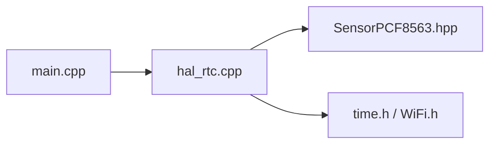

# RTC 时钟接口

<cite>
**本文引用的文件**   
- [hal_rtc.cpp](file://src/hal/hal_rtc.cpp)
- [hal.h](file://src/hal/hal.h)
- [SensorPCF8563.hpp](file://lib/SensorLib/src/SensorPCF8563.hpp)
- [main.cpp](file://src/main.cpp)
</cite>

## 目录
1. [简介](#简介)
2. [项目结构](#项目结构)
3. [核心组件](#核心组件)
4. [架构总览](#架构总览)
5. [详细组件分析](#详细组件分析)
6. [依赖关系分析](#依赖关系分析)
7. [性能与精度](#性能与精度)
8. [故障排查指南](#故障排查指南)
9. [结论](#结论)
10. [附录：API 参考与示例](#附录api-参考与示例)

## 简介
本文件为 ESP32 NullPod 的 RTC 实时时钟接口提供完整 API 文档。当前实现基于 I2C 外部 RTC 芯片 PCF8563，通过 HAL 层暴露统一的初始化、时间设置、时间读取、网络时间同步、编译时回退等能力；同时封装了闹钟与倒计时定时器配置。文档涵盖 DS3231/内部 RTC 的扩展思路、时间格式转换与时区处理、时间同步与日志时间戳用法，以及电池备份、精度校准、夏令时支持等高级主题。

## 项目结构
RTC 相关代码位于硬件抽象层（HAL）中，对外暴露统一接口；底层通过 SensorLib 提供的 PCF8563 驱动完成寄存器读写与 BCD/十进制转换。系统启动流程在 main.cpp 中调用 HAL::Init，随后进入应用状态机；“设置”应用可触发网络时间同步。

**图表来源**
- [main.cpp:19-24](file://src/main.cpp#L19-L24)
- [hal_rtc.cpp:15-48](file://src/hal/hal_rtc.cpp#L15-L48)
- [hal_rtc.cpp:50-97](file://src/hal/hal_rtc.cpp#L50-L97)

**章节来源**
- [main.cpp:19-24](file://src/main.cpp#L19-L24)
- [hal_rtc.cpp:15-48](file://src/hal/hal_rtc.cpp#L15-L48)

## 核心组件
- HAL RTC 接口：提供 RTC 初始化、系统时间调整、网络时间同步、编译时间回退、本地时间获取等函数。
- PCF8563 驱动：封装 I2C 通信、BCD/十进制转换、日期时间读写、闹钟与倒计时定时器控制、方波输出等。
- 系统集成：在启动阶段从 RTC 读取时间并同步到系统；在“设置”应用中通过 NTP 同步网络时间并写回 RTC。

**章节来源**
- [hal.h:159-163](file://src/hal/hal.h#L159-L163)
- [hal_rtc.cpp:15-132](file://src/hal/hal_rtc.cpp#L15-L132)
- [SensorPCF8563.hpp:36-322](file://lib/SensorLib/src/SensorPCF8563.hpp#L36-L322)

## 架构总览
下图展示 RTC 子系统在系统中的位置与交互关系：应用通过 HAL 访问 RTC；HAL 调用 PCF8563 驱动进行 I2C 操作；必要时通过 WiFi/NTP 与时间服务器同步。

**图表来源**
- [main.cpp:19-24](file://src/main.cpp#L19-L24)
- [main.cpp:111-114](file://src/main.cpp#L111-L114)
- [hal_rtc.cpp:15-132](file://src/hal/hal_rtc.cpp#L15-L132)
- [SensorPCF8563.hpp:36-322](file://lib/SensorLib/src/SensorPCF8563.hpp#L36-L322)

## 详细组件分析

### HAL RTC 接口
- RTC_Init
  - 功能：初始化 PCF8563，读取当前时间；若年份无效则使用编译时间回退；最后将 RTC 时间同步至系统时间。
  - 关键点：I2C 初始化失败会记录错误；年份小于阈值时触发编译时间回退；最终调用 adjustSysTime。
- adjustSysTime
  - 功能：从 RTC 读取时间，转换为 time_t 并通过 settimeofday 更新系统时间。
- syncNetworkTime
  - 功能：连接 WiFi，配置 NTP（UTC+8，无夏令时），等待同步后读取本地时间并写入 RTC，然后断开 WiFi。
- setTimeFromCompileTime
  - 功能：解析 __DATE__/__TIME__，转换为年月日时分秒并写入 RTC。
- GetLocalTime
  - 功能：返回 localtime 结果指针（内部缓存 time_t）。

**图表来源**
- [hal_rtc.cpp:15-48](file://src/hal/hal_rtc.cpp#L15-L48)
- [hal_rtc.cpp:99-126](file://src/hal/hal_rtc.cpp#L99-L126)

**章节来源**
- [hal_rtc.cpp:15-132](file://src/hal/hal_rtc.cpp#L15-L132)
- [hal.h:159-163](file://src/hal/hal.h#L159-L163)

### PCF8563 驱动（SensorPCF8563）
- 初始化与设备检测
  - begin：创建 I2C 通信对象，执行 initImpl 检查设备在线性与时间寄存器有效性。
- 时间读写
  - setDateTime/getDateTime：负责 BCD/十进制转换、世纪位处理、星期计算。
- 闹钟与定时器
  - getAlarm/setAlarm：支持按分钟/小时/日/周配置闹钟，包含边界校验与使能位处理。
  - enableAlarm/disableAlarm/resetAlarm/isAlarmActive：闹钟状态管理。
  - isCountdownTimerEnable/isCountdownTimerActive：倒计时定时器状态查询。
  - enableCountdownTimer/disableCountdownTimer/clearCountdownTimer：倒计时启停与清除。
  - setCountdownTimer：设置倒计时计数值与频率。
- 方波输出
  - setClockOutput：配置 SQW 引脚输出频率或禁用。

**图表来源**
- [SensorPCF8563.hpp:36-322](file://lib/SensorLib/src/SensorPCF8563.hpp#L36-L322)

**章节来源**
- [SensorPCF8563.hpp:36-322](file://lib/SensorLib/src/SensorPCF8563.hpp#L36-L322)

### 系统时间与网络同步
- 启动流程
  - main.cpp 调用 HAL::Init，随后进入主循环；RTC_Init 在 HAL 初始化阶段运行。
- 网络时间同步
  - Settings 应用触发 HAL::syncNetworkTime，连接 WiFi，配置 NTP（UTC+8，无夏令时），等待同步后将时间写入 RTC，再断开 WiFi。

**图表来源**
- [main.cpp:111-114](file://src/main.cpp#L111-L114)
- [hal_rtc.cpp:50-97](file://src/hal/hal_rtc.cpp#L50-L97)

**章节来源**
- [main.cpp:111-114](file://src/main.cpp#L111-L114)
- [hal_rtc.cpp:50-97](file://src/hal/hal_rtc.cpp#L50-L97)

## 依赖关系分析
- HAL 层依赖
  - hal_rtc.cpp 依赖 SensorPCF8563.hpp（PCF8563 驱动）、Arduino/WiFi/time.h 标准库。
- 驱动层依赖
  - SensorPCF8563 依赖 SensorRTC、SensorPlatform、REG/PCF8563Constants 等内部模块。
- 系统集成
  - main.cpp 通过 HAL 接口间接依赖 RTC 与网络同步逻辑。

**图表来源**
- [main.cpp:19-24](file://src/main.cpp#L19-L24)
- [hal_rtc.cpp:1-6](file://src/hal/hal_rtc.cpp#L1-L6)
- [SensorPCF8563.hpp:32-34](file://lib/SensorLib/src/SensorPCF8563.hpp#L32-L34)

**章节来源**
- [hal_rtc.cpp:1-6](file://src/hal/hal_rtc.cpp#L1-L6)
- [SensorPCF8563.hpp:32-34](file://lib/SensorLib/src/SensorPCF8563.hpp#L32-L34)

## 性能与精度
- I2C 通信开销
  - 每次时间读写涉及多次寄存器访问；建议在批量操作时减少重复 I2C 调用。
- 时间同步延迟
  - NTP 同步包含 WiFi 连接与等待时间；建议仅在需要时触发，避免频繁联网。
- 精度与校准
  - PCF8563 具备时钟完整性标志位可用于判断晶振稳定性；可通过方波输出辅助外部测量校准。
- 电池备份
  - PCF8563 支持 VBAT 供电；断电后保持时间运行；需确保硬件电路正确连接备用电池。

[本节为通用指导，不直接分析具体文件]

## 故障排查指南
- RTC 初始化失败
  - 现象：打印初始化失败信息。
  - 排查：检查 I2C 接线、地址、上拉电阻；确认 PCF8563 供电与复位状态。
- 时间异常（年份过小）
  - 现象：年份小于阈值，触发编译时间回退。
  - 排查：首次烧录或断电后未保留时间属正常；可通过 NTP 同步修正。
- 网络时间同步超时
  - 现象：WiFi 连接或 NTP 同步超时。
  - 排查：检查 SSID/密码、网络连通性、NTP 服务器可达性；适当增加等待时间。
- 闹钟不触发
  - 现象：闹钟未产生中断或事件。
  - 排查：确认闹钟已启用且参数合法；检查中断引脚与状态位；必要时重置闹钟标志。

**章节来源**
- [hal_rtc.cpp:15-39](file://src/hal/hal_rtc.cpp#L15-L39)
- [hal_rtc.cpp:50-97](file://src/hal/hal_rtc.cpp#L50-L97)
- [SensorPCF8563.hpp:146-226](file://lib/SensorLib/src/SensorPCF8563.hpp#L146-L226)

## 结论
本项目通过 HAL 层统一封装 PCF8563 RTC 驱动，提供稳定的时间初始化、系统时间同步、网络时间校准与闹钟/定时器管理能力。结合编译时间回退与 NTP 同步机制，可在断电与联网场景下保证时间的准确性。后续可扩展 DS3231 或内部 RTC 以适配不同硬件方案，并在时区与夏令时方面增强灵活性。

[本节为总结性内容，不直接分析具体文件]

## 附录：API 参考与示例

### HAL RTC API 概览
- HAL::RTC_Init
  - 作用：初始化 RTC，读取时间，必要时回退到编译时间，并同步系统时间。
- HAL::adjustSysTime
  - 作用：从 RTC 读取时间并更新系统时间。
- HAL::syncNetworkTime
  - 作用：连接 WiFi，NTP 同步时间，写回 RTC，断开 WiFi。
- HAL::setTimeFromCompileTime
  - 作用：解析编译时间并写入 RTC。
- HAL::GetLocalTime
  - 作用：返回本地时间指针（tm*）。

**章节来源**
- [hal.h:159-163](file://src/hal/hal.h#L159-L163)
- [hal_rtc.cpp:15-132](file://src/hal/hal_rtc.cpp#L15-L132)

### PCF8563 驱动 API 概览
- 时间操作
  - setDateTime/getDateTime：设置与读取日期时间，自动处理 BCD/十进制与世纪位。
- 闹钟
  - getAlarm/setAlarm/enableAlarm/disableAlarm/resetAlarm/isAlarmActive：闹钟配置与状态管理。
- 倒计时定时器
  - isCountdownTimerEnable/isCountdownTimerActive/enableCountdownTimer/disableCountdownTimer/clearCountdownTimer/setCountdownTimer：倒计时启停与配置。
- 方波输出
  - setClockOutput：配置 SQW 输出频率或禁用。

**章节来源**
- [SensorPCF8563.hpp:104-298](file://lib/SensorLib/src/SensorPCF8563.hpp#L104-L298)

### 时间格式转换与时区处理
- 时间格式
  - RTC_DateTime：年/月/日/时/分/秒/周，由驱动内部进行 BCD/十进制转换。
  - tm：C 标准时间结构体，用于系统时间与 NTP 交互。
- 时区处理
  - NTP 配置使用 UTC+8，无夏令时偏移；如需支持夏令时，可在 configTime 中设置 daylightOffset_sec 并动态调整。

**章节来源**
- [hal_rtc.cpp:78-90](file://src/hal/hal_rtc.cpp#L78-L90)
- [SensorPCF8563.hpp:104-137](file://lib/SensorLib/src/SensorPCF8563.hpp#L104-L137)

### 时间同步与日志时间戳示例路径
- 时间同步
  - 在“设置”应用中调用 HAL::syncNetworkTime，完成 NTP 同步并写回 RTC。
- 日志时间戳
  - 使用 HAL::GetLocalTime 获取 tm 指针，格式化输出日志时间戳。

**章节来源**
- [main.cpp:111-114](file://src/main.cpp#L111-L114)
- [hal_rtc.cpp:128-132](file://src/hal/hal_rtc.cpp#L128-L132)

### 精度校准、电池备份与夏令时支持
- 精度校准
  - 使用 isClockIntegrityGuaranteed 检查时钟完整性；通过 setClockOutput 输出固定频率，配合外部测量工具进行校准。
- 电池备份
  - 确保 PCF8563 的 VBAT 引脚连接备用电池，断电后时间继续运行。
- 夏令时支持
  - 在 NTP 配置中设置 daylightOffset_sec；根据地区规则动态调整偏移量。

**章节来源**
- [SensorPCF8563.hpp:140-143](file://lib/SensorLib/src/SensorPCF8563.hpp#L140-L143)
- [SensorPCF8563.hpp:291-298](file://lib/SensorLib/src/SensorPCF8563.hpp#L291-L298)
- [hal_rtc.cpp:78-81](file://src/hal/hal_rtc.cpp#L78-L81)