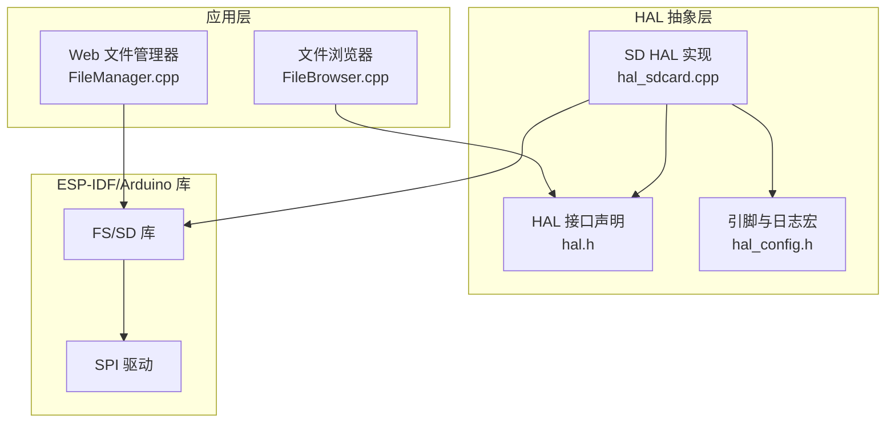
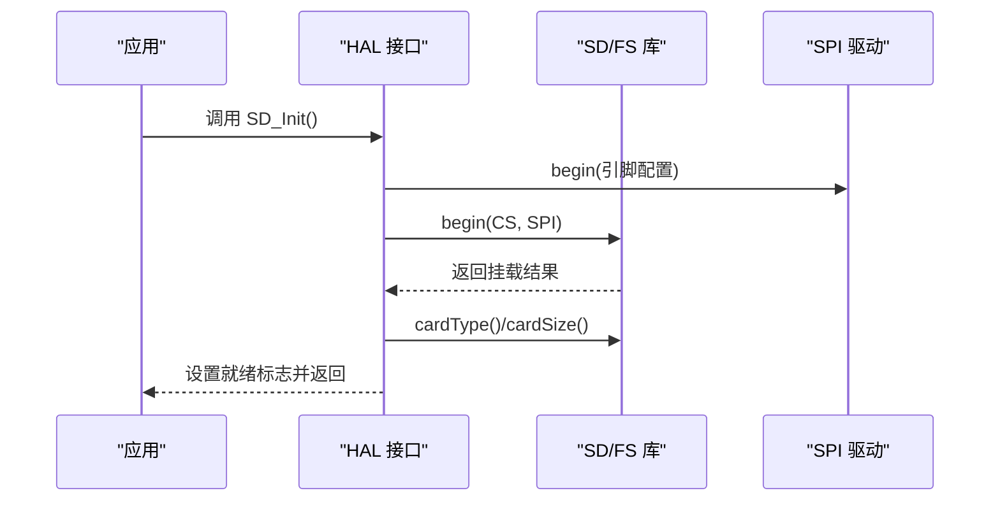
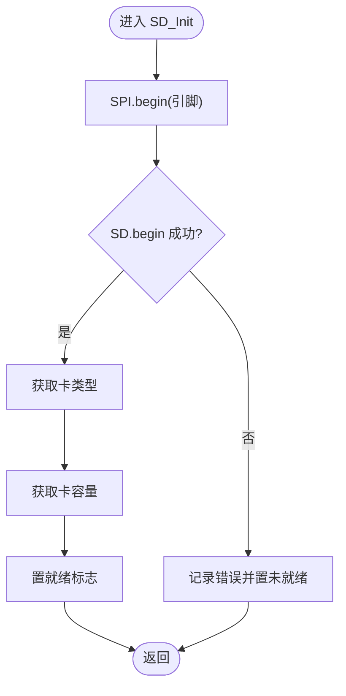
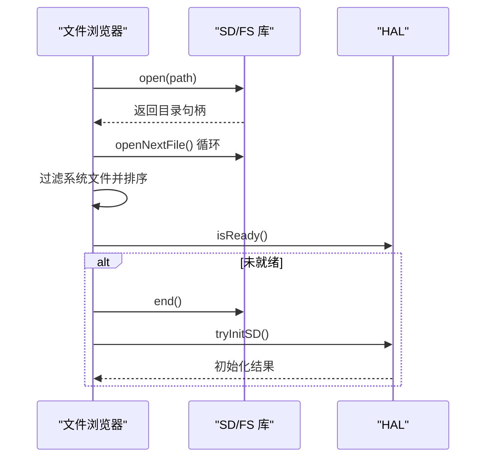
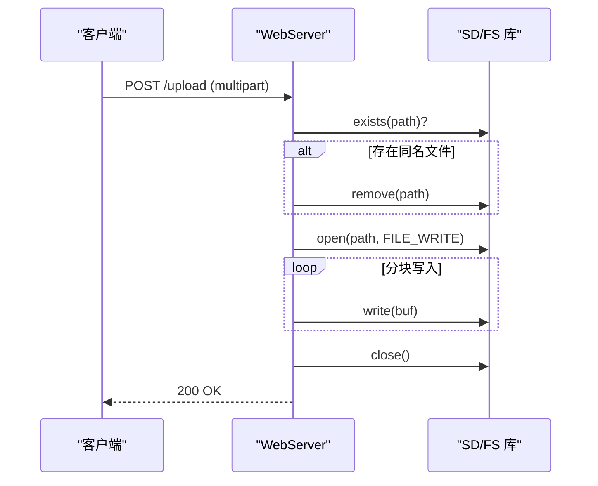
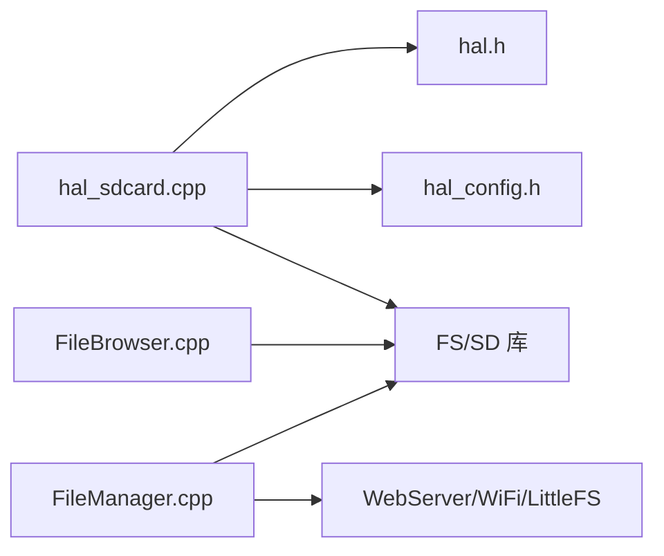

# SD 卡接口

<cite>
**本文引用的文件**   
- [hal_sdcard.cpp](file://src/hal/hal_sdcard.cpp)
- [hal.h](file://src/hal/hal.h)
- [hal_config.h](file://src/hal/hal_config.h)
- [FileBrowser.cpp](file://src/apps/FileBrowser.cpp)
- [FileManager.cpp](file://src/apps/FileManager.cpp)
</cite>

## 目录
1. [简介](#简介)
2. [项目结构](#项目结构)
3. [核心组件](#核心组件)
4. [架构总览](#架构总览)
5. [详细组件分析](#详细组件分析)
6. [依赖关系分析](#依赖关系分析)
7. [性能与优化](#性能与优化)
8. [故障排查](#故障排查)
9. [结论](#结论)
10. [附录：API 参考与示例](#附录api-参考与示例)

## 简介
本文件为 ESP32 NullPod 的 SD 卡接口提供完整 API 文档，覆盖初始化、SPI 配置、文件系统挂载、目录浏览、文件读写、删除/创建目录、存储信息查询等能力。同时给出文件浏览、数据备份（通过 Web 上传/下载）、媒体播放（结合音频模块）的使用思路与代码路径指引，并总结 SD 卡检测、错误恢复与性能调优等高级特性。

## 项目结构
本项目将 SD 卡相关 HAL 抽象在硬件抽象层中，上层应用通过 HAL 暴露的接口访问 SD 卡；同时提供两个典型应用：
- 文件浏览器：本地 UI 浏览 SD 卡目录与文件
- Web 文件管理器：通过 HTTP 接口对 SD 卡进行上传、下载、删除、创建目录、查询容量等操作

**图表来源**
- [hal.h:165-169](file://src/hal/hal.h#L165-L169)
- [hal_sdcard.cpp:1-119](file://src/hal/hal_sdcard.cpp#L1-L119)
- [hal_config.h:38-42](file://src/hal/hal_config.h#L38-L42)
- [FileBrowser.cpp:1-638](file://src/apps/FileBrowser.cpp#L1-L638)
- [FileManager.cpp:1-559](file://src/apps/FileManager.cpp#L1-L559)

**章节来源**
- [hal.h:165-169](file://src/hal/hal.h#L165-L169)
- [hal_sdcard.cpp:1-119](file://src/hal/hal_sdcard.cpp#L1-L119)
- [hal_config.h:38-42](file://src/hal/hal_config.h#L38-L42)
- [FileBrowser.cpp:1-638](file://src/apps/FileBrowser.cpp#L1-L638)
- [FileManager.cpp:1-559](file://src/apps/FileManager.cpp#L1-L559)

## 核心组件
- HAL::SD_Init()：初始化 SD 卡 SPI 总线与文件系统挂载，打印卡类型与容量，设置就绪标志
- HAL::SD_isReady()：返回 SD 卡是否就绪
- HAL::SD_ListDir()：列出根目录内容（含递归子目录打印）
- HAL::tryInitSD()：尝试重新初始化 SD 卡（用于热插拔或失败重试）
- FileBrowser：基于 SD 卡的本地文件浏览 UI，支持展开/折叠文件夹、选择文件
- FileManager：基于 WebServer 的文件管理后端，提供上传、下载、删除、创建目录、存储信息 API

**章节来源**
- [hal.h:165-169](file://src/hal/hal.h#L165-L169)
- [hal_sdcard.cpp:11-80](file://src/hal/hal_sdcard.cpp#L11-L80)
- [FileBrowser.cpp:15-638](file://src/apps/FileBrowser.cpp#L15-L638)
- [FileManager.cpp:121-448](file://src/apps/FileManager.cpp#L121-L448)

## 架构总览
SD 卡接口采用“应用层 + HAL 抽象层 + 底层库”的分层设计：
- 应用层通过 HAL 提供的稳定接口访问 SD 卡
- HAL 封装了 SPI 初始化、SD 挂载、状态判断与基础目录遍历
- 应用层还直接调用 SD/FS 库完成更复杂的文件操作（如 Web 上传/下载）

**图表来源**
- [hal_sdcard.cpp:16-58](file://src/hal/hal_sdcard.cpp#L16-L58)
- [hal_config.h:38-42](file://src/hal/hal_config.h#L38-L42)

## 详细组件分析

### HAL SD 接口
- 初始化流程
  - 使用 HSPI 通道初始化 SPI 引脚（CLK/MISO/MOSI/CS）
  - 调用 SD.begin() 挂载文件系统
  - 读取卡类型与容量，输出日志
  - 设置内部就绪标志
- 目录列表
  - 打开根目录，递归打印目录与文件大小
- 重试机制
  - tryInitSD() 可被上层用于失败重试或热插拔场景

**图表来源**
- [hal_sdcard.cpp:16-58](file://src/hal/hal_sdcard.cpp#L16-L58)

**章节来源**
- [hal_sdcard.cpp:11-80](file://src/hal/hal_sdcard.cpp#L11-L80)
- [hal.h:165-169](file://src/hal/hal.h#L165-L169)
- [hal_config.h:38-42](file://src/hal/hal_config.h#L38-L42)

### 文件浏览器（本地 UI）
- 功能要点
  - 扫描根目录并构建扁平化列表，支持文件夹展开/折叠
  - 过滤 macOS 元数据文件（以“._”开头）
  - 当无 SD 卡时提示插入并重试
  - 通过 SD.end() 与 HAL::tryInitSD() 实现失败重试
- 关键路径
  - 目录扫描：scanDirectory()
  - 展开/折叠：toggleFolder()
  - 重试逻辑：handleInput() 中检测到空列表时触发

**图表来源**
- [FileBrowser.cpp:75-155](file://src/apps/FileBrowser.cpp#L75-L155)
- [FileBrowser.cpp:194-295](file://src/apps/FileBrowser.cpp#L194-L295)
- [FileBrowser.cpp:299-391](file://src/apps/FileBrowser.cpp#L299-L391)

**章节来源**
- [FileBrowser.cpp:15-638](file://src/apps/FileBrowser.cpp#L15-L638)

### Web 文件管理器（HTTP API）
- 功能要点
  - 启动 AP 热点并提供 Web 界面（静态资源来自 LittleFS）
  - 提供以下 SD 卡操作 API：
    - GET /list：列出目录（JSON）
    - POST /upload：分块上传到 SD 卡
    - GET /download：流式下载 SD 卡文件
    - DELETE /delete：删除文件或目录
    - POST /mkdir：创建目录
    - GET /storage：查询总容量与已用空间
- 关键路径
  - 上传处理：handleFileUpload()
  - 下载处理：handleFileDownload()
  - 删除/创建目录：handleFileDelete(), handleMakeDir()
  - 路由注册：setupRoutes()

**图表来源**
- [FileManager.cpp:121-226](file://src/apps/FileManager.cpp#L121-L226)
- [FileManager.cpp:292-346](file://src/apps/FileManager.cpp#L292-L346)
- [FileManager.cpp:348-408](file://src/apps/FileManager.cpp#L348-L408)
- [FileManager.cpp:424-448](file://src/apps/FileManager.cpp#L424-L448)

**章节来源**
- [FileManager.cpp:121-448](file://src/apps/FileManager.cpp#L121-L448)

## 依赖关系分析
- HAL 层依赖
  - hal_config.h：定义 SD 卡引脚（CS/MOSI/MISO/CLK）与日志宏
  - FS/SD 库：提供文件系统与 SD 卡驱动
- 应用层依赖
  - FileBrowser：依赖 SD/FS 库进行目录扫描与交互
  - FileManager：依赖 WebServer、WiFi、LittleFS（静态资源）与 SD/FS 库（文件操作）

**图表来源**
- [hal_sdcard.cpp:1-119](file://src/hal/hal_sdcard.cpp#L1-L119)
- [hal.h:165-169](file://src/hal/hal.h#L165-L169)
- [hal_config.h:38-42](file://src/hal/hal_config.h#L38-L42)
- [FileBrowser.cpp:1-638](file://src/apps/FileBrowser.cpp#L1-L638)
- [FileManager.cpp:1-559](file://src/apps/FileManager.cpp#L1-L559)

**章节来源**
- [hal_sdcard.cpp:1-119](file://src/hal/hal_sdcard.cpp#L1-L119)
- [hal.h:165-169](file://src/hal/hal.h#L165-L169)
- [hal_config.h:38-42](file://src/hal/hal_config.h#L38-L42)
- [FileBrowser.cpp:1-638](file://src/apps/FileBrowser.cpp#L1-L638)
- [FileManager.cpp:1-559](file://src/apps/FileManager.cpp#L1-L559)

## 性能与优化
- SPI 通信配置
  - 使用 HSPI 通道，按 HAL_PIN_SD_* 配置 CLK/MISO/MOSI/CS
  - 建议在多设备共享 SPI 的场景下确保 CS 正确切换，避免总线冲突
- 大文件传输优化
  - 上传：分块写入，减少内存占用；建议合理设置缓冲区大小
  - 下载：流式发送，边读边写，降低峰值内存
- 文件系统
  - 当前使用 SD/FS 默认格式（通常为 FAT），如需更高可靠性可考虑 LittleFS（注意分区表与挂载方式）
- 并发与锁
  - 若多个任务同时访问 SD，需在上层加互斥保护，避免文件句柄竞争
- I/O 缓冲
  - 下载/上传建议使用固定大小缓冲（例如 1KB~4KB），平衡吞吐与内存占用

[本节为通用指导，不直接分析具体文件]

## 故障排查
- SD 卡无法挂载
  - 检查 SPI 引脚配置是否正确（hal_config.h）
  - 确认 SD 卡已插入且供电正常
  - 使用 HAL::tryInitSD() 重试
- 目录为空或显示异常
  - 检查文件系统是否为 FAT 且未被损坏
  - 过滤系统文件（如 macOS 的“._”前缀）
- 上传失败或不完整
  - 检查 UPLOAD_FILE_ABORTED 分支，清理未完成文件
  - 验证写入字节数与分块大小
- 下载卡顿或中断
  - 确保服务端流式发送，客户端及时消费数据
  - 检查网络稳定性与缓冲区大小

**章节来源**
- [hal_sdcard.cpp:16-80](file://src/hal/hal_sdcard.cpp#L16-L80)
- [FileBrowser.cpp:299-391](file://src/apps/FileBrowser.cpp#L299-L391)
- [FileManager.cpp:121-226](file://src/apps/FileManager.cpp#L121-L226)

## 结论
本项目通过 HAL 抽象层统一了 SD 卡初始化与基础操作，上层应用在此基础上实现了本地文件浏览与 Web 文件管理两大功能。该设计清晰、可扩展性强，便于后续接入更多外设与应用。针对大文件传输与高可靠性的需求，可在现有基础上进一步优化 SPI 参数、I/O 缓冲与并发控制。

[本节为总结性内容，不直接分析具体文件]

## 附录：API 参考与示例

### HAL SD 接口
- HAL::SD_Init()
  - 作用：初始化 SPI 与 SD 卡，打印卡类型与容量，设置就绪标志
  - 入口：[hal_sdcard.cpp:16-58](file://src/hal/hal_sdcard.cpp#L16-L58)
- HAL::SD_isReady()
  - 作用：返回 SD 卡是否就绪
  - 入口：[hal_sdcard.cpp:11-14](file://src/hal/hal_sdcard.cpp#L11-L14)
- HAL::SD_ListDir()
  - 作用：列出根目录内容（含递归打印）
  - 入口：[hal_sdcard.cpp:61-67](file://src/hal/hal_sdcard.cpp#L61-L67)
- HAL::tryInitSD()
  - 作用：尝试重新初始化 SD 卡
  - 入口：[hal_sdcard.cpp:69-80](file://src/hal/hal_sdcard.cpp#L69-L80)

**章节来源**
- [hal_sdcard.cpp:11-80](file://src/hal/hal_sdcard.cpp#L11-L80)
- [hal.h:165-169](file://src/hal/hal.h#L165-L169)

### 文件浏览示例（本地 UI）
- 扫描目录与展开/折叠
  - 参考：[FileBrowser.cpp:75-155](file://src/apps/FileBrowser.cpp#L75-L155)、[FileBrowser.cpp:194-295](file://src/apps/FileBrowser.cpp#L194-L295)
- 失败重试（SD.end + tryInitSD）
  - 参考：[FileBrowser.cpp:299-391](file://src/apps/FileBrowser.cpp#L299-L391)

**章节来源**
- [FileBrowser.cpp:75-155](file://src/apps/FileBrowser.cpp#L75-L155)
- [FileBrowser.cpp:194-295](file://src/apps/FileBrowser.cpp#L194-L295)
- [FileBrowser.cpp:299-391](file://src/apps/FileBrowser.cpp#L299-L391)

### Web 文件管理示例（HTTP API）
- 上传文件（POST /upload）
  - 参考：[FileManager.cpp:121-226](file://src/apps/FileManager.cpp#L121-L226)
- 下载文件（GET /download）
  - 参考：[FileManager.cpp:292-346](file://src/apps/FileManager.cpp#L292-L346)
- 删除文件/目录（DELETE /delete）
  - 参考：[FileManager.cpp:348-381](file://src/apps/FileManager.cpp#L348-L381)
- 创建目录（POST /mkdir）
  - 参考：[FileManager.cpp:383-408](file://src/apps/FileManager.cpp#L383-L408)
- 查询存储信息（GET /storage）
  - 参考：[FileManager.cpp:410-422](file://src/apps/FileManager.cpp#L410-L422)

**章节来源**
- [FileManager.cpp:121-226](file://src/apps/FileManager.cpp#L121-L226)
- [FileManager.cpp:292-346](file://src/apps/FileManager.cpp#L292-L346)
- [FileManager.cpp:348-408](file://src/apps/FileManager.cpp#L348-L408)
- [FileManager.cpp:410-422](file://src/apps/FileManager.cpp#L410-L422)

### 媒体播放集成思路
- 播放音频文件
  - 从 SD 卡读取音频文件，送入音频模块播放
  - 参考音频接口：[hal.h:197-200](file://src/hal/hal.h#L197-L200)
- 文件选择
  - 使用 FileBrowser 选择音频文件，或通过 Web 下载后播放
  - 参考：[FileBrowser.cpp:75-155](file://src/apps/FileBrowser.cpp#L75-L155)

**章节来源**
- [hal.h:197-200](file://src/hal/hal.h#L197-L200)
- [FileBrowser.cpp:75-155](file://src/apps/FileBrowser.cpp#L75-L155)