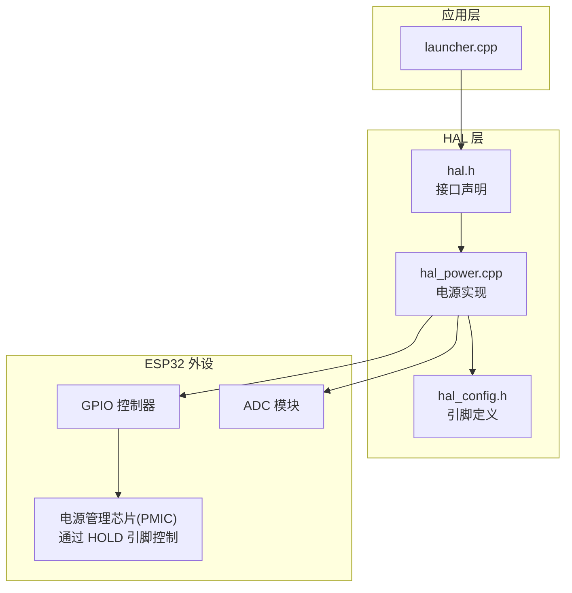
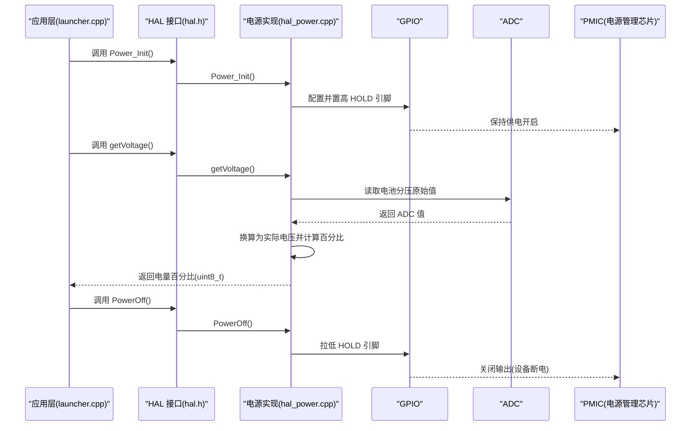
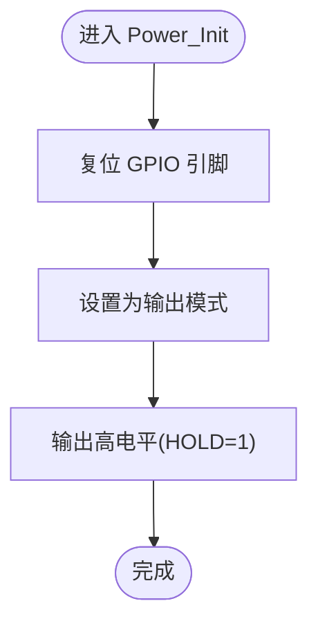
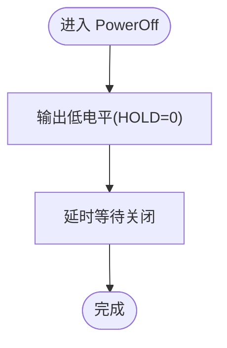
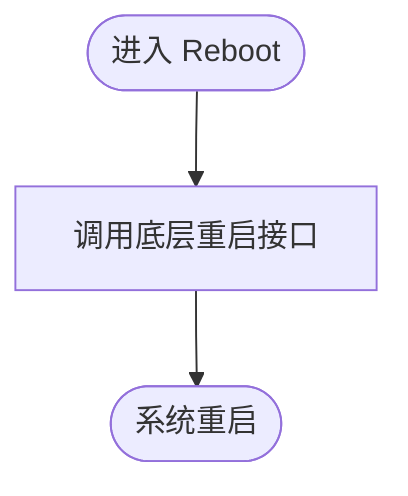
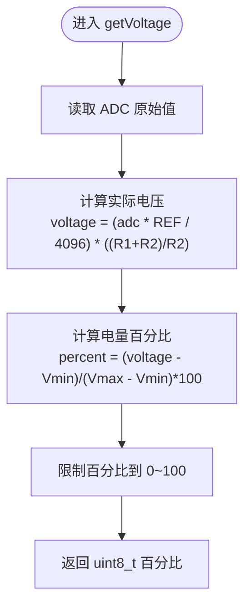

# 电源管理接口

<cite>
**本文引用的文件**   
- [hal_power.cpp](file://src/hal/hal_power.cpp)
- [hal.h](file://src/hal/hal.h)
- [hal_config.h](file://src/hal/hal_config.h)
- [launcher.cpp](file://src/launcher.cpp)
</cite>

## 目录
1. [简介](#简介)
2. [项目结构](#项目结构)
3. [核心组件](#核心组件)
4. [架构总览](#架构总览)
5. [详细组件分析](#详细组件分析)
6. [依赖关系分析](#依赖关系分析)
7. [性能与功耗考量](#性能与功耗考量)
8. [故障排查指南](#故障排查指南)
9. [结论](#结论)
10. [附录：API 参考与使用示例](#附录api-参考与使用示例)

## 简介
本文件为 ESP32 NullPod 的电源管理接口提供完整 API 文档，覆盖以下能力：
- 电源初始化、关机控制、系统重启
- 电池电压测量（ADC）与电量百分比估算
- 硬件引脚配置与分压电阻参数说明
- 低功耗模式建议与注意事项
- 代码级流程图与时序图，帮助理解实现原理

该接口以 HAL 层封装，向上暴露统一函数：Power_Init()、PowerOff()、Reboot()、getVoltage()。

## 项目结构
电源相关代码位于 HAL 层，主要文件如下：
- src/hal/hal_power.cpp：电源管理实现（初始化、关机、重启、电压读取）
- src/hal/hal.h：HAL 接口声明（包含电源相关函数原型）
- src/hal/hal_config.h：硬件引脚定义（电源保持引脚、电池 ADC 引脚等）
- src/launcher.cpp：上层应用调用示例（关机、电量显示）

图表来源
- [hal.h:171-178](file://src/hal/hal.h#L171-L178)
- [hal_power.cpp:9-38](file://src/hal/hal_power.cpp#L9-L38)
- [hal_config.h:24-27](file://src/hal/hal_config.h#L24-L27)
- [hal_config.h:54-55](file://src/hal/hal_config.h#L54-L55)

章节来源
- [hal.h:171-178](file://src/hal/hal.h#L171-L178)
- [hal_power.cpp:1-38](file://src/hal/hal_power.cpp#L1-L38)
- [hal_config.h:24-27](file://src/hal/hal_config.h#L24-L27)
- [hal_config.h:54-55](file://src/hal/hal_config.h#L54-L55)

## 核心组件
- Power_Init()：初始化电源保持引脚，确保设备正常上电并保持供电
- PowerOff()：拉低电源保持引脚，触发 PMIC 关闭输出
- Reboot()：调用底层重启接口进行系统重启
- getVoltage()：通过 ADC 读取电池分压值，换算为实际电压并估算电量百分比

章节来源
- [hal.h:171-178](file://src/hal/hal.h#L171-L178)
- [hal_power.cpp:9-38](file://src/hal/hal_power.cpp#L9-L38)

## 架构总览
电源管理在 HAL 层对上层屏蔽了具体硬件细节，对外暴露统一 API。内部通过 GPIO 控制 PMIC 的 HOLD 引脚完成开关机，通过 ADC 读取电池分压信号计算电量。

图表来源
- [hal.h:171-178](file://src/hal/hal.h#L171-L178)
- [hal_power.cpp:9-38](file://src/hal/hal_power.cpp#L9-L38)
- [launcher.cpp:136](file://src/launcher.cpp#L136)
- [launcher.cpp:366](file://src/launcher.cpp#L366)

## 详细组件分析

### 电源初始化 Power_Init()
- 功能：复位并配置电源保持引脚为输出，置高以保持 PMIC 供电
- 关键引脚：HAL_PIN_PWR_HOLD（GPIO18）
- 行为：
  - 复位引脚
  - 设置为输出模式
  - 输出高电平，维持 PMIC 输出

图表来源
- [hal_power.cpp:9-15](file://src/hal/hal_power.cpp#L9-L15)
- [hal_config.h:27](file://src/hal/hal_config.h#L27)

章节来源
- [hal_power.cpp:9-15](file://src/hal/hal_power.cpp#L9-L15)
- [hal_config.h:27](file://src/hal/hal_config.h#L27)

### 关机控制 PowerOff()
- 功能：拉低电源保持引脚，使 PMIC 停止输出，设备断电
- 关键引脚：HAL_PIN_PWR_HOLD（GPIO18）
- 行为：
  - 输出低电平
  - 延时等待电源稳定关闭

图表来源
- [hal_power.cpp:17-21](file://src/hal/hal_power.cpp#L17-L21)
- [hal_config.h:27](file://src/hal/hal_config.h#L27)

章节来源
- [hal_power.cpp:17-21](file://src/hal/hal_power.cpp#L17-L21)
- [hal_config.h:27](file://src/hal/hal_config.h#L27)

### 系统重启 Reboot()
- 功能：调用底层重启接口，执行系统重启
- 行为：直接调用 esp_restart()

图表来源
- [hal_power.cpp:23-26](file://src/hal/hal_power.cpp#L23-L26)

章节来源
- [hal_power.cpp:23-26](file://src/hal/hal_power.cpp#L23-L26)

### 电池电压与电量 getVoltage()
- 功能：读取电池分压信号，转换为实际电压并估算电量百分比
- 关键引脚：HAL_PIN_BAT_ADC（GPIO1）
- 分压电阻参数：
  - R1 = 56kΩ
  - R2 = 22kΩ
- 参考电压：REF_VOLTAGE = 3.3V
- 算法步骤：
  1) 读取 ADC 原始值
  2) 将 ADC 值转换为输入电压（考虑分压比）
  3) 根据电池电压范围映射到 0–100% 电量
  4) 限制百分比在 0–100 范围内

图表来源
- [hal_power.cpp:28-38](file://src/hal/hal_power.cpp#L28-L38)
- [hal_config.h:55](file://src/hal/hal_config.h#L55)

章节来源
- [hal_power.cpp:28-38](file://src/hal/hal_power.cpp#L28-L38)
- [hal_config.h:55](file://src/hal/hal_config.h#L55)

## 依赖关系分析
- HAL 接口声明与实现分离：
  - hal.h 声明电源相关函数原型
  - hal_power.cpp 实现具体逻辑
- 硬件引脚由 hal_config.h 集中定义，便于移植与修改
- 上层应用通过 HAL 层调用电源管理功能，避免直接操作外设

图表来源
- [hal.h:171-178](file://src/hal/hal.h#L171-L178)
- [hal_power.cpp:1-38](file://src/hal/hal_power.cpp#L1-L38)
- [hal_config.h:24-27](file://src/hal/hal_config.h#L24-L27)
- [hal_config.h:54-55](file://src/hal/hal_config.h#L54-L55)
- [launcher.cpp:136](file://src/launcher.cpp#L136)
- [launcher.cpp:366](file://src/launcher.cpp#L366)

章节来源
- [hal.h:171-178](file://src/hal/hal.h#L171-L178)
- [hal_power.cpp:1-38](file://src/hal/hal_power.cpp#L1-L38)
- [hal_config.h:24-27](file://src/hal/hal_config.h#L24-L27)
- [hal_config.h:54-55](file://src/hal/hal_config.h#L54-L55)
- [launcher.cpp:136](file://src/launcher.cpp#L136)
- [launcher.cpp:366](file://src/launcher.cpp#L366)

## 性能与功耗考量
- ADC 采样精度与噪声：
  - 单次 analogRead() 可能受噪声影响；如需更高精度可多次采样取平均
- 电量曲线线性近似：
  - 当前采用线性映射（Vmin=2.25V，Vmax=3.9V），适用于简单场景
  - 若需更精确的电量估算，可引入分段拟合或查表法
- 低功耗模式建议：
  - 关闭背光、降低刷新频率、禁用非必要外设
  - 使用 ESP32 深度睡眠模式（结合 RTC 唤醒）以降低静态电流
- 关机时序：
  - PowerOff() 中延时用于确保 PMIC 完全关闭，避免数据丢失

[本节为通用指导，不直接分析具体文件]

## 故障排查指南
- 无法开机或频繁掉电：
  - 检查 HAL_PIN_PWR_HOLD 是否被正确置高
  - 确认 PMIC 的 HOLD 引脚外部电路连接无误
- 电量显示异常：
  - 核对分压电阻 R1/R2 的实际值是否与代码一致
  - 校准 ADC 参考电压（REF_VOLTAGE）与实际 VCC 偏差
  - 检查电池电压范围（Vmin/Vmax）是否符合实际电池特性
- 重启无响应：
  - 确认 esp_restart() 未被其他任务阻塞
  - 检查是否有未释放的资源导致重启失败

章节来源
- [hal_power.cpp:9-38](file://src/hal/hal_power.cpp#L9-L38)
- [hal_config.h:27](file://src/hal/hal_config.h#L27)
- [hal_config.h:55](file://src/hal/hal_config.h#L55)

## 结论
本电源管理接口通过 HAL 层封装，提供了简洁稳定的电源控制与电量检测能力。其实现清晰、依赖明确，适合在嵌入式项目中快速集成与扩展。对于更复杂的电量估算与低功耗策略，可在现有基础上进一步优化算法与系统状态管理。

[本节为总结性内容，不直接分析具体文件]

## 附录：API 参考与使用示例

### API 概览
- void HAL::Power_Init()
  - 作用：初始化电源保持引脚，确保设备正常供电
  - 依赖：HAL_PIN_PWR_HOLD（GPIO18）
- void HAL::PowerOff()
  - 作用：拉低电源保持引脚，关闭 PMIC 输出
  - 依赖：HAL_PIN_PWR_HOLD（GPIO18）
- void HAL::Reboot()
  - 作用：执行系统重启
- uint8_t HAL::getVoltage()
  - 作用：读取电池分压并返回电量百分比（0–100）
  - 依赖：HAL_PIN_BAT_ADC（GPIO1）、分压电阻 R1/R2、参考电压 REF_VOLTAGE

章节来源
- [hal.h:171-178](file://src/hal/hal.h#L171-L178)
- [hal_power.cpp:9-38](file://src/hal/hal_power.cpp#L9-L38)
- [hal_config.h:27](file://src/hal/hal_config.h#L27)
- [hal_config.h:55](file://src/hal/hal_config.h#L55)

### 使用示例（路径引用）
- 关机调用示例：
  - [launcher.cpp:136](file://src/launcher.cpp#L136)
- 电量读取与显示示例：
  - [launcher.cpp:366](file://src/launcher.cpp#L366)

章节来源
- [launcher.cpp:136](file://src/launcher.cpp#L136)
- [launcher.cpp:366](file://src/launcher.cpp#L366)

### 硬件引脚与参数配置
- 电源保持引脚：
  - HAL_PIN_PWR_HOLD = 18
- 电池 ADC 引脚：
  - HAL_PIN_BAT_ADC = 1
- 分压电阻参数：
  - R1 = 56kΩ
  - R2 = 22kΩ
- 参考电压：
  - REF_VOLTAGE = 3.3V

章节来源
- [hal_config.h:27](file://src/hal/hal_config.h#L27)
- [hal_config.h:55](file://src/hal/hal_config.h#L55)
- [hal_power.cpp:5-7](file://src/hal/hal_power.cpp#L5-L7)

### 电压转换公式与电量计算
- 电压转换：
  - voltage = (adcValue * REF_VOLTAGE / 4096) * ((R1 + R2) / R2)
- 电量百分比：
  - percent = (voltage - 2.25) / (3.9 - 2.25) * 100
- 百分比限制：
  - percent = constrain(percent, 0, 100)

章节来源
- [hal_power.cpp:31-37](file://src/hal/hal_power.cpp#L31-L37)