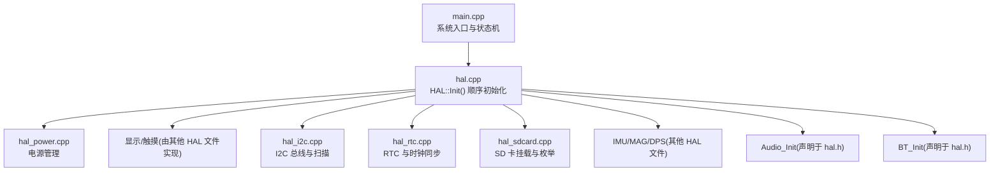
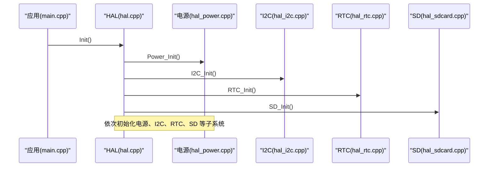
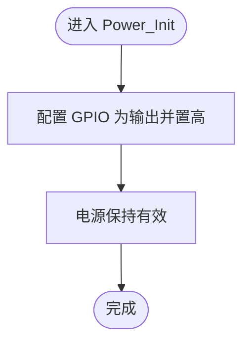
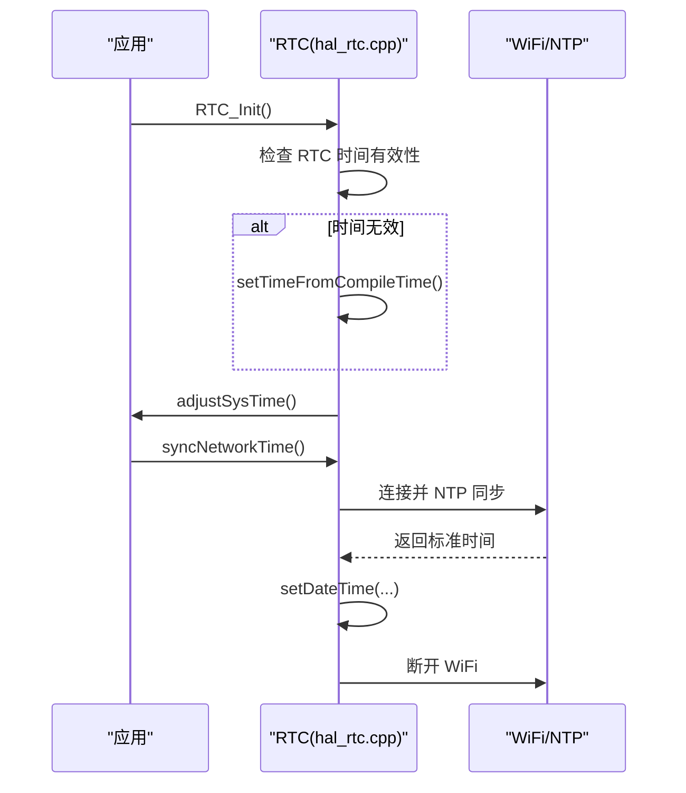
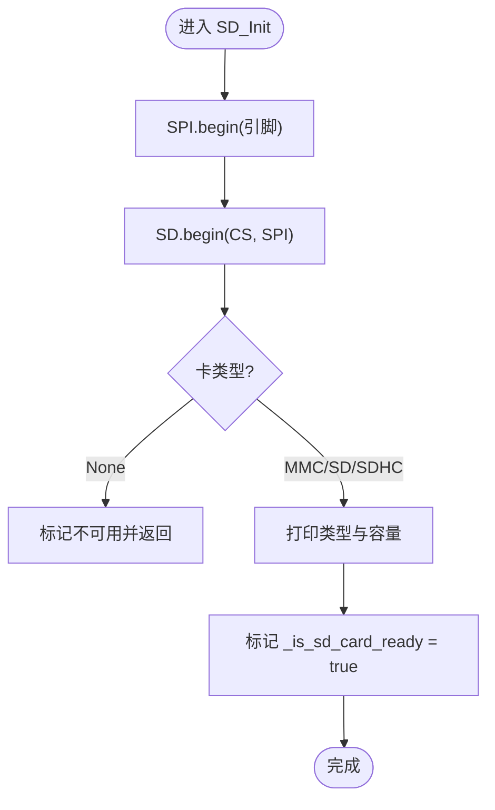
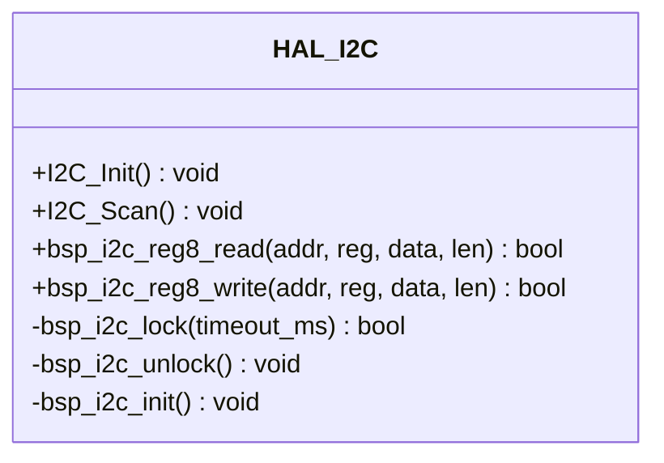
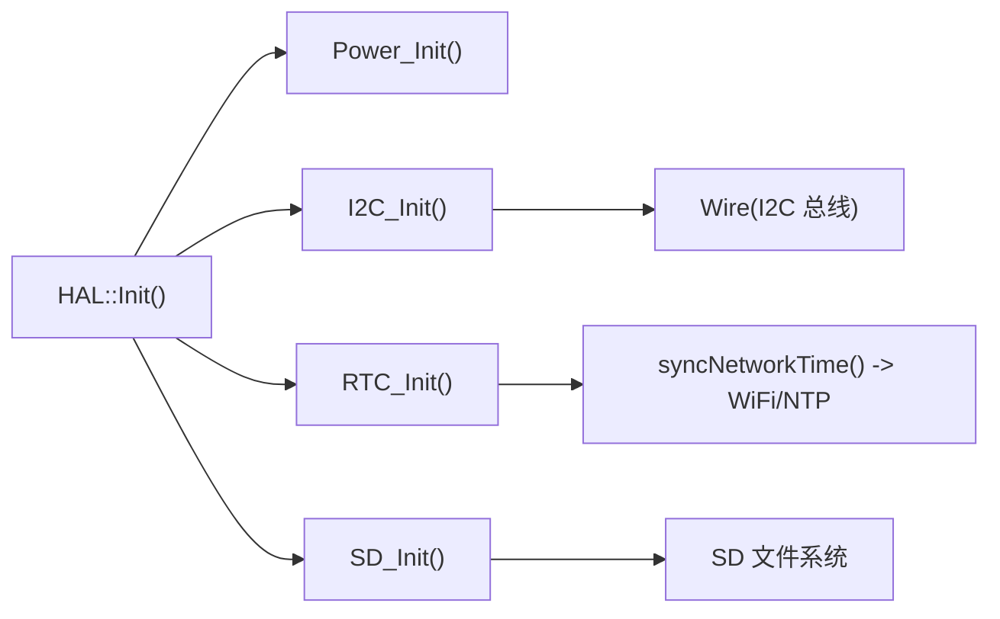

# 系统接口

<cite>
**本文引用的文件**   
- [src/main.cpp](file://src/main.cpp)
- [src/hal/hal.h](file://src/hal/hal.h)
- [src/hal/hal.cpp](file://src/hal/hal.cpp)
- [src/hal/hal_power.cpp](file://src/hal/hal_power.cpp)
- [src/hal/hal_rtc.cpp](file://src/hal/hal_rtc.cpp)
- [src/hal/hal_sdcard.cpp](file://src/hal/hal_sdcard.cpp)
- [src/hal/hal_i2c.cpp](file://src/hal/hal_i2c.cpp)
</cite>

## 目录
1. [简介](#简介)
2. [项目结构](#项目结构)
3. [核心组件](#核心组件)
4. [架构总览](#架构总览)
5. [详细组件分析](#详细组件分析)
6. [依赖关系分析](#依赖关系分析)
7. [性能与功耗考虑](#性能与功耗考虑)
8. [故障排查指南](#故障排查指南)
9. [结论](#结论)
10. [附录：API 参考](#附录api-参考)

## 简介
本文件为 ESP32 NullPod 的系统级接口文档，聚焦电源管理、RTC 时钟、SD 卡、I2C 通信、音频、蓝牙等系统功能。文档面向开发者与系统集成者，提供各模块的初始化流程、关键函数说明、错误处理机制、资源分配与低功耗策略，并给出可操作的代码示例路径（以“章节来源”形式标注），便于快速定位实现细节。

## 项目结构
本项目采用分层 HAL（硬件抽象层）组织方式，系统启动入口在 main.cpp，HAL 统一封装底层外设驱动，应用通过 HAL 提供的稳定接口访问硬件能力。

图表来源
- [src/main.cpp:19-24](file://src/main.cpp#L19-L24)
- [src/hal/hal.cpp:4-25](file://src/hal/hal.cpp#L4-L25)

章节来源
- [src/main.cpp:19-24](file://src/main.cpp#L19-L24)
- [src/hal/hal.cpp:4-25](file://src/hal/hal.cpp#L4-L25)

## 核心组件
本节概述系统对外暴露的核心 HAL 接口族，涵盖电源、RTC、SD、I2C、音频、蓝牙等。所有接口均定义在 HAL 命名空间下，供上层应用调用。

- 电源管理
  - Power_Init(): 初始化电源保持引脚，确保系统上电后持续供电。
  - PowerOff(): 拉低电源保持信号，触发关机。
  - Reboot(): 调用系统重启。
  - getVoltage(): 读取电池电压百分比（ADC + 分压网络）。
- RTC 与时钟
  - RTC_Init(): 初始化 PCF8563，若时间无效则从编译时间或 NTP 同步。
  - adjustSysTime(): 将 RTC 时间写入系统时间。
  - syncNetworkTime(): 连接 WiFi，NTP 同步时间后写回 RTC，再断开 WiFi。
  - setTimeFromCompileTime(): 使用编译日期/时间设置 RTC。
  - GetLocalTime(): 获取本地时间 tm 指针。
- SD 卡
  - SD_Init(): 初始化 SPI 与 SD 文件系统，打印卡类型与容量。
  - SD_isReady(): 查询 SD 是否就绪。
  - SD_ListDir(): 列出根目录内容。
  - tryInitSD(): 尝试重新挂载 SD。
- I2C 通信
  - I2C_Init(): 初始化 I2C 总线（400kHz），创建互斥量。
  - I2C_Scan(): 扫描 I2C 设备地址。
  - bsp_i2c_reg8_read/write(): 寄存器级读写封装（带互斥保护）。
- 音频与蓝牙
  - Audio_Init()/Audio_Update()/Audio_PlayMusic(): 音频播放控制（接口声明）。
  - BT_Init()/BT_Update(): 蓝牙初始化与更新（接口声明）。

章节来源
- [src/hal/hal.h:101-212](file://src/hal/hal.h#L101-L212)

## 架构总览
下图展示系统启动时 HAL 的初始化顺序与各子系统之间的关系。

图表来源
- [src/hal/hal.cpp:4-25](file://src/hal/hal.cpp#L4-L25)
- [src/hal/hal_power.cpp:9-15](file://src/hal/hal_power.cpp#L9-L15)
- [src/hal/hal_i2c.cpp:14-21](file://src/hal/hal_i2c.cpp#L14-L21)
- [src/hal/hal_rtc.cpp:15-39](file://src/hal/hal_rtc.cpp#L15-L39)
- [src/hal/hal_sdcard.cpp:16-59](file://src/hal/hal_sdcard.cpp#L16-L59)

## 详细组件分析

### 电源管理（Power）
- 初始化与关机
  - Power_Init(): 配置电源保持引脚为输出并置高，保证系统持续供电。
  - PowerOff(): 拉低电源保持引脚，延迟等待硬件掉电。
- 重启与电量
  - Reboot(): 调用系统重启 API。
  - getVoltage(): 通过 ADC 采样与分压电阻计算实际电压，映射到 0-100% 区间。

图表来源
- [src/hal/hal_power.cpp:9-15](file://src/hal/hal_power.cpp#L9-L15)

章节来源
- [src/hal/hal_power.cpp:9-38](file://src/hal/hal_power.cpp#L9-L38)

### RTC 与时钟（RTC）
- 初始化流程
  - RTC_Init(): 初始化 PCF8563；若年份小于阈值，则从编译时间设置默认时间；随后调整系统时间。
  - adjustSysTime(): 读取 RTC 时间并设置系统时间。
  - setTimeFromCompileTime(): 解析编译期 __DATE__/__TIME__ 字符串，设置 RTC。
- 网络时间同步
  - syncNetworkTime(): 连接 WiFi，配置 NTP 服务器，等待同步后将时间写入 RTC，最后断开 WiFi。

图表来源
- [src/hal/hal_rtc.cpp:15-39](file://src/hal/hal_rtc.cpp#L15-L39)
- [src/hal/hal_rtc.cpp:50-97](file://src/hal/hal_rtc.cpp#L50-L97)
- [src/hal/hal_rtc.cpp:99-126](file://src/hal/hal_rtc.cpp#L99-L126)

章节来源
- [src/hal/hal_rtc.cpp:15-133](file://src/hal/hal_rtc.cpp#L15-L133)

### SD 卡（SD）
- 初始化与检测
  - SD_Init(): 初始化 SPI，挂载 SD，打印卡类型与容量，标记就绪状态。
  - SD_isReady(): 返回 SD 是否就绪。
  - tryInitSD(): 尝试重新挂载 SD，成功则标记就绪。
- 目录浏览
  - SD_ListDir(): 递归列出根目录下的文件与文件夹。

图表来源
- [src/hal/hal_sdcard.cpp:16-59](file://src/hal/hal_sdcard.cpp#L16-L59)

章节来源
- [src/hal/hal_sdcard.cpp:11-120](file://src/hal/hal_sdcard.cpp#L11-L120)

### I2C 通信（I2C）
- 总线初始化
  - I2C_Init(): 创建递归互斥量，初始化 Wire 总线至 400kHz。
- 设备扫描
  - I2C_Scan(): 遍历 1-127 地址，尝试读取寄存器 0x00，统计并打印已发现设备。
- 寄存器读写
  - bsp_i2c_reg8_read/write(): 对指定设备地址与寄存器进行字节读写，内部加锁避免并发冲突。

图表来源
- [src/hal/hal_i2c.cpp:14-21](file://src/hal/hal_i2c.cpp#L14-L21)
- [src/hal/hal_i2c.cpp:23-49](file://src/hal/hal_i2c.cpp#L23-L49)
- [src/hal/hal_i2c.cpp:51-69](file://src/hal/hal_i2c.cpp#L51-L69)
- [src/hal/hal_i2c.cpp:71-117](file://src/hal/hal_i2c.cpp#L71-L117)

章节来源
- [src/hal/hal_i2c.cpp:14-117](file://src/hal/hal_i2c.cpp#L14-L117)

### 音频与蓝牙（Audio / Bluetooth）
- 音频
  - Audio_Init(): 初始化音频相关资源（接口声明）。
  - Audio_Update(): 音频任务更新（接口声明）。
  - Audio_PlayMusic(name): 播放指定名称的音乐文件（接口声明）。
- 蓝牙
  - BT_Init(): 初始化蓝牙协议栈（接口声明）。
  - BT_Update(): 蓝牙事件更新（接口声明）。

说明
- 上述接口在 HAL 头文件中声明，具体实现位于对应源文件（未在本文引用范围内）。使用时需确保在 HAL::Init() 之后调用，并根据应用需求在循环中调用 Update 类方法。

章节来源
- [src/hal/hal.h:197-204](file://src/hal/hal.h#L197-L204)

## 依赖关系分析
- HAL 初始化顺序
  - 电源 -> 显示 -> I2C -> 输入 -> 编码器 -> RTC -> IMU -> SD -> MAG -> DPS -> 蜂鸣器提示音。
- 外部依赖
  - RTC 依赖 PCF8563 库与 I2C 总线。
  - SD 依赖 SPI 与 SD 文件系统。
  - 网络时间同步依赖 WiFi 与 NTP。
  - I2C 使用 FreeRTOS 递归互斥量保护并发访问。

图表来源
- [src/hal/hal.cpp:4-25](file://src/hal/hal.cpp#L4-L25)
- [src/hal/hal_rtc.cpp:50-97](file://src/hal/hal_rtc.cpp#L50-L97)
- [src/hal/hal_i2c.cpp:64-69](file://src/hal/hal_i2c.cpp#L64-L69)
- [src/hal/hal_sdcard.cpp:16-59](file://src/hal/hal_sdcard.cpp#L16-L59)

章节来源
- [src/hal/hal.cpp:4-25](file://src/hal/hal.cpp#L4-L25)

## 性能与功耗考虑
- 电源管理
  - 使用电源保持引脚维持系统供电；可通过 PowerOff() 主动关闭系统以降低静态功耗。
  - getVoltage() 基于 ADC 采样与分压网络估算电量，适合做低电量告警与休眠策略。
- I2C 总线
  - 使用 400kHz 速率提升通信效率；递归互斥量避免多任务并发导致的总线竞争。
- SD 卡
  - 仅在需要时挂载与访问文件系统，减少 SPI 总线占用与功耗。
- RTC 与网络时间
  - 仅在必要时执行 NTP 同步，完成后立即断开 WiFi，降低射频功耗。
- 内存与资源
  - 通过 logMemory() 监控堆与 PSRAM 使用情况，避免内存碎片化与泄漏。

[本节为通用指导，不直接分析具体文件]

## 故障排查指南
- RTC 初始化失败
  - 现象：日志打印 “rtc init failed!”。
  - 排查：确认 I2C 总线已初始化且 PCF8563 地址正确；检查 I2C 扫描结果。
  - 参考：[src/hal/hal_rtc.cpp:15-39](file://src/hal/hal_rtc.cpp#L15-L39)
- SD 卡挂载失败
  - 现象：日志打印 “sd card init failed!” 或 “No SD card attached”。
  - 排查：检查 SPI 引脚配置与 CS 电平；确认卡类型与容量识别；尝试调用 tryInitSD() 重试。
  - 参考：[src/hal/hal_sdcard.cpp:16-59](file://src/hal/hal_sdcard.cpp#L16-L59), [src/hal/hal_sdcard.cpp:69-80](file://src/hal/hal_sdcard.cpp#L69-L80)
- I2C 设备未响应
  - 现象：I2C_Scan() 未发现设备或读写返回 false。
  - 排查：检查设备地址、上拉电阻与总线时钟；确认 bsp_i2c_reg8_read/write 返回值。
  - 参考：[src/hal/hal_i2c.cpp:23-49](file://src/hal/hal_i2c.cpp#L23-L49), [src/hal/hal_i2c.cpp:71-117](file://src/hal/hal_i2c.cpp#L71-L117)
- 网络时间同步超时
  - 现象：连接 WiFi 超时或 NTP 同步失败。
  - 排查：检查 SSID/密码、网络连通性与时区配置；确认 WiFi.disconnect(true, true) 后模式切换。
  - 参考：[src/hal/hal_rtc.cpp:50-97](file://src/hal/hal_rtc.cpp#L50-L97)

章节来源
- [src/hal/hal_rtc.cpp:15-97](file://src/hal/hal_rtc.cpp#L15-L97)
- [src/hal/hal_sdcard.cpp:16-80](file://src/hal/hal_sdcard.cpp#L16-L80)
- [src/hal/hal_i2c.cpp:23-117](file://src/hal/hal_i2c.cpp#L23-L117)

## 结论
NullPod 的系统接口通过 HAL 统一封装了电源、RTC、SD、I2C、音频与蓝牙等关键子系统，提供了清晰的初始化顺序与稳定的 API 契约。开发者可在应用层按需调用这些接口，结合错误处理与资源监控，构建可靠的嵌入式应用。建议在产品阶段完善低功耗策略（如按需唤醒、关闭无线模块）与健壮的错误恢复机制（重试、降级运行）。

[本节为总结性内容，不直接分析具体文件]

## 附录：API 参考
以下按模块汇总核心 API 与其用途，便于快速查阅。

- 电源管理
  - Power_Init(): 初始化电源保持引脚。
  - PowerOff(): 拉低电源保持信号以关机。
  - Reboot(): 系统重启。
  - getVoltage(): 读取电池电量百分比。
- RTC 与时钟
  - RTC_Init(): 初始化 RTC 并处理时间缺失情况。
  - adjustSysTime(): 将 RTC 时间同步到系统时间。
  - syncNetworkTime(): 通过 NTP 同步时间并写回 RTC。
  - setTimeFromCompileTime(): 使用编译时间设置 RTC。
  - GetLocalTime(): 获取本地时间 tm 指针。
- SD 卡
  - SD_Init(): 初始化 SPI 与 SD 文件系统。
  - SD_isReady(): 查询 SD 就绪状态。
  - SD_ListDir(): 列出根目录内容。
  - tryInitSD(): 尝试重新挂载 SD。
- I2C 通信
  - I2C_Init(): 初始化 I2C 总线与互斥量。
  - I2C_Scan(): 扫描 I2C 设备地址。
  - bsp_i2c_reg8_read(): 寄存器读。
  - bsp_i2c_reg8_write(): 寄存器写。
- 音频与蓝牙
  - Audio_Init()/Audio_Update()/Audio_PlayMusic(): 音频播放控制。
  - BT_Init()/BT_Update(): 蓝牙初始化与更新。

章节来源
- [src/hal/hal.h:101-212](file://src/hal/hal.h#L101-L212)
- [src/hal/hal_power.cpp:9-38](file://src/hal/hal_power.cpp#L9-L38)
- [src/hal/hal_rtc.cpp:15-133](file://src/hal/hal_rtc.cpp#L15-L133)
- [src/hal/hal_sdcard.cpp:11-120](file://src/hal/hal_sdcard.cpp#L11-L120)
- [src/hal/hal_i2c.cpp:14-117](file://src/hal/hal_i2c.cpp#L14-L117)