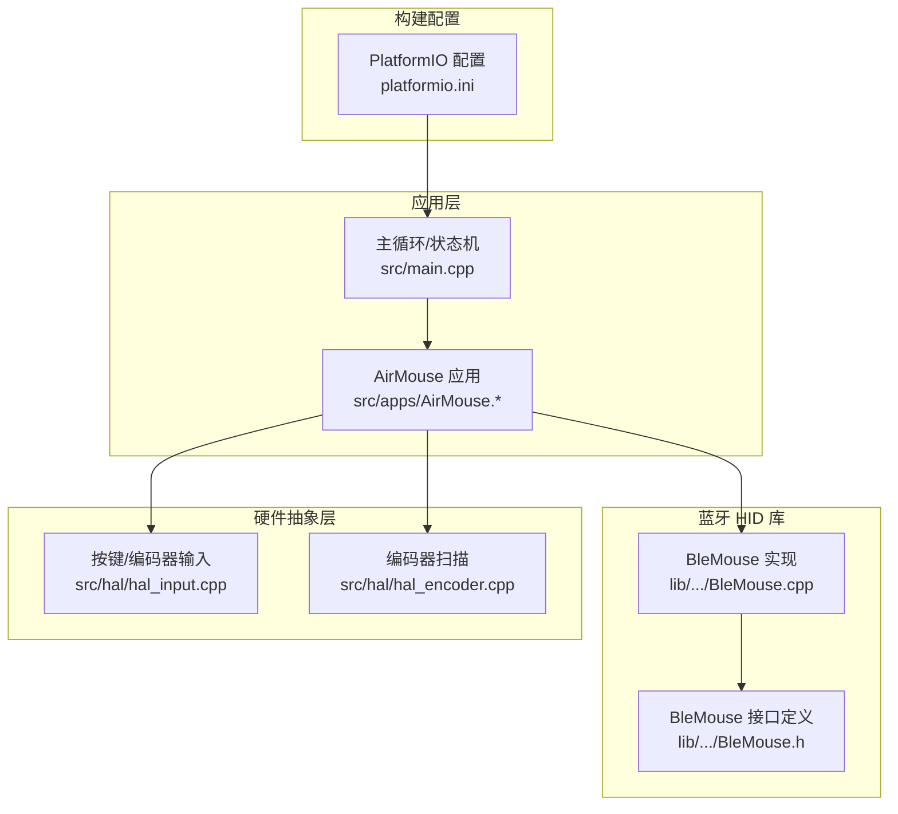
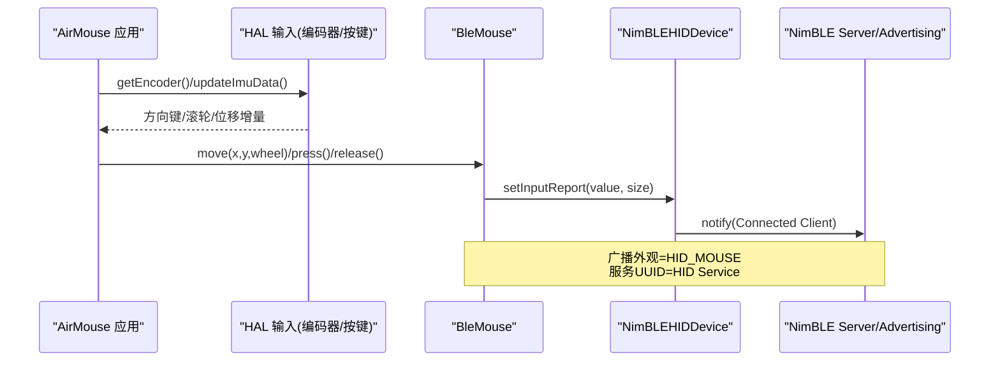
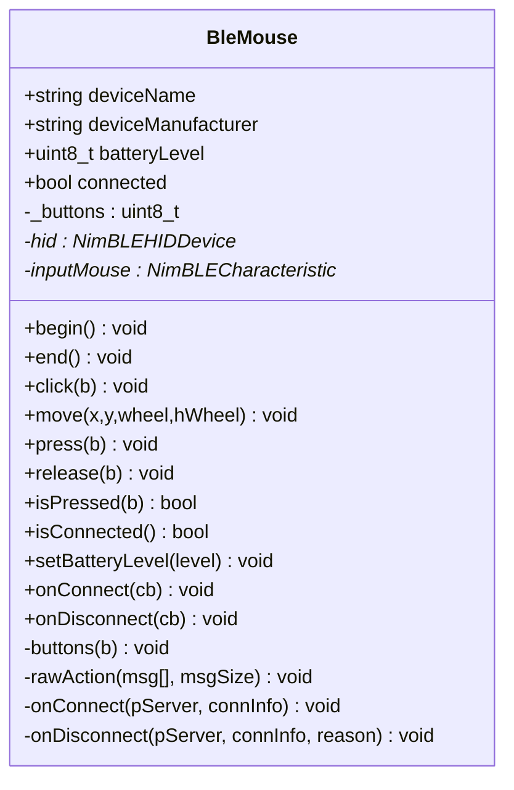
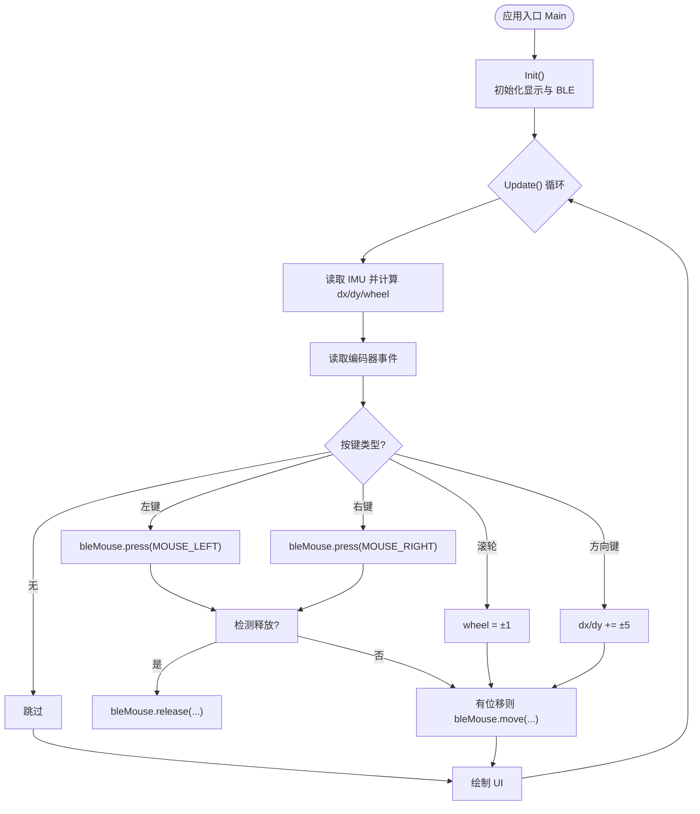
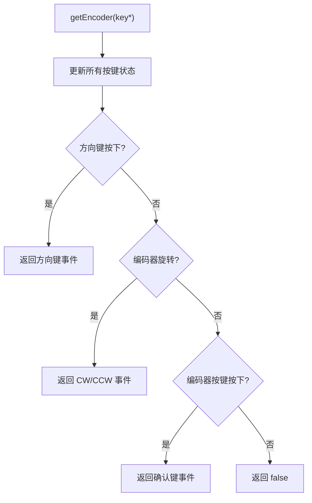
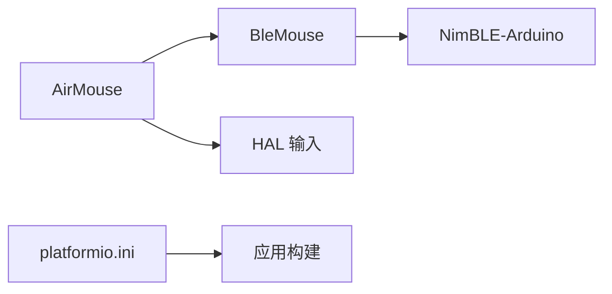

# 蓝牙接口

<cite>
**本文引用的文件**   
- [platformio.ini](file://platformio.ini)
- [main.cpp](file://src/main.cpp)
- [BleMouse.h](file://lib/ESP32-NimBLE-Mouse/src/BleMouse.h)
- [BleMouse.cpp](file://lib/ESP32-NimBLE-Mouse/src/BleMouse.cpp)
- [AirMouse.h](file://src/apps/AirMouse.h)
- [AirMouse.cpp](file://src/apps/AirMouse.cpp)
- [hal_input.cpp](file://src/hal/hal_input.cpp)
- [hal_encoder.cpp](file://src/hal/hal_encoder.cpp)
</cite>

## 目录
1. [简介](#简介)
2. [项目结构](#项目结构)
3. [核心组件](#核心组件)
4. [架构总览](#架构总览)
5. [详细组件分析](#详细组件分析)
6. [依赖关系分析](#依赖关系分析)
7. [性能与功耗优化](#性能与功耗优化)
8. [故障排查指南](#故障排查指南)
9. [结论](#结论)
10. [附录：API 参考与示例](#附录api-参考与示例)

## 简介
本文件为 ESP32 NullPod 的蓝牙接口提供系统化 API 文档，聚焦基于 NimBLE 的 HID 鼠标实现。内容涵盖 BLE 协议栈初始化、服务与特征值配置、设备连接管理、数据传输（HID 报告）、以及上层应用如何驱动鼠标移动与按键。同时给出连接回调、安全配对、功耗优化等高级实践建议，并附带可落地的代码路径指引。

## 项目结构
本项目以 Arduino + PlatformIO 构建，目标板为 ESP32-S3，启用 PSRAM 与 USB CDC 调试。蓝牙相关能力由第三方库 ESP32-NimBLE-Mouse 提供，应用层通过 AirMouse 应用将 IMU/编码器输入映射为 HID 鼠标事件。

**图表来源** 
- [platformio.ini:11-27](file://platformio.ini#L11-L27)
- [main.cpp:18-24](file://src/main.cpp#L18-L24)
- [AirMouse.cpp:1-23](file://src/apps/AirMouse.cpp#L1-L23)
- [BleMouse.h:17-33](file://lib/ESP32-NimBLE-Mouse/src/BleMouse.h#L17-L33)
- [BleMouse.cpp:64-84](file://lib/ESP32-NimBLE-Mouse/src/BleMouse.cpp#L64-L84)
- [hal_encoder.cpp:74-128](file://src/hal/hal_encoder.cpp#L74-L128)
- [hal_input.cpp:7-24](file://src/hal/hal_input.cpp#L7-L24)

**章节来源**
- [platformio.ini:11-27](file://platformio.ini#L11-L27)
- [main.cpp:18-24](file://src/main.cpp#L18-L24)

## 核心组件
- BleMouse（NimBLE HID Mouse）
  - 负责 BLE 协议栈初始化、HID 服务与特征值创建、广播外观设置、连接回调、电池电量上报、HID 鼠标报告发送。
- AirMouse 应用
  - 负责 UI 绘制、IMU 数据读取与鼠标增量计算、编码器按键处理、调用 BleMouse 进行移动与点击。
- HAL 输入子系统
  - 提供按键扫描与编码器事件统一接口，供 AirMouse 使用。

**章节来源**
- [BleMouse.h:17-33](file://lib/ESP32-NimBLE-Mouse/src/BleMouse.h#L17-L33)
- [BleMouse.cpp:64-84](file://lib/ESP32-NimBLE-Mouse/src/BleMouse.cpp#L64-L84)
- [AirMouse.cpp:14-23](file://src/apps/AirMouse.cpp#L14-L23)
- [hal_encoder.cpp:74-128](file://src/hal/hal_encoder.cpp#L74-L128)
- [hal_input.cpp:7-24](file://src/hal/hal_input.cpp#L7-L24)

## 架构总览
下图展示从应用到 BLE 协议栈的完整调用链：应用层采集传感器与按键，转换为 HID 鼠标报告，经由 BleMouse 写入特征值并通过 NimBLE 广播与服务对外暴露。

**图表来源** 
- [AirMouse.cpp:58-147](file://src/apps/AirMouse.cpp#L58-L147)
- [BleMouse.cpp:97-108](file://lib/ESP32-NimBLE-Mouse/src/BleMouse.cpp#L97-L108)
- [BleMouse.cpp:64-84](file://lib/ESP32-NimBLE-Mouse/src/BleMouse.cpp#L64-L84)

## 详细组件分析

### BleMouse 类（蓝牙 HID 鼠标）
- 职责
  - 初始化 NimBLE 设备与服务器，创建 HID 服务与特征值，配置 HID Report Map（鼠标）。
  - 处理连接/断开回调，维护连接状态与电池电量。
  - 封装鼠标移动、点击、按钮状态查询等便捷 API。
- 关键流程
  - begin(): 初始化 BLE 设备名与安全策略，创建服务器与 HID 设备，注册回调，设置外观与广播服务，启动广播。
  - move(): 当已连接时，组装 5 字节 HID 报告（按钮位+X/Y/Wheel/HWheel），写入特征值并通知客户端。
  - press/release/buttons/isPressed: 维护内部按钮掩码，必要时触发一次 move 以刷新 HID 报告。
  - onConnect/onDisconnect: 更新连接标志并触发用户回调。
- 数据结构与复杂度
  - 内部按钮掩码 uint8_t，O(1) 操作；HID 报告固定长度 5 字节，内存与 CPU 开销极低。
- 错误处理与边界
  - isConnected 检查后再发送报告，避免未连接时的无效写入。
  - setBatteryLevel 仅在 hid 非空时更新，防止空指针。

**图表来源** 
- [BleMouse.h:17-53](file://lib/ESP32-NimBLE-Mouse/src/BleMouse.h#L17-L53)
- [BleMouse.cpp:57-157](file://lib/ESP32-NimBLE-Mouse/src/BleMouse.cpp#L57-L157)

**章节来源**
- [BleMouse.h:17-53](file://lib/ESP32-NimBLE-Mouse/src/BleMouse.h#L17-L53)
- [BleMouse.cpp:64-84](file://lib/ESP32-NimBLE-Mouse/src/BleMouse.cpp#L64-L84)
- [BleMouse.cpp:97-108](file://lib/ESP32-NimBLE-Mouse/src/BleMouse.cpp#L97-L108)
- [BleMouse.cpp:141-157](file://lib/ESP32-NimBLE-Mouse/src/BleMouse.cpp#L141-L157)

### AirMouse 应用（空中鼠标）
- 职责
  - 初始化显示与 BLE 鼠标，绘制 UI，周期性读取 IMU 与编码器，将动作映射为 HID 鼠标事件。
- 关键流程
  - Init(): 获取显示对象，绘制 UI，调用 bleMouse.begin() 启动 BLE HID。
  - Update(): 读取 IMU 数据并计算 dx/dy/wheel；处理编码器按键（左/右键按下、方向键、滚轮）；根据状态调用 bleMouse.press/release/move。
  - Main(): 进入主循环，直到返回键退出。
- 交互细节
  - 方向键直接放大位移增量，模拟键盘方向键效果。
  - 左右键按下/释放通过状态变量控制，确保与物理按键同步。

**图表来源** 
- [AirMouse.cpp:14-23](file://src/apps/AirMouse.cpp#L14-L23)
- [AirMouse.cpp:58-147](file://src/apps/AirMouse.cpp#L58-L147)

**章节来源**
- [AirMouse.h:8-42](file://src/apps/AirMouse.h#L8-L42)
- [AirMouse.cpp:14-23](file://src/apps/AirMouse.cpp#L14-L23)
- [AirMouse.cpp:58-147](file://src/apps/AirMouse.cpp#L58-L147)

### HAL 输入子系统（编码器与按键）
- 职责
  - 初始化 GPIO 并映射按键；提供统一的 getEncoder 接口，按优先级输出方向键、旋转、确认键事件。
- 关键点
  - 非阻塞按键扫描，结合 PCNT 计数值计算编码器增量。
  - 支持短按/长按/连发等扩展（Button 类接口在 Button.h 中声明）。

**图表来源** 
- [hal_encoder.cpp:74-128](file://src/hal/hal_encoder.cpp#L74-L128)
- [hal_input.cpp:7-24](file://src/hal/hal_input.cpp#L7-L24)

**章节来源**
- [hal_encoder.cpp:74-128](file://src/hal/hal_encoder.cpp#L74-L128)
- [hal_input.cpp:7-24](file://src/hal/hal_input.cpp#L7-L24)

## 依赖关系分析
- 应用层依赖
  - AirMouse 依赖 BleMouse 提供的 HID 鼠标能力。
  - AirMouse 依赖 HAL 输入子系统获取编码器与按键事件。
- 底层依赖
  - BleMouse 依赖 NimBLE-Arduino 提供的 NimBLEServer/NimBLEHIDDevice 等能力。
- 构建配置
  - platformio.ini 指定 ESP32-S3 平台、PSRAM 启用、USB CDC 调试等编译选项。

**图表来源** 
- [AirMouse.cpp:1-6](file://src/apps/AirMouse.cpp#L1-L6)
- [BleMouse.cpp:1-14](file://lib/ESP32-NimBLE-Mouse/src/BleMouse.cpp#L1-L14)
- [platformio.ini:11-27](file://platformio.ini#L11-L27)

**章节来源**
- [AirMouse.cpp:1-6](file://src/apps/AirMouse.cpp#L1-L6)
- [BleMouse.cpp:1-14](file://lib/ESP32-NimBLE-Mouse/src/BleMouse.cpp#L1-L14)
- [platformio.ini:11-27](file://platformio.ini#L11-L27)

## 性能与功耗优化
- 传输效率
  - HID 鼠标报告固定 5 字节，仅在存在变化时发送，减少 BLE 负载。
- 连接管理
  - 通过 isConnected 判断是否发送报告，避免无效通信。
- 功耗优化建议
  - 降低广播间隔（需通过 NimBLEAdvertising 配置，当前库未暴露该 API）。
  - 在无活动周期关闭或降级 BLE 功能（需在应用层实现空闲检测与休眠策略）。
  - 合理设置 IMU 采样率与滤波参数，减少不必要的移动上报。
- 系统级
  - 利用 PSRAM 提升 UI 缓冲与图像资源加载性能（已在构建选项中启用）。

[本节为通用指导，不直接分析具体文件]

## 故障排查指南
- BLE 无法被发现
  - 检查 begin() 是否被调用，确认广播外观设置为 HID_MOUSE 且包含 HID 服务 UUID。
  - 确认设备名称与安全策略已正确设置。
- 连接后无鼠标移动
  - 检查 isConnected 是否为真；确认 move() 的参数不为零。
  - 验证 HID Report Map 是否正确（库内已内置鼠标描述符）。
- 按键无响应
  - 检查编码器按键映射与 GPIO 初始化是否正确。
  - 确认 getEncoder() 返回值与按键优先级逻辑是否符合预期。
- 电池电量不更新
  - 确认 setBatteryLevel() 在 hid 非空时调用。

**章节来源**
- [BleMouse.cpp:64-84](file://lib/ESP32-NimBLE-Mouse/src/BleMouse.cpp#L64-L84)
- [BleMouse.cpp:97-108](file://lib/ESP32-NimBLE-Mouse/src/BleMouse.cpp#L97-L108)
- [hal_encoder.cpp:74-128](file://src/hal/hal_encoder.cpp#L74-L128)
- [hal_input.cpp:7-24](file://src/hal/hal_input.cpp#L7-L24)

## 结论
本项目通过 BleMouse 库在 ESP32 上实现了标准的 BLE HID 鼠标，AirMouse 应用将 IMU 与编码器输入映射为 HID 报告，形成完整的“空中鼠标”体验。整体架构清晰、耦合度低，便于扩展其他 HID 设备（如键盘、游戏手柄）与自定义 BLE 透传服务。

[本节为总结性内容，不直接分析具体文件]

## 附录：API 参考与示例

### BLE 初始化与服务发现
- 初始化步骤
  - 调用 BleMouse::begin() 完成 NimBLE 设备初始化、HID 服务创建、广播外观设置与启动。
- 服务与特征值
  - HID 服务与输入报告特征值由 NimBLEHIDDevice 自动创建，Report Map 内置于库中。
- 连接回调
  - 通过 onConnect/onDisconnect 注册回调，监听连接状态变化。

**章节来源**
- [BleMouse.cpp:64-84](file://lib/ESP32-NimBLE-Mouse/src/BleMouse.cpp#L64-L84)
- [BleMouse.cpp:141-157](file://lib/ESP32-NimBLE-Mouse/src/BleMouse.cpp#L141-L157)

### 数据传输（HID 鼠标）
- 移动与滚轮
  - 调用 BleMouse::move(x, y, wheel, hWheel) 发送相对位移与滚轮事件。
- 按键
  - 使用 press()/release() 组合控制左/右/中/后退/前进键；isPressed() 查询状态。
- 连接检查
  - 发送前调用 isConnected() 确保链路有效。

**章节来源**
- [BleMouse.cpp:90-123](file://lib/ESP32-NimBLE-Mouse/src/BleMouse.cpp#L90-L123)
- [BleMouse.cpp:131-139](file://lib/ESP32-NimBLE-Mouse/src/BleMouse.cpp#L131-L139)

### 鼠标模拟示例（AirMouse）
- 初始化
  - 在应用 Init() 中调用 bleMouse.begin()。
- 主循环
  - 读取 IMU 与编码器，计算 dx/dy/wheel，调用 bleMouse.move() 与 press()/release()。
- 参考路径
  - [AirMouse.cpp:14-23](file://src/apps/AirMouse.cpp#L14-L23)
  - [AirMouse.cpp:58-147](file://src/apps/AirMouse.cpp#L58-L147)

**章节来源**
- [AirMouse.cpp:14-23](file://src/apps/AirMouse.cpp#L14-L23)
- [AirMouse.cpp:58-147](file://src/apps/AirMouse.cpp#L58-L147)

### 键盘输入（概念说明）
- 当前仓库未包含键盘 HID 实现。若需键盘输入，可在 BleMouse 基础上扩展 NimBLEHIDDevice 的键盘报告描述符与特征值，并在应用层映射按键为 HID 键盘扫描码。
- 建议参考 NimBLEHIDDevice 的键盘相关接口（库内已有键盘 boot input/output characteristic 相关方法）。

[本节为概念性说明，不直接分析具体文件]

### 数据透传（概念说明）
- 当前仓库未包含自定义 BLE 透传服务。若需透传，可基于 NimBLEService/NimBLECharacteristic 创建自定义服务与读写特征，并在 onConnect/onDisconnect 中管理会话。
- 建议参考 Adafruit NeoPixel 示例中的 BLESerial 思路（位于 lib/Adafruit NeoPixel/examples/StrandtestBLE/），但注意该示例使用不同 BLE 库，移植时需替换为 NimBLE 对应 API。

[本节为概念性说明，不直接分析具体文件]

### 连接管理与安全配对
- 连接管理
  - 通过 onConnect/onDisconnect 回调更新连接状态，应用层据此调整行为（如暂停上报、切换 UI）。
- 安全配对
  - begin() 中已设置 BLE_SM_PAIR_AUTHREQ_BOND，启用绑定配对。
- 电池电量
  - 使用 setBatteryLevel() 定期更新，有助于主机端显示电量。

**章节来源**
- [BleMouse.cpp:64-84](file://lib/ESP32-NimBLE-Mouse/src/BleMouse.cpp#L64-L84)
- [BleMouse.cpp:141-157](file://lib/ESP32-NimBLE-Mouse/src/BleMouse.cpp#L141-L157)
- [BleMouse.cpp:135-139](file://lib/ESP32-NimBLE-Mouse/src/BleMouse.cpp#L135-L139)

### 功耗优化最佳实践
- 仅在检测到运动或按键时发送 HID 报告。
- 在长时间无活动时降低 IMU 采样率或关闭 BLE 广播（需自行扩展）。
- 利用系统低功耗模式与任务调度，减少 CPU 占用。

[本节为通用指导，不直接分析具体文件]