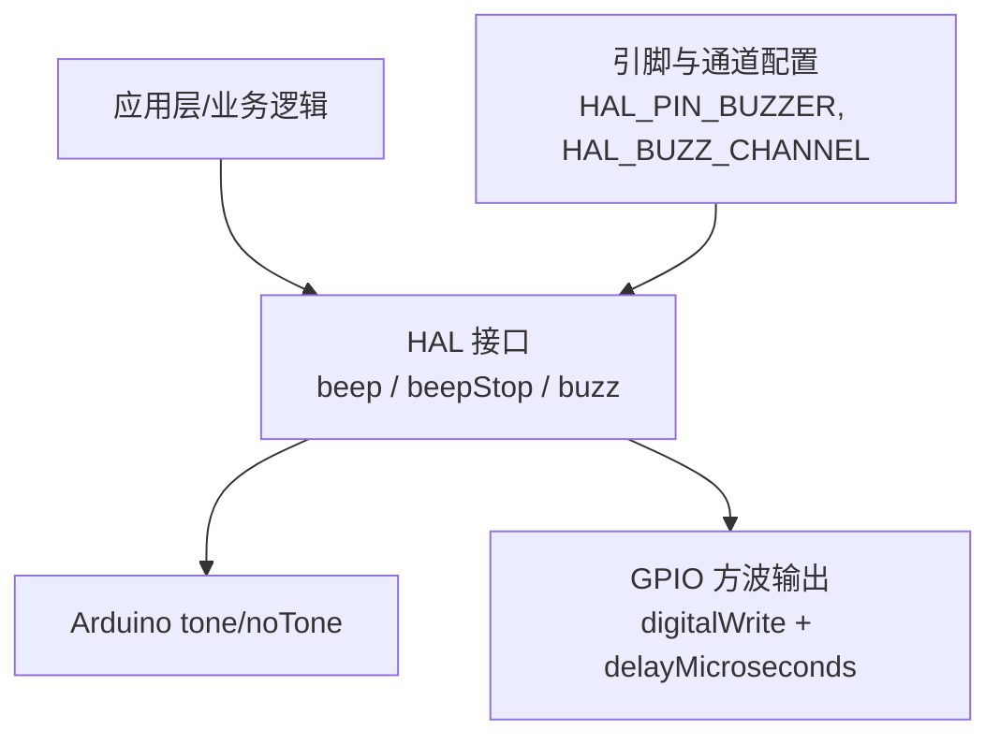
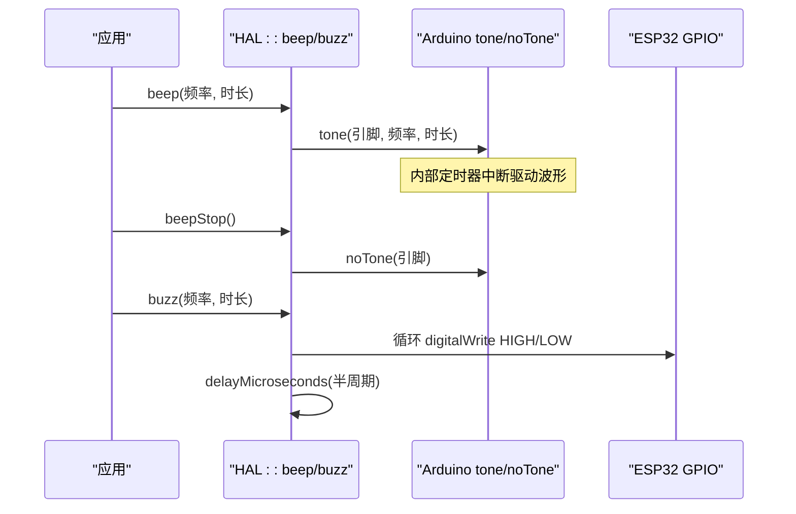
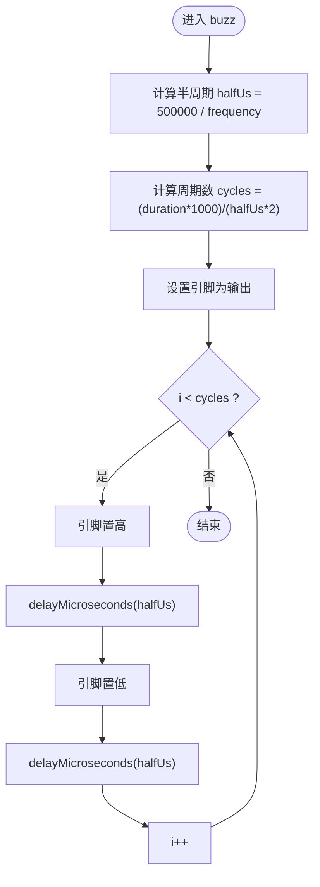
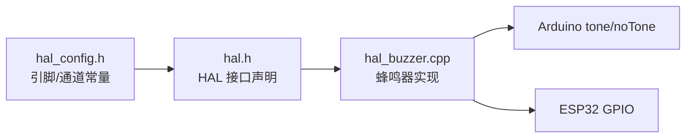

# 音频接口

<cite>
**本文引用的文件**   
- [hal_buzzer.cpp](file://src/hal/hal_buzzer.cpp)
- [hal.h](file://src/hal/hal.h)
- [hal_config.h](file://src/hal/hal_config.h)
</cite>

## 目录
1. [简介](#简介)
2. [项目结构](#项目结构)
3. [核心组件](#核心组件)
4. [架构总览](#架构总览)
5. [详细组件分析](#详细组件分析)
6. [依赖关系分析](#依赖关系分析)
7. [性能与功耗考量](#性能与功耗考量)
8. [故障排查指南](#故障排查指南)
9. [结论](#结论)
10. [附录：API 参考](#附录api-参考)

## 简介
本文件为 ESP32 NullPod 的音频接口提供详细 API 文档，聚焦蜂鸣器控制、音调生成、音量调节等核心能力。当前代码库实现了基于 Arduino tone/noTone 的蜂鸣器驱动，以及一个基于 GPIO 翻转的方波发声实现；同时声明了音频子系统（Audio_Init/Audio_Update/Audio_PlayMusic）接口，但尚未提供对应实现。本文在严格依据源码的前提下，给出可操作的调用方式、频率计算原理、波形生成机制，并补充面向工程实践的优化建议与排障方法。

## 项目结构
与音频相关的代码集中在 HAL 层：
- 蜂鸣器驱动实现：src/hal/hal_buzzer.cpp
- HAL 公共接口声明：src/hal/hal.h
- 引脚与通道配置：src/hal/hal_config.h

图表来源
- [hal_buzzer.cpp:4-28](file://src/hal/hal_buzzer.cpp#L4-L28)
- [hal.h:180-200](file://src/hal/hal.h#L180-L200)
- [hal_config.h:57-60](file://src/hal/hal_config.h#L57-L60)

章节来源
- [hal_buzzer.cpp:1-29](file://src/hal/hal_buzzer.cpp#L1-L29)
- [hal.h:180-200](file://src/hal/hal.h#L180-L200)
- [hal_config.h:57-60](file://src/hal/hal_config.h#L57-L60)

## 核心组件
- 蜂鸣器控制 API
  - beep(frequency, duration)：使用 Arduino tone 以指定频率和时长发声。
  - beepStop()：停止由 tone 产生的声音。
  - buzz(frequency, duration)：通过 GPIO 翻转产生方波，按频率与时长循环输出。
- 音频子系统接口（已声明未实现）
  - Audio_Init()：初始化音频相关资源（如 I2S/PWM）。
  - Audio_Update()：音频数据流更新或播放调度。
  - Audio_PlayMusic(name)：根据文件名播放音乐。

章节来源
- [hal.h:180-200](file://src/hal/hal.h#L180-L200)
- [hal_buzzer.cpp:4-28](file://src/hal/hal_buzzer.cpp#L4-L28)

## 架构总览
蜂鸣器控制走两条路径：
- tone 路径：由 Arduino 框架管理定时器中断，适合短时提示音。
- GPIO 方波路径：直接翻转引脚，适合对时序有强控制的场景。

图表来源
- [hal_buzzer.cpp:4-28](file://src/hal/hal_buzzer.cpp#L4-L28)
- [hal.h:180-183](file://src/hal/hal.h#L180-L183)

## 详细组件分析

### 蜂鸣器 API：beep / beepStop / buzz
- beep(frequency, duration)
  - 功能：以指定频率和持续时间发声。
  - 实现要点：调用 Arduino tone，底层由定时器中断驱动。
  - 适用场景：短促提示音、按键反馈。
- beepStop()
  - 功能：立即停止 tone 产生的声音。
  - 注意：若之前未调用 tone，调用此函数无副作用。
- buzz(frequency, duration)
  - 功能：以指定频率输出方波，持续 duration 毫秒。
  - 算法细节：
    - 半周期 halfUs = 500000 / frequency（微秒）
    - 周期数 cycles = (duration * 1000) / (halfUs * 2)
    - 循环内交替设置引脚高/低，并使用 delayMicroseconds(halfUs) 延时
  - 适用场景：需要精确控制每个周期的场合，或对 tone 不可用时作为备选方案。

图表来源
- [hal_buzzer.cpp:14-28](file://src/hal/hal_buzzer.cpp#L14-L28)

章节来源
- [hal_buzzer.cpp:4-28](file://src/hal/hal_buzzer.cpp#L4-L28)

### 音频子系统接口：Audio_Init / Audio_Update / Audio_PlayMusic
- 现状
  - 已在 HAL 接口中声明 Audio_Init、Audio_Update、Audio_PlayMusic，但未找到对应实现文件。
  - 这意味着当前固件不包含 MP3/WAV 解码与 I2S/PWM 音频输出的完整实现。
- 设计意图
  - Audio_Init：初始化音频硬件（如 I2S、PWM、DMA 缓冲区）。
  - Audio_Update：周期性从存储读取音频帧并推送到硬件 FIFO。
  - Audio_PlayMusic：根据文件名加载并启动播放流程。
- 建议实现方向（概念性说明）
  - 使用 I2S 外设进行数字音频输出，配合 DMA 环形缓冲降低 CPU 占用。
  - 使用 FreeRTOS 任务处理解码与数据搬运，避免阻塞主循环。
  - 支持常见格式（WAV/MP3），按需引入轻量解码库。
  - 提供音量控制（数字增益或 PWM 占空比映射到模拟音量）。

章节来源
- [hal.h:197-200](file://src/hal/hal.h#L197-L200)

## 依赖关系分析
- 模块耦合
  - hal_buzzer.cpp 依赖 Arduino 的 tone/noTone 与 GPIO 操作。
  - hal.h 暴露蜂鸣器与音频子系统的统一接口。
  - hal_config.h 定义蜂鸣器引脚与通道常量。
- 外部依赖
  - Arduino 框架提供的 tone/noTone 抽象。
  - ESP32 的 GPIO 与定时器/中断系统。

图表来源
- [hal_config.h:57-60](file://src/hal/hal_config.h#L57-L60)
- [hal.h:180-200](file://src/hal/hal.h#L180-L200)
- [hal_buzzer.cpp:1-28](file://src/hal/hal_buzzer.cpp#L1-L28)

章节来源
- [hal_config.h:57-60](file://src/hal/hal_config.h#L57-L60)
- [hal.h:180-200](file://src/hal/hal.h#L180-L200)
- [hal_buzzer.cpp:1-28](file://src/hal/hal_buzzer.cpp#L1-L28)

## 性能与功耗考量
- 蜂鸣器驱动选择
  - tone 路径：由中断驱动，CPU 占用低，适合短时提示音；长时间播放可能带来中断抖动。
  - GPIO 方波路径：完全由主循环控制，延迟可控但会阻塞 CPU；适用于需要精确时序的场景。
- 频率与精度
  - buzz 使用整数除法计算半周期，高频时误差累积；如需高精度可用 ledc 或 I2S。
- 功耗控制
  - 及时调用 beepStop 停止 tone，避免持续发声耗电。
  - 对于长时音频，优先采用 DMA/I2S 方案以降低 CPU 占用与动态功耗。
- 音质优化（概念性建议）
  - 使用 I2S + DMA 输出 PCM 数据，减少卡顿与爆音。
  - 合理设置采样率与位深，平衡音质与内存占用。
  - 音量控制可采用数字增益或 PWM 映射到模拟音量电路。

[本节为通用指导，不直接分析具体文件]

## 故障排查指南
- 无声或声音异常
  - 检查蜂鸣器引脚配置是否正确（HAL_PIN_BUZZER）。
  - 确认是否调用了 beepStop 提前终止了 tone。
  - 验证频率是否在蜂鸣器有效范围内（过低/过高可能导致听不见）。
- 声音断续或卡顿
  - 避免在主循环中进行耗时操作，确保 delayMicroseconds 不被打断。
  - 长时间播放建议使用 I2S/DMA 方案。
- 功耗偏高
  - 检查是否有未停止的 tone 或持续的 buzz 循环。
  - 降低重复提示音的频率与时长。

章节来源
- [hal_buzzer.cpp:4-28](file://src/hal/hal_buzzer.cpp#L4-L28)
- [hal_config.h:57-60](file://src/hal/hal_config.h#L57-L60)

## 结论
当前固件提供了简洁可靠的蜂鸣器控制 API，满足提示音与基础音频反馈需求。音频子系统接口已预留，便于后续扩展 I2S/PWM 音频输出与音乐播放能力。建议在实现阶段采用 DMA/I2S 方案以提升音质与能效，并通过合理的音量控制与中断策略优化用户体验。

[本节为总结性内容，不直接分析具体文件]

## 附录：API 参考

- HAL::beep(float frequency, uint32_t duration)
  - 功能：以指定频率和时长发声（基于 Arduino tone）。
  - 参数：
    - frequency：频率（Hz）
    - duration：持续时间（ms）
  - 返回值：无
  - 使用示例（概念性）：
    - 按键提示音：HAL::beep(1000, 100);
    - 错误提示：HAL::beep(500, 200);

- HAL::beepStop()
  - 功能：停止 tone 产生的声音。
  - 参数：无
  - 返回值：无
  - 使用示例（概念性）：
    - 条件停止：if(playing) HAL::beepStop();

- HAL::buzz(float frequency, uint32_t duration)
  - 功能：以指定频率输出方波，持续 duration 毫秒。
  - 参数：
    - frequency：频率（Hz）
    - duration：持续时间（ms）
  - 返回值：无
  - 使用示例（概念性）：
    - 连续提示音：HAL::buzz(2000, 500);

- HAL::Audio_Init()
  - 状态：已声明，未实现
  - 用途：初始化音频硬件与资源

- HAL::Audio_Update()
  - 状态：已声明，未实现
  - 用途：音频数据流更新或播放调度

- HAL::Audio_PlayMusic(const char *name)
  - 状态：已声明，未实现
  - 用途：根据文件名播放音乐

章节来源
- [hal.h:180-200](file://src/hal/hal.h#L180-L200)
- [hal_buzzer.cpp:4-28](file://src/hal/hal_buzzer.cpp#L4-L28)