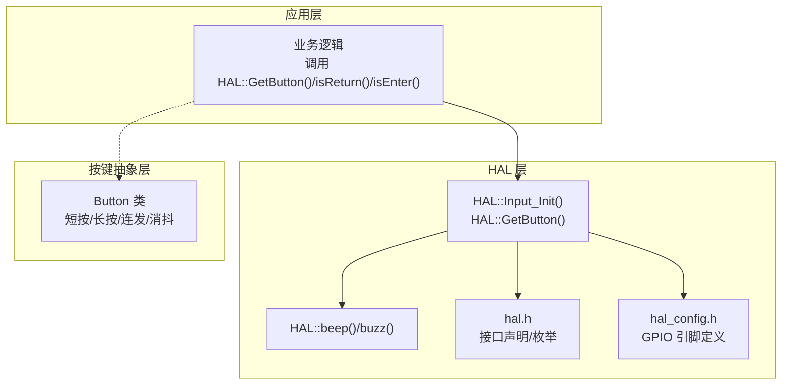
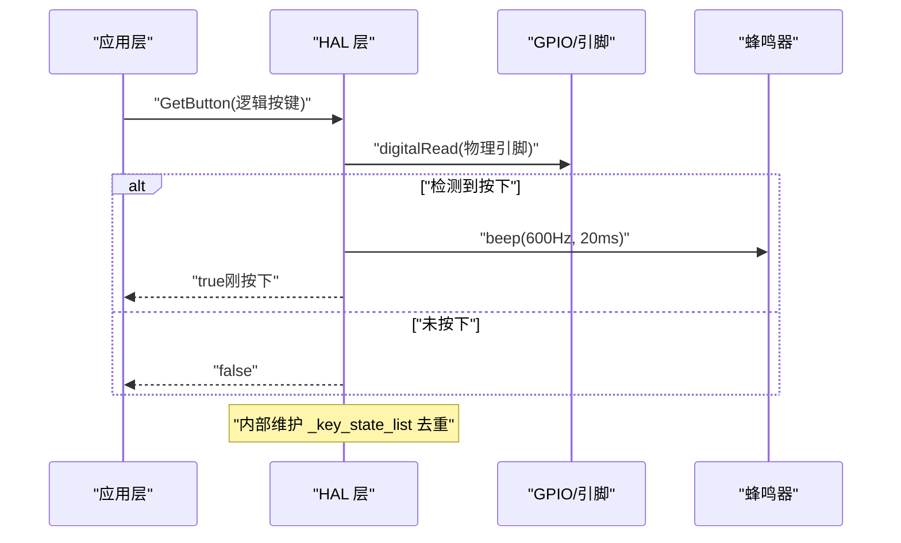
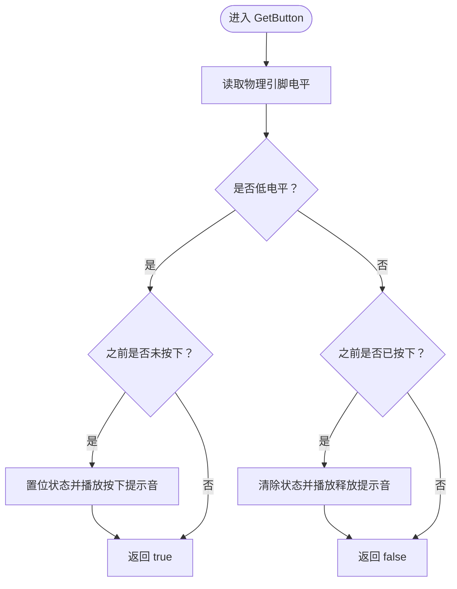
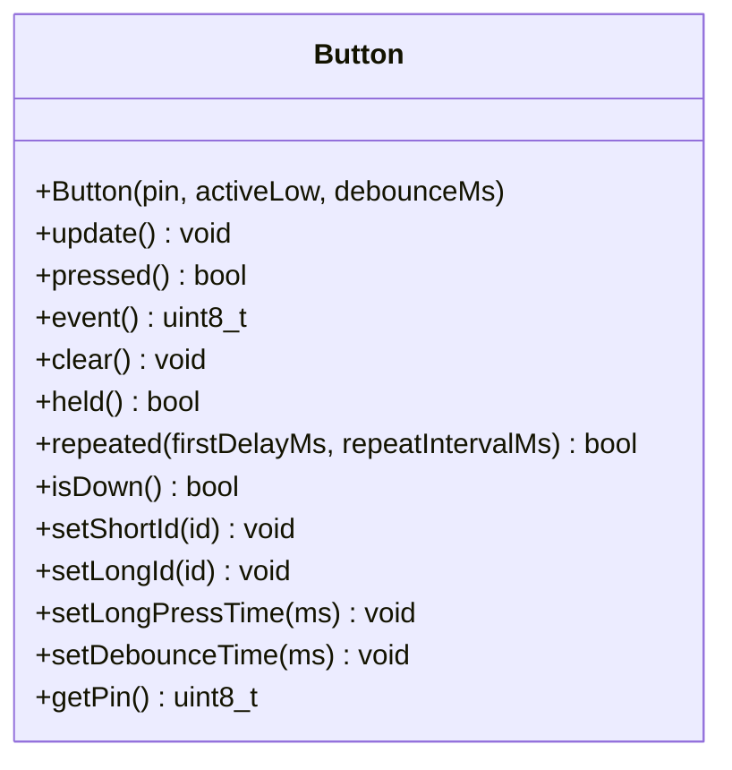
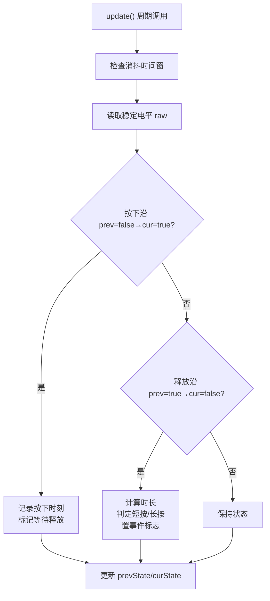
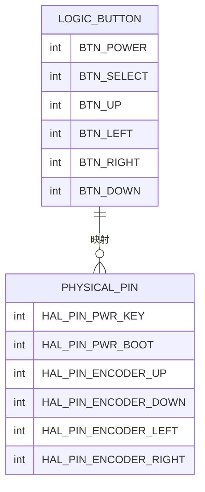
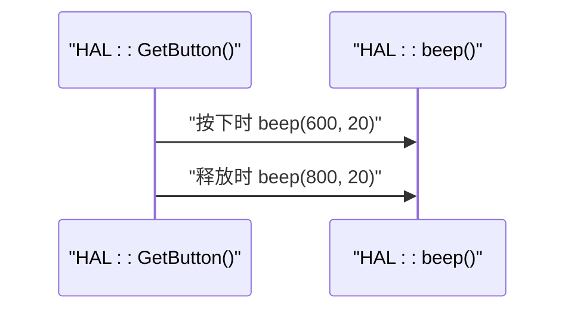
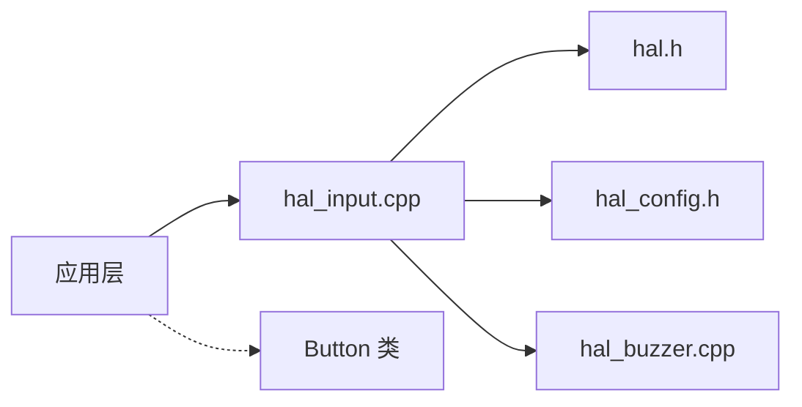

# 按钮控制接口

<cite>
**本文引用的文件**   
- [Button.h](file://src/hal/Button.h)
- [Button.cpp](file://src/hal/Button.cpp)
- [hal_input.cpp](file://src/hal/hal_input.cpp)
- [hal_buzzer.cpp](file://src/hal/hal_buzzer.cpp)
- [hal.h](file://src/hal/hal.h)
- [hal_config.h](file://src/hal/hal_config.h)
</cite>

## 目录
1. [简介](#简介)
2. [项目结构](#项目结构)
3. [核心组件](#核心组件)
4. [架构总览](#架构总览)
5. [详细组件分析](#详细组件分析)
6. [依赖关系分析](#依赖关系分析)
7. [性能与实时性](#性能与实时性)
8. [故障排查指南](#故障排查指南)
9. [结论](#结论)
10. [附录：API 参考与配置示例](#附录api-参考与配置示例)

## 简介
本文件面向 ESP32 NullPod 的“物理按键 + 逻辑按键”控制子系统，重点说明以下能力：
- HAL 层按键检测 API：GetButton()、isReturn()、isEnter()
- Button 类完整 API 与用法：短按/长按识别、按住持续触发、连发模式、消抖
- 物理引脚到逻辑按键的映射机制
- 多按键同时按下时的处理策略与优先级
- 蜂鸣器反馈机制（按键按下/释放提示音）

该文档既适合快速上手使用，也适合深入理解实现细节。

## 项目结构
与按钮控制相关的核心代码位于 hal 层：
- Button.h / Button.cpp：非阻塞按键类，提供事件与状态接口
- hal_input.cpp：HAL 层按键扫描、去抖动、按键状态机、蜂鸣器反馈
- hal_buzzer.cpp：蜂鸣器发声封装
- hal.h：HAL 接口声明、按键枚举、Button 句柄获取函数
- hal_config.h：GPIO 引脚定义（电源键、选择键、方向键等）

图表来源
- [hal_input.cpp:7-58](file://src/hal/hal_input.cpp#L7-L58)
- [hal_buzzer.cpp:4-28](file://src/hal/hal_buzzer.cpp#L4-L28)
- [hal.h:13-29,94-100,126-133,180-183,209-210:13-29](file://src/hal/hal.h#L13-L29)
- [hal_config.h:24-36,57-59:24-36](file://src/hal/hal_config.h#L24-L36)

章节来源
- [hal_input.cpp:1-59](file://src/hal/hal_input.cpp#L1-L59)
- [hal_buzzer.cpp:1-29](file://src/hal/hal_buzzer.cpp#L1-L29)
- [hal.h:1-215](file://src/hal/hal.h#L1-L215)
- [hal_config.h:1-123](file://src/hal/hal_config.h#L1-L123)

## 核心组件
- HAL 按键接口
  - Input_Init()：初始化按键 GPIO 并建立“逻辑按键 → 物理引脚”的映射表
  - GetButton(button)：读取指定逻辑按键电平，维护“刚按下/刚释放”状态，返回是否“刚按下”，并在按下/释放时触发蜂鸣器
  - isReturn() / isEnter()：分别对应“返回键”和“确认键”的便捷方法
- Button 类
  - 非阻塞更新 update()
  - 事件接口：pressed()、event()、clear()
  - 状态接口：held()、repeated(firstDelayMs, repeatIntervalMs)、isDown()
  - 配置接口：setShortId()、setLongId()、setLongPressTime()、setDebounceTime()、getPin()
- 蜂鸣器
  - beep(frequency, duration)：tone 驱动蜂鸣器
  - buzz(frequency, duration)：软件方波驱动蜂鸣器
  - beepStop()：停止 tone

章节来源
- [hal_input.cpp:7-58](file://src/hal/hal_input.cpp#L7-L58)
- [Button.h:48-182](file://src/hal/Button.h#L48-L182)
- [Button.cpp:12-168](file://src/hal/Button.cpp#L12-L168)
- [hal_buzzer.cpp:4-28](file://src/hal/hal_buzzer.cpp#L4-L28)

## 架构总览
下图展示从应用层到硬件层的按键调用链路与数据流：

图表来源
- [hal_input.cpp:26-48](file://src/hal/hal_input.cpp#L26-L48)
- [hal_buzzer.cpp:4-7](file://src/hal/hal_buzzer.cpp#L4-L7)

## 详细组件分析

### HAL 按键接口：GetButton()、isReturn()、isEnter()
- 输入参数
  - button：逻辑按键编号，来自 ENCODER::EncoderButton_t 枚举
- 返回值
  - true：本次调用为“刚按下”
  - false：不是“刚按下”（可能为持续按下或已释放）
- 行为说明
  - 通过 _gamepad_key_map[button] 查找到物理引脚
  - 若引脚为低电平（上拉按键按下），且内部状态为未按下，则置位状态并触发蜂鸣器
  - 若引脚恢复高电平且内部状态为已按下，则清除状态并触发释放提示音
  - 仅在“边沿变化”时触发蜂鸣器，避免重复发声
- 便捷方法
  - isReturn()：绑定 BTN_POWER（电源键）
  - isEnter()：绑定 BTN_SELECT（选择键）

图表来源
- [hal_input.cpp:26-48](file://src/hal/hal_input.cpp#L26-L48)

章节来源
- [hal_input.cpp:7-58](file://src/hal/hal_input.cpp#L7-L58)
- [hal.h:13-29,126-133,209-210:13-29](file://src/hal/hal.h#L13-L29)

### Button 类 API 与用法
- 构造与初始化
  - Button(pin, activeLow=true, debounceMs=5)
  - 自动设置 GPIO 模式（低电平有效时使用 INPUT_PULLUP）
- 非阻塞更新
  - update()：在 loop() 或定时器中周期性调用；内部完成消抖、边沿检测、长按判定
- 事件接口
  - pressed()：是否有“短按/长按”事件
  - event()：获取事件 ID（短按 shortId，长按 longId）
  - clear()：清除当前事件标志
- 状态接口
  - held()：是否处于“按住未释放”状态
  - repeated(firstDelayMs, repeatIntervalMs)：连发模式（首帧延迟 + 固定间隔）
  - isDown()：原始引脚电平（未经消抖）
- 配置接口
  - setShortId(id)、setLongId(id)
  - setLongPressTime(ms)：默认 500ms
  - setDebounceTime(ms)：默认 5ms
  - getPin()：返回绑定的 GPIO

图表来源
- [Button.h:48-182](file://src/hal/Button.h#L48-L182)

章节来源
- [Button.h:1-183](file://src/hal/Button.h#L1-L183)
- [Button.cpp:12-168](file://src/hal/Button.cpp#L12-L168)

### 按键状态管理与去抖动算法
- HAL 层状态管理
  - _gamepad_key_map：逻辑按键到物理引脚的映射表
  - _key_state_list：每个逻辑按键的“已按下”标志，用于去重与边沿检测
- 去抖动策略
  - HAL 层：通过“上次状态 vs 当前状态”判断边沿，避免重复触发
  - Button 类：基于时间戳与阈值进行消抖（debounceMs），并在 update() 中统一处理
- 长按判定
  - Button 类：在释放沿处计算按下持续时间，与 _longPressMs 比较区分短按/长按
- 连发模式
  - Button::repeated()：首次延迟后开始连发，之后以固定间隔触发

图表来源
- [Button.cpp:28-70](file://src/hal/Button.cpp#L28-L70)

章节来源
- [hal_input.cpp:4-24](file://src/hal/hal_input.cpp#L4-L24)
- [Button.cpp:28-70](file://src/hal/Button.cpp#L28-L70)

### 物理按键与逻辑按键映射
- 逻辑按键枚举（ENCODER::EncoderButton_t）
  - BTN_POWER、BTN_SELECT、BTN_UP、BTN_LEFT、BTN_RIGHT、BTN_DOWN
- 物理引脚定义（hal_config.h）
  - HAL_PIN_PWR_KEY、HAL_PIN_PWR_BOOT、HAL_PIN_ENCODER_UP/DOWN/LEFT/RIGHT
- 映射初始化（Input_Init）
  - 将逻辑按键索引映射到具体 GPIO
  - 所有按键引脚初始化为 INPUT_PULLUP

图表来源
- [hal.h:13-29](file://src/hal/hal.h#L13-L29)
- [hal_config.h:24-36](file://src/hal/hal_config.h#L24-L36)
- [hal_input.cpp:7-24](file://src/hal/hal_input.cpp#L7-L24)

章节来源
- [hal.h:13-29](file://src/hal/hal.h#L13-L29)
- [hal_config.h:24-36](file://src/hal/hal_config.h#L24-L36)
- [hal_input.cpp:7-24](file://src/hal/hal_input.cpp#L7-L24)

### 按键优先级与多按键同时按下策略
- 当前实现
  - GetButton() 对每个逻辑按键独立处理，无全局优先级仲裁
  - 多按键同时按下时，各自独立触发“刚按下”与蜂鸣器提示音
- 建议策略
  - 若需优先级（例如电源键优先于方向键），可在应用层集中调度：先检测高优先级按键，再检测其他按键
  - 若需防误触，可结合 Button 类的消抖与长按阈值，或在 HAL 层增加“按键互斥窗口”

章节来源
- [hal_input.cpp:26-48](file://src/hal/hal_input.cpp#L26-L48)

### 蜂鸣器反馈机制
- 按下提示音
  - 当检测到“刚按下”时，调用 beep(600, 20)
- 释放提示音
  - 当检测到“刚释放”时，调用 beep(800, 20)
- 蜂鸣器驱动
  - beep()：使用 tone() 驱动
  - buzz()：软件方波驱动（适用于需要精确频率的场景）
  - beepStop()：停止 tone

图表来源
- [hal_input.cpp:26-48](file://src/hal/hal_input.cpp#L26-L48)
- [hal_buzzer.cpp:4-12](file://src/hal/hal_buzzer.cpp#L4-L12)

章节来源
- [hal_input.cpp:26-48](file://src/hal/hal_input.cpp#L26-L48)
- [hal_buzzer.cpp:4-28](file://src/hal/hal_buzzer.cpp#L4-L28)

## 依赖关系分析
- HAL 层依赖
  - hal_input.cpp 依赖 hal.h（接口与枚举）、hal_config.h（引脚定义）
  - hal_input.cpp 调用 hal_buzzer.cpp 的蜂鸣器接口
- Button 类
  - 独立于 HAL 层，但可通过 hal.h 暴露的句柄获取函数被上层使用
- 外部库
  - Arduino.h（ESP32 平台基础 API）
  - LovyanGFX（显示相关，非本主题重点）

图表来源
- [hal_input.cpp:1-59](file://src/hal/hal_input.cpp#L1-L59)
- [hal.h:1-215](file://src/hal/hal.h#L1-L215)
- [hal_config.h:1-123](file://src/hal/hal_config.h#L1-L123)
- [hal_buzzer.cpp:1-29](file://src/hal/hal_buzzer.cpp#L1-L29)

章节来源
- [hal_input.cpp:1-59](file://src/hal/hal_input.cpp#L1-L59)
- [hal.h:1-215](file://src/hal/hal.h#L1-L215)
- [hal_config.h:1-123](file://src/hal/hal_config.h#L1-L123)
- [hal_buzzer.cpp:1-29](file://src/hal/hal_buzzer.cpp#L1-L29)

## 性能与实时性
- 非阻塞设计
  - Button::update() 基于 millis() 时间戳，避免阻塞
  - HAL::GetButton() 仅做简单电平读取与状态切换，开销极低
- 消抖与响应
  - Button 类默认 5ms 消抖，可按需调整
  - HAL 层通过状态数组去重，避免重复触发
- 蜂鸣器
  - tone() 会占用系统定时器资源，频繁触发可能影响其他定时任务
  - 建议在 UI 或关键交互中使用，避免高频连续触发

[本节为通用指导，不直接分析具体文件]

## 故障排查指南
- 按键无响应
  - 检查 Input_Init() 是否正确初始化 GPIO 并设置为 INPUT_PULLUP
  - 核对 hal_config.h 中的引脚定义与实际硬件一致
- 按键误触发或抖动
  - 调整 Button::setDebounceTime() 或硬件滤波电容
  - 检查电源稳定性与接地质量
- 蜂鸣器异常
  - 确认 HAL_PIN_BUZZER 引脚可用
  - 避免长时间连续 tone，必要时使用 beepStop() 停止
- 多按键冲突
  - 在应用层实现优先级调度，确保关键按键优先处理
  - 如需互斥，可在 HAL 层增加“按键互斥窗口”

章节来源
- [hal_input.cpp:7-24](file://src/hal/hal_input.cpp#L7-L24)
- [hal_config.h:24-36,57-59:24-36](file://src/hal/hal_config.h#L24-L36)
- [Button.cpp:152-155](file://src/hal/Button.cpp#L152-L155)
- [hal_buzzer.cpp:4-12](file://src/hal/hal_buzzer.cpp#L4-L12)

## 结论
- HAL 层提供了简洁的 GetButton()/isReturn()/isEnter() 接口，配合内部状态机实现稳定的边沿检测与蜂鸣器反馈
- Button 类为非阻塞按键抽象，支持短按/长按、按住持续触发与连发模式，适合游戏手柄与菜单导航场景
- 物理引脚到逻辑按键的映射清晰，便于扩展新按键
- 多按键同时按下时各自独立处理，应用层可实现优先级与互斥策略
- 蜂鸣器反馈增强用户交互体验，但需注意资源占用与触发频率

[本节为总结性内容，不直接分析具体文件]

## 附录：API 参考与配置示例

### HAL 按键 API 参考
- Input_Init()
  - 作用：初始化按键 GPIO 与映射表
- GetButton(button)
  - 参数：逻辑按键编号（ENCODER::EncoderButton_t）
  - 返回：true 表示“刚按下”，否则 false
- isReturn()
  - 返回：BTN_POWER 的“刚按下”状态
- isEnter()
  - 返回：BTN_SELECT 的“刚按下”状态

章节来源
- [hal.h:126-133,209-210:126-133](file://src/hal/hal.h#L126-L133)
- [hal_input.cpp:7-58](file://src/hal/hal_input.cpp#L7-L58)

### Button 类 API 参考
- 构造
  - Button(pin, activeLow=true, debounceMs=5)
- 更新与事件
  - update()、pressed()、event()、clear()
- 状态
  - held()、repeated(firstDelayMs, repeatIntervalMs)、isDown()
- 配置
  - setShortId(id)、setLongId(id)、setLongPressTime(ms)、setDebounceTime(ms)、getPin()

章节来源
- [Button.h:48-182](file://src/hal/Button.h#L48-L182)
- [Button.cpp:12-168](file://src/hal/Button.cpp#L12-L168)

### 物理按键与逻辑按键映射配置示例
- 逻辑按键枚举
  - BTN_POWER、BTN_SELECT、BTN_UP、BTN_LEFT、BTN_RIGHT、BTN_DOWN
- 物理引脚定义
  - HAL_PIN_PWR_KEY、HAL_PIN_PWR_BOOT、HAL_PIN_ENCODER_UP/DOWN/LEFT/RIGHT
- 映射初始化
  - 在 Input_Init() 中将逻辑按键索引映射到具体 GPIO，并统一设置为 INPUT_PULLUP

章节来源
- [hal.h:13-29](file://src/hal/hal.h#L13-L29)
- [hal_config.h:24-36](file://src/hal/hal_config.h#L24-L36)
- [hal_input.cpp:7-24](file://src/hal/hal_input.cpp#L7-L24)

### 按键优先级与多按键同时按下处理策略
- 当前实现：各按键独立处理，无全局优先级
- 推荐做法：
  - 应用层集中调度，先处理高优先级按键（如电源键）
  - 可选：在 HAL 层增加“按键互斥窗口”，防止并发误触

章节来源
- [hal_input.cpp:26-48](file://src/hal/hal_input.cpp#L26-L48)

### 蜂鸣器反馈机制实现细节
- 按下提示音：beep(600, 20)
- 释放提示音：beep(800, 20)
- 蜂鸣器驱动：
  - beep()：tone() 驱动
  - buzz()：软件方波驱动
  - beepStop()：停止 tone

章节来源
- [hal_input.cpp:26-48](file://src/hal/hal_input.cpp#L26-L48)
- [hal_buzzer.cpp:4-28](file://src/hal/hal_buzzer.cpp#L4-L28)