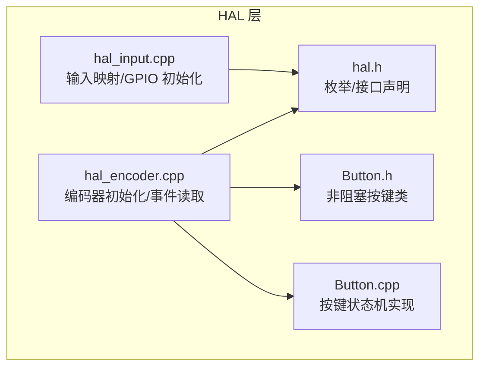
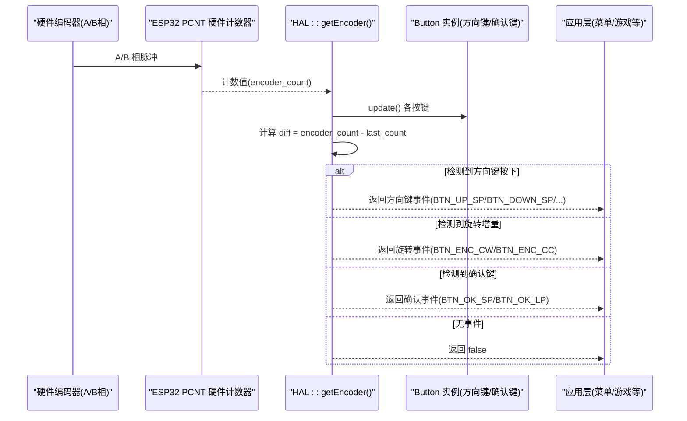
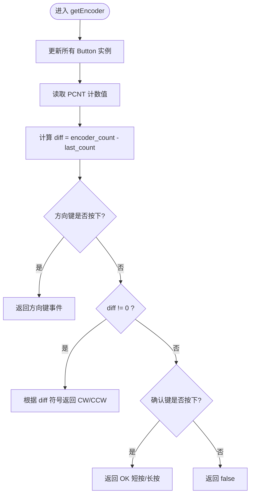
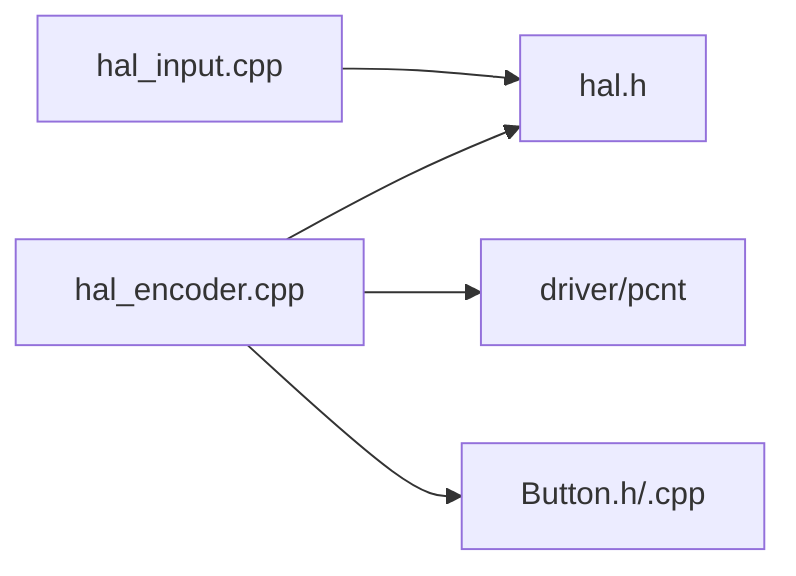

# 旋转编码器接口

<cite>
**本文引用的文件**   
- [hal_encoder.cpp](file://src/hal/hal_encoder.cpp)
- [hal.h](file://src/hal/hal.h)
- [Button.h](file://src/hal/Button.h)
- [Button.cpp](file://src/hal/Button.cpp)
- [hal_input.cpp](file://src/hal/hal_input.cpp)
</cite>

## 目录
1. [简介](#简介)
2. [项目结构](#项目结构)
3. [核心组件](#核心组件)
4. [架构总览](#架构总览)
5. [详细组件分析](#详细组件分析)
6. [依赖关系分析](#依赖关系分析)
7. [性能与稳定性](#性能与稳定性)
8. [故障排查指南](#故障排查指南)
9. [结论](#结论)
10. [附录：配置与使用清单](#附录配置与使用清单)

## 简介
本文件面向 ESP32 NullPod 的旋转编码器接口，系统性说明以下要点：
- EncoderEvent 枚举类型（BTN_ENC_CC、BTN_ENC_CW 等）的定义与使用方法
- 编码器事件处理流程：方向检测、增量计算、按键优先级
- 引脚配置、消抖参数、毛刺滤波设置
- 编码器校准方法（硬件接线与软件清零）
- 在菜单导航中的典型应用模式

注意：本项目中“编码器事件”统一以 Button/Encoder 相关枚举表达，未定义名为 ENCODER_EVENT_NONE/CW/CCW 的独立枚举；实际使用的是 BTN_ENC_CC/BTN_ENC_CW 以及短按/长按等事件。

## 项目结构
与旋转编码器相关的代码主要位于 HAL 层：
- hal_encoder.cpp：编码器初始化、PCNT 配置、事件读取与优先级调度
- hal.h：全局枚举（含 EncoderEvent）、HAL 接口声明
- Button.h/.cpp：非阻塞按键类，提供短按/长按/连发等能力
- hal_input.cpp：通用输入映射与 GPIO 初始化（部分复用编码器方向键引脚）

图表来源
- [hal_encoder.cpp:37-71](file://src/hal/hal_encoder.cpp#L37-L71)
- [hal.h:77-92](file://src/hal/hal.h#L77-L92)
- [Button.h:48-182](file://src/hal/Button.h#L48-L182)
- [Button.cpp:12-169](file://src/hal/Button.cpp#L12-L169)
- [hal_input.cpp:7-24](file://src/hal/hal_input.cpp#L7-L24)

章节来源
- [hal_encoder.cpp:37-71](file://src/hal/hal_encoder.cpp#L37-L71)
- [hal.h:77-92](file://src/hal/hal.h#L77-L92)
- [Button.h:48-182](file://src/hal/Button.h#L48-L182)
- [Button.cpp:12-169](file://src/hal/Button.cpp#L12-L169)
- [hal_input.cpp:7-24](file://src/hal/hal_input.cpp#L7-L24)

## 核心组件
- 编码器事件枚举（EncoderEvent）
  - BTN_ENC_CC：逆时针旋转
  - BTN_ENC_CW：顺时针旋转
  - BTN_OK_SP/BTN_OK_LP：编码器按键短按/长按
  - BTN_UP_SP/BTN_DOWN_SP/BTN_LEFT_SP/BTN_RIGHT_SP：方向键短按（长按扩展为 _LP）
- 编码器驱动（HAL::Encoder_Init / HAL::getEncoder）
  - 基于 ESP-IDF PCNT 模块进行正交解码
  - 通过差值 diff 判断旋转方向与步数
  - 统一事件输出，支持方向键优先于旋转，再优先于确认键
- 非阻塞按键类（Button）
  - 支持短按/长按识别、按住持续触发、连发模式
  - 可配置消抖时间、有效电平、GPIO 上拉

章节来源
- [hal.h:77-92](file://src/hal/hal.h#L77-L92)
- [hal_encoder.cpp:37-71](file://src/hal/hal_encoder.cpp#L37-L71)
- [hal_encoder.cpp:74-128](file://src/hal/hal_encoder.cpp#L74-L128)
- [Button.h:48-182](file://src/hal/Button.h#L48-L182)
- [Button.cpp:12-169](file://src/hal/Button.cpp#L12-L169)

## 架构总览
编码器数据流从硬件到上层应用的调用链如下：

图表来源
- [hal_encoder.cpp:49-70](file://src/hal/hal_encoder.cpp#L49-L70)
- [hal_encoder.cpp:74-128](file://src/hal/hal_encoder.cpp#L74-L128)

## 详细组件分析

### 编码器事件枚举与语义
- 旋转事件
  - BTN_ENC_CC：逆时针旋转
  - BTN_ENC_CW：顺时针旋转
- 按键事件
  - BTN_OK_SP/BTN_OK_LP：编码器按键短按/长按
  - BTN_UP_SP/BTN_DOWN_SP/BTN_LEFT_SP/BTN_RIGHT_SP：方向键短按（长按扩展为 _LP）

这些枚举由 HAL 层统一对外暴露，应用层无需关心底层是 PCNT 还是 GPIO 扫描。

章节来源
- [hal.h:77-92](file://src/hal/hal.h#L77-L92)

### 编码器初始化与硬件配置
- 使用 ESP-IDF PCNT 单元 0、通道 0 进行正交解码
- A 相接入 pulse 引脚，B 相接入 control 引脚
- 正向计数：A 上升沿 +1，A 下降沿 -1
- 方向控制：B 低电平时反转加减，B 高电平时保持原方向
- 启用毛刺滤波（默认 100，约 1.25μs），可根据实际抖动调整
- 启动前暂停、清零、恢复计数

章节来源
- [hal_encoder.cpp:49-70](file://src/hal/hal_encoder.cpp#L49-L70)

### 事件读取与优先级调度
- 每次调用 getEncoder 时：
  - 更新所有 Button 实例的状态（方向键与确认键）
  - 读取 PCNT 计数值并计算 diff
  - 优先级顺序：方向键 > 旋转增量 > 确认键
  - 若存在事件，则通过 out key 返回对应枚举，并返回 true
  - 若无事件，返回 false

图表来源
- [hal_encoder.cpp:74-128](file://src/hal/hal_encoder.cpp#L74-L128)

章节来源
- [hal_encoder.cpp:74-128](file://src/hal/hal_encoder.cpp#L74-L128)

### 旋转方向检测与速度计算
- 方向检测
  - 通过 PCNT 的正交解码自动区分 CW/CCW
  - 应用层依据 diff 的正负或 getEncoder 返回的事件判断方向
- 速度计算
  - 可在应用层维护一个时间窗口内的累计步数，除以时间得到“步/秒”
  - 或使用多次采样平均，平滑瞬时抖动带来的速度波动

章节来源
- [hal_encoder.cpp:83-86](file://src/hal/hal_encoder.cpp#L83-L86)
- [hal_encoder.cpp:114-117](file://src/hal/hal_encoder.cpp#L114-L117)

### 编码器中断处理
- 当前实现采用轮询方式：在 getEncoder 中主动读取 PCNT 计数值
- 未使用中断回调；如需降低主循环开销，可将 getEncoder 放入高频定时器或任务中执行

章节来源
- [hal_encoder.cpp:74-128](file://src/hal/hal_encoder.cpp#L74-L128)

### 按键消抖与参数配置
- Button 类内部实现非阻塞消抖，默认消抖时间为 5ms
- 可通过 setDebounceTime 调整消抖时间
- 支持短按/长按阈值（setLongPressTime），默认 300ms（编码器确认键）
- 支持连发模式（repeated），适合 NES 风格连续移动

章节来源
- [Button.h:56-58](file://src/hal/Button.h#L56-L58)
- [Button.h:143-147](file://src/hal/Button.h#L143-L147)
- [Button.cpp:28-70](file://src/hal/Button.cpp#L28-L70)
- [hal_encoder.cpp:37-47](file://src/hal/hal_encoder.cpp#L37-L47)

### 编码器校准方法
- 硬件接线
  - A 相 → HAL_PIN_ENCODER_CHA
  - B 相 → HAL_PIN_ENCODER_CHB
  - 方向键与确认键分别接至 HAL_PIN_ENCODER_UP/DOWN/LEFT/RIGHT 与 HAL_PIN_ENCODER_SEL
- 软件校准
  - 启动后对 PCNT 计数器清零（已在初始化中完成）
  - 必要时在应用层记录初始位置，后续以相对位移工作

章节来源
- [hal_encoder.cpp:49-70](file://src/hal/hal_encoder.cpp#L49-L70)

### 在菜单导航中的应用实例
- 方向键用于菜单上下左右选择
- 旋转用于数值调节（如音量、亮度、进度条）
- 确认键用于进入子菜单或确认操作
- 建议将 getEncoder 的返回值直接映射到菜单动作表，避免硬编码分支

章节来源
- [hal_encoder.cpp:88-127](file://src/hal/hal_encoder.cpp#L88-L127)

## 依赖关系分析
- HAL 层耦合点
  - hal_encoder.cpp 依赖 hal.h 中的枚举与接口
  - hal_encoder.cpp 依赖 ESP-IDF driver/pcnt 进行硬件计数
  - hal_encoder.cpp 依赖 Button 类处理方向键与确认键
  - hal_input.cpp 复用方向键引脚进行通用输入映射

图表来源
- [hal_encoder.cpp:1-4](file://src/hal/hal_encoder.cpp#L1-L4)
- [hal.h:1-10](file://src/hal/hal.h#L1-L10)
- [hal_input.cpp:1-4](file://src/hal/hal_input.cpp#L1-L4)

章节来源
- [hal_encoder.cpp:1-4](file://src/hal/hal_encoder.cpp#L1-L4)
- [hal.h:1-10](file://src/hal/hal.h#L1-L10)
- [hal_input.cpp:1-4](file://src/hal/hal_input.cpp#L1-L4)

## 性能与稳定性
- 轮询开销
  - getEncoder 会更新多个 Button 实例并读取 PCNT 计数，建议在稳定帧率下调用（例如每 10-20ms）
- 消抖与滤波
  - Button 消抖默认 5ms；PCNT 毛刺滤波默认 100（约 1.25μs）
  - 若出现误触发，可适当增大消抖时间或调整 PCNT 滤波值
- 计数溢出保护
  - PCNT 计数器上限/下限已配置，避免溢出导致异常

章节来源
- [hal_encoder.cpp:63-70](file://src/hal/hal_encoder.cpp#L63-L70)
- [Button.cpp:28-70](file://src/hal/Button.cpp#L28-L70)

## 故障排查指南
- 现象：旋转无响应或方向错误
  - 检查 A/B 相接线是否正确
  - 确认 PCNT 配置中 pos_mode/neg_mode/lctrl_mode/hctrl_mode 与实际接线一致
  - 尝试调整 PCNT 毛刺滤波值
- 现象：按键误触或重复触发
  - 增加 Button 消抖时间
  - 检查外部上拉电阻或内部上拉是否启用
- 现象：菜单导航卡顿
  - 减少 getEncoder 调用频率或将其放入高效任务
  - 避免在 getEncoder 中执行耗时逻辑

章节来源
- [hal_encoder.cpp:49-70](file://src/hal/hal_encoder.cpp#L49-L70)
- [Button.cpp:28-70](file://src/hal/Button.cpp#L28-L70)

## 结论
本项目通过 ESP-IDF PCNT 与自研 Button 类实现了稳定、可扩展的旋转编码器接口。应用层只需消费统一的 EncoderEvent 枚举即可实现菜单导航、数值调节等功能。通过合理配置消抖与滤波参数，并在应用层进行速度平滑与事件去重，可获得良好的用户体验。

## 附录：配置与使用清单
- 引脚配置
  - A 相：HAL_PIN_ENCODER_CHA
  - B 相：HAL_PIN_ENCODER_CHB
  - 方向键：HAL_PIN_ENCODER_UP/DOWN/LEFT/RIGHT
  - 确认键：HAL_PIN_ENCODER_SEL
- 关键参数
  - PCNT 毛刺滤波：默认 100（约 1.25μs）
  - Button 消抖：默认 5ms
  - 长按阈值：编码器确认键默认 300ms
- 使用步骤
  - 调用 HAL::Encoder_Init 完成初始化
  - 在主循环或定时器中周期性调用 HAL::getEncoder(&key)
  - 根据 key 的值分发到菜单/游戏等业务逻辑

章节来源
- [hal_encoder.cpp:37-71](file://src/hal/hal_encoder.cpp#L37-L71)
- [hal_encoder.cpp:74-128](file://src/hal/hal_encoder.cpp#L74-L128)