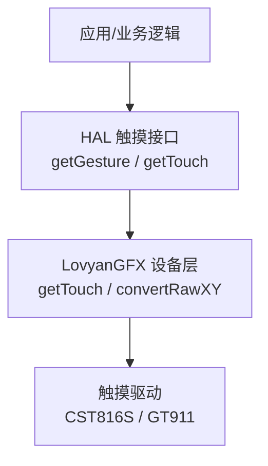
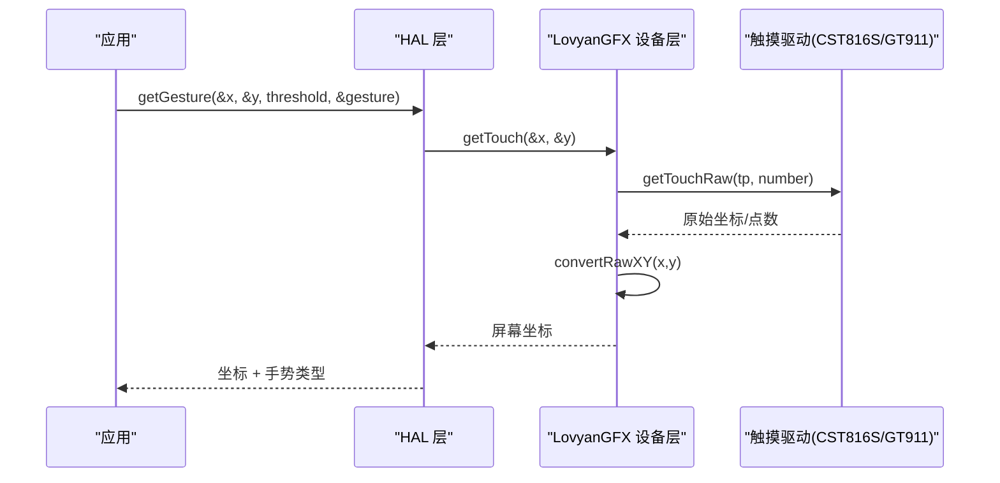
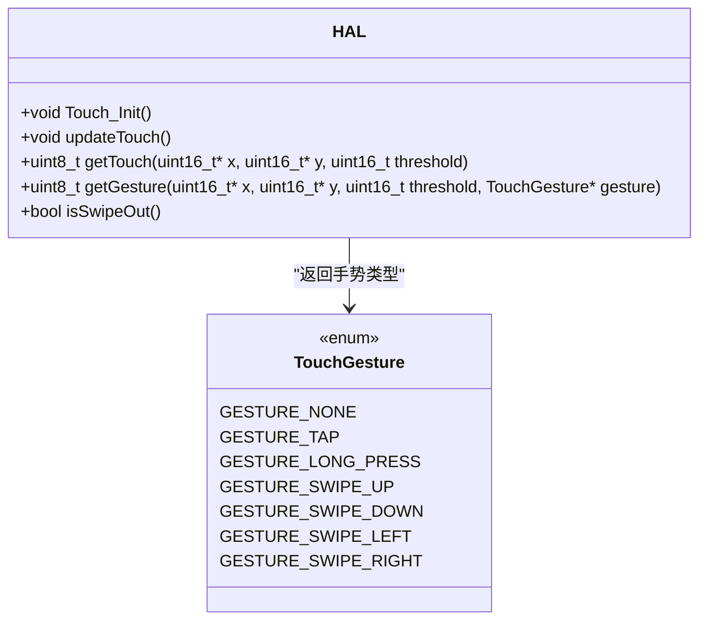
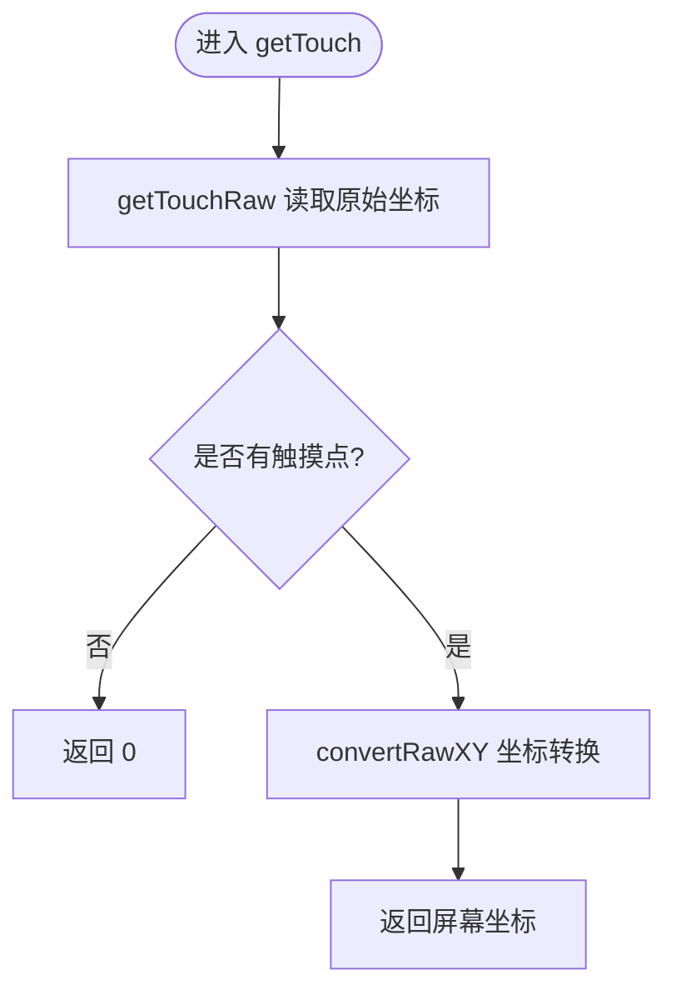
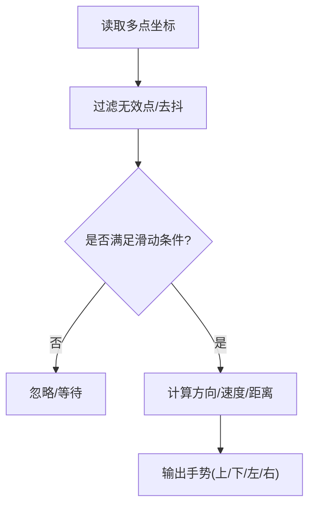
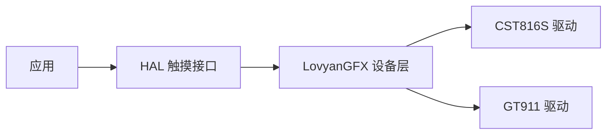

# 触摸输入接口

<cite>
**本文引用的文件**   
- [hal.h](file://src/hal/hal.h)
- [hal.cpp](file://src/hal/hal.cpp)
- [LGFX_Device.hpp](file://lib/LovyanGFX/src/lgfx/v0/LGFX_Device.hpp)
- [Touch_CST816S.hpp](file://lib/LovyanGFX/src/lgfx/v1/touch/Touch_CST816S.hpp)
- [Touch_GT911.cpp](file://lib/LovyanGFX/src/lgfx/v1/touch/Touch_GT911.cpp)
</cite>

## 目录
1. [简介](#简介)
2. [项目结构](#项目结构)
3. [核心组件](#核心组件)
4. [架构总览](#架构总览)
5. [详细组件分析](#详细组件分析)
6. [依赖关系分析](#依赖关系分析)
7. [性能与配置建议](#性能与配置建议)
8. [故障排查指南](#故障排查指南)
9. [结论](#结论)

## 简介
本文件面向 ESP32 NullPod 的触摸输入子系统，聚焦以下目标：
- 触摸事件处理流程与坐标获取方式
- TouchGesture 枚举类型的使用说明（含轻点、长按、四向滑动等）
- 手势识别算法思路与多点触控支持
- 去抖动、灵敏度调节、触摸区域划分等可配置项
- 结合 LovyanGFX 驱动层与 HAL 层的交互路径

注意：仓库中未提供自定义 TouchGesture 枚举的全部值（如 TOUCH_DOUBLE_CLICK、TOUCH_DRAG_*、TOUCH_SWIPE_*），实际实现以 HAL 层定义的 TouchGesture 为准。

## 项目结构
触摸相关代码主要分布在两层：
- 应用/系统层（HAL）：定义 TouchGesture 枚举，提供 getGesture/getTouch 等统一接口，封装上层调用
- 显示/触摸驱动层（LovyanGFX）：提供底层触摸读取、坐标转换、校准、多点触控能力



图表来源
- [hal.h:120-124](file://src/hal/hal.h#L120-L124)
- [LGFX_Device.hpp:238-285](file://lib/LovyanGFX/src/lgfx/v0/LGFX_Device.hpp#L238-L285)
- [Touch_CST816S.hpp:28-48](file://lib/LovyanGFX/src/lgfx/v1/touch/Touch_CST816S.hpp#L28-L48)
- [Touch_GT911.cpp:166-215](file://lib/LovyanGFX/src/lgfx/v1/touch/Touch_GT911.cpp#L166-L215)

章节来源
- [hal.h:120-124](file://src/hal/hal.h#L120-L124)
- [LGFX_Device.hpp:238-285](file://lib/LovyanGFX/src/lgfx/v0/LGFX_Device.hpp#L238-L285)

## 核心组件
- HAL 触摸接口
  - Touch_Init：初始化触摸子系统
  - updateTouch：周期性更新触摸状态（当前在 HAL::Update 中被注释）
  - getTouch：返回触摸坐标与是否有效
  - getGesture：返回坐标与手势类型
- LovyanGFX 设备层
  - getTouch/getTouchRaw：从驱动读取原始坐标并转换为屏幕坐标
  - convertRawXY：坐标映射/校准
- 触摸驱动
  - CST816S：单点触摸，内置手势（上/下/左/右滑动、单击、双击、长按）
  - GT911：多点触控，支持最多 5 点

章节来源
- [hal.h:120-124](file://src/hal/hal.h#L120-L124)
- [LGFX_Device.hpp:238-285](file://lib/LovyanGFX/src/lgfx/v0/LGFX_Device.hpp#L238-L285)
- [Touch_CST816S.hpp:28-48](file://lib/LovyanGFX/src/lgfx/v1/touch/Touch_CST816S.hpp#L28-L48)
- [Touch_GT911.cpp:166-215](file://lib/LovyanGFX/src/lgfx/v1/touch/Touch_GT911.cpp#L166-L215)

## 架构总览
下图展示从应用到触摸驱动的完整调用链，以及坐标转换与手势识别的关键节点。



图表来源
- [hal.cpp:35-54](file://src/hal/hal.cpp#L35-L54)
- [LGFX_Device.hpp:268-285](file://lib/LovyanGFX/src/lgfx/v0/LGFX_Device.hpp#L268-L285)
- [Touch_GT911.cpp:166-215](file://lib/LovyanGFX/src/lgfx/v1/touch/Touch_GT911.cpp#L166-L215)

## 详细组件分析

### HAL 触摸接口与手势枚举
- TouchGesture 枚举定义
  - 包含轻点、长按、四向滑动等基础手势
  - 未包含“双击”“拖拽开始/移动/结束”等扩展手势；如需使用，请在上层自行组合或扩展枚举
- HAL 对外方法
  - getGesture：返回坐标与手势类型
  - isSwipeOut：基于 getGesture 判断“左滑”返回 true，用于上层快速判定



图表来源
- [hal.h:66-75](file://src/hal/hal.h#L66-L75)
- [hal.h:120-124](file://src/hal/hal.h#L120-L124)
- [hal.cpp:35-54](file://src/hal/hal.cpp#L35-L54)

章节来源
- [hal.h:66-75](file://src/hal/hal.h#L66-L75)
- [hal.h:120-124](file://src/hal/hal.h#L120-L124)
- [hal.cpp:35-54](file://src/hal/hal.cpp#L35-L54)

### LovyanGFX 触摸读取与坐标转换
- getTouchRaw：直接读取驱动原始坐标（不转换）
- getTouch：读取后通过 convertRawXY 转换为屏幕坐标
- 校准与多点触控
  - 校准过程会多次采样并设置校正参数
  - GT911 支持多点触控数量配置（1~5）



图表来源
- [LGFX_Device.hpp:238-285](file://lib/LovyanGFX/src/lgfx/v0/LGFX_Device.hpp#L238-L285)
- [LGFX_Device.hpp:578-615](file://lib/LovyanGFX/src/lgfx/v0/LGFX_Device.hpp#L578-L615)

章节来源
- [LGFX_Device.hpp:238-285](file://lib/LovyanGFX/src/lgfx/v0/LGFX_Device.hpp#L238-L285)
- [LGFX_Device.hpp:578-615](file://lib/LovyanGFX/src/lgfx/v0/LGFX_Device.hpp#L578-L615)

### 触摸驱动层（CST816S / GT911）
- CST816S
  - 内置手势枚举：上/下/左/右滑动、单击、双击、长按
  - 单点触摸，适合轻量级手势识别
- GT911
  - 多点触控，支持最多 5 点
  - 数据读取时具备重试与稳定性处理逻辑

```mermaid
classDiagram
class Touch_CST816S {
<<driver>>
+init()
+getTouchRaw(tp, count)
enum CS816S_GESTURE { NONE, SWIPE_UP, SWIPE_DOWN, SWIPE_LEFT, SWIPE_RIGHT, SINGLE_CLICK, DOUBLE_CLICK, LONG_PRESS }
}
class Touch_GT911 {
<<driver>>
+init()
+getTouchRaw(tp, count)
+setTouchNums(nums)
}
Touch_CST816S <|-- ITouch
Touch_GT911 <|-- ITouch
```

图表来源
- [Touch_CST816S.hpp:28-48](file://lib/LovyanGFX/src/lgfx/v1/touch/Touch_CST816S.hpp#L28-L48)
- [Touch_GT911.cpp:166-215](file://lib/LovyanGFX/src/lgfx/v1/touch/Touch_GT911.cpp#L166-L215)

章节来源
- [Touch_CST816S.hpp:28-48](file://lib/LovyanGFX/src/lgfx/v1/touch/Touch_CST816S.hpp#L28-L48)
- [Touch_GT911.cpp:166-215](file://lib/LovyanGFX/src/lgfx/v1/touch/Touch_GT911.cpp#L166-L215)

### 手势识别算法与多点触控处理
- 手势识别
  - 若使用 CST816S，可直接利用其内置手势（单击、双击、长按、四向滑动）
  - 若使用 GT911，可在上层根据多点坐标序列自行实现手势识别（例如滑动方向、速度、轨迹长度）
- 多点触控处理
  - GT911 支持多点，可通过 setTouchNums 配置最大点数
  - 上层可遍历多点数组，按 ID 跟踪每个触点，实现拖拽、缩放等复杂交互



[本图为概念性流程图，无需图表来源]

### 触摸去抖动、灵敏度调节、触摸区域划分
- 去抖动
  - 校准流程中对连续两次采样进行差值阈值判断，避免噪声
  - 上层可在 getGesture 前对坐标序列做均值滤波或时间窗去抖
- 灵敏度调节
  - 滑动检测可通过调整位移阈值、角度阈值、时间窗口来调节灵敏度
  - 长按检测可通过按住时长阈值调节
- 触摸区域划分
  - 可使用屏幕坐标将界面划分为若干区域，结合手势类型触发不同动作
  - 也可在驱动层通过 x_min/x_max/y_min/y_max 限制有效触摸范围（CST816S 示例中已设置默认范围）

章节来源
- [LGFX_Device.hpp:578-615](file://lib/LovyanGFX/src/lgfx/v0/LGFX_Device.hpp#L578-L615)
- [Touch_CST816S.hpp:41-48](file://lib/LovyanGFX/src/lgfx/v1/touch/Touch_CST816S.hpp#L41-L48)

## 依赖关系分析
- HAL 层依赖 LovyanGFX 的设备抽象，屏蔽底层驱动差异
- LovyanGFX 依赖具体触摸驱动（CST816S/GT911），负责 I2C 通信与数据解析
- 上层应用仅依赖 HAL 提供的 getGesture/getTouch 接口



图表来源
- [hal.h:120-124](file://src/hal/hal.h#L120-L124)
- [LGFX_Device.hpp:238-285](file://lib/LovyanGFX/src/lgfx/v0/LGFX_Device.hpp#L238-L285)
- [Touch_CST816S.hpp:28-48](file://lib/LovyanGFX/src/lgfx/v1/touch/Touch_CST816S.hpp#L28-L48)
- [Touch_GT911.cpp:166-215](file://lib/LovyanGFX/src/lgfx/v1/touch/Touch_GT911.cpp#L166-L215)

章节来源
- [hal.h:120-124](file://src/hal/hal.h#L120-L124)
- [LGFX_Device.hpp:238-285](file://lib/LovyanGFX/src/lgfx/v0/LGFX_Device.hpp#L238-L285)

## 性能与配置建议
- 触摸轮询频率
  - 建议在主循环中定期调用 updateTouch 或 getGesture，避免阻塞
- 多点触控开销
  - GT911 多点读取会增加 I2C 带宽占用，合理设置最大点数
- 坐标校准
  - 首次运行或更换屏幕时可执行校准流程，提升坐标精度
- 手势阈值调优
  - 滑动距离/角度/时间阈值需根据产品形态与用户习惯调优
  - 长按时长阈值影响误触率与响应速度

[本节为通用建议，不涉及具体文件分析]

## 故障排查指南
- 无触摸点返回
  - 检查 I2C 连接与驱动初始化
  - 确认 getTouchRaw 返回值是否为 0
- 坐标漂移或不稳定
  - 重新执行校准流程
  - 增加去抖与滤波策略
- 手势误判
  - 调整滑动距离/角度/时间阈值
  - 区分单击与长按的时间边界
- 多点触控异常
  - 检查 GT911 的多点数量配置
  - 关注驱动内部的重试与数据有效性逻辑

章节来源
- [LGFX_Device.hpp:578-615](file://lib/LovyanGFX/src/lgfx/v0/LGFX_Device.hpp#L578-L615)
- [Touch_GT911.cpp:166-215](file://lib/LovyanGFX/src/lgfx/v1/touch/Touch_GT911.cpp#L166-L215)

## 结论
ESP32 NullPod 的触摸输入由 HAL 层统一暴露 getGesture/getTouch 接口，底层依托 LovyanGFX 与具体触摸驱动（CST816S/GT911）。TouchGesture 枚举提供了轻点、长按与四向滑动等基础手势；如需更丰富的手势（如双击、拖拽），可在上层基于多点坐标序列自行实现。通过合理的去抖、灵敏度与区域划分配置，可获得稳定且易用的触摸体验。