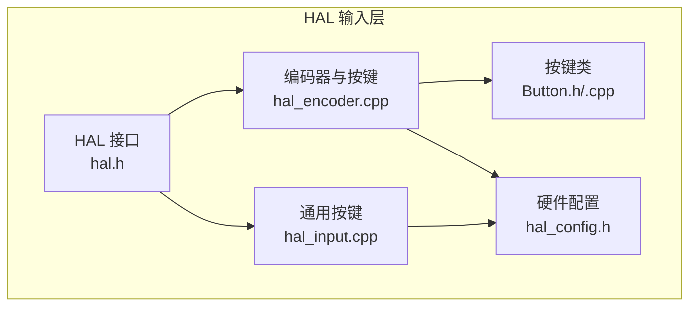
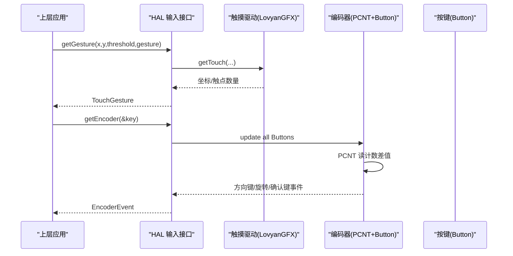
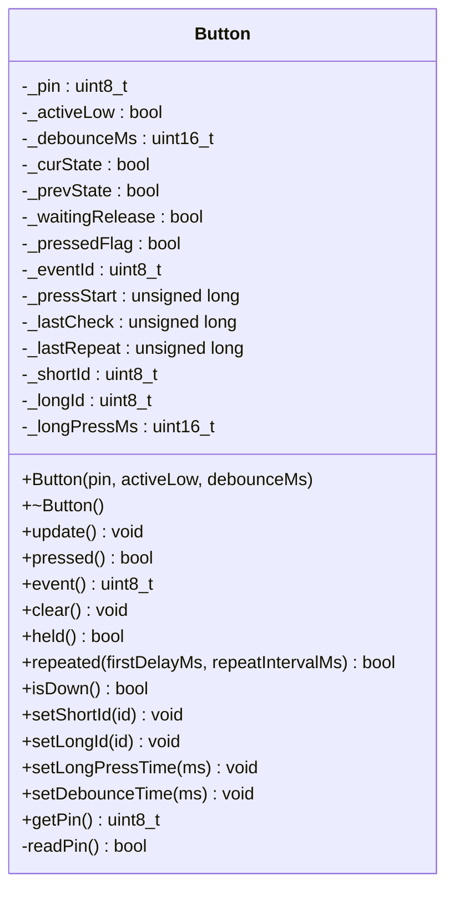
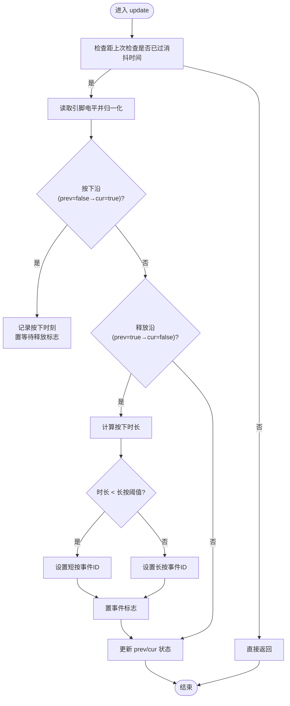
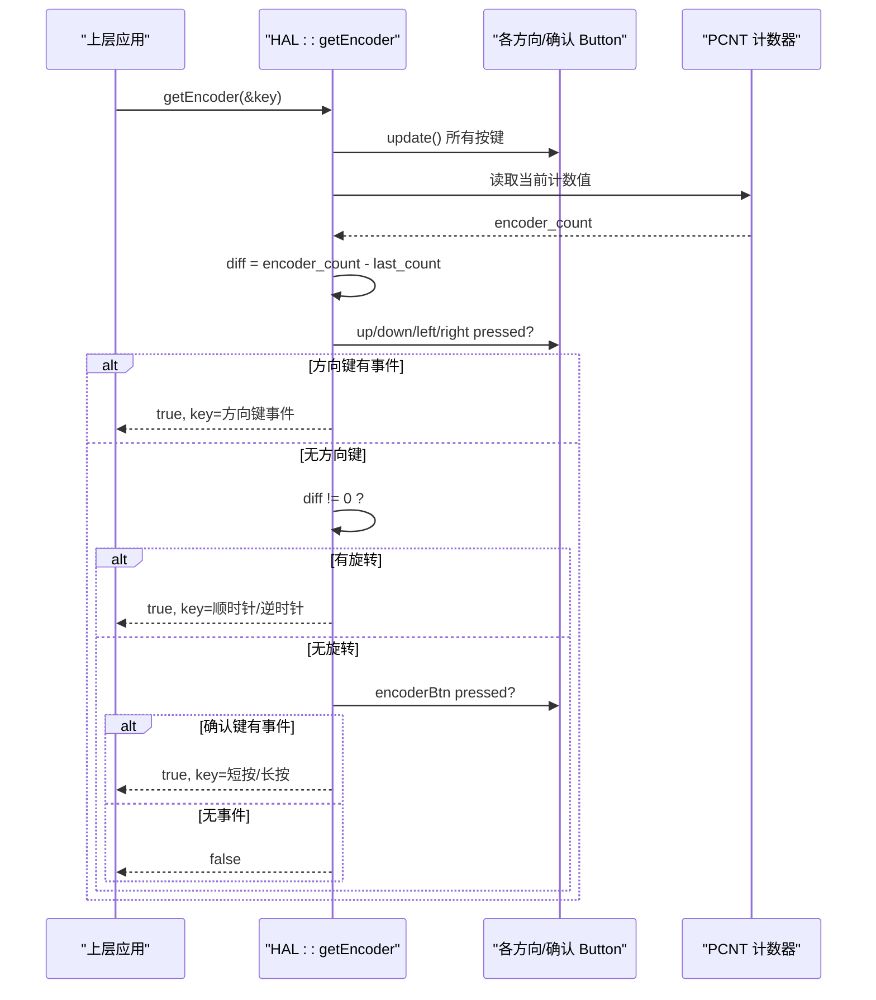
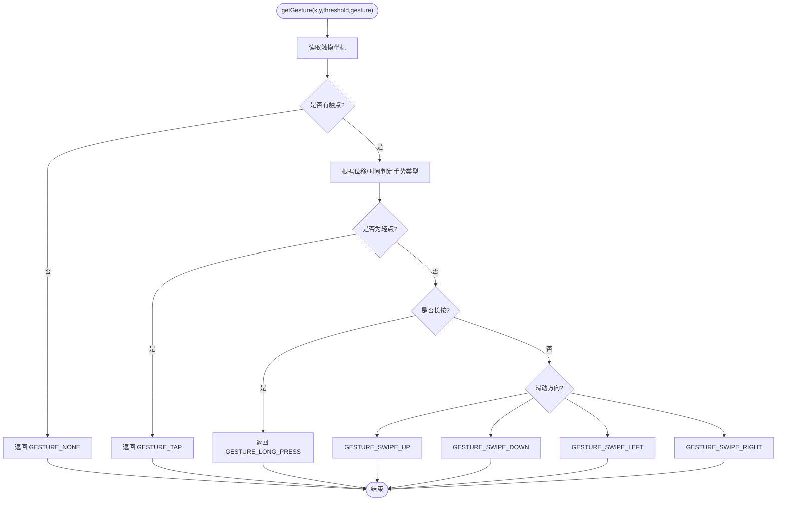
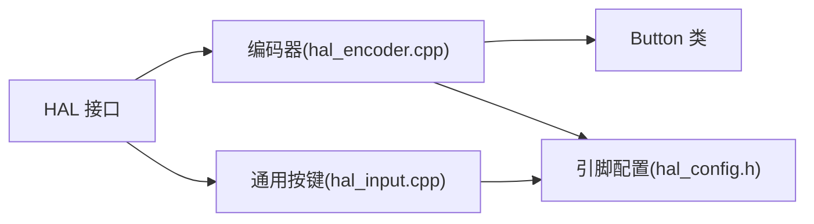

# 输入接口

<cite>
**本文引用的文件**   
- [hal.h](file://src/hal/hal.h)
- [Button.h](file://src/hal/Button.h)
- [Button.cpp](file://src/hal/Button.cpp)
- [hal_encoder.cpp](file://src/hal/hal_encoder.cpp)
- [hal_input.cpp](file://src/hal/hal_input.cpp)
- [hal_config.h](file://src/hal/hal_config.h)
</cite>

## 目录
1. [简介](#简介)
2. [项目结构](#项目结构)
3. [核心组件](#核心组件)
4. [架构总览](#架构总览)
5. [详细组件分析](#详细组件分析)
6. [依赖关系分析](#依赖关系分析)
7. [性能与实现细节](#性能与实现细节)
8. [故障排查指南](#故障排查指南)
9. [结论](#结论)

## 简介
本文件为 ESP32 NullPod 的输入子系统 API 文档，覆盖以下三类输入：
- 触摸输入与手势识别
- 物理按键（方向键、确认键等）
- 旋转编码器（A/B 相增量计数 + 按键）

文档重点说明：
- TouchGesture 枚举
- EncoderEvent 枚举
- Button 类的完整接口
- 触摸手势识别流程
- 按键检测与去抖
- 编码器事件处理
- 多输入源优先级协调策略

## 项目结构
输入相关代码主要位于 hal 层，围绕硬件抽象统一对外暴露 HAL 接口。关键文件职责如下：
- hal.h：定义 TouchGesture、EncoderEvent 等公共枚举，以及 HAL 命名空间下的输入相关函数声明
- Button.h/.cpp：非阻塞按键类，提供短按/长按/连发/持续按住等能力
- hal_encoder.cpp：编码器初始化、PCNT 配置、按键扫描与统一事件输出
- hal_input.cpp：通用按键映射与简单按键读取
- hal_config.h：引脚与屏幕等硬件配置常量

图表来源
- [hal.h:101-196](file://src/hal/hal.h#L101-L196)
- [hal_encoder.cpp:37-128](file://src/hal/hal_encoder.cpp#L37-L128)
- [hal_input.cpp:7-58](file://src/hal/hal_input.cpp#L7-L58)
- [hal_config.h:29-36](file://src/hal/hal_config.h#L29-L36)

章节来源
- [hal.h:101-196](file://src/hal/hal.h#L101-L196)
- [hal_encoder.cpp:37-128](file://src/hal/hal_encoder.cpp#L37-L128)
- [hal_input.cpp:7-58](file://src/hal/hal_input.cpp#L7-L58)
- [hal_config.h:29-36](file://src/hal/hal_config.h#L29-L36)

## 核心组件
本节概述三大输入子系统的 API 与数据模型。

### 触摸输入与手势识别
- 触摸初始化：Touch_Init()
- 触摸更新：updateTouch()
- 原始坐标获取：getTouch(x, y, threshold)
- 手势识别：getGesture(x, y, threshold, gesture)
- 手势类型：TouchGesture 枚举

TouchGesture 枚举值：
- GESTURE_NONE：无手势
- GESTURE_TAP：轻点
- GESTURE_LONG_PRESS：长按
- GESTURE_SWIPE_UP：上滑
- GESTURE_SWIPE_DOWN：下滑
- GESTURE_SWIPE_LEFT：左滑
- GESTURE_SWIPE_RIGHT：右滑

章节来源
- [hal.h:66-75](file://src/hal/hal.h#L66-L75)
- [hal.h:120-124](file://src/hal/hal.h#L120-L124)

### 按钮控制
- 通用按键映射与读取：Input_Init(), GetButton(button), isReturn(), isEnter()
- 专用编码器按键：通过 Button 类封装，支持短按/长按/连发/持续按住

章节来源
- [hal_input.cpp:7-58](file://src/hal/hal_input.cpp#L7-L58)
- [hal.h:126-128](file://src/hal/hal.h#L126-L128)

### 旋转编码器
- 初始化：Encoder_Init()
- 统一事件读取：getEncoder(key)
- 底层驱动：ESP32 PCNT 模块进行 A/B 相正交解码
- 事件类型：EncoderEvent 枚举

EncoderEvent 枚举值：
- BTN_ENC_CC：逆时针旋转
- BTN_ENC_CW：顺时针旋转
- BTN_OK_SP / BTN_OK_LP：确认键短按/长按
- BTN_UP_SP / BTN_UP_LP：上键短按/长按
- BTN_DOWN_SP / BTN_DOWN_LP：下键短按/长按
- BTN_LEFT_SP / BTN_LEFT_LP：左键短按/长按
- BTN_RIGHT_SP / BTN_RIGHT_LP：右键短按/长按

章节来源
- [hal.h:77-92](file://src/hal/hal.h#L77-L92)
- [hal_encoder.cpp:37-128](file://src/hal/hal_encoder.cpp#L37-L128)

## 架构总览
输入子系统由 HAL 层统一封装，向上层应用提供稳定的事件接口。触摸通过 LovyanGFX/LGFX 驱动，编码器使用 ESP32 PCNT 硬件计数器，按键通过 Button 类进行非阻塞状态机管理。

图表来源
- [hal.h:120-124](file://src/hal/hal.h#L120-L124)
- [hal.h:189-196](file://src/hal/hal.h#L189-L196)
- [hal_encoder.cpp:74-128](file://src/hal/hal_encoder.cpp#L74-L128)

## 详细组件分析

### Button 类
Button 类用于非阻塞按键扫描，支持：
- 构造时指定 GPIO、有效电平、消抖时间
- update() 周期性调用以更新内部状态
- pressed()/event()/clear() 事件接口
- held() 判断是否持续按住
- repeated(firstDelayMs, repeatIntervalMs) 连发模式
- setShortId()/setLongId()/setLongPressTime()/setDebounceTime() 配置接口

图表来源
- [Button.h:48-182](file://src/hal/Button.h#L48-L182)

章节来源
- [Button.h:48-182](file://src/hal/Button.h#L48-L182)
- [Button.cpp:12-168](file://src/hal/Button.cpp#L12-L168)

#### 按键去抖算法
- 基于时间窗口的消抖：在 update() 中检查距上次检查的时间间隔，若小于配置的消抖时间则直接返回
- 边沿检测：记录 prev/cur 状态变化，按下时记录开始时间并置等待释放标志；释放时根据持续时间判定短按或长按
- 事件保持：pressed() 返回 true 后需调用 clear() 清除事件标志，避免重复消费

图表来源
- [Button.cpp:28-70](file://src/hal/Button.cpp#L28-L70)

章节来源
- [Button.cpp:28-70](file://src/hal/Button.cpp#L28-L70)

### 编码器与按键统一事件
编码器子系统将方向键、旋转、确认键统一为 getEncoder(&key) 接口，内部优先级为：
- 方向键 > 旋转 > 确认键

图表来源
- [hal_encoder.cpp:74-128](file://src/hal/hal_encoder.cpp#L74-L128)

章节来源
- [hal_encoder.cpp:37-128](file://src/hal/hal_encoder.cpp#L37-L128)

### 通用按键映射
通用按键通过 Input_Init() 建立按键名到 GPIO 的映射，GetButton() 提供简单的“刚按下/刚释放”语义，并在按下/释放时触发蜂鸣器提示。

章节来源
- [hal_input.cpp:7-58](file://src/hal/hal_input.cpp#L7-L58)

### 触摸手势识别流程
触摸手势识别通过 HAL::getGesture() 对外暴露，内部会调用 LovyanGFX 的触摸接口获取坐标，再结合阈值与时间窗口判定手势类型。

图表来源
- [hal.h:120-124](file://src/hal/hal.h#L120-L124)

章节来源
- [hal.h:120-124](file://src/hal/hal.h#L120-L124)

## 依赖关系分析
- HAL 层对外暴露统一的输入 API，屏蔽底层差异
- Button 类被编码器子系统复用，提供一致的按键行为
- 编码器使用 ESP32 PCNT 硬件计数器，减少 CPU 负担
- 触摸依赖 LovyanGFX/LGFX 提供的 getTouch/getTouchRaw 接口

图表来源
- [hal.h:101-196](file://src/hal/hal.h#L101-L196)
- [hal_encoder.cpp:37-128](file://src/hal/hal_encoder.cpp#L37-L128)
- [hal_input.cpp:7-58](file://src/hal/hal_input.cpp#L7-L58)
- [hal_config.h:29-36](file://src/hal/hal_config.h#L29-L36)

章节来源
- [hal.h:101-196](file://src/hal/hal.h#L101-L196)
- [hal_encoder.cpp:37-128](file://src/hal/hal_encoder.cpp#L37-L128)
- [hal_input.cpp:7-58](file://src/hal/hal_input.cpp#L7-L58)
- [hal_config.h:29-36](file://src/hal/hal_config.h#L29-L36)

## 性能与实现细节
- 非阻塞设计
  - Button::update() 基于 millis() 时间戳，适合放在 loop() 或定时器回调中周期性调用
  - 编码器按键统一通过 getEncoder() 轮询，避免中断风暴
- 去抖策略
  - 软件消抖：Button 内部维护 _debounceMs，未到时间不采样
  - 硬件滤波：PCNT 启用毛刺滤波（filter_value），过滤高频抖动
- 多输入源优先级
  - 方向键优先于旋转和确认键，确保导航操作即时响应
- 资源占用
  - PCNT 硬件计数降低 CPU 负载
  - Button 类轻量，每个实例独立计时，互不干扰

章节来源
- [Button.cpp:28-70](file://src/hal/Button.cpp#L28-L70)
- [hal_encoder.cpp:63-70](file://src/hal/hal_encoder.cpp#L63-L70)
- [hal_encoder.cpp:88-127](file://src/hal/hal_encoder.cpp#L88-L127)

## 故障排查指南
- 按键误触发
  - 检查 Button 消抖时间是否过小，适当增大 setDebounceTime()
  - 确认 GPIO 上拉配置正确（INPUT_PULLUP）
- 编码器计数异常
  - 检查 PCNT 滤波值是否合理，必要时调整 pcnt_set_filter_value()
  - 确认 A/B 相接线与配置一致（CHA/CHB）
- 触摸手势不灵敏
  - 调整 getGesture() 的 threshold 参数
  - 确认触摸驱动已正确初始化 Touch_Init()

章节来源
- [Button.h:143-147](file://src/hal/Button.h#L143-L147)
- [Button.cpp:12-24](file://src/hal/Button.cpp#L12-L24)
- [hal_encoder.cpp:63-70](file://src/hal/hal_encoder.cpp#L63-L70)
- [hal.h:120-124](file://src/hal/hal.h#L120-L124)

## 结论
本输入子系统通过 HAL 层统一封装触摸、按键与编码器，提供稳定且高性能的事件接口。Button 类实现了可配置的非阻塞按键逻辑，编码器借助 PCNT 硬件计数提升效率，触摸手势识别通过 LovyanGFX 集成。多输入源的优先级策略确保了交互体验的一致性与及时性。