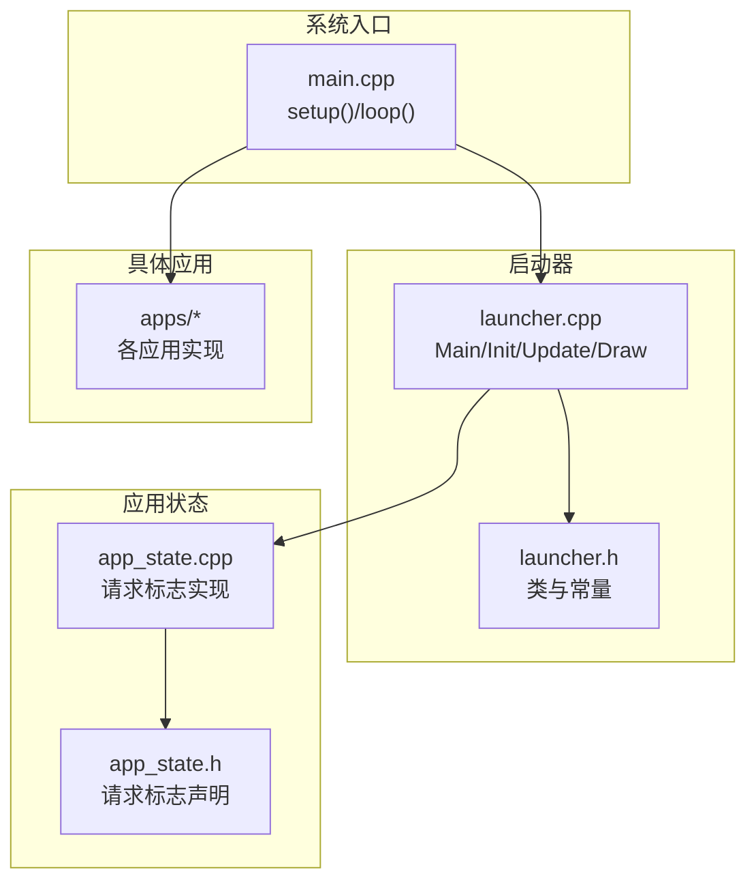
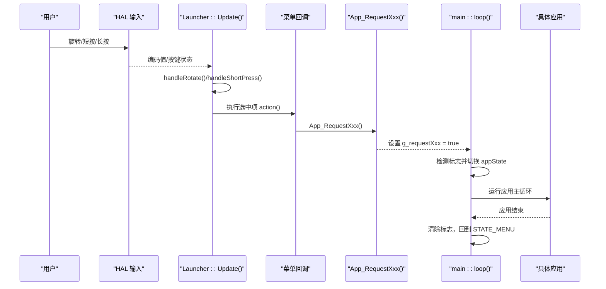
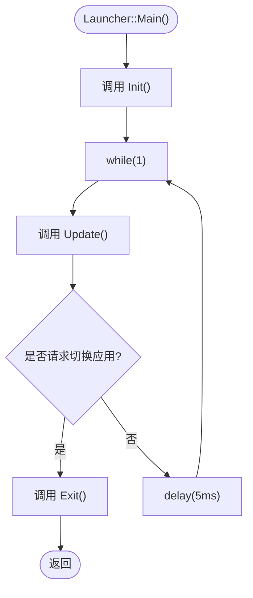
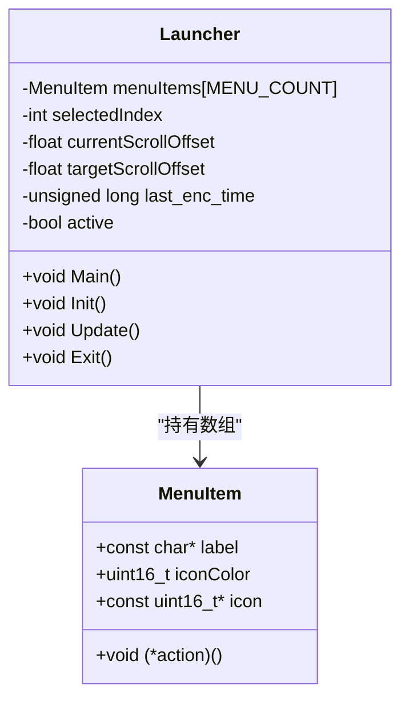
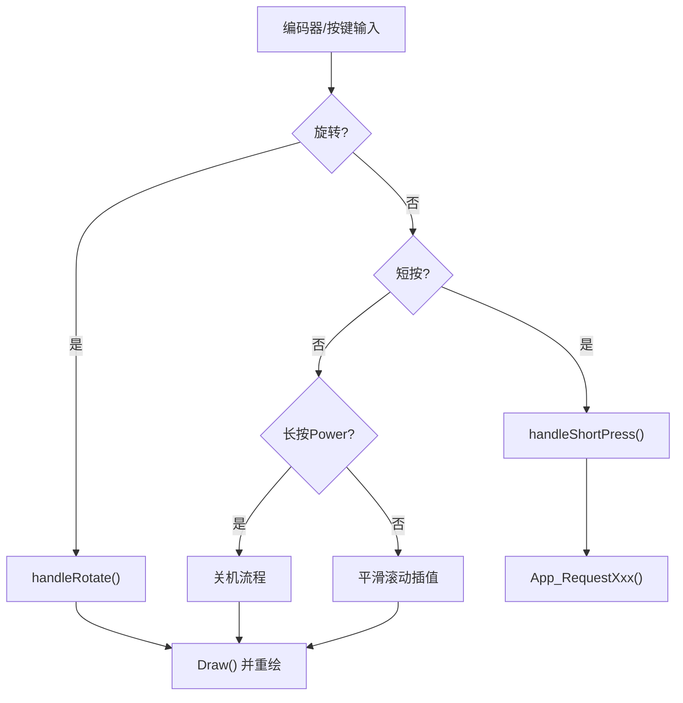

# Launcher 应用接口

<cite>
**本文引用的文件**   
- [launcher.h](file://src/launcher.h)
- [launcher.cpp](file://src/launcher.cpp)
- [app_state.h](file://src/app_state.h)
- [app_state.cpp](file://src/app_state.cpp)
- [main.cpp](file://src/main.cpp)
</cite>

## 目录
1. [简介](#简介)
2. [项目结构](#项目结构)
3. [核心组件](#核心组件)
4. [架构总览](#架构总览)
5. [详细组件分析](#详细组件分析)
6. [依赖关系分析](#依赖关系分析)
7. [性能与交互特性](#性能与交互特性)
8. [故障排查指南](#故障排查指南)
9. [结论](#结论)
10. [附录：添加新应用的完整示例](#附录添加新应用的完整示例)

## 简介
本文件为 Launcher（应用启动器）的 API 文档，面向希望扩展或集成新应用的开发者。文档聚焦以下目标：
- 说明应用启动器的核心接口与职责边界
- 定义应用注册机制、生命周期管理、菜单界面交互
- 规范 Main()、Init()、Update()、Exit() 方法的行为契约
- 说明如何通过全局实例与请求标志进行应用切换
- 提供应用状态管理与事件处理的接口说明
- 给出添加新应用的完整步骤与代码路径指引

## 项目结构
Launcher 位于 src 目录下，围绕 launcher.h/.cpp 实现菜单与输入处理；app_state.* 提供跨模块的应用切换请求标志；main.cpp 作为系统主循环，负责根据请求标志调度具体应用。

图表来源
- [main.cpp:1-209](file://src/main.cpp#L1-L209)
- [launcher.h:1-153](file://src/launcher.h#L1-L153)
- [launcher.cpp:1-444](file://src/launcher.cpp#L1-L444)
- [app_state.h:1-42](file://src/app_state.h#L1-L42)
- [app_state.cpp:1-37](file://src/app_state.cpp#L1-L37)

章节来源
- [main.cpp:1-209](file://src/main.cpp#L1-L209)
- [launcher.h:1-153](file://src/launcher.h#L1-L153)
- [launcher.cpp:1-444](file://src/launcher.cpp#L1-L444)
- [app_state.h:1-42](file://src/app_state.h#L1-L42)
- [app_state.cpp:1-37](file://src/app_state.cpp#L1-L37)

## 核心组件
- Launcher 类：封装菜单 UI、输入处理、状态栏绘制与应用切换触发
- 应用状态模块：维护一组 volatile 请求标志，供 Launcher 与 main 协调切换
- 全局实例：g_launcher 作为唯一 Launcher 实例，由 main 调用其 Main() 进入阻塞式主循环

关键要点
- Launcher::Main() 是阻塞式生命周期入口，内部循环调用 Update()，直到有应用切换请求
- Launcher::Init() 完成首次初始化与菜单项绑定，并绘制初始界面
- Launcher::Update() 处理编码器/按键输入、长按关机逻辑、平滑滚动与状态栏刷新
- Launcher::Exit() 当前为空实现，可在此做资源释放等收尾工作

章节来源
- [launcher.h:85-148](file://src/launcher.h#L85-L148)
- [launcher.cpp:8-79](file://src/launcher.cpp#L8-L79)
- [app_state.h:4-39](file://src/app_state.h#L4-L39)
- [app_state.cpp:1-37](file://src/app_state.cpp#L1-L37)

## 架构总览
Launcher 通过“请求标志 + 回调”的方式与上层 main 协作：
- Launcher 在菜单中监听输入，将用户选择转换为 App_RequestXxx() 调用
- App_RequestXxx() 设置对应的 g_requestXxx 标志
- main::loop() 检测标志位，切换到对应 AppState，并运行相应应用
- 应用返回后，main 重置标志并回到 STATE_MENU

图表来源
- [launcher.cpp:82-197](file://src/launcher.cpp#L82-L197)
- [launcher.cpp:428-443](file://src/launcher.cpp#L428-L443)
- [app_state.cpp:21-36](file://src/app_state.cpp#L21-L36)
- [main.cpp:27-208](file://src/main.cpp#L27-L208)

## 详细组件分析

### Launcher 类与生命周期
- Main()
  - 行为：调用 Init()，进入 while(1) 循环，周期性调用 Update()，当检测到任意应用切换请求时退出循环，最后调用 Exit()
  - 适用场景：作为阻塞式主循环入口，适合单任务环境
- Init()
  - 行为：若已激活则强制刷新一次界面；否则初始化索引、滚动偏移、电源长按状态，填充 menuItems 数组，获取显示与画布对象，绘制并输出就绪日志
  - 注意：从应用返回时，会先 Draw() 再 pushSprite()，确保界面一致
- Update()
  - 行为：读取编码器/按键，处理旋转与短按；实现长按 Power 关机流程；平滑滚动插值；每秒重绘状态栏
  - 关键点：使用 millis() 控制时间相关逻辑，避免阻塞
- Exit()
  - 行为：当前为空实现，可用于释放资源或记录日志

图表来源
- [launcher.cpp:58-79](file://src/launcher.cpp#L58-L79)
- [launcher.cpp:82-197](file://src/launcher.cpp#L82-L197)

章节来源
- [launcher.h:85-148](file://src/launcher.h#L85-L148)
- [launcher.cpp:8-79](file://src/launcher.cpp#L8-L79)
- [launcher.cpp:82-197](file://src/launcher.cpp#L82-L197)

### 应用注册机制与菜单项
- 菜单项结构 MenuItem
  - 字段：label（名称）、iconColor（图标颜色）、icon（图标指针）、action（回调函数指针）
- 菜单初始化
  - 在 Init() 中填充 menuItems[0..MENU_COUNT-1]，每个条目绑定一个 action() 回调
- 回调到请求标志
  - 每个 action() 仅调用对应的 App_RequestXxx()，不直接操作应用状态
- 扩展建议
  - 新增应用需在 Init() 中添加一条 MenuItem 记录，并在 app_state.* 中增加请求标志与函数声明/实现

图表来源
- [launcher.h:105-129](file://src/launcher.h#L105-L129)
- [launcher.cpp:28-43](file://src/launcher.cpp#L28-L43)

章节来源
- [launcher.h:105-129](file://src/launcher.h#L105-L129)
- [launcher.cpp:28-43](file://src/launcher.cpp#L28-L43)

### 应用生命周期管理与切换
- 请求标志
  - 所有 g_requestXxx 均为 volatile bool，用于跨线程/中断安全通信
- 切换流程
  - Launcher 菜单回调 -> App_RequestXxx() -> 设置 g_requestXxx = true
  - main::loop() 检测标志，设置 appState 并运行对应应用
  - 应用结束后，main 清除标志并回到 STATE_MENU
- 状态枚举
  - AppState 定义了 MENU、SCREENSAVER、DIAL、RGB_LED、REMOTE、MUSIC、WEATHER、AIRMOUSE、GYROSCOPE、COMPASS、BAROMETER、GAME、FILE、SDCARD、WIFI、SETTINGS、ABOUT 等状态

```mermaid
stateDiagram-v2
[*] --> STATE_MENU
STATE_MENU --> STATE_SCREENSAVER : "g_requestScreenSaver"
STATE_MENU --> STATE_DIAL : "g_requestDial"
STATE_MENU --> STATE_RGB_LED : "g_requestLed"
STATE_MENU --> STATE_REMOTE : "g_requestRemote"
STATE_MENU --> STATE_MUSIC : "g_requestMusic"
STATE_MENU --> STATE_WEATHER : "g_requestWeather"
STATE_MENU --> STATE_AIRMOUSE : "g_requestAirMouse"
STATE_MENU --> STATE_GYROSCOPE : "g_requestGyroscope"
STATE_MENU --> STATE_COMPASS : "g_requestCompass"
STATE_MENU --> STATE_BAROMETER : "g_requestBarometer"
STATE_MENU --> STATE_GAME : "g_requestGame"
STATE_MENU --> STATE_FILE : "g_requestFile"
STATE_MENU --> STATE_SDCARD : "g_requestSD"
STATE_MENU --> STATE_WIFI : "g_requestWiFi"
STATE_MENU --> STATE_SETTINGS : "g_requestSettings"
STATE_MENU --> STATE_ABOUT : "g_requestAbout"
STATE_SCREENSAVER --> STATE_MENU : "应用结束"
STATE_DIAL --> STATE_MENU : "应用结束"
STATE_RGB_LED --> STATE_MENU : "应用结束"
STATE_REMOTE --> STATE_MENU : "应用结束"
STATE_MUSIC --> STATE_MENU : "应用结束"
STATE_WEATHER --> STATE_MENU : "应用结束"
STATE_AIRMOUSE --> STATE_MENU : "应用结束"
STATE_GYROSCOPE --> STATE_MENU : "应用结束"
STATE_COMPASS --> STATE_MENU : "应用结束"
STATE_BAROMETER --> STATE_MENU : "应用结束"
STATE_GAME --> STATE_MENU : "应用结束"
STATE_FILE --> STATE_MENU : "应用结束"
STATE_SDCARD --> STATE_MENU : "应用结束"
STATE_WIFI --> STATE_MENU : "应用结束"
STATE_SETTINGS --> STATE_MENU : "应用结束"
STATE_ABOUT --> STATE_MENU : "应用结束"
```

图表来源
- [launcher.h:44-65](file://src/launcher.h#L44-L65)
- [main.cpp:15-126](file://src/main.cpp#L15-L126)
- [main.cpp:128-208](file://src/main.cpp#L128-L208)

章节来源
- [launcher.h:44-65](file://src/launcher.h#L44-L65)
- [app_state.h:4-39](file://src/app_state.h#L4-L39)
- [app_state.cpp:1-37](file://src/app_state.cpp#L1-L37)
- [main.cpp:15-126](file://src/main.cpp#L15-L126)
- [main.cpp:128-208](file://src/main.cpp#L128-L208)

### 菜单界面交互
- 输入处理
  - 编码器旋转：handleRotate() 调整 selectedIndex 与滚动偏移，支持加速倍率
  - 短按确认：handleShortPress() 调用当前选中项的 action()
  - 长按 Power：实现关机提示进度条与最终关机流程
- 绘制逻辑
  - drawBackground()/drawStatusBar()/drawIconArea()/drawLabelArea()/drawHintBar()
  - 状态栏每秒刷新时间与连接图标；图标区域采用缩放与位移实现滑动效果

图表来源
- [launcher.cpp:82-197](file://src/launcher.cpp#L82-L197)
- [launcher.cpp:199-228](file://src/launcher.cpp#L199-L228)
- [launcher.cpp:231-425](file://src/launcher.cpp#L231-L425)

章节来源
- [launcher.cpp:82-197](file://src/launcher.cpp#L82-L197)
- [launcher.cpp:199-228](file://src/launcher.cpp#L199-L228)
- [launcher.cpp:231-425](file://src/launcher.cpp#L231-L425)

## 依赖关系分析
- Launcher 依赖 HAL 提供的显示、输入、蜂鸣、电源管理等能力
- Launcher 通过 app_state.* 暴露的请求标志与 main 解耦
- main 负责应用调度，具体应用通过各自的全局实例或函数入口被调用

图表来源
- [launcher.cpp:1-444](file://src/launcher.cpp#L1-L444)
- [app_state.cpp:1-37](file://src/app_state.cpp#L1-L37)
- [main.cpp:1-209](file://src/main.cpp#L1-L209)

章节来源
- [launcher.cpp:1-444](file://src/launcher.cpp#L1-L444)
- [app_state.cpp:1-37](file://src/app_state.cpp#L1-L37)
- [main.cpp:1-209](file://src/main.cpp#L1-L209)

## 性能与交互特性
- 平滑滚动：通过 currentScrollOffset 与 targetScrollOffset 差值插值，提升视觉流畅度
- 状态栏刷新节流：每秒重绘一次，减少频繁绘制开销
- 长按关机反馈：蜂鸣提示与进度条可视化，提升用户体验
- 输入防抖：编码器旋转间隔判断与加速倍率，提高响应性

章节来源
- [launcher.cpp:157-197](file://src/launcher.cpp#L157-L197)
- [launcher.cpp:199-228](file://src/launcher.cpp#L199-L228)

## 故障排查指南
- 无响应或无法切换应用
  - 检查 App_RequestXxx() 是否被调用，以及 g_requestXxx 是否被置位
  - 确认 main::loop() 是否正确检测并清除标志
- 界面不刷新
  - 检查 Init() 是否在首次进入时正确绘制并 pushSprite()
  - 确认 Update() 中的 Draw() 与 pushSprite() 调用链正常
- 长按关机无效
  - 检查 HAL::isReturn() 返回值与长按阈值逻辑
  - 确认蜂鸣与背光关闭流程未被提前打断

章节来源
- [launcher.cpp:8-79](file://src/launcher.cpp#L8-L79)
- [launcher.cpp:109-155](file://src/launcher.cpp#L109-L155)
- [main.cpp:128-208](file://src/main.cpp#L128-L208)

## 结论
Launcher 提供了稳定的菜单与输入处理框架，并通过统一的请求标志机制与 main 协同完成应用切换。开发者只需遵循“菜单项注册 + 回调调用 App_RequestXxx()”的模式，即可快速接入新应用。该设计清晰解耦了 UI 与业务逻辑，便于扩展与维护。

## 附录：添加新应用的完整示例
以下步骤演示如何添加一个新应用（以“NewApp”为例），包括声明、注册、回调与 main 调度。

步骤一：在 app_state.h 中声明请求标志与函数
- 新增 volatile 标志：g_requestNewApp
- 新增函数声明：App_RequestNewApp()

步骤二：在 app_state.cpp 中实现标志与函数
- 初始化标志：volatile bool g_requestNewApp = false;
- 实现函数：void App_RequestNewApp(void) { g_requestNewApp = true; }

步骤三：在 launcher.cpp 中注册菜单项
- 在 Init() 的 menuItems 数组中添加一项，包含 label、icon、iconColor 与 action
- action 指向一个包装函数，例如 actionNewAppEntry()，该函数调用 App_RequestNewApp()

步骤四：在 launcher.cpp 中添加 action 包装函数
- 新增 void actionNewAppEntry(void) { App_RequestNewApp(); }

步骤五：在 launcher.cpp 的 Main() 中检测新标志
- 在 while 循环的条件中加入 g_requestNewApp

步骤六：在 main.cpp 中处理切换
- 在 switch(appState) 中添加 STATE_NEW_APP 分支，运行 NewApp 的主循环
- 在 loop() 末尾的检测段中，处理 g_requestNewApp 标志，设置 appState 并运行应用

步骤七：在 launcher.h 中扩展 AppState 枚举
- 新增 STATE_NEW_APP 与 STATE_COUNT（如需）

步骤八：准备图标与资源
- 在 assets/icon/icons.h 中引入新图标资源，并在 menuItems 中引用

参考路径
- [app_state.h:4-39](file://src/app_state.h#L4-L39)
- [app_state.cpp:1-37](file://src/app_state.cpp#L1-L37)
- [launcher.cpp:28-43](file://src/launcher.cpp#L28-L43)
- [launcher.cpp:428-443](file://src/launcher.cpp#L428-L443)
- [launcher.cpp:58-79](file://src/launcher.cpp#L58-L79)
- [main.cpp:15-126](file://src/main.cpp#L15-L126)
- [main.cpp:128-208](file://src/main.cpp#L128-L208)
- [launcher.h:44-65](file://src/launcher.h#L44-L65)