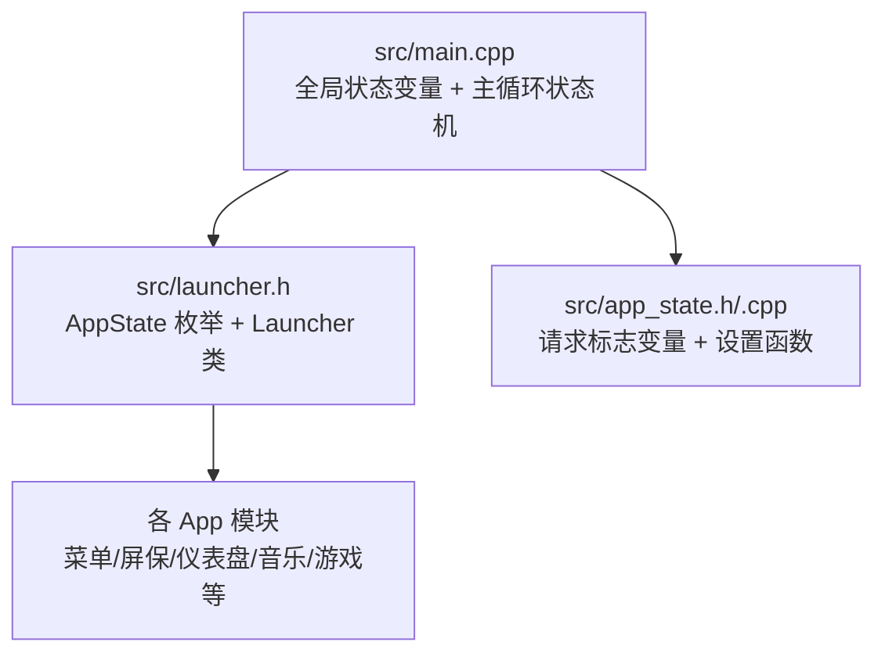
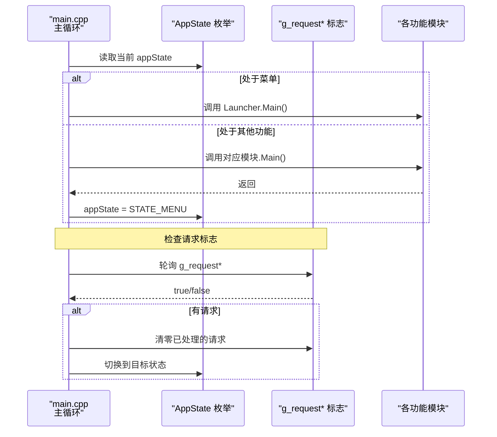
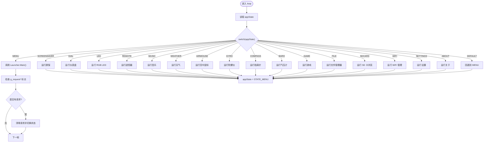
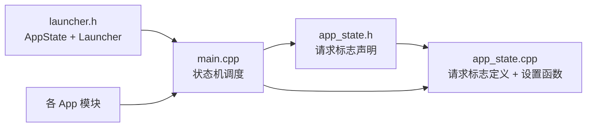

# 应用状态接口

<cite>
**本文引用的文件**   
- [launcher.h](file://src/launcher.h)
- [main.cpp](file://src/main.cpp)
- [app_state.h](file://src/app_state.h)
- [app_state.cpp](file://src/app_state.cpp)
</cite>

## 目录
1. [简介](#简介)
2. [项目结构](#项目结构)
3. [核心组件](#核心组件)
4. [架构总览](#架构总览)
5. [详细组件分析](#详细组件分析)
6. [依赖关系分析](#依赖关系分析)
7. [性能与线程安全](#性能与线程安全)
8. [故障排查指南](#故障排查指南)
9. [结论](#结论)
10. [附录：API 参考与使用模式](#附录api-参考与使用模式)

## 简介
本文件为 NullPod 固件的应用状态管理子系统提供 API 文档。该子系统通过一个全局的 AppState 枚举和一组“请求标志”变量，将用户输入、传感器事件或外部触发转化为应用状态转换，驱动菜单、屏保、仪表盘、音乐、游戏等各个功能模块的运行与退出。

重点包括：
- AppState 枚举的所有状态值及其含义
- 状态设置、获取与状态机逻辑
- 全局请求标志的使用方法与线程安全性
- 状态转换图与最佳实践
- 代码示例与使用模式（以路径引用代替具体代码）

## 项目结构
与本主题直接相关的源文件位于 src 目录下：
- src/launcher.h：定义 AppState 枚举、Launcher 类及菜单项回调函数前向声明
- src/main.cpp：维护全局 appState 变量，实现主循环中的状态机调度
- src/app_state.h / src/app_state.cpp：声明并实现各功能的“请求标志”变量与设置函数

图表来源
- [main.cpp:15-208](file://src/main.cpp#L15-L208)
- [launcher.h:45-65](file://src/launcher.h#L45-L65)
- [app_state.h:4-21](file://src/app_state.h#L4-L21)
- [app_state.cpp:3-36](file://src/app_state.cpp#L3-L36)

章节来源
- [launcher.h:45-65](file://src/launcher.h#L45-L65)
- [main.cpp:15-208](file://src/main.cpp#L15-L208)
- [app_state.h:4-21](file://src/app_state.h#L4-L21)
- [app_state.cpp:3-36](file://src/app_state.cpp#L3-L36)

## 核心组件
- AppState 枚举：定义所有应用状态，作为状态机的唯一真值来源
- 全局 appState 变量：在 main.cpp 中维护当前状态
- 请求标志集合：g_request* 系列 volatile bool，用于跨中断/多线程传递“进入某功能”的请求
- 设置函数：App_Request* 系列函数，用于置位对应的请求标志

章节来源
- [launcher.h:45-65](file://src/launcher.h#L45-L65)
- [main.cpp:15-208](file://src/main.cpp#L15-L208)
- [app_state.h:4-21](file://src/app_state.h#L4-L21)
- [app_state.cpp:3-36](file://src/app_state.cpp#L3-L36)

## 架构总览
整体流程如下：
- 系统启动后初始化 HAL，首次进入菜单（STATE_MENU）
- 主循环根据当前 appState 调用对应模块的主入口
- 当任意 g_request* 标志被置位时，主循环将其清零并将 appState 切换至目标状态
- 各功能模块运行结束后，通常将 appState 重置为 STATE_MENU，回到菜单

图表来源
- [main.cpp:27-208](file://src/main.cpp#L27-L208)
- [launcher.h:45-65](file://src/launcher.h#L45-L65)
- [app_state.h:4-21](file://src/app_state.h#L4-L21)
- [app_state.cpp:21-36](file://src/app_state.cpp#L21-L36)

## 详细组件分析

### AppState 枚举与状态语义
AppState 枚举定义了以下状态（按定义顺序）：
- STATE_MENU：主菜单界面
- STATE_SCREENSAVER：屏保（矩阵动画）
- STATE_DIAL：仪表盘
- STATE_RGB_LED：RGB LED 呼吸灯演示
- STATE_REMOTE：遥控器
- STATE_MUSIC：音乐播放器
- STATE_WEATHER：天气
- STATE_AIRMOUSE：空中鼠标
- STATE_GYROSCOPE：陀螺仪
- STATE_COMPASS：指南针
- STATE_BAROMETER：气压计
- STATE_GAME：游戏
- STATE_FILE：文件管理器
- STATE_SDCARD：SD 卡浏览
- STATE_WIFI：WiFi 管理
- STATE_SETTINGS：设置
- STATE_ABOUT：关于
- STATE_COUNT：状态总数（用于边界校验/统计）

这些状态在 main.cpp 中以 switch-case 形式进行分发，并在每个分支执行对应模块的主循环或一次性操作，完成后统一回退到 STATE_MENU。

章节来源
- [launcher.h:45-65](file://src/launcher.h#L45-L65)
- [main.cpp:29-126](file://src/main.cpp#L29-L126)

### 全局状态变量与线程安全
- 全局状态变量：static AppState appState = STATE_MENU; 位于 main.cpp，表示当前应用状态
- 请求标志：g_requestScreenSaver、g_requestDial、g_requestLed、g_requestRemote、g_requestMusic、g_requestWeather、g_requestAirMouse、g_requestGyroscope、g_requestCompass、g_requestBarometer、g_requestGame、g_requestFile、g_requestSD、g_requestWiFi、g_requestSettings、g_requestAbout，均为 volatile bool
- 线程安全说明：
  - 请求标志使用 volatile 修饰，确保跨中断/多线程可见性
  - 主循环在消费请求时会先清零再切换状态，避免重复触发
  - 若需要在 ISR 中置位请求标志，应遵循原子写单个布尔变量的约定；如需更复杂的数据交换，建议使用互斥锁或队列（当前实现未包含）

章节来源
- [main.cpp:15-16](file://src/main.cpp#L15-L16)
- [app_state.h:4-21](file://src/app_state.h#L4-L21)
- [app_state.cpp:3-19](file://src/app_state.cpp#L3-L19)

### 状态设置、获取与状态机逻辑
- 设置函数：App_Request* 系列函数仅负责将对应 g_request* 标志置为 true
- 获取方式：无显式 getter；主循环直接轮询 g_request* 标志
- 状态机逻辑：
  - 主循环首先处理当前状态的渲染/业务逻辑
  - 随后依次检查各 g_request* 标志，若为真则清零并切换到相应状态
  - 默认分支兜底，异常情况下回退到 STATE_MENU

图表来源
- [main.cpp:27-208](file://src/main.cpp#L27-L208)

章节来源
- [main.cpp:27-208](file://src/main.cpp#L27-L208)
- [app_state.cpp:21-36](file://src/app_state.cpp#L21-L36)

### 状态转换图
从“菜单”出发，任何 g_request* 置位都会跳转到对应功能；功能模块运行结束后通常返回“菜单”。

```mermaid
stateDiagram-v2
[*] --> STATE_MENU
STATE_MENU --> STATE_SCREENSAVER : "g_requestScreenSaver"
STATE_MENU --> STATE_DIAL : "g_requestDial"
STATE_MENU --> STATE_RGB_LED : "g_requestLed"
STATE_MENU --> STATE_REMOTE : "g_requestRemote"
STATE_MENU --> STATE_MUSIC : "g_requestMusic"
STATE_MENU --> STATE_WEATHER : "g_requestWeather"
STATE_MENU --> STATE_AIRMOUSE : "g_requestAirMouse"
STATE_MENU --> STATE_GYROSCOPE : "g_requestGyroscope"
STATE_MENU --> STATE_COMPASS : "g_requestCompass"
STATE_MENU --> STATE_BAROMETER : "g_requestBarometer"
STATE_MENU --> STATE_GAME : "g_requestGame"
STATE_MENU --> STATE_FILE : "g_requestFile"
STATE_MENU --> STATE_SDCARD : "g_requestSD"
STATE_MENU --> STATE_WIFI : "g_requestWiFi"
STATE_MENU --> STATE_SETTINGS : "g_requestSettings"
STATE_MENU --> STATE_ABOUT : "g_requestAbout"
STATE_SCREENSAVER --> STATE_MENU
STATE_DIAL --> STATE_MENU
STATE_RGB_LED --> STATE_MENU
STATE_REMOTE --> STATE_MENU
STATE_MUSIC --> STATE_MENU
STATE_WEATHER --> STATE_MENU
STATE_AIRMOUSE --> STATE_MENU
STATE_GYROSCOPE --> STATE_MENU
STATE_COMPASS --> STATE_MENU
STATE_BAROMETER --> STATE_MENU
STATE_GAME --> STATE_MENU
STATE_FILE --> STATE_MENU
STATE_SDCARD --> STATE_MENU
STATE_WIFI --> STATE_MENU
STATE_SETTINGS --> STATE_MENU
STATE_ABOUT --> STATE_MENU
```

图表来源
- [main.cpp:29-208](file://src/main.cpp#L29-L208)
- [app_state.h:4-21](file://src/app_state.h#L4-L21)

## 依赖关系分析
- launcher.h 引入 hal、hal_config、common 以及 app_state.h
- main.cpp 包含多个 App 头文件，并在主循环中调用其 Main 方法
- app_state.h/.cpp 提供请求标志与设置函数，供各模块或输入层调用

图表来源
- [launcher.h:1-8](file://src/launcher.h#L1-L8)
- [main.cpp:1-13](file://src/main.cpp#L1-L13)
- [app_state.h:4-21](file://src/app_state.h#L4-L21)
- [app_state.cpp:1-36](file://src/app_state.cpp#L1-L36)

章节来源
- [launcher.h:1-8](file://src/launcher.h#L1-L8)
- [main.cpp:1-13](file://src/main.cpp#L1-L13)
- [app_state.h:4-21](file://src/app_state.h#L4-L21)
- [app_state.cpp:1-36](file://src/app_state.cpp#L1-L36)

## 性能与线程安全
- 性能特性
  - 状态机采用简单 switch-case 分发，开销极低
  - 请求标志为布尔型，读写代价可忽略
  - 各功能模块在主循环中运行，建议模块内部自行控制刷新频率与资源占用
- 线程安全
  - 请求标志使用 volatile，保证跨中断/多线程可见性
  - 建议在 ISR 中仅置位标志，避免复杂逻辑
  - 若未来需要并发修改 appState，应引入互斥保护或使用原子类型

[本节为通用指导，不直接分析具体文件]

## 故障排查指南
常见问题与定位思路：
- 状态无法切换
  - 检查是否调用了正确的 App_Request* 函数
  - 确认主循环是否被阻塞（例如某个模块未返回）
  - 查看串口日志，确认是否进入了对应分支
- 重复触发同一功能
  - 检查是否在消费请求后正确清零了 g_request* 标志
- 中断中置位标志无效
  - 确认变量是否为 volatile
  - 避免在中断中进行耗时操作

章节来源
- [main.cpp:128-208](file://src/main.cpp#L128-L208)
- [app_state.cpp:21-36](file://src/app_state.cpp#L21-L36)

## 结论
NullPod 的状态管理采用“枚举 + 全局变量 + 请求标志”的轻量方案，结构简单、易于扩展。通过统一的 AppState 枚举与集中式的状态机调度，保证了各功能模块的清晰边界与一致的生命周期。结合 volatile 请求标志，可在中断与主循环之间可靠地传递“进入某功能”的意图。

[本节为总结性内容，不直接分析具体文件]

## 附录：API 参考与使用模式

### AppState 枚举成员与含义
- STATE_MENU：主菜单
- STATE_SCREENSAVER：屏保
- STATE_DIAL：仪表盘
- STATE_RGB_LED：RGB LED
- STATE_REMOTE：遥控器
- STATE_MUSIC：音乐
- STATE_WEATHER：天气
- STATE_AIRMOUSE：空中鼠标
- STATE_GYROSCOPE：陀螺仪
- STATE_COMPASS：指南针
- STATE_BAROMETER：气压计
- STATE_GAME：游戏
- STATE_FILE：文件管理器
- STATE_SDCARD：SD 卡浏览
- STATE_WIFI：WiFi 管理
- STATE_SETTINGS：设置
- STATE_ABOUT：关于
- STATE_COUNT：状态计数

章节来源
- [launcher.h:45-65](file://src/launcher.h#L45-L65)

### 全局状态变量
- static AppState appState：当前应用状态，由 main.cpp 维护

章节来源
- [main.cpp:15-16](file://src/main.cpp#L15-L16)

### 请求标志与设置函数
- 请求标志（volatile bool）：
  - g_requestScreenSaver、g_requestDial、g_requestLed、g_requestRemote、g_requestMusic、g_requestWeather、g_requestAirMouse、g_requestGyroscope、g_requestCompass、g_requestBarometer、g_requestGame、g_requestFile、g_requestSD、g_requestWiFi、g_requestSettings、g_requestAbout
- 设置函数：
  - App_RequestScreenSaver()
  - App_RequestDial()
  - App_RequestLED()
  - App_RequestRemote()
  - App_RequestMusic()
  - App_RequestWeather()
  - App_RequestAirMouse()
  - App_RequestGyroscope()
  - App_RequestCompass()
  - App_RequestBarometer()
  - App_RequestGame()
  - App_RequestFile()
  - App_RequestSD()
  - App_RequestWiFi()
  - App_RequestSettings()
  - App_RequestAbout()

章节来源
- [app_state.h:4-21](file://src/app_state.h#L4-L21)
- [app_state.cpp:3-36](file://src/app_state.cpp#L3-L36)

### 使用模式与示例（以路径引用代替代码）
- 在任意模块或输入处理中，调用对应的 App_Request* 函数置位请求标志
  - 示例路径：[app_state.cpp:21-36](file://src/app_state.cpp#L21-L36)
- 主循环会轮询 g_request* 标志，清零并切换到目标状态
  - 示例路径：[main.cpp:128-208](file://src/main.cpp#L128-L208)
- 功能模块运行结束后，将 appState 重置为 STATE_MENU
  - 示例路径：[main.cpp:35-121](file://src/main.cpp#L35-L121)

章节来源
- [app_state.cpp:21-36](file://src/app_state.cpp#L21-L36)
- [main.cpp:35-121](file://src/main.cpp#L35-L121)
- [main.cpp:128-208](file://src/main.cpp#L128-L208)