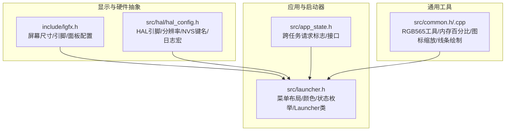
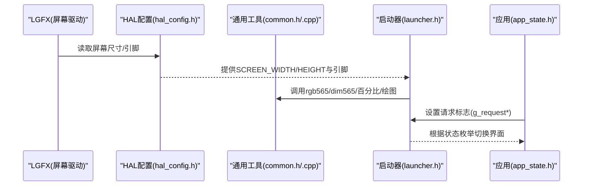
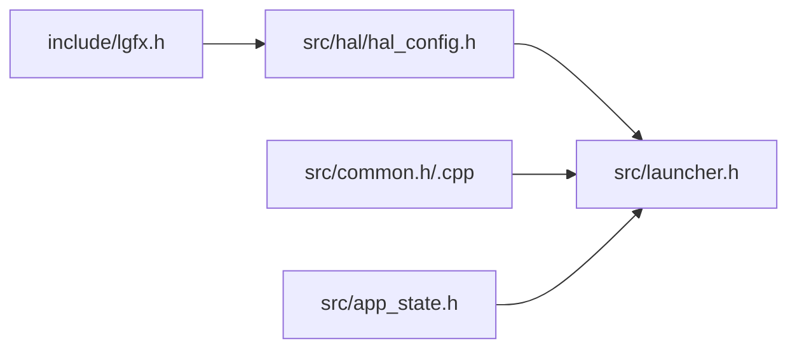

# 通用数据类型

<cite>
**本文引用的文件**   
- [common.h](file://src/common.h)
- [common.cpp](file://src/common.cpp)
- [lgfx.h](file://include/lgfx.h)
- [hal_config.h](file://src/hal/hal_config.h)
- [launcher.h](file://src/launcher.h)
- [app_state.h](file://src/app_state.h)
</cite>

## 目录
1. [简介](#简介)
2. [项目结构](#项目结构)
3. [核心组件](#核心组件)
4. [架构总览](#架构总览)
5. [详细组件分析](#详细组件分析)
6. [依赖关系分析](#依赖关系分析)
7. [性能与资源特性](#性能与资源特性)
8. [故障排查指南](#故障排查指南)
9. [结论](#结论)
10. [附录：常用初始化与用法示例](#附录常用初始化与用法示例)

## 简介
本参考文档聚焦于本项目中的通用数据结构和常量，覆盖颜色定义、尺寸常量、配置参数、全局变量以及基础工具函数。目标是帮助开发者快速理解并正确使用这些基础类型，包括字段含义、取值范围、使用场景、初始化方式、版本兼容性与迁移注意事项。

## 项目结构
本项目在显示与交互层集中定义了屏幕尺寸、引脚映射、颜色常量与菜单布局等通用数据；在应用层提供状态枚举与请求标志；在公共层提供颜色转换与绘图辅助函数。

**图表来源**
- [lgfx.h:25-31](file://include/lgfx.h#L25-L31)
- [hal_config.h:17-22](file://src/hal/hal_config.h#L17-L22)
- [common.h:27-34](file://src/common.h#L27-L34)
- [launcher.h:44-65](file://src/launcher.h#L44-L65)
- [app_state.h:5-21](file://src/app_state.h#L5-L21)

**章节来源**
- [lgfx.h:1-118](file://include/lgfx.h#L1-L118)
- [hal_config.h:1-123](file://src/hal/hal_config.h#L1-L123)
- [common.h:1-36](file://src/common.h#L1-L36)
- [launcher.h:1-153](file://src/launcher.h#L1-L153)
- [app_state.h:1-42](file://src/app_state.h#L1-L42)

## 核心组件
本节汇总所有公共数据结构、枚举、常量与全局变量的分类与职责。

- 颜色与主题常量
  - 菜单主题色（背景、标题、状态栏、文字、高亮、箭头、提示、标题、边框）
  - 通用浅色/功能色（浅蓝、浅黄、浅紫、浅灰、摇杆绿）
  - 启动器界面配色（背景渐变、文本白/暗/灰、状态栏专用色）
  - HAL 层灰色常量（TFT_GREY）

- 尺寸与布局常量
  - 屏幕宽高（SCREEN_WIDTH/SCREEN_HEIGHT）
  - 菜单区域高度、状态栏位置与高度、图标源尺寸
  - 启动器布局常量（状态栏、图标区、标签区、提示区）

- 配置与键名
  - NVS 命名空间与键名（LCD 背光亮度/超时、WiFi SSID/密码）
  - 引脚映射（LCD/触摸/I2C/SD/电源/编码器/蜂鸣器/RGB/红外）

- 全局变量与请求标志
  - 跨任务/中断安全的请求标志（菜单、屏保、拨号、LED、遥控、音乐、天气、空鼠、陀螺仪、指南针、气压计、游戏、文件、SD、WiFi、设置、关于）
  - 启动器全局实例（g_launcher）

- 枚举类型
  - 应用状态枚举（AppState），用于启动器状态机

- 工具函数
  - RGB565 转换与变暗
  - 内存/PSRAM/Flash 占用百分比查询
  - 图标缩放绘制与楔形线绘制

**章节来源**
- [common.h:4-28](file://src/common.h#L4-L28)
- [launcher.h:14-42](file://src/launcher.h#L14-L42)
- [hal_config.h:67-77](file://src/hal/hal_config.h#L67-L77)
- [app_state.h:5-21](file://src/app_state.h#L5-L21)
- [launcher.h:44-65](file://src/launcher.h#L44-L65)

## 架构总览
通用数据类型贯穿“显示驱动 → HAL 配置 → 通用工具 → 启动器与应用”的链路。显示驱动定义物理屏幕尺寸与引脚；HAL 层统一引脚与分辨率；通用工具提供颜色与绘图能力；启动器基于上述常量构建 UI 与状态机；应用通过请求标志与启动器交互。

**图表来源**
- [lgfx.h:25-31](file://include/lgfx.h#L25-L31)
- [hal_config.h:17-22](file://src/hal/hal_config.h#L17-L22)
- [common.h:27-34](file://src/common.h#L27-L34)
- [launcher.h:44-65](file://src/launcher.h#L44-L65)
- [app_state.h:5-21](file://src/app_state.h#L5-L21)

## 详细组件分析

### 颜色与主题常量
- 菜单主题色
  - 用途：菜单背景、标题背景、状态栏背景、文字、选中项背景、箭头、提示、标题、边框、暂停遮罩
  - 格式：RGB565 十六进制值
  - 典型取值范围：0x0000–0xFFFF
  - 使用场景：菜单渲染、UI 主题切换、遮罩效果
- 通用功能色
  - 用途：强调色、功能指示（如摇杆绿）
  - 格式：RGB565
- 启动器配色
  - 用途：背景渐变、文本颜色、状态栏连接状态指示（WiFi/BT 已连接/断开）
  - 格式：RGB565
- HAL 层颜色
  - TFT_GREY：用于日志或调试输出时的文本颜色

建议：
- 新增主题时优先复用 rgb565() 构造，避免硬编码分散。
- 对对比度敏感的颜色（如状态栏连接指示）应成对定义 ON/OFF 色值，便于一致性维护。

**章节来源**
- [common.h:4-25](file://src/common.h#L4-L25)
- [launcher.h:14-29](file://src/launcher.h#L14-L29)
- [hal_config.h:67-68](file://src/hal/hal_config.h#L67-L68)

### 尺寸与布局常量
- 屏幕尺寸
  - SCREEN_WIDTH / SCREEN_HEIGHT：由 HAL 层定义，默认横屏 240×280
  - 注意：LovyanGFX 内部也声明了 screenWidth/screenHeight，但业务代码应以 HAL 层为准
- 菜单布局
  - MENU_HEADER_HEIGHT、MENU_STATUS_Y、MENU_STATUS_HEIGHT、ICON_SRC_SIZE
- 启动器布局
  - STATUS_H/Y、ICON_AREA_Y/H、LABEL_AREA_Y/H、HINT_AREA_Y/H、CENTER_X

建议：
- 所有布局计算以 SCREEN_WIDTH/HEIGHT 为基准，避免硬编码像素。
- 当更换屏幕或旋转方向时，仅修改 HAL 层常量即可全局生效。

**章节来源**
- [hal_config.h:17-22](file://src/hal/hal_config.h#L17-L22)
- [common.h:16-19](file://src/common.h#L16-L19)
- [launcher.h:30-42](file://src/launcher.h#L30-L42)

### 配置与键名（NVS）
- NVS 命名空间与键名
  - CONFIG_NAMESPACE：NVS 命名空间
  - INIT_KEY、FFAT_KEY：初始化与文件系统标记
  - LCD_BK_BRIGHTNESS_KEY、LCD_BK_TIME_OUT_KEY：LCD 背光亮度与自动关闭时间
  - WIFI_SSID_KEY、WIFI_PASSWORD_KEY：WiFi 凭据键名
- 引脚映射
  - LCD、触摸、I2C、SD、电源、编码器、蜂鸣器、RGB、红外等引脚常量

建议：
- 新增持久化配置时，遵循现有键名风格，并在首次运行时进行迁移校验。
- 引脚变更需同步更新 HAL 层与 LovyanGFX 配置（若涉及）。

**章节来源**
- [hal_config.h:70-77](file://src/hal/hal_config.h#L70-L77)
- [hal_config.h:7-66](file://src/hal/hal_config.h#L7-L66)

### 全局变量与请求标志
- 请求标志（volatile bool）
  - g_requestMenu、g_requestScreenSaver、g_requestDial、g_requestLed、g_requestRemote、g_requestMusic、g_requestWeather、g_requestAirMouse、g_requestGyroscope、g_requestCompass、g_requestBarometer、g_requestGame、g_requestFile、g_requestSD、g_requestWiFi、g_requestSettings、g_requestAbout
- 启动器全局实例
  - g_launcher：启动器单例，供系统其他模块访问

建议：
- 所有跨任务/中断共享的标志必须使用 volatile，并通过统一的 App_Request* 接口设置，避免竞态。
- 启动器对外暴露 Main/Init/Update/Draw/Exit 生命周期方法，内部状态机通过 AppState 枚举管理。

**章节来源**
- [app_state.h:5-21](file://src/app_state.h#L5-L21)
- [launcher.h:150-150](file://src/launcher.h#L150-L150)

### 枚举类型：AppState
- 定义：包含菜单、屏保、拨号、LED、遥控、音乐、天气、空鼠、陀螺仪、指南针、气压计、游戏、文件、SD卡、WiFi、设置、关于等状态
- 用途：启动器状态机、界面切换、事件分发

建议：
- 新增功能时，在末尾追加新状态，保持 STATE_COUNT 自增语义。
- 与 app_state.h 的请求标志一一对应，确保状态与入口一致。

**章节来源**
- [launcher.h:44-65](file://src/launcher.h#L44-L65)

### 工具函数与数据结构
- rgb565(r,g,b)：将 8bit R/G/B 转换为 RGB565 16bit 颜色
- dim565(c, factor)：对 RGB565 颜色按因子变暗（factor ∈ [0,1]）
- getRamPercent()/getPsramPercent()/getFlashPercent()：返回内存/PSRAM/Flash 使用百分比
- drawScaledIcon(canvas, x, y, scale, src, clicked)：按缩放比例绘制图标，支持点击态混合
- drawWedgeLine(s, x0,y0,x1,y1,w0,w1,color, bg)：绘制带宽度渐变的楔形线（模拟 TFT_eSPI 行为）

复杂度与性能要点：
- rgb565/dim565：O(1)，位运算，适合高频调用
- 百分比查询：O(1)，调用 ESP-IDF/ESP32 库 API
- drawScaledIcon：O(N^2)，N 为缩放后像素数，应避免过大 scale 或频繁重绘
- drawWedgeLine：O(steps)，steps 控制平滑度，默认 6

建议：
- 图标绘制前做视口裁剪判断，减少无效绘制
- 对需要半透明效果的 UI，优先使用 dim565 生成中间色，避免浮点开销

**章节来源**
- [common.cpp:7-25](file://src/common.cpp#L7-L25)
- [common.cpp:27-62](file://src/common.cpp#L27-L62)
- [common.cpp:64-150](file://src/common.cpp#L64-L150)
- [common.h:27-34](file://src/common.h#L27-L34)

## 依赖关系分析
- 显示驱动（lgfx.h）
  - 定义屏幕尺寸、引脚、面板与触控配置
  - 被 HAL 层与启动器引用
- HAL 配置（hal_config.h）
  - 提供统一的引脚、分辨率、NVS 键名与日志宏
  - 被启动器与通用工具间接引用
- 通用工具（common.h/.cpp）
  - 提供颜色与绘图工具，被启动器广泛使用
- 启动器（launcher.h）
  - 聚合颜色、尺寸、布局、状态枚举与 UI 逻辑
- 应用状态（app_state.h）
  - 提供跨任务请求标志，供启动器消费

**图表来源**
- [lgfx.h:25-31](file://include/lgfx.h#L25-L31)
- [hal_config.h:17-22](file://src/hal/hal_config.h#L17-L22)
- [common.h:27-34](file://src/common.h#L27-L34)
- [launcher.h:1-10](file://src/launcher.h#L1-L10)
- [app_state.h:5-21](file://src/app_state.h#L5-L21)

**章节来源**
- [lgfx.h:1-118](file://include/lgfx.h#L1-L118)
- [hal_config.h:1-123](file://src/hal/hal_config.h#L1-L123)
- [common.h:1-36](file://src/common.h#L1-L36)
- [launcher.h:1-153](file://src/launcher.h#L1-L153)
- [app_state.h:1-42](file://src/app_state.h#L1-L42)

## 性能与资源特性
- 颜色处理
  - 使用 RGB565 降低显存带宽压力，dim565 避免浮点运算
- 内存与存储
  - 提供 RAM/PSRAM/Flash 使用率查询，便于监控与告警
- 图形绘制
  - 图标缩放算法简单直接，建议在 UI 层缓存缩放结果以减少重复计算
  - 楔形线绘制采用步进近似，steps 越大越平滑但开销越高

优化建议：
- 对频繁变化的 UI（如状态栏）采用增量刷新
- 大图标预缩放至常用尺寸，避免运行时缩放

[本节为通用指导，不直接分析具体文件]

## 故障排查指南
- 颜色异常
  - 检查是否误用 RGB888 值而非 RGB565
  - 确认 dim565 的 factor 是否在 [0,1] 范围内
- 布局错位
  - 核对 SCREEN_WIDTH/HEIGHT 是否与 HAL 层一致
  - 检查菜单区域常量与状态栏 Y 偏移是否冲突
- 持久化配置丢失
  - 检查 NVS 命名空间与键名是否匹配
  - 首次运行需写入默认值并标记 INIT_KEY
- 触摸/显示引脚错误
  - 对照 lgfx.h 与 hal_config.h 的引脚定义，确保硬件连线一致

**章节来源**
- [common.cpp:13-25](file://src/common.cpp#L13-L25)
- [hal_config.h:17-22](file://src/hal/hal_config.h#L17-L22)
- [hal_config.h:70-77](file://src/hal/hal_config.h#L70-L77)

## 结论
本项目将颜色、尺寸、配置与工具函数集中在通用层，配合 HAL 与 LovyanGFX 形成清晰的层次。通过统一的常量与枚举，启动器与应用可稳定协作。建议后续扩展遵循现有命名与组织规范，确保可维护性与兼容性。

[本节为总结性内容，不直接分析具体文件]

## 附录：常用初始化与用法示例
- 颜色构造
  - 使用 rgb565(R,G,B) 构造任意颜色
  - 使用 dim565(color, factor) 生成变暗色
- 内存与存储监控
  - 调用 getRamPercent()/getPsramPercent()/getFlashPercent() 获取百分比
- 图标绘制
  - 调用 drawScaledIcon(canvas, x, y, scale, icon_data, clicked) 绘制缩放图标
- 楔形线绘制
  - 调用 drawWedgeLine(s, x0,y0,x1,y1,w0,w1,color, bg) 绘制渐变宽度线条
- 状态切换
  - 通过 App_Request* 设置请求标志，启动器根据 AppState 切换界面

注意：
- 以上为用法指引，具体实现请参考对应源码路径。

**章节来源**
- [common.cpp:7-25](file://src/common.cpp#L7-L25)
- [common.cpp:27-62](file://src/common.cpp#L27-L62)
- [common.cpp:64-150](file://src/common.cpp#L64-L150)
- [app_state.h:23-39](file://src/app_state.h#L23-L39)
- [launcher.h:44-65](file://src/launcher.h#L44-L65)