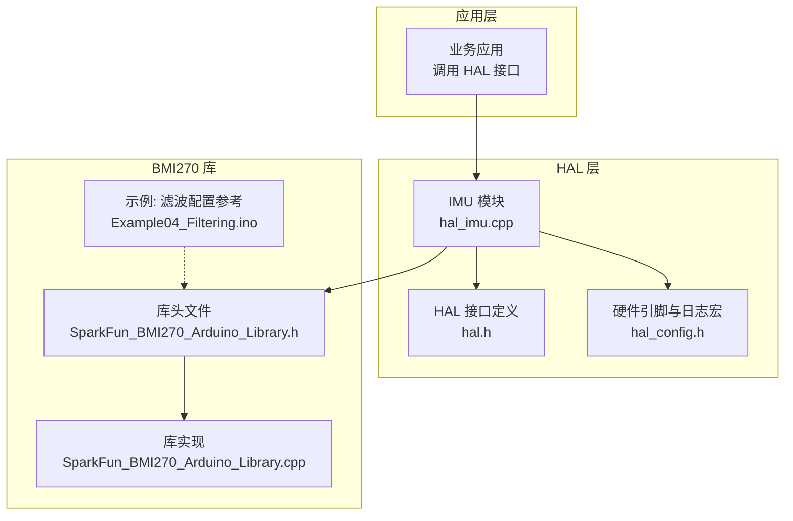
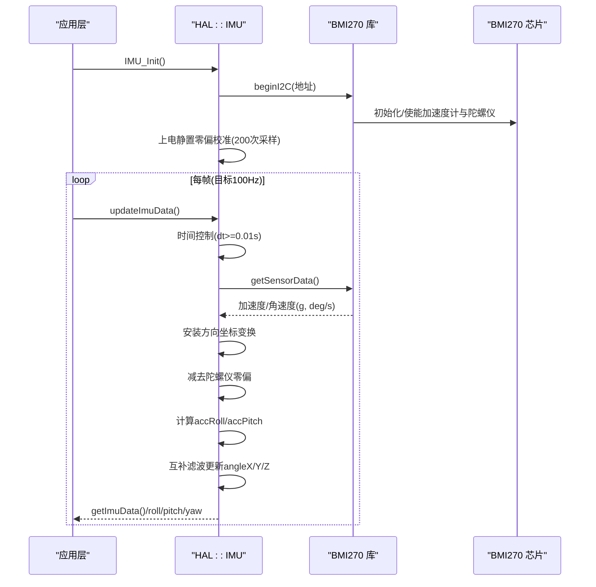
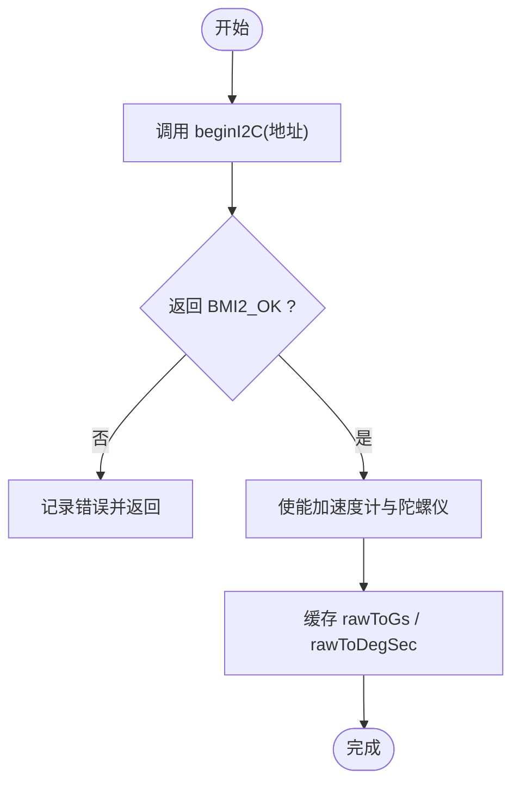
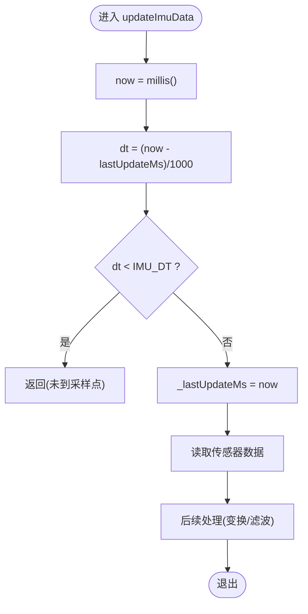
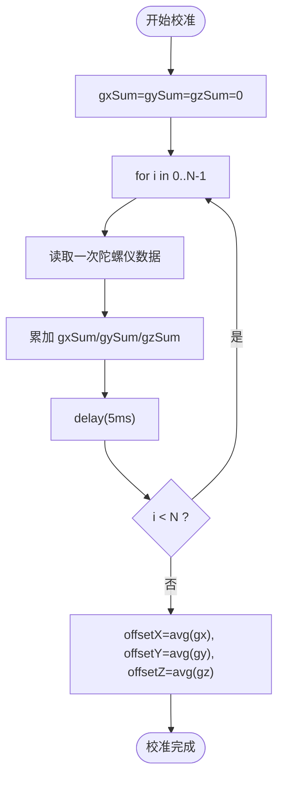
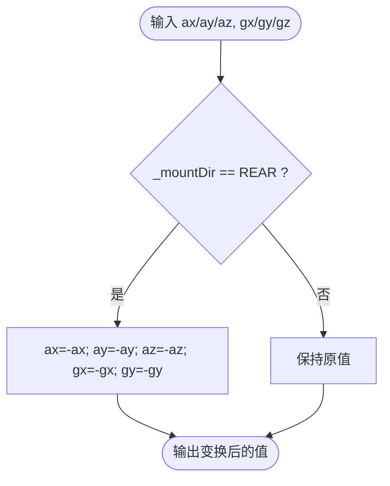
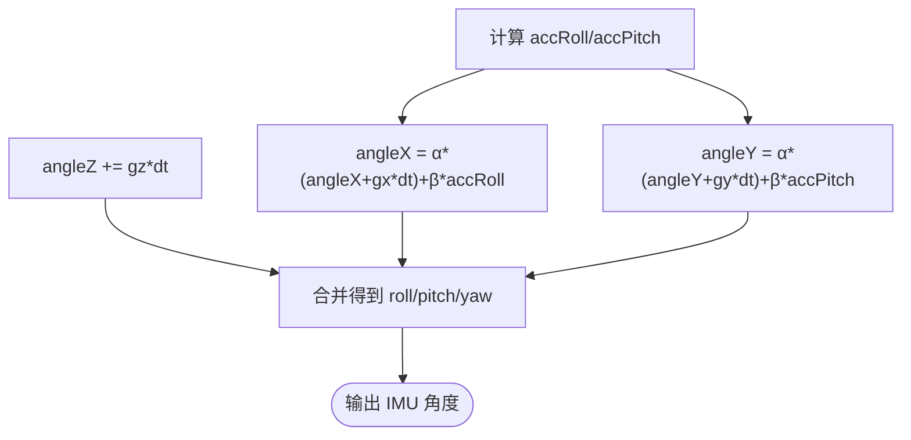
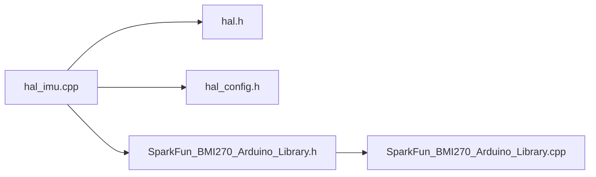

# IMU 传感器处理

<cite>
**本文引用的文件**   
- [hal_imu.cpp](file://src/hal/hal_imu.cpp)
- [hal.h](file://src/hal/hal.h)
- [hal_config.h](file://src/hal/hal_config.h)
- [SparkFun_BMI270_Arduino_Library.h](file://lib/SparkFun BMI270 Arduino Library/src/SparkFun_BMI270_Arduino_Library.h)
- [SparkFun_BMI270_Arduino_Library.cpp](file://lib/SparkFun BMI270 Arduino Library/src/SparkFun_BMI270_Arduino_Library.cpp)
- [Example04_Filtering.ino](file://lib/SparkFun BMI270 Arduino Library/examples/Example04_Filtering/Example04_Filtering.ino)
</cite>

## 目录
1. [简介](#简介)
2. [项目结构](#项目结构)
3. [核心组件](#核心组件)
4. [架构总览](#架构总览)
5. [详细组件分析](#详细组件分析)
6. [依赖关系分析](#依赖关系分析)
7. [性能与调优](#性能与调优)
8. [故障诊断与调试](#故障诊断与调试)
9. [结论](#结论)

## 简介
本技术文档围绕 ESP32 上基于 BMI270 的 IMU 数据处理流程展开，覆盖 I2C 通信配置、固定 100Hz 采样控制、加速度计与陀螺仪数据读取、陀螺仪零偏校准、互补滤波姿态解算（滚转/俯仰角）以及 yaw 角的积分处理。同时给出安装方向坐标变换逻辑、数学原理说明、滤波系数调优建议、性能优化方法与常见故障诊断技巧，帮助开发者快速定位问题并稳定运行。

## 项目结构
本项目中与 IMU 相关的关键代码位于 HAL 层与第三方 BMI270 库：
- HAL 层实现 IMU 初始化、数据采集、零偏校准、互补滤波、安装方向变换与对外接口。
- SparkFun BMI270 Arduino Library 提供底层 I2C/SPI 驱动、寄存器访问、原始数据到物理单位转换等能力。

图表来源
- [hal_imu.cpp:1-182](file://src/hal/hal_imu.cpp#L1-L182)
- [hal.h:31-54](file://src/hal/hal.h#L31-L54)
- [hal_config.h:44-50](file://src/hal/hal_config.h#L44-L50)
- [SparkFun_BMI270_Arduino_Library.h:144-273](file://lib/SparkFun BMI270 Arduino Library/src/SparkFun_BMI270_Arduino_Library.h#L144-L273)
- [SparkFun_BMI270_Arduino_Library.cpp:1-46](file://lib/SparkFun BMI270 Arduino Library/src/SparkFun_BMI270_Arduino_Library.cpp#L1-L46)
- [Example04_Filtering.ino:74-116](file://lib/SparkFun BMI270 Arduino Library/examples/Example04_Filtering/Example04_Filtering.ino#L74-L116)

章节来源
- [hal_imu.cpp:1-182](file://src/hal/hal_imu.cpp#L1-L182)
- [hal.h:31-54](file://src/hal/hal.h#L31-L54)
- [hal_config.h:44-50](file://src/hal/hal_config.h#L44-L50)
- [SparkFun_BMI270_Arduino_Library.h:144-273](file://lib/SparkFun BMI270 Arduino Library/src/SparkFun_BMI270_Arduino_Library.h#L144-L273)
- [SparkFun_BMI270_Arduino_Library.cpp:1-46](file://lib/SparkFun BMI270 Arduino Library/src/SparkFun_BMI270_Arduino_Library.cpp#L1-L46)
- [Example04_Filtering.ino:74-116](file://lib/SparkFun BMI270 Arduino Library/examples/Example04_Filtering/Example04_Filtering.ino#L74-L116)

## 核心组件
- IMU 数据模型与接口
  - ImuData_t 包含加速度、角速度、角度（roll/pitch/yaw）、鼠标增量等字段，供上层使用。
  - HAL 暴露 IMU_Init、updateImuData、getImuData、imu_get_roll/pitch/yaw 等接口。
- BMI270 库封装
  - beginI2C 完成 I2C 初始化与设备探测；getSensorData 获取最新加速度与角速度。
  - 内部维护 rawToGs/rawToDegSec 标量用于将原始值转换为 g 与 deg/s。
- 常量与配置
  - 固定采样率 100Hz，DT=0.01s。
  - 互补滤波系数：陀螺仪 0.98，加速度计 0.02。
  - 零偏校准：上电静置采样 200 次，间隔 5ms，约 1 秒完成。

章节来源
- [hal.h:31-54](file://src/hal/hal.h#L31-L54)
- [hal_imu.cpp:5-16](file://src/hal/hal_imu.cpp#L5-L16)
- [SparkFun_BMI270_Arduino_Library.h:85-103](file://lib/SparkFun BMI270 Arduino Library/src/SparkFun_BMI270_Arduino_Library.h#L85-L103)
- [SparkFun_BMI270_Arduino_Library.h:144-161](file://lib/SparkFun BMI270 Arduino Library/src/SparkFun_BMI270_Arduino_Library.h#L144-L161)

## 架构总览
下图展示从应用层到 BMI270 传感器的完整数据流与控制流。

图表来源
- [hal_imu.cpp:57-74](file://src/hal/hal_imu.cpp#L57-L74)
- [hal_imu.cpp:88-149](file://src/hal/hal_imu.cpp#L88-L149)
- [SparkFun_BMI270_Arduino_Library.cpp:12-46](file://lib/SparkFun BMI270 Arduino Library/src/SparkFun_BMI270_Arduino_Library.cpp#L12-L46)

## 详细组件分析

### I2C 通信与设备初始化
- 使用 BMI270 库的 beginI2C 进行 I2C 初始化与设备探测，默认主地址为 BMI2_I2C_PRIM_ADDR。
- 成功后启用加速度计与陀螺仪，并缓存量程换算标量。

图表来源
- [SparkFun_BMI270_Arduino_Library.cpp:12-46](file://lib/SparkFun BMI270 Arduino Library/src/SparkFun_BMI270_Arduino_Library.cpp#L12-L46)
- [Example04_Filtering.ino:74-116](file://lib/SparkFun BMI270 Arduino Library/examples/Example04_Filtering/Example04_Filtering.ino#L74-L116)

章节来源
- [hal_imu.cpp:57-74](file://src/hal/hal_imu.cpp#L57-L74)
- [SparkFun_BMI270_Arduino_Library.cpp:12-46](file://lib/SparkFun BMI270 Arduino Library/src/SparkFun_BMI270_Arduino_Library.cpp#L12-L46)

### 采样频率控制（100Hz）
- 通过全局常量 IMU_SAMPLE_RATE_HZ=100 与 IMU_DT=0.01 控制采集周期。
- updateImuData 中根据 millis() 差值判断是否到达采样时刻，未到则直接返回，保证稳定 100Hz。

图表来源
- [hal_imu.cpp:88-98](file://src/hal/hal_imu.cpp#L88-L98)

章节来源
- [hal_imu.cpp:5-8](file://src/hal/hal_imu.cpp#L5-L8)
- [hal_imu.cpp:88-98](file://src/hal/hal_imu.cpp#L88-L98)

### 加速度计与陀螺仪数据读取
- 通过 _bmi270.getSensorData() 获取最新数据，字段包括 accelX/Y/Z 与 gyroX/Y/Z。
- 库内部已将原始寄存器值转换为物理单位（g 与 deg/s）。

章节来源
- [hal_imu.cpp:99-108](file://src/hal/hal_imu.cpp#L99-L108)
- [SparkFun_BMI270_Arduino_Library.h:85-103](file://lib/SparkFun BMI270 Arduino Library/src/SparkFun_BMI270_Arduino_Library.h#L85-L103)

### 陀螺仪零偏校准算法
- 上电后先延时 200ms，再执行 calibrateGyroBias：在静置状态下连续采样 200 次，每次间隔 5ms，对三轴角速度求平均作为零偏偏移量。
- 运行时在 updateImuData 中从原始角速度中减去该偏移。

图表来源
- [hal_imu.cpp:31-55](file://src/hal/hal_imu.cpp#L31-L55)
- [hal_imu.cpp:69-73](file://src/hal/hal_imu.cpp#L69-L73)
- [hal_imu.cpp:113-116](file://src/hal/hal_imu.cpp#L113-L116)

章节来源
- [hal_imu.cpp:31-55](file://src/hal/hal_imu.cpp#L31-L55)
- [hal_imu.cpp:69-73](file://src/hal/hal_imu.cpp#L69-L73)
- [hal_imu.cpp:113-116](file://src/hal/hal_imu.cpp#L113-L116)

### 安装方向坐标变换
- 支持两种安装方向：正面(IMU_MOUNT_NORMAL)与反面(IMU_MOUNT_REAR)。
- applyMountTransform 对加速度与角速度进行符号翻转以适配 PCB 安装方向。
- 针对 roll/pitch 输出也做了相应符号修正，确保最终姿态符合预期。

图表来源
- [hal_imu.cpp:76-86](file://src/hal/hal_imu.cpp#L76-L86)
- [hal_imu.cpp:110-111](file://src/hal/hal_imu.cpp#L110-L111)
- [hal_imu.cpp:126-130](file://src/hal/hal_imu.cpp#L126-L130)

章节来源
- [hal_imu.cpp:76-86](file://src/hal/hal_imu.cpp#L76-L86)
- [hal_imu.cpp:110-130](file://src/hal/hal_imu.cpp#L110-L130)

### 姿态解算与互补滤波
- 加速度计角度：
  - roll = atan2(ay, az + |ax|) * RAD_TO_DEG
  - pitch = -atan2(ax, az + |ay|) * RAD_TO_DEG
- 互补滤波：
  - angleX = α*(angleX + gx*dt) + β*accRoll
  - angleY = α*(angleY + gy*dt) + β*accPitch
  - angleZ += gz*dt（yaw 仅积分，无磁力计）
- 其中 α=0.98，β=0.02，dt≈0.01s。

图表来源
- [hal_imu.cpp:118-135](file://src/hal/hal_imu.cpp#L118-L135)

章节来源
- [hal_imu.cpp:118-135](file://src/hal/hal_imu.cpp#L118-L135)

### 数学原理与注意事项
- 加速度计角度估计基于重力矢量投影，适用于静态或低速场景下的绝对角度参考。
- 陀螺仪积分提供高频动态响应，但存在漂移；互补滤波用高置信度的短期变化（陀螺仪）与长期稳定参考（加速度计）融合。
- yaw 角由于缺少磁力计，无法获得绝对方位，只能做相对积分，长时间会累积误差。

[本节为概念性说明，不直接分析具体文件]

## 依赖关系分析
- HAL 层依赖：
  - hal.h：定义 ImuData_t、枚举与 HAL 接口。
  - hal_config.h：I2C 引脚与日志宏。
  - SparkFun BMI270 库：beginI2C/getSensorData 等 API。
- 库内部依赖：
  - bmi270_api/bmi270.h（由库头文件引入），负责寄存器级操作。
  - TwoWire/SPIClass 抽象通信接口。

图表来源
- [hal_imu.cpp:1-3](file://src/hal/hal_imu.cpp#L1-L3)
- [hal.h:31-54](file://src/hal/hal.h#L31-L54)
- [hal_config.h:44-50](file://src/hal/hal_config.h#L44-L50)
- [SparkFun_BMI270_Arduino_Library.h:1-9](file://lib/SparkFun BMI270 Arduino Library/src/SparkFun_BMI270_Arduino_Library.h#L1-L9)
- [SparkFun_BMI270_Arduino_Library.h:144-161](file://lib/SparkFun BMI270 Arduino Library/src/SparkFun_BMI270_Arduino_Library.h#L144-L161)

章节来源
- [hal_imu.cpp:1-3](file://src/hal/hal_imu.cpp#L1-L3)
- [hal.h:31-54](file://src/hal/hal.h#L31-L54)
- [hal_config.h:44-50](file://src/hal/hal_config.h#L44-L50)
- [SparkFun_BMI270_Arduino_Library.h:144-161](file://lib/SparkFun BMI270 Arduino Library/src/SparkFun_BMI270_Arduino_Library.h#L144-L161)

## 性能与调优
- 滤波系数调优
  - 当前 α=0.98，β=0.02，偏向陀螺仪积分，适合动态响应较快场景。
  - 若出现角度抖动增大，可适当增大 β（如 0.03~0.05）以提高加速度计权重，增强稳定性。
  - 若角度响应迟缓，可适当减小 β（如 0.01~0.02）以提升动态跟踪。
- 采样频率与 dt
  - 固定 100Hz，dt≈0.01s，满足一般手势/鼠标控制需求。
  - 如需更高动态精度，可提升 ODR（需同步调整滤波参数与系统负载）。
- 零偏校准
  - 确保上电静置至少 1 秒，避免运动引入偏差。
  - 可在温度变化较大时重新校准，减少温漂影响。
- 安装方向
  - 正确设置 IMU_MOUNT_*，否则 roll/pitch/yaw 符号可能异常。
- 数值稳定性
  - 加速度计角度计算中使用 fabsf 避免除零与数值不稳定。
  - yaw 角不做限幅，注意长期漂移；必要时可结合磁力计或外部参考重置。

[本节为通用指导，不直接分析具体文件]

## 故障诊断与调试
- 初始化失败
  - 现象：IMU init failed!
  - 排查：检查 I2C 地址与接线；确认 Wire 已初始化；查看 beginI2C 返回值。
  - 参考：[hal_imu.cpp:62-67](file://src/hal/hal_imu.cpp#L62-L67)
- 角度异常或符号相反
  - 现象：roll/pitch/yaw 方向与预期不符。
  - 排查：检查 IMU_MOUNT_* 配置；验证 applyMountTransform 与 roll/pitch 符号修正。
  - 参考：[hal_imu.cpp:76-86](file://src/hal/hal_imu.cpp#L76-L86)，[hal_imu.cpp:126-130](file://src/hal/hal_imu.cpp#L126-L130)
- 角度漂移严重
  - 现象：yaw 持续漂移，pitch/roll 缓慢偏移。
  - 排查：确认零偏校准是否成功；检查静置时间与采样次数；适当调整互补滤波系数。
  - 参考：[hal_imu.cpp:31-55](file://src/hal/hal_imu.cpp#L31-L55)，[hal_imu.cpp:113-116](file://src/hal/hal_imu.cpp#L113-L116)
- 数据跳变或噪声大
  - 现象：角度抖动明显。
  - 排查：提高加速度计权重（增大 β）；检查供电与布线质量；必要时增加软件平滑。
  - 参考：[hal_imu.cpp:11-12](file://src/hal/hal_imu.cpp#L11-L12)
- 鼠标增量异常
  - 现象：鼠标 dx/dy 过大或过小。
  - 排查：检查 sensitivity 参数与映射关系；确认角度增量计算与限幅范围。
  - 参考：[hal_imu.cpp:151-173](file://src/hal/hal_imu.cpp#L151-L173)

章节来源
- [hal_imu.cpp:31-55](file://src/hal/hal_imu.cpp#L31-L55)
- [hal_imu.cpp:62-67](file://src/hal/hal_imu.cpp#L62-L67)
- [hal_imu.cpp:76-86](file://src/hal/hal_imu.cpp#L76-L86)
- [hal_imu.cpp:113-116](file://src/hal/hal_imu.cpp#L113-L116)
- [hal_imu.cpp:126-130](file://src/hal/hal_imu.cpp#L126-L130)
- [hal_imu.cpp:151-173](file://src/hal/hal_imu.cpp#L151-L173)

## 结论
本项目在 ESP32 上通过 HAL 层封装 BMI270 IMU，实现了稳定的 100Hz 数据采集、上电静置零偏校准、互补滤波姿态解算与安装方向坐标变换。在无磁力计条件下，roll/pitch 通过加速度计与陀螺仪互补得到稳定结果，yaw 采用纯积分方式，需注意长期漂移。通过合理调节互补滤波系数、确保正确的安装方向与充分的零偏校准，可获得良好的姿态解算效果。对于更复杂的航向与姿态需求，建议扩展磁力计融合方案（如 Madgwick/Mahony 滤波器）并引入外部参考进行 yaw 校正。

[本节为总结性内容，不直接分析具体文件]