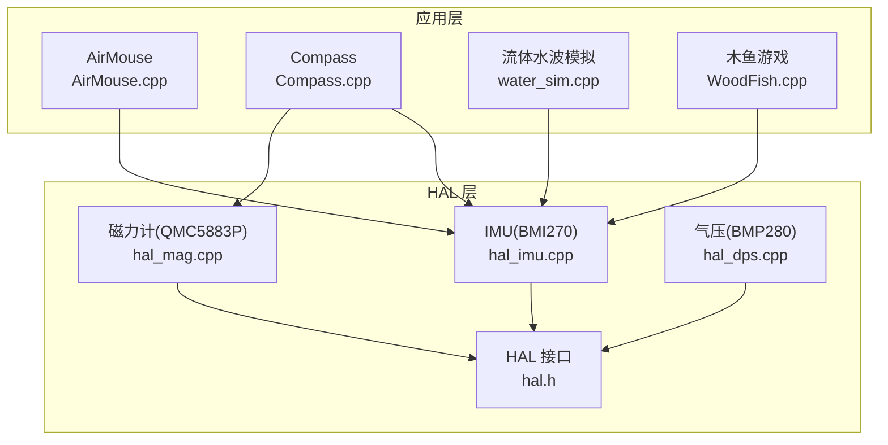
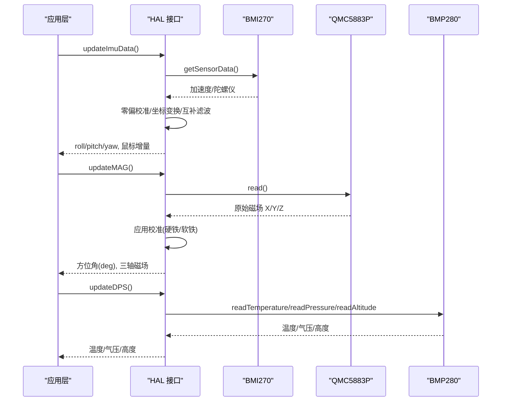
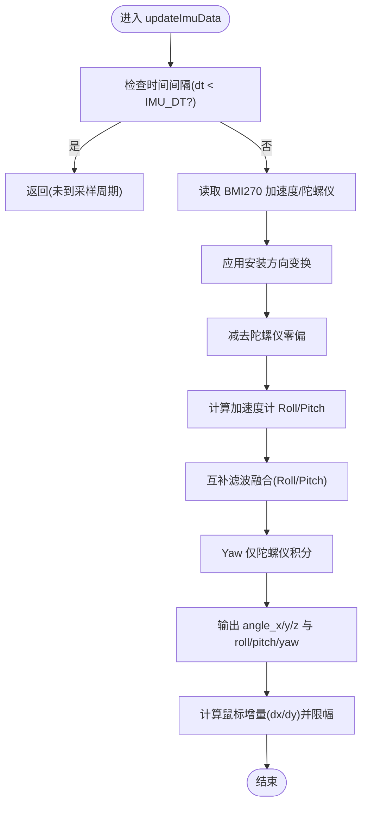
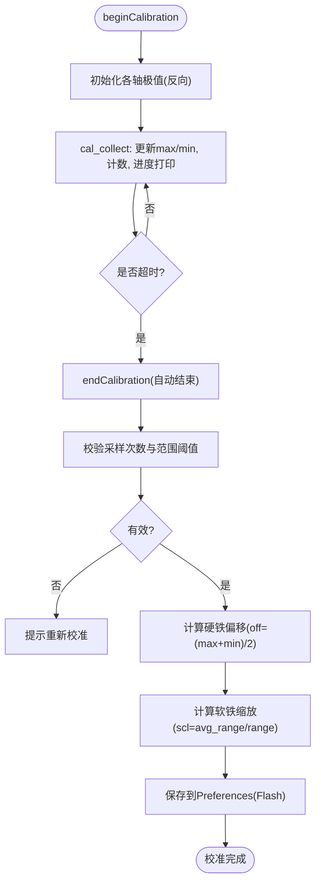
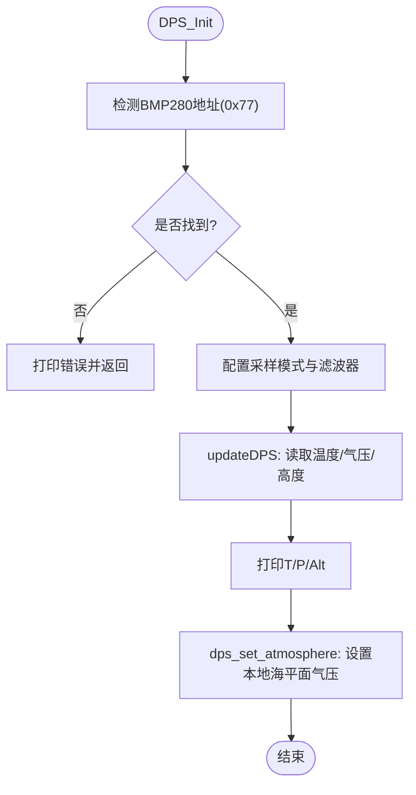
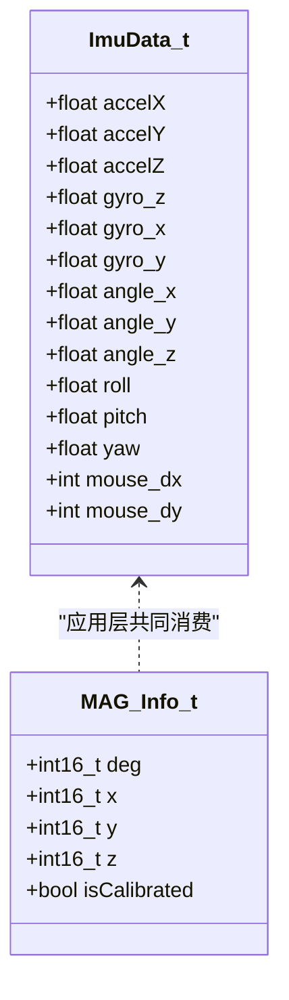
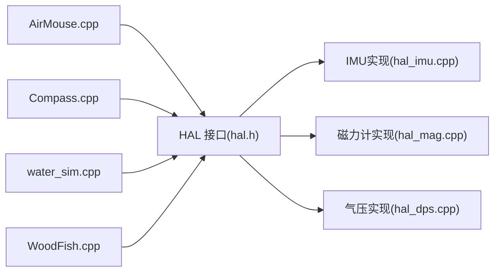

# 传感器数据处理

<cite>
**本文引用的文件**   
- [hal_imu.cpp](file://src/hal/hal_imu.cpp)
- [hal_mag.cpp](file://src/hal/hal_mag.cpp)
- [hal_dps.cpp](file://src/hal/hal_dps.cpp)
- [hal.h](file://src/hal/hal.h)
- [AirMouse.cpp](file://src/apps/AirMouse.cpp)
- [Compass.cpp](file://src/apps/Compass.cpp)
- [water_sim.cpp](file://src/apps/FluidApp/water_sim.cpp)
- [WoodFish.cpp](file://src/apps/game/WoodFish.cpp)
</cite>

## 目录
1. [引言](#引言)
2. [项目结构](#项目结构)
3. [核心组件](#核心组件)
4. [架构总览](#架构总览)
5. [详细组件分析](#详细组件分析)
6. [依赖关系分析](#依赖关系分析)
7. [性能与调优](#性能与调优)
8. [故障诊断与调试](#故障诊断与调试)
9. [结论](#结论)

## 引言
本技术文档面向 ESP32 NullPod 的传感器数据处理子系统，重点覆盖 IMU（加速度计与陀螺仪）的姿态解算与互补滤波、磁力计的方位角计算与校准流程、气压传感器的高度估算与温度补偿，以及多传感器数据的融合思路与误差校正方法。同时给出传感器初始化配置、数据采集频率设置、性能调优建议，以及常见问题的诊断与调试方法，帮助开发者快速定位问题并优化系统表现。

## 项目结构
本项目将传感器驱动与处理逻辑集中在 HAL 层，上层应用通过统一接口访问 IMU、磁力计与气压传感器的数据：
- IMU 使用 BMI270，提供加速度与陀螺仪数据，并在 HAL 中实现零偏校准与互补滤波姿态解算。
- 磁力计使用 QMC5883P，提供磁场三轴数据与方位角，支持硬铁偏移与软铁缩放校准，参数持久化到 Flash。
- 气压传感器使用 BMP280，提供温度、气压与海拔高度估算，支持本地海平面气压设定以修正高度。

**图表来源**
- [hal_imu.cpp:1-182](file://src/hal/hal_imu.cpp#L1-L182)
- [hal_mag.cpp:1-297](file://src/hal/hal_mag.cpp#L1-L297)
- [hal_dps.cpp:1-57](file://src/hal/hal_dps.cpp#L1-L57)
- [hal.h:31-64](file://src/hal/hal.h#L31-L64)
- [AirMouse.cpp:66-66](file://src/apps/AirMouse.cpp#L66-L66)
- [Compass.cpp:552-552](file://src/apps/Compass.cpp#L552-L552)
- [Compass.cpp:670-670](file://src/apps/Compass.cpp#L670-L670)
- [water_sim.cpp:164-164](file://src/apps/FluidApp/water_sim.cpp#L164-L164)
- [WoodFish.cpp:319-319](file://src/apps/game/WoodFish.cpp#L319-L319)

**章节来源**
- [hal_imu.cpp:1-182](file://src/hal/hal_imu.cpp#L1-L182)
- [hal_mag.cpp:1-297](file://src/hal/hal_mag.cpp#L1-L297)
- [hal_dps.cpp:1-57](file://src/hal/hal_dps.cpp#L1-L57)
- [hal.h:31-64](file://src/hal/hal.h#L31-L64)

## 核心组件
- IMU 模块（BMI270）
  - 上电零偏校准：静置采样求平均，得到陀螺仪各轴零偏。
  - 安装方向变换：根据 IMU_MOUNT_REAR 等枚举进行坐标翻转。
  - 姿态解算：加速度计角度 + 陀螺仪积分，采用标准互补滤波；Yaw 仅陀螺仪积分。
  - 输出：roll/pitch/yaw、角度增量、鼠标位移增量。
- 磁力计模块（QMC5883P）
  - 采集原始磁场 X/Y/Z，应用硬铁偏移与软铁缩放校准。
  - 方位角计算：基于校准后的 X/Y 计算方位角。
  - 校准流程：记录各轴最大最小值，计算偏移与缩放，保存到 Preferences（Flash）。
- 气压模块（BMP280）
  - 读取温度、气压、海拔高度；支持本地海平面气压设定。
  - 采样模式与滤波器系数按库推荐配置，提高稳定性。

**章节来源**
- [hal_imu.cpp:31-55](file://src/hal/hal_imu.cpp#L31-L55)
- [hal_imu.cpp:76-149](file://src/hal/hal_imu.cpp#L76-L149)
- [hal_mag.cpp:61-76](file://src/hal/hal_mag.cpp#L61-L76)
- [hal_mag.cpp:141-197](file://src/hal/hal_mag.cpp#L141-L197)
- [hal_dps.cpp:20-26](file://src/hal/hal_dps.cpp#L20-L26)

## 架构总览
传感器数据流从底层驱动到 HAL 处理，再到应用层消费：
- IMU 在 HAL 中以固定频率（约 100Hz）更新，完成零偏校准、坐标变换、互补滤波，输出姿态与鼠标增量。
- 磁力计在 HAL 中持续采样并应用校准参数，输出方位角与三轴磁场。
- 气压传感器在 HAL 中读取温度、气压与高度，供应用层显示或进一步处理。

**图表来源**
- [hal_imu.cpp:88-149](file://src/hal/hal_imu.cpp#L88-L149)
- [hal_mag.cpp:248-274](file://src/hal/hal_mag.cpp#L248-L274)
- [hal_dps.cpp:29-36](file://src/hal/hal_dps.cpp#L29-L36)

## 详细组件分析

### IMU 传感器数据处理与姿态解算
- 初始化与零偏校准
  - 启动 I2C 连接 BMI270，随后执行静置采样求平均，得到陀螺仪各轴零偏。
  - 校准过程会打印偏移量，便于调试。
- 安装方向变换
  - 根据 IMU_MOUNT_REAR 对加速度与陀螺仪数据进行符号翻转，保证坐标系一致。
- 姿态解算
  - 加速度计角度：Roll/Pitch 由 atan2 计算，考虑安装方向后取反。
  - 互补滤波：Roll/Pitch 使用陀螺仪积分与加速度计角度加权融合；Yaw 仅陀螺仪积分。
  - 输出：angle_x/y/z 为滤波后的角度，roll/pitch/yaw 为最终姿态角。
- 鼠标增量
  - 基于角度差值计算 dx/dy，并进行限幅，用于 AirMouse 等应用。

**图表来源**
- [hal_imu.cpp:88-149](file://src/hal/hal_imu.cpp#L88-L149)
- [hal_imu.cpp:151-173](file://src/hal/hal_imu.cpp#L151-L173)

**章节来源**
- [hal_imu.cpp:31-55](file://src/hal/hal_imu.cpp#L31-L55)
- [hal_imu.cpp:76-149](file://src/hal/hal_imu.cpp#L76-L149)
- [hal_imu.cpp:151-173](file://src/hal/hal_imu.cpp#L151-L173)

### 磁力计方位角计算与校准流程
- 校准数据存储
  - 使用 Preferences 存储各轴最大最小值、硬铁偏移、软铁缩放与有效性标志。
  - 上电自动加载已保存的校准参数。
- 校准流程
  - beginCalibration：进入校准模式，初始化极值为反向范围。
  - cal_collect：循环采集磁场数据，更新各轴最大最小值，统计采样次数，超时自动结束。
  - endCalibration：校验采样次数与各轴范围阈值，计算硬铁偏移与软铁缩放，保存至 Flash。
- 方位角计算
  - 读取原始磁场 X/Y/Z，应用校准参数得到校准后的 cx/cy/cz。
  - 调用 compass.getAzimuth() 获取方位角。

**图表来源**
- [hal_mag.cpp:141-197](file://src/hal/hal_mag.cpp#L141-L197)
- [hal_mag.cpp:199-230](file://src/hal/hal_mag.cpp#L199-L230)

**章节来源**
- [hal_mag.cpp:61-76](file://src/hal/hal_mag.cpp#L61-L76)
- [hal_mag.cpp:78-129](file://src/hal/hal_mag.cpp#L78-L129)
- [hal_mag.cpp:141-197](file://src/hal/hal_mag.cpp#L141-L197)
- [hal_mag.cpp:248-274](file://src/hal/hal_mag.cpp#L248-L274)

### 气压传感器高度计算与温度补偿
- 初始化
  - 检测设备地址 0x77，若未找到则打印错误信息。
  - 设置采样模式：NORMAL 模式，温度过采样 x2，气压过采样 x16，IIR 滤波器 x4，待机时间 63ms，ODR 约 10Hz。
- 数据读取
  - 读取温度（°C）、气压（hPa）、海拔高度（m），并打印日志。
- 高度修正
  - 支持 dps_set_atmosphere 设置本地海平面气压，用于修正海拔估算。

**图表来源**
- [hal_dps.cpp:10-26](file://src/hal/hal_dps.cpp#L10-L26)
- [hal_dps.cpp:29-56](file://src/hal/hal_dps.cpp#L29-L56)

**章节来源**
- [hal_dps.cpp:10-26](file://src/hal/hal_dps.cpp#L10-L26)
- [hal_dps.cpp:29-56](file://src/hal/hal_dps.cpp#L29-L56)

### 传感器数据融合与误差校正
- IMU 融合
  - 互补滤波融合加速度计角度与陀螺仪积分，抑制高频噪声与低频漂移。
  - Yaw 无磁力计参与，存在累积漂移，需外部参考（如磁力计）进行长期校正。
- 磁力计校正
  - 硬铁偏移消除恒定磁场干扰，软铁缩放使各轴灵敏度一致，提升方位角精度。
- 气压高度修正
  - 通过本地海平面气压修正海拔估算，减少环境气压变化带来的误差。

**图表来源**
- [hal.h:31-64](file://src/hal/hal.h#L31-L64)

**章节来源**
- [hal.h:31-64](file://src/hal/hal.h#L31-L64)

## 依赖关系分析
- HAL 接口定义
  - hal.h 定义了 IMU/MAG/DPS 的公共接口与数据结构，供应用层调用。
- 应用层调用
  - AirMouse、Compass、water_sim、WoodFish 等应用通过 HAL::updateImuData、HAL::updateMAG、HAL::updateDPS 获取传感器数据。

**图表来源**
- [hal.h:130-157](file://src/hal/hal.h#L130-L157)
- [AirMouse.cpp:66-66](file://src/apps/AirMouse.cpp#L66-L66)
- [Compass.cpp:552-552](file://src/apps/Compass.cpp#L552-L552)
- [Compass.cpp:670-670](file://src/apps/Compass.cpp#L670-L670)
- [water_sim.cpp:164-164](file://src/apps/FluidApp/water_sim.cpp#L164-L164)
- [WoodFish.cpp:319-319](file://src/apps/game/WoodFish.cpp#L319-L319)

**章节来源**
- [hal.h:130-157](file://src/hal/hal.h#L130-L157)
- [AirMouse.cpp:66-66](file://src/apps/AirMouse.cpp#L66-L66)
- [Compass.cpp:552-552](file://src/apps/Compass.cpp#L552-L552)
- [Compass.cpp:670-670](file://src/apps/Compass.cpp#L670-L670)
- [water_sim.cpp:164-164](file://src/apps/FluidApp/water_sim.cpp#L164-L164)
- [WoodFish.cpp:319-319](file://src/apps/game/WoodFish.cpp#L319-L319)

## 性能与调优
- IMU 采样频率
  - 固定 100Hz，通过 dt 控制更新时间，避免频繁调用导致 CPU 占用过高。
  - 建议：在资源紧张的应用中可适当降低频率，但需注意姿态解算精度下降。
- 互补滤波系数
  - 当前陀螺仪权重较高（0.98），加速度计权重较低（0.02），适合动态场景；静态场景可提高加速度计权重以提升稳定性。
- 磁力计校准
  - 确保旋转覆盖各方向，采样次数与范围阈值满足要求，否则校准无效。
  - 建议在远离强磁环境进行校准，避免硬铁/软铁干扰。
- 气压高度修正
  - 设置正确的本地海平面气压可显著改善高度估算精度；随天气变化定期更新该值。
- 功耗与延迟
  - 磁力计每 50ms 采样一次，可根据应用需求调整 delay 以降低功耗。
  - 气压传感器 ODR 约 10Hz，适合低频高度监测。

[本节为通用指导，不直接分析具体文件]

## 故障诊断与调试
- IMU 初始化失败
  - 现象：串口打印“IMU init failed!”。
  - 排查：检查 I2C 接线与地址；确认 BMI270 供电正常。
- IMU 零偏校准异常
  - 现象：校准后 Roll/Pitch 抖动大或漂移明显。
  - 排查：确保校准期间设备静置；检查安装方向枚举是否正确。
- 磁力计校准无效
  - 现象：方位角跳变或不准确。
  - 排查：检查校准过程中是否旋转足够范围；查看 Preferences 中 valid 标志；清除校准数据后重新校准。
- 气压传感器未找到
  - 现象：串口打印“BMP280 not found! Check wiring / address.”。
  - 排查：检查 I2C 地址是否为 0x77；检查接线与供电。
- 应用层数据异常
  - 现象：AirMouse 移动异常、Compass 指向错误、水波模拟不稳定。
  - 排查：确认应用层正确调用 HAL::updateImuData/updateMAG/updateDPS；检查传感器数据输出日志。

**章节来源**
- [hal_imu.cpp:57-74](file://src/hal/hal_imu.cpp#L57-L74)
- [hal_mag.cpp:233-246](file://src/hal/hal_mag.cpp#L233-L246)
- [hal_dps.cpp:10-18](file://src/hal/hal_dps.cpp#L10-L18)

## 结论
ESP32 NullPod 的传感器数据处理子系统通过 HAL 层统一封装 IMU、磁力计与气压传感器，提供了稳定的姿态解算、方位角计算与高度估算能力。IMU 采用互补滤波融合加速度计与陀螺仪数据，磁力计支持硬铁偏移与软铁缩放校准并持久化到 Flash，气压传感器支持本地海平面气压修正以提高高度精度。结合应用层的调用方式与调试日志，开发者可以快速定位问题并进行性能调优，以满足不同应用场景的需求。