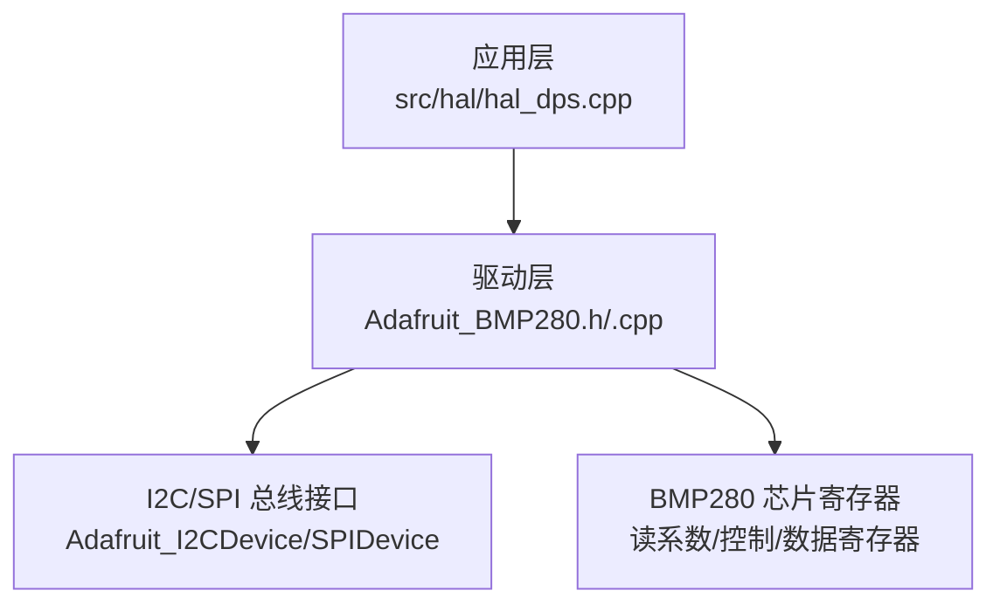
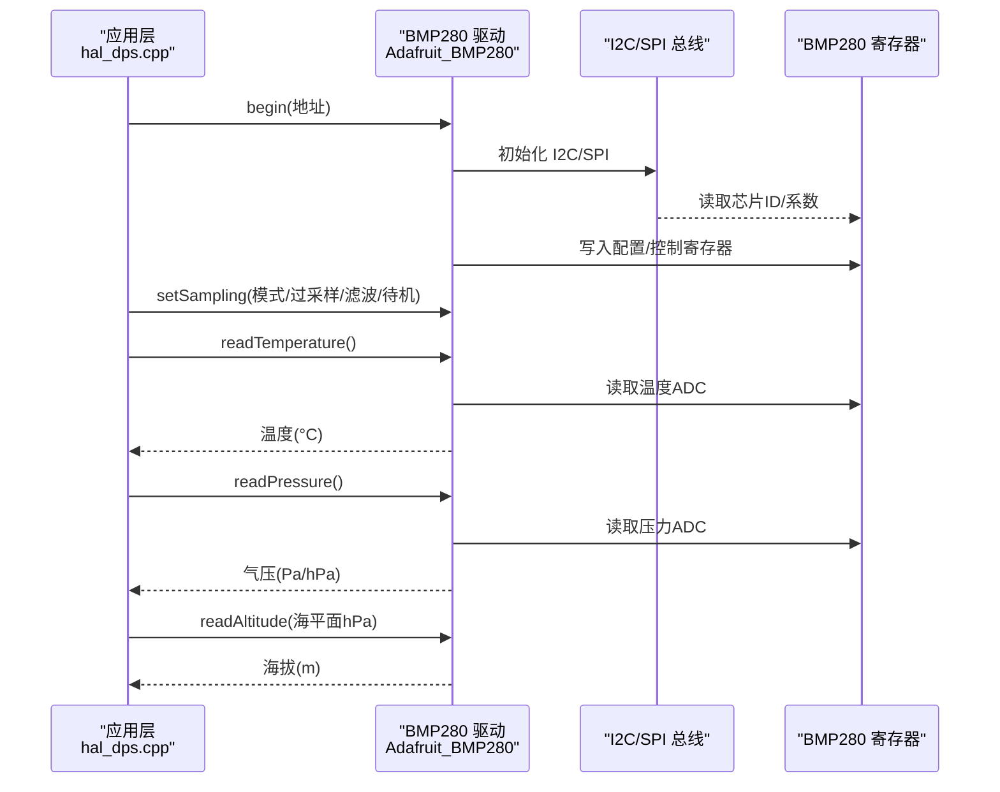
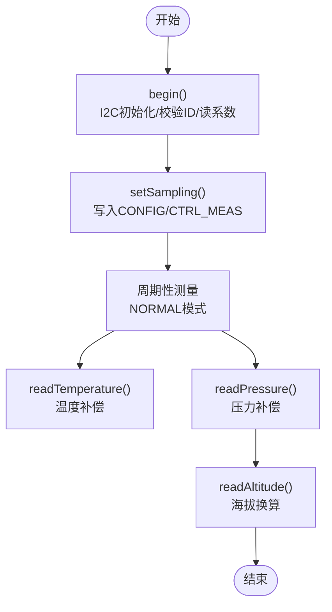
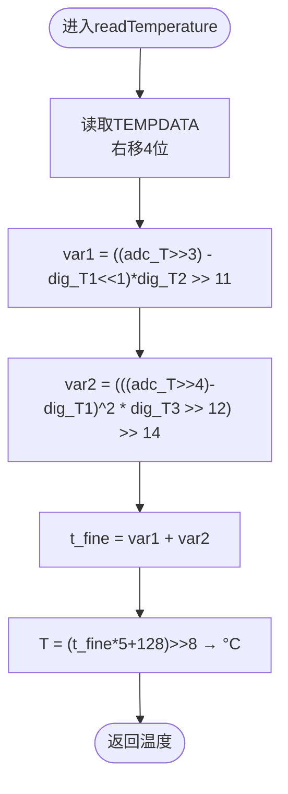
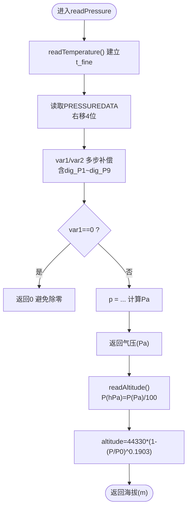
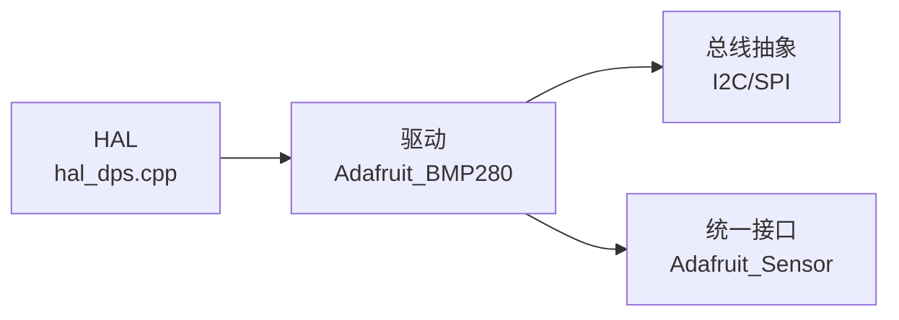

# 气压传感器处理

<cite>
**本文引用的文件**   
- [Adafruit_BMP280.h](file://lib/Adafruit BMP280 Library/Adafruit_BMP280.h)
- [Adafruit_BMP280.cpp](file://lib/Adafruit BMP280 Library/Adafruit_BMP280.cpp)
- [hal_dps.cpp](file://src/hal/hal_dps.cpp)
</cite>

## 目录
1. [简介](#简介)
2. [项目结构](#项目结构)
3. [核心组件](#核心组件)
4. [架构总览](#架构总览)
5. [详细组件分析](#详细组件分析)
6. [依赖关系分析](#依赖关系分析)
7. [性能与精度考量](#性能与精度考量)
8. [故障诊断与调优](#故障诊断与调优)
9. [结论](#结论)
10. [附录](#附录)

## 简介
本技术文档围绕 Adafruit BMP280 气压传感器在工程中的数据处理流程展开，重点覆盖：
- I2C 通信配置与参数设置（采样、滤波、待机时间）
- 温度补偿机制及其对气压测量的影响
- 气压到海拔高度的转换算法与标准大气压模型的应用
- 数据滤波与异常值检测策略
- 不同天气条件下的气压变化规律与高度计算准确性分析
- 校准方法与精度优化建议
- 常见故障诊断与性能调优技巧

## 项目结构
本项目将 BMP280 驱动封装在库中，并在硬件抽象层（HAL）中进行初始化与调用。关键路径如下：
- 驱动层：lib/Adafruit BMP280 Library/Adafruit_BMP280.{h,cpp}
- 应用层：src/hal/hal_dps.cpp（初始化、读取温度/气压/海拔、设置海平面参考气压）

图表来源
- [hal_dps.cpp:10-26](file://src/hal/hal_dps.cpp#L10-L26)
- [Adafruit_BMP280.cpp:86-110](file://lib/Adafruit BMP280 Library/Adafruit_BMP280.cpp#L86-L110)

章节来源
- [hal_dps.cpp:1-57](file://src/hal/hal_dps.cpp#L1-L57)
- [Adafruit_BMP280.h:118-265](file://lib/Adafruit BMP280 Library/Adafruit_BMP280.h#L118-L265)
- [Adafruit_BMP280.cpp:86-141](file://lib/Adafruit BMP280 Library/Adafruit_BMP280.cpp#L86-L141)

## 核心组件
- Adafruit_BMP280 类：提供 I2C/SPI 访问、寄存器读写、温度/气压/海拔计算、采样与滤波配置等能力。
- HAL 封装（hal_dps.cpp）：负责设备初始化、参数配置、数据读取与输出。

关键职责划分：
- 初始化与连接：begin() 完成 I2C/SPI 初始化、芯片 ID 校验、系数读取与默认采样配置。
- 数据采集：readTemperature()/readPressure() 实现温度与气压的原始 ADC 读取与数字补偿。
- 海拔换算：readAltitude() 基于标准大气压模型进行近似海拔估算。
- 统一传感器接口：暴露温度与气压的统一事件接口，便于上层集成。

章节来源
- [Adafruit_BMP280.h:118-265](file://lib/Adafruit BMP280 Library/Adafruit_BMP280.h#L118-L265)
- [Adafruit_BMP280.cpp:86-141](file://lib/Adafruit BMP280 Library/Adafruit_BMP280.cpp#L86-L141)
- [hal_dps.cpp:10-26](file://src/hal/hal_dps.cpp#L10-L26)

## 架构总览
下图展示从应用层到传感器寄存器的完整数据流与控制流。

图表来源
- [hal_dps.cpp:10-26](file://src/hal/hal_dps.cpp#L10-L26)
- [Adafruit_BMP280.cpp:86-141](file://lib/Adafruit BMP280 Library/Adafruit_BMP280.cpp#L86-L141)
- [Adafruit_BMP280.cpp:248-306](file://lib/Adafruit BMP280 Library/Adafruit_BMP280.cpp#L248-L306)
- [Adafruit_BMP280.cpp:315-341](file://lib/Adafruit BMP280 Library/Adafruit_BMP280.cpp#L315-L341)

## 详细组件分析

### I2C 通信配置与参数设置
- I2C 地址：支持默认地址与备用地址两种选项。
- 初始化流程：
  - begin() 创建 I2C 设备对象并建立连接；校验芯片 ID；读取出厂校准系数；调用 setSampling() 写入配置与控制寄存器。
- 采样与滤波配置：
  - setSampling() 可设置工作模式（睡眠/强制/正常）、温度与压力过采样倍数、内部 IIR 滤波器等级、待机时间（决定 ODR）。
- 典型配置（HAL 层）：
  - 模式：NORMAL
  - 温度过采样：X2
  - 压力过采样：X16
  - 滤波器：X4
  - 待机时间：63ms（对应约 10Hz 采样率）

图表来源
- [Adafruit_BMP280.cpp:86-141](file://lib/Adafruit BMP280 Library/Adafruit_BMP280.cpp#L86-L141)
- [hal_dps.cpp:10-26](file://src/hal/hal_dps.cpp#L10-L26)

章节来源
- [Adafruit_BMP280.h:31-64](file://lib/Adafruit BMP280 Library/Adafruit_BMP280.h#L31-L64)
- [Adafruit_BMP280.h:120-180](file://lib/Adafruit BMP280 Library/Adafruit_BMP280.h#L120-L180)
- [Adafruit_BMP280.cpp:86-141](file://lib/Adafruit BMP280 Library/Adafruit_BMP280.cpp#L86-L141)
- [hal_dps.cpp:10-26](file://src/hal/hal_dps.cpp#L10-L26)

### 温度补偿机制
- 温度读取流程：
  - 读取温度 ADC 值并进行工厂校准系数补偿，得到 t_fine 中间变量。
  - 最终温度以摄氏度返回。
- 对气压的影响：
  - 气压补偿算法依赖 t_fine，因此必须先执行温度读取以建立补偿基础。
- 关键点：
  - 温度补偿通过多项式拟合与移位运算实现，避免浮点开销，提高实时性。

图表来源
- [Adafruit_BMP280.cpp:248-270](file://lib/Adafruit BMP280 Library/Adafruit_BMP280.cpp#L248-L270)

章节来源
- [Adafruit_BMP280.cpp:248-270](file://lib/Adafruit BMP280 Library/Adafruit_BMP280.cpp#L248-L270)

### 气压值到海拔高度的转换算法（标准大气压模型）
- 气压补偿流程：
  - 先读取温度以建立 t_fine。
  - 读取压力 ADC 值，使用工厂校准系数 dig_P1~dig_P9 进行非线性补偿，得到 Pa 单位的气压值。
- 海拔换算：
  - 使用标准大气压模型公式：altitude = 44330 × (1 - (P/P0)^0.1903)，其中 P 为当前气压（hPa），P0 为海平面参考气压（hPa）。
- 反向换算：
  - seaLevelForAltitude() 根据已知海拔与当前大气压反推海平面气压（QNH）。

图表来源
- [Adafruit_BMP280.cpp:276-306](file://lib/Adafruit BMP280 Library/Adafruit_BMP280.cpp#L276-L306)
- [Adafruit_BMP280.cpp:315-341](file://lib/Adafruit BMP280 Library/Adafruit_BMP280.cpp#L315-L341)

章节来源
- [Adafruit_BMP280.cpp:276-306](file://lib/Adafruit BMP280 Library/Adafruit_BMP280.cpp#L276-L306)
- [Adafruit_BMP280.cpp:315-341](file://lib/Adafruit BMP280 Library/Adafruit_BMP280.cpp#L315-L341)

### 数据滤波与异常值检测
- 硬件滤波：
  - 通过 setSampling() 的 filter 参数启用 IIR 滤波器（OFF/X2/X4/X8/X16），用于平滑压力读数。
- 软件异常值检测建议：
  - 基于历史窗口计算均值与方差，剔除超过阈值（如 ±3σ）的离群点。
  - 结合气压变化速率限制（例如每秒变化不超过某 hPa），过滤突发跳变。
- 注意：
  - 库内未内置异常值检测逻辑，需在应用层（HAL 或业务层）实现。

章节来源
- [Adafruit_BMP280.h:148-160](file://lib/Adafruit BMP280 Library/Adafruit_BMP280.h#L148-L160)
- [Adafruit_BMP280.cpp:125-141](file://lib/Adafruit BMP280 Library/Adafruit_BMP280.cpp#L125-L141)

### 不同天气条件下的气压变化规律与高度计算准确性
- 天气影响：
  - 高气压系统（高压脊）通常带来稳定天气，低气压系统（气旋）常伴随云雨风。
  - 海平面参考气压（P0）随天气动态变化，直接影响海拔换算结果。
- 准确性分析：
  - 标准大气压模型假设静态、均匀大气，实际存在温度梯度、湿度、地形等因素，导致误差。
  - 短时段内（分钟级）相对高度变化较可靠；绝对海拔需定期用当地气象站 QNH 校正。
- 实践建议：
  - 使用本地气象站的实时 QNH 更新 local_atmosphere，提升海拔估算精度。
  - 在剧烈天气变化时，增加 P0 更新频率，降低高度漂移。

章节来源
- [hal_dps.cpp:7-8](file://src/hal/hal_dps.cpp#L7-L8)
- [Adafruit_BMP280.cpp:315-341](file://lib/Adafruit BMP280 Library/Adafruit_BMP280.cpp#L315-L341)

### 校准方法与精度优化建议
- 工厂校准：
  - 启动时自动读取 dig_T1~dig_T3、dig_P1~dig_P9 系数，无需用户额外校准。
- 精度优化：
  - 合理设置过采样倍数：温度 X2、压力 X16 平衡功耗与精度。
  - 启用 IIR 滤波器（X4）抑制高频噪声。
  - 调整待机时间（STANDBY_MS_63）以获得约 10Hz 采样率，满足多数场景。
  - 使用真实 QNH 作为海平面参考气压，减少系统偏差。
  - 保持传感器远离热源与强气流，避免热辐射与对流影响。

章节来源
- [Adafruit_BMP280.cpp:228-242](file://lib/Adafruit BMP280 Library/Adafruit_BMP280.cpp#L228-L242)
- [hal_dps.cpp:20-26](file://src/hal/hal_dps.cpp#L20-L26)

## 依赖关系分析
- 组件耦合：
  - HAL 层依赖 Adafruit_BMP280 驱动；驱动依赖 I2C/SPI 总线抽象。
- 外部依赖：
  - Adafruit_I2CDevice/SPIDevice 提供底层通信。
  - Adafruit_Sensor 提供统一传感器接口。
- 潜在循环依赖：
  - 无直接循环依赖；驱动与应用层单向依赖。

图表来源
- [hal_dps.cpp:1-57](file://src/hal/hal_dps.cpp#L1-L57)
- [Adafruit_BMP280.h:25-29](file://lib/Adafruit BMP280 Library/Adafruit_BMP280.h#L25-L29)

章节来源
- [hal_dps.cpp:1-57](file://src/hal/hal_dps.cpp#L1-L57)
- [Adafruit_BMP280.h:25-29](file://lib/Adafruit BMP280 Library/Adafruit_BMP280.h#L25-L29)

## 性能与精度考量
- 采样与功耗：
  - NORMAL 模式下按待机时间周期唤醒；过采样越高，功耗越大但精度提升。
- 滤波与延迟：
  - IIR 滤波器引入一定延迟，需权衡响应速度与稳定性。
- 数值稳定性：
  - 气压补偿中存在除法操作，代码已对分母为零做保护，避免异常。
- 平台差异：
  - ESP32 具备较高算力，可在应用层实现更复杂的滤波与异常检测。

章节来源
- [Adafruit_BMP280.cpp:296-305](file://lib/Adafruit BMP280 Library/Adafruit_BMP280.cpp#L296-L305)
- [Adafruit_BMP280.h:162-180](file://lib/Adafruit BMP280 Library/Adafruit_BMP280.h#L162-L180)

## 故障诊断与调优
常见问题与排查步骤：
- 设备未找到：
  - 检查 I2C 地址与接线；确认 begin() 返回值。
- 读数异常：
  - 检查是否先调用 readTemperature() 再 readPressure()；确认 t_fine 已建立。
  - 验证海平面参考气压 P0 是否正确设置。
- 高度漂移：
  - 频繁更新 local_atmosphere（QNH）；在天气变化时缩短更新间隔。
- 性能调优：
  - 调整过采样与滤波器等级；适当增大待机时间以降低功耗。
  - 在应用层加入滑动窗口滤波与离群点剔除。

章节来源
- [hal_dps.cpp:10-26](file://src/hal/hal_dps.cpp#L10-L26)
- [Adafruit_BMP280.cpp:86-141](file://lib/Adafruit BMP280 Library/Adafruit_BMP280.cpp#L86-L141)
- [Adafruit_BMP280.cpp:276-306](file://lib/Adafruit BMP280 Library/Adafruit_BMP280.cpp#L276-L306)

## 结论
- BMP280 驱动提供了完善的温度与气压补偿、海拔换算与灵活的采样/滤波配置。
- 通过合理设置过采样、滤波器与待机时间，可在功耗与精度之间取得良好平衡。
- 海拔换算依赖标准大气压模型，需结合实时 QNH 提升准确性。
- 建议在应用层实现数据滤波与异常值检测，以进一步提升鲁棒性与可用性。

## 附录
- 关键函数与用途速查：
  - begin(addr): 初始化 I2C/SPI、校验芯片、读取系数、默认采样配置。
  - setSampling(mode, tempSampling, pressSampling, filter, duration): 配置工作模式、过采样、滤波、待机时间。
  - readTemperature(): 读取温度（°C）。
  - readPressure(): 读取气压（Pa）。
  - readAltitude(seaLevelhPa): 基于标准大气压模型计算海拔（m）。
  - seaLevelForAltitude(altitude, atmospheric): 由海拔与大气压反推海平面气压（hPa）。

章节来源
- [Adafruit_BMP280.h:187-206](file://lib/Adafruit BMP280 Library/Adafruit_BMP280.h#L187-L206)
- [Adafruit_BMP280.cpp:86-141](file://lib/Adafruit BMP280 Library/Adafruit_BMP280.cpp#L86-L141)
- [Adafruit_BMP280.cpp:248-341](file://lib/Adafruit BMP280 Library/Adafruit_BMP280.cpp#L248-L341)