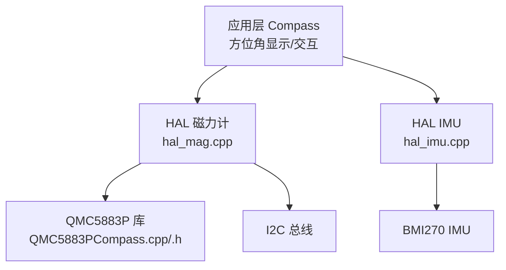
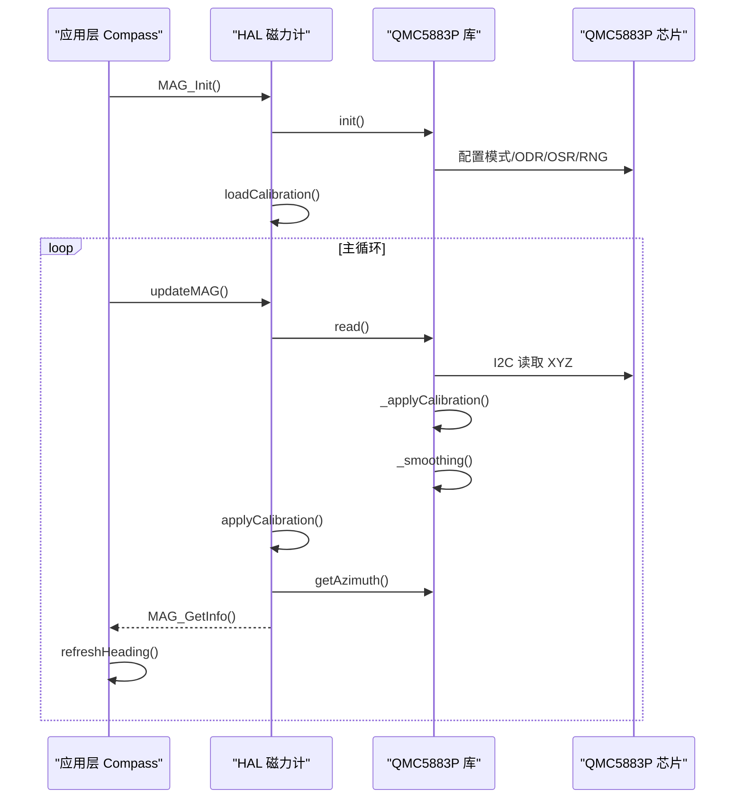
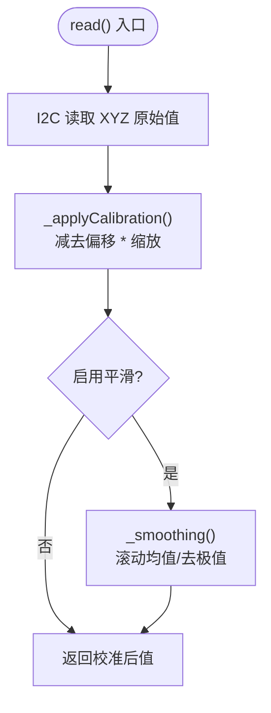
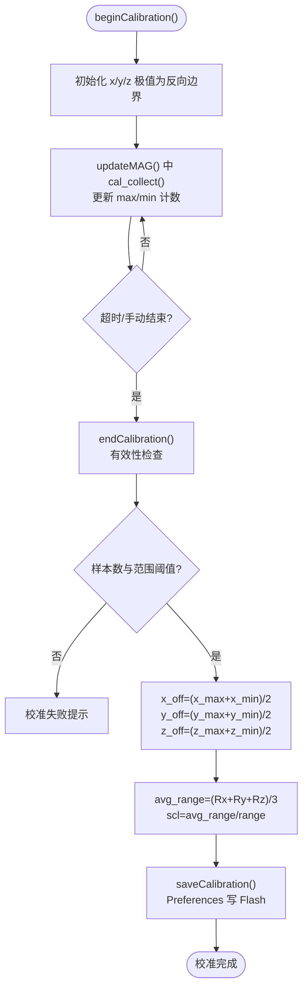
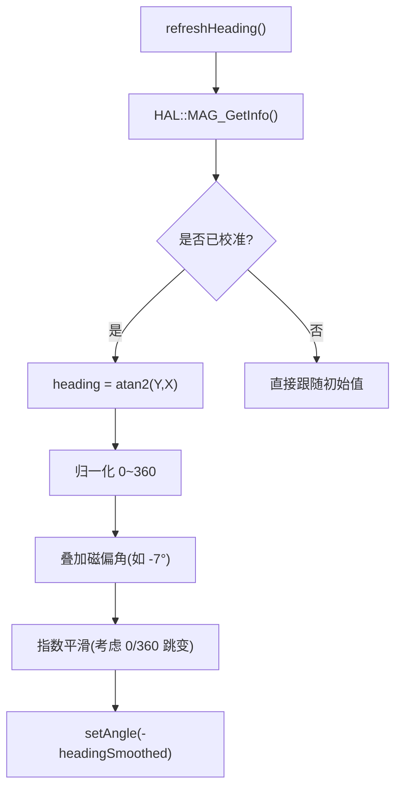
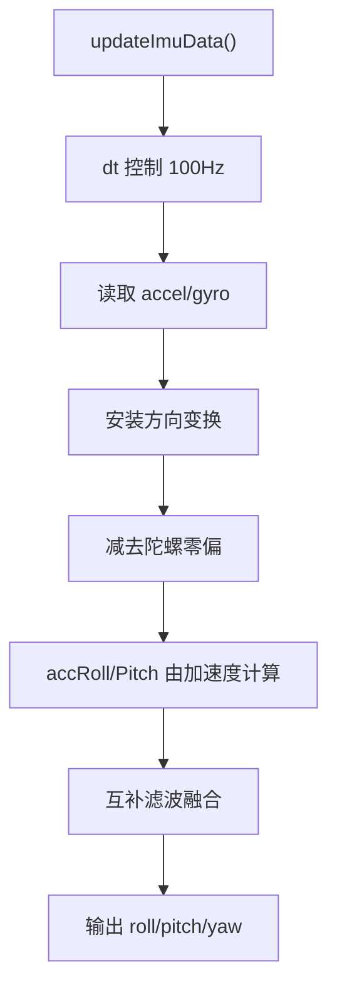
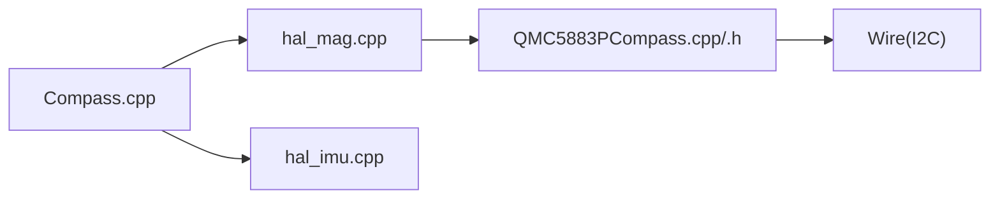

# 磁力计数据处理

<cite>
**本文引用的文件**   
- [Compass.cpp](file://src/apps/Compass.cpp)
- [hal_mag.cpp](file://src/hal/hal_mag.cpp)
- [QMC5883PCompass.cpp](file://lib/QMC5883PCompass/src/QMC5883PCompass.cpp)
- [QMC5883PCompass.h](file://lib/QMC5883PCompass/src/QMC5883PCompass.h)
- [hal_imu.cpp](file://src/hal/hal_imu.cpp)
</cite>

## 目录
1. [引言](#引言)
2. [项目结构](#项目结构)
3. [核心组件](#核心组件)
4. [架构总览](#架构总览)
5. [详细组件分析](#详细组件分析)
6. [依赖关系分析](#依赖关系分析)
7. [性能与实时性](#性能与实时性)
8. [故障排查指南](#故障排查指南)
9. [结论](#结论)
10. [附录：使用与环境建议](#附录使用与环境建议)

## 引言
本技术文档围绕 QMC5883P 磁力计的数据处理流程展开，重点说明：
- 磁力计的初始化配置与磁场数据读取路径
- 方位角计算的数学原理与三轴磁场数据处理方法
- 磁力计校准流程（硬铁偏移、软铁缩放）及参数持久化
- 磁场数据的滤波与噪声抑制策略
- 磁力计与 IMU 数据融合思路，用于提升方位角精度
- 实际使用注意事项与环境干扰处理方法

## 项目结构
本项目在 ESP32 平台上实现罗盘、环境信息与水平仪应用。与磁力计相关的关键代码分布在以下位置：
- 应用层罗盘显示与方位角平滑：[Compass.cpp](file://src/apps/Compass.cpp)
- HAL 层磁力计驱动与校准：[hal_mag.cpp](file://src/hal/hal_mag.cpp)
- QMC5883P 库（I2C 读写、滤波、校准、方位角计算）：[QMC5883PCompass.cpp](file://lib/QMC5883PCompass/src/QMC5883PCompass.cpp)、[QMC5883PCompass.h](file://lib/QMC5883PCompass/src/QMC5883PCompass.h)
- IMU（BMI270）姿态解算与互补滤波：[hal_imu.cpp](file://src/hal/hal_imu.cpp)

**图表来源**
- [Compass.cpp:222-263](file://src/apps/Compass.cpp#L222-L263)
- [hal_mag.cpp:233-283](file://src/hal/hal_mag.cpp#L233-L283)
- [QMC5883PCompass.cpp:73-77,274-296,439-444:73-77](file://lib/QMC5883PCompass/src/QMC5883PCompass.cpp#L73-L77)
- [hal_imu.cpp:88-149](file://src/hal/hal_imu.cpp#L88-L149)

**章节来源**
- [Compass.cpp:1-753](file://src/apps/Compass.cpp#L1-L753)
- [hal_mag.cpp:1-297](file://src/hal/hal_mag.cpp#L1-L297)
- [QMC5883PCompass.cpp:1-498](file://lib/QMC5883PCompass/src/QMC5883PCompass.cpp#L1-L498)
- [QMC5883PCompass.h:1-72](file://lib/QMC5883PCompass/src/QMC5883PCompass.h#L1-L72)
- [hal_imu.cpp:1-182](file://src/hal/hal_imu.cpp#L1-L182)

## 核心组件
- QMC5883P 库：负责 I2C 寄存器配置、原始数据读取、可选滑动平均/极值剔除滤波、硬铁/软铁校准参数应用、方位角计算。
- HAL 磁力计模块：封装传感器初始化、校准流程（采集最大最小值、计算硬铁偏移与软铁缩放）、参数存储到 Flash、提供统一接口给应用层。
- 应用层 Compass：从 HAL 获取校准后的 X/Y/Z 与方位角，进行角度归一化、指数平滑、磁偏角补偿、UI 绘制与用户交互。
- IMU 模块：提供 roll/pitch/yaw 姿态信息，用于水平仪与后续可能的磁力计融合。

**章节来源**
- [QMC5883PCompass.cpp:73-77,147-152,274-296,311-316,439-444:73-77](file://lib/QMC5883PCompass/src/QMC5883PCompass.cpp#L73-L77)
- [hal_mag.cpp:233-283](file://src/hal/hal_mag.cpp#L233-L283)
- [Compass.cpp:222-263](file://src/apps/Compass.cpp#L222-L263)
- [hal_imu.cpp:88-149](file://src/hal/hal_imu.cpp#L88-L149)

## 架构总览
下图展示从硬件到应用的磁力计数据流：

**图表来源**
- [hal_mag.cpp:233-283](file://src/hal/hal_mag.cpp#L233-L283)
- [QMC5883PCompass.cpp:73-77,274-296,439-444:73-77](file://lib/QMC5883PCompass/src/QMC5883PCompass.cpp#L73-L77)
- [Compass.cpp:222-263](file://src/apps/Compass.cpp#L222-L263)

## 详细组件分析

### QMC5883P 库：初始化、读取与滤波
- 初始化：通过 I2C 设置工作模式、输出速率、过采样率与量程。
- 数据读取：按寄存器顺序读取 XYZ 三轴原始值，随后应用校准参数，再执行滑动平均或“去极值”的进阶平滑。
- 方位角：基于 Y/X 的 atan2 计算，并叠加磁偏角。

**图表来源**
- [QMC5883PCompass.cpp:274-296](file://lib/QMC5883PCompass/src/QMC5883PCompass.cpp#L274-L296)
- [QMC5883PCompass.cpp:311-316](file://lib/QMC5883PCompass/src/QMC5883PCompass.cpp#L311-L316)
- [QMC5883PCompass.cpp:336-378](file://lib/QMC5883PCompass/src/QMC5883PCompass.cpp#L336-L378)

**章节来源**
- [QMC5883PCompass.cpp:73-77,147-152,274-296,311-316,336-378,439-444:73-77](file://lib/QMC5883PCompass/src/QMC5883PCompass.cpp#L73-L77)
- [QMC5883PCompass.h:10-31](file://lib/QMC5883PCompass/src/QMC5883PCompass.h#L10-L31)

### HAL 磁力计模块：校准流程与参数持久化
- 初始化：调用库 init，开启平滑；加载已保存的校准参数。
- 数据采集：每次循环读取原始值，若处于校准模式则记录各轴最大最小值；否则应用本地校准参数得到 cx/cy/cz。
- 方位角：调用库 getAzimuth 获得度数。
- 校准算法：
  - 硬铁偏移：off = (max + min) / 2
  - 软铁缩放：scl = avg_range / axis_range，使三轴灵敏度一致
- 参数存储：使用 Preferences 将 off/scale/valid 等写入 Flash，上电自动加载。

**图表来源**
- [hal_mag.cpp:143-197](file://src/hal/hal_mag.cpp#L143-L197)
- [hal_mag.cpp:200-230](file://src/hal/hal_mag.cpp#L200-L230)
- [hal_mag.cpp:81-129](file://src/hal/hal_mag.cpp#L81-L129)

**章节来源**
- [hal_mag.cpp:233-283](file://src/hal/hal_mag.cpp#L233-L283)
- [hal_mag.cpp:143-197](file://src/hal/hal_mag.cpp#L143-L197)
- [hal_mag.cpp:81-129](file://src/hal/hal_mag.cpp#L81-L129)

### 应用层 Compass：方位角计算与 UI
- 刷新方位角：
  - 从 HAL 获取校准后的 X/Y/Z 与 isCalibrated 状态
  - 使用 atan2(Y, X) 计算 heading，并做 0~360 归一化
  - 叠加磁偏角（示例中为 -7°），得到真北方向
  - 指数平滑处理 0/360 跳变，保持表盘旋转稳定
- UI：
  - 表盘反向旋转以让 N 始终朝上
  - 显示方位角数值与中文方位（北/东北/东…）
  - 校准状态指示灯（黄闪表示校准中，绿/灰表示已校准/未校准）

**图表来源**
- [Compass.cpp:222-263](file://src/apps/Compass.cpp#L222-L263)

**章节来源**
- [Compass.cpp:140-148](file://src/apps/Compass.cpp#L140-L148)
- [Compass.cpp:155-183](file://src/apps/Compass.cpp#L155-L183)
- [Compass.cpp:186-210](file://src/apps/Compass.cpp#L186-L210)
- [Compass.cpp:222-263](file://src/apps/Compass.cpp#L222-L263)

### IMU 模块：姿态解算与互补滤波
- 上电静置时进行陀螺仪零偏校准
- 固定 100Hz 采样，读取加速度与角速度
- 根据安装方向进行坐标变换
- 使用互补滤波融合加速度计角度与陀螺积分，得到 roll/pitch/yaw
- 该姿态可用于水平仪显示，也可作为未来磁力计融合的参考

**图表来源**
- [hal_imu.cpp:88-149](file://src/hal/hal_imu.cpp#L88-L149)

**章节来源**
- [hal_imu.cpp:31-55](file://src/hal/hal_imu.cpp#L31-L55)
- [hal_imu.cpp:88-149](file://src/hal/hal_imu.cpp#L88-L149)

## 依赖关系分析
- 应用层 Compass 依赖 HAL 提供的磁力计与 IMU 接口
- HAL 磁力计依赖 QMC5883P 库进行底层 I2C 操作与基础滤波
- QMC5883P 库依赖 Arduino Wire 进行 I2C 通信
- IMU 模块独立于磁力计，但可与磁力计联合用于更稳健的航向估计

**图表来源**
- [Compass.cpp:222-263](file://src/apps/Compass.cpp#L222-L263)
- [hal_mag.cpp:233-283](file://src/hal/hal_mag.cpp#L233-L283)
- [QMC5883PCompass.cpp:73-77,274-296:73-77](file://lib/QMC5883PCompass/src/QMC5883PCompass.cpp#L73-L77)
- [hal_imu.cpp:88-149](file://src/hal/hal_imu.cpp#L88-L149)

**章节来源**
- [Compass.cpp:1-753](file://src/apps/Compass.cpp#L1-L753)
- [hal_mag.cpp:1-297](file://src/hal/hal_mag.cpp#L1-L297)
- [QMC5883PCompass.cpp:1-498](file://lib/QMC5883PCompass/src/QMC5883PCompass.cpp#L1-L498)
- [hal_imu.cpp:1-182](file://src/hal/hal_imu.cpp#L1-L182)

## 性能与实时性
- 磁力计采样频率：库默认 ODR 配置为较高档位（例如 200Hz），HAL 每 50ms 调用一次 updateMAG，形成约 20Hz 的应用侧刷新节奏。
- 滤波开销：库支持滑动平均与“去极值”进阶平滑，会引入少量 CPU 开销；可通过调整 steps 与 adv 开关平衡精度与性能。
- 显示刷新：应用层对页面绘制采用节流（约 60fps 上限），避免频繁重绘造成资源浪费。
- IMU 更新：固定 100Hz，互补滤波在 MCU 上开销较低。

优化建议：
- 若需更高实时性，可降低磁力计 ODR 或关闭进阶平滑
- 减少 UI 刷新频率或在低帧率场景下跳过非关键绘制
- 合理设置平滑步数，避免在低端设备上产生卡顿

[本节为通用指导，不直接分析具体文件]

## 故障排查指南
常见问题与定位要点：
- 无磁力计数据或方位角异常
  - 检查 I2C 初始化与地址配置是否正确
  - 确认库 init 与 setSmoothing 是否被调用
  - 查看是否成功加载校准参数（Preferences 命名空间 qmc5883p）
- 校准失败
  - 确保旋转覆盖足够范围（X/Y/Z 各轴 range 超过阈值）
  - 采样次数不足或超时会自动结束，需重新校准
- 方位角抖动大
  - 检查是否启用平滑；适当增大平滑步数或开启进阶平滑
  - 检查是否存在强磁性干扰源
- 表盘旋转不稳定
  - 检查指数平滑系数与 0/360 跳变处理逻辑
  - 确认磁偏角补偿是否合理

**章节来源**
- [hal_mag.cpp:143-197](file://src/hal/hal_mag.cpp#L143-L197)
- [hal_mag.cpp:233-283](file://src/hal/hal_mag.cpp#L233-L283)
- [Compass.cpp:222-263](file://src/apps/Compass.cpp#L222-L263)

## 结论
本项目实现了完整的 QMC5883P 磁力计数据处理链路：从 I2C 初始化、数据读取、滤波、校准到方位角计算与应用层显示。通过硬铁偏移与软铁缩放的离线校准，结合库内滑动平均/去极值滤波，显著提升了方位角的稳定性与准确性。IMU 模块提供了可靠的姿态参考，为后续磁力计与 IMU 的融合奠定了良好基础。

[本节为总结性内容，不直接分析具体文件]

## 附录：使用与环境建议
- 校准步骤
  - 进入校准模式后缓慢画“8”字，覆盖各方向约 30 秒
  - 观察串口日志中的采样次数与各轴 range，确保达到阈值
  - 校准完成后参数自动保存到 Flash，重启仍有效
- 磁偏角补偿
  - 可根据所在地磁偏角设置（库提供 setMagneticDeclination）
  - 应用层也支持叠加磁偏角（示例中为 -7°）
- 环境干扰处理
  - 远离扬声器、电机、金属结构与强电流导线
  - 避免手机、蓝牙设备靠近传感器
  - 定期重新校准以应对温度漂移与外部磁场变化
- 与 IMU 融合思路（扩展）
  - 利用 IMU 的 yaw 作为短期航向参考，磁力计提供长期绝对航向
  - 可采用互补滤波或卡尔曼滤波融合两者，提高抗干扰能力与动态响应
  - 注意 IMU 的 yaw 存在漂移，需要磁力计周期性校正

[本节为通用指导，不直接分析具体文件]