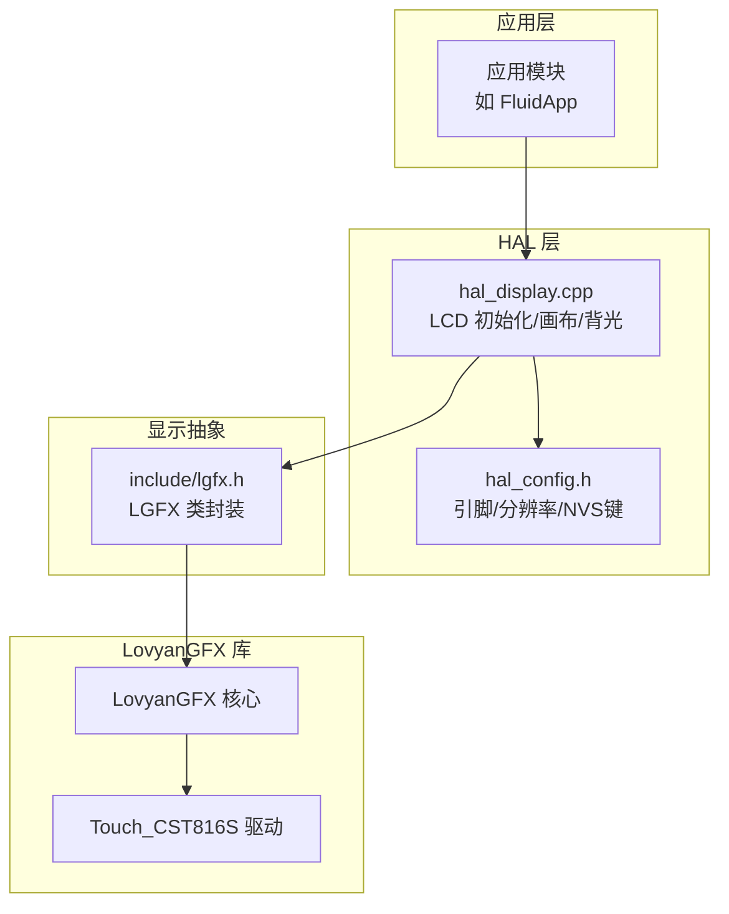
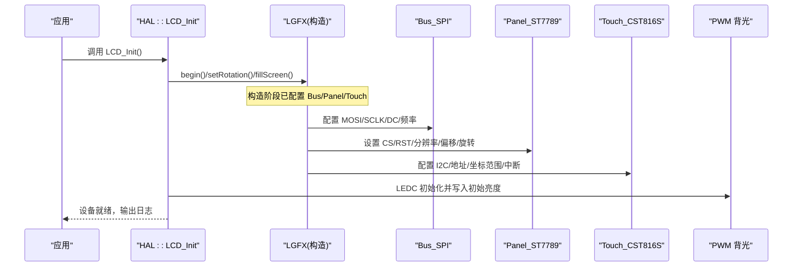
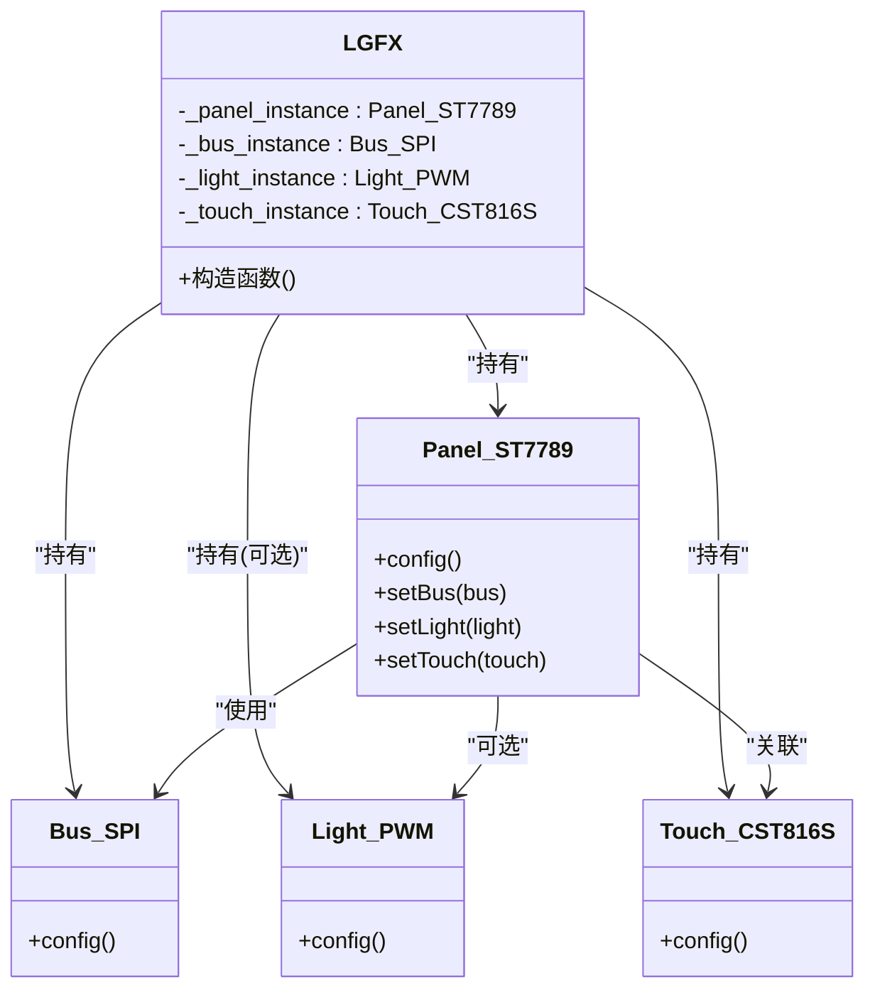
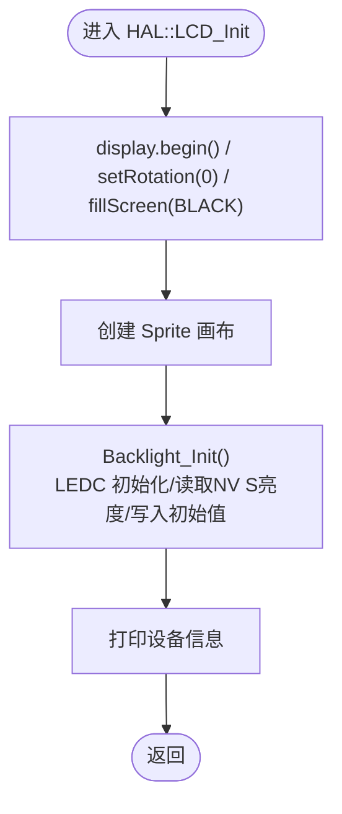
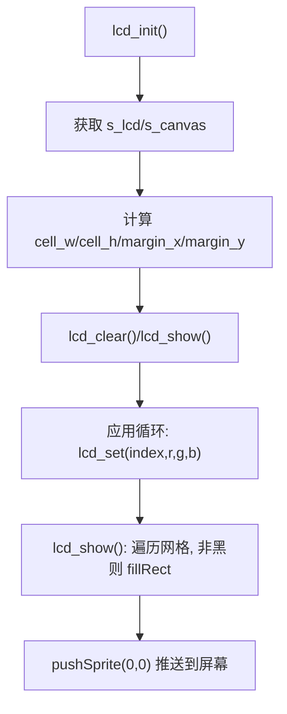
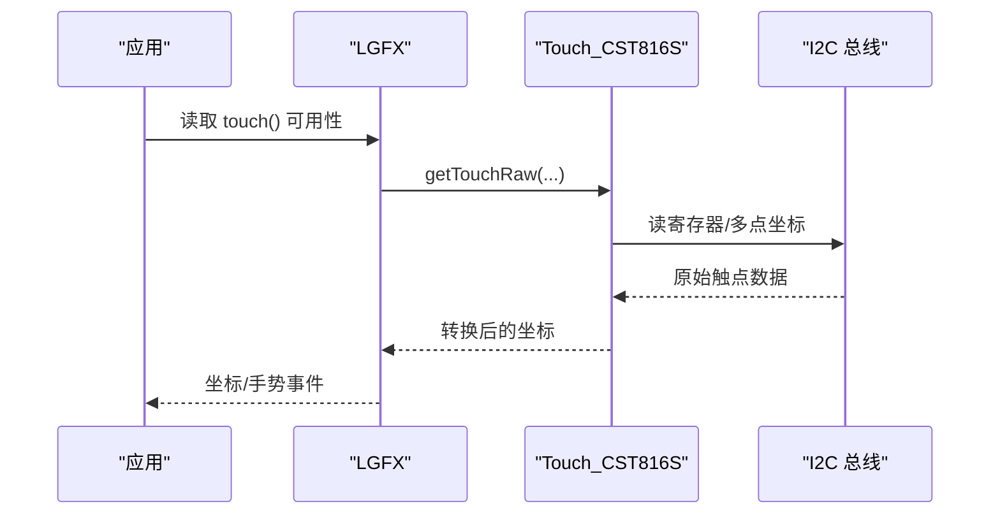
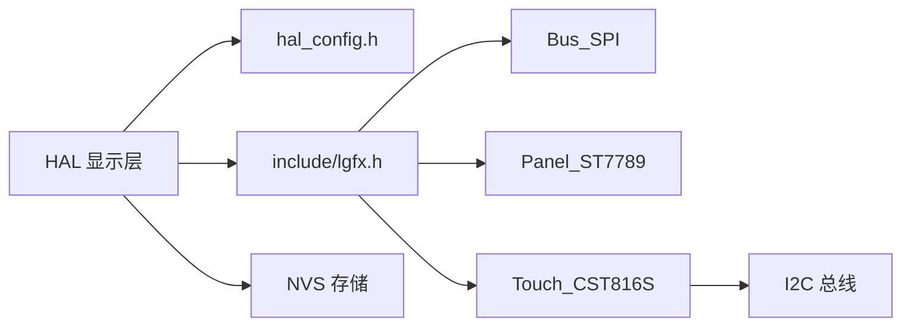

# LovyanGFX 图形库集成

<cite>
**本文引用的文件**   
- [include/lgfx.h](file://include/lgfx.h)
- [src/hal/hal_display.cpp](file://src/hal/hal_display.cpp)
- [src/hal/hal_config.h](file://src/hal/hal_config.h)
- [src/apps/FluidApp/lcd_panel.cpp](file://src/apps/FluidApp/lcd_panel.cpp)
- [lib/LovyanGFX/src/lgfx/v1/touch/Touch_CST816S.cpp](file://lib/LovyanGFX/src/lgfx/v1/touch/Touch_CST816S.cpp)
- [lib/LovyanGFX/examples/HowToUse/2_user_setting/2_user_setting.ino](file://lib/LovyanGFX/examples/HowToUse/2_user_setting/2_user_setting.ino)
</cite>

## 目录
1. [简介](#简介)
2. [项目结构](#项目结构)
3. [核心组件](#核心组件)
4. [架构总览](#架构总览)
5. [详细组件分析](#详细组件分析)
6. [依赖关系分析](#依赖关系分析)
7. [性能与优化](#性能与优化)
8. [故障排查指南](#故障排查指南)
9. [结论](#结论)
10. [附录：硬件适配与校准](#附录硬件适配与校准)

## 简介
本文件面向在 ESP32 平台上集成 LovyanGFX（LGFX）的开发者，系统说明本项目中 LGFX 类的配置与初始化流程，包括 SPI 总线、面板驱动、触摸控制器、背光控制、显示旋转与分辨率等关键参数。同时提供不同硬件配置的适配方法与常见问题解决方案，帮助快速完成屏幕与触摸的联调。

## 项目结构
本项目将 LovyanGFX 作为第三方库引入，并在 include 层定义统一的 LGFX 类封装，HAL 层负责实例化、启动与资源管理，应用层通过 HAL 提供的接口进行绘制与交互。

图表来源
- [src/hal/hal_display.cpp:1-42](file://src/hal/hal_display.cpp#L1-L42)
- [include/lgfx.h:34-114](file://include/lgfx.h#L34-L114)
- [src/hal/hal_config.h:1-23](file://src/hal/hal_config.h#L1-L23)

章节来源
- [src/hal/hal_display.cpp:1-42](file://src/hal/hal_display.cpp#L1-L42)
- [include/lgfx.h:34-114](file://include/lgfx.h#L34-L114)
- [src/hal/hal_config.h:1-23](file://src/hal/hal_config.h#L1-L23)

## 核心组件
- LGFX 类封装：集中定义 SPI 总线、ST7789 面板、PWM 背光、CST816S 触摸的配置与装配。
- HAL 显示层：负责 display.begin()、旋转设置、画布创建、背光 PWM 初始化与亮度持久化。
- 硬件配置头：统一引脚、分辨率、NVS 键名等常量。
- 应用层 LCD 适配：基于 LovyanGFX 的 Sprite 画布实现网格渲染与亮度缩放。

章节来源
- [include/lgfx.h:34-114](file://include/lgfx.h#L34-L114)
- [src/hal/hal_display.cpp:18-42](file://src/hal/hal_display.cpp#L18-L42)
- [src/hal/hal_config.h:7-23](file://src/hal/hal_config.h#L7-L23)
- [src/apps/FluidApp/lcd_panel.cpp:35-65](file://src/apps/FluidApp/lcd_panel.cpp#L35-L65)

## 架构总览
下图展示从应用到硬件的调用链路与数据流向，涵盖显示初始化、SPI 传输、触摸 I2C 通信与背光 PWM 控制。

图表来源
- [src/hal/hal_display.cpp:18-42](file://src/hal/hal_display.cpp#L18-L42)
- [include/lgfx.h:44-114](file://include/lgfx.h#L44-L114)

## 详细组件分析

### LGFX 类与初始化流程
- SPI 总线配置
  - 使用 Bus_SPI 配置 MOSI、MISO、SCLK、DC 引脚，写频设为 40MHz。
  - 将总线对象绑定到面板。
- 面板配置（ST7789）
  - 启用 invert 与 RGB 顺序；配置 CS、RST、Busy 引脚。
  - 设置 panel_width/height 为 screenWidth/screenHeight，X 偏移 0，Y 偏移 20。
  - 根据 PORTRAIT 宏设置 offset_rotation（竖屏为 0，横屏为 1）。
- 背光控制（可选）
  - 示例代码注释了 PWM 背光配置，包含 pin_bl、invert、freq、pwm_channel 等字段。
- 触摸控制器（CST816S）
  - I2C 端口、地址、SDA/SCL、RST/INT 引脚与频率 400kHz。
  - 坐标范围按 screenWidth/screenHeight 设定，offset_rotation 为 0。
  - 将触摸实例挂载到面板。
- 最终 setPanel 生效。

图表来源
- [include/lgfx.h:34-114](file://include/lgfx.h#L34-L114)

章节来源
- [include/lgfx.h:44-114](file://include/lgfx.h#L44-L114)

### HAL 显示层与背光管理
- 初始化流程
  - 调用 display.begin()，设置旋转为 0，清屏为黑色。
  - 创建与屏幕同尺寸的 Sprite 画布用于离屏渲染。
  - 初始化背光 PWM，读取 NVS 中的亮度值并写入。
  - 打印设备信息（分辨率、Flash/RAM/PSRAM 使用情况）。
- 背光控制
  - 使用 LEDC 通道 7，频率 44100Hz，位深 9bit。
  - 支持亮度非线性补偿与最小亮度保护。
  - 亮度值持久化至 NVS，键名为 LCD_BK_BRIGHTNESS_KEY。

图表来源
- [src/hal/hal_display.cpp:18-42](file://src/hal/hal_display.cpp#L18-L42)
- [src/hal/hal_display.cpp:81-127](file://src/hal/hal_display.cpp#L81-L127)

章节来源
- [src/hal/hal_display.cpp:18-42](file://src/hal/hal_display.cpp#L18-L42)
- [src/hal/hal_display.cpp:81-127](file://src/hal/hal_display.cpp#L81-L127)
- [src/hal/hal_config.h:70-77](file://src/hal/hal_config.h#L70-L77)

### 应用层 LCD 适配（网格渲染）
- 获取 HAL 提供的 LGFX 实例与 Sprite 画布。
- 计算 16x16 网格在屏幕上的格子尺寸与边距，居中布局。
- 帧内先写入后台缓冲，lcd_show() 时统一刷新到画布并 pushSprite 到屏幕。
- 提供亮度缩放接口，对每个像素颜色做线性缩放。

图表来源
- [src/apps/FluidApp/lcd_panel.cpp:35-65](file://src/apps/FluidApp/lcd_panel.cpp#L35-L65)
- [src/apps/FluidApp/lcd_panel.cpp:116-152](file://src/apps/FluidApp/lcd_panel.cpp#L116-L152)

章节来源
- [src/apps/FluidApp/lcd_panel.cpp:35-65](file://src/apps/FluidApp/lcd_panel.cpp#L35-L65)
- [src/apps/FluidApp/lcd_panel.cpp:116-152](file://src/apps/FluidApp/lcd_panel.cpp#L116-L152)

### 触摸输入与校准
- 触摸控制器 CST816S
  - I2C 地址 0x15，SDA/SCL 复用 I2C 引脚，RST/INT 独立引脚。
  - 坐标范围与屏幕分辨率一致，offset_rotation=0。
  - 内部复位序列与 INT 脉冲策略已在驱动中处理。
- 校准参考
  - LovyanGFX 示例展示了触摸可用时的自动旋转切换与提示文字绘制，可作为校准引导的基础。

图表来源
- [include/lgfx.h:90-110](file://include/lgfx.h#L90-L110)
- [lib/LovyanGFX/src/lgfx/v1/touch/Touch_CST816S.cpp:53-69](file://lib/LovyanGFX/src/lgfx/v1/touch/Touch_CST816S.cpp#L53-L69)
- [lib/LovyanGFX/examples/HowToUse/2_user_setting/2_user_setting.ino:211-219](file://lib/LovyanGFX/examples/HowToUse/2_user_setting/2_user_setting.ino#L211-L219)

章节来源
- [include/lgfx.h:90-110](file://include/lgfx.h#L90-L110)
- [lib/LovyanGFX/src/lgfx/v1/touch/Touch_CST816S.cpp:53-69](file://lib/LovyanGFX/src/lgfx/v1/touch/Touch_CST816S.cpp#L53-L69)
- [lib/LovyanGFX/examples/HowToUse/2_user_setting/2_user_setting.ino:211-219](file://lib/LovyanGFX/examples/HowToUse/2_user_setting/2_user_setting.ino#L211-L219)

## 依赖关系分析
- 组件耦合
  - HAL 层依赖 LGFX 类与 hal_config.h 常量。
  - LGFX 类依赖 LovyanGFX 的 Bus_SPI、Panel_ST7789、Touch_CST816S 等子组件。
- 外部依赖
  - ESP32 外设：SPI、I2C、LED PWM。
  - NVS 存储：保存背光亮度等配置。

图表来源
- [src/hal/hal_display.cpp:1-42](file://src/hal/hal_display.cpp#L1-L42)
- [include/lgfx.h:34-114](file://include/lgfx.h#L34-L114)
- [src/hal/hal_config.h:70-77](file://src/hal/hal_config.h#L70-L77)

章节来源
- [src/hal/hal_display.cpp:1-42](file://src/hal/hal_display.cpp#L1-L42)
- [include/lgfx.h:34-114](file://include/lgfx.h#L34-L114)
- [src/hal/hal_config.h:70-77](file://src/hal/hal_config.h#L70-L77)

## 性能与优化
- 显示路径
  - 使用 Sprite 画布进行离屏渲染，减少闪烁与重复绘制。
  - 仅在脏区更新后 pushSprite，降低带宽占用。
- SPI 带宽
  - 写频 40MHz，适合高分辨率与高刷新场景。
- 触摸采样
  - I2C 400kHz，配合 INT 引脚可降低轮询开销。
- 背光 PWM
  - 9bit 分辨率，频率 44100Hz，避免可见闪烁。
  - 非线性补偿提升暗态观感。

[本节为通用指导，不直接分析具体文件]

## 故障排查指南
- 屏幕无显示或花屏
  - 检查 SPI 引脚与 DC/CS/RST 是否匹配 hal_config.h 与 lgfx.h。
  - 确认 ST7789 面板参数（invert、rgb_order、offset_x/y、offset_rotation）。
- 触摸无响应
  - 核对 I2C 地址、SDA/SCL、RST/INT 引脚与频率。
  - 确认触摸坐标范围与屏幕分辨率一致。
- 背光异常
  - 检查 LEDC 通道、引脚、频率与位深。
  - 确认 NVS 中亮度值未越界或被清零。
- 旋转错乱
  - 校验 setRotation 与 offset_rotation 的组合逻辑。
  - 若启用触摸，注意触摸与面板的 offset_rotation 一致性。

章节来源
- [include/lgfx.h:44-114](file://include/lgfx.h#L44-L114)
- [src/hal/hal_display.cpp:81-127](file://src/hal/hal_display.cpp#L81-L127)
- [src/hal/hal_config.h:7-23](file://src/hal/hal_config.h#L7-L23)

## 结论
本项目通过 LGFX 类集中封装了 SPI 总线、ST7789 面板与 CST816S 触摸的配置，HAL 层负责实例化、画布管理与背光控制。该设计清晰分层、易于扩展，适用于多种硬件变体。结合示例与驱动细节，可快速完成屏幕与触摸的联调与优化。

[本节为总结性内容，不直接分析具体文件]

## 附录：硬件适配与校准

### 引脚与分辨率对照
- SPI 与面板
  - MOSI/MISO/SCLK/DC/CS/RST/BUSY/BL 引脚由 hal_config.h 与 lgfx.h 共同定义。
- 分辨率与旋转
  - 默认竖屏 240x280，横屏 280x240；offset_rotation 根据 PORTRAIT 宏切换。
- 触摸
  - I2C 复用 SDA/SCL，RST/INT 独立；地址 0x15；坐标范围与屏幕一致。

章节来源
- [src/hal/hal_config.h:7-23](file://src/hal/hal_config.h#L7-L23)
- [include/lgfx.h:9-31](file://include/lgfx.h#L9-L31)
- [include/lgfx.h:57-75](file://include/lgfx.h#L57-L75)
- [include/lgfx.h:90-110](file://include/lgfx.h#L90-L110)

### 校准步骤建议
- 确保触摸可用（display.touch() 返回真）。
- 如需横竖屏切换，参考示例中根据宽高判断并翻转旋转。
- 在屏幕上绘制引导提示，让用户依次点击标记点以完成校准。
- 校准完成后保存映射参数（可在上层自行实现）。

章节来源
- [lib/LovyanGFX/examples/HowToUse/2_user_setting/2_user_setting.ino:211-219](file://lib/LovyanGFX/examples/HowToUse/2_user_setting/2_user_setting.ino#L211-L219)