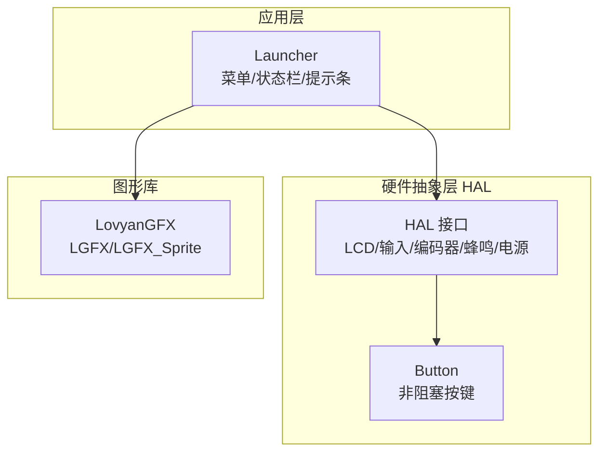
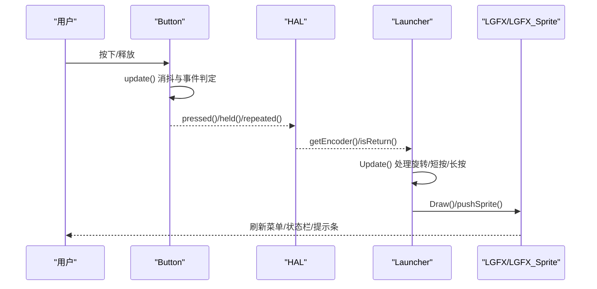
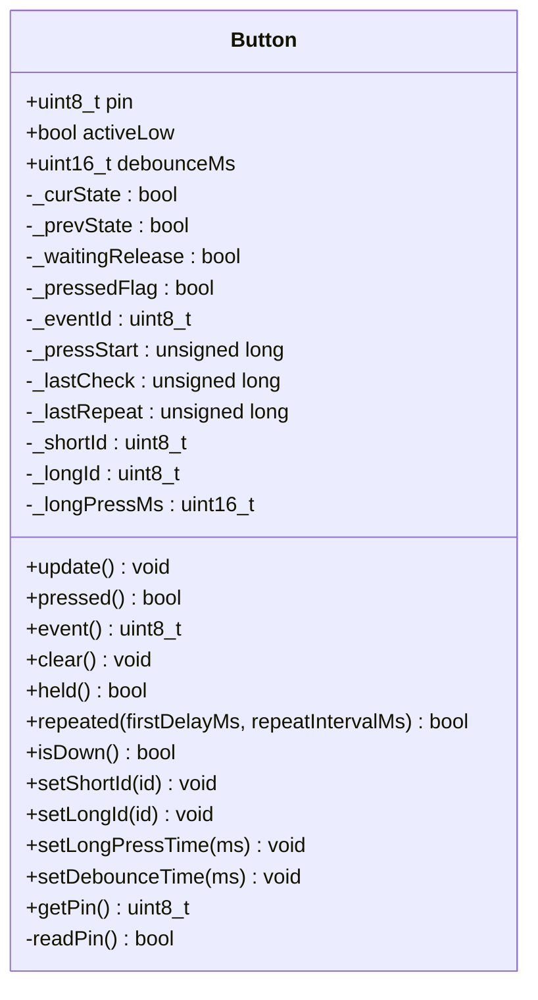
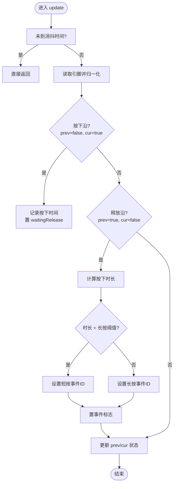
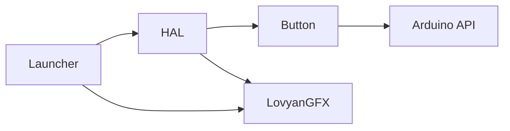

# UI 组件系统

<cite>
**本文引用的文件**   
- [Button.h](file://src/hal/Button.h)
- [Button.cpp](file://src/hal/Button.cpp)
- [hal.h](file://src/hal/hal.h)
- [hal.cpp](file://src/hal/hal.cpp)
- [launcher.h](file://src/launcher.h)
- [launcher.cpp](file://src/launcher.cpp)
</cite>

## 目录
1. [引言](#引言)
2. [项目结构](#项目结构)
3. [核心组件](#核心组件)
4. [架构总览](#架构总览)
5. [详细组件分析](#详细组件分析)
6. [依赖关系分析](#依赖关系分析)
7. [性能与内存优化](#性能与内存优化)
8. [故障排查指南](#故障排查指南)
9. [结论](#结论)
10. [附录：扩展开发指南](#附录扩展开发指南)

## 引言
本文件面向嵌入式设备上的 UI 组件系统，重点文档化 Button 按钮组件的实现与使用方式，并围绕其扩展到菜单、状态栏等界面元素。内容涵盖：
- 按钮状态管理（短按、长按、按住持续触发、连发）
- 事件处理与生命周期
- 样式与布局（基于 LovyanGFX 的绘制流程）
- 自定义 UI 组件的开发模式与最佳实践
- 组合模式与布局技巧
- 常用 UI 组件扩展方法与性能优化建议

本项目采用“硬件抽象层 + 应用启动器”的分层设计：HAL 提供输入、显示、电源等能力；Launcher 作为主菜单与应用调度入口；Button 作为非阻塞按键抽象，贯穿输入与交互逻辑。

## 项目结构
UI 相关代码主要分布在以下位置：
- src/hal/Button.{h,cpp}：非阻塞按键类，封装消抖、短/长按识别、按住与连发
- src/hal/hal.{h,cpp}：硬件抽象接口，统一暴露 LCD、输入、编码器、蜂鸣器等能力
- src/launcher.{h,cpp}：主菜单与状态栏实现，负责图标滚动、提示条、长按关机进度条等 UI 行为



图表来源
- [launcher.h:85-148](file://src/launcher.h#L85-L148)
- [launcher.cpp:8-51](file://src/launcher.cpp#L8-L51)
- [hal.h:101-212](file://src/hal/hal.h#L101-L212)
- [Button.h:48-182](file://src/hal/Button.h#L48-L182)

章节来源
- [launcher.h:85-148](file://src/launcher.h#L85-L148)
- [launcher.cpp:8-51](file://src/launcher.cpp#L8-L51)
- [hal.h:101-212](file://src/hal/hal.h#L101-L212)

## 核心组件
- Button：非阻塞按键抽象，支持短按、长按、按住持续触发、连发，并提供事件 ID 与状态查询接口
- HAL：硬件抽象层，统一初始化与更新各子系统，对外暴露 LCD、输入、编码器、蜂鸣、电源等 API
- Launcher：主菜单与应用调度器，负责图标流式滚动、标签区、提示条、状态栏刷新与长按关机流程

章节来源
- [Button.h:48-182](file://src/hal/Button.h#L48-L182)
- [Button.cpp:12-169](file://src/hal/Button.cpp#L12-L169)
- [hal.h:101-212](file://src/hal/hal.h#L101-L212)
- [launcher.h:85-148](file://src/launcher.h#L85-L148)

## 架构总览
整体架构遵循“输入抽象 -> 应用调度 -> 渲染输出”的链路：
- 输入侧：Button 对物理按键进行消抖与事件判定；HAL 将编码器、触摸、返回键等统一为高层事件
- 应用侧：Launcher 监听输入事件，维护菜单选择、滚动偏移、长按关机进度等状态
- 渲染侧：通过 LovyanGFX 的 LGFX/LGFX_Sprite 在离屏缓冲区绘制，再 pushSprite 到屏幕



图表来源
- [Button.cpp:28-70](file://src/hal/Button.cpp#L28-L70)
- [launcher.cpp:82-197](file://src/launcher.cpp#L82-L197)
- [hal.h:101-212](file://src/hal/hal.h#L101-L212)

## 详细组件分析

### Button 按钮组件
Button 是一个非阻塞按键类，适合放在 loop() 或定时器回调中周期性调用。它内部维护一个小型状态机，完成消抖、按下/释放沿检测、短/长按判定、按住与连发计时。

- 关键特性
  - 非阻塞 update()：基于 millis() 的时间戳驱动
  - 短按/长按：根据按下持续时间与阈值区分
  - held()：按住持续状态，适合 NES 风格移动
  - repeated(firstDelayMs, repeatIntervalMs)：首延迟后固定间隔连发
  - 高/低电平有效：适配上拉按键或外部电路
  - 事件 ID：可配置 shortId/longId，pressed()/event() 读取事件

- 状态机要点
  - _curState/_prevState：消抖后的当前/上次状态
  - _waitingRelease：等待释放标志，用于区分按下期间与已释放
  - _pressStart：记录按下时刻，用于时长计算
  - _lastCheck/_lastRepeat：消抖检查与连发时间戳

- 事件与状态接口
  - pressed()/event()/clear()：事件读取与清除
  - held()/repeated(...)：按住与连发
  - isDown()：原始引脚状态（未经消抖）

- 配置接口
  - setShortId()/setLongId()：设置事件 ID
  - setLongPressTime()/setDebounceTime()：调整长按阈值与消抖时间
  - getPin()：获取绑定 GPIO



图表来源
- [Button.h:48-182](file://src/hal/Button.h#L48-L182)
- [Button.cpp:12-169](file://src/hal/Button.cpp#L12-L169)

#### 事件处理时序


图表来源
- [Button.cpp:28-70](file://src/hal/Button.cpp#L28-L70)

章节来源
- [Button.h:48-182](file://src/hal/Button.h#L48-L182)
- [Button.cpp:12-169](file://src/hal/Button.cpp#L12-L169)

### Launcher 菜单与状态栏
Launcher 负责主菜单的图标流式滚动、标签区文字、底部提示条以及顶部状态栏（时间、WiFi/蓝牙图标、电量）。它还处理长按 Power 键关机流程，包括蜂鸣反馈、清屏、背光关闭与最终关机。

- 生命周期
  - Init()：初始化菜单项、显示与画布、首次绘制
  - Main()：阻塞式主循环，轮询 Update() 并在请求切换 App 时退出
  - Update()：处理编码器旋转、短按、长按 Power 键、平滑滚动与状态栏每秒刷新
  - Exit()：占位方法，可扩展清理逻辑

- 绘制流程
  - Draw()：分发到 drawBackground()/drawStatusBar()/drawIconArea()/drawLabelArea()/drawHintBar()
  - drawIconArea()：基于 selectedIndex 与 currentScrollOffset 计算可见槽位与缩放/位移
  - drawStatusBar()：绘制时间、WiFi/蓝牙图标、电量电池图标
  - drawHintBar()：提示操作说明与长按关机进度条

- 交互逻辑
  - handleRotate(dir)：编码器旋转加速逻辑，限制索引范围
  - handleShortPress()：调用当前选中菜单项的 action 回调
  - 长按 Power：记录起始时间，超过阈值触发关机；500ms 后显示提示与进度条

```mermaid
sequenceDiagram
participant Loop as "Main/Update"
participant Encoder as "HAL : : getEncoder"
participant Launcher as "Launcher"
participant Canvas as "LGFX_Sprite"
Loop->>Encoder : getEncoder(&key)
Encoder-->>Loop : key(BTN_ENC_CW/BTN_LEFT_SP/...)
Loop->>Launcher : handleRotate(dir)/handleShortPress()
Launcher->>Canvas : Draw()/pushSprite()
Note over Launcher,Canvas : 平滑滚动插值与每秒状态栏刷新
```

图表来源
- [launcher.cpp:58-79](file://src/launcher.cpp#L58-L79)
- [launcher.cpp:82-197](file://src/launcher.cpp#L82-L197)
- [launcher.cpp:231-238](file://src/launcher.cpp#L231-L238)

章节来源
- [launcher.h:85-148](file://src/launcher.h#L85-L148)
- [launcher.cpp:8-51](file://src/launcher.cpp#L8-L51)
- [launcher.cpp:82-197](file://src/launcher.cpp#L82-L197)
- [launcher.cpp:231-238](file://src/launcher.cpp#L231-L238)

### HAL 硬件抽象层
HAL 提供统一的初始化与更新接口，封装 LCD、I2C、Touch、IMU、MAG、DPS、RTC、SD、Power、Buzzer、RGB LED、Encoder、Audio、Bluetooth 等子系统。对于 UI 组件而言，最重要的能力包括：
- LCD：GetDisplay()/GetCanvas() 获取绘图对象
- Input/Encoder：getEncoder()/isReturn() 提供按键与编码器事件
- Power：Backlight_Off()/PowerOff() 控制背光与关机
- Buzzer：beep() 提供操作反馈

章节来源
- [hal.h:101-212](file://src/hal/hal.h#L101-L212)
- [hal.cpp:4-33](file://src/hal/hal.cpp#L4-L33)

## 依赖关系分析
- Button 依赖 Arduino 平台 API（millis/digitalRead/pinMode），不耦合具体硬件
- HAL 聚合多个子系统，Button 通过 HAL 的输入接口被上层应用间接使用
- Launcher 依赖 HAL 提供的显示与输入能力，并通过 LovyanGFX 进行绘制
- 组件间耦合度较低：Button 独立于 HAL 与 Launcher；Launcher 通过 HAL 与 Button 解耦



图表来源
- [Button.cpp:12-169](file://src/hal/Button.cpp#L12-L169)
- [hal.h:101-212](file://src/hal/hal.h#L101-L212)
- [launcher.cpp:8-51](file://src/launcher.cpp#L8-L51)

章节来源
- [Button.cpp:12-169](file://src/hal/Button.cpp#L12-L169)
- [hal.h:101-212](file://src/hal/hal.h#L101-L212)
- [launcher.cpp:8-51](file://src/launcher.cpp#L8-L51)

## 性能与内存优化
- 非阻塞更新
  - Button::update() 使用 millis() 与消抖时间戳避免阻塞，适合高频调用
  - Launcher::Update() 仅在滚动变化或每秒刷新状态栏时重绘，减少不必要的 pushSprite

- 绘制优化
  - 使用 LGFX_Sprite 离屏缓冲绘制，批量 pushSprite 降低闪烁
  - 状态栏每秒刷新一次，避免频繁重绘时间与连接图标

- 内存与资源
  - 使用全局实例 g_launcher 与 canvas，避免重复分配
  - 长按关机前关闭背光并清屏，减少功耗与显存占用

- 建议
  - 合理设置消抖时间与长按阈值，避免误触发
  - 连发参数 firstDelayMs/repeatIntervalMs 根据交互体验调优
  - 在资源紧张场景下，减少字体与图标尺寸，按需加载

章节来源
- [Button.cpp:28-70](file://src/hal/Button.cpp#L28-L70)
- [launcher.cpp:157-197](file://src/launcher.cpp#L157-L197)
- [launcher.cpp:120-155](file://src/launcher.cpp#L120-L155)

## 故障排查指南
- 按键无响应或误触发
  - 检查 activeLow 配置与上拉电阻是否匹配
  - 调整 setDebounceTime() 以消除抖动
  - 确认 update() 在 loop() 或定时器中被周期性调用

- 长按无法识别
  - 检查 setLongPressTime() 阈值是否过短或过长
  - 确认 pressed()/event() 在 pressed()==true 后立即读取

- 连发异常
  - 检查 repeated() 的首延迟与间隔参数
  - 确保 held() 为真时才调用 repeated()

- 菜单滚动卡顿
  - 减少每帧绘制区域，仅重绘必要部分
  - 调整平滑滚动系数，避免过度插值

- 关机流程异常
  - 确认 isReturn() 与 powerLongPressTriggered 状态机逻辑
  - 检查蜂鸣与背光控制是否正常

章节来源
- [Button.cpp:28-169](file://src/hal/Button.cpp#L28-L169)
- [launcher.cpp:109-155](file://src/launcher.cpp#L109-L155)

## 结论
Button 提供了稳定、非阻塞的按键抽象，配合 HAL 的统一输入能力与 Launcher 的菜单/状态栏绘制，构成了嵌入式 UI 的基础骨架。通过合理的状态机设计、非阻塞更新与离屏缓冲绘制，系统在资源受限环境下仍能保持流畅交互。后续可扩展更多 UI 组件（如滑块、开关、列表项），复用 Button 的状态管理与 Launcher 的绘制流程，形成一致的组件模型。

## 附录：扩展开发指南
- 自定义 UI 组件模式
  - 定义组件类，包含状态字段与 update()/render() 方法
  - 使用 Button 的 pressed()/held()/repeated() 处理交互
  - 通过 HAL::GetCanvas() 在 LGFX_Sprite 上绘制

- 生命周期管理
  - 初始化：构造函数或 init() 中分配资源、设置默认状态
  - 运行期：update() 中处理输入与状态迁移
  - 销毁：析构或 exit() 中释放资源（如精灵、缓冲区）

- 组合模式与布局
  - 将多个子组件组合为容器组件（如菜单项、面板）
  - 使用相对坐标与缩放因子实现自适应布局
  - 利用 Launcher 的 slotParams 思想，为不同槽位定义差异化样式

- 性能优化建议
  - 合并绘制区域，减少 pushSprite 次数
  - 使用静态字体与图标数据，避免运行时分配
  - 按需刷新，避免全量重绘

[本节为概念性指导，不直接分析具体文件]