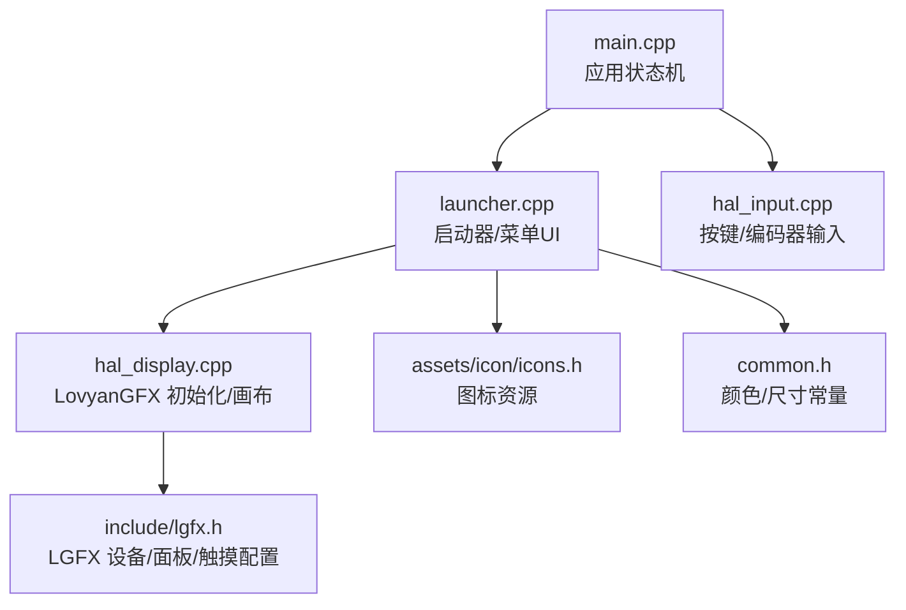
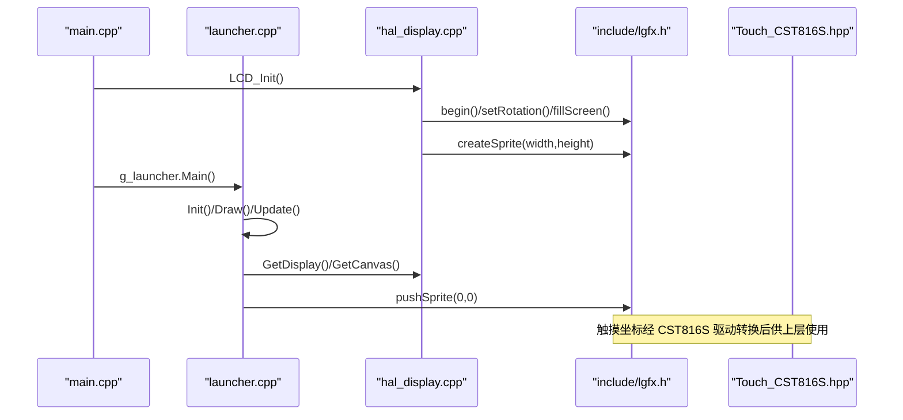
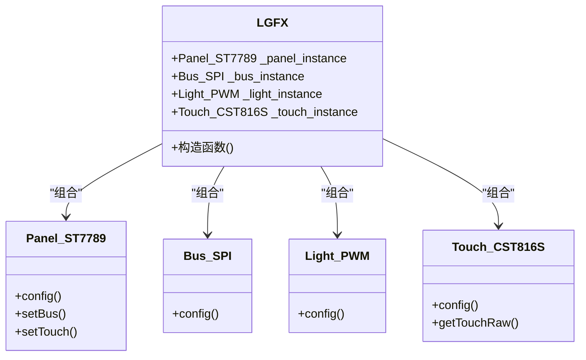
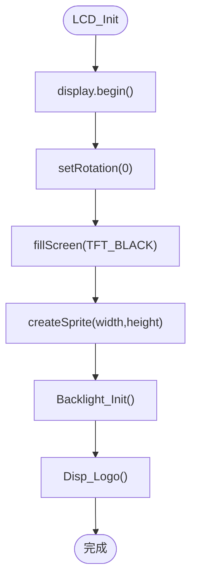
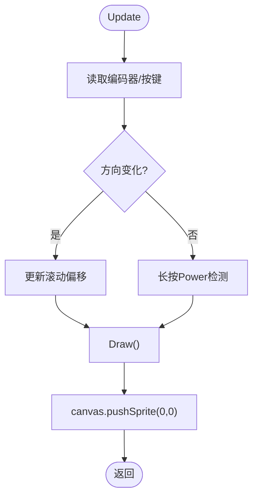
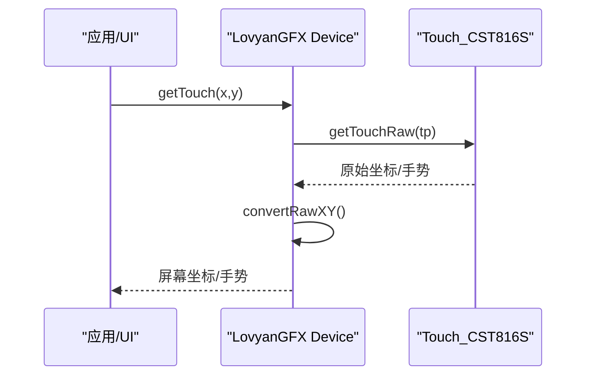
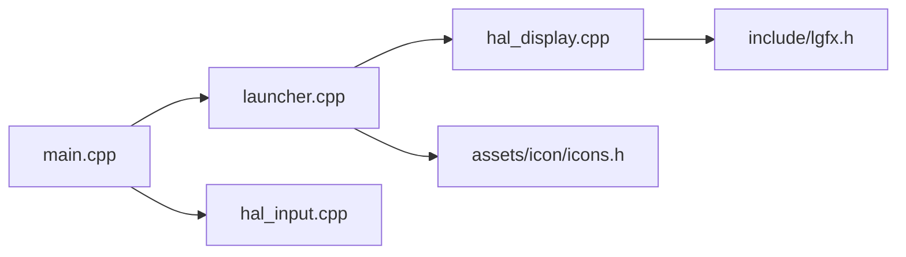

# 图形用户界面

<cite>
**本文引用的文件**   
- [include/lgfx.h](file://include/lgfx.h)
- [src/main.cpp](file://src/main.cpp)
- [src/launcher.cpp](file://src/launcher.cpp)
- [src/launcher.h](file://src/launcher.h)
- [src/hal/hal_display.cpp](file://src/hal/hal_display.cpp)
- [src/hal/hal_input.cpp](file://src/hal/hal_input.cpp)
- [src/hal/hal_config.h](file://src/hal/hal_config.h)
- [src/common.h](file://src/common.h)
- [src/assets/icon/icons.h](file://src/assets/icon/icons.h)
- [lib/LovyanGFX/src/lgfx/v1/Touch_CST816S.hpp](file://lib/LovyanGFX/src/lgfx/v1/Touch_CST816S.hpp)
- [lib/LovyanGFX/src/lgfx/v0/LGFX_Device.hpp](file://lib/LovyanGFX/src/lgfx/v0/LGFX_Device.hpp)
- [lib/LovyanGFX/src/lgfx/v1/misc/SpriteBuffer.hpp](file://lib/LovyanGFX/src/lgfx/v1/misc/SpriteBuffer.hpp)
</cite>

## 目录
1. [简介](#简介)
2. [项目结构](#项目结构)
3. [核心组件](#核心组件)
4. [架构总览](#架构总览)
5. [详细组件分析](#详细组件分析)
6. [依赖关系分析](#依赖关系分析)
7. [性能与内存优化](#性能与内存优化)
8. [故障排查指南](#故障排查指南)
9. [结论](#结论)
10. [附录：主题与样式、响应式适配、自定义组件开发](#附录主题与样式响应式适配自定义组件开发)

## 简介
本文件为 ESP32 NullPod 的图形用户界面（UI）文档，聚焦 LovyanGFX 图形库的集成与配置、UI 组件设计（按钮、图标、字体等）、触摸输入与手势识别、主题定制与样式系统、渲染优化与内存管理策略，以及自定义 UI 组件开发与响应式适配。目标是帮助开发者快速理解并扩展该设备的 UI 子系统。

## 项目结构
UI 相关代码主要分布在以下位置：
- 显示与触摸驱动：include/lgfx.h、src/hal/hal_display.cpp、src/hal/hal_input.cpp、src/hal/hal_config.h
- 主循环与应用切换：src/main.cpp
- 启动器与菜单 UI：src/launcher.cpp、src/launcher.h
- 资源：图标 assets/icon/icons.h、通用颜色与工具 src/common.h

图表来源
- [src/main.cpp:1-209](file://src/main.cpp#L1-L209)
- [src/launcher.cpp:1-444](file://src/launcher.cpp#L1-L444)
- [src/hal/hal_display.cpp:1-127](file://src/hal/hal_display.cpp#L1-L127)
- [include/lgfx.h:1-118](file://include/lgfx.h#L1-L118)
- [src/assets/icon/icons.h:1-46](file://src/assets/icon/icons.h#L1-L46)
- [src/common.h:1-36](file://src/common.h#L1-L36)
- [src/hal/hal_input.cpp:1-59](file://src/hal/hal_input.cpp#L1-L59)

章节来源
- [src/main.cpp:1-209](file://src/main.cpp#L1-L209)
- [src/launcher.cpp:1-444](file://src/launcher.cpp#L1-L444)
- [src/hal/hal_display.cpp:1-127](file://src/hal/hal_display.cpp#L1-L127)
- [include/lgfx.h:1-118](file://include/lgfx.h#L1-L118)
- [src/assets/icon/icons.h:1-46](file://src/assets/icon/icons.h#L1-L46)
- [src/common.h:1-36](file://src/common.h#L1-L36)
- [src/hal/hal_input.cpp:1-59](file://src/hal/hal_input.cpp#L1-L59)

## 核心组件
- LovyanGFX 设备层：定义 SPI 总线、ST7789 面板、PWM 背光、CST816S 触摸控制器，统一封装为 LGFX 类。
- HAL 显示层：创建 display 与 canvas（LGFX_Sprite），负责屏幕初始化、亮度控制、开机 Logo 输出。
- 启动器 Launcher：实现菜单 UI、图标流、标签区、状态栏、长按关机提示、平滑滚动与插值。
- 输入层：按键与编码器映射，提供短按/长按检测与蜂鸣反馈。
- 资源层：图标数组（PROGMEM）、颜色与尺寸常量、字体引用。

章节来源
- [include/lgfx.h:1-118](file://include/lgfx.h#L1-L118)
- [src/hal/hal_display.cpp:1-127](file://src/hal/hal_display.cpp#L1-L127)
- [src/launcher.cpp:1-444](file://src/launcher.cpp#L1-L444)
- [src/hal/hal_input.cpp:1-59](file://src/hal/hal_input.cpp#L1-L59)
- [src/assets/icon/icons.h:1-46](file://src/assets/icon/icons.h#L1-L46)
- [src/common.h:1-36](file://src/common.h#L1-L36)

## 架构总览
下图展示从 main 到 LovyanGFX 的调用链路与数据流向。

图表来源
- [src/main.cpp:18-24](file://src/main.cpp#L18-L24)
- [src/hal/hal_display.cpp:18-42](file://src/hal/hal_display.cpp#L18-L42)
- [include/lgfx.h:34-114](file://include/lgfx.h#L34-L114)
- [lib/LovyanGFX/src/lgfx/v1/Touch_CST816S.hpp:28-63](file://lib/LovyanGFX/src/lgfx/v1/Touch_CST816S.hpp#L28-L63)

## 详细组件分析

### LovyanGFX 集成与配置
- 总线与面板：SPI 总线配置 MOSI/MISO/SCLK/DC，ST7789 面板设置宽高、偏移、旋转、RGB 顺序与反转。
- 背光：可选 PWM 控制，当前通过 HAL 层独立控制 LEDC。
- 触摸：CST816S I2C 配置 SDA/SCL/INT/RST，坐标范围与屏幕一致，支持手势枚举（上/下/左/右滑、单击、双击、长按）。

图表来源
- [include/lgfx.h:34-114](file://include/lgfx.h#L34-L114)

章节来源
- [include/lgfx.h:1-118](file://include/lgfx.h#L1-L118)

### 显示与画布（HAL 层）
- 初始化流程：display.begin -> setRotation -> fillScreen -> createSprite -> Backlight_Init -> Disp_Logo。
- 画布：全局 canvas（LGFX_Sprite）用于离屏绘制，减少闪烁；pushSprite 将整帧推送到屏幕。
- 背光：LED PWM 通道配置，亮度持久化存储。

图表来源
- [src/hal/hal_display.cpp:18-42](file://src/hal/hal_display.cpp#L18-L42)
- [src/hal/hal_display.cpp:62-79](file://src/hal/hal_display.cpp#L62-L79)
- [src/hal/hal_display.cpp:81-92](file://src/hal/hal_display.cpp#L81-L92)

章节来源
- [src/hal/hal_display.cpp:1-127](file://src/hal/hal_display.cpp#L1-L127)

### 启动器与菜单 UI（Launcher）
- 生命周期：Init -> Main（阻塞循环）-> Update（输入处理/滚动插值/重绘）-> Exit。
- 菜单项：包含标签、颜色、图标指针、动作回调；通过 slotParams 控制中心缩放与位移，形成“焦点居中”的视觉流。
- 交互：编码器旋转选择、短按进入、长按电源键关机（带进度条提示）。
- 绘制分层：背景 -> 状态栏（时间/WiFi/电量）-> 图标区 -> 标签区 -> 提示栏。

图表来源
- [src/launcher.cpp:82-197](file://src/launcher.cpp#L82-L197)
- [src/launcher.cpp:231-238](file://src/launcher.cpp#L231-L238)

章节来源
- [src/launcher.cpp:1-444](file://src/launcher.cpp#L1-L444)
- [src/launcher.h:1-153](file://src/launcher.h#L1-L153)

### 图标与字体资源管理
- 图标：以 PROGMEM 数组形式存放，尺寸多为 64x64，通过 drawScaledIcon 进行缩放绘制；状态栏内还包含 WiFi 小图标绘制逻辑。
- 字体：使用 FreeSans 系列字体（如 FreeSans9pt7b、FreeSansBold12pt7b），在状态栏与标签区分别设置字号与字重。
- 颜色：集中定义于 launcher.h 与 common.h，便于主题切换。

章节来源
- [src/assets/icon/icons.h:1-46](file://src/assets/icon/icons.h#L1-L46)
- [src/launcher.cpp:331-368](file://src/launcher.cpp#L331-L368)
- [src/launcher.cpp:401-414](file://src/launcher.cpp#L401-L414)
- [src/common.h:1-36](file://src/common.h#L1-L36)

### 触摸输入与手势识别
- 触摸驱动：CST816S 提供 getTouchRaw 接口，支持手势枚举（上/下/左/右滑、单击、双击、长按）。
- 坐标映射：在 include/lgfx.h 中配置 x_min/x_max/y_min/y_max 与屏幕分辨率一致，确保触摸坐标与显示坐标对齐。
- 上层使用：当前 Launcher 主要通过编码器与按键交互；触摸能力由 LovyanGFX 暴露，可在后续 UI 中接入点击/滑动事件。

图表来源
- [lib/LovyanGFX/src/lgfx/v0/LGFX_Device.hpp:238-285](file://lib/LovyanGFX/src/lgfx/v0/LGFX_Device.hpp#L238-L285)
- [lib/LovyanGFX/src/lgfx/v1/Touch_CST816S.hpp:28-63](file://lib/LovyanGFX/src/lgfx/v1/Touch_CST816S.hpp#L28-L63)
- [include/lgfx.h:90-110](file://include/lgfx.h#L90-L110)

章节来源
- [lib/LovyanGFX/src/lgfx/v1/Touch_CST816S.hpp:28-63](file://lib/LovyanGFX/src/lgfx/v1/Touch_CST816S.hpp#L28-L63)
- [lib/LovyanGFX/src/lgfx/v0/LGFX_Device.hpp:238-285](file://lib/LovyanGFX/src/lgfx/v0/LGFX_Device.hpp#L238-L285)
- [include/lgfx.h:90-110](file://include/lgfx.h#L90-L110)

### 主题定制与样式系统
- 颜色体系：BG_TOP/BG_BOTTOM、STATUS_BG、TEXT_*、WIFI/BT 连接态颜色等集中在 launcher.h；通用色与尺寸在 common.h。
- 字体样式：不同区域使用不同字体大小与粗细，通过 setFont/setTextColor 动态设置。
- 可扩展性：建议新增主题时，集中修改颜色宏与字体选择，保持 UI 一致性。

章节来源
- [src/launcher.h:14-42](file://src/launcher.h#L14-L42)
- [src/common.h:4-19](file://src/common.h#L4-L19)
- [src/launcher.cpp:331-368](file://src/launcher.cpp#L331-L368)
- [src/launcher.cpp:401-414](file://src/launcher.cpp#L401-L414)

## 依赖关系分析
- main.cpp 作为入口，维护 AppState 状态机，分发到各 App 或 Launcher。
- Launcher 依赖 HAL 提供的 Display/Canvas 与输入抽象。
- HAL 层依赖 include/lgfx.h 中的 LGFX 设备类与 LovyanGFX 库。
- 图标资源通过 icons.h 集中声明，供 Launcher 使用。

图表来源
- [src/main.cpp:1-209](file://src/main.cpp#L1-L209)
- [src/launcher.cpp:1-444](file://src/launcher.cpp#L1-L444)
- [src/hal/hal_display.cpp:1-127](file://src/hal/hal_display.cpp#L1-L127)
- [include/lgfx.h:1-118](file://include/lgfx.h#L1-L118)
- [src/assets/icon/icons.h:1-46](file://src/assets/icon/icons.h#L1-L46)
- [src/hal/hal_input.cpp:1-59](file://src/hal/hal_input.cpp#L1-L59)

章节来源
- [src/main.cpp:1-209](file://src/main.cpp#L1-L209)
- [src/launcher.cpp:1-444](file://src/launcher.cpp#L1-L444)
- [src/hal/hal_display.cpp:1-127](file://src/hal/hal_display.cpp#L1-L127)
- [include/lgfx.h:1-118](file://include/lgfx.h#L1-L118)
- [src/assets/icon/icons.h:1-46](file://src/assets/icon/icons.h#L1-L46)
- [src/hal/hal_input.cpp:1-59](file://src/hal/hal_input.cpp#L1-L59)

## 性能与内存优化
- 离屏缓冲：使用 LGFX_Sprite（canvas）进行离屏绘制，最后一次性 pushSprite，降低闪烁与重复刷新开销。
- 增量刷新：非滚动状态下每秒仅重绘状态栏，避免全量刷新带来的 CPU 占用。
- 平滑滚动：采用目标偏移与当前偏移插值，提升滚动体验同时控制计算开销。
- 内存分配：SpriteBuffer 支持 Normal/Dma/Psram 三种分配源，优先 PSRAM，失败回退 DMA，有助于缓解内部 RAM 压力。
- 字体渲染：合理使用字体大小与裁剪区域，避免不必要的背景填充与跨屏绘制。

章节来源
- [src/hal/hal_display.cpp:24-31](file://src/hal/hal_display.cpp#L24-L31)
- [src/launcher.cpp:157-197](file://src/launcher.cpp#L157-L197)
- [lib/LovyanGFX/src/lgfx/v1/misc/SpriteBuffer.hpp:57-84](file://lib/LovyanGFX/src/lgfx/v1/misc/SpriteBuffer.hpp#L57-L84)
- [lib/LovyanGFX/src/lgfx/v1/misc/SpriteBuffer.cpp:116-143](file://lib/LovyanGFX/src/lgfx/v1/misc/SpriteBuffer.cpp#L116-L143)

## 故障排查指南
- 屏幕无显示：检查 display.begin 是否成功、rotation 与 offset 是否正确、背光是否开启。
- 触摸坐标异常：确认 include/lgfx.h 中 x_min/x_max/y_min/y_max 与屏幕分辨率一致；I2C 地址与引脚正确。
- 滚动卡顿：减少每帧绘制面积，避免频繁 pushSprite；仅在必要时重绘状态栏。
- 内存不足：观察 heap_caps_get_free_size 日志；必要时调整字体大小或减少图标数量。
- 长按关机不触发：检查 isReturn 按键映射与消抖逻辑；确认 powerPressStart 计时与阈值判断。

章节来源
- [src/hal/hal_display.cpp:24-42](file://src/hal/hal_display.cpp#L24-L42)
- [include/lgfx.h:90-110](file://include/lgfx.h#L90-L110)
- [src/launcher.cpp:109-155](file://src/launcher.cpp#L109-L155)
- [src/hal/hal_input.cpp:26-53](file://src/hal/hal_input.cpp#L26-L53)

## 结论
本项目基于 LovyanGFX 构建了稳定高效的嵌入式 UI 子系统。通过 HAL 层封装显示与输入、Launcher 实现菜单与交互、资源集中管理，形成了清晰的层次结构与可维护的代码组织。在此基础上，可通过主题宏、字体与图标替换实现外观定制；借助 LovyanGFX 的触摸与手势能力，可进一步扩展交互模式。

## 附录：主题与样式、响应式适配、自定义组件开发

### 主题与样式
- 颜色宏：在 launcher.h 与 common.h 中集中定义，便于一键换肤。
- 字体：根据区域语义选择合适的字体大小与字重，避免过度渲染。
- 图标：统一尺寸与格式，建议使用矢量转点阵工具生成 64x64 的 RGB565 数组。

章节来源
- [src/launcher.h:14-42](file://src/launcher.h#L14-L42)
- [src/common.h:4-19](file://src/common.h#L4-L19)
- [src/assets/icon/icons.h:1-46](file://src/assets/icon/icons.h#L1-L46)

### 响应式设计与屏幕适配
- 分辨率常量：SCREEN_WIDTH/SCREEN_HEIGHT 来自 hal_config.h，所有布局以此为基准。
- 旋转与偏移：include/lgfx.h 中 panel 的 offset_rotation 与 offset_x/y 用于适配不同安装方向。
- 布局弹性：Launcher 的 slotParams 提供缩放与偏移，使焦点图标始终居中且具透视感。

章节来源
- [src/hal/hal_config.h:17-22](file://src/hal/hal_config.h#L17-L22)
- [include/lgfx.h:25-31](file://include/lgfx.h#L25-L31)
- [include/lgfx.h:57-75](file://include/lgfx.h#L57-L75)
- [src/launcher.h:116-129](file://src/launcher.h#L116-L129)

### 自定义 UI 组件开发指南
- 按钮组件：可使用 LovyanGFX 的 LGFX_Button，支持边框、填充、文字与命中检测。
- 图标绘制：复用 drawScaledIcon 与图标数组，结合主题颜色进行高亮/选中态。
- 字体与文本：按需设置 setTextSize/setFont/setTextColor，注意 textWidth 测量以避免溢出。
- 交互扩展：在 Launcher::Update 中接入触摸事件（getTouch/getTouchRaw），实现点击/滑动逻辑。

章节来源
- [lib/LovyanGFX/src/lgfx/v1/Touch_CST816S.hpp:28-63](file://lib/LovyanGFX/src/lgfx/v1/Touch_CST816S.hpp#L28-L63)
- [lib/LovyanGFX/src/lgfx/v0/LGFX_Device.hpp:238-285](file://lib/LovyanGFX/src/lgfx/v0/LGFX_Device.hpp#L238-L285)
- [src/launcher.cpp:331-368](file://src/launcher.cpp#L331-L368)
- [src/launcher.cpp:401-414](file://src/launcher.cpp#L401-L414)