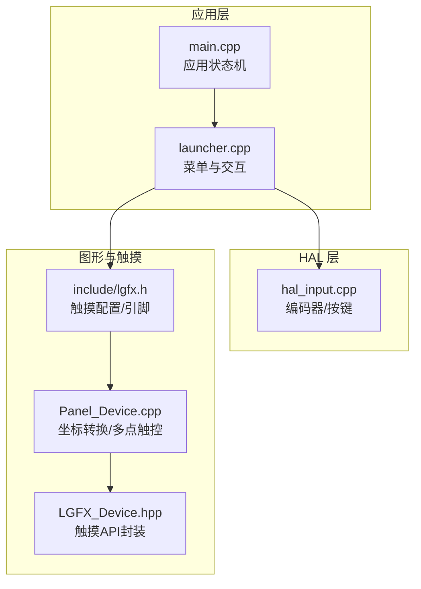
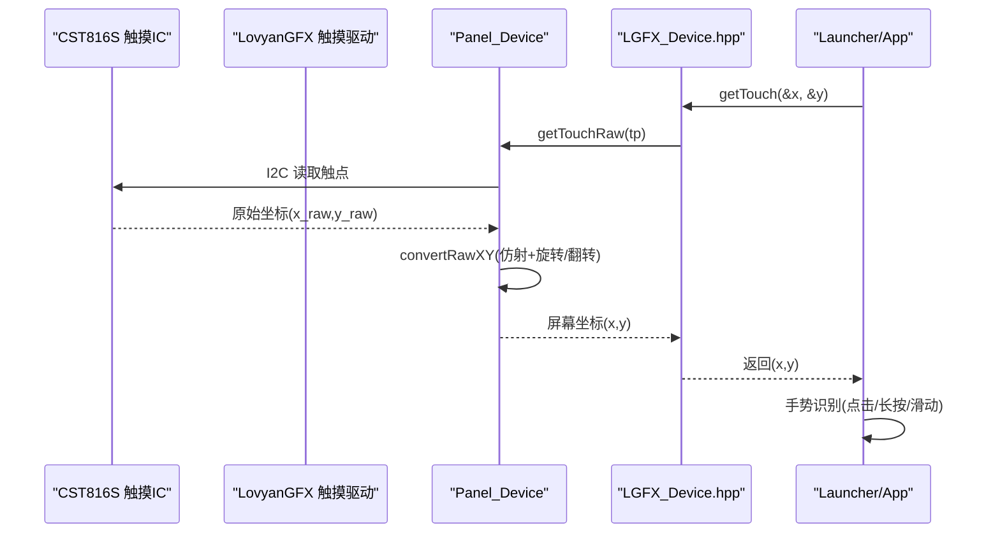
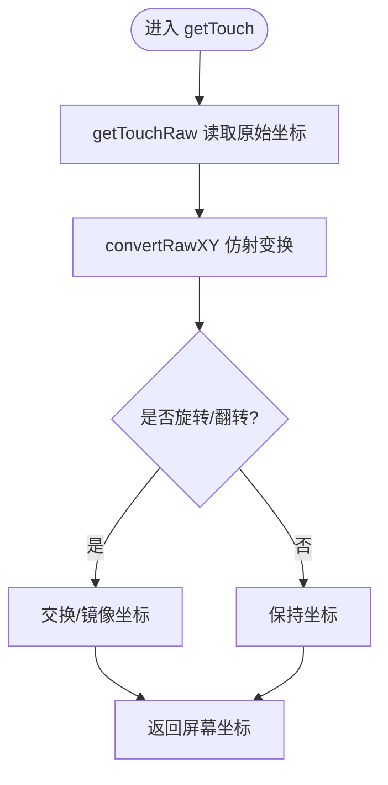
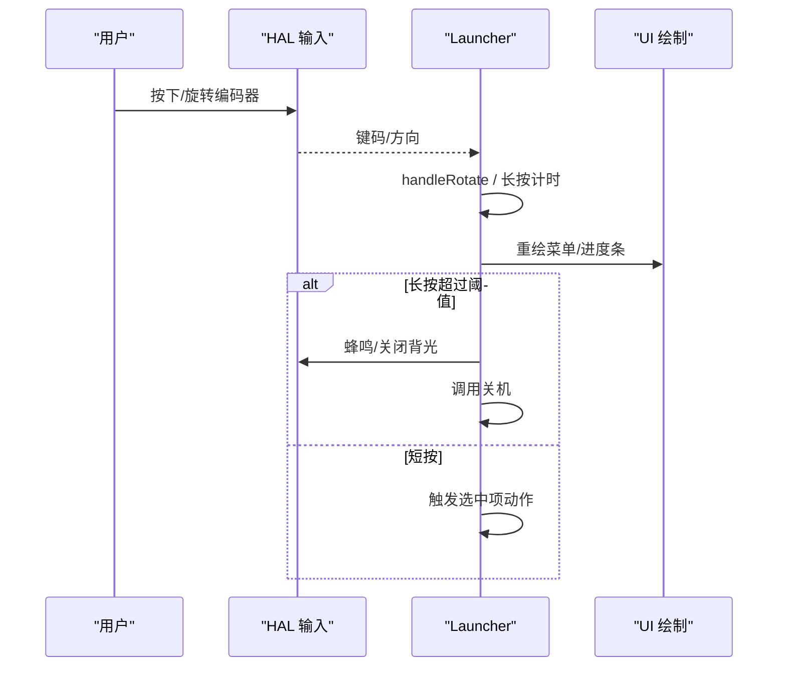
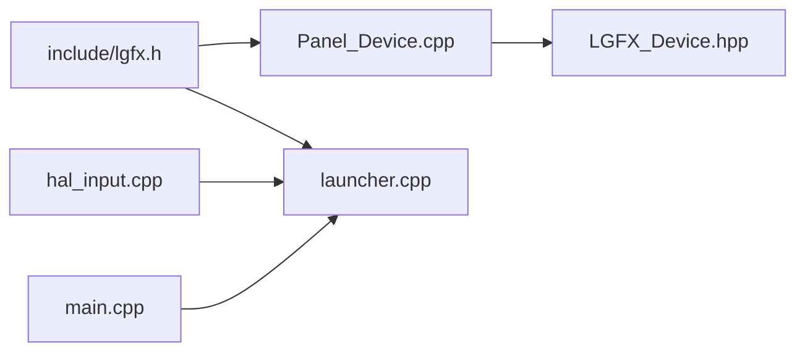

# 触摸交互处理

<cite>
**本文引用的文件**   
- [include/lgfx.h](file://include/lgfx.h)
- [lib/LovyanGFX/src/lgfx/v1/panel/Panel_Device.cpp](file://lib/LovyanGFX/src/lgfx/v1/panel/Panel_Device.cpp)
- [lib/LovyanGFX/src/lgfx/v0/LGFX_Device.hpp](file://lib/LovyanGFX/src/lgfx/v0/LGFX_Device.hpp)
- [src/hal/hal_input.cpp](file://src/hal/hal_input.cpp)
- [src/launcher.cpp](file://src/launcher.cpp)
- [src/main.cpp](file://src/main.cpp)
</cite>

## 目录
1. [简介](#简介)
2. [项目结构](#项目结构)
3. [核心组件](#核心组件)
4. [架构总览](#架构总览)
5. [详细组件分析](#详细组件分析)
6. [依赖关系分析](#依赖关系分析)
7. [性能与优化](#性能与优化)
8. [故障排查指南](#故障排查指南)
9. [结论](#结论)
10. [附录：交互设计指南](#附录交互设计指南)

## 简介
本文件面向本项目中的“触摸交互处理”，系统性说明触摸事件的捕获、坐标映射、多点触控支持，以及与编码器输入的统一交互流程。文档同时覆盖手势识别（点击、长按、滑动）的实现思路、冲突解决策略，以及针对小屏设备的触摸优化与交互体验建议。

## 项目结构
本项目在 LovyanGFX 图形库之上实现显示与触摸驱动，并通过 HAL 层抽象硬件按键与编码器输入；应用侧通过 Launcher 统一调度菜单与 App 切换。触摸相关的关键位置包括：
- 触摸设备配置与引脚定义：include/lgfx.h
- 触摸原始数据读取与坐标转换：lib/LovyanGFX/src/lgfx/v1/panel/Panel_Device.cpp
- 触摸 API 封装（v0/v1 兼容）：lib/LovyanGFX/src/lgfx/v0/LGFX_Device.hpp
- 编码器/按键输入：src/hal/hal_input.cpp
- 菜单与长按关机逻辑：src/launcher.cpp
- 系统主循环与应用状态机：src/main.cpp

图表来源
- [src/main.cpp:1-209](file://src/main.cpp#L1-L209)
- [src/launcher.cpp:1-444](file://src/launcher.cpp#L1-L444)
- [src/hal/hal_input.cpp:1-59](file://src/hal/hal_input.cpp#L1-L59)
- [include/lgfx.h:1-118](file://include/lgfx.h#L1-L118)
- [lib/LovyanGFX/src/lgfx/v1/panel/Panel_Device.cpp:404-479](file://lib/LovyanGFX/src/lgfx/v1/panel/Panel_Device.cpp#L404-L479)
- [lib/LovyanGFX/src/lgfx/v0/LGFX_Device.hpp:238-285](file://lib/LovyanGFX/src/lgfx/v0/LGFX_Device.hpp#L238-L285)

章节来源
- [src/main.cpp:1-209](file://src/main.cpp#L1-L209)
- [src/launcher.cpp:1-444](file://src/launcher.cpp#L1-L444)
- [src/hal/hal_input.cpp:1-59](file://src/hal/hal_input.cpp#L1-L59)
- [include/lgfx.h:1-118](file://include/lgfx.h#L1-L118)
- [lib/LovyanGFX/src/lgfx/v1/panel/Panel_Device.cpp:404-479](file://lib/LovyanGFX/src/lgfx/v1/panel/Panel_Device.cpp#L404-L479)
- [lib/LovyanGFX/src/lgfx/v0/LGFX_Device.hpp:238-285](file://lib/LovyanGFX/src/lgfx/v0/LGFX_Device.hpp#L238-L285)

## 核心组件
- 触摸设备与引脚配置：CST816S I2C 触摸屏，SDA/SCL/RST/INT 引脚与地址在 include/lgfx.h 中定义，并设置 x/y 范围、旋转偏移等参数。
- 触摸数据读取与坐标转换：Panel_Device.cpp 提供 getTouchRaw/getTouch 与 convertRawXY，负责从底层驱动获取原始坐标并进行仿射变换、旋转/翻转适配。
- 触摸 API 封装：LGFX_Device.hpp 暴露 getTouch/getTouchRaw 接口，屏蔽底层差异，向上层返回屏幕坐标系下的点。
- 编码器/按键输入：hal_input.cpp 将物理按键映射为虚拟键码，并提供 GetButton/isReturn/isEnter 等查询接口。
- 菜单与交互：launcher.cpp 使用编码器输入进行滚动与选择，并实现长按 Power 关机流程与 UI 反馈。

章节来源
- [include/lgfx.h:18-24](file://include/lgfx.h#L18-L24)
- [include/lgfx.h:90-110](file://include/lgfx.h#L90-L110)
- [lib/LovyanGFX/src/lgfx/v1/panel/Panel_Device.cpp:434-474](file://lib/LovyanGFX/src/lgfx/v1/panel/Panel_Device.cpp#L434-L474)
- [lib/LovyanGFX/src/lgfx/v0/LGFX_Device.hpp:238-285](file://lib/LovyanGFX/src/lgfx/v0/LGFX_Device.hpp#L238-L285)
- [src/hal/hal_input.cpp:1-59](file://src/hal/hal_input.cpp#L1-L59)
- [src/launcher.cpp:81-228](file://src/launcher.cpp#L81-L228)

## 架构总览
触摸事件从硬件到应用的完整链路如下：
- 硬件：CST816S 通过 I2C 上报触点坐标
- 驱动层：LovyanGFX 的 Touch_CST816S 读取原始坐标
- 面板层：Panel_Device::getTouchRaw/getTouch 与 convertRawXY 完成坐标转换与旋转/翻转
- 上层 API：LGFX_Device.hpp 对外暴露 getTouch/getTouchRaw
- 应用层：Launcher 与具体 App 调用 getTouch 进行点击/长按/滑动等手势识别

图表来源
- [include/lgfx.h:90-110](file://include/lgfx.h#L90-L110)
- [lib/LovyanGFX/src/lgfx/v1/panel/Panel_Device.cpp:458-474](file://lib/LovyanGFX/src/lgfx/v1/panel/Panel_Device.cpp#L458-L474)
- [lib/LovyanGFX/src/lgfx/v0/LGFX_Device.hpp:268-285](file://lib/LovyanGFX/src/lgfx/v0/LGFX_Device.hpp#L268-L285)
- [src/launcher.cpp:81-228](file://src/launcher.cpp#L81-L228)

## 详细组件分析

### 触摸设备与引脚配置（include/lgfx.h）
- 定义触摸 SDA/SCL/RST/INT 引脚与 I2C 地址（CST816S_ADDRESS）。
- 配置触摸坐标范围 x_min/x_max、y_min/y_max 与 offset_rotation，确保与屏幕分辨率一致。
- 设置 I2C 端口、频率，并将触摸实例绑定到面板。

章节来源
- [include/lgfx.h:18-24](file://include/lgfx.h#L18-L24)
- [include/lgfx.h:90-110](file://include/lgfx.h#L90-L110)

### 触摸坐标映射与多点触控（Panel_Device.cpp）
- getTouchRaw：从底层触摸驱动读取原始坐标，必要时管理总线事务。
- convertRawXY：对每个触点执行仿射变换，并根据旋转位与垂直翻转标志调整坐标，以匹配当前屏幕方向。
- getTouch：组合 getTouchRaw 与 convertRawXY，返回屏幕坐标系下的坐标。

图表来源
- [lib/LovyanGFX/src/lgfx/v1/panel/Panel_Device.cpp:434-474](file://lib/LovyanGFX/src/lgfx/v1/panel/Panel_Device.cpp#L434-L474)

章节来源
- [lib/LovyanGFX/src/lgfx/v1/panel/Panel_Device.cpp:434-474](file://lib/LovyanGFX/src/lgfx/v1/panel/Panel_Device.cpp#L434-L474)

### 触摸 API 封装（LGFX_Device.hpp）
- 提供 getTouch/getTouchRaw 的多重载版本，支持直接返回 x/y 或 touch_point_t 结构体。
- 内部自动调用 convertRawXY，保证上层获得的是屏幕坐标系下的结果。

章节来源
- [lib/LovyanGFX/src/lgfx/v0/LGFX_Device.hpp:238-285](file://lib/LovyanGFX/src/lgfx/v0/LGFX_Device.hpp#L238-L285)

### 编码器与按键输入（hal_input.cpp）
- 初始化阶段将物理引脚映射到虚拟键码（电源、选择、上/下/左/右）。
- GetButton 检测按键按下/释放，并触发蜂鸣反馈。
- isReturn/isEnter 提供便捷查询方法，供上层用于长按/短按判断。

章节来源
- [src/hal/hal_input.cpp:1-59](file://src/hal/hal_input.cpp#L1-L59)

### 菜单与长按关机流程（launcher.cpp）
- 编码器输入：handleRotate 根据方向改变选中项，配合平滑滚动插值更新 UI。
- 长按 Power：记录按下时间，超过阈值后触发蜂鸣、清屏、关闭背光并调用关机；期间显示进度条提示。
- 状态栏与图标区域绘制：周期性刷新时间与连接状态。

图表来源
- [src/launcher.cpp:81-228](file://src/launcher.cpp#L81-L228)
- [src/hal/hal_input.cpp:26-59](file://src/hal/hal_input.cpp#L26-L59)

章节来源
- [src/launcher.cpp:81-228](file://src/launcher.cpp#L81-L228)

### 触摸手势识别与冲突解决策略
- 点击：基于单次触点的停留时间与位移阈值判定。
- 长按：结合时间阈值与可选的视觉反馈（如进度条），避免误触。
- 滑动：基于连续多点轨迹的方向与速度阈值判定。
- 冲突解决：
  - 优先级：长按 > 滑动 > 点击（长按优先于其他手势）。
  - 去抖与容差：引入最小移动距离与时间窗口，减少抖动与误判。
  - 多点触控：当存在多个触点时，仅跟踪主触点（最近一次有效点）作为手势主体，其余忽略或用于缩放/平移等复合手势。

[本节为概念性说明，不直接分析具体代码文件]

## 依赖关系分析
- include/lgfx.h 依赖 LovyanGFX 的 Touch_CST816S 与 Panel_ST7789，并配置 I2C 与引脚。
- Panel_Device.cpp 依赖底层触摸驱动与仿射矩阵，负责坐标转换。
- LGFX_Device.hpp 向上层暴露统一的触摸 API。
- hal_input.cpp 独立于图形库，提供通用按键/编码器输入。
- launcher.cpp 依赖 HAL 与 LovyanGFX 的绘图能力，实现菜单与交互。

图表来源
- [include/lgfx.h:1-118](file://include/lgfx.h#L1-L118)
- [lib/LovyanGFX/src/lgfx/v1/panel/Panel_Device.cpp:404-479](file://lib/LovyanGFX/src/lgfx/v1/panel/Panel_Device.cpp#L404-L479)
- [lib/LovyanGFX/src/lgfx/v0/LGFX_Device.hpp:238-285](file://lib/LovyanGFX/src/lgfx/v0/LGFX_Device.hpp#L238-L285)
- [src/hal/hal_input.cpp:1-59](file://src/hal/hal_input.cpp#L1-L59)
- [src/launcher.cpp:1-444](file://src/launcher.cpp#L1-L444)
- [src/main.cpp:1-209](file://src/main.cpp#L1-L209)

章节来源
- [include/lgfx.h:1-118](file://include/lgfx.h#L1-L118)
- [lib/LovyanGFX/src/lgfx/v1/panel/Panel_Device.cpp:404-479](file://lib/LovyanGFX/src/lgfx/v1/panel/Panel_Device.cpp#L404-L479)
- [lib/LovyanGFX/src/lgfx/v0/LGFX_Device.hpp:238-285](file://lib/LovyanGFX/src/lgfx/v0/LGFX_Device.hpp#L238-L285)
- [src/hal/hal_input.cpp:1-59](file://src/hal/hal_input.cpp#L1-L59)
- [src/launcher.cpp:1-444](file://src/launcher.cpp#L1-L444)
- [src/main.cpp:1-209](file://src/main.cpp#L1-L209)

## 性能与优化
- 触摸采样频率：I2C 时钟设置为 400kHz，兼顾速度与稳定性；在高负载场景可适当降低频率以减少总线竞争。
- 坐标转换开销：convertRawXY 对每个触点执行仿射变换，建议在多点触控时限制最大点数，避免频繁浮点运算。
- UI 刷新节流：Launcher 在非滚动状态下每秒刷新一次状态栏，减少不必要的 pushSprite 调用。
- 防抖与容差：在应用层增加最小移动距离与时间窗口，降低误触概率。
- 资源复用：复用触摸点结构体，避免频繁分配内存。

[本节为通用指导，不直接分析具体代码文件]

## 故障排查指南
- 触摸无响应：
  - 检查 include/lgfx.h 中 I2C 引脚与地址配置是否正确。
  - 确认 _touch_instance.config(cfg) 已调用且 setTouch 已绑定到面板。
- 坐标错位：
  - 检查 x_min/x_max、y_min/y_max 是否与屏幕分辨率一致。
  - 检查 offset_rotation 与屏幕旋转设置是否匹配。
- 多点触控异常：
  - 确认底层驱动是否支持多点触控；若不支持，需限制单点模式。
- 长按误触发：
  - 调整长按阈值与提示进度条的时间区间，避免过短导致误判。
- 编码器与触摸冲突：
  - 明确输入优先级：长按 > 滑动 > 点击；在应用层实现互斥逻辑。

章节来源
- [include/lgfx.h:90-110](file://include/lgfx.h#L90-L110)
- [lib/LovyanGFX/src/lgfx/v1/panel/Panel_Device.cpp:434-474](file://lib/LovyanGFX/src/lgfx/v1/panel/Panel_Device.cpp#L434-L474)
- [src/launcher.cpp:109-196](file://src/launcher.cpp#L109-L196)

## 结论
本项目通过 LovyanGFX 提供了完整的触摸采集与坐标转换能力，并在 HAL 层统一了编码器与按键输入。应用侧 Launcher 实现了菜单导航与长按关机流程。在此基础上，可进一步扩展点击、长按、滑动等手势识别，并结合多点触控与冲突解决策略，提升小屏设备的交互体验。

[本节为总结性内容，不直接分析具体代码文件]

## 附录：交互设计指南
- 触摸目标尺寸：按钮与可点击区域不小于 40×40 像素，便于手指操作。
- 反馈机制：每次有效交互提供蜂鸣或视觉反馈（高亮/动画），增强确定性。
- 手势边界：为滑动与长按设定明确的阈值与可视化提示（如进度条）。
- 多点触控：仅在需要缩放/平移的场景启用多点触控，默认单点模式以提升稳定性。
- 屏幕适配：在不同旋转角度下，确保坐标转换正确，避免 UI 错位。

[本节为概念性指导，不直接分析具体代码文件]