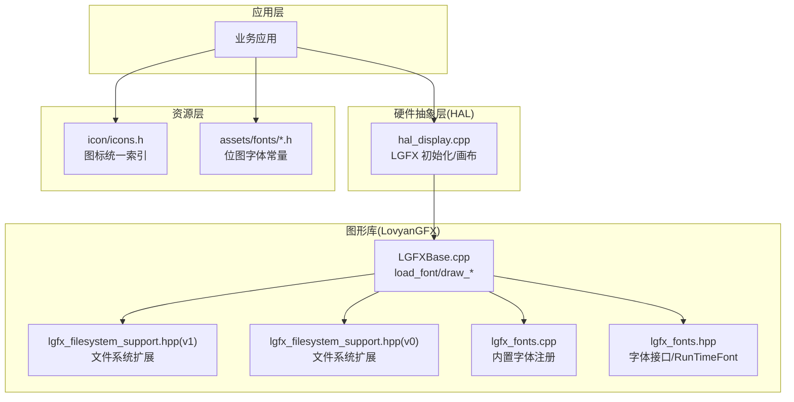
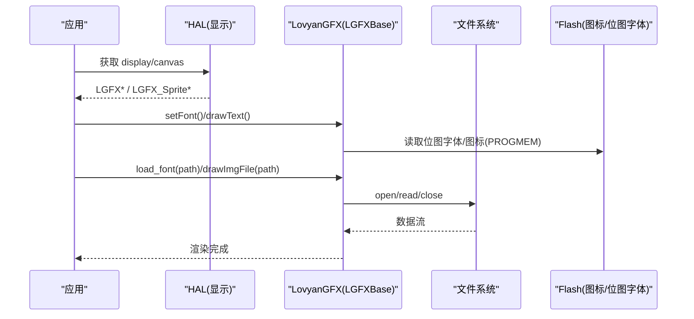
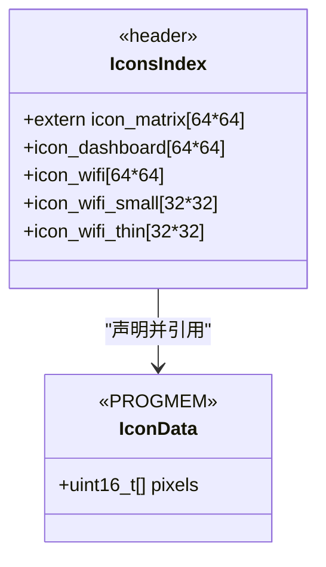
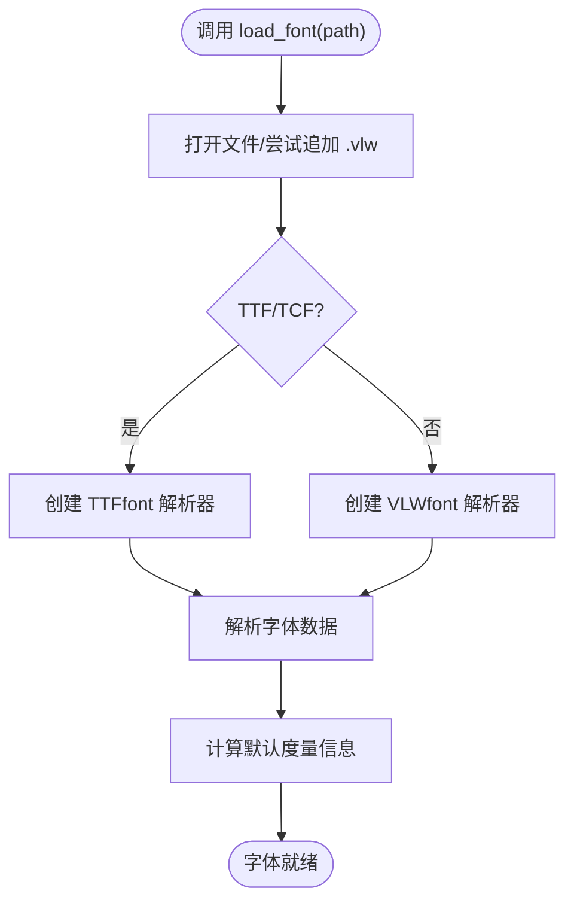
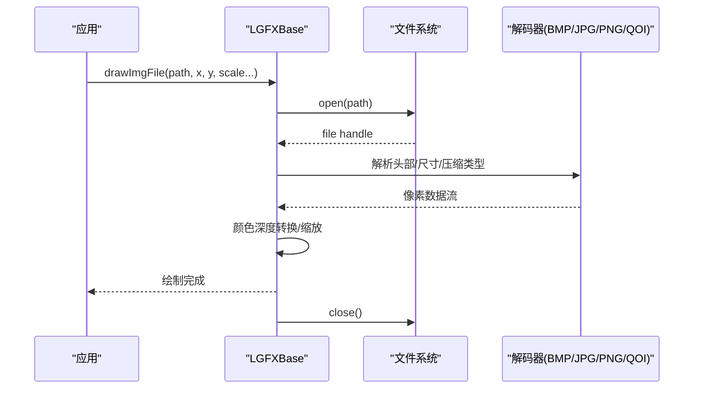
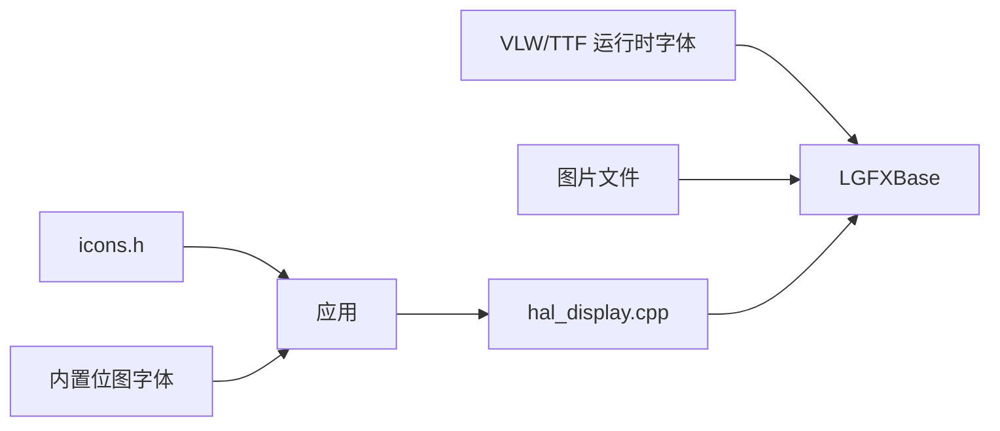

# 资源管理系统

<cite>
**本文引用的文件**   
- [src/assets/icon/icons.h](file://src/assets/icon/icons.h)
- [src/assets/icon/icon_wifi.h](file://src/assets/icon/icon_wifi.h)
- [src/hal/hal_display.cpp](file://src/hal/hal_display.cpp)
- [lib/LovyanGFX/src/lgfx/v1/LGFXBase.cpp](file://lib/LovyanGFX/src/lgfx/v1/LGFXBase.cpp)
- [lib/LovyanGFX/src/lgfx/v0/lgfx_filesystem_support.hpp](file://lib/LovyanGFX/src/lgfx/v0/lgfx_filesystem_support.hpp)
- [lib/LovyanGFX/src/lgfx/v1/ lgfx_filesystem_support.hpp](file://lib/LovyanGFX/src/lgfx/v1/ lgfx_filesystem_support.hpp)
- [lib/LovyanGFX/src/lgfx/v1/LGFXBase.hpp](file://lib/LovyanGFX/src/lgfx/v1/LGFXBase.hpp)
- [lib/LovyanGFX/src/lgfx/v1/lgfx_fonts.cpp](file://lib/LovyanGFX/src/lgfx/v1/lgfx_fonts.cpp)
- [lib/LovyanGFX/src/lgfx/v1/lgfx_fonts.hpp](file://lib/LovyanGFX/src/lgfx/v1/lgfx_fonts.hpp)
- [platformio.ini](file://platformio.ini)
</cite>

## 目录
1. [简介](#简介)
2. [项目结构](#项目结构)
3. [核心组件](#核心组件)
4. [架构总览](#架构总览)
5. [详细组件分析](#详细组件分析)
6. [依赖关系分析](#依赖关系分析)
7. [性能与内存优化](#性能与内存优化)
8. [故障排查指南](#故障排查指南)
9. [结论](#结论)
10. [附录：资源维护流程](#附录资源维护流程)

## 简介
本文件系统文档面向 NullPod 固件的资源管理，重点覆盖以下方面：
- 字体资源的加载与管理（内置位图字体、运行时 VLW/TTF 字体）
- 图标资源的组织方式与引用机制（Flash 中像素数组、统一头文件索引）
- 图片资源的存储格式与加载机制（BMP/JPG/PNG/QOI 等）
- 资源文件的添加、更新与维护流程
- 资源优化技巧与内存使用最佳实践

本项目基于 ESP32 + LovyanGFX 图形库，资源以 Flash 常驻为主，通过 PROGMEM 将静态数据置于程序存储器，减少 RAM 占用；同时支持从文件系统（LittleFS/SD）动态加载字体与图片。

## 项目结构
资源相关目录与关键文件如下：
- src/assets/fonts：自定义字体头文件（位图字体常量）
- src/assets/icon：图标像素数组与统一索引头
- src/hal：显示 HAL，封装 LGFX 初始化与画布操作
- lib/LovyanGFX：图形库实现，提供字体与图片的运行时加载能力
- data：Web 资源（与本资源系统无直接耦合）

图表来源
- [src/hal/hal_display.cpp:18-42](file://src/hal/hal_display.cpp#L18-L42)
- [src/assets/icon/icons.h:1-46](file://src/assets/icon/icons.h#L1-L46)
- [lib/LovyanGFX/src/lgfx/v1/LGFXBase.cpp:2160-2209](file://lib/LovyanGFX/src/lgfx/v1/LGFXBase.cpp#L2160-L2209)
- [lib/LovyanGFX/src/lgfx/v1/ lgfx_filesystem_support.hpp:39-68](file://lib/LovyanGFX/src/lgfx/v1/ lgfx_filesystem_support.hpp#L39-L68)
- [lib/LovyanGFX/src/lgfx/v0/lgfx_filesystem_support.hpp:62-106](file://lib/LovyanGFX/src/lgfx/v0/lgfx_filesystem_support.hpp#L62-L106)
- [lib/LovyanGFX/src/lgfx/v1/lgfx_fonts.cpp:1154-1180](file://lib/LovyanGFX/src/lgfx/v1/lgfx_fonts.cpp#L1154-L1180)
- [lib/LovyanGFX/src/lgfx/v1/lgfx_fonts.hpp:201-223](file://lib/LovyanGFX/src/lgfx/v1/lgfx_fonts.hpp#L201-L223)

章节来源
- [src/hal/hal_display.cpp:18-42](file://src/hal/hal_display.cpp#L18-L42)
- [src/assets/icon/icons.h:1-46](file://src/assets/icon/icons.h#L1-L46)

## 核心组件
- 图标资源索引与定义
  - icons.h 集中声明所有图标数组及尺寸，便于统一引用
  - 各 icon_*.h 包含具体像素数组，使用 PROGMEM 存放于 Flash
- 字体资源
  - 内置位图字体：通过 fonts::FontX 引用（由 LovyanGFX 内置）
  - 运行时字体：VLW/TTF 通过 LGFXBase.load_font 从文件系统加载
- 图片资源
  - 支持 BMP/JPG/PNG/QOI，通过 drawBmp/drawJpg/drawPng/drawQoi 或 File 版本绘制
- 显示 HAL
  - 封装 LGFX 实例与离屏画布，负责初始化、背光控制、Logo 输出

章节来源
- [src/assets/icon/icons.h:1-46](file://src/assets/icon/icons.h#L1-L46)
- [src/assets/icon/icon_wifi.h:1-398](file://src/assets/icon/icon_wifi.h#L1-L398)
- [src/hal/hal_display.cpp:18-79](file://src/hal/hal_display.cpp#L18-L79)
- [lib/LovyanGFX/src/lgfx/v1/LGFXBase.cpp:2160-2209](file://lib/LovyanGFX/src/lgfx/v1/LGFXBase.cpp#L2160-L2209)
- [lib/LovyanGFX/src/lgfx/v1/LGFXBase.hpp:866-892](file://lib/LovyanGFX/src/lgfx/v1/LGFXBase.hpp#L866-L892)

## 架构总览
下图展示资源在运行时的访问路径：应用层通过 HAL 获取显示对象，再调用 LovyanGFX 提供的字体/图片 API；图标与位图字体直接从 Flash 读取，运行时字体与图片可从文件系统加载。

图表来源
- [src/hal/hal_display.cpp:44-51](file://src/hal/hal_display.cpp#L44-L51)
- [lib/LovyanGFX/src/lgfx/v1/LGFXBase.cpp:2160-2209](file://lib/LovyanGFX/src/lgfx/v1/LGFXBase.cpp#L2160-L2209)
- [lib/LovyanGFX/src/lgfx/v1/LGFXBase.hpp:866-892](file://lib/LovyanGFX/src/lgfx/v1/LGFXBase.hpp#L866-L892)

## 详细组件分析

### 图标资源组织与引用
- 组织结构
  - 每个图标一个 .h 文件，包含 uint16_t 像素数组，尺寸如 64x64 或 32x32
  - icons.h 汇总 extern 声明，作为统一入口
- 内存布局
  - 所有图标数组使用 PROGMEM 存储在 Flash，避免占用 RAM
- 使用方式
  - 在应用中 include icons.h，按名称引用对应图标数组
  - 配合 LovyanGFX 的图像绘制 API 进行缩放/定位绘制

图表来源
- [src/assets/icon/icons.h:22-43](file://src/assets/icon/icons.h#L22-L43)
- [src/assets/icon/icon_wifi.h:7-398](file://src/assets/icon/icon_wifi.h#L7-L398)

章节来源
- [src/assets/icon/icons.h:1-46](file://src/assets/icon/icons.h#L1-L46)
- [src/assets/icon/icon_wifi.h:1-398](file://src/assets/icon/icon_wifi.h#L1-L398)

### 字体资源加载与管理
- 内置位图字体
  - LovyanGFX 内置多种字体（如 Font0），通过 fonts::FontX 引用
  - 示例：在 HAL 启动时设置字体并输出 Logo
- 运行时字体（VLW/TTF）
  - 通过 LGFXBase.load_font(path) 从文件系统加载
  - 自动识别 TTF/TCF 或 VLW 格式，内部创建对应解析器
  - 支持带/不带扩展名的路径，必要时自动补全 .vlw
- 字体度量与绘制
  - 加载成功后填充 FontMetrics，用于文本测量与对齐

图表来源
- [lib/LovyanGFX/src/lgfx/v1/LGFXBase.cpp:2160-2209](file://lib/LovyanGFX/src/lgfx/v1/LGFXBase.cpp#L2160-L2209)
- [lib/LovyanGFX/src/lgfx/v0/lgfx_filesystem_support.hpp:62-106](file://lib/LovyanGFX/src/lgfx/v0/lgfx_filesystem_support.hpp#L62-L106)
- [lib/LovyanGFX/src/lgfx/v1/lgfx_fonts.hpp:201-223](file://lib/LovyanGFX/src/lgfx/v1/lgfx_fonts.hpp#L201-L223)

章节来源
- [src/hal/hal_display.cpp:62-79](file://src/hal/hal_display.cpp#L62-L79)
- [lib/LovyanGFX/src/lgfx/v1/LGFXBase.cpp:2160-2209](file://lib/LovyanGFX/src/lgfx/v1/LGFXBase.cpp#L2160-L2209)
- [lib/LovyanGFX/src/lgfx/v0/lgfx_filesystem_support.hpp:62-106](file://lib/LovyanGFX/src/lgfx/v0/lgfx_filesystem_support.hpp#L62-L106)
- [lib/LovyanGFX/src/lgfx/v1/lgfx_fonts.cpp:1154-1180](file://lib/LovyanGFX/src/lgfx/v1/lgfx_fonts.cpp#L1154-L1180)
- [lib/LovyanGFX/src/lgfx/v1/lgfx_fonts.hpp:201-223](file://lib/LovyanGFX/src/lgfx/v1/lgfx_fonts.hpp#L201-L223)

### 图片资源存储格式与加载机制
- 支持格式
  - BMP/JPG/PNG/QOI，分别提供内存指针与文件路径两种绘制接口
- 加载流程
  - 文件版本 API 会打开文件、读取头信息、解码像素、转换为目标深度后写入帧缓冲
  - 对调色板图像（bpp<=8）会分配调色板缓冲区
- 文件系统集成
  - 通过 LGFX_FILESYSTEM_Support 暴露 drawBmpFile/drawJpgFile/drawPngFile/drawQoiFile 等方法

图表来源
- [lib/LovyanGFX/src/lgfx/v1/LGFXBase.hpp:866-892](file://lib/LovyanGFX/src/lgfx/v1/LGFXBase.hpp#L866-L892)
- [lib/LovyanGFX/src/lgfx/v1/ lgfx_filesystem_support.hpp:39-68](file://lib/LovyanGFX/src/lgfx/v1/ lgfx_filesystem_support.hpp#L39-L68)
- [lib/LovyanGFX/src/lgfx/v1/LGFXBase.cpp:2451-2489](file://lib/LovyanGFX/src/lgfx/v1/LGFXBase.cpp#L2451-L2489)

章节来源
- [lib/LovyanGFX/src/lgfx/v1/LGFXBase.hpp:866-892](file://lib/LovyanGFX/src/lgfx/v1/LGFXBase.hpp#L866-L892)
- [lib/LovyanGFX/src/lgfx/v1/ lgfx_filesystem_support.hpp:39-68](file://lib/LovyanGFX/src/lgfx/v1/ lgfx_filesystem_support.hpp#L39-L68)
- [lib/LovyanGFX/src/lgfx/v1/LGFXBase.cpp:2451-2489](file://lib/LovyanGFX/src/lgfx/v1/LGFXBase.cpp#L2451-L2489)

## 依赖关系分析
- 图标与字体
  - 图标数组通过 icons.h 集中声明，被应用层直接引用
  - 位图字体通过 LovyanGFX 内置 fonts::FontX 使用
- 运行时字体与图片
  - 依赖 LGFXBase 的文件系统扩展方法，底层通过 DataWrapper/FileWrapper 访问文件系统
- HAL 与图形库
  - HAL 持有 LGFX 实例与离屏 Sprite，作为应用与图形库之间的桥梁

图表来源
- [src/assets/icon/icons.h:1-46](file://src/assets/icon/icons.h#L1-L46)
- [src/hal/hal_display.cpp:18-42](file://src/hal/hal_display.cpp#L18-L42)
- [lib/LovyanGFX/src/lgfx/v1/LGFXBase.cpp:2160-2209](file://lib/LovyanGFX/src/lgfx/v1/LGFXBase.cpp#L2160-L2209)

章节来源
- [src/assets/icon/icons.h:1-46](file://src/assets/icon/icons.h#L1-L46)
- [src/hal/hal_display.cpp:18-42](file://src/hal/hal_display.cpp#L18-L42)
- [lib/LovyanGFX/src/lgfx/v1/LGFXBase.cpp:2160-2209](file://lib/LovyanGFX/src/lgfx/v1/LGFXBase.cpp#L2160-L2209)

## 性能与内存优化
- 将静态资源放入 Flash
  - 图标数组与位图字体使用 PROGMEM，避免占用 RAM
- 按需加载运行时字体
  - 仅在需要时调用 load_font，并在切换字体前 unloadFont（库内部已处理）
- 图片绘制优化
  - 优先使用 drawImgFile 系列，避免一次性将大图载入 RAM
  - 对小图标使用较小尺寸版本（如 icon_wifi_small/thin）以减少带宽与解码开销
- 离屏缓冲与刷新策略
  - 使用 LGFX_Sprite 作为画布，批量绘制后再 pushSprite 到屏幕，减少闪烁与重复绘制
- 构建配置
  - 确保 platformio.ini 正确启用 LittleFS/SD 等文件系统，以便运行时资源加载

章节来源
- [src/assets/icon/icon_wifi.h:1-398](file://src/assets/icon/icon_wifi.h#L1-L398)
- [src/hal/hal_display.cpp:24-42](file://src/hal/hal_display.cpp#L24-L42)
- [lib/LovyanGFX/src/lgfx/v1/LGFXBase.cpp:2160-2209](file://lib/LovyanGFX/src/lgfx/v1/LGFXBase.cpp#L2160-L2209)
- [platformio.ini](file://platformio.ini)

## 故障排查指南
- 字体加载失败
  - 检查路径是否正确，必要时让库自动补全 .vlw
  - 确认文件系统已挂载且可读
- 图片无法显示
  - 确认文件格式受支持（BMP/JPG/PNG/QOI）
  - 检查文件大小与分辨率是否超出预期，导致解码或内存不足
- 图标不显示或错位
  - 核对图标数组尺寸与绘制参数（缩放、偏移）
  - 确认 include 的是正确的图标头文件
- 显示异常或卡顿
  - 检查是否频繁创建/销毁字体或图片对象
  - 合理使用离屏缓冲，减少全屏刷新次数

章节来源
- [lib/LovyanGFX/src/lgfx/v0/lgfx_filesystem_support.hpp:62-106](file://lib/LovyanGFX/src/lgfx/v0/lgfx_filesystem_support.hpp#L62-L106)
- [lib/LovyanGFX/src/lgfx/v1/LGFXBase.hpp:866-892](file://lib/LovyanGFX/src/lgfx/v1/LGFXBase.hpp#L866-L892)

## 结论
本项目的资源管理以“Flash 常驻 + 按需运行时加载”为核心策略：
- 图标与位图字体通过 PROGMEM 驻留 Flash，零 RAM 占用
- 运行时字体与图片通过 LovyanGFX 的文件系统扩展按需加载，降低初始内存压力
- HAL 封装了显示与画布，为上层应用提供稳定一致的绘图接口
遵循本文的流程与优化建议，可在保证 UI 质量的同时有效控制内存与性能开销。

## 附录：资源维护流程
- 添加新图标
  - 在 src/assets/icon 下新增 icon_xxx.h，定义像素数组并使用 PROGMEM
  - 在 icons.h 中添加 extern 声明，保持命名一致
- 添加新字体
  - 位图字体：准备位图数据，生成对应的 fonts::FontX 并加入 LovyanGFX 内置字体（或通过 assets/fonts 引入）
  - 运行时字体：准备 VLW/TTF 文件，部署至文件系统（LittleFS/SD），通过 load_font 加载
- 添加新图片
  - 将图片文件放入文件系统，使用 drawImgFile 系列 API 绘制
- 更新与维护
  - 定期评估图标尺寸与数量，移除未使用资源
  - 监控 RAM/PSRAM 使用情况，调整字体与图片加载策略
  - 在 platformio.ini 中确认文件系统分区与大小配置合理

章节来源
- [src/assets/icon/icons.h:1-46](file://src/assets/icon/icons.h#L1-L46)
- [lib/LovyanGFX/src/lgfx/v1/LGFXBase.cpp:2160-2209](file://lib/LovyanGFX/src/lgfx/v1/LGFXBase.cpp#L2160-L2209)
- [platformio.ini](file://platformio.ini)