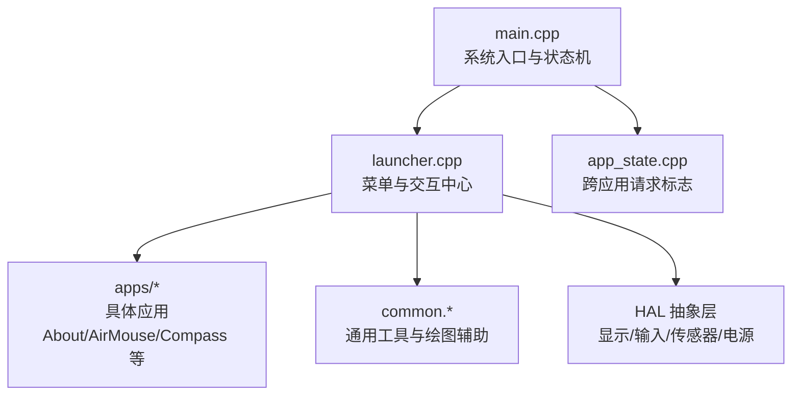
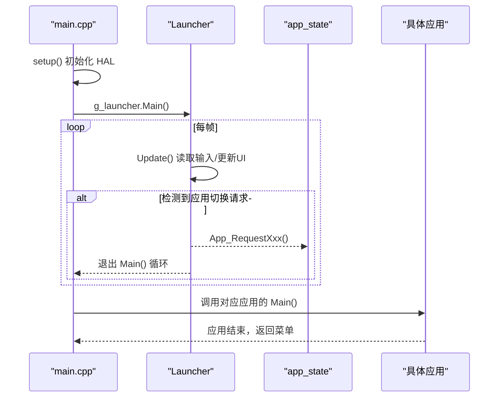
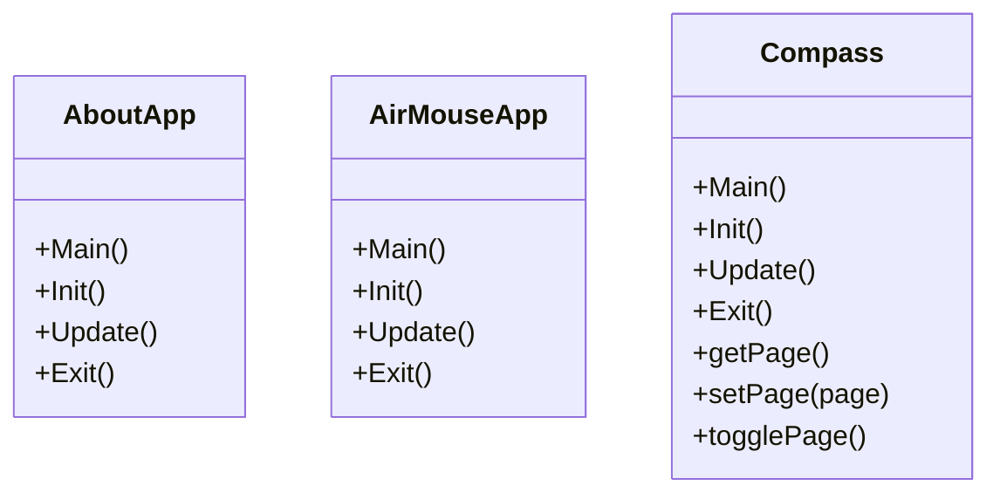
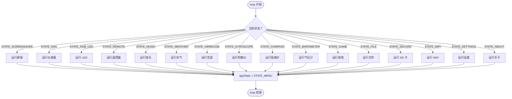
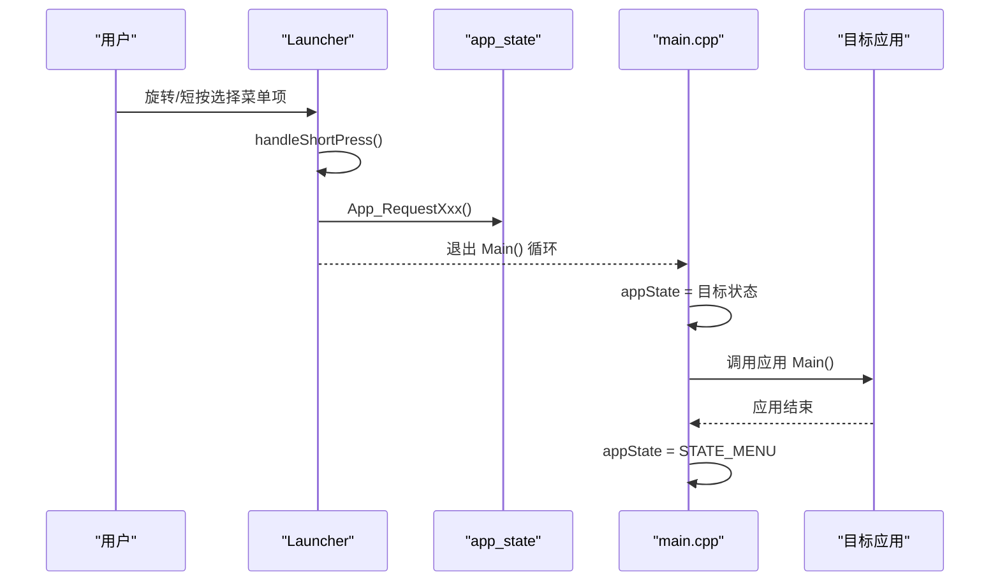
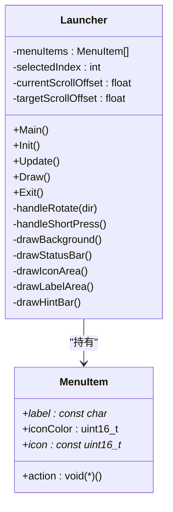
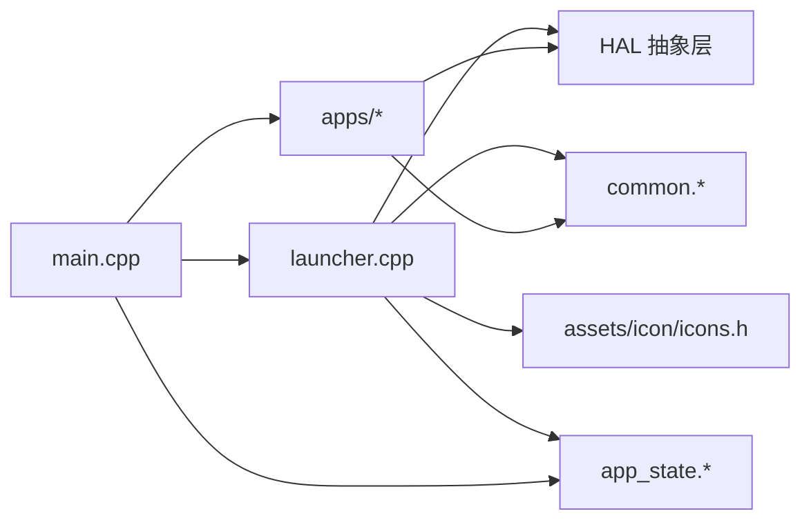

# 应用架构设计

<cite>
**本文引用的文件**   
- [main.cpp](file://src/main.cpp)
- [app_state.h](file://src/app_state.h)
- [app_state.cpp](file://src/app_state.cpp)
- [launcher.h](file://src/launcher.h)
- [launcher.cpp](file://src/launcher.cpp)
- [common.h](file://src/common.h)
- [common.cpp](file://src/common.cpp)
- [AboutApp.h](file://src/apps/AboutApp.h)
- [AirMouse.h](file://src/apps/AirMouse.h)
- [Compass.h](file://src/apps/Compass.h)
</cite>

## 目录
1. [引言](#引言)
2. [项目结构](#项目结构)
3. [核心组件](#核心组件)
4. [架构总览](#架构总览)
5. [详细组件分析](#详细组件分析)
6. [依赖关系分析](#依赖关系分析)
7. [性能与优化建议](#性能与优化建议)
8. [故障排查指南](#故障排查指南)
9. [结论](#结论)
10. [附录：生命周期与错误处理示例](#附录生命周期与错误处理示例)

## 引言
本文件面向 ESP32 NullPod 的应用架构，系统化说明应用的统一接口规范、状态机管理、注册机制与启动器（Launcher）工作原理，并给出应用间通信与数据共享的架构模式。文档同时提供开发最佳实践、性能优化建议以及生命周期管理与错误处理的参考实现路径。

## 项目结构
NullPod 固件采用“系统主循环 + 启动器菜单 + 多应用”的分层组织方式：
- 系统入口 main.cpp 负责 HAL 初始化、全局状态切换与应用调度。
- Launcher 作为统一的菜单与交互中心，封装了 UI 绘制、输入处理与应用切换触发。
- app_state 模块通过一组 volatile 标志位在各 App 之间传递“请求切换”的信号。
- 各 App（如 AboutApp、AirMouseApp、Compass 等）遵循统一的 Main/Init/Update/Exit 生命周期接口。

图表来源
- [main.cpp:19-24](file://src/main.cpp#L19-L24)
- [launcher.cpp:58-79](file://src/launcher.cpp#L58-L79)
- [app_state.cpp:21-36](file://src/app_state.cpp#L21-L36)

章节来源
- [main.cpp:19-24](file://src/main.cpp#L19-L24)
- [launcher.h:45-65](file://src/launcher.h#L45-L65)

## 核心组件
- 系统入口与状态机（main.cpp）
  - 在 setup() 中初始化 HAL 并首次进入 Launcher。
  - loop() 根据全局 AppState 分发到不同应用或功能模块，并在每个分支结束后恢复至菜单状态。
  - 支持屏保、仪表盘、LED、遥控器、音乐、天气、空鼠、陀螺仪、指南针、气压计、游戏、文件、SD卡、WiFi、设置、关于等场景。

- 应用状态与请求标志（app_state.h/.cpp）
  - 定义一组 volatile bool 标志位，用于从任意位置（包括中断或子任务）安全地请求切换到某个应用。
  - 提供 App_RequestXxx() 函数集中设置对应标志位，避免直接操作全局变量造成耦合。

- 启动器 Launcher（launcher.h/.cpp）
  - 提供 Main()/Init()/Update()/Exit() 统一生命周期方法。
  - 维护菜单项数组、选中索引、滚动偏移、长按关机逻辑、状态栏每秒刷新等。
  - 将用户输入（编码器旋转、短按、长按返回键）映射为应用切换请求。

- 通用工具（common.h/.cpp）
  - 提供颜色转换、资源百分比查询、图标缩放绘制等通用能力，供 Launcher 与各 App 复用。

章节来源
- [main.cpp:19-24](file://src/main.cpp#L19-L24)
- [app_state.h:5-21](file://src/app_state.h#L5-L21)
- [app_state.cpp:21-36](file://src/app_state.cpp#L21-L36)
- [launcher.h:85-148](file://src/launcher.h#L85-L148)
- [launcher.cpp:58-79](file://src/launcher.cpp#L58-L79)
- [common.h:27-33](file://src/common.h#L27-L33)
- [common.cpp:64-112](file://src/common.cpp#L64-L112)

## 架构总览
下图展示系统主循环、Launcher 与各应用之间的调用关系与数据流。

图表来源
- [main.cpp:19-24](file://src/main.cpp#L19-L24)
- [launcher.cpp:58-79](file://src/launcher.cpp#L58-L79)
- [launcher.cpp:427-443](file://src/launcher.cpp#L427-L443)
- [app_state.cpp:21-36](file://src/app_state.cpp#L21-L36)

## 详细组件分析

### 应用统一接口规范（Main/Init/Update/Exit）
各应用类普遍暴露以下生命周期方法：
- Main(): 阻塞式主循环，驱动应用运行直至退出。
- Init(): 初始化显示、输入、传感器等资源。
- Update(): 单帧更新逻辑（输入处理、数据刷新、渲染）。
- Exit(): 清理资源、恢复状态。

示例应用：
- AboutApp：展示 RAM/PSRAM/Flash 使用率与温度等信息。
- AirMouseApp：基于 IMU 的空鼠演示。
- Compass：罗盘、环境信息与气泡水平仪三页应用。

图表来源
- [AboutApp.h:18-57](file://src/apps/AboutApp.h#L18-L57)
- [AirMouse.h:8-42](file://src/apps/AirMouse.h#L8-L42)
- [Compass.h:43-126](file://src/apps/Compass.h#L43-L126)

章节来源
- [AboutApp.h:18-57](file://src/apps/AboutApp.h#L18-L57)
- [AirMouse.h:8-42](file://src/apps/AirMouse.h#L8-L42)
- [Compass.h:43-126](file://src/apps/Compass.h#L43-L126)

### 应用状态机（AppState）与管理机制
- 枚举 AppState 定义了所有可能的界面与应用状态，包括菜单、屏保、仪表盘、LED、遥控器、音乐、天气、空鼠、陀螺仪、指南针、气压计、游戏、文件、SD卡、WiFi、设置、关于等。
- main.cpp 中的 loop() 以 switch(appState) 进行分发，执行对应应用后重置为 STATE_MENU。
- 当检测到 g_requestXxx 标志时，将 appState 设置为对应状态，从而进入目标应用。

图表来源
- [launcher.h:45-65](file://src/launcher.h#L45-L65)
- [main.cpp:29-126](file://src/main.cpp#L29-L126)

章节来源
- [launcher.h:45-65](file://src/launcher.h#L45-L65)
- [main.cpp:29-126](file://src/main.cpp#L29-L126)

### 应用切换流程与请求机制
- Launcher::Update() 持续读取编码器与按键输入，并根据用户操作调用 handleRotate/handleShortPress。
- 当用户在菜单中选择某项时，Launcher 调用对应的 actionXxxEntry()，这些回调统一调用 App_RequestXxx() 设置请求标志。
- Launcher::Main() 在每次循环中检查是否出现任何切换请求，若有则 break 退出阻塞循环，交由 main.cpp 的 switch(appState) 分发到目标应用。
- 应用结束后，main.cpp 将 appState 重置为 STATE_MENU，回到菜单。

图表来源
- [launcher.cpp:82-197](file://src/launcher.cpp#L82-L197)
- [launcher.cpp:224-228](file://src/launcher.cpp#L224-L228)
- [launcher.cpp:427-443](file://src/launcher.cpp#L427-L443)
- [main.cpp:29-126](file://src/main.cpp#L29-L126)

章节来源
- [launcher.cpp:82-197](file://src/launcher.cpp#L82-L197)
- [launcher.cpp:224-228](file://src/launcher.cpp#L224-L228)
- [launcher.cpp:427-443](file://src/launcher.cpp#L427-L443)
- [main.cpp:29-126](file://src/main.cpp#L29-L126)

### 注册机制与启动器（Launcher）工作原理
- Launcher 内部维护一个 MenuItem 数组，包含标签、图标、颜色与动作回调。
- Init() 中完成菜单项初始化、显示与画布获取，并绘制初始界面。
- Main() 是阻塞式生命周期：先 Init()，然后进入 while(1) 循环，反复调用 Update()，直到检测到应用切换请求或需要退出。
- Update() 负责输入处理、长按关机检测、平滑滚动插值与状态栏每秒刷新。
- Draw() 将背景、状态栏、图标区、标签区与提示栏组合绘制。

图表来源
- [launcher.h:85-148](file://src/launcher.h#L85-L148)
- [launcher.cpp:9-51](file://src/launcher.cpp#L9-L51)
- [launcher.cpp:58-79](file://src/launcher.cpp#L58-L79)
- [launcher.cpp:82-197](file://src/launcher.cpp#L82-L197)
- [launcher.cpp:231-238](file://src/launcher.cpp#L231-L238)

章节来源
- [launcher.h:85-148](file://src/launcher.h#L85-L148)
- [launcher.cpp:9-51](file://src/launcher.cpp#L9-L51)
- [launcher.cpp:58-79](file://src/launcher.cpp#L58-L79)
- [launcher.cpp:82-197](file://src/launcher.cpp#L82-L197)
- [launcher.cpp:231-238](file://src/launcher.cpp#L231-L238)

### 应用间通信与数据共享架构模式
- 应用间通信采用“请求标志 + 主循环分发”的模式：
  - 任意模块（包括应用、HAL、中断）通过 App_RequestXxx() 设置 volatile 标志。
  - main.cpp 的 loop() 轮询这些标志并切换 AppState。
  - Launcher 在 Update() 中检测请求并退出 Main()，让出控制权给 main.cpp。
- 数据共享主要通过 HAL 抽象层提供的服务（显示、输入、传感器、时间、电源等），各应用通过 HAL 接口访问公共资源，避免直接耦合底层硬件。
- 对于复杂数据交换（例如多个应用共享配置或缓存），可在 HAL 或 common 层增加统一的数据管理器；当前代码未显式实现，但可沿用此模式扩展。

章节来源
- [app_state.h:5-21](file://src/app_state.h#L5-L21)
- [app_state.cpp:21-36](file://src/app_state.cpp#L21-L36)
- [launcher.cpp:82-197](file://src/launcher.cpp#L82-L197)
- [main.cpp:29-126](file://src/main.cpp#L29-L126)

## 依赖关系分析
- main.cpp 依赖 launcher.h 与多个应用头文件，负责全局状态分发。
- launcher.cpp 依赖 HAL、common 与图标资源，负责菜单 UI 与交互。
- app_state.cpp 被 launcher.cpp 与 main.cpp 共同引用，作为跨模块通信通道。
- 各应用依赖 HAL 与 common，遵循统一生命周期接口。

图表来源
- [main.cpp:1-13](file://src/main.cpp#L1-L13)
- [launcher.cpp:1-3](file://src/launcher.cpp#L1-L3)
- [launcher.cpp:2](file://src/launcher.cpp#L2)
- [app_state.cpp:1](file://src/app_state.cpp#L1)

章节来源
- [main.cpp:1-13](file://src/main.cpp#L1-L13)
- [launcher.cpp:1-3](file://src/launcher.cpp#L1-L3)
- [launcher.cpp:2](file://src/launcher.cpp#L2)
- [app_state.cpp:1](file://src/app_state.cpp#L1)

## 性能与优化建议
- 减少不必要的重绘
  - Launcher 仅在滚动变化或每秒刷新状态栏时重绘，避免全量刷新导致卡顿。
  - 建议在应用中按需刷新区域，而非整屏重绘。
- 控制传感器与网络 I/O 频率
  - 使用节流（如 Compass 的环境数据刷新间隔）降低高频 I/O 对 CPU 的影响。
- 合理使用内存
  - 利用 common.cpp 中的 getRamPercent/getPsramPercent/getFlashPercent 监控资源占用，避免大对象常驻内存。
- 输入响应优化
  - 编码器加速策略已在 Launcher 中实现，可根据用户体验调整 accel_multiplier 阈值。
- 功耗优化
  - 长按关机逻辑已实现蜂鸣反馈与背光关闭，建议在空闲时主动降低刷新频率或进入低功耗模式。

[本节为通用指导，不直接分析具体文件]

## 故障排查指南
- 无法切换到目标应用
  - 检查 App_RequestXxx() 是否被正确调用，确认对应 volatile 标志是否置位。
  - 确认 main.cpp 的 switch(appState) 分支是否覆盖该状态。
- 菜单无响应或滚动异常
  - 检查 HAL::getEncoder() 返回值与按键映射是否正确。
  - 验证 handleRotate 与 selectedIndex 边界处理逻辑。
- 长按关机无效
  - 检查 isReturn() 与 powerLongPressTriggered 状态机逻辑。
  - 确认蜂鸣与背光关闭序列是否正常执行。
- 显示内容错乱
  - 确保 canvas->pushSprite(0, 0) 在绘制完成后被调用。
  - 检查 drawStatusBar 的时间与连接图标刷新逻辑。

章节来源
- [launcher.cpp:82-197](file://src/launcher.cpp#L82-L197)
- [launcher.cpp:109-155](file://src/launcher.cpp#L109-L155)
- [launcher.cpp:331-368](file://src/launcher.cpp#L331-L368)
- [main.cpp:29-126](file://src/main.cpp#L29-L126)

## 结论
NullPod 的应用架构以“系统主循环 + Launcher 菜单 + 多应用”为核心，通过统一的 Main/Init/Update/Exit 生命周期与 volatile 请求标志实现松耦合的应用切换与通信。Launcher 承担 UI 与交互职责，HAL 抽象层屏蔽硬件差异，common 提供通用工具。该架构具备良好的可扩展性与可维护性，适合在嵌入式设备上快速迭代新应用。

[本节为总结性内容，不直接分析具体文件]

## 附录：生命周期与错误处理示例
- 应用生命周期参考路径
  - AboutApp 生命周期：[AboutApp.h:18-57](file://src/apps/AboutApp.h#L18-L57)
  - AirMouseApp 生命周期：[AirMouse.h:8-42](file://src/apps/AirMouse.h#L8-L42)
  - Compass 生命周期与页面管理：[Compass.h:43-126](file://src/apps/Compass.h#L43-L126)
- 错误处理策略参考
  - 长按关机与反馈：[launcher.cpp:109-155](file://src/launcher.cpp#L109-L155)
  - 状态栏刷新与时间有效性检查：[launcher.cpp:331-368](file://src/launcher.cpp#L331-L368)
  - 资源百分比监控：[common.cpp:27-62](file://src/common.cpp#L27-L62)

章节来源
- [AboutApp.h:18-57](file://src/apps/AboutApp.h#L18-L57)
- [AirMouse.h:8-42](file://src/apps/AirMouse.h#L8-L42)
- [Compass.h:43-126](file://src/apps/Compass.h#L43-L126)
- [launcher.cpp:109-155](file://src/launcher.cpp#L109-L155)
- [launcher.cpp:331-368](file://src/launcher.cpp#L331-L368)
- [common.cpp:27-62](file://src/common.cpp#L27-L62)