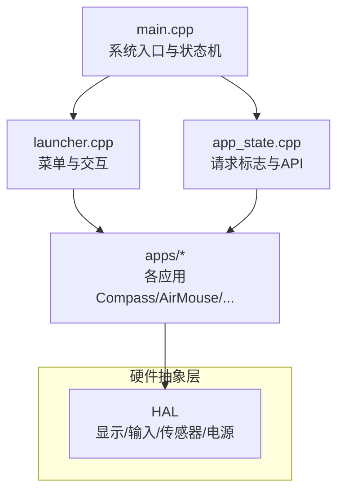
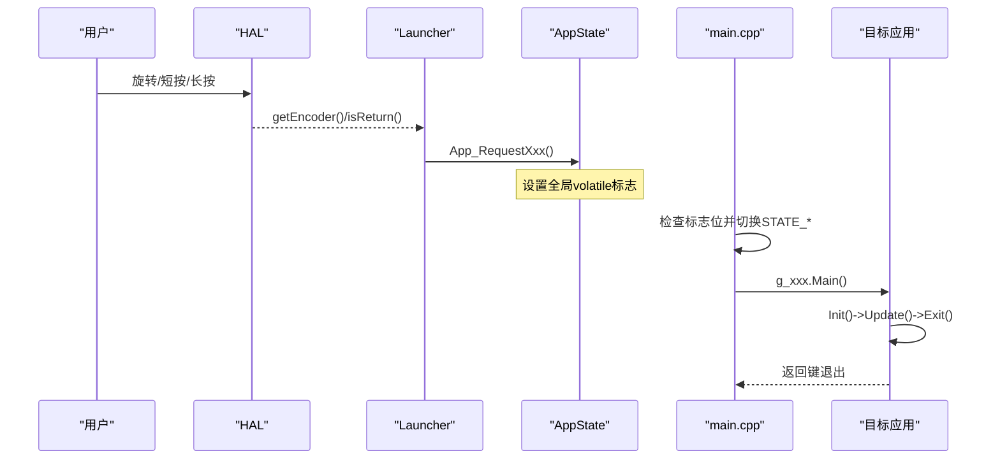
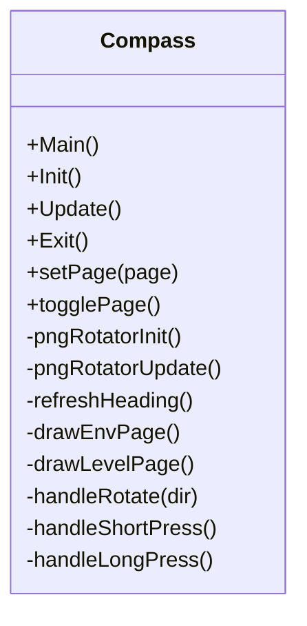
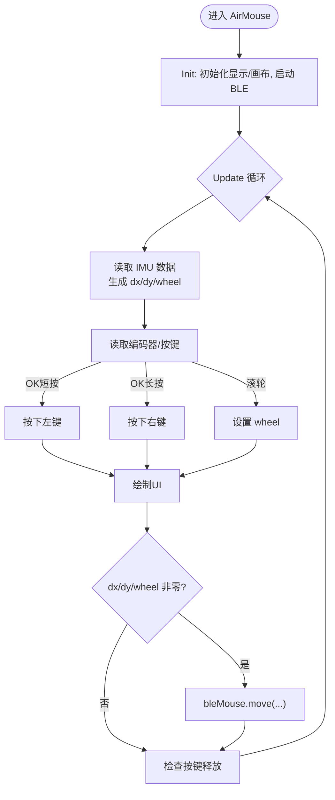
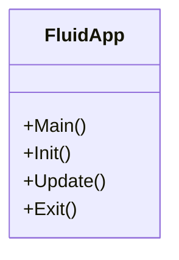
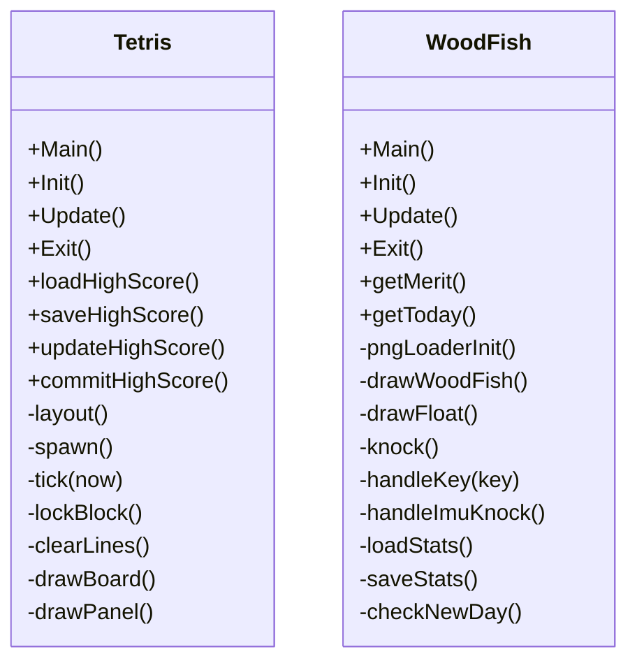
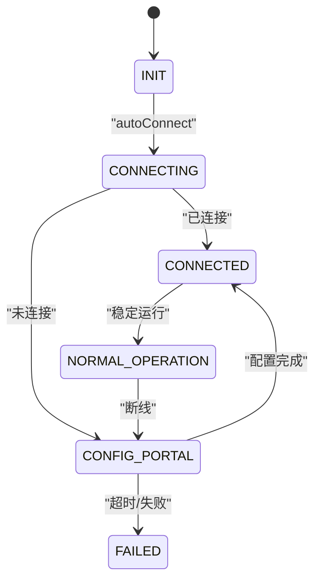

# 应用生态系统

<cite>
**本文引用的文件**   
- [main.cpp](file://src/main.cpp)
- [launcher.h](file://src/launcher.h)
- [launcher.cpp](file://src/launcher.cpp)
- [app_state.h](file://src/app_state.h)
- [app_state.cpp](file://src/app_state.cpp)
- [Compass.h](file://src/apps/Compass.h)
- [Compass.cpp](file://src/apps/Compass.cpp)
- [AirMouse.h](file://src/apps/AirMouse.h)
- [AirMouse.cpp](file://src/apps/AirMouse.cpp)
- [FluidApp.h](file://src/apps/FluidApp/FluidApp.h)
- [FluidApp.cpp](file://src/apps/FluidApp/FluidApp.cpp)
- [Tetris.h](file://src/apps/game/Tetris.h)
- [WoodFish.h](file://src/apps/game/WoodFish.h)
- [FileManager.h](file://src/apps/FileManager.h)
- [WiFiManagerApp.h](file://src/apps/WiFiManagerApp.h)
- [AboutApp.h](file://src/apps/AboutApp.h)
</cite>

## 目录
1. [引言](#引言)
2. [项目结构](#项目结构)
3. [核心组件](#核心组件)
4. [架构总览](#架构总览)
5. [详细组件分析](#详细组件分析)
6. [依赖关系分析](#依赖关系分析)
7. [性能与资源考量](#性能与资源考量)
8. [故障排查指南](#故障排查指南)
9. [结论](#结论)
10. [附录：应用开发指南](#附录应用开发指南)

## 引言
本文件系统性地梳理 ESP32 NullPod 的应用生态，重点说明应用的统一接口规范、生命周期管理、注册机制与启动流程，并逐一解析核心应用（指南针、空中鼠标、流体模拟、游戏集合、文件管理器、WiFi 管理器、关于应用等）。文档同时给出应用间通信与数据共享机制的建议方案，以及扩展新应用的实践指南。

## 项目结构
- 入口与状态机
  - main.cpp 负责系统初始化、HAL 初始化与应用主循环的状态切换。
  - app_state.h/.cpp 提供跨模块的“请求标志”与“请求函数”，用于从任意 App 触发进入另一个 App。
- 菜单与启动器
  - launcher.h/.cpp 实现桌面菜单、图标滚动、状态栏绘制、长按关机逻辑，并通过 action 回调将选择映射到 App_Request* 函数。
- 应用层
  - apps/* 下为各独立应用，遵循统一的 Main/Init/Update/Exit 生命周期接口。
  - 部分应用包含子模块（如 FluidApp 的水体仿真、game 下的俄罗斯方块与木鱼音乐）。

图表来源
- [main.cpp:19-24](file://src/main.cpp#L19-L24)
- [launcher.cpp:57-79](file://src/launcher.cpp#L57-L79)
- [app_state.cpp:21-36](file://src/app_state.cpp#L21-L36)

章节来源
- [main.cpp:19-209](file://src/main.cpp#L19-L209)
- [launcher.h:44-65](file://src/launcher.h#L44-L65)
- [launcher.cpp:57-79](file://src/launcher.cpp#L57-L79)
- [app_state.h:4-21](file://src/app_state.h#L4-L21)
- [app_state.cpp:1-37](file://src/app_state.cpp#L1-L37)

## 核心组件
- 统一应用接口
  - 每个应用类暴露 Main/Init/Update/Exit 四个方法，Main 中循环调用 Update，并在检测到返回键时退出，随后调用 Exit 清理资源。
- 生命周期管理
  - 应用通过 HAL::isReturn() 检测返回键；在 Main 循环内轮询更新，退出时释放内存、停止外设或动画。
- 应用注册与启动
  - 菜单项在 launcher.cpp 中集中定义，action 回调统一调用 App_Request* 函数设置全局 volatile 标志位。
  - main.cpp 的 loop 根据标志位切换到对应 STATE_* 分支，调用具体应用的 g_xxx.Main()。

章节来源
- [Compass.h:43-56](file://src/apps/Compass.h#L43-L56)
- [AirMouse.h:8-16](file://src/apps/AirMouse.h#L8-L16)
- [FluidApp.h:6-14](file://src/apps/FluidApp/FluidApp.h#L6-L14)
- [launcher.cpp:28-49](file://src/launcher.cpp#L28-L49)
- [launcher.cpp:427-443](file://src/launcher.cpp#L427-L443)
- [main.cpp:27-126](file://src/main.cpp#L27-L126)

## 架构总览
下图展示从用户交互到应用执行的完整链路：编码器/按键事件经 HAL 上报，Launcher 处理输入并触发 App_Request*，main.cpp 根据标志位切换状态并运行目标应用。

图表来源
- [launcher.cpp:81-197](file://src/launcher.cpp#L81-L197)
- [launcher.cpp:427-443](file://src/launcher.cpp#L427-L443)
- [app_state.cpp:21-36](file://src/app_state.cpp#L21-L36)
- [main.cpp:27-126](file://src/main.cpp#L27-L126)

## 详细组件分析

### 指南针应用（方位角、气压、海拔监测）
- 功能要点
  - 页面0：罗盘表盘（PNG 解码 + 旋转），实时方位角与校准指示灯。
  - 页面1：环境信息卡片（气压 hPa、海拔 m、温度 °C），1Hz 节流刷新。
  - 页面2：气泡水平仪，支持零位偏移持久化与陀螺仪校准。
- 关键实现
  - PNG 表盘：Flash 直读、PSRAM Sprite 缓存、pushRotateZoom 旋转渲染。
  - 磁力计：MAG_GetInfo 获取 X/Y，atan2 计算方位角，指数平滑与 0/360 跳变处理。
  - 气压/海拔/温度：dps_get_* 系列接口，ENV_REFRESH_MS 节流。
  - 水平仪：IMU roll/pitch 平滑、死区判定、零位偏移保存至 Preferences。
- 交互
  - 左右键切换页面；OK 短按/长按分别执行不同操作（校准/设置零位/陀螺仪校准）。

图表来源
- [Compass.h:43-126](file://src/apps/Compass.h#L43-L126)
- [Compass.cpp:40-95](file://src/apps/Compass.cpp#L40-L95)
- [Compass.cpp:222-263](file://src/apps/Compass.cpp#L222-L263)
- [Compass.cpp:328-339](file://src/apps/Compass.cpp#L328-L339)
- [Compass.cpp:344-392](file://src/apps/Compass.cpp#L344-L392)
- [Compass.cpp:740-752](file://src/apps/Compass.cpp#L740-L752)

章节来源
- [Compass.h:34-41](file://src/apps/Compass.h#L34-L41)
- [Compass.cpp:150-210](file://src/apps/Compass.cpp#L150-L210)
- [Compass.cpp:271-339](file://src/apps/Compass.cpp#L271-L339)
- [Compass.cpp:341-457](file://src/apps/Compass.cpp#L341-L457)
- [Compass.cpp:469-539](file://src/apps/Compass.cpp#L469-L539)
- [Compass.cpp:541-578](file://src/apps/Compass.cpp#L541-L578)
- [Compass.cpp:622-708](file://src/apps/Compass.cpp#L622-L708)
- [Compass.cpp:740-752](file://src/apps/Compass.cpp#L740-L752)

### 空中鼠标应用（IMU 手势识别、蓝牙鼠标）
- 功能要点
  - 基于 IMU 的位移/滚转估算鼠标移动，编码器作为滚轮，OK 短/长按映射左/右键。
  - 使用 NimBLE BleMouse 库建立 BLE HID 连接，向主机发送 move/press/release。
- 关键实现
  - HAL::updateImuData 与 HAL::updateMouseDelta 生成 dx/dy/wheel。
  - UI 显示蓝牙连接状态与点击反馈图标。

图表来源
- [AirMouse.cpp:14-23](file://src/apps/AirMouse.cpp#L14-L23)
- [AirMouse.cpp:58-147](file://src/apps/AirMouse.cpp#L58-L147)
- [AirMouse.cpp:153-165](file://src/apps/AirMouse.cpp#L153-L165)

章节来源
- [AirMouse.h:8-42](file://src/apps/AirMouse.h#L8-L42)
- [AirMouse.cpp:1-166](file://src/apps/AirMouse.cpp#L1-L166)

### 流体模拟应用（物理仿真、实时渲染）
- 功能要点
  - 封装 water_sim 物理仿真，启动/停止仿真线程或任务，配合 LCD 面板进行实时渲染。
- 关键实现
  - Init 中调用 water_sim_start，Exit 中调用 water_sim_stop。
  - Update 为空占位，实际渲染由底层水波仿真驱动。

图表来源
- [FluidApp.h:6-18](file://src/apps/FluidApp/FluidApp.h#L6-L18)
- [FluidApp.cpp:8-35](file://src/apps/FluidApp/FluidApp.cpp#L8-L35)

章节来源
- [FluidApp.h:1-21](file://src/apps/FluidApp/FluidApp.h#L1-L21)
- [FluidApp.cpp:1-36](file://src/apps/FluidApp/FluidApp.cpp#L1-L36)

### 游戏应用集合（俄罗斯方块、木鱼音乐）
- 俄罗斯方块
  - 棋盘布局自适应屏幕比例，支持旋转、软降、幽灵块、等级/消行计分。
  - 最高分持久化至 NVS（Preferences/NVS），界面右侧信息面板实时更新。
- 木鱼音乐
  - PNG 资源加载与放大动画，“功德+1”飘字效果。
  - IMU 晃动敲击检测，NVS 持久化累计功德与当日计数。

图表来源
- [Tetris.h:66-155](file://src/apps/game/Tetris.h#L66-L155)
- [WoodFish.h:28-85](file://src/apps/game/WoodFish.h#L28-L85)

章节来源
- [Tetris.h:1-160](file://src/apps/game/Tetris.h#L1-L160)
- [WoodFish.h:1-90](file://src/apps/game/WoodFish.h#L1-L90)

### 文件管理器
- 职责
  - 提供文件系统浏览与管理能力（LittleFS/SD 卡等），通过 FileManager 类组织生命周期。
- 接口
  - Init/Deinit/Main 三阶段，便于在主循环中挂载/卸载存储设备。

章节来源
- [FileManager.h:1-21](file://src/apps/FileManager.h#L1-L21)

### WiFi 管理器
- 职责
  - 自动连接 WiFi，失败时进入配置门户（Config Portal），并提供状态可视化。
- 关键实现
  - begin 中设置超时并尝试 autoConnect；update 中根据模式调整 wm.process() 频率。
  - 提供 resetSettings 与状态检查/屏幕更新辅助函数。

图表来源
- [WiFiManagerApp.h:8-18](file://src/apps/WiFiManagerApp.h#L8-L18)
- [WiFiManagerApp.h:39-95](file://src/apps/WiFiManagerApp.h#L39-L95)

章节来源
- [WiFiManagerApp.h:1-116](file://src/apps/WiFiManagerApp.h#L1-L116)

### 关于应用
- 职责
  - 展示系统资源使用情况（RAM/PSRAM/Flash 占用环图）、CPU 温度等。
- 关键实现
  - 环形进度条动画，周期性读取系统指标并平滑过渡。

章节来源
- [AboutApp.h:1-62](file://src/apps/AboutApp.h#L1-L62)

## 依赖关系分析
- 耦合与内聚
  - Launcher 与 AppState 低耦合：Launcher 仅通过 App_Request* 设置标志位，不直接依赖具体 App 实现。
  - 各 App 高内聚：各自维护状态、资源与渲染逻辑，通过 HAL 访问硬件。
- 外部依赖
  - NimBLE-BleMouse（空中鼠标）、LGFX/LovyanGFX（显示与精灵）、BMP280/气压计（指南针环境页）、BMI270/磁力计（姿态与方位角）。
- 潜在循环依赖
  - 当前未见 App 之间直接相互引用，避免循环依赖风险。

图表来源
- [launcher.cpp:28-49](file://src/launcher.cpp#L28-L49)
- [app_state.cpp:21-36](file://src/app_state.cpp#L21-L36)
- [main.cpp:27-126](file://src/main.cpp#L27-L126)

章节来源
- [launcher.cpp:28-49](file://src/launcher.cpp#L28-L49)
- [app_state.cpp:1-37](file://src/app_state.cpp#L1-L37)
- [main.cpp:27-126](file://src/main.cpp#L27-L126)

## 性能与资源考量
- 渲染优化
  - 指南针使用 PSRAM Sprite 缓存 PNG 并旋转渲染，减少重复解码与内存抖动。
  - 状态栏每秒刷新一次时间/电量，滚动时插值平滑，降低频繁重绘开销。
- 传感器采样节流
  - 指南针方位角每 50ms 刷新一次，环境数据每 1s 刷新一次，避免高频 I/O。
- BLE 与 HID
  - 空中鼠标以 10ms 周期采样 IMU 并发送 HID，注意功耗与主机端延迟。
- 存储写入
  - 俄罗斯方块/木鱼音乐对 NVS 的写操作采用阈值合并（如每 20 次敲击写一次），降低 Flash 磨损。

[本节为通用指导，无需特定文件引用]

## 故障排查指南
- 无法进入某应用
  - 检查对应 App_Request* 是否被调用，确认 g_requestXxx 标志位在 main.cpp 中被消费并清零。
- 指南针方向异常
  - 确认磁力计校准流程（长按 OK 开始校准，短按结束），必要时串口命令 cal/clear/status 辅助诊断。
- 空中鼠标无响应
  - 检查 BLE 是否成功 begin 且 isConnected；确认 IMU 数据更新与 HID 发送路径。
- WiFi 无法连接
  - 观察 WiFiManagerApp 状态机，必要时重置设置并重启设备。

章节来源
- [Compass.cpp:710-738](file://src/apps/Compass.cpp#L710-L738)
- [AirMouse.cpp:14-23](file://src/apps/AirMouse.cpp#L14-L23)
- [WiFiManagerApp.h:87-95](file://src/apps/WiFiManagerApp.h#L87-L95)

## 结论
ESP32 NullPod 的应用生态以 Launcher 为中心，通过 AppState 的请求标志机制解耦菜单与应用，所有应用遵循统一的 Main/Init/Update/Exit 生命周期。该设计使新增应用简单直观，同时保持系统可维护性与可扩展性。

[本节为总结性内容，无需特定文件引用]

## 附录：应用开发指南
- 新建应用步骤
  1. 在 src/apps 下创建 MyApp.h/.cpp，定义类 MyApplication，实现 Main/Init/Update/Exit。
  2. 在 launcher.cpp 中添加菜单项，绑定 actionMyAppEntry -> App_RequestMyApp。
  3. 在 app_state.h/.cpp 中声明 g_requestMyApp 与 App_RequestMyApp。
  4. 在 main.cpp 的 loop 中增加 STATE_MYAPP 分支，调用 g_myApp.Main()。
- 生命周期最佳实践
  - Init 中分配资源（Sprite、缓冲区、外设），Exit 中释放资源（deleteSprite、关闭外设）。
  - Update 中轮询输入、更新数据、按需绘制；使用节流策略控制传感器/网络/I/O 频率。
- 应用间通信与数据共享建议
  - 轻量数据：通过全局变量或单例对象（例如 SensorHub）暴露只读接口，供多应用读取。
  - 事件通知：沿用 AppState 的请求标志模式，定义新的 App_Event* 与 g_eventXxx 标志。
  - 消息队列：如需异步通信，可在 HAL 层引入轻量队列，应用订阅/发布事件。
  - 资源隔离：避免多个应用同时持有同一外设独占锁，必要时在 HAL 层加互斥。
- 常见问题与排错
  - 内存不足：优先使用 PSRAM 缓冲大图/视频帧，及时 deleteSprite。
  - 卡顿：降低渲染频率、合并绘制区域、避免阻塞 delay。
  - 传感器漂移：定期校准（磁力计/陀螺仪），使用指数平滑与死区抑制抖动。

[本节为通用指导，无需特定文件引用]