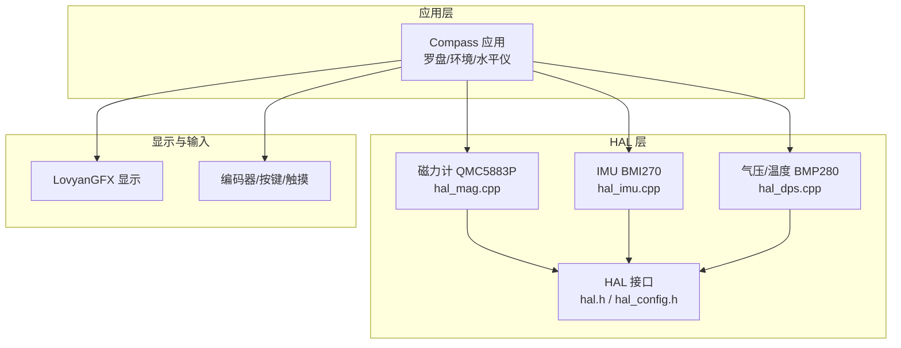
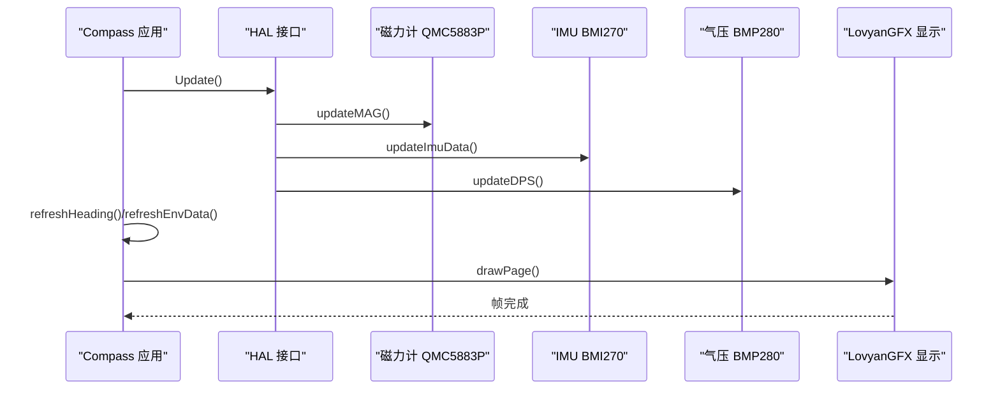
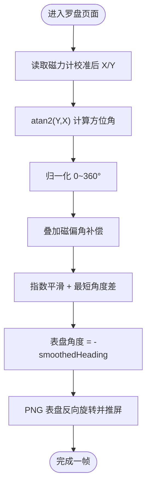
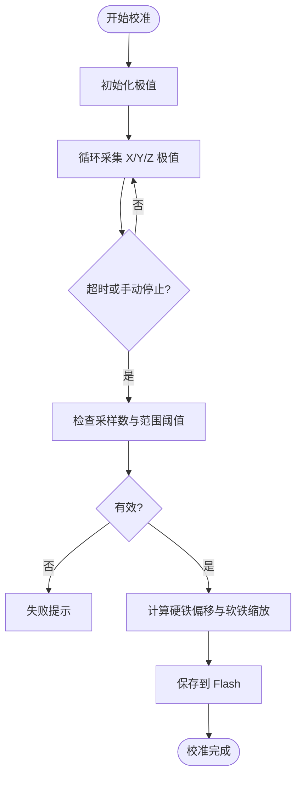
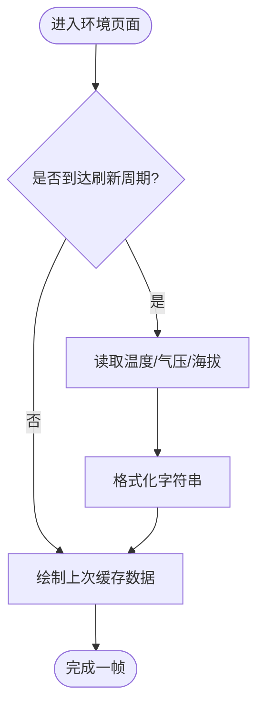
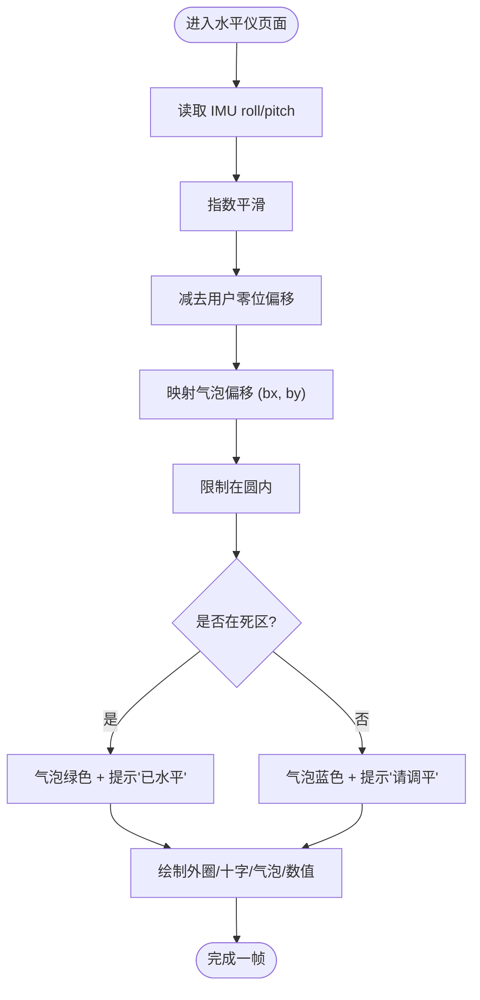
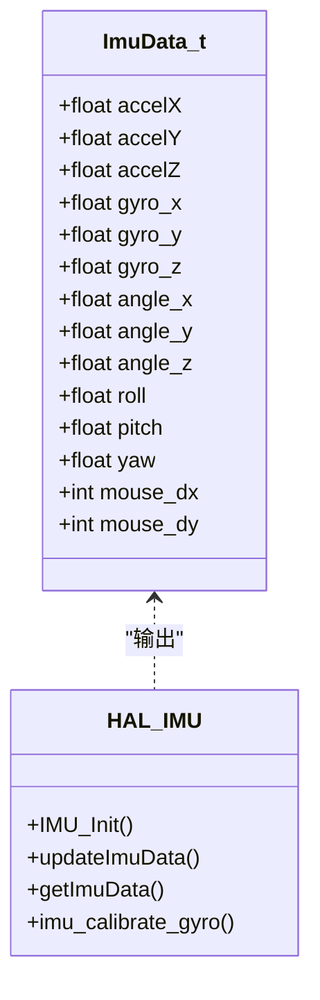
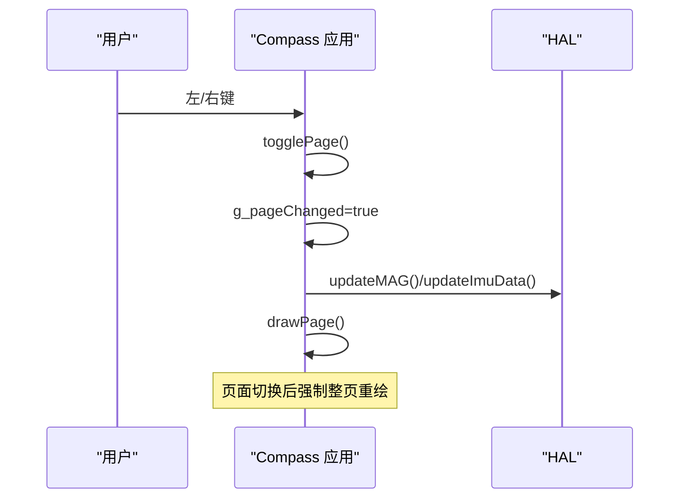
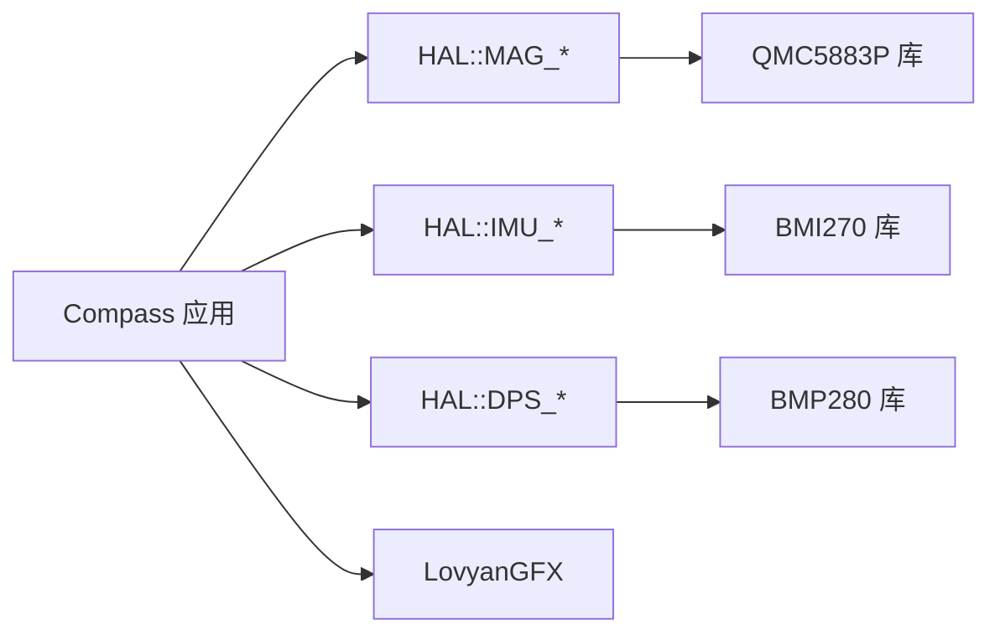

# 指南针应用

<cite>
**本文引用的文件**   
- [Compass.cpp](file://src/apps/Compass.cpp)
- [Compass.h](file://src/apps/Compass.h)
- [hal_mag.cpp](file://src/hal/hal_mag.cpp)
- [hal_imu.cpp](file://src/hal/hal_imu.cpp)
- [hal_dps.cpp](file://src/hal/hal_dps.cpp)
- [hal.h](file://src/hal/hal.h)
- [hal_config.h](file://src/hal/hal_config.h)
</cite>

## 目录
1. [简介](#简介)
2. [项目结构](#项目结构)
3. [核心组件](#核心组件)
4. [架构总览](#架构总览)
5. [详细组件分析](#详细组件分析)
6. [依赖关系分析](#依赖关系分析)
7. [性能与优化](#性能与优化)
8. [故障排除](#故障排除)
9. [结论](#结论)

## 简介
本技术文档面向“指南针应用”，围绕以下目标展开：
- 方位角计算算法与磁力计数据处理流程
- 气压传感器数据获取与海拔高度计算方法
- 温度监测与环境信息显示
- 气泡水平仪的实现原理与视觉效果
- IMU 数据融合算法与方向校准过程
- 用户交互界面设计与触摸/按键处理
- 传感器数据滤波与误差校正技术
- 故障排除指南与性能调优建议

该应用基于 ESP32，使用 LovyanGFX 显示、QMC5883P 磁力计、BMI270 IMU 与 BMP280 气压/温度传感器，提供罗盘、环境信息、气泡水平仪三个页面。

## 项目结构
指南针应用位于 apps 层，HAL 层封装了 IMU、磁力计、气压传感器、显示、输入等硬件能力。关键路径如下：
- 应用层：src/apps/Compass.cpp/.h
- HAL 层：src/hal/hal_mag.cpp（磁力计）、src/hal/hal_imu.cpp（IMU）、src/hal/hal_dps.cpp（气压/温度）
- HAL 接口与配置：src/hal/hal.h、src/hal/hal_config.h

图表来源
- [Compass.cpp:1-15](file://src/apps/Compass.cpp#L1-L15)
- [hal_mag.cpp:1-28](file://src/hal/hal_mag.cpp#L1-L28)
- [hal_imu.cpp:1-13](file://src/hal/hal_imu.cpp#L1-L13)
- [hal_dps.cpp:1-8](file://src/hal/hal_dps.cpp#L1-L8)
- [hal.h:101-157](file://src/hal/hal.h#L101-L157)

章节来源
- [Compass.h:34-41](file://src/apps/Compass.h#L34-L41)
- [hal.h:101-157](file://src/hal/hal.h#L101-L157)
- [hal_config.h:17-22](file://src/hal/hal_config.h#L17-L22)

## 核心组件
- Compass 应用类：管理三页 UI（罗盘、环境信息、气泡水平仪），负责传感器数据刷新、平滑、绘制与交互。
- 磁力计 HAL：QMC5883P 驱动，支持硬铁/软铁校准、参数持久化、方位角输出。
- IMU HAL：BMI270 驱动，实现零偏校准、互补滤波融合 roll/pitch/yaw。
- 气压/温度 HAL：BMP280 驱动，提供温度、气压、海拔估算，支持本地大气压设置。
- HAL 接口与配置：统一对外 API、引脚定义、屏幕分辨率、日志宏等。

章节来源
- [Compass.h:43-126](file://src/apps/Compass.h#L43-L126)
- [hal_mag.cpp:233-297](file://src/hal/hal_mag.cpp#L233-L297)
- [hal_imu.cpp:57-149](file://src/hal/hal_imu.cpp#L57-L149)
- [hal_dps.cpp:10-57](file://src/hal/hal_dps.cpp#L10-L57)
- [hal.h:101-157](file://src/hal/hal.h#L101-L157)

## 架构总览
应用通过 HAL 抽象硬件，形成“应用层 → HAL 层 → 传感器”的清晰分层。显示由 LovyanGFX 提供，输入来自编码器/按键/触摸。

图表来源
- [Compass.cpp:641-681](file://src/apps/Compass.cpp#L641-L681)
- [hal_mag.cpp:248-274](file://src/hal/hal_mag.cpp#L248-L274)
- [hal_imu.cpp:88-149](file://src/hal/hal_imu.cpp#L88-L149)
- [hal_dps.cpp:29-36](file://src/hal/hal_dps.cpp#L29-L36)

## 详细组件分析

### 罗盘页面：方位角计算与表盘旋转
- 方位角来源：从 HAL::MAG_GetInfo 读取校准后的 X/Y，使用 atan2(Y, X) 得到角度，归一化到 0~360°，并叠加磁偏角补偿（示例中为 -7°）。
- 平滑策略：指数平滑 + 最短角度差处理，避免 0/360° 跳变导致指针抖动。
- 表盘渲染：将 PNG 表盘图像在 PSRAM Sprite 中进行反向旋转（表盘角度 = -headingSmoothed），使 N 始终朝上，指针随 heading 指向正确方向。
- 状态指示：左上角 LED 表示校准状态（黄闪=校准中；绿=已校准；暗灰=未校准）。
- 文字显示：右上角显示数值与中文方位（北/东北/东/东南/南/西南/西/西北）。

图表来源
- [Compass.cpp:222-263](file://src/apps/Compass.cpp#L222-L263)
- [Compass.cpp:97-138](file://src/apps/Compass.cpp#L97-L138)
- [Compass.cpp:185-210](file://src/apps/Compass.cpp#L185-L210)

章节来源
- [Compass.cpp:222-263](file://src/apps/Compass.cpp#L222-L263)
- [Compass.cpp:97-138](file://src/apps/Compass.cpp#L97-L138)
- [Compass.cpp:185-210](file://src/apps/Compass.cpp#L185-L210)

### 磁力计数据处理与校准
- 数据采集：QMC5883P 原始值经内部平滑后读取。
- 校准流程：记录各轴最大/最小值，计算硬铁偏移（(max+min)/2）与软铁缩放（以平均半径归一化），校验采样次数与范围阈值，保存至 Flash（Preferences）。
- 运行期：自动加载校准参数，applyCalibration 对原始值进行偏移与缩放修正，再计算方位角。
- 控制接口：Start/Stop/Clear/GetStatus 供应用层或串口命令触发。

图表来源
- [hal_mag.cpp:143-197](file://src/hal/hal_mag.cpp#L143-L197)
- [hal_mag.cpp:81-129](file://src/hal/hal_mag.cpp#L81-L129)
- [hal_mag.cpp:248-297](file://src/hal/hal_mag.cpp#L248-L297)

章节来源
- [hal_mag.cpp:143-197](file://src/hal/hal_mag.cpp#L143-L197)
- [hal_mag.cpp:81-129](file://src/hal/hal_mag.cpp#L81-L129)
- [hal_mag.cpp:248-297](file://src/hal/hal_mag.cpp#L248-L297)

### 环境信息页面：气压、海拔与温度
- 数据来源：BMP280 提供温度（°C）、气压（hPa）、海拔（m）。
- 海拔计算：基于本地海平面气压（默认 1022 hPa，可在应用初始化时设置）估算海拔。
- 显示布局：三张卡片垂直排列，分别展示气压、海拔、温度，带颜色强调。
- 刷新节流：每 1 秒刷新一次，避免频繁 I/O。

图表来源
- [Compass.cpp:271-339](file://src/apps/Compass.cpp#L271-L339)
- [hal_dps.cpp:29-57](file://src/hal/hal_dps.cpp#L29-L57)

章节来源
- [Compass.cpp:271-339](file://src/apps/Compass.cpp#L271-L339)
- [hal_dps.cpp:29-57](file://src/hal/hal_dps.cpp#L29-L57)

### 气泡水平仪：原理与视觉效果
- 姿态输入：从 IMU 获取 roll/pitch，经过指数平滑与零位偏移校正。
- 气泡映射：根据重力分量（gx=-pitch_c, gy=-roll_c）计算气泡偏移，限制在圆内，死区内严格居中。
- 视觉反馈：外圈边界、十字准星、中心点；气泡颜色随是否水平变化（绿色=已水平，天蓝=倾斜）；底部显示 Roll/Pitch 数值。
- 交互功能：
  - 短按 OK：以当前姿态设为“水平零位”，写入 Flash 持久化。
  - 长按 OK：调用 HAL::imu_calibrate_gyro 进行陀螺仪零偏校准，完成后复位平滑值。

图表来源
- [Compass.cpp:344-392](file://src/apps/Compass.cpp#L344-L392)
- [Compass.cpp:394-457](file://src/apps/Compass.cpp#L394-L457)
- [Compass.cpp:477-514](file://src/apps/Compass.cpp#L477-L514)

章节来源
- [Compass.cpp:344-392](file://src/apps/Compass.cpp#L344-L392)
- [Compass.cpp:394-457](file://src/apps/Compass.cpp#L394-L457)
- [Compass.cpp:477-514](file://src/apps/Compass.cpp#L477-L514)

### IMU 数据融合与方向校准
- 零偏校准：上电静置采样若干次求均值作为陀螺仪零偏，减少漂移。
- 坐标变换：根据安装方向（正面/反面）对加速度与陀螺数据进行符号翻转。
- 互补滤波：融合加速度计角度与陀螺积分，系数分别为 0.02 与 0.98，输出 roll/pitch/yaw。
- 鼠标增量：基于角度增量计算 dx/dy，用于其他应用的空中鼠标功能（与本应用无直接关系）。

图表来源
- [hal.h:31-47](file://src/hal/hal.h#L31-L47)
- [hal_imu.cpp:57-149](file://src/hal/hal_imu.cpp#L57-L149)

章节来源
- [hal_imu.cpp:31-55](file://src/hal/hal_imu.cpp#L31-L55)
- [hal_imu.cpp:76-149](file://src/hal/hal_imu.cpp#L76-L149)
- [hal.h:31-47](file://src/hal/hal.h#L31-L47)

### 用户交互界面与操作处理
- 页面切换：左右键切换三页（罗盘/环境/水平仪），切换时标记整页重绘。
- 编码器旋转：在罗盘页面微调 smoothedHeading（模拟磁偏角/安装角补偿）。
- 短按/长按：
  - 罗盘：短按取消校准或锁定 smoothedHeading；长按启动磁力计校准。
  - 水平仪：短按设置零位；长按执行陀螺仪校准。
- 返回退出：检测系统返回键，退出应用并释放资源。

图表来源
- [Compass.cpp:17-37](file://src/apps/Compass.cpp#L17-L37)
- [Compass.cpp:580-620](file://src/apps/Compass.cpp#L580-L620)
- [Compass.cpp:641-681](file://src/apps/Compass.cpp#L641-L681)

章节来源
- [Compass.cpp:17-37](file://src/apps/Compass.cpp#L17-L37)
- [Compass.cpp:580-620](file://src/apps/Compass.cpp#L580-L620)
- [Compass.cpp:641-681](file://src/apps/Compass.cpp#L641-L681)

### 传感器数据滤波与误差校正技术
- 磁力计：
  - 硬件平滑：QMC5883P 内部 smoothing 开启。
  - 软件平滑：方位角指数平滑 + 最短角度差处理。
  - 误差校正：硬铁偏移 + 软铁缩放，参数持久化。
- IMU：
  - 零偏校准：上电静置采样求均值。
  - 互补滤波：融合加速度计角度与陀螺积分。
  - 坐标变换：根据安装方向调整符号。
- 气压/温度：
  - 设备滤波：BMP280 内置 IIR 滤波与过采样。
  - 应用侧节流：1Hz 刷新，降低 I/O 压力。

章节来源
- [hal_mag.cpp:233-297](file://src/hal/hal_mag.cpp#L233-L297)
- [Compass.cpp:222-263](file://src/apps/Compass.cpp#L222-L263)
- [hal_imu.cpp:31-55](file://src/hal/hal_imu.cpp#L31-L55)
- [hal_imu.cpp:118-149](file://src/hal/hal_imu.cpp#L118-L149)
- [hal_dps.cpp:20-26](file://src/hal/hal_dps.cpp#L20-L26)

## 依赖关系分析
- Compass 应用依赖 HAL 提供的磁力计、IMU、气压/温度接口。
- HAL 层依赖具体传感器库（QMC5883P、BMI270、BMP280）与 Preferences 存储。
- 显示与输入由 LovyanGFX 与 HAL 输入模块提供。

图表来源
- [Compass.cpp:1-4](file://src/apps/Compass.cpp#L1-L4)
- [hal_mag.cpp:19-22](file://src/hal/hal_mag.cpp#L19-L22)
- [hal_imu.cpp:1-4](file://src/hal/hal_imu.cpp#L1-L4)
- [hal_dps.cpp:1-4](file://src/hal/hal_dps.cpp#L1-L4)

章节来源
- [Compass.h:4-5](file://src/apps/Compass.h#L4-L5)
- [hal.h:101-157](file://src/hal/hal.h#L101-L157)

## 性能与优化
- 显示优化：
  - PNG 表盘解码一次，使用 PSRAM Sprite 旋转，减少重复解码开销。
  - 页面切换时整页重绘，非切换时按帧率（约 60fps）更新。
- 传感器 I/O：
  - 磁力计 50ms 刷新一次方位角。
  - 环境数据 1s 刷新一次。
  - IMU 固定 100Hz 更新，未到时间直接返回。
- 内存管理：
  - 应用退出时释放 Sprite 对象，避免内存泄漏。
  - 使用 Preferences 持久化校准与零位参数，减少重复校准。

章节来源
- [Compass.cpp:39-95](file://src/apps/Compass.cpp#L39-L95)
- [Compass.cpp:641-681](file://src/apps/Compass.cpp#L641-L681)
- [Compass.cpp:683-708](file://src/apps/Compass.cpp#L683-L708)
- [hal_imu.cpp:5-9](file://src/hal/hal_imu.cpp#L5-L9)

## 故障排除
- 磁力计校准失败：
  - 现象：LED 暗灰，方位角跳动或不准确。
  - 排查：确认校准过程中缓慢画“8”字覆盖各方向；检查采样次数与范围阈值；必要时清除校准数据重新校准。
  - 参考：[hal_mag.cpp:170-197](file://src/hal/hal_mag.cpp#L170-L197)、[hal_mag.cpp:285-297](file://src/hal/hal_mag.cpp#L285-L297)
- 水平仪气泡不居中：
  - 现象：气泡偏离中心或提示“请调平”。
  - 排查：短按 OK 设置零位；若仍异常，长按 OK 执行陀螺仪校准；检查安装方向配置。
  - 参考：[Compass.cpp:477-514](file://src/apps/Compass.cpp#L477-L514)、[hal_imu.cpp:31-55](file://src/hal/hal_imu.cpp#L31-L55)
- 气压/海拔异常：
  - 现象：海拔读数明显偏差。
  - 排查：确认本地大气压设置是否正确；检查 BMP280 地址与接线。
  - 参考：[hal_dps.cpp:10-26](file://src/hal/hal_dps.cpp#L10-L26)、[Compass.cpp:623-630](file://src/apps/Compass.cpp#L623-L630)
- 显示卡顿或闪烁：
  - 现象：页面切换后闪烁或帧率低。
  - 排查：确认页面切换标志 g_pageChanged 正确使用；检查 PNG 解码与 Sprite 创建是否成功。
  - 参考：[Compass.cpp:17-37](file://src/apps/Compass.cpp#L17-L37)、[Compass.cpp:39-95](file://src/apps/Compass.cpp#L39-L95)

章节来源
- [hal_mag.cpp:170-197](file://src/hal/hal_mag.cpp#L170-L197)
- [hal_mag.cpp:285-297](file://src/hal/hal_mag.cpp#L285-L297)
- [Compass.cpp:477-514](file://src/apps/Compass.cpp#L477-L514)
- [hal_imu.cpp:31-55](file://src/hal/hal_imu.cpp#L31-L55)
- [hal_dps.cpp:10-26](file://src/hal/hal_dps.cpp#L10-L26)
- [Compass.cpp:623-630](file://src/apps/Compass.cpp#L623-L630)
- [Compass.cpp:17-37](file://src/apps/Compass.cpp#L17-L37)
- [Compass.cpp:39-95](file://src/apps/Compass.cpp#L39-L95)

## 结论
指南针应用通过清晰的 HAL 分层与稳健的传感器校准/滤波机制，实现了可靠的罗盘、环境信息与气泡水平仪功能。方位角计算结合磁力计校准与指数平滑，IMU 采用互补滤波融合 roll/pitch/yaw，气压/温度通过 BMP280 提供稳定数据。用户交互通过编码器与按键完成，页面切换与绘制逻辑简洁高效。在实际使用中，建议定期校准磁力计与陀螺仪，并根据当地气压设置本地大气压以获得更准确的海拔读数。