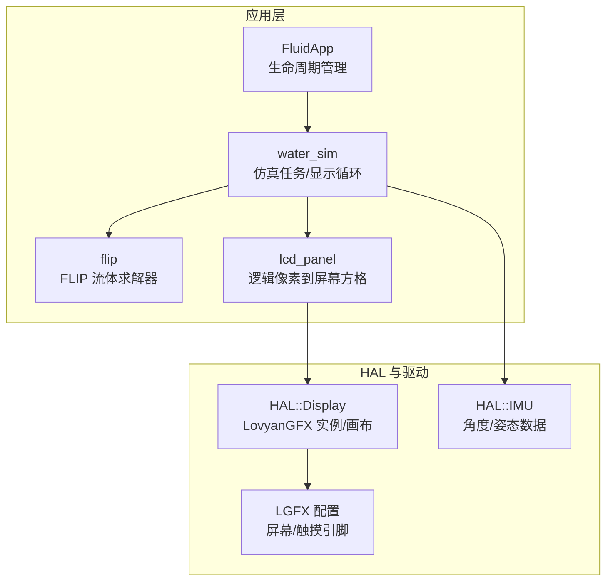
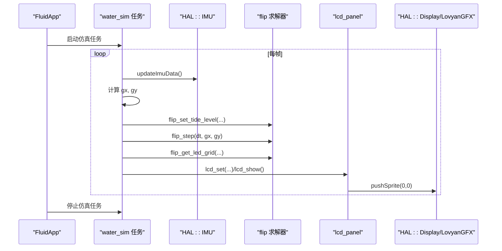
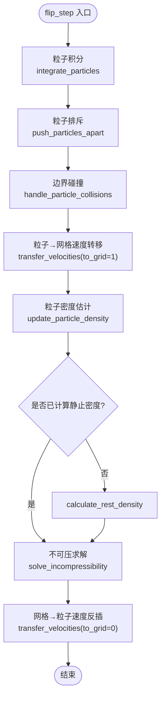
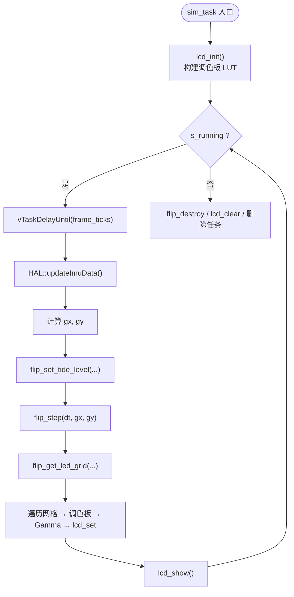
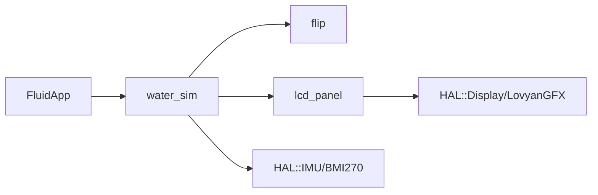

# 流体模拟应用

<cite>
**本文引用的文件**   
- [FluidApp.cpp](file://src/apps/FluidApp/FluidApp.cpp)
- [water_sim.cpp](file://src/apps/FluidApp/water_sim.cpp)
- [water_sim.h](file://src/apps/FluidApp/water_sim.h)
- [lcd_panel.cpp](file://src/apps/FluidApp/lcd_panel.cpp)
- [lcd_panel.h](file://src/apps/FluidApp/lcd_panel.h)
- [flip.cpp](file://src/apps/FluidApp/flip.cpp)
- [flip.h](file://src/apps/FluidApp/flip.h)
- [lgfx.h](file://include/lgfx.h)
- [hal_display.cpp](file://src/hal/hal_display.cpp)
- [hal_imu.cpp](file://src/hal/hal_imu.cpp)
</cite>

## 目录
1. [简介](#简介)
2. [项目结构](#项目结构)
3. [核心组件](#核心组件)
4. [架构总览](#架构总览)
5. [详细组件分析](#详细组件分析)
6. [依赖关系分析](#依赖关系分析)
7. [性能与内存优化](#性能与内存优化)
8. [硬件适配与基准测试建议](#硬件适配与基准测试建议)
9. [调试与可视化](#调试与可视化)
10. [故障排查](#故障排查)
11. [结论](#结论)

## 简介
本技术文档面向在 ESP32 平台上运行的“流体模拟应用”，重点说明：
- 流体力学仿真算法与物理引擎实现（FLIP + 网格压力求解）
- 水波模拟的计算模型、潮汐水量控制与 IMU 重力注入
- 实时图形渲染管线与 LovyanGFX 画布优化
- 触摸交互对流体效果的影响与响应机制
- 数值计算方法（Navier-Stokes 的简化实现思路）
- 内存管理与帧率优化策略
- 不同硬件平台的适配方案与性能基准测试方法
- 调试工具与可视化分析方法

## 项目结构
该应用位于 apps 子模块中，围绕 FluidApp 组织，关键路径如下：
- 应用入口与生命周期：FluidApp.cpp
- 流体仿真调度与显示循环：water_sim.cpp / water_sim.h
- 流体求解器（FLIP）：flip.cpp / flip.h
- LCD 面板抽象与渲染：lcd_panel.cpp / lcd_panel.h
- 屏幕与触摸驱动配置：include/lgfx.h
- HAL 层显示与 IMU：src/hal/hal_display.cpp, src/hal/hal_imu.cpp

图表来源
- [FluidApp.cpp:1-36](file://src/apps/FluidApp/FluidApp.cpp#L1-L36)
- [water_sim.cpp:1-327](file://src/apps/FluidApp/water_sim.cpp#L1-L327)
- [flip.cpp:1-839](file://src/apps/FluidApp/flip.cpp#L1-L839)
- [lcd_panel.cpp:1-163](file://src/apps/FluidApp/lcd_panel.cpp#L1-L163)
- [lgfx.h:1-118](file://include/lgfx.h#L1-L118)
- [hal_display.cpp:1-127](file://src/hal/hal_display.cpp#L1-L127)
- [hal_imu.cpp:1-182](file://src/hal/hal_imu.cpp#L1-L182)

章节来源
- [FluidApp.cpp:1-36](file://src/apps/FluidApp/FluidApp.cpp#L1-L36)
- [water_sim.cpp:1-327](file://src/apps/FluidApp/water_sim.cpp#L1-L327)
- [lcd_panel.cpp:1-163](file://src/apps/FluidApp/lcd_panel.cpp#L1-L163)
- [flip.cpp:1-839](file://src/apps/FluidApp/flip.cpp#L1-L839)
- [lgfx.h:1-118](file://include/lgfx.h#L1-L118)
- [hal_display.cpp:1-127](file://src/hal/hal_display.cpp#L1-L127)
- [hal_imu.cpp:1-182](file://src/hal/hal_imu.cpp#L1-L182)

## 核心组件
- 流体求解器（FLIP）：基于粒子-网格混合方法，包含粒子积分、粒子排斥、边界碰撞、速度向网格转移、密度计算、不可压求解（压力泊松迭代）、网格向粒子反插等步骤。
- 仿真任务调度：独立 FreeRTOS 任务，固定帧率（SIM_FPS=30），读取 IMU 角度并转换为重力方向，按潮汐参数动态调整粒子数量。
- 渲染管线：逻辑 24×28 网格映射到 LovyanGFX Sprite 画布，批量填充矩形后 pushSprite 至屏幕；支持亮度缩放与 Gamma 校正。
- HAL 接口：统一获取屏幕、画布、IMU 数据，提供背光 PWM 控制与初始化流程。

章节来源
- [flip.cpp:53-85](file://src/apps/FluidApp/flip.cpp#L53-L85)
- [water_sim.cpp:132-274](file://src/apps/FluidApp/water_sim.cpp#L132-L274)
- [lcd_panel.cpp:35-65](file://src/apps/FluidApp/lcd_panel.cpp#L35-L65)
- [hal_display.cpp:18-52](file://src/hal/hal_display.cpp#L18-L52)
- [hal_imu.cpp:88-149](file://src/hal/hal_imu.cpp#L88-L149)

## 架构总览
整体数据与控制流如下：
- FluidApp 启动 water_sim 任务，进入主循环等待返回键退出。
- water_sim 任务以固定帧率运行：更新 IMU → 计算重力分量 → 设置潮汐水位 → 调用 flip_step → 获取 LED 网格 → 渲染到 LCD。
- flip 内部维护粒子与网格数据结构，执行 FLIP 步进。
- lcd_panel 将逻辑像素写入后台缓冲，最终一次性推送到屏幕。

图表来源
- [FluidApp.cpp:8-35](file://src/apps/FluidApp/FluidApp.cpp#L8-L35)
- [water_sim.cpp:132-274](file://src/apps/FluidApp/water_sim.cpp#L132-L274)
- [flip.cpp:728-763](file://src/apps/FluidApp/flip.cpp#L728-L763)
- [lcd_panel.cpp:116-152](file://src/apps/FluidApp/lcd_panel.cpp#L116-L152)
- [hal_display.cpp:44-52](file://src/hal/hal_display.cpp#L44-L52)
- [hal_imu.cpp:88-149](file://src/hal/hal_imu.cpp#L88-L149)

## 详细组件分析

### 流体求解器（FLIP）
- 数据结构：FlipFluid 包含网格数组（u, v, du, dv, prev_u, prev_v, p, s）、粒子数组（pos, vel, density）、空间哈希表（cell_particle_ids 等）、细胞类型标记（AIR/FLUID/SOLID）。
- 关键过程：
  - 粒子积分：根据重力分量更新速度与位置。
  - 粒子排斥：使用空间分桶加速近邻搜索，避免粒子重叠。
  - 边界碰撞：限制粒子在网格范围内，速度归零。
  - 速度转移：从粒子到网格（加权插值），再从网格回插到粒子（含 FLIP 修正项）。
  - 密度估计：将粒子贡献平滑分配到网格。
  - 不可压求解：压力泊松迭代，结合粒子密度漂移补偿。
  - 输出网格：将粒子密度映射为可视强度，Gamma 校正后输出。

图表来源
- [flip.cpp:92-103](file://src/apps/FluidApp/flip.cpp#L92-L103)
- [flip.cpp:105-200](file://src/apps/FluidApp/flip.cpp#L105-L200)
- [flip.cpp:202-243](file://src/apps/FluidApp/flip.cpp#L202-L243)
- [flip.cpp:299-441](file://src/apps/FluidApp/flip.cpp#L299-L441)
- [flip.cpp:245-297](file://src/apps/FluidApp/flip.cpp#L245-L297)
- [flip.cpp:443-501](file://src/apps/FluidApp/flip.cpp#L443-L501)
- [flip.cpp:728-763](file://src/apps/FluidApp/flip.cpp#L728-L763)

章节来源
- [flip.cpp:53-85](file://src/apps/FluidApp/flip.cpp#L53-L85)
- [flip.cpp:92-103](file://src/apps/FluidApp/flip.cpp#L92-L103)
- [flip.cpp:105-200](file://src/apps/FluidApp/flip.cpp#L105-L200)
- [flip.cpp:202-243](file://src/apps/FluidApp/flip.cpp#L202-L243)
- [flip.cpp:299-441](file://src/apps/FluidApp/flip.cpp#L299-L441)
- [flip.cpp:245-297](file://src/apps/FluidApp/flip.cpp#L245-L297)
- [flip.cpp:443-501](file://src/apps/FluidApp/flip.cpp#L443-L501)
- [flip.cpp:728-763](file://src/apps/FluidApp/flip.cpp#L728-L763)

### 仿真任务与显示循环
- 任务创建：water_sim_start 在指定核心上创建任务，设置运行标志。
- 帧循环：
  - 使用 vTaskDelayUntil 保证 SIM_FPS=30。
  - 读取 IMU 角度，转换为重力分量（roll/pitch → sin 映射，乘以增益）。
  - 设置潮汐水位（当前固定 tide=0.8f，可替换为时间同步源）。
  - 调用 flip_step 与 flip_get_led_grid 获取密度网格。
  - 遍历网格，查调色板 LUT，Gamma 校正后写入 lcd_set，最后 lcd_show 刷新。
- 资源清理：flip_destroy、lcd_clear、任务删除。

图表来源
- [water_sim.cpp:132-274](file://src/apps/FluidApp/water_sim.cpp#L132-L274)
- [water_sim.cpp:276-327](file://src/apps/FluidApp/water_sim.cpp#L276-L327)

章节来源
- [water_sim.cpp:132-274](file://src/apps/FluidApp/water_sim.cpp#L132-L274)
- [water_sim.cpp:276-327](file://src/apps/FluidApp/water_sim.cpp#L276-L327)

### LCD 面板与渲染优化
- 逻辑网格：24×28 逻辑像素，蛇形行序（PANEL_SERPENTINE）映射到线性索引。
- 后台缓冲：RGB 三元组数组，lcd_set 写入，lcd_show 时统一绘制。
- 画布绘制：清空 Sprite → 遍历非黑格子 fillRect → pushSprite 到屏幕。
- 亮度与 Gamma：全局亮度缩放，Gamma 曲线增强暗部细节。
- 坐标旋转：渲染时将 (x,y) 映射为 (W-1-x, H-1-y)，保持物理模拟不变而画面倒转。

章节来源
- [lcd_panel.cpp:1-163](file://src/apps/FluidApp/lcd_panel.cpp#L1-L163)
- [lcd_panel.h:1-48](file://src/apps/FluidApp/lcd_panel.h#L1-L48)
- [water_sim.cpp:207-259](file://src/apps/FluidApp/water_sim.cpp#L207-L259)

### HAL 层：显示与 IMU
- 显示：HAL::GetDisplay/GetCanvas 返回 LovyanGFX 实例与画布；Backlight_Init 配置 PWM 背光；Disp_Logo 打印设备信息。
- IMU：BMI270 传感器，100Hz 采样，互补滤波融合加速度计与陀螺仪，输出 roll/pitch/yaw；支持安装方向变换与鼠标增量计算。

章节来源
- [hal_display.cpp:18-52](file://src/hal/hal_display.cpp#L18-L52)
- [hal_display.cpp:81-127](file://src/hal/hal_display.cpp#L81-L127)
- [hal_imu.cpp:57-74](file://src/hal/hal_imu.cpp#L57-L74)
- [hal_imu.cpp:88-149](file://src/hal/hal_imu.cpp#L88-L149)
- [hal_imu.cpp:151-182](file://src/hal/hal_imu.cpp#L151-L182)

### 触摸交互对流体效果的影响
- 当前代码未直接处理触摸输入对流体施加扰动；触摸引脚与 I2C 地址在 lgfx.h 中定义，可用于扩展交互。
- 若需通过触摸影响流体，可在 sim_task 中读取触摸坐标，将其映射为局部重力或速度脉冲，注入 flip_step 或作为瞬时外力。

章节来源
- [lgfx.h:18-23](file://include/lgfx.h#L18-L23)
- [water_sim.cpp:160-185](file://src/apps/FluidApp/water_sim.cpp#L160-L185)

## 依赖关系分析
- 应用层依赖：
  - FluidApp 依赖 water_sim 与 HAL 返回键检测。
  - water_sim 依赖 flip 求解器、lcd_panel 渲染、HAL IMU 数据。
  - lcd_panel 依赖 HAL Display/CVS 与 LovyanGFX。
- 外部库：
  - LovyanGFX（屏幕/触摸/画布）
  - SparkFun BMI270（IMU）

图表来源
- [FluidApp.cpp:1-36](file://src/apps/FluidApp/FluidApp.cpp#L1-L36)
- [water_sim.cpp:1-327](file://src/apps/FluidApp/water_sim.cpp#L1-L327)
- [lcd_panel.cpp:1-163](file://src/apps/FluidApp/lcd_panel.cpp#L1-L163)
- [hal_display.cpp:1-127](file://src/hal/hal_display.cpp#L1-L127)
- [hal_imu.cpp:1-182](file://src/hal/hal_imu.cpp#L1-L182)

章节来源
- [FluidApp.cpp:1-36](file://src/apps/FluidApp/FluidApp.cpp#L1-L36)
- [water_sim.cpp:1-327](file://src/apps/FluidApp/water_sim.cpp#L1-L327)
- [lcd_panel.cpp:1-163](file://src/apps/FluidApp/lcd_panel.cpp#L1-L163)
- [hal_display.cpp:1-127](file://src/hal/hal_display.cpp#L1-L127)
- [hal_imu.cpp:1-182](file://src/hal/hal_imu.cpp#L1-L182)

## 性能与内存优化
- 帧率控制：SIM_FPS=30，使用 vTaskDelayUntil 精确节流，避免 CPU 抖动。
- 渲染优化：
  - 后台缓冲 + 一次性 pushSprite，减少多次 draw 开销。
  - 仅绘制非黑格子，跳过空区域。
  - Gamma 查找表与整数近似亮度缩放，降低浮点运算。
- 求解器质量：
  - flip_set_solver_quality 限制 push_iters 与 pressure_iters 范围，平衡稳定性与性能。
  - gravity_scale 调低重力强度，减少极端速度导致的数值不稳定。
- 内存管理：
  - flip_create 预分配所有数组，flip_destroy 释放，避免运行时频繁 malloc/calloc。
  - 空间哈希表用于粒子近邻搜索，降低 O(n^2) 复杂度。
- 数值稳定：
  - 密度漂移补偿（particle_rest_density）提升不可压求解稳定性。
  - 边界条件与粒子半径约束防止越界与发散。

章节来源
- [water_sim.cpp:10-18](file://src/apps/FluidApp/water_sim.cpp#L10-L18)
- [water_sim.cpp:147-159](file://src/apps/FluidApp/water_sim.cpp#L147-L159)
- [lcd_panel.cpp:116-152](file://src/apps/FluidApp/lcd_panel.cpp#L116-L152)
- [flip.cpp:542-563](file://src/apps/FluidApp/flip.cpp#L542-L563)
- [flip.cpp:565-703](file://src/apps/FluidApp/flip.cpp#L565-L703)
- [flip.cpp:706-726](file://src/apps/FluidApp/flip.cpp#L706-L726)
- [flip.cpp:443-501](file://src/apps/FluidApp/flip.cpp#L443-L501)

## 硬件适配与基准测试建议
- 屏幕与触摸：
  - lgfx.h 定义 SPI 屏引脚、I2C 触摸引脚与分辨率；可根据实际硬件修改 screenWidth/screenHeight 与偏移。
  - 若更换面板，需调整 offset_rotation、rgb_order、invert 等参数。
- 背光与亮度：
  - HAL::Backlight_Init 配置 PWM 通道与频率；可通过 Preferences 持久化亮度值。
- 基准测试建议：
  - 测量每帧耗时：在 sim_task 中使用 xTaskGetTickCount 统计 flip_step 与 lcd_show 耗时。
  - 调节 SIM_FPS、pressure_iters、gravity_scale，观察帧率与视觉效果的权衡。
  - 在不同负载下（如同时运行其他任务）评估系统稳定性。

章节来源
- [lgfx.h:25-31](file://include/lgfx.h#L25-L31)
- [lgfx.h:44-75](file://include/lgfx.h#L44-L75)
- [hal_display.cpp:81-127](file://src/hal/hal_display.cpp#L81-L127)
- [water_sim.cpp:147-149](file://src/apps/FluidApp/water_sim.cpp#L147-L149)

## 调试与可视化
- 串口调试：
  - Serial.println/printf 输出启动日志、IMU 角度、最大速度等（部分代码注释掉，可按需启用）。
- 可视化辅助：
  - 调色板 LUT 便于快速查看不同水位下的颜色映射。
  - 可将 particle_density 或 velocity 幅值通过串口导出，离线绘图分析。
- 状态检查：
  - water_sim_is_running 判断任务状态。
  - 在 flip_create 失败时返回 NULL，需检查内存分配与参数合法性。

章节来源
- [water_sim.cpp:177-202](file://src/apps/FluidApp/water_sim.cpp#L177-L202)
- [water_sim.cpp:323-327](file://src/apps/FluidApp/water_sim.cpp#L323-L327)
- [flip.cpp:583-604](file://src/apps/FluidApp/flip.cpp#L583-L604)

## 故障排查
- 仿真无显示：
  - 检查 lcd_init 是否成功，LCD 尺寸与网格布局是否正确。
  - 确认 panel_led_index 映射与 PANEL_SERPENTINE 配置一致。
- 流体异常发散：
  - 调整 gravity_scale 与 pressure_iters，确保数值稳定。
  - 检查粒子半径与网格间距比例，避免过密或过疏。
- IMU 数据异常：
  - 确认 IMU 校准完成，安装方向变换正确。
  - 检查互补滤波系数与采样频率。

章节来源
- [lcd_panel.cpp:35-65](file://src/apps/FluidApp/lcd_panel.cpp#L35-L65)
- [lcd_panel.h:17-24](file://src/apps/FluidApp/lcd_panel.h#L17-L24)
- [flip.cpp:535-563](file://src/apps/FluidApp/flip.cpp#L535-L563)
- [hal_imu.cpp:32-55](file://src/hal/hal_imu.cpp#L32-L55)
- [hal_imu.cpp:76-86](file://src/hal/hal_imu.cpp#L76-L86)

## 结论
该流体模拟应用在 ESP32 上实现了基于 FLIP 的粒子-网格混合仿真，并通过 LovyanGFX 高效渲染到屏幕。通过 IMU 重力注入与潮汐水量控制，提供了直观的交互式水波效果。在性能方面，采用固定帧率、后台缓冲、Gamma LUT 与空间哈希等技术保障实时性。未来可扩展触摸交互、多平台适配与更丰富的可视化分析工具，进一步提升用户体验与调试效率。