# 俄罗斯方块游戏

<cite>
**本文引用的文件**   
- [Tetris.h](file://src/apps/game/Tetris.h)
- [Tetris.cpp](file://src/apps/game/Tetris.cpp)
</cite>

## 目录
1. [简介](#简介)
2. [项目结构](#项目结构)
3. [核心组件](#核心组件)
4. [架构总览](#架构总览)
5. [详细组件分析](#详细组件分析)
6. [依赖关系分析](#依赖关系分析)
7. [性能与内存优化](#性能与内存优化)
8. [故障排查指南](#故障排查指南)
9. [结论](#结论)
10. [附录：扩展开发指南](#附录扩展开发指南)

## 简介
本技术文档围绕 ESP32 平台上的俄罗斯方块实现，系统性解析七种经典方块的定义与旋转、棋盘网格与碰撞检测、游戏核心逻辑（生成、下落、消行、计分）、状态管理（准备/游戏中/暂停/结束）、难度递增机制、用户输入处理（方向键、旋转、软降、硬降）、UI 渲染系统（棋盘绘制、方块显示、预览窗口与信息面板）、最高分持久化与存档系统，以及性能优化与扩展开发建议。

## 项目结构
俄罗斯方块作为应用层 App 位于 src/apps/game 目录下，核心由 Tetris.h 与 Tetris.cpp 组成：
- Tetris.h：定义常量、数据结构、枚举、类接口与成员变量。
- Tetris.cpp：实现初始化、布局、游戏循环、输入处理、渲染、持久化等全部逻辑。

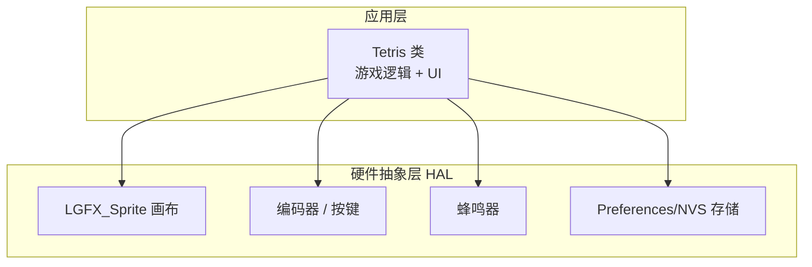

**图表来源**
- [Tetris.h:66-155](file://src/apps/game/Tetris.h#L66-L155)
- [Tetris.cpp:109-119](file://src/apps/game/Tetris.cpp#L109-L119)

**章节来源**
- [Tetris.h:1-159](file://src/apps/game/Tetris.h#L1-L159)
- [Tetris.cpp:1-119](file://src/apps/game/Tetris.cpp#L1-L119)

## 核心组件
- 棋盘与网格：10×20 逻辑网格，使用 uint8_t g_grid[TETRIS_COLS][TETRIS_ROWS] 存储颜色索引。
- 方块模型：TetrisBlock 包含 4×4 坐标表、旋转态数量与颜色索引；kBlocks[7] 预定义 I/O/J/S/L/Z/T 七种方块及其旋转态。
- 运行状态：TetrisState 枚举（准备、游戏中、暂停、结束）。
- 游戏循环：Main → Init → Update 循环 → Exit。
- 渲染管线：drawBoard → drawPanel → drawOverlay → pushSprite。
- 输入处理：handleKey + pollHoldDrop。
- 持久化：loadHighScore/saveHighScore/commitHighScore/updateHighScore。

**章节来源**
- [Tetris.h:7-55](file://src/apps/game/Tetris.h#L7-L55)
- [Tetris.h:57-64](file://src/apps/game/Tetris.h#L57-L64)
- [Tetris.h:66-155](file://src/apps/game/Tetris.h#L66-L155)
- [Tetris.cpp:39-88](file://src/apps/game/Tetris.cpp#L39-L88)
- [Tetris.cpp:849-856](file://src/apps/game/Tetris.cpp#L849-L856)

## 架构总览
下图展示从主入口到每帧更新、输入、逻辑、渲染的完整流程。

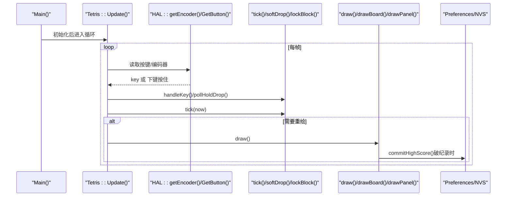

**图表来源**
- [Tetris.cpp:872-882](file://src/apps/game/Tetris.cpp#L872-L882)
- [Tetris.cpp:605-623](file://src/apps/game/Tetris.cpp#L605-L623)
- [Tetris.cpp:496-509](file://src/apps/game/Tetris.cpp#L496-L509)
- [Tetris.cpp:414-440](file://src/apps/game/Tetris.cpp#L414-L440)
- [Tetris.cpp:125-169](file://src/apps/game/Tetris.cpp#L125-L169)

## 详细组件分析

### 方块定义与旋转算法
- 七种方块在 kBlocks[7] 中以静态数据定义，每个方块包含最多 4 个旋转态的相对坐标数组 square[4][4]，并记录 numRotate 与 color。
- 旋转通过 rotateBlock(dir) 计算新旋转态 nrot，并使用墙踢（wall kick）尝试左右偏移以适配边界。
- canPlace 检查越界与重叠；tryPlace 在合法时更新当前位置与旋转态。

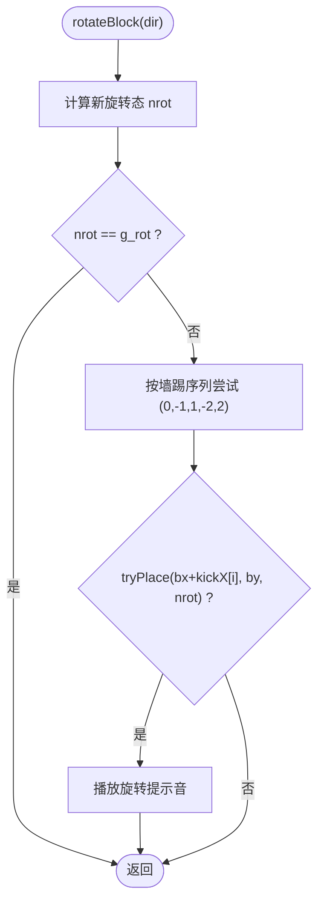

**图表来源**
- [Tetris.cpp:305-323](file://src/apps/game/Tetris.cpp#L305-L323)
- [Tetris.cpp:267-293](file://src/apps/game/Tetris.cpp#L267-L293)

**章节来源**
- [Tetris.cpp:39-88](file://src/apps/game/Tetris.cpp#L39-L88)
- [Tetris.cpp:267-323](file://src/apps/game/Tetris.cpp#L267-L323)

### 棋盘网格管理与碰撞检测
- 棋盘 g_grid[x][y] 存储颜色索引（0=空，1~7=方块色）。
- canPlace 遍历当前方块 4 个单元，检查目标位置是否越界或与已有方块冲突。
- ghostY 通过不断下移预测落点，用于虚影显示。

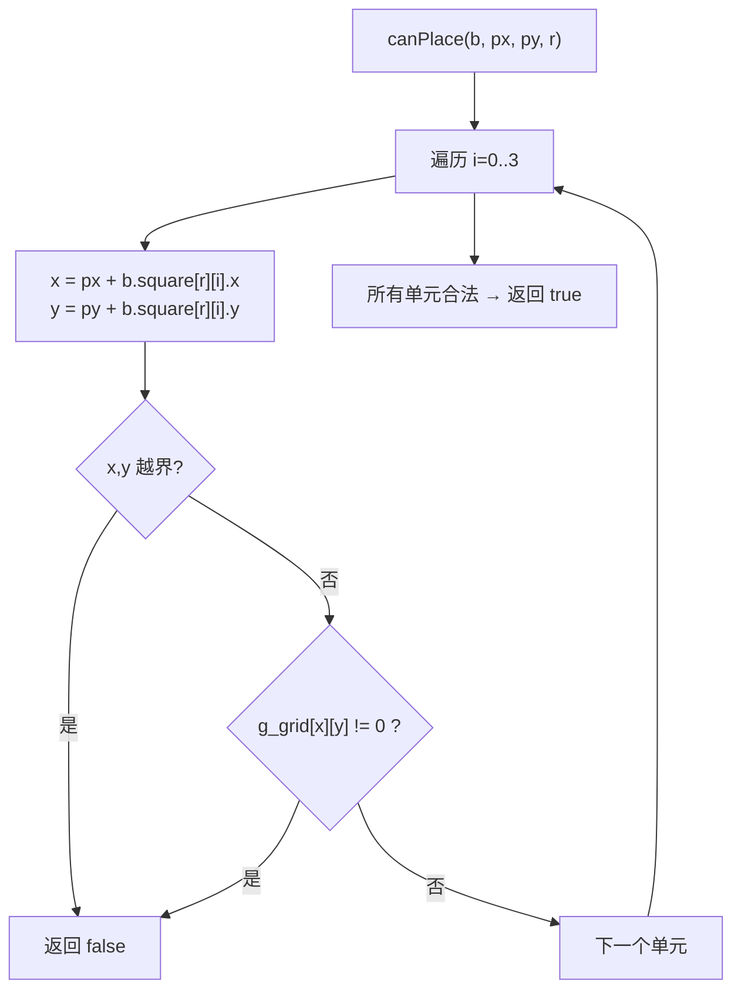

**图表来源**
- [Tetris.cpp:267-279](file://src/apps/game/Tetris.cpp#L267-L279)

**章节来源**
- [Tetris.h:132-133](file://src/apps/game/Tetris.h#L132-L133)
- [Tetris.cpp:267-279](file://src/apps/game/Tetris.cpp#L267-L279)
- [Tetris.cpp:477-483](file://src/apps/game/Tetris.cpp#L477-L483)

### 游戏核心逻辑：生成、下落、消行、计分
- 生成 spawn：将 next 赋给当前块，随机生成新的 next，设置初始位置与旋转态，若不可放置则直接结束。
- 自然下落 tick：根据等级计算间隔 fallInterval，到达时间则尝试下移一格，失败则锁定。
- 软降 softDrop：点按下键移动一格并加分；到底则立即锁定。
- 硬降 pollHoldDrop：按住持续快速下落，支持触底延迟锁定，避免连跳。
- 锁定 lockBlock：写入棋盘、消行 clearLines、加分升级、生成下一块。
- 消行 clearLines：自下而上扫描满行，整体下移并清零顶行，重复检查。

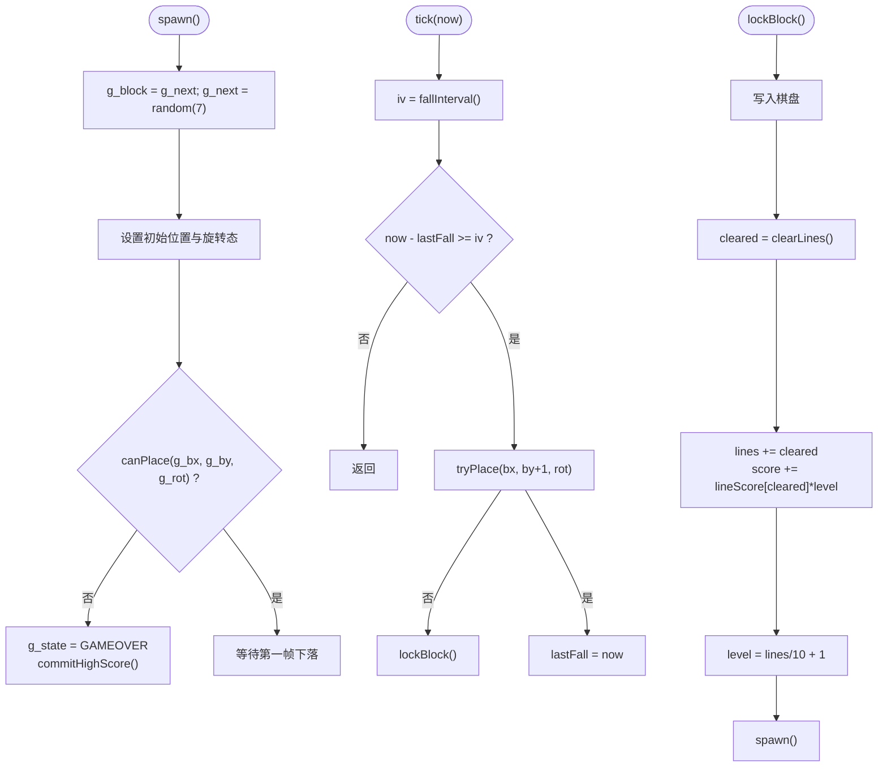

**图表来源**
- [Tetris.cpp:243-262](file://src/apps/game/Tetris.cpp#L243-L262)
- [Tetris.cpp:496-509](file://src/apps/game/Tetris.cpp#L496-L509)
- [Tetris.cpp:328-343](file://src/apps/game/Tetris.cpp#L328-L343)
- [Tetris.cpp:352-409](file://src/apps/game/Tetris.cpp#L352-L409)
- [Tetris.cpp:414-440](file://src/apps/game/Tetris.cpp#L414-L440)
- [Tetris.cpp:445-472](file://src/apps/game/Tetris.cpp#L445-L472)

**章节来源**
- [Tetris.cpp:243-262](file://src/apps/game/Tetris.cpp#L243-L262)
- [Tetris.cpp:328-409](file://src/apps/game/Tetris.cpp#L328-L409)
- [Tetris.cpp:414-472](file://src/apps/game/Tetris.cpp#L414-L472)
- [Tetris.cpp:485-491](file://src/apps/game/Tetris.cpp#L485-L491)

### 游戏状态管理（准备/游戏中/暂停/结束）
- 状态枚举：TETRIS_READY、TETRIS_PLAYING、TETRIS_PAUSED、TETRIS_GAMEOVER。
- 上键 handlePauseResume：在 READY/GAMEOVER 开始游戏；PLAYING 切换为 PAUSED；PAUSED 恢复 PLAYING 并重置下落计时。
- OK 短按：PLAYING 中旋转；非 PLAYING 且 READY/GAMEOVER 可启动游戏。
- OK 长按：任意时刻重启一局。

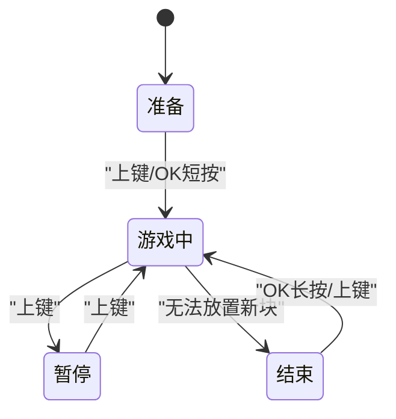

**图表来源**
- [Tetris.h:57-64](file://src/apps/game/Tetris.h#L57-L64)
- [Tetris.cpp:552-600](file://src/apps/game/Tetris.cpp#L552-L600)
- [Tetris.cpp:569-593](file://src/apps/game/Tetris.cpp#L569-L593)
- [Tetris.cpp:255-261](file://src/apps/game/Tetris.cpp#L255-L261)

**章节来源**
- [Tetris.h:57-64](file://src/apps/game/Tetris.h#L57-L64)
- [Tetris.cpp:552-600](file://src/apps/game/Tetris.cpp#L552-L600)
- [Tetris.cpp:569-593](file://src/apps/game/Tetris.cpp#L569-L593)

### 难度递增机制
- 等级计算：level = lines / TETRIS_LINES_PER_LEVEL + 1，默认每消 10 行升 1 级。
- 下落间隔：fallInterval() = base - (level-1)*step，最小不低于 min_ms。
- 分数加成：clearLines 后 score += lineScore[cleared] * level。

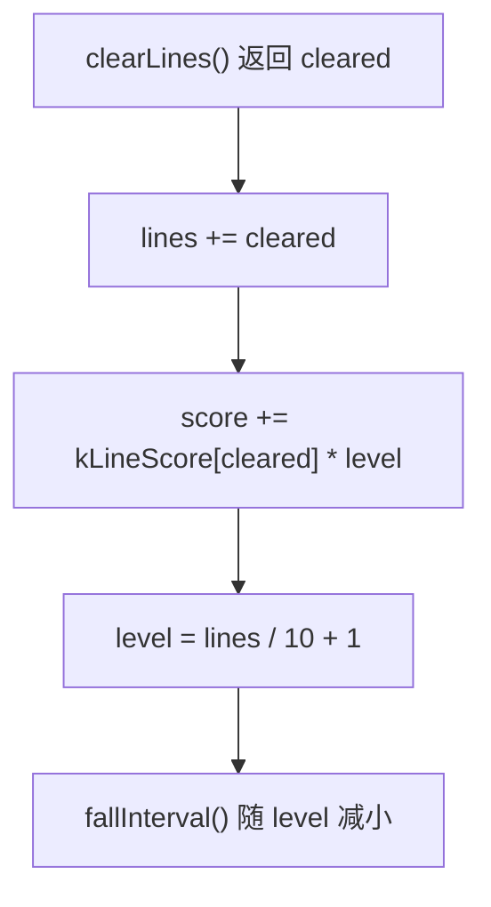

**图表来源**
- [Tetris.cpp:424-430](file://src/apps/game/Tetris.cpp#L424-L430)
- [Tetris.cpp:485-491](file://src/apps/game/Tetris.cpp#L485-L491)

**章节来源**
- [Tetris.cpp:424-430](file://src/apps/game/Tetris.cpp#L424-L430)
- [Tetris.cpp:485-491](file://src/apps/game/Tetris.cpp#L485-L491)

### 用户输入处理
- 方向键：左/右键 moveHorizontal(-1/+1)。
- 旋转：编码器顺时针/逆时针 rotateBlock(-1/+1)，OK 短按同样旋转。
- 软降：下键点按 softDrop()。
- 硬降：pollHoldDrop() 轮询下键按住，持续快速下落到底并可选延迟锁定。
- 暂停/继续：上键 handlePauseResume()。

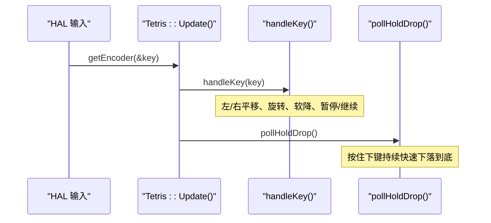

**图表来源**
- [Tetris.cpp:514-549](file://src/apps/game/Tetris.cpp#L514-L549)
- [Tetris.cpp:352-409](file://src/apps/game/Tetris.cpp#L352-L409)

**章节来源**
- [Tetris.cpp:514-549](file://src/apps/game/Tetris.cpp#L514-L549)
- [Tetris.cpp:352-409](file://src/apps/game/Tetris.cpp#L352-L409)

### UI 渲染系统
- 布局 layout：左侧棋盘占画布宽约 2/3，右侧信息面板占 1/3；格子边长受宽高约束保证 10×20 可见。
- 棋盘绘制 drawBoard：背景、网格线、外框、已固化方块、虚影、当前方块。
- 信息面板 drawPanel：标题、NEXT 预览、分数/最高分/消行/等级卡片、操作提示。
- NEXT 预览 drawNextPreview：自适应缩放与居中。
- 覆盖层 drawOverlay：开始/暂停/结束提示。
- 整页绘制 draw：fillSprite → drawBoard → drawPanel → drawOverlay → pushSprite。

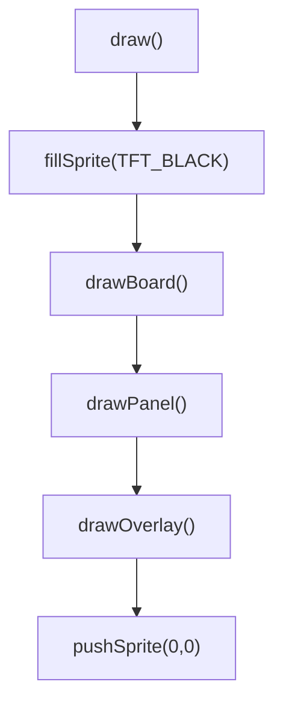

**图表来源**
- [Tetris.cpp:177-203](file://src/apps/game/Tetris.cpp#L177-L203)
- [Tetris.cpp:651-694](file://src/apps/game/Tetris.cpp#L651-L694)
- [Tetris.cpp:699-757](file://src/apps/game/Tetris.cpp#L699-L757)
- [Tetris.cpp:762-800](file://src/apps/game/Tetris.cpp#L762-L800)
- [Tetris.cpp:805-844](file://src/apps/game/Tetris.cpp#L805-L844)
- [Tetris.cpp:849-856](file://src/apps/game/Tetris.cpp#L849-L856)

**章节来源**
- [Tetris.cpp:177-203](file://src/apps/game/Tetris.cpp#L177-L203)
- [Tetris.cpp:651-856](file://src/apps/game/Tetris.cpp#L651-L856)

### 最高分持久化与存档系统
- 命名空间与键：TETRIS_NVS_NS="tetris"，TETRIS_NVS_KEY_HIGH="high"。
- loadHighScore：只读 Preferences.begin，读取历史最高分。
- saveHighScore：可写 Preferences.begin，写入最高分。
- updateHighScore：仅内存比较更新，标记脏位。
- commitHighScore：仅在破纪录时落盘，减少 Flash 擦写。

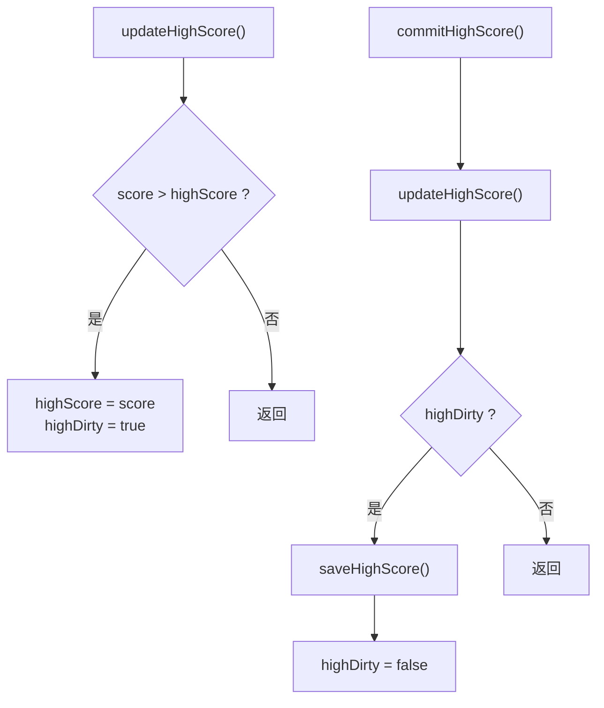

**图表来源**
- [Tetris.cpp:125-169](file://src/apps/game/Tetris.cpp#L125-L169)

**章节来源**
- [Tetris.h:35-37](file://src/apps/game/Tetris.h#L35-L37)
- [Tetris.cpp:125-169](file://src/apps/game/Tetris.cpp#L125-L169)

## 依赖关系分析
- Tetris 类依赖 HAL 提供的画布、编码器/按键、蜂鸣器与日志输出。
- 渲染依赖 LovyanGFX 的 LGFX_Sprite 进行离屏缓冲绘制。
- 持久化依赖 ESP32 Preferences/NVS。

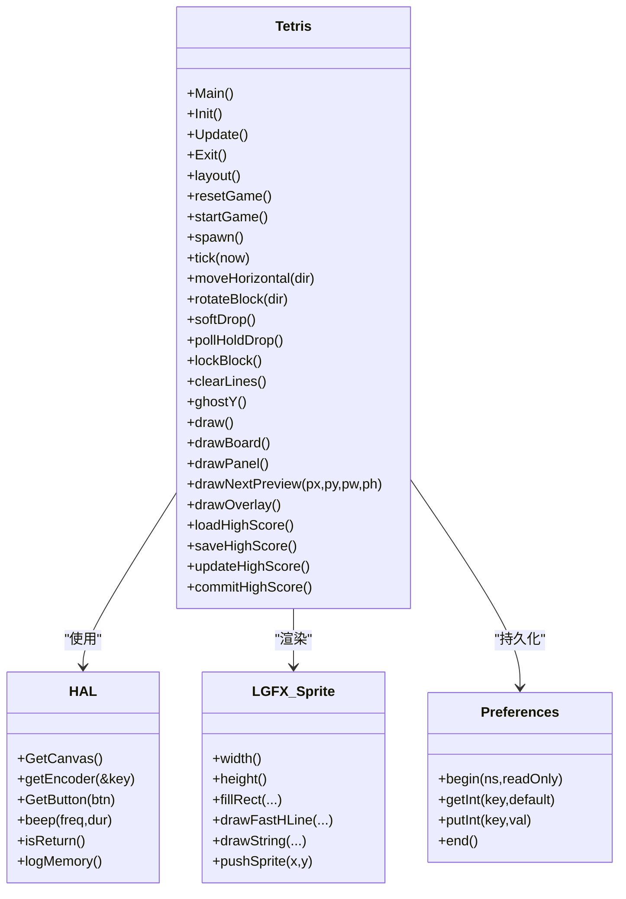

**图表来源**
- [Tetris.h:66-155](file://src/apps/game/Tetris.h#L66-L155)
- [Tetris.cpp:109-119](file://src/apps/game/Tetris.cpp#L109-L119)
- [Tetris.cpp:125-169](file://src/apps/game/Tetris.cpp#L125-L169)

**章节来源**
- [Tetris.h:66-155](file://src/apps/game/Tetris.h#L66-L155)
- [Tetris.cpp:109-119](file://src/apps/game/Tetris.cpp#L109-L119)
- [Tetris.cpp:125-169](file://src/apps/game/Tetris.cpp#L125-L169)

## 性能与内存优化
- 渲染优化：
  - 使用 LGFX_Sprite 离屏缓冲，减少闪烁与频繁刷新。
  - 仅在 g_dirty 或帧间隔达到时才重绘，降低 CPU 占用。
  - 网格线与边框一次性绘制，避免重复计算。
- 逻辑优化：
  - 自然下落与软降/硬降分离，避免叠加导致跳格。
  - 墙踢采用固定序列，常数时间复杂度。
  - 消行自下而上扫描，遇到满行即时下移并重新检查当前行，减少多余遍历。
- 持久化优化：
  - 仅在破纪录时落盘，减少 Flash 擦写次数。
- 内存管理：
  - canvas 由 HAL 统一管理生命周期，App 不释放。
  - 使用 static const 数据存放方块与颜色表，节省 RAM。

[本节为通用指导，不直接分析具体代码文件]

## 故障排查指南
- 方块无法旋转：
  - 检查 rotateBlock 的墙踢序列与 tryPlace 判定是否正确。
  - 确认 g_rot 与 numRotate 取值范围。
- 方块穿墙或穿透：
  - 检查 canPlace 的越界与重叠判断。
  - 确认坐标转换与棋盘索引一致。
- 下落速度异常：
  - 检查 fallInterval 与 g_lastFall 重置逻辑。
  - 确认软降/硬降未与 tick 叠加。
- 分数或等级不正确：
  - 核对 clearLines 返回值与 kLineScore 表。
  - 确认 level 计算与 lines 累计。
- 最高分未保存：
  - 检查 commitHighScore 调用时机（开局/结束/退出）。
  - 确认 Preferences begin/end 正确配对。

**章节来源**
- [Tetris.cpp:305-323](file://src/apps/game/Tetris.cpp#L305-L323)
- [Tetris.cpp:267-279](file://src/apps/game/Tetris.cpp#L267-L279)
- [Tetris.cpp:485-491](file://src/apps/game/Tetris.cpp#L485-L491)
- [Tetris.cpp:424-430](file://src/apps/game/Tetris.cpp#L424-L430)
- [Tetris.cpp:125-169](file://src/apps/game/Tetris.cpp#L125-L169)

## 结论
该俄罗斯方块实现以简洁清晰的类结构与模块化设计，覆盖了经典玩法的核心要素：七种方块与旋转、网格与碰撞、生成与下落、消行与计分、状态机与难度递增、输入处理与 UI 渲染、以及基于 Preferences/NVS 的最高分持久化。整体方案在嵌入式平台上兼顾了性能与可维护性，适合进一步扩展自定义方块、关卡设计与音效反馈。

[本节为总结性内容，不直接分析具体代码文件]

## 附录：扩展开发指南
- 自定义方块类型：
  - 在 kBlocks 中添加新条目，定义 square[4][4] 各旋转态坐标，设置 numRotate 与 color。
  - 确保 canPlace 与 rotateBlock 的通用逻辑无需修改即可支持新方块。
- 关卡设计：
  - 调整 TETRIS_FALL_BASE_MS、TETRIS_FALL_STEP_MS、TETRIS_FALL_MIN_MS 控制基础速度与难度曲线。
  - 调整 TETRIS_LINES_PER_LEVEL 改变升级节奏。
  - 扩展 kLineScore 表以改变多行消除奖励策略。
- UI 增强：
  - 在 drawPanel 增加“连击”“Combo”“下一块预览数”等信息卡片。
  - 在 drawOverlay 增加“暂停菜单”“设置项”。
- 音效与震动：
  - 在 rotateBlock、lockBlock、clearLines 等处扩展蜂鸣频率与时长，或接入震动模块。
- 存档扩展：
  - 在 Preferences 中增加更多键值（如最佳等级、总消行数），并在 commitHighScore 统一落盘。

[本节为概念性指导，不直接分析具体代码文件]