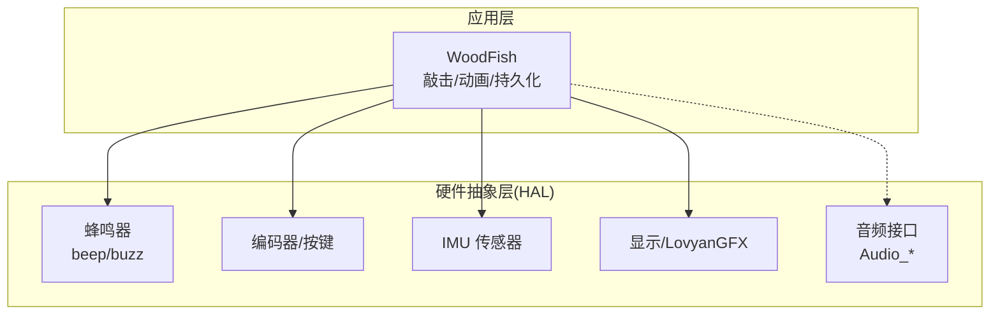
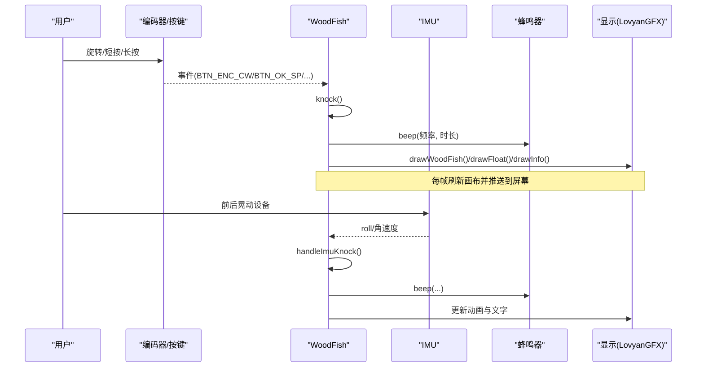
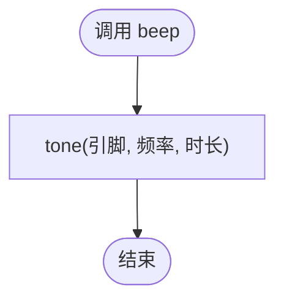
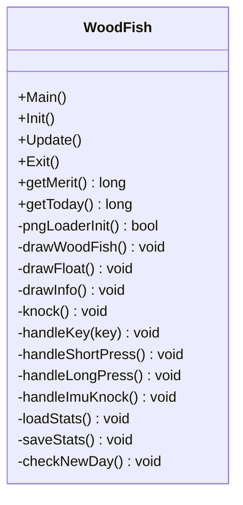
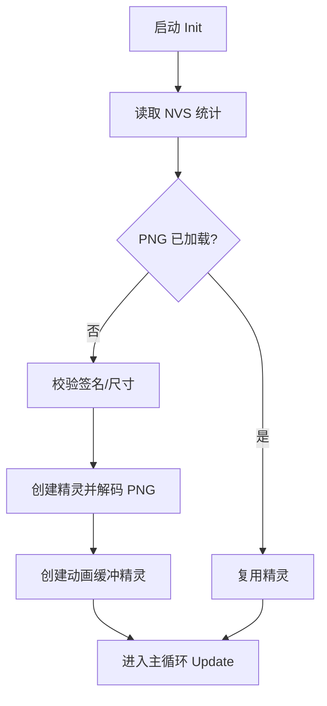
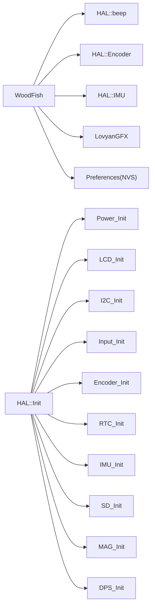

# 木鱼音乐播放器

<cite>
**本文引用的文件**   
- [WoodFish.h](file://src/apps/game/WoodFish.h)
- [WoodFish.cpp](file://src/apps/game/WoodFish.cpp)
- [hal_buzzer.cpp](file://src/hal/hal_buzzer.cpp)
- [hal.h](file://src/hal/hal.h)
- [hal.cpp](file://src/hal/hal.cpp)
</cite>

## 目录
1. [简介](#简介)
2. [项目结构](#项目结构)
3. [核心组件](#核心组件)
4. [架构总览](#架构总览)
5. [详细组件分析](#详细组件分析)
6. [依赖关系分析](#依赖关系分析)
7. [性能与内存优化](#性能与内存优化)
8. [故障排查指南](#故障排查指南)
9. [结论](#结论)
10. [附录：扩展与自定义](#附录扩展与自定义)

## 简介
本技术文档面向“木鱼音乐播放器”（以游戏应用 WoodFish 为载体）的音频处理、交互反馈与状态管理。当前代码库中，木鱼应用的“音频”能力主要通过蜂鸣器（Buzzer）提供提示音；同时暴露了 HAL 层的通用音频接口（Audio_Init/Audio_Update/Audio_PlayMusic），为后续扩展 MP3/PCM 播放、音效增强与输出优化预留空间。本文围绕以下主题展开：
- 音频资源加载与解码（PNG 图像资源，非音频）
- 敲击事件到声音反馈的链路
- 节奏控制与节拍管理（BPM 调节、自动/手动模式）
- 用户交互界面（编码器/按键、IMU 晃动、视觉动画）
- 音频效果处理（音量、音效增强、输出优化）
- 播放器状态管理（播放、暂停、停止、循环）
- 进度控制与时间显示
- 资源管理与内存优化策略
- 音频格式支持与兼容性说明
- 扩展开发与自定义音效指南

## 项目结构
本项目采用分层组织：
- src/apps/game：功能应用层，包含木鱼应用（WoodFish）
- src/hal：硬件抽象层，封装蜂鸣器、输入、显示、传感器等
- lib：第三方库（LovyanGFX 图形库、传感器驱动等）
- data：Web 前端资源（与本实现无直接耦合）
- include：平台相关头文件

图表来源
- [WoodFish.cpp:109-147](file://src/apps/game/WoodFish.cpp#L109-L147)
- [hal_buzzer.cpp:4-28](file://src/hal/hal_buzzer.cpp#L4-L28)
- [hal.h:180-200](file://src/hal/hal.h#L180-L200)

章节来源
- [WoodFish.h:28-85](file://src/apps/game/WoodFish.h#L28-L85)
- [WoodFish.cpp:368-437](file://src/apps/game/WoodFish.cpp#L368-L437)
- [hal.h:101-212](file://src/hal/hal.h#L101-L212)

## 核心组件
- 木鱼应用（WoodFish）
  - 负责 PNG 资源加载与缓存、敲击动画、飘字效果、NVS 持久化、IMU 晃动检测、编码器/按键输入处理、帧绘制循环。
- 蜂鸣器（HAL::beep/buzz）
  - 提供短促提示音与持续蜂鸣，用于敲击反馈与整百计数提示。
- HAL 音频接口（Audio_Init/Audio_Update/Audio_PlayMusic）
  - 预留音频管线接口，当前未由 WoodFish 直接使用，便于后续接入 MP3/PCM 播放与音效处理。

章节来源
- [WoodFish.h:28-85](file://src/apps/game/WoodFish.h#L28-L85)
- [WoodFish.cpp:38-107](file://src/apps/game/WoodFish.cpp#L38-L107)
- [hal_buzzer.cpp:4-28](file://src/hal/hal_buzzer.cpp#L4-L28)
- [hal.h:197-200](file://src/hal/hal.h#L197-L200)

## 架构总览
下图展示从用户输入到声音与画面反馈的整体流程：

图表来源
- [WoodFish.cpp:234-267](file://src/apps/game/WoodFish.cpp#L234-L267)
- [WoodFish.cpp:315-366](file://src/apps/game/WoodFish.cpp#L315-L366)
- [WoodFish.cpp:385-401](file://src/apps/game/WoodFish.cpp#L385-L401)
- [hal_buzzer.cpp:4-28](file://src/hal/hal_buzzer.cpp#L4-L28)

## 详细组件分析

### 音频处理系统（蜂鸣器与预留音频接口）
- 蜂鸣器 API
  - beep(frequency, duration)：使用 Arduino tone 生成指定频率与持续时间的提示音。
  - buzz(frequency, duration)：基于 GPIO 翻转的简易蜂鸣实现，适合更底层的波形输出。
  - beepStop()：停止 tone 输出。
- 预留音频接口
  - Audio_Init/Audio_Update/Audio_PlayMusic：在 HAL 中声明，供未来接入 I2S/MP3 解码与播放管线。

图表来源
- [hal_buzzer.cpp:4-12](file://src/hal/hal_buzzer.cpp#L4-L12)

章节来源
- [hal_buzzer.cpp:4-28](file://src/hal/hal_buzzer.cpp#L4-L28)
- [hal.h:180-200](file://src/hal/hal.h#L180-L200)

### 节奏控制与节拍管理（BPM、自动/手动模式）
- 当前实现
  - 敲击触发即时音效（beep），频率根据功德数是否整百切换，体现“节奏感”。
  - 未实现 BPM 参数化或自动播放模式；所有敲击均由用户输入或 IMU 触发。
- 可扩展设计建议
  - 引入 BPM 配置项，将敲击间隔映射为节拍周期。
  - 自动播放模式：基于定时器按 BPM 触发 knock()，支持启停与变速。
  - 手动敲击模式：保持现有编码器/按键/IMU 触发逻辑，叠加节拍对齐与量化。

章节来源
- [WoodFish.cpp:135-147](file://src/apps/game/WoodFish.cpp#L135-L147)

### 用户交互界面（触摸响应、视觉反馈与动画）
- 输入源
  - 编码器：顺时针/逆时针视为敲击；OK 键短按敲击、长按清零。
  - IMU：通过 roll 角速度阈值与冷却时间判定“放下即敲”，反向抬起复位。
- 视觉反馈
  - 木鱼缩放动画：基于正弦曲线实现先快后慢的回弹缩放。
  - 飘字“功德+1”：上移 + 渐隐，位置随木鱼尺寸自适应。
  - 底部信息：总功德与今日次数实时显示。
- 渲染管线
  - 双缓冲精灵：主精灵缓存 PNG，全屏动画精灵用于缩放避免裁剪，最终透明合成至画布并 pushSprite。

图表来源
- [WoodFish.h:28-85](file://src/apps/game/WoodFish.h#L28-L85)

章节来源
- [WoodFish.cpp:109-147](file://src/apps/game/WoodFish.cpp#L109-L147)
- [WoodFish.cpp:149-232](file://src/apps/game/WoodFish.cpp#L149-L232)
- [WoodFish.cpp:234-267](file://src/apps/game/WoodFish.cpp#L234-L267)
- [WoodFish.cpp:315-366](file://src/apps/game/WoodFish.cpp#L315-L366)
- [WoodFish.cpp:385-401](file://src/apps/game/WoodFish.cpp#L385-L401)

### 音频效果处理（音量、音效增强、输出优化）
- 当前实现
  - 仅通过蜂鸣器输出提示音，无音量控制与音效增强。
- 扩展方向
  - 音量控制：在 Audio_PlayMusic 中增加增益系数，结合 DAC/I2S 输出。
  - 音效增强：加入均衡、混响、压缩等 DSP 模块（可基于 ESP32 I2S + DMA）。
  - 输出优化：使用 DMA 传输 PCM 数据，降低 CPU 占用；按需采样率转换。

章节来源
- [hal.h:197-200](file://src/hal/hal.h#L197-L200)

### 播放器状态管理（播放、暂停、停止、循环）
- 现状
  - WoodFish 未实现传统“播放器状态机”；其“状态”体现在功德计数、动画标志位与 NVS 持久化。
- 建议状态机
  - Idle / Playing / Paused / Stopped / Looping
  - 事件：Start、Pause、Stop、Next、Prev、LoopToggle
  - 与 BPM 自动播放联动，支持定时任务驱动。

[本节为概念性设计，不直接分析具体文件]

### 进度控制与时间显示
- 现状
  - 无音频进度条；显示“功德总数/今日次数”。
- 扩展建议
  - 若接入音频播放，可增加进度条、剩余时间、当前位置显示。
  - 使用 RTC 或网络时间同步，配合歌曲元数据展示。

[本节为概念性设计，不直接分析具体文件]

### 音频资源管理与内存优化策略
- PNG 资源
  - 从 Flash 编译嵌入，启动时校验签名与尺寸，解码一次并缓存至 PSRAM 精灵对象，避免重复解码。
  - 使用全屏动画精灵作为中间缓冲，避免缩放裁剪。
- NVS 持久化
  - 功德与今日计数、日期键值存储；节流写入（每 20 次写一次），减少 Flash 磨损。
- 内存监控
  - 提供 logMemory 打印堆/PSRAM/Flash 大小与空闲块，便于调试。

图表来源
- [WoodFish.cpp:38-107](file://src/apps/game/WoodFish.cpp#L38-L107)
- [WoodFish.cpp:269-313](file://src/apps/game/WoodFish.cpp#L269-L313)
- [hal.cpp:56-71](file://src/hal/hal.cpp#L56-L71)

章节来源
- [WoodFish.cpp:38-107](file://src/apps/game/WoodFish.cpp#L38-L107)
- [WoodFish.cpp:269-313](file://src/apps/game/WoodFish.cpp#L269-L313)
- [hal.cpp:56-71](file://src/hal/hal.cpp#L56-L71)

### 音频格式支持与兼容性说明
- 当前
  - 未实现音频解码与播放；蜂鸣器仅输出方波提示音。
- 预留
  - HAL 层 Audio_* 接口可用于后续接入 MP3/OGG/WAV 等格式，需结合 ESP32 的 I2S/DAC 与外部解码库。

章节来源
- [hal.h:197-200](file://src/hal/hal.h#L197-L200)

## 依赖关系分析
- WoodFish 依赖
  - HAL 蜂鸣器（beep）、编码器/按键、IMU、显示（LovyanGFX）、NVS（Preferences）。
- HAL 层
  - 初始化顺序：电源、LCD、I2C、输入、编码器、RTC、IMU、SD、磁力计、气压计、蜂鸣器提示音。
  - 提供统一的日志与内存报告工具。

图表来源
- [WoodFish.cpp:368-383](file://src/apps/game/WoodFish.cpp#L368-L383)
- [hal.cpp:4-25](file://src/hal/hal.cpp#L4-L25)

章节来源
- [WoodFish.cpp:368-383](file://src/apps/game/WoodFish.cpp#L368-L383)
- [hal.cpp:4-25](file://src/hal/hal.cpp#L4-L25)

## 性能与内存优化
- 精灵对象复用
  - PNG 解码一次后缓存于 PSRAM，避免重复解码开销。
- 动画缓冲
  - 使用全屏精灵作为中间缓冲，减少逐像素混合成本。
- NVS 写入节流
  - 每 20 次敲击写一次 NVS，降低 Flash 擦写次数。
- 内存监控
  - 启动与退出阶段打印堆/PSRAM/Flash 使用情况，辅助定位 OOM 风险。

章节来源
- [WoodFish.cpp:69-107](file://src/apps/game/WoodFish.cpp#L69-L107)
- [WoodFish.cpp:138-147](file://src/apps/game/WoodFish.cpp#L138-L147)
- [hal.cpp:56-71](file://src/hal/hal.cpp#L56-L71)

## 故障排查指南
- PNG 加载失败
  - 检查 Flash 内嵌资源是否正确链接与大小限制；确认 PNG 签名与 IHDR 宽高解析。
- 动画异常
  - 确认动画精灵创建成功且启用 PSRAM；检查 pushSprite 透明色合成。
- 敲击无声音
  - 检查蜂鸣器引脚配置与 tone/noTone 调用；确认 beep 频率与时长合理。
- 数据丢失
  - 检查 NVS 命名空间与键名；确认节流写入条件与跨天重置逻辑。
- 内存不足
  - 使用 logMemory 查看堆与 PSRAM 占用；必要时减小 PNG 尺寸或禁用动画缓冲。

章节来源
- [WoodFish.cpp:38-107](file://src/apps/game/WoodFish.cpp#L38-L107)
- [WoodFish.cpp:269-313](file://src/apps/game/WoodFish.cpp#L269-L313)
- [hal_buzzer.cpp:4-28](file://src/hal/hal_buzzer.cpp#L4-L28)
- [hal.cpp:56-71](file://src/hal/hal.cpp#L56-L71)

## 结论
当前木鱼应用以蜂鸣器提供敲击反馈，并通过 LovyanGFX 实现流畅的视觉动画与交互体验。HAL 层预留了完整的音频接口，为后续接入真正的音频播放、音效增强与输出优化奠定基础。建议在保持现有轻量实现的同时，逐步引入 BPM 节拍引擎、自动播放模式与进度控制，完善播放器状态机与资源管理策略。

## 附录：扩展与自定义
- 接入音频播放
  - 在 HAL::Audio_Init 中初始化 I2S/DAC 与解码库；在 Audio_PlayMusic 中实现流式解码与 DMA 传输。
- 自定义音效
  - 替换 beep 频率与时长策略，或引入多轨提示音；支持不同场景（整百、连击、错误）差异化音效。
- 节拍与 BPM
  - 新增 BPM 配置与定时器任务，按节拍触发 knock()；支持加速/减速与节拍量化。
- 进度与可视化
  - 增加进度条、时间码、频谱可视化；结合 LovyanGFX 绘制动态 UI。
- 资源管理
  - 对大体积资源进行分块加载与释放；使用 PSRAM 缓存热点资源；定期回收未用精灵对象。

[本节为概念性指导，不直接分析具体文件]