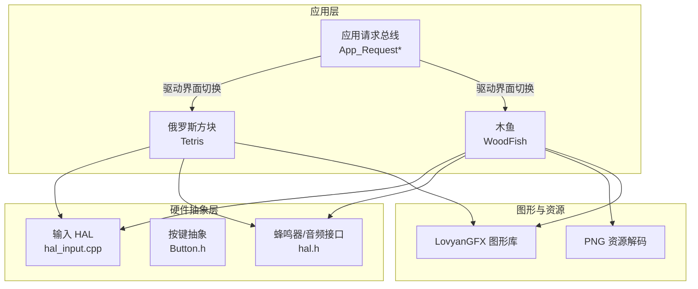
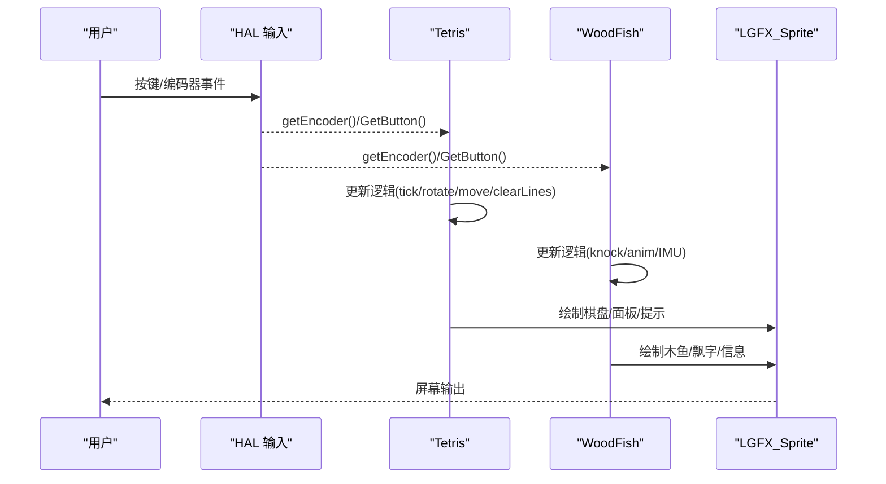
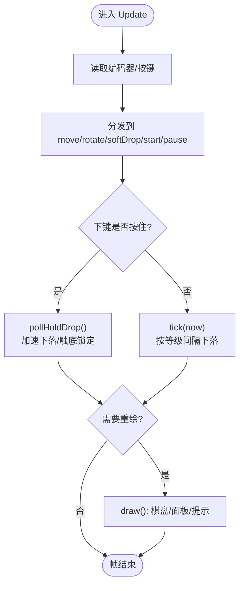
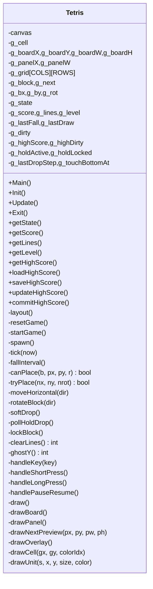
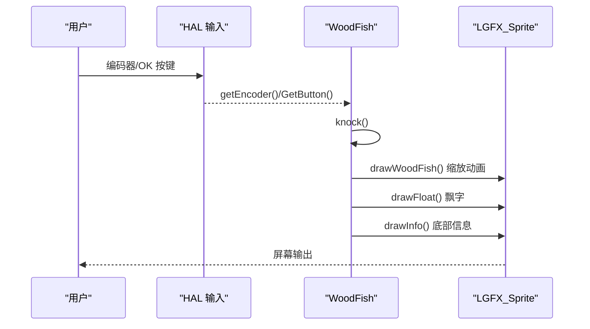
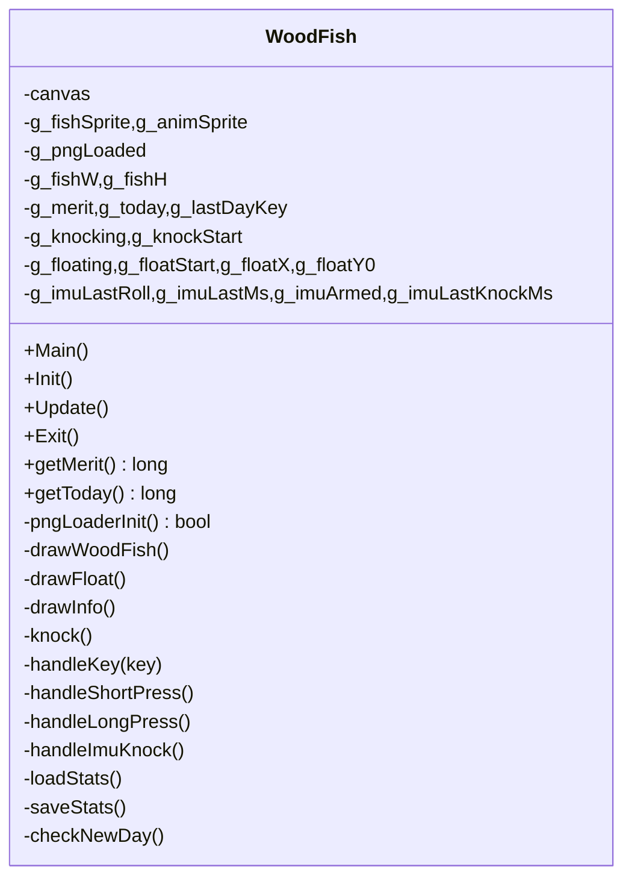
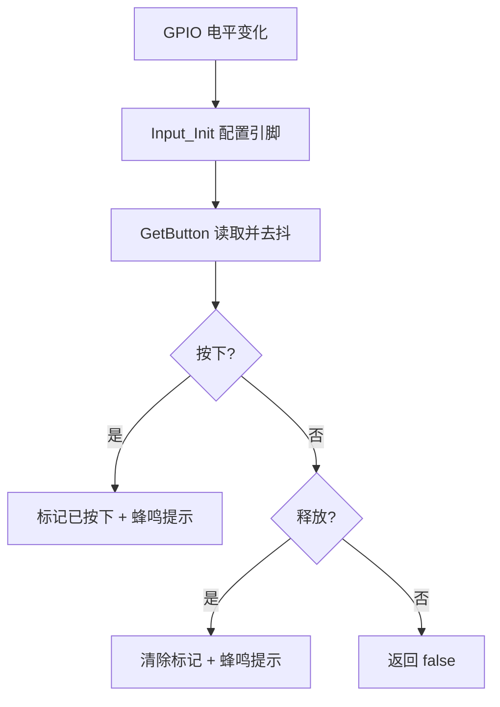
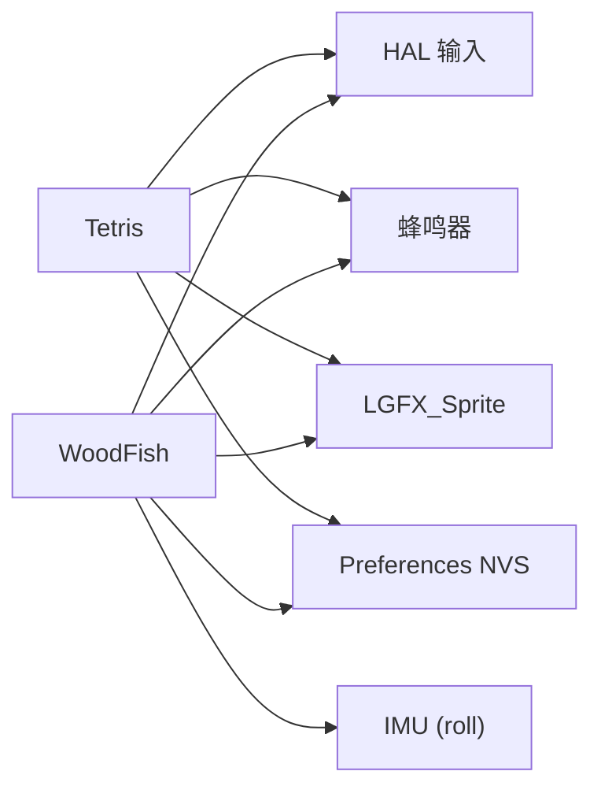

# 游戏应用集合

<cite>
**本文引用的文件**   
- [Tetris.h](file://src/apps/game/Tetris.h)
- [Tetris.cpp](file://src/apps/game/Tetris.cpp)
- [WoodFish.h](file://src/apps/game/WoodFish.h)
- [WoodFish.cpp](file://src/apps/game/WoodFish.cpp)
- [app_state.h](file://src/app_state.h)
- [app_state.cpp](file://src/app_state.cpp)
- [hal_input.cpp](file://src/hal/hal_input.cpp)
- [Button.h](file://src/hal/Button.h)
</cite>

## 目录
1. [简介](#简介)
2. [项目结构](#项目结构)
3. [核心组件](#核心组件)
4. [架构总览](#架构总览)
5. [详细组件分析](#详细组件分析)
6. [依赖关系分析](#依赖关系分析)
7. [性能与内存优化](#性能与内存优化)
8. [故障排查指南](#故障排查指南)
9. [结论](#结论)
10. [附录：扩展与自定义开发指南](#附录扩展与自定义开发指南)

## 简介
本技术文档面向 ESP32 平台上的“游戏应用集合”，重点覆盖以下模块：
- 俄罗斯方块（Tetris）：完整实现包括方块生成、旋转、消行算法、难度与关卡系统、输入处理、状态管理、分数与最高分持久化、UI 布局与动画提示。
- 木鱼（WoodFish）：敲击交互、PNG 资源加载与缩放动画、飘字效果、IMU 晃动触发、功德统计与跨天清零、NVS 持久化。
- 通用输入与 HAL：按键/编码器事件、蜂鸣器提示、返回键检测。
- 应用请求总线：通过全局标志位驱动上层 Launcher 切换界面。

说明：仓库中未包含“木鱼音乐播放器”的音频播放实现，因此本文不展开该部分；但会指出与 HAL 音频接口的位置以便后续集成。

## 项目结构
本项目采用“应用 + HAL + 公共库”的分层组织方式：
- src/apps/game：游戏应用（俄罗斯方块、木鱼）。
- src/hal：硬件抽象层（输入、蜂鸣器、显示等）。
- src：应用状态与启动器相关。
- lib：第三方库（如 LovyanGFX 图形库）。

图表来源
- [Tetris.h:66-155](file://src/apps/game/Tetris.h#L66-L155)
- [WoodFish.h:28-85](file://src/apps/game/WoodFish.h#L28-L85)
- [hal_input.cpp:1-58](file://src/hal/hal_input.cpp#L1-L58)
- [hal.h:180-200](file://src/hal/hal.h#L180-L200)

章节来源
- [Tetris.h:1-159](file://src/apps/game/Tetris.h#L1-L159)
- [WoodFish.h:1-89](file://src/apps/game/WoodFish.h#L1-L89)
- [hal_input.cpp:1-58](file://src/hal/hal_input.cpp#L1-L58)

## 核心组件
- 俄罗斯方块（Tetris）
  - 棋盘与方块数据结构、7 种标准方块的旋转态数据。
  - 下落计时、软降、按住快速落底、墙踢旋转、固化与消行。
  - 等级与难度曲线、NEXT 预览、信息面板、状态提示层。
  - 最高分 NVS 持久化（命名空间 tetris）。
- 木鱼（WoodFish）
  - PNG 资源校验与解码、精灵缓存、全屏动画缓冲。
  - 敲击动画（缩放）、飘字（上移+渐隐）、底部信息。
  - IMU 单向晃动触发敲击、冷却与复位阈值。
  - 功德/今日计数、跨天清零、NVs 节流保存。
- 输入与 HAL
  - 编码器/按键映射、边沿检测、蜂鸣反馈。
  - 返回键检测用于退出应用。
- 应用请求总线
  - 全局 volatile 标志位与 App_Request* 函数，供 Launcher 轮询并切换界面。

章节来源
- [Tetris.h:44-155](file://src/apps/game/Tetris.h#L44-L155)
- [Tetris.cpp:109-119](file://src/apps/game/Tetris.cpp#L109-L119)
- [WoodFish.h:28-85](file://src/apps/game/WoodFish.h#L28-L85)
- [WoodFish.cpp:39-107](file://src/apps/game/WoodFish.cpp#L39-L107)
- [hal_input.cpp:1-58](file://src/hal/hal_input.cpp#L1-L58)
- [app_state.h:1-42](file://src/app_state.h#L1-L42)
- [app_state.cpp:1-37](file://src/app_state.cpp#L1-L37)

## 架构总览
下图展示游戏应用与 HAL、图形库之间的调用关系，以及关键数据流（输入→逻辑→绘制）。

图表来源
- [Tetris.cpp:605-623](file://src/apps/game/Tetris.cpp#L605-L623)
- [WoodFish.cpp:385-401](file://src/apps/game/WoodFish.cpp#L385-L401)
- [hal_input.cpp:26-48](file://src/hal/hal_input.cpp#L26-L48)

## 详细组件分析

### 俄罗斯方块（Tetris）
- 数据结构与复杂度
  - 棋盘 g_grid[TETRIS_COLS][TETRIS_ROWS]，O(1) 访问；消行扫描 O(COLS×ROWS)。
  - 方块 TetrisBlock 含 4×4 坐标表，旋转态数量 numRotate；放置判定 O(4)。
- 核心流程
  - 初始化：获取画布、计算布局、随机种子、载入最高分、重置游戏。
  - 每帧 Update：读取输入→轮询下键→tick 自然下落→按需绘制。
  - 生成方块：next→current，随机初始旋转；若无法放置则结束。
  - 移动与旋转：水平移动 tryPlace；旋转带墙踢（左右偏移尝试）。
  - 软降与按住落底：点按软降计分；按住持续快速落到底，触底后延迟锁定。
  - 固化与消行：写入网格→从下往上扫描消除→上方整体下移→计分与升级。
  - 难度与等级：根据等级计算下落间隔，最小值限制；每消 N 行升一级。
  - UI：左侧棋盘（网格+已固化+虚影+当前块），右侧面板（分数/最高分/消行/等级/NEXT 预览/操作提示），状态提示层（开始/暂停/结束）。
  - 持久化：Preferences NVS 命名空间 tetris，仅破纪录时落盘，避免频繁擦写。

图表来源
- [Tetris.cpp:605-623](file://src/apps/game/Tetris.cpp#L605-L623)
- [Tetris.cpp:352-409](file://src/apps/game/Tetris.cpp#L352-L409)
- [Tetris.cpp:496-509](file://src/apps/game/Tetris.cpp#L496-L509)

图表来源
- [Tetris.h:66-155](file://src/apps/game/Tetris.h#L66-L155)

章节来源
- [Tetris.h:1-159](file://src/apps/game/Tetris.h#L1-L159)
- [Tetris.cpp:109-119](file://src/apps/game/Tetris.cpp#L109-L119)
- [Tetris.cpp:177-203](file://src/apps/game/Tetris.cpp#L177-L203)
- [Tetris.cpp:208-238](file://src/apps/game/Tetris.cpp#L208-L238)
- [Tetris.cpp:243-279](file://src/apps/game/Tetris.cpp#L243-L279)
- [Tetris.cpp:305-323](file://src/apps/game/Tetris.cpp#L305-L323)
- [Tetris.cpp:328-409](file://src/apps/game/Tetris.cpp#L328-L409)
- [Tetris.cpp:414-472](file://src/apps/game/Tetris.cpp#L414-L472)
- [Tetris.cpp:485-509](file://src/apps/game/Tetris.cpp#L485-L509)
- [Tetris.cpp:514-600](file://src/apps/game/Tetris.cpp#L514-L600)
- [Tetris.cpp:605-623](file://src/apps/game/Tetris.cpp#L605-L623)
- [Tetris.cpp:628-800](file://src/apps/game/Tetris.cpp#L628-L800)
- [Tetris.cpp:801-883](file://src/apps/game/Tetris.cpp#L801-L883)

### 木鱼（WoodFish）
- 资源与渲染
  - 从 Flash 内嵌 PNG 数据校验签名、解析 IHDR 宽高、使用 LovyanGFX drawPng 解码为精灵。
  - 主精灵 g_fishSprite 复用；全屏动画缓冲 g_animSprite 用于缩放绘制，避免裁剪。
  - 绘制流程：清屏→绘制木鱼（缩放动画）→绘制飘字（上移+渐隐）→绘制底部信息→推送到屏幕。
- 交互与动画
  - 敲击 knock：功德+1、今日+1、触发放大动画与飘字、蜂鸣提示、节流 NVS 保存。
  - 缩放动画：基于时间比例的正弦曲线，中心缩放 pushRotateZoom。
  - 飘字：easeOut 缓动，透明度随时间递减。
- IMU 晃动触发
  - 计算 roll 角速度，方向匹配且超过阈值触发敲击；反向明显抬起才重新武装；冷却时间防抖。
- 数据持久化
  - NVS 命名空间 woodfish，存储功德总数、今日次数、日期 key；跨天自动清零今日。
  - 节流保存：每敲击 N 次写一次 NVS，降低 Flash 磨损。

图表来源
- [WoodFish.cpp:110-147](file://src/apps/game/WoodFish.cpp#L110-L147)
- [WoodFish.cpp:150-212](file://src/apps/game/WoodFish.cpp#L150-L212)
- [WoodFish.cpp:385-401](file://src/apps/game/WoodFish.cpp#L385-L401)

图表来源
- [WoodFish.h:28-85](file://src/apps/game/WoodFish.h#L28-L85)

章节来源
- [WoodFish.h:1-89](file://src/apps/game/WoodFish.h#L1-L89)
- [WoodFish.cpp:39-107](file://src/apps/game/WoodFish.cpp#L39-L107)
- [WoodFish.cpp:110-147](file://src/apps/game/WoodFish.cpp#L110-L147)
- [WoodFish.cpp:150-212](file://src/apps/game/WoodFish.cpp#L150-L212)
- [WoodFish.cpp:234-267](file://src/apps/game/WoodFish.cpp#L234-L267)
- [WoodFish.cpp:269-313](file://src/apps/game/WoodFish.cpp#L269-L313)
- [WoodFish.cpp:315-366](file://src/apps/game/WoodFish.cpp#L315-L366)
- [WoodFish.cpp:369-437](file://src/apps/game/WoodFish.cpp#L369-L437)

### 输入处理与 HAL
- 按键映射与边沿检测
  - Input_Init 配置 GPIO 为上拉输入，维护 _key_state_list 以区分按下/释放边沿。
  - GetButton 在按下时返回 true 并蜂鸣提示；释放时也蜂鸣提示。
  - isReturn/isEnter 封装返回/确认键检测。
- 按键抽象
  - Button.h 提供 held/repeated/isDown 等高级接口，便于 NES 风格连发或持续移动。

图表来源
- [hal_input.cpp:7-48](file://src/hal/hal_input.cpp#L7-L48)

章节来源
- [hal_input.cpp:1-58](file://src/hal/hal_input.cpp#L1-L58)
- [Button.h:95-141](file://src/hal/Button.h#L95-L141)

### 应用请求总线
- 全局 volatile 标志位 g_request* 与 App_Request* 函数，供 Launcher 轮询并切换到对应界面（如游戏、音乐、天气等）。
- 适用于多任务/中断环境下的安全标志传递。

章节来源
- [app_state.h:1-42](file://src/app_state.h#L1-L42)
- [app_state.cpp:1-37](file://src/app_state.cpp#L1-L37)

## 依赖关系分析
- 俄罗斯方块
  - 依赖 HAL 输入（编码器/按键）、蜂鸣器、LOVYAN 图形库（LGFX_Sprite）。
  - 依赖 Preferences NVS 进行最高分持久化。
- 木鱼
  - 依赖 HAL 输入、蜂鸣器、LOVYAN 图形库（PNG 解码、Sprite）。
  - 依赖 Preferences NVS 进行功德/今日统计持久化。
  - 依赖 IMU 数据（roll）进行晃动触发。
- 输入 HAL
  - 依赖 GPIO 配置与蜂鸣器。

图表来源
- [Tetris.h:4-5](file://src/apps/game/Tetris.h#L4-L5)
- [WoodFish.h:4-5](file://src/apps/game/WoodFish.h#L4-L5)
- [hal_input.cpp:1-58](file://src/hal/hal_input.cpp#L1-L58)
- [hal.h:180-200](file://src/hal/hal.h#L180-L200)

章节来源
- [Tetris.h:1-159](file://src/apps/game/Tetris.h#L1-L159)
- [WoodFish.h:1-89](file://src/apps/game/WoodFish.h#L1-L89)
- [hal_input.cpp:1-58](file://src/hal/hal_input.cpp#L1-L58)

## 性能与内存优化
- 俄罗斯方块
  - 绘制节流：仅在状态变化或达到 TETRIS_FRAME_MS 时重绘，减少 GPU/CPU 压力。
  - 布局自适应：根据画布尺寸动态计算格子大小，保证不同分辨率下完整显示。
  - NVS 落盘节流：仅在破纪录时写入 Flash，避免频繁擦写。
- 木鱼
  - PNG 解码一次并缓存精灵，重复使用；动画缓冲全屏 Sprite 复用。
  - PSRAM 启用：sprite.setPsram(true) 将大缓冲区放在外部 RAM，缓解内部 SRAM 压力。
  - NVS 节流保存：每敲击 N 次写一次 NVS，降低 Flash 磨损。
  - 动画缓冲：pushRotateZoom 到全屏 Sprite，再透明叠加到主画布，避免裁剪与重绘开销。
- 通用建议
  - 避免在 Update 中进行字符串格式化与大量分配；必要时缓存结果。
  - 使用半透明混合 alpha565 时注意精度与性能平衡。
  - 对 IMU 数据做最小帧间隔与最大 dt 钳制，防止卡顿导致突变。

章节来源
- [Tetris.cpp:617-623](file://src/apps/game/Tetris.cpp#L617-L623)
- [Tetris.cpp:125-169](file://src/apps/game/Tetris.cpp#L125-L169)
- [WoodFish.cpp:70-107](file://src/apps/game/WoodFish.cpp#L70-L107)
- [WoodFish.cpp:110-147](file://src/apps/game/WoodFish.cpp#L110-L147)
- [WoodFish.cpp:315-366](file://src/apps/game/WoodFish.cpp#L315-L366)

## 故障排查指南
- 俄罗斯方块
  - 无法旋转或卡墙：检查 rotateBlock 的墙踢偏移数组与 canPlace 边界判断。
  - 下落过快/过慢：调整 fallInterval 参数（基础间隔、步长、最小值）。
  - 分数/等级异常：核对 clearLines 与 kLineScore 系数、等级计算公式。
  - 最高分未保存：确认 commitHighScore 在 startGame/End/Exit 被调用，且 NVS 命名空间正确。
- 木鱼
  - PNG 加载失败：检查二进制符号与长度、PNG 签名、IHDR 宽高解析。
  - 动画闪烁/裁剪：确认全屏动画缓冲尺寸与 pushRotateZoom 中心点设置。
  - IMU 无响应：检查 roll 方向配置、阈值与冷却时间；确保 updateImuData 被调用。
  - 功德未持久化：确认 saveStats 节流条件与 NVS 命名空间。
- 输入与 HAL
  - 按键无响应：检查 GPIO 配置与上拉电阻；确认 GetButton 边沿逻辑。
  - 蜂鸣异常：检查 beep 频率/时长参数与 HAL 实现。

章节来源
- [Tetris.cpp:305-323](file://src/apps/game/Tetris.cpp#L305-L323)
- [Tetris.cpp:485-509](file://src/apps/game/Tetris.cpp#L485-L509)
- [Tetris.cpp:125-169](file://src/apps/game/Tetris.cpp#L125-L169)
- [WoodFish.cpp:39-107](file://src/apps/game/WoodFish.cpp#L39-L107)
- [WoodFish.cpp:315-366](file://src/apps/game/WoodFish.cpp#L315-L366)
- [hal_input.cpp:26-48](file://src/hal/hal_input.cpp#L26-L48)

## 结论
本“游戏应用集合”在 ESP32 平台上实现了两个典型小游戏：俄罗斯方块与木鱼。两者均遵循“输入→逻辑→绘制”的清晰循环，并通过 HAL 抽象硬件、Preferences NVS 持久化关键数据。俄罗斯方块侧重经典玩法与难度曲线，木鱼侧重交互体验与动画表现。代码结构清晰、模块化良好，便于扩展与维护。

## 附录：扩展与自定义开发指南
- 新增游戏应用
  - 在 src/apps/game 下新建类，遵循 Main/Init/Update/Exit 生命周期。
  - 通过 HAL::GetCanvas() 获取 LGFX_Sprite 进行绘制；使用 HAL::beep 提供音效反馈。
  - 如需持久化，使用 Preferences NVS（命名空间隔离），并在合适时机落盘。
- 自定义俄罗斯方块
  - 扩展方块类型：在 kBlocks 中添加新形状与旋转态，调整 numRotate。
  - 调整难度曲线：修改 TETRIS_FALL_BASE_MS/TETRIS_FALL_STEP_MS/TETRIS_FALL_MIN_MS。
  - 自定义 UI：调整 drawPanel/drawOverlay 中的文本与布局。
- 自定义木鱼
  - 替换 PNG 资源：更新二进制符号与 WOODFISH_PNG_MAX_SIZE。
  - 调整动画参数：WOODFISH_KNOCK_MS、WOODFISH_SCALE_MIN、WOODFISH_FLOAT_MS。
  - IMU 灵敏度：调整 WOODFISH_IMU_RATE_DPS、RESET_DPS、COOLDOWN_MS。
- 音频扩展（未来）
  - HAL 提供 Audio_Init/Audio_Update/Audio_PlayMusic 接口，可在后续集成音乐播放器功能。

章节来源
- [Tetris.h:21-33](file://src/apps/game/Tetris.h#L21-L33)
- [Tetris.cpp:39-88](file://src/apps/game/Tetris.cpp#L39-L88)
- [WoodFish.h:7-14](file://src/apps/game/WoodFish.h#L7-L14)
- [WoodFish.cpp:39-107](file://src/apps/game/WoodFish.cpp#L39-L107)
- [hal.h:197-200](file://src/hal/hal.h#L197-L200)