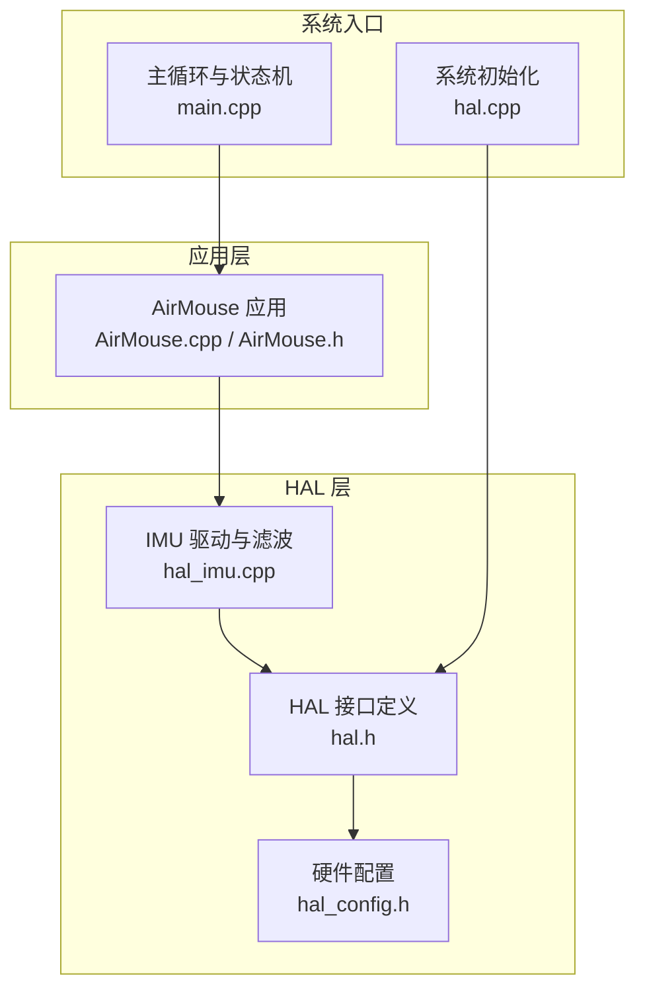
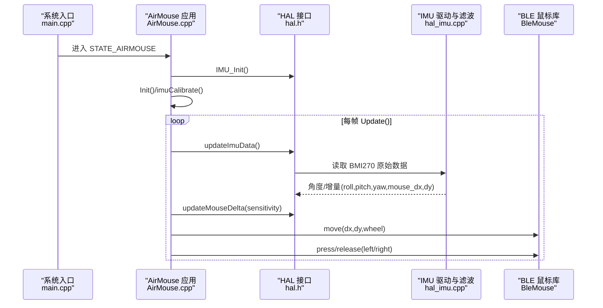
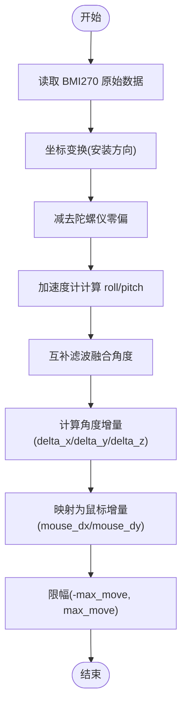
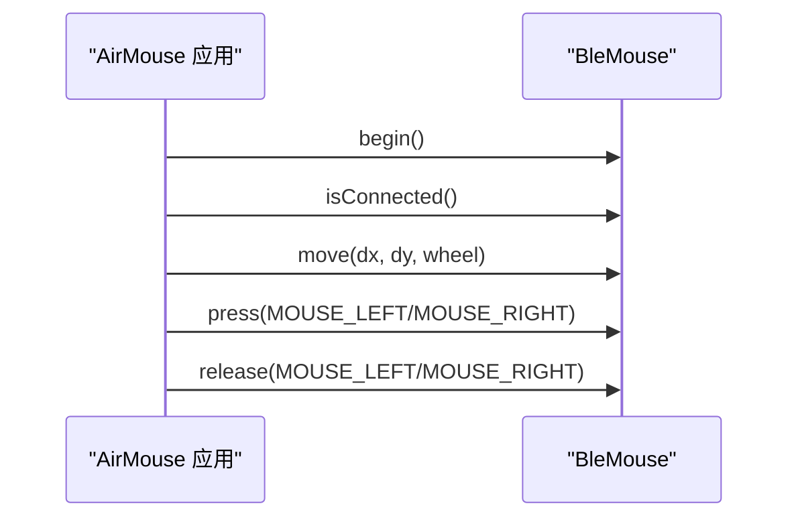
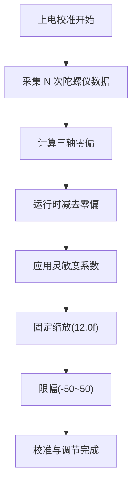
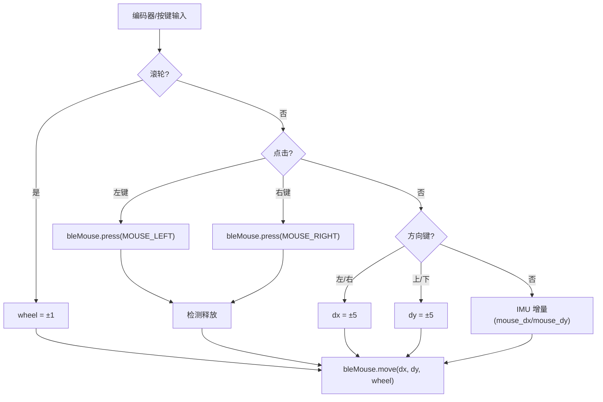
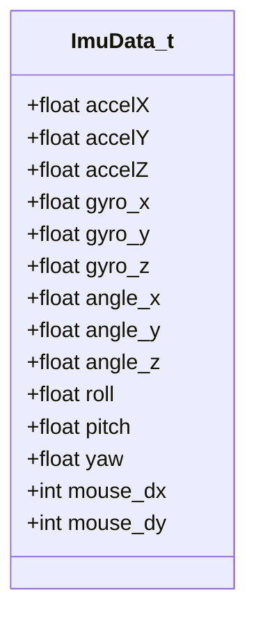
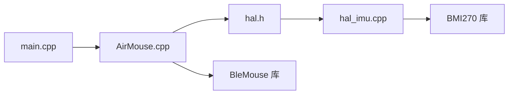

# 空中鼠标应用

<cite>
**本文引用的文件**   
- [AirMouse.cpp](file://src/apps/AirMouse.cpp)
- [AirMouse.h](file://src/apps/AirMouse.h)
- [hal_imu.cpp](file://src/hal/hal_imu.cpp)
- [hal.h](file://src/hal/hal.h)
- [hal_config.h](file://src/hal/hal_config.h)
- [main.cpp](file://src/main.cpp)
- [hal.cpp](file://src/hal/hal.cpp)
</cite>

## 目录
1. [简介](#简介)
2. [项目结构](#项目结构)
3. [核心组件](#核心组件)
4. [架构总览](#架构总览)
5. [详细组件分析](#详细组件分析)
6. [依赖关系分析](#依赖关系分析)
7. [性能与延迟优化](#性能与延迟优化)
8. [低功耗与电池管理](#低功耗与电池管理)
9. [故障排除指南](#故障排除指南)
10. [结论](#结论)

## 简介
本技术文档面向“空中鼠标”应用，围绕 IMU 手势识别算法、运动轨迹检测、蓝牙 HID 鼠标协议实现与连接管理、手势校准流程与灵敏度调节机制、鼠标移动/点击/滚轮映射逻辑、IMU 数据滤波与噪声抑制、低功耗模式与电池管理策略、配对设置与连接排障、以及性能优化与延迟降低方案进行系统化说明。目标读者包括硬件工程师、嵌入式软件工程师与应用开发者。

## 项目结构
本项目采用分层架构：
- 应用层：AirMouse 应用负责 UI、BLE 鼠标初始化、按键与编码器事件处理、HID 上报。
- HAL 层：封装 IMU、I2C、LCD、输入、电源等底层驱动与接口。
- 系统入口：main.cpp 作为状态机调度各应用；hal.cpp 完成系统级初始化。

**图示来源**
- [main.cpp:1-20](file://src/main.cpp#L1-L20)
- [hal.cpp:4-25](file://src/hal/hal.cpp#L4-L25)
- [AirMouse.cpp:1-23](file://src/apps/AirMouse.cpp#L1-L23)
- [hal_imu.cpp:1-16](file://src/hal/hal_imu.cpp#L1-L16)
- [hal.h:101-140](file://src/hal/hal.h#L101-L140)
- [hal_config.h:1-22](file://src/hal/hal_config.h#L1-L22)

**章节来源**
- [main.cpp:1-20](file://src/main.cpp#L1-L20)
- [hal.cpp:4-25](file://src/hal/hal.cpp#L4-L25)
- [AirMouse.cpp:1-23](file://src/apps/AirMouse.cpp#L1-L23)
- [hal_imu.cpp:1-16](file://src/hal/hal_imu.cpp#L1-L16)
- [hal.h:101-140](file://src/hal/hal.h#L101-L140)
- [hal_config.h:1-22](file://src/hal/hal_config.h#L1-L22)

## 核心组件
- AirMouse 应用：负责 BLE 鼠标初始化、UI 绘制、编码器按键处理、HID 移动/点击/滚轮上报。
- IMU 子系统：BMI270 传感器数据采集、零偏校准、坐标变换、互补滤波角度估计、鼠标增量计算。
- HAL 接口：统一暴露 IMU、输入、显示、电源等能力。
- 系统入口：启动顺序、应用切换、返回控制。

关键职责划分：
- AirMouse 应用不直接操作 IMU 寄存器，通过 HAL::updateImuData() 与 HAL::updateMouseDelta() 获取稳定角度与位移增量。
- IMU 内部维护采样频率、零偏、角度积分与方向映射，确保输出稳定的 roll/pitch/yaw 与 mouse_dx/dy。
- HAL 提供统一的 ImuData_t 数据结构，包含加速度、陀螺仪、角度、鼠标增量等字段。

**章节来源**
- [AirMouse.cpp:14-23](file://src/apps/AirMouse.cpp#L14-L23)
- [AirMouse.cpp:58-147](file://src/apps/AirMouse.cpp#L58-L147)
- [hal_imu.cpp:31-74](file://src/hal/hal_imu.cpp#L31-L74)
- [hal_imu.cpp:88-149](file://src/hal/hal_imu.cpp#L88-L149)
- [hal_imu.cpp:151-173](file://src/hal/hal_imu.cpp#L151-L173)
- [hal.h:31-47](file://src/hal/hal.h#L31-L47)
- [hal.h:130-140](file://src/hal/hal.h#L130-L140)

## 架构总览
下图展示从 IMU 采集到 HID 鼠标上报的完整数据流与控制流。

**图示来源**
- [main.cpp:69-73](file://src/main.cpp#L69-L73)
- [AirMouse.cpp:14-23](file://src/apps/AirMouse.cpp#L14-L23)
- [AirMouse.cpp:58-147](file://src/apps/AirMouse.cpp#L58-L147)
- [hal_imu.cpp:88-149](file://src/hal/hal_imu.cpp#L88-L149)
- [hal_imu.cpp:151-173](file://src/hal/hal_imu.cpp#L151-L173)

## 详细组件分析

### IMU 手势识别与轨迹检测
- 采样与时间控制：固定 100Hz 采样率，使用 dt 控制更新周期，避免高频抖动。
- 零偏校准：上电静置时采集 N 次陀螺仪数据求平均，得到三轴零偏并减去。
- 安装方向变换：根据 IMU_MOUNT_REAR 对加速度与陀螺仪数据进行符号翻转，保证坐标系一致。
- 角度估计：加速度计计算 roll/pitch，陀螺仪积分 yaw；标准互补滤波融合加速度计与陀螺仪角度，抑制漂移。
- 轨迹增量：基于角度差值计算 mouse_dx/dy，按 pitch→dx、roll→dy 映射，乘以灵敏度与缩放系数，并进行限幅。

**图示来源**
- [hal_imu.cpp:31-74](file://src/hal/hal_imu.cpp#L31-L74)
- [hal_imu.cpp:76-86](file://src/hal/hal_imu.cpp#L76-L86)
- [hal_imu.cpp:88-149](file://src/hal/hal_imu.cpp#L88-L149)
- [hal_imu.cpp:151-173](file://src/hal/hal_imu.cpp#L151-L173)

**章节来源**
- [hal_imu.cpp:31-74](file://src/hal/hal_imu.cpp#L31-L74)
- [hal_imu.cpp:76-86](file://src/hal/hal_imu.cpp#L76-L86)
- [hal_imu.cpp:88-149](file://src/hal/hal_imu.cpp#L88-L149)
- [hal_imu.cpp:151-173](file://src/hal/hal_imu.cpp#L151-L173)

### 蓝牙鼠标协议与连接管理
- BLE 初始化：AirMouse 应用创建 BleMouse 实例并调用 begin() 启动 BLE 服务。
- 连接状态：UI 中根据 isConnected() 显示蓝牙图标。
- HID 上报：move(dx, dy, wheel) 发送移动与滚轮；press/release(MOUSE_LEFT/MOUSE_RIGHT) 发送左右键。
- 按键释放：在检测到按钮抬起后调用 release()，避免悬空按键状态。

**图示来源**
- [AirMouse.cpp:1-6](file://src/apps/AirMouse.cpp#L1-L6)
- [AirMouse.cpp:45-53](file://src/apps/AirMouse.cpp#L45-L53)
- [AirMouse.cpp:87-101](file://src/apps/AirMouse.cpp#L87-L101)
- [AirMouse.cpp:127-139](file://src/apps/AirMouse.cpp#L127-L139)
- [AirMouse.cpp:141-146](file://src/apps/AirMouse.cpp#L141-L146)

**章节来源**
- [AirMouse.cpp:1-6](file://src/apps/AirMouse.cpp#L1-L6)
- [AirMouse.cpp:45-53](file://src/apps/AirMouse.cpp#L45-L53)
- [AirMouse.cpp:87-101](file://src/apps/AirMouse.cpp#L87-L101)
- [AirMouse.cpp:127-139](file://src/apps/AirMouse.cpp#L127-L139)
- [AirMouse.cpp:141-146](file://src/apps/AirMouse.cpp#L141-L146)

### 手势校准与灵敏度调节
- 校准流程：上电后执行 calibrateGyroBias()，静置约 1 秒采集 200 次样本，计算三轴零偏。
- 灵敏度调节：AirMouse 应用中 MOUSE_SENSITIVITY 常量控制鼠标增量放大倍数；IMU 内部还乘以固定缩放系数（12.0f）以适配屏幕像素移动。
- 限幅保护：mouse_dx/dy 限制在 [-50, 50]，防止极端抖动导致光标越界。

**图示来源**
- [hal_imu.cpp:31-55](file://src/hal/hal_imu.cpp#L31-L55)
- [hal_imu.cpp:151-173](file://src/hal/hal_imu.cpp#L151-L173)
- [AirMouse.h:32-32](file://src/apps/AirMouse.h#L32-L32)

**章节来源**
- [hal_imu.cpp:31-55](file://src/hal/hal_imu.cpp#L31-L55)
- [hal_imu.cpp:151-173](file://src/hal/hal_imu.cpp#L151-L173)
- [AirMouse.h:32-32](file://src/apps/AirMouse.h#L32-L32)

### 鼠标移动、点击、滚轮映射逻辑
- 移动映射：pitch→dx、roll→dy，结合灵敏度与缩放系数生成 HID 移动量。
- 滚轮映射：编码器顺时针/逆时针旋转分别映射为 wheel=+1/-1。
- 点击映射：短按 OK 键触发左键按下；长按 OK 键触发右键按下；按键抬起后自动释放。
- 方向键映射：上下左右键直接注入 dx/dy 增量，便于快速导航。

**图示来源**
- [AirMouse.cpp:74-121](file://src/apps/AirMouse.cpp#L74-L121)
- [AirMouse.cpp:127-146](file://src/apps/AirMouse.cpp#L127-L146)
- [hal_imu.cpp:151-173](file://src/hal/hal_imu.cpp#L151-L173)

**章节来源**
- [AirMouse.cpp:74-121](file://src/apps/AirMouse.cpp#L74-L121)
- [AirMouse.cpp:127-146](file://src/apps/AirMouse.cpp#L127-L146)
- [hal_imu.cpp:151-173](file://src/hal/hal_imu.cpp#L151-L173)

### IMU 数据滤波与噪声抑制
- 零偏抑制：上电静置采样求平均，消除静态偏移。
- 互补滤波：高比例陀螺仪积分 + 低比例加速度计修正，平衡动态响应与长期稳定性。
- 坐标变换：安装方向翻转，避免反向映射导致的误操作。
- 限幅与平滑：鼠标增量限幅，减少突发抖动；固定采样率避免时序抖动。

**图示来源**
- [hal.h:31-47](file://src/hal/hal.h#L31-L47)

**章节来源**
- [hal_imu.cpp:31-74](file://src/hal/hal_imu.cpp#L31-L74)
- [hal_imu.cpp:76-86](file://src/hal/hal_imu.cpp#L76-L86)
- [hal_imu.cpp:88-149](file://src/hal/hal_imu.cpp#L88-L149)
- [hal.h:31-47](file://src/hal/hal.h#L31-L47)

## 依赖关系分析
- AirMouse 应用依赖 HAL 接口与 BLE 鼠标库。
- HAL 接口定义集中管理 IMU、输入、显示、电源等能力，便于扩展与维护。
- IMU 驱动依赖 BMI270 库与 I2C 总线。
- main.cpp 作为状态机调度各应用，AIRMOUSE 状态触发 AirMouse 应用运行。

**图示来源**
- [main.cpp:69-73](file://src/main.cpp#L69-L73)
- [AirMouse.cpp:1-6](file://src/apps/AirMouse.cpp#L1-L6)
- [hal.h:130-140](file://src/hal/hal.h#L130-L140)
- [hal_imu.cpp:1-16](file://src/hal/hal_imu.cpp#L1-L16)

**章节来源**
- [main.cpp:69-73](file://src/main.cpp#L69-L73)
- [AirMouse.cpp:1-6](file://src/apps/AirMouse.cpp#L1-L6)
- [hal.h:130-140](file://src/hal/hal.h#L130-L140)
- [hal_imu.cpp:1-16](file://src/hal/hal_imu.cpp#L1-L16)

## 性能与延迟优化
- 固定采样率：IMU 更新周期控制在 10ms（100Hz），避免频繁唤醒与 CPU 抖动。
- 最小化 UI 刷新：Update() 中限制 10ms 内重复执行，减少不必要的重绘。
- 轻量数据处理：互补滤波与角度增量计算均为 O(1)，无复杂迭代。
- HID 批量上报：仅在 dx/dy/wheel 非零时调用 bleMouse.move()，减少无效传输。
- 建议优化：
  - 将 BLE 连接检查与 UI 绘制解耦，降低主循环压力。
  - 使用中断或 DMA 方式读取 IMU 数据，进一步降低 CPU 占用。
  - 对鼠标增量做一阶低通滤波，提升平滑度并降低抖动。

[本节为通用性能建议，不涉及具体代码片段]

## 低功耗与电池管理
- 当前实现未启用 BLE 低功耗广播或休眠策略，主要功耗来自 BLE 常驻与 LCD 背光。
- 可优化点：
  - BLE 空闲时进入低功耗模式或关闭广播。
  - 根据用户活动调整 IMU 采样率（如静止时降至 20Hz）。
  - 背光自动调暗或关闭，延长续航。
  - 利用 hal.cpp 中的 Power_Init()/getVoltage() 监控电量并提示低电量。

**章节来源**
- [hal.cpp:4-25](file://src/hal/hal.cpp#L4-L25)
- [hal.h:171-179](file://src/hal/hal.h#L171-L179)

## 故障排除指南
- IMU 初始化失败：
  - 现象：串口打印 “IMU init failed!”。
  - 排查：检查 I2C 地址与连线；确认 BMI270 供电正常。
- 校准异常：
  - 现象：校准过程中设备晃动导致零偏不准。
  - 解决：保持设备静置至少 1 秒，避免震动。
- 鼠标漂移或反向：
  - 现象：鼠标移动方向与预期相反或漂移严重。
  - 解决：检查 IMU_MOUNT_REAR 配置；调整 MOUSE_SENSITIVITY；确认互补滤波系数合理。
- BLE 无法连接：
  - 现象：UI 不显示蓝牙图标，或主机无法发现设备。
  - 解决：确认 bleMouse.begin() 成功；检查主机蓝牙权限与配对列表。
- 按键无响应：
  - 现象：编码器旋转或按键无效果。
  - 解决：检查 ENCODER 引脚配置；确认 getEncoder() 返回值正确。

**章节来源**
- [hal_imu.cpp:57-74](file://src/hal/hal_imu.cpp#L57-L74)
- [AirMouse.cpp:45-53](file://src/apps/AirMouse.cpp#L45-L53)
- [hal_config.h:29-36](file://src/hal/hal_config.h#L29-L36)

## 结论
空中鼠标应用通过 HAL 抽象层与 IMU 驱动实现了稳定的手势识别与轨迹检测，结合 BLE HID 协议完成鼠标移动、点击与滚轮的上报。系统在采样率控制、零偏校准、互补滤波与限幅保护等方面具备良好鲁棒性。未来可在 BLE 低功耗、IMU 自适应采样率与 UI 异步渲染方面进一步优化，以提升续航与交互流畅度。