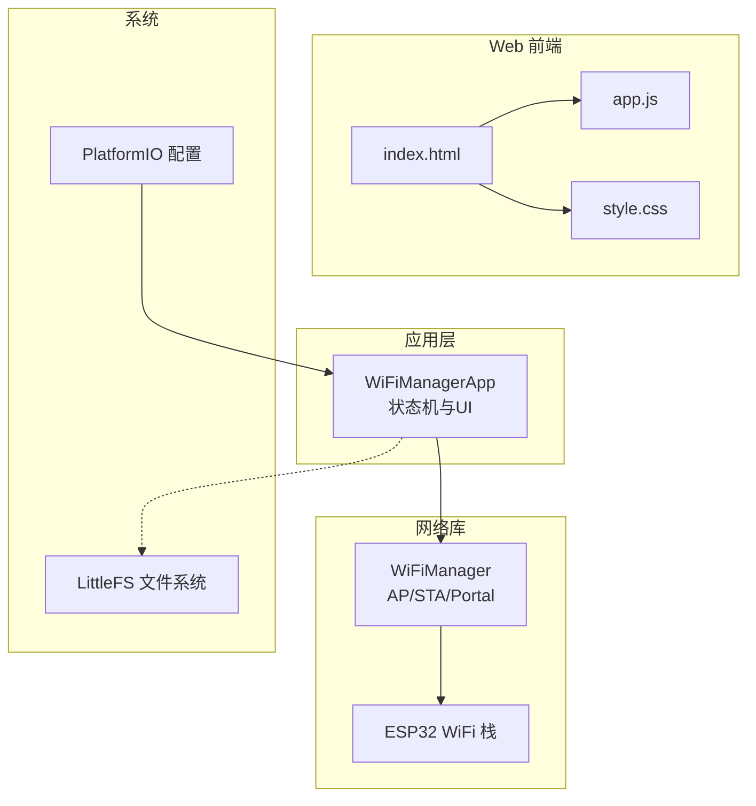
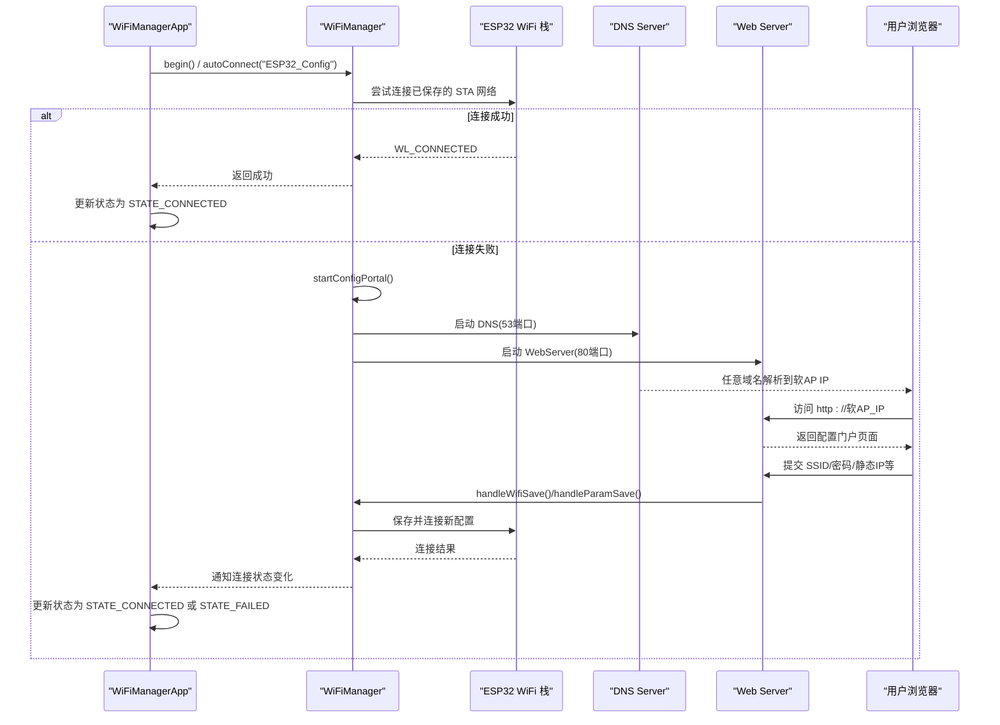
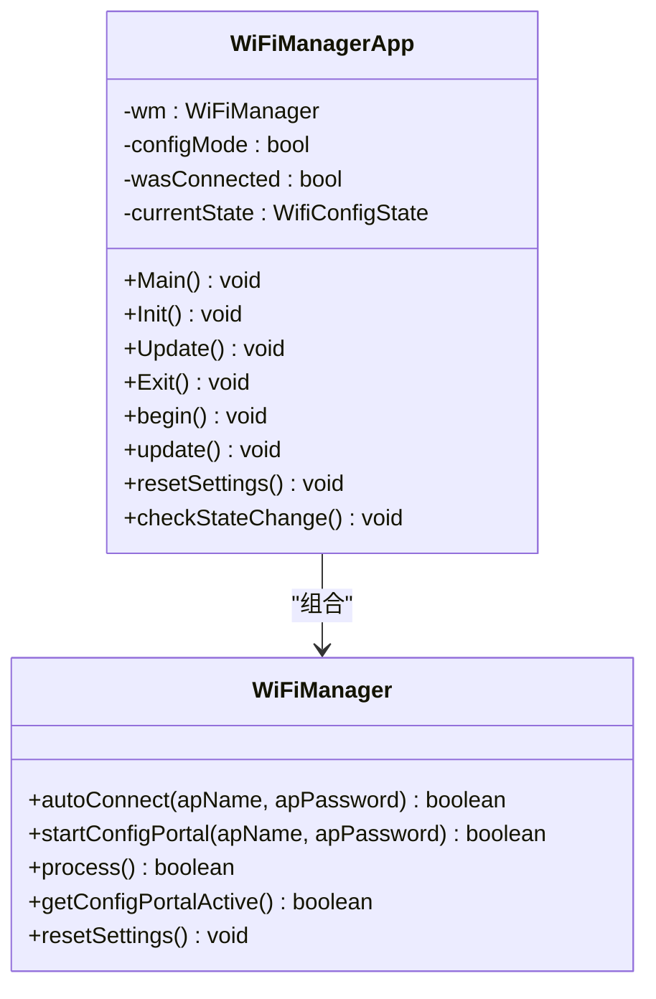
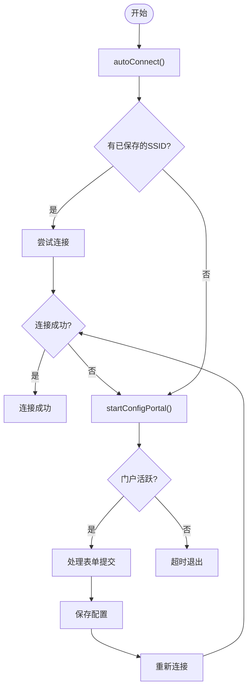
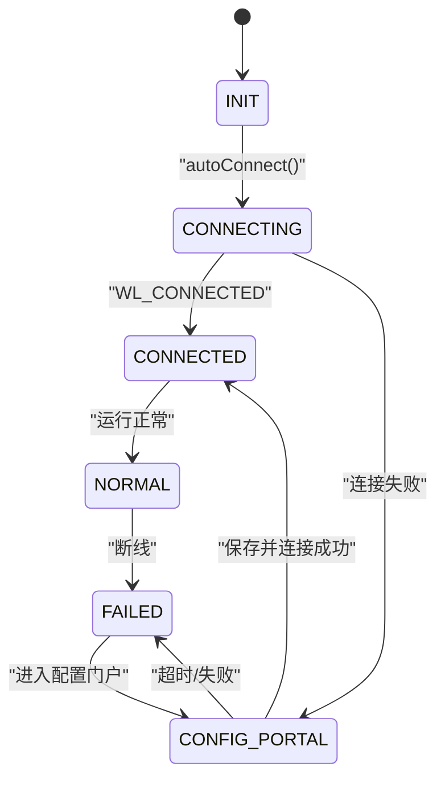
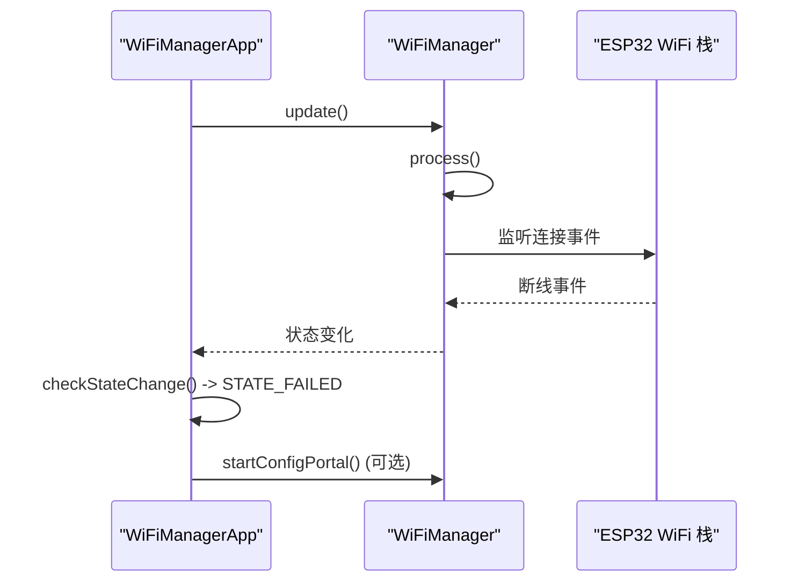
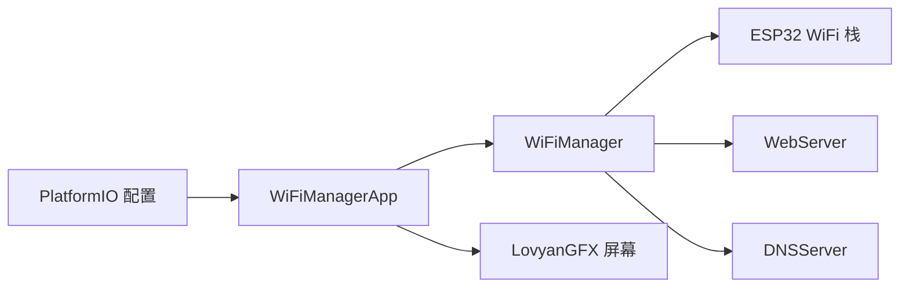

# WiFi 管理器

<cite>
**本文引用的文件**   
- [WiFiManagerApp.cpp](file://src/apps/WiFiManagerApp.cpp)
- [WiFiManagerApp.h](file://src/apps/WiFiManagerApp.h)
- [index.html](file://data/index.html)
- [app.js](file://data/app.js)
- [style.css](file://data/style.css)
- [platformio.ini](file://platformio.ini)
- [WiFiManager.h](file://lib/WiFiManager/WiFiManager.h)
- [WiFiManager.cpp](file://lib/WiFiManager/WiFiManager.cpp)
</cite>

## 目录
1. [简介](#简介)
2. [项目结构](#项目结构)
3. [核心组件](#核心组件)
4. [架构总览](#架构总览)
5. [详细组件分析](#详细组件分析)
6. [依赖关系分析](#依赖关系分析)
7. [性能与优化](#性能与优化)
8. [故障诊断与排错](#故障诊断与排错)
9. [结论](#结论)
10. [附录](#附录)

## 简介
本技术文档围绕 ESP32-S3 设备上的 WiFi 管理器应用，系统性说明以下主题：
- WiFi 网络配置流程：AP 模式配置、STA 模式连接、静态 IP 等网络参数设置
- WiFiManager 库的集成与使用：自动连接、Captive Portal（门户）配置与自定义页面
- 网络连接生命周期管理：连接建立、自动重连、断开处理
- 网络安全设置：WPA/WPA2 认证与加密配置
- 网络状态监控与故障诊断：信号强度、IP 显示、错误提示与重试机制
- 调试技巧与性能优化建议

本项目基于 Arduino 框架与 PlatformIO 构建，使用 WiFiManager 库提供 Web 配置门户，结合 LovyanGFX 在本地屏幕展示连接状态与操作引导。

## 项目结构
- src/apps/WiFiManagerApp.*：应用层 UI 与状态机，负责屏幕绘制、按钮/串口交互、调用 WiFiManager
- data/*：Web 前端资源（HTML/CSS/JS），用于 SD 卡文件管理界面（非 WiFi 配置门户）
- lib/WiFiManager/*：第三方 WiFiManager 库，实现 AP/STA 管理、DNS/WebServer、Captive Portal、参数表单等
- platformio.ini：平台与编译选项，启用 LittleFS、USB CDC、PSRAM 等

图表来源
- [WiFiManagerApp.h:20-95](file://src/apps/WiFiManagerApp.h#L20-L95)
- [WiFiManager.h:247-509](file://lib/WiFiManager/WiFiManager.h#L247-L509)
- [platformio.ini:11-31](file://platformio.ini#L11-L31)

章节来源
- [platformio.ini:11-31](file://platformio.ini#L11-L31)

## 核心组件
- WiFiManagerApp：封装 WiFiManager 的使用，维护设备连接状态机，驱动屏幕显示不同阶段（初始化、连接中、配置门户、已连接、失败、正常运行）
- WiFiManager：提供自动连接、配置门户、Web 服务器、DNS 重定向、参数表单、静态 IP 配置、自动重连等能力
- 前端资源：data/index.html、data/app.js、data/style.css 为 SD 卡文件管理界面，与 WiFi 配置门户无关

章节来源
- [WiFiManagerApp.h:20-95](file://src/apps/WiFiManagerApp.h#L20-L95)
- [WiFiManager.h:247-509](file://lib/WiFiManager/WiFiManager.h#L247-L509)

## 架构总览
下图展示了从应用启动到 WiFi 连接成功或进入配置门户的整体流程，以及各组件之间的交互关系。

图表来源
- [WiFiManagerApp.h:39-91](file://src/apps/WiFiManagerApp.h#L39-L91)
- [WiFiManager.h:255-273](file://lib/WiFiManager/WiFiManager.h#L255-L273)
- [WiFiManager.h:651-691](file://lib/WiFiManager/WiFiManager.h#L651-L691)

## 详细组件分析

### WiFiManagerApp 组件分析
- 职责
  - 管理应用生命周期：Init/Update/Exit/Main
  - 维护状态机：STATE_INIT、STATE_CONNECTING、STATE_CONFIG_PORTAL、STATE_CONNECTED、STATE_FAILED、STATE_NORMAL_OPERATION
  - 驱动屏幕绘制：初始化画面、连接动画、配置门户引导、连接成功信息、失败重试提示、正常运行界面
  - 与 WiFiManager 交互：begin/update/resetSettings/checkStateChange
  - 输入处理：按键与串口命令（调试用）

- 关键方法与字段
  - begin：设置配置门户超时、尝试自动连接
  - update：根据 configMode 调整 wm.process() 调用频率；断线时切换回配置模式
  - resetSettings：清除配置并重启
  - checkStateChange：检测 WiFi.status() 与 wm.getConfigPortalActive() 变化，更新 UI 状态
  - Main/Update：主循环与状态刷新

图表来源
- [WiFiManagerApp.h:20-95](file://src/apps/WiFiManagerApp.h#L20-L95)
- [WiFiManager.h:247-509](file://lib/WiFiManager/WiFiManager.h#L247-L509)

章节来源
- [WiFiManagerApp.h:20-95](file://src/apps/WiFiManagerApp.h#L20-L95)
- [WiFiManagerApp.cpp:360-436](file://src/apps/WiFiManagerApp.cpp#L360-L436)

### WiFiManager 库集成与使用
- 自动连接与配置门户
  - autoConnect：优先尝试已保存的 STA 网络；失败则启动配置门户
  - startConfigPortal：手动启动 AP 与 Web 门户
  - process：在非阻塞模式下周期性处理门户逻辑
- 配置门户控制
  - setConfigPortalTimeout：设置门户超时时间
  - setConfigPortalBlocking：是否阻塞等待配置完成
  - getConfigPortalActive：判断门户是否活跃
- 网络参数设置
  - setSTAStaticIPConfig：设置 STA 静态 IP、网关、子网、DNS
  - setAPStaticIPConfig：设置 AP 静态 IP
  - setHostname：设置主机名
- 安全与认证
  - 通过 Web 门户表单提交 SSID 与密码，底层支持 WPA/WPA2 加密类型
  - encryptionTypeStr：将加密类型转换为字符串显示
- 回调与扩展
  - setSaveConfigCallback、setPreSaveParamsCallback 等：在保存前后执行自定义逻辑
  - addParameter：添加自定义参数项（如 MQTT 服务器、端口、设备名）

图表来源
- [WiFiManager.h:255-273](file://lib/WiFiManager/WiFiManager.h#L255-L273)
- [WiFiManager.h:356-363](file://lib/WiFiManager/WiFiManager.h#L356-L363)
- [WiFiManager.h:415-417](file://lib/WiFiManager/WiFiManager.h#L415-L417)
- [WiFiManager.h:651-691](file://lib/WiFiManager/WiFiManager.h#L651-L691)

章节来源
- [WiFiManager.h:247-509](file://lib/WiFiManager/WiFiManager.h#L247-L509)
- [WiFiManager.cpp:1-200](file://lib/WiFiManager/WiFiManager.cpp#L1-L200)

### AP 模式配置与 STA 模式连接
- AP 模式配置
  - 通过 startConfigPortal 启动软 AP，默认 SSID 可自定义（例如 “ESP32_Config”）
  - 可设置 AP 静态 IP、信道、隐藏 AP 等
- STA 模式连接
  - autoConnect 优先使用已保存的 SSID/密码进行连接
  - 可通过 setSTAStaticIPConfig 配置静态 IP、网关、子网、DNS
  - 支持 setCleanConnect 提升连接稳定性

图表来源
- [WiFiManagerApp.h:9-18](file://src/apps/WiFiManagerApp.h#L9-L18)
- [WiFiManager.h:255-273](file://lib/WiFiManager/WiFiManager.h#L255-L273)

章节来源
- [WiFiManager.h:356-363](file://lib/WiFiManager/WiFiManager.h#L356-L363)
- [WiFiManager.h:425-432](file://lib/WiFiManager/WiFiManager.h#L425-L432)

### 网络参数设置与自定义页面
- 自定义参数
  - 通过 addParameter 添加自定义字段（如 MQTT 服务器、端口、设备名）
  - 这些参数可在配置门户中编辑并随 Wi-Fi 配置一起保存
- 自定义页面
  - setCustomHeadElement：注入 <head> 内容
  - setCustomMenuHTML：自定义菜单 HTML
  - setParamsPage：将参数放置于独立页面
- 注意：data/index.html、data/app.js、data/style.css 为 SD 卡文件管理界面，并非 WiFi 配置门户页面

章节来源
- [WiFiManager.h:373-377](file://lib/WiFiManager/WiFiManager.h#L373-L377)
- [WiFiManager.h:442-443](file://lib/WiFiManager/WiFiManager.h#L442-L443)
- [index.html:1-92](file://data/index.html#L1-L92)
- [app.js:1-413](file://data/app.js#L1-L413)
- [style.css:1-390](file://data/style.css#L1-L390)

### 网络连接生命周期管理
- 连接建立
  - autoConnect 尝试连接已保存网络；成功后进入 CONNECTED 状态
- 自动重连
  - setWiFiAutoReconnect 启用自动重连
  - WiFiManager 内部维护 _wifiAutoReconnect 标志，并在事件回调中触发重连
- 断开处理
  - WiFiManagerApp::checkStateChange 检测断线，切换到 FAILED 状态并进入配置门户
  - 用户可通过按键或串口命令触发重置配置

图表来源
- [WiFiManagerApp.cpp:360-385](file://src/apps/WiFiManagerApp.cpp#L360-L385)
- [WiFiManager.h:403-404](file://lib/WiFiManager/WiFiManager.h#L403-L404)

章节来源
- [WiFiManagerApp.cpp:360-385](file://src/apps/WiFiManagerApp.cpp#L360-L385)
- [WiFiManager.h:403-404](file://lib/WiFiManager/WiFiManager.h#L403-L404)

### 网络安全设置（WPA/WPA2 认证与加密）
- 通过配置门户表单提交 SSID 与密码，底层使用 ESP32 WiFi 栈进行 WPA/WPA2 认证
- encryptionTypeStr 可将加密类型转为可读字符串，便于在门户中显示
- 建议在公共环境中启用强密码，避免开放网络（ENC_TYPE_NONE）

章节来源
- [WiFiManager.h:760-760](file://lib/WiFiManager/WiFiManager.h#L760-L760)

### 网络状态监控与故障诊断
- 信号强度与 IP 显示
  - showConnectedScreen 显示 IP 与 RSSI，drawSignalStrength 根据 RSSI 计算信号条数
- 失败与重试
  - showFailedScreen 提示失败并重试，引导用户进入配置门户
- 串口调试
  - handleSerialInput 提供数字键切换状态，便于快速验证 UI 与状态机

章节来源
- [WiFiManagerApp.cpp:132-198](file://src/apps/WiFiManagerApp.cpp#L132-L198)
- [WiFiManagerApp.cpp:296-324](file://src/apps/WiFiManagerApp.cpp#L296-L324)
- [WiFiManagerApp.cpp:509-589](file://src/apps/WiFiManagerApp.cpp#L509-L589)

## 依赖关系分析
- WiFiManagerApp 依赖 WiFiManager 提供的自动连接、门户与参数管理
- WiFiManager 依赖 ESP32 WiFi 栈、WebServer、DNSServer
- PlatformIO 配置启用 LittleFS 与 PSRAM，影响文件系统与内存行为

图表来源
- [WiFiManagerApp.h:20-95](file://src/apps/WiFiManagerApp.h#L20-L95)
- [WiFiManager.h:501-509](file://lib/WiFiManager/WiFiManager.h#L501-L509)
- [platformio.ini:11-31](file://platformio.ini#L11-L31)

章节来源
- [platformio.ini:11-31](file://platformio.ini#L11-L31)

## 性能与优化
- 进程调度策略
  - WiFiManagerApp::update 在配置模式下高频调用 wm.process()（约 20ms），正常模式下低频调用（约 1s），降低 CPU 占用
- 扫描与缓存
  - WiFiManager 支持异步扫描与扫描缓存（_asyncScan、_scancachetime），可减少门户加载延迟
- 连接稳定性
  - setCleanConnect 在连接前断开旧连接，提高稳定性
  - setConnectRetries 增加重试次数，应对弱信号或 AP 保护机制
- 内存与文件系统
  - PlatformIO 启用 PSRAM 与 LittleFS，有助于减少内存碎片与提升 I/O 性能

章节来源
- [WiFiManagerApp.h:51-80](file://src/apps/WiFiManagerApp.h#L51-L80)
- [WiFiManager.h:624-626](file://lib/WiFiManager/WiFiManager.h#L624-L626)
- [WiFiManager.h:431-432](file://lib/WiFiManager/WiFiManager.h#L431-L432)
- [WiFiManager.h:339-340](file://lib/WiFiManager/WiFiManager.h#L339-L340)
- [platformio.ini:11-31](file://platformio.ini#L11-L31)

## 故障诊断与排错
- 常见问题
  - 无法进入配置门户：检查 wm.setConfigPortalTimeout 与 setConfigPortalBlocking 设置
  - 连接失败：确认 SSID/密码正确，必要时使用 setMinimumSignalQuality 过滤弱信号
  - 门户超时：调整 setConfigPortalTimeout 或禁用客户端检查 setWebPortalClientCheck
- 调试手段
  - 串口输出：开启 WiFiManager 调试日志 setDebugOutput(true)
  - 状态切换：通过串口命令快速切换 UI 状态以验证显示逻辑
  - 按键复位：长按触发 resetSettings 并重启设备

章节来源
- [WiFiManagerApp.cpp:444-489](file://src/apps/WiFiManagerApp.cpp#L444-L489)
- [WiFiManagerApp.cpp:509-589](file://src/apps/WiFiManagerApp.cpp#L509-L589)
- [WiFiManager.h:348-351](file://lib/WiFiManager/WiFiManager.h#L348-L351)

## 结论
本项目通过 WiFiManagerApp 与 WiFiManager 库协作，实现了完整的 WiFi 配置与连接生命周期管理。开发者可借助其自动连接、配置门户、参数表单与回调机制，快速构建稳定的 IoT 设备联网方案。同时，结合屏幕 UI 与串口调试，提供了良好的用户体验与排错能力。在生产环境中，建议合理配置超时、重试与静态 IP，并启用强密码以提升安全性。

## 附录
- 常用 API 速查
  - autoConnect/apName/apPassword：自动连接与门户 SSID/密码
  - startConfigPortal/process：手动启动门户与非阻塞处理
  - setSTAStaticIPConfig/setAPStaticIPConfig：静态 IP 配置
  - setWiFiAutoReconnect/setConnectRetries：自动重连与重试
  - setDebugOutput：开启调试日志
  - addParameter/setCustomHeadElement/setCustomMenuHTML：扩展门户功能

章节来源
- [WiFiManager.h:255-273](file://lib/WiFiManager/WiFiManager.h#L255-L273)
- [WiFiManager.h:336-340](file://lib/WiFiManager/WiFiManager.h#L336-L340)
- [WiFiManager.h:356-363](file://lib/WiFiManager/WiFiManager.h#L356-L363)
- [WiFiManager.h:373-377](file://lib/WiFiManager/WiFiManager.h#L373-L377)
- [WiFiManager.h:403-404](file://lib/WiFiManager/WiFiManager.h#L403-L404)