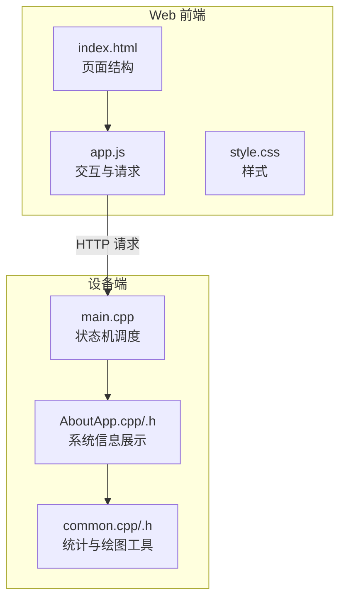
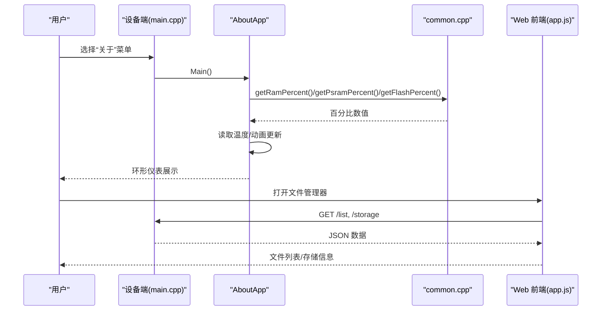
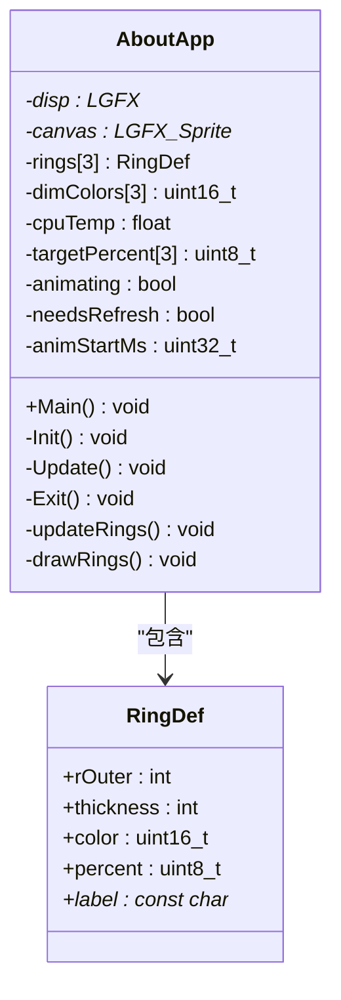
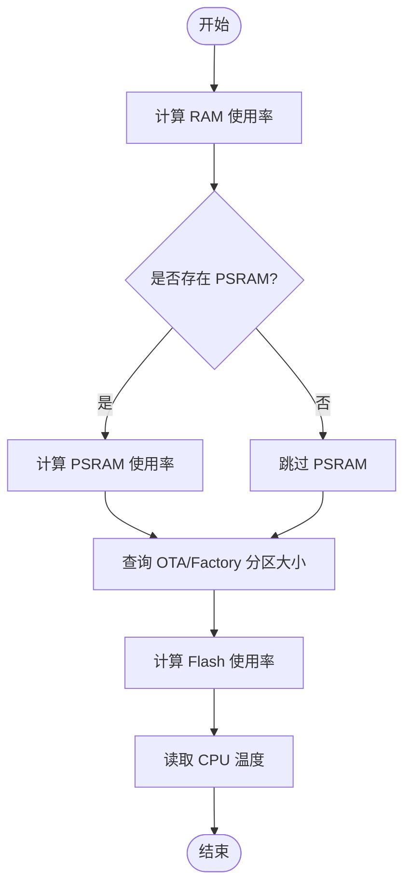
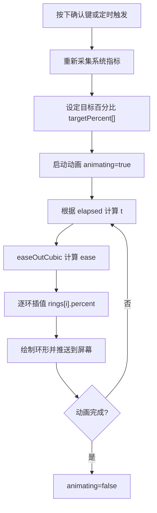
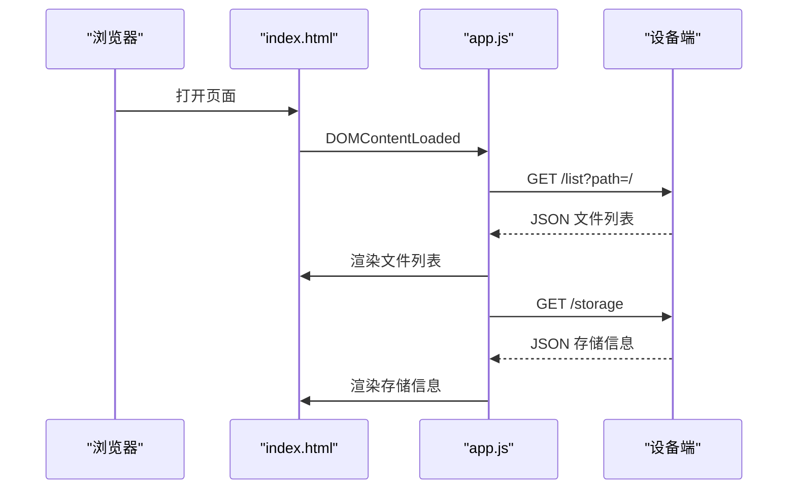
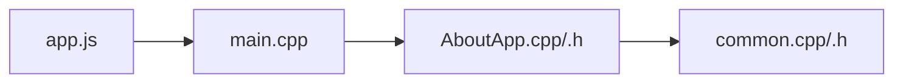

# 关于应用

<cite>
**本文引用的文件**   
- [AboutApp.cpp](file://src/apps/AboutApp.cpp)
- [AboutApp.h](file://src/apps/AboutApp.h)
- [common.cpp](file://src/common.cpp)
- [common.h](file://src/common.h)
- [main.cpp](file://src/main.cpp)
- [index.html](file://data/index.html)
- [app.js](file://data/app.js)
- [style.css](file://data/style.css)
</cite>

## 目录
1. [简介](#简介)
2. [项目结构](#项目结构)
3. [核心组件](#核心组件)
4. [架构总览](#架构总览)
5. [详细组件分析](#详细组件分析)
6. [依赖关系分析](#依赖关系分析)
7. [性能与扩展性](#性能与扩展性)
8. [故障排查指南](#故障排查指南)
9. [结论](#结论)
10. [附录：API 与使用示例](#附录api-与使用示例)

## 简介
本“关于应用”文档聚焦于系统信息的采集、展示与交互，覆盖以下方面：
- 系统信息收集与展示：固件版本（通过 OTA/Factory 分区体现）、硬件信息（内存、PSRAM、Flash、温度等）、运行时间（通过动画计时器体现）
- 应用版本管理与更新检查机制：基于 OTA 分区的版本布局与占用比例展示
- 系统统计数据收集方法与显示逻辑：环形进度条动画、缓动函数、数据刷新触发
- 用户界面设计与交互方式：设备端环形仪表 + Web 侧存储管理界面
- 系统信息获取 API 与使用示例：内存/PSRAM/Flash 百分比接口
- 信息展示的自定义选项与扩展方法：环样式、颜色、标签、动画参数等

## 项目结构
围绕“关于应用”的关键代码位于 src/apps 与 src/common，Web 资源位于 data。整体组织如下：
- 设备端应用层：AboutApp 负责采集系统指标并绘制环形仪表
- 公共工具层：common 提供内存/PSRAM/Flash 百分比计算与绘图工具
- 主循环调度：main.cpp 将 AboutApp 作为独立状态机入口
- Web 前端：index.html/app.js/style.css 提供 SD 卡文件管理与存储信息展示（与“关于应用”并列的 Web 功能）

图表来源
- [main.cpp:1-209](file://src/main.cpp#L1-L209)
- [AboutApp.cpp:1-204](file://src/apps/AboutApp.cpp#L1-L204)
- [AboutApp.h:1-62](file://src/apps/AboutApp.h#L1-L62)
- [common.cpp:1-151](file://src/common.cpp#L1-L151)
- [index.html:1-92](file://data/index.html#L1-L92)
- [app.js:1-413](file://data/app.js#L1-L413)
- [style.css:1-390](file://data/style.css#L1-L390)

章节来源
- [main.cpp:1-209](file://src/main.cpp#L1-L209)
- [AboutApp.cpp:1-204](file://src/apps/AboutApp.cpp#L1-L204)
- [AboutApp.h:1-62](file://src/apps/AboutApp.h#L1-L62)
- [common.cpp:1-151](file://src/common.cpp#L1-L151)
- [index.html:1-92](file://data/index.html#L1-L92)
- [app.js:1-413](file://data/app.js#L1-L413)
- [style.css:1-390](file://data/style.css#L1-L390)

## 核心组件
- AboutApp：负责初始化传感器、读取系统指标、渲染环形进度条、处理交互与动画
- common：提供 getRamPercent/getPsramPercent/getFlashPercent 等统计接口与绘图辅助
- main.cpp：状态机驱动，进入 STATE_ABOUT 时调用 AboutApp.Main()
- Web 前端：提供文件列表、上传队列、存储信息展示与操作

章节来源
- [AboutApp.cpp:1-204](file://src/apps/AboutApp.cpp#L1-L204)
- [AboutApp.h:1-62](file://src/apps/AboutApp.h#L1-L62)
- [common.cpp:1-151](file://src/common.cpp#L1-L151)
- [main.cpp:117-121](file://src/main.cpp#L117-L121)
- [index.html:1-92](file://data/index.html#L1-L92)
- [app.js:1-413](file://data/app.js#L1-L413)
- [style.css:1-390](file://data/style.css#L1-L390)

## 架构总览
“关于应用”在设备上以环形仪表呈现系统指标；Web 端提供文件管理与存储信息查看。两者通过 HTTP 接口协作（Web 端发起请求，设备端响应）。

图表来源
- [main.cpp:117-121](file://src/main.cpp#L117-L121)
- [AboutApp.cpp:6-15](file://src/apps/AboutApp.cpp#L6-L15)
- [common.cpp:27-62](file://src/common.cpp#L27-L62)
- [app.js:200-230](file://data/app.js#L200-L230)
- [app.js:361-378](file://data/app.js#L361-L378)

## 详细组件分析

### AboutApp 组件
职责：
- 初始化温度传感器与显示资源
- 周期性采集 RAM/PSRAM/Flash 使用率与 CPU 温度
- 绘制三条环形进度条，中心显示温度
- 支持按键重播动画与串口调试命令

关键流程：
- Init：配置温度传感器、计算暗色背景、初始目标值、启动动画
- Update：检测按键重播、串口指令设置环百分比、执行缓动动画
- Exit：停止温度传感器

图表来源
- [AboutApp.h:8-57](file://src/apps/AboutApp.h#L8-L57)
- [AboutApp.cpp:6-15](file://src/apps/AboutApp.cpp#L6-L15)
- [AboutApp.cpp:17-74](file://src/apps/AboutApp.cpp#L17-L74)
- [AboutApp.cpp:76-117](file://src/apps/AboutApp.cpp#L76-L117)
- [AboutApp.cpp:119-185](file://src/apps/AboutApp.cpp#L119-L185)
- [AboutApp.cpp:187-204](file://src/apps/AboutApp.cpp#L187-L204)

章节来源
- [AboutApp.cpp:1-204](file://src/apps/AboutApp.cpp#L1-L204)
- [AboutApp.h:1-62](file://src/apps/AboutApp.h#L1-L62)

### 系统统计与数据采集
- RAM 使用率：基于 ESP.getFreeHeap/ESP.getHeapSize 计算已用百分比
- PSRAM 使用率：若存在 PSRAM，则基于 ESP.getFreePsram/ESP.getPsramSize 计算
- Flash 使用率：查找 OTA/Factory 分区大小，除以整片 Flash 容量得到占比
- 温度：通过内部温度传感器读取 CPU 温度

图表来源
- [common.cpp:27-62](file://src/common.cpp#L27-L62)
- [AboutApp.cpp:6-15](file://src/apps/AboutApp.cpp#L6-L15)

章节来源
- [common.cpp:27-62](file://src/common.cpp#L27-L62)
- [AboutApp.cpp:6-15](file://src/apps/AboutApp.cpp#L6-L15)

### 动画与显示逻辑
- 环形绘制：背景灰环 + 前景彩色弧段 + 圆角端点
- 缓动动画：easeOutCubic，按时间比例插值到目标百分比
- 交互触发：确认键重播动画；串口命令可设置环百分比用于调试

图表来源
- [AboutApp.cpp:119-185](file://src/apps/AboutApp.cpp#L119-L185)
- [AboutApp.cpp:17-74](file://src/apps/AboutApp.cpp#L17-L74)

章节来源
- [AboutApp.cpp:119-185](file://src/apps/AboutApp.cpp#L119-L185)
- [AboutApp.cpp:17-74](file://src/apps/AboutApp.cpp#L17-L74)

### Web 前端与存储信息展示
- index.html：定义页面结构与控件（上传区、存储信息、文件列表、面包屑导航）
- app.js：实现文件列表加载、上传队列、删除/创建文件夹、存储信息拉取与格式化
- style.css：提供现代化 UI 样式与响应式布局

图表来源
- [index.html:1-92](file://data/index.html#L1-L92)
- [app.js:7-50](file://data/app.js#L7-L50)
- [app.js:200-230](file://data/app.js#L200-L230)
- [app.js:361-378](file://data/app.js#L361-L378)

章节来源
- [index.html:1-92](file://data/index.html#L1-L92)
- [app.js:1-413](file://data/app.js#L1-L413)
- [style.css:1-390](file://data/style.css#L1-L390)

## 依赖关系分析
- AboutApp 依赖 common 提供的统计接口与绘图工具
- main.cpp 通过状态机调度 AboutApp
- Web 前端通过 HTTP 接口与设备端通信（文件列表、存储信息等）

图表来源
- [main.cpp:117-121](file://src/main.cpp#L117-L121)
- [AboutApp.cpp:1-204](file://src/apps/AboutApp.cpp#L1-L204)
- [common.cpp:1-151](file://src/common.cpp#L1-L151)
- [app.js:200-230](file://data/app.js#L200-L230)

章节来源
- [main.cpp:117-121](file://src/main.cpp#L117-L121)
- [AboutApp.cpp:1-204](file://src/apps/AboutApp.cpp#L1-L204)
- [common.cpp:1-151](file://src/common.cpp#L1-L151)
- [app.js:200-230](file://data/app.js#L200-L230)

## 性能与扩展性
- 性能要点
  - 环形绘制采用批量填充弧段与少量圆形端点，避免频繁像素级绘制
  - 动画使用毫秒计时与缓动函数，减少不必要的重绘
  - 温度传感器仅在 AboutApp 生命周期内启用，退出时关闭
- 扩展建议
  - 新增统计项：在 common.cpp 中增加对应百分比接口，并在 AboutApp::updateRings 中采集
  - 自定义环样式：修改 AboutApp.h 中的 rings 数组（半径、厚度、颜色、标签）
  - 调整动画效果：修改 ANIM_DURATION_MS 与缓动算法
  - Web 端扩展：在 app.js 中增加新的 HTTP 接口调用与 UI 渲染

章节来源
- [AboutApp.cpp:17-74](file://src/apps/AboutApp.cpp#L17-L74)
- [AboutApp.cpp:119-185](file://src/apps/AboutApp.cpp#L119-L185)
- [AboutApp.h:38-52](file://src/apps/AboutApp.h#L38-L52)
- [common.cpp:27-62](file://src/common.cpp#L27-L62)

## 故障排查指南
- 温度读取失败
  - 现象：串口打印 temp_sensor_read_celsius fail
  - 排查：检查温度传感器配置与初始化流程
  - 参考位置：AboutApp::Init 与 updateRings
- 环形百分比异常
  - 现象：环百分比不更新或为 0
  - 排查：确认 getRamPercent/getPsramPercent/getFlashPercent 返回值；检查 PSRAM 是否可用
  - 参考位置：common.cpp 统计接口
- 动画未播放
  - 现象：按下确认键无动画
  - 排查：检查 animating 标志与 animStartMs 重置逻辑；确认 Update 循环执行
  - 参考位置：AboutApp::Update
- Web 端无法加载存储信息
  - 现象：/storage 返回错误或空数据
  - 排查：检查设备端 HTTP 服务是否就绪；确认 app.js 中 fetch 路径正确
  - 参考位置：app.js 存储信息加载

章节来源
- [AboutApp.cpp:6-15](file://src/apps/AboutApp.cpp#L6-L15)
- [AboutApp.cpp:119-185](file://src/apps/AboutApp.cpp#L119-L185)
- [common.cpp:27-62](file://src/common.cpp#L27-L62)
- [app.js:361-378](file://data/app.js#L361-L378)

## 结论
“关于应用”通过设备端环形仪表直观展示系统指标，结合 Web 前端提供文件与存储管理能力。其设计清晰、可扩展性强，便于后续添加更多统计项与自定义展示样式。

## 附录：API 与使用示例
- 系统统计接口（设备端 C++）
  - getRamPercent(): 返回 RAM 使用百分比
  - getPsramPercent(): 返回 PSRAM 使用百分比（若无 PSRAM 返回 0）
  - getFlashPercent(): 返回 Flash 使用百分比（基于 OTA/Factory 分区）
  - 使用示例：在 AboutApp::updateRings 中调用上述接口并赋值给 rings[i].percent

- Web 端 HTTP 接口（由 app.js 调用）
  - GET /list?path=...：返回文件列表 JSON
  - GET /storage：返回存储信息 JSON（totalBytes/usedBytes）
  - POST /upload：上传文件（FormData）
  - POST /mkdir?path=...：创建文件夹
  - DELETE /delete?path=...&isDirectory=...：删除文件或文件夹
  - 使用示例：见 app.js 中 loadFileList 与 loadStorageInfo 的实现

章节来源
- [AboutApp.cpp:6-15](file://src/apps/AboutApp.cpp#L6-L15)
- [common.cpp:27-62](file://src/common.cpp#L27-L62)
- [app.js:200-230](file://data/app.js#L200-L230)
- [app.js:361-378](file://data/app.js#L361-L378)
- [app.js:130-180](file://data/app.js#L130-L180)
- [app.js:297-326](file://data/app.js#L297-L326)
- [app.js:333-359](file://data/app.js#L333-L359)