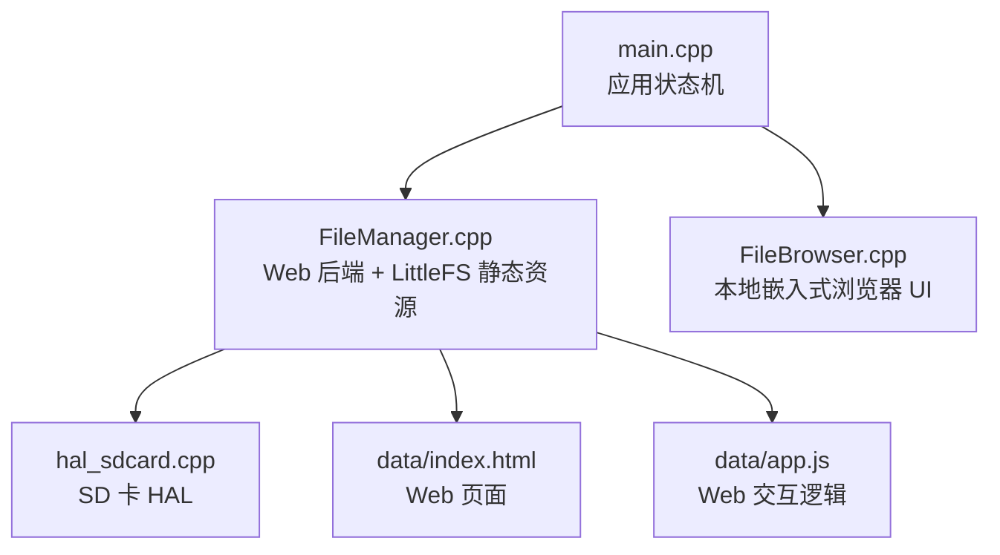
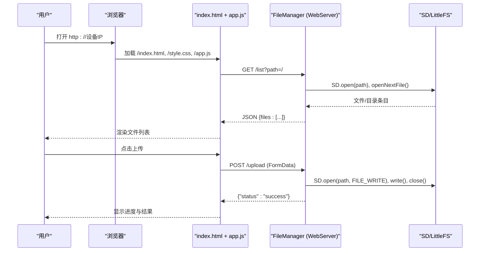
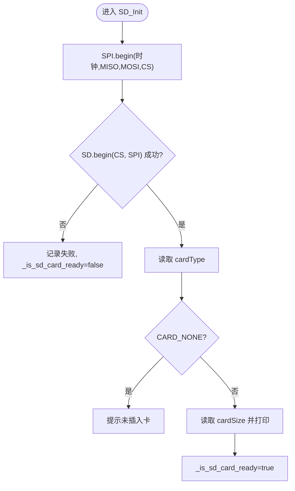
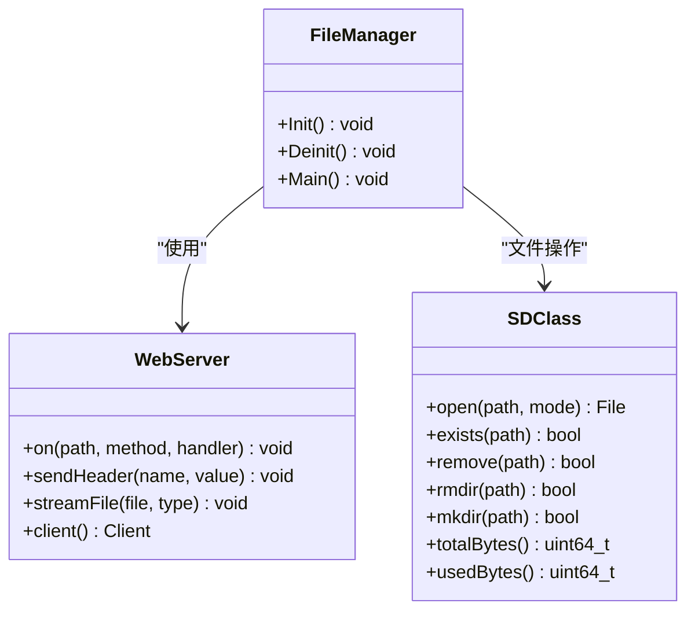
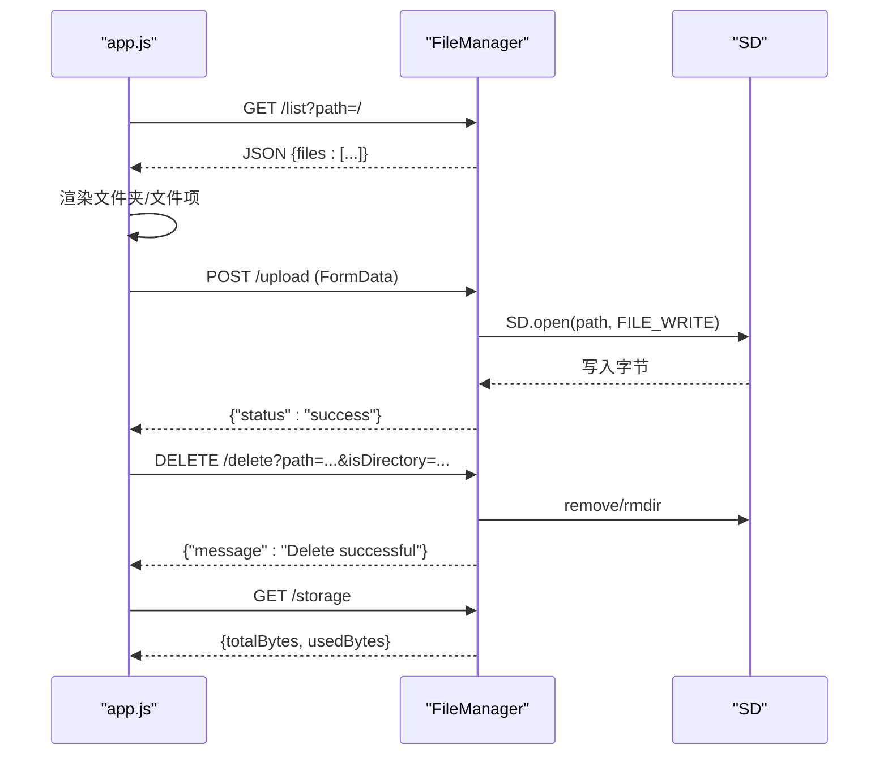
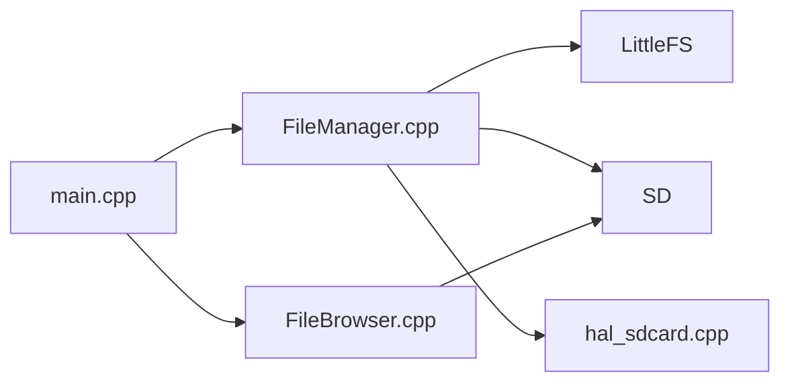

# 文件管理器

<cite>
**本文引用的文件**   
- [src/main.cpp](file://src/main.cpp)
- [src/apps/FileManager.h](file://src/apps/FileManager.h)
- [src/apps/FileManager.cpp](file://src/apps/FileManager.cpp)
- [src/apps/FileBrowser.h](file://src/apps/FileBrowser.h)
- [src/apps/FileBrowser.cpp](file://src/apps/FileBrowser.cpp)
- [src/hal/hal_sdcard.cpp](file://src/hal/hal_sdcard.cpp)
- [data/index.html](file://data/index.html)
- [data/app.js](file://data/app.js)
</cite>

## 目录
1. [简介](#简介)
2. [项目结构](#项目结构)
3. [核心组件](#核心组件)
4. [架构总览](#架构总览)
5. [详细组件分析](#详细组件分析)
6. [依赖关系分析](#依赖关系分析)
7. [性能与优化建议](#性能与优化建议)
8. [故障排查指南](#故障排查指南)
9. [API 使用示例与最佳实践](#api-使用示例与最佳实践)
10. [结论](#结论)

## 简介
本技术文档围绕 ESP32 设备上的“文件管理器”应用展开，覆盖 SD 卡初始化、文件系统操作（目录浏览、文件读写、删除、创建目录）、本地嵌入式浏览器 UI 与 Web 端文件管理界面设计、文件传输机制与数据格式、错误处理策略、API 使用示例与最佳实践，以及性能优化与常见问题解决方案。

该应用提供两种交互方式：
- 本地嵌入式浏览器：在设备上直接通过旋转编码器/按键浏览 SD 卡目录，适合无网络环境。
- Web 文件管理器：设备开启热点后，通过浏览器访问内置网页，完成上传、下载、删除、新建文件夹等操作。

## 项目结构
与文件管理相关的代码主要分布在以下位置：
- src/main.cpp：应用状态机与入口，负责调度 FileManager 与 FileBrowser。
- src/apps/FileManager.*：Web 文件管理器后端（HTTP 服务、路由、SD 文件操作）与前端静态资源托管（LittleFS）。
- src/apps/FileBrowser.*：本地嵌入式文件浏览器 UI（列表渲染、输入处理、目录扫描）。
- src/hal/hal_sdcard.cpp：SD 卡硬件抽象层（初始化、检测、基础目录遍历）。
- data/index.html、data/app.js：Web 端页面与交互逻辑。



图表来源
- [src/main.cpp:93-103](file://src/main.cpp#L93-L103)
- [src/apps/FileManager.cpp:429-456](file://src/apps/FileManager.cpp#L429-L456)
- [src/apps/FileBrowser.cpp:15-30](file://src/apps/FileBrowser.cpp#L15-L30)
- [src/hal/hal_sdcard.cpp:16-59](file://src/hal/hal_sdcard.cpp#L16-L59)
- [data/index.html:1-92](file://data/index.html#L1-L92)
- [data/app.js:1-413](file://data/app.js#L1-L413)

章节来源
- [src/main.cpp:18-24](file://src/main.cpp#L18-L24)
- [src/main.cpp:93-103](file://src/main.cpp#L93-L103)

## 核心组件
- FileManager：启动 HTTP 服务器，挂载 LittleFS 用于托管 Web 资源；注册文件管理 API（列表、上传、下载、删除、新建目录、存储信息）；提供 Init/Main/Deinit 生命周期管理。
- FileBrowser：本地嵌入式文件浏览器，基于 SD 库进行目录扫描、展平树展示、滚动与选中交互，支持文件夹展开/折叠与 NES 文件识别。
- hal_sdcard.cpp：封装 SD 卡 SPI 初始化、类型与容量打印、就绪状态查询与重试初始化。
- data/index.html + data/app.js：Web 端文件管理界面，实现拖拽/选择上传、进度显示、队列管理、面包屑导航、删除与新建文件夹等。

章节来源
- [src/apps/FileManager.h:7-18](file://src/apps/FileManager.h#L7-L18)
- [src/apps/FileManager.cpp:458-558](file://src/apps/FileManager.cpp#L458-L558)
- [src/apps/FileBrowser.h:39-81](file://src/apps/FileBrowser.h#L39-L81)
- [src/apps/FileBrowser.cpp:15-63](file://src/apps/FileBrowser.cpp#L15-L63)
- [src/hal/hal_sdcard.cpp:11-80](file://src/hal/hal_sdcard.cpp#L11-L80)
- [data/index.html:1-92](file://data/index.html#L1-L92)
- [data/app.js:1-413](file://data/app.js#L1-L413)

## 架构总览
系统由“应用状态机”统一调度两个文件管理子模块：
- Web 文件管理器（FileManager）：ESP32 作为 AP 热点，提供 HTTP 接口与静态资源服务，对 SD 卡执行文件操作。
- 本地嵌入式浏览器（FileBrowser）：直接在设备上通过 LCD 与编码器/按键浏览 SD 卡内容。



图表来源
- [data/index.html:1-92](file://data/index.html#L1-L92)
- [data/app.js:200-230](file://data/app.js#L200-L230)
- [data/app.js:130-180](file://data/app.js#L130-L180)
- [src/apps/FileManager.cpp:228-290](file://src/apps/FileManager.cpp#L228-L290)
- [src/apps/FileManager.cpp:121-226](file://src/apps/FileManager.cpp#L121-L226)

## 详细组件分析

### SD 卡初始化与基础能力（HAL）
- SPI 初始化与 SD.begin：使用 HSPI 总线，配置引脚并尝试挂载 SD。
- 类型与容量探测：读取 cardType 与 cardSize，输出日志。
- 就绪标志：_is_sd_card_ready 标记是否成功初始化。
- 重试初始化：tryInitSD 供 UI 在空目录或失败时重试。



图表来源
- [src/hal/hal_sdcard.cpp:16-59](file://src/hal/hal_sdcard.cpp#L16-L59)

章节来源
- [src/hal/hal_sdcard.cpp:11-80](file://src/hal/hal_sdcard.cpp#L11-L80)

### Web 文件管理器（FileManager）
职责与要点：
- 静态资源托管：从 LittleFS 流式返回 index.html、style.css、app.js 等，自动设置 Content-Type 与缓存头。
- 路由注册：/list、/upload、/download、/delete、/storage、/mkdir。
- 文件上传：分片回调处理 START/WRITE/END/ABORTED，校验写入完整性，清理不完整文件。
- 文件列表：返回 JSON，包含 name、path、isDirectory、size、modified。
- 文件下载：流式发送 application/octet-stream，附带 Content-Disposition。
- 删除与创建目录：支持文件与目录删除，新建目录。
- 生命周期：Init 启动 WiFi AP 与 HTTP 服务，Main 循环处理请求，Deinit 停止服务并释放资源。



图表来源
- [src/apps/FileManager.h:7-18](file://src/apps/FileManager.h#L7-L18)
- [src/apps/FileManager.cpp:429-456](file://src/apps/FileManager.cpp#L429-L456)
- [src/apps/FileManager.cpp:121-226](file://src/apps/FileManager.cpp#L121-L226)
- [src/apps/FileManager.cpp:228-422](file://src/apps/FileManager.cpp#L228-L422)

章节来源
- [src/apps/FileManager.cpp:27-95](file://src/apps/FileManager.cpp#L27-L95)
- [src/apps/FileManager.cpp:121-226](file://src/apps/FileManager.cpp#L121-L226)
- [src/apps/FileManager.cpp:228-422](file://src/apps/FileManager.cpp#L228-L422)
- [src/apps/FileManager.cpp:458-558](file://src/apps/FileManager.cpp#L458-L558)

### 本地嵌入式文件浏览器（FileBrowser）
职责与要点：
- 目录扫描：scanDirectory 递归扫描，构建 flatList（展平树），过滤 macOS 元数据（._*）。
- 排序与展示：文件夹优先，按名称排序；支持缩进层级与 NES 文件标识。
- 交互：编码器旋转上下移动，短按确认（文件夹展开/折叠，文件选中反馈），长按回到顶部。
- 绘制：标题栏、列表区域、滚动条、底部状态栏；UTF-8 文本宽度截断。
- 错误处理：当列表为空且 SD 未就绪时，提示插入 SD 卡并按 OK 重试；否则显示空目录。

```mermaid
flowchart TD
A["Init: 清空flatList, pathStack=['/']"] --> B["refreshRoot: scanDirectory('/')"]
B --> C{"flatList 是否为空?"}
C --> |是| D["selectedIndex=-1"]
C --> |否| E["selectedIndex=0, scrollOffset=0"]
E --> F["drawMain: 绘制标题/列表/状态栏"]
F --> G["Update: handleInput"]
G --> H{"事件: 上/下/确认/长按"}
H --> |上/下| I["更新 selectedIndex, ensureVisible, drawList"]
H --> |确认(文件夹)| J["toggleFolder(index): 展开/折叠"]
H --> |确认(文件)| K["confirmed=true, confirmedPath=path"]
H --> |长按| L["回到顶部: selectedIndex=0, scrollOffset=0"]
```

图表来源
- [src/apps/FileBrowser.cpp:15-30](file://src/apps/FileBrowser.cpp#L15-L30)
- [src/apps/FileBrowser.cpp:75-155](file://src/apps/FileBrowser.cpp#L75-L155)
- [src/apps/FileBrowser.cpp:194-295](file://src/apps/FileBrowser.cpp#L194-L295)
- [src/apps/FileBrowser.cpp:299-391](file://src/apps/FileBrowser.cpp#L299-L391)
- [src/apps/FileBrowser.cpp:409-520](file://src/apps/FileBrowser.cpp#L409-L520)

章节来源
- [src/apps/FileBrowser.cpp:75-155](file://src/apps/FileBrowser.cpp#L75-L155)
- [src/apps/FileBrowser.cpp:194-295](file://src/apps/FileBrowser.cpp#L194-L295)
- [src/apps/FileBrowser.cpp:299-391](file://src/apps/FileBrowser.cpp#L299-L391)
- [src/apps/FileBrowser.cpp:409-520](file://src/apps/FileBrowser.cpp#L409-L520)

### Web 端 UI 与交互（index.html + app.js）
- 页面结构：侧边栏（上传区、存储信息、新建文件夹）、主内容区（工具栏、面包屑、文件列表）。
- 功能：
  - 文件列表加载：GET /list，按文件夹优先、文件在后顺序渲染。
  - 上传：FormData 多文件队列，XHR 进度回调，速度计算，完成后刷新列表与存储信息。
  - 下载：window.open('/download?path=...')。
  - 删除：DELETE /delete，确认后调用，成功后刷新。
  - 新建文件夹：POST /mkdir，成功后刷新。
  - 存储信息：GET /storage，显示总量、已用、可用与百分比。



图表来源
- [data/app.js:200-230](file://data/app.js#L200-L230)
- [data/app.js:130-180](file://data/app.js#L130-L180)
- [data/app.js:328-359](file://data/app.js#L328-L359)
- [data/app.js:361-378](file://data/app.js#L361-L378)
- [src/apps/FileManager.cpp:228-422](file://src/apps/FileManager.cpp#L228-L422)

章节来源
- [data/index.html:1-92](file://data/index.html#L1-L92)
- [data/app.js:1-413](file://data/app.js#L1-L413)

## 依赖关系分析
- main.cpp 通过 AppState 切换至 STATE_FILE 与 STATE_SDCARD，分别驱动 FileManager 与 FileBrowser。
- FileManager 依赖 WebServer、LittleFS、SD 库；同时托管 data 目录下的静态资源。
- FileBrowser 依赖 SD 库与 HAL 的编码器/按键输入。
- hal_sdcard.cpp 提供 SD 初始化与就绪状态，被上层 UI 与 Web 后端间接使用。



图表来源
- [src/main.cpp:93-103](file://src/main.cpp#L93-L103)
- [src/apps/FileManager.cpp:429-456](file://src/apps/FileManager.cpp#L429-L456)
- [src/apps/FileBrowser.cpp:15-30](file://src/apps/FileBrowser.cpp#L15-L30)
- [src/hal/hal_sdcard.cpp:16-59](file://src/hal/hal_sdcard.cpp#L16-L59)

章节来源
- [src/main.cpp:93-103](file://src/main.cpp#L93-L103)
- [src/apps/FileManager.cpp:429-456](file://src/apps/FileManager.cpp#L429-L456)
- [src/apps/FileBrowser.cpp:15-30](file://src/apps/FileBrowser.cpp#L15-L30)
- [src/hal/hal_sdcard.cpp:16-59](file://src/hal/hal_sdcard.cpp#L16-L59)

## 性能与优化建议
- 列表渲染
  - 本地浏览器：flatList 采用插入/擦除维护展开/折叠，避免全量重建；仅重绘可见行。
  - Web 端：先渲染文件夹再渲染文件，减少 DOM 操作次数。
- 文件传输
  - 上传采用分块写入与进度回调，避免一次性占用过多内存。
  - 下载使用流式发送，降低峰值内存。
- 静态资源
  - LittleFS 流式发送并设置 Cache-Control，提升重复访问性能。
- SD 卡
  - 初始化失败时提供重试入口（本地 UI 的 OK 键重试）；避免频繁反复初始化。
- 路径安全
  - 静态资源拒绝路径穿越（..），防止越权访问。

[本节为通用指导，不直接分析具体文件]

## 故障排查指南
- SD 卡检测失败
  - 现象：本地浏览器显示“未检测到 SD 卡”，提示插入 SD 卡并按 OK 重试。
  - 处理：检查 SD 卡物理连接；使用 tryInitSD 重试；查看串口日志中“sd card init failed!”。
  - 参考：
    - [src/apps/FileBrowser.cpp:426-445](file://src/apps/FileBrowser.cpp#L426-L445)
    - [src/hal/hal_sdcard.cpp:16-59](file://src/hal/hal_sdcard.cpp#L16-L59)
- 权限错误
  - 现象：删除或创建目录失败，返回错误 JSON。
  - 处理：确认 SD 卡可写；检查目标路径是否存在；确保路径以“/”开头。
  - 参考：
    - [src/apps/FileManager.cpp:348-408](file://src/apps/FileManager.cpp#L348-L408)
- 存储空间不足
  - 现象：上传失败或无法写入新文件。
  - 处理：通过 /storage 接口查看 totalBytes/usedBytes；清理无用文件或更换更大容量 SD 卡。
  - 参考：
    - [src/apps/FileManager.cpp:410-422](file://src/apps/FileManager.cpp#L410-L422)
    - [data/app.js:361-378](file://data/app.js#L361-L378)
- 上传中断或不完整
  - 现象：UPLOAD_FILE_ABORTED 分支触发，清理不完整文件。
  - 处理：检查网络稳定性；重新上传；确认服务端日志中的“Upload Aborted”。
  - 参考：
    - [src/apps/FileManager.cpp:211-225](file://src/apps/FileManager.cpp#L211-L225)

章节来源
- [src/apps/FileBrowser.cpp:426-445](file://src/apps/FileBrowser.cpp#L426-L445)
- [src/hal/hal_sdcard.cpp:16-59](file://src/hal/hal_sdcard.cpp#L16-L59)
- [src/apps/FileManager.cpp:348-408](file://src/apps/FileManager.cpp#L348-L408)
- [src/apps/FileManager.cpp:410-422](file://src/apps/FileManager.cpp#L410-L422)
- [data/app.js:361-378](file://data/app.js#L361-L378)
- [src/apps/FileManager.cpp:211-225](file://src/apps/FileManager.cpp#L211-L225)

## API 使用示例与最佳实践

### 列出目录
- 方法：GET
- URL：/list
- 参数：path（可选，默认根目录）
- 响应：JSON
  - files：数组，每项包含 name、path、isDirectory、size、modified
- 示例（浏览器控制台）：
  - fetch('/list?path=/').then(r=>r.json()).then(console.log)

章节来源
- [src/apps/FileManager.cpp:228-290](file://src/apps/FileManager.cpp#L228-L290)
- [data/app.js:200-230](file://data/app.js#L200-L230)

### 上传文件
- 方法：POST
- URL：/upload
- 表单字段：
  - data：二进制文件
  - path：目标目录（如 /games）
- 响应：{"status":"success"}
- 说明：
  - 若同名文件存在，先删除再写入。
  - 支持分块写入与中止清理。
- 示例（JavaScript）：
  - const fd = new FormData(); fd.append('data', file); fd.append('path', '/'); fetch('/upload', {method:'POST', body:fd})

章节来源
- [src/apps/FileManager.cpp:121-226](file://src/apps/FileManager.cpp#L121-L226)
- [data/app.js:130-180](file://data/app.js#L130-L180)

### 下载文件
- 方法：GET
- URL：/download
- 参数：path（必填）
- 响应：application/octet-stream，触发浏览器下载
- 示例：
  - window.open('/download?path=' + encodeURIComponent('/music.mp3'))

章节来源
- [src/apps/FileManager.cpp:292-346](file://src/apps/FileManager.cpp#L292-L346)
- [data/app.js:328-331](file://data/app.js#L328-L331)

### 删除文件或目录
- 方法：DELETE
- URL：/delete
- 参数：
  - path（必填）
  - isDirectory（可选，true 表示目录）
- 响应：{"message":"Delete successful"} 或 {"error":"..."}
- 示例：
  - fetch('/delete?path=/test.txt&isDirectory=false', {method:'DELETE'})

章节来源
- [src/apps/FileManager.cpp:348-381](file://src/apps/FileManager.cpp#L348-L381)
- [data/app.js:333-359](file://data/app.js#L333-L359)

### 新建目录
- 方法：POST
- URL：/mkdir
- 参数：path（必填，完整路径）
- 响应：{"message":"Created"} 或 {"error":"..."}
- 示例：
  - fetch('/mkdir?path=/games/nes', {method:'POST'})

章节来源
- [src/apps/FileManager.cpp:383-408](file://src/apps/FileManager.cpp#L383-L408)
- [data/app.js:297-326](file://data/app.js#L297-L326)

### 查询存储信息
- 方法：GET
- URL：/storage
- 响应：{totalBytes, usedBytes}
- 示例：
  - fetch('/storage').then(r=>r.json()).then(console.log)

章节来源
- [src/apps/FileManager.cpp:410-422](file://src/apps/FileManager.cpp#L410-L422)
- [data/app.js:361-378](file://data/app.js#L361-L378)

### 最佳实践
- 路径规范化：所有 path 参数以“/”开头，避免相对路径导致的路径解析问题。
- 安全性：避免传入包含“..”的路径；静态资源服务已做防护。
- 大文件上传：建议使用分块上传与进度反馈；必要时在前端增加重试与断点续传逻辑。
- 错误处理：对每个 API 调用增加 catch 分支，向用户展示友好提示。
- 资源释放：退出 App 时调用 Deinit，停止 HTTP 服务、关闭 AP 热点、卸载 LittleFS。

章节来源
- [src/apps/FileManager.cpp:62-95](file://src/apps/FileManager.cpp#L62-L95)
- [src/apps/FileManager.cpp:514-533](file://src/apps/FileManager.cpp#L514-L533)

## 结论
本文件管理器应用通过“本地嵌入式浏览器 + Web 文件管理器”双通道满足多种使用场景。底层依托 SD 卡 HAL 完成初始化与基础能力，FileManager 提供完整的 Web API 与静态资源托管，FileBrowser 提供直观的本地 UI 体验。结合完善的错误处理、性能优化与清晰的 API 规范，可在不同环境下稳定高效地管理 SD 卡文件。

[本节为总结性内容，不直接分析具体文件]