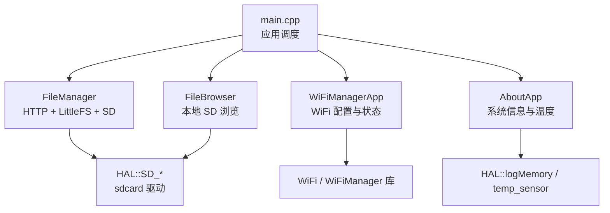
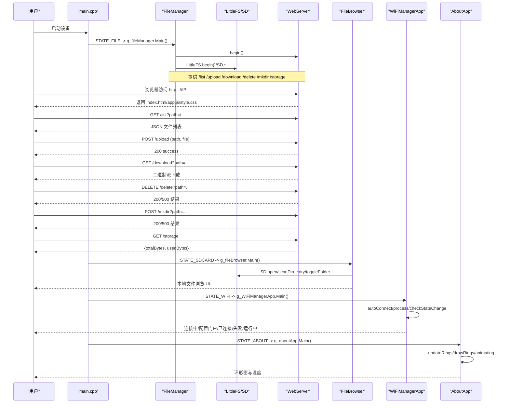
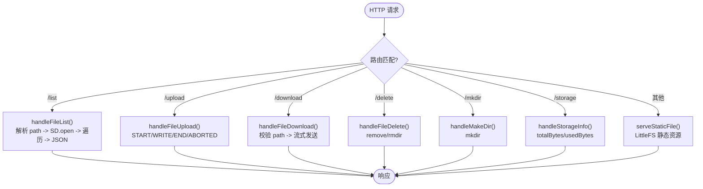
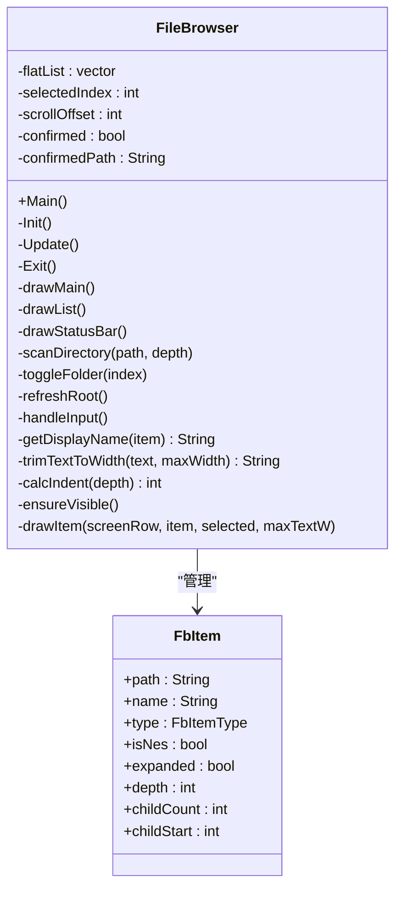
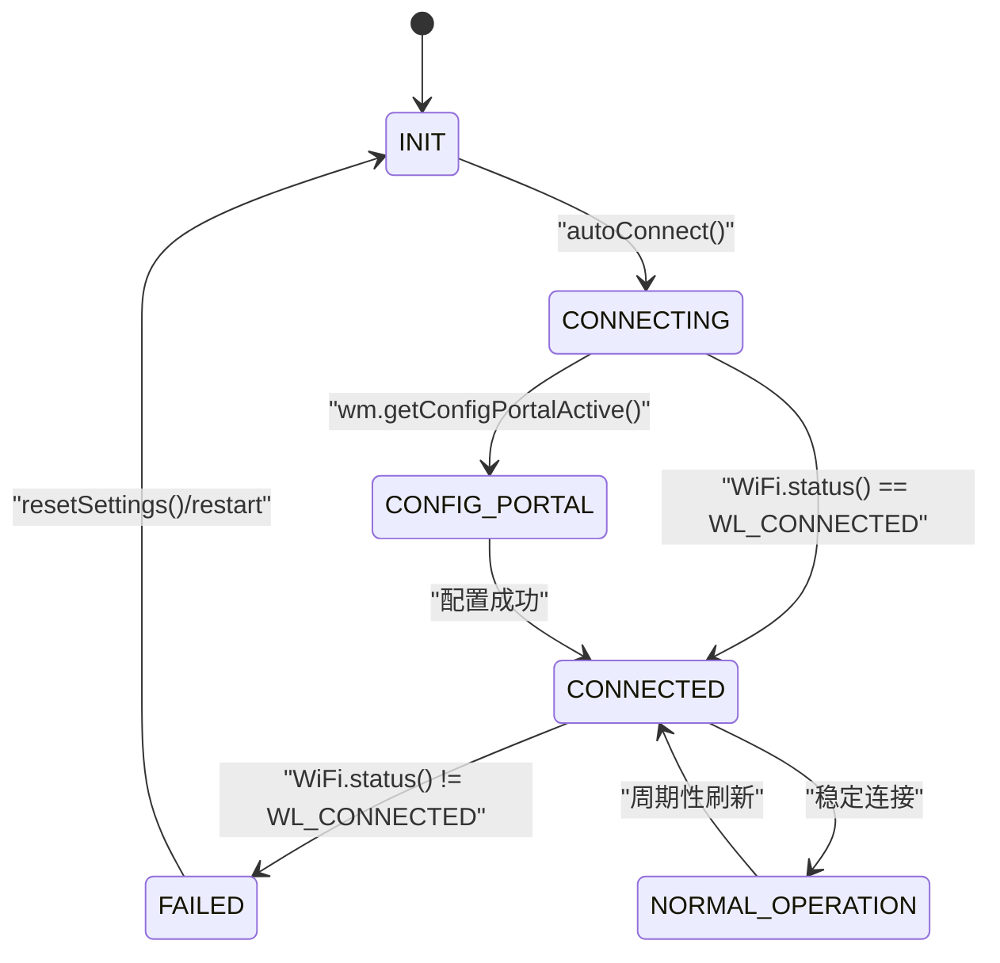
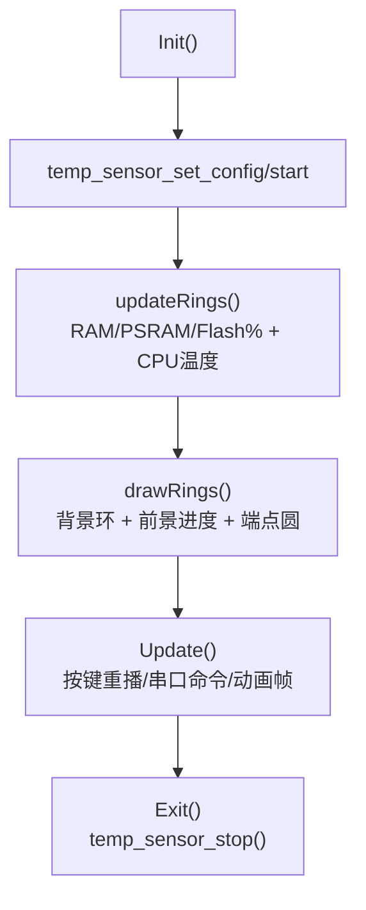
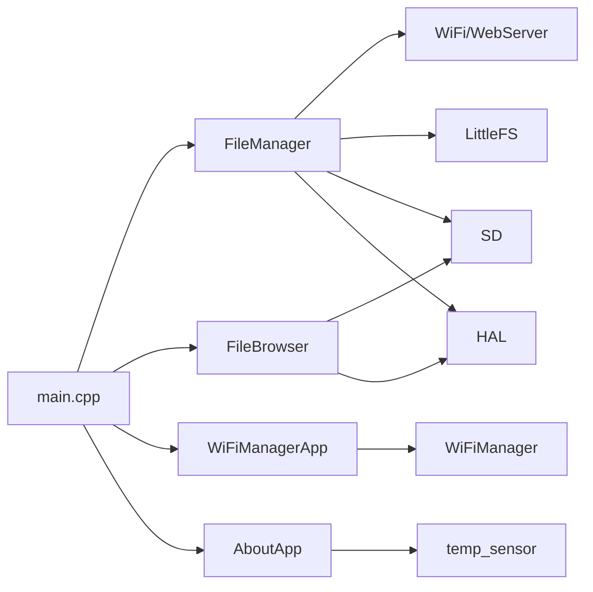

# 系统应用

<cite>
**本文引用的文件**   
- [main.cpp](file://src/main.cpp)
- [FileManager.h](file://src/apps/FileManager.h)
- [FileManager.cpp](file://src/apps/FileManager.cpp)
- [FileBrowser.h](file://src/apps/FileBrowser.h)
- [FileBrowser.cpp](file://src/apps/FileBrowser.cpp)
- [WiFiManagerApp.h](file://src/apps/WiFiManagerApp.h)
- [WiFiManagerApp.cpp](file://src/apps/WiFiManagerApp.cpp)
- [AboutApp.h](file://src/apps/AboutApp.h)
- [AboutApp.cpp](file://src/apps/AboutApp.cpp)
- [hal_sdcard.cpp](file://src/hal/hal_sdcard.cpp)
- [hal.h](file://src/hal/hal.h)
- [common.h](file://src/common.h)
</cite>

## 目录
1. [简介](#简介)
2. [项目结构](#项目结构)
3. [核心组件](#核心组件)
4. [架构总览](#架构总览)
5. [详细组件分析](#详细组件分析)
6. [依赖关系分析](#依赖关系分析)
7. [性能与资源特性](#性能与资源特性)
8. [故障排除指南](#故障排除指南)
9. [结论](#结论)
10. [附录：API 与配置参考](#附录api-与配置参考)

## 简介
本技术文档围绕系统应用中的三大功能域展开：SD 卡文件管理、WiFi 网络管理与连接状态展示、以及“关于”应用的系统信息展示。重点覆盖以下方面：
- SD 卡操作：本地文件浏览、目录展开/折叠、列表滚动、文件选择；HTTP 文件上传/下载/删除/创建目录/存储信息查询。
- WiFi 管理：网络配置门户、自动连接、连接状态监控、失败重试与正常模式显示。
- “关于”应用：内存（RAM/PSRAM/Flash）使用率环形图、CPU 温度读取与动画展示。
- 文件系统 API 与错误处理：LittleFS 静态资源服务、SD 卡挂载与错误恢复、路径安全校验。
- 网络连接流程：建立、认证、断开与状态切换。
- 系统信息收集与显示逻辑：传感器初始化、数据更新、UI 动画。
- 配置选项与自定义设置：热点参数、Web 路由、WiFi 超时等。
- 常见问题排查：SD 卡未识别、LittleFS 挂载失败、WiFi 配置门户不可用等。

## 项目结构
系统采用分层组织：
- src/main.cpp：应用调度入口，根据请求切换到具体 App（文件管理器、SD 浏览器、WiFi 管理器、“关于”）。
- src/apps/*：各功能 App 的实现与头文件。
- src/hal/*：硬件抽象层，封装 LCD、按键、编码器、SD 卡、电源、RTC 等能力。
- src/common.h：通用 UI 颜色常量与工具函数声明。

图表来源
- [main.cpp:15-126](file://src/main.cpp#L15-L126)
- [FileManager.cpp:458-559](file://src/apps/FileManager.cpp#L458-L559)
- [FileBrowser.cpp:15-63](file://src/apps/FileBrowser.cpp#L15-L63)
- [WiFiManagerApp.cpp:387-506](file://src/apps/WiFiManagerApp.cpp#L387-L506)
- [AboutApp.cpp:76-117](file://src/apps/AboutApp.cpp#L76-L117)
- [hal_sdcard.cpp:16-59](file://src/hal/hal_sdcard.cpp#L16-L59)

章节来源
- [main.cpp:15-126](file://src/main.cpp#L15-L126)

## 核心组件
- FileManager：提供基于 WebServer 的文件管理界面，托管在 LittleFS 分区，后端对 SD 卡进行增删改查与上传下载。
- FileBrowser：纯本地 SD 卡文件浏览 UI，支持目录展开/折叠、滚动、选中反馈。
- WiFiManagerApp：基于 WiFiManager 的 WiFi 配置与应用状态展示，包含连接中、配置门户、已连接、失败、正常运行等界面。
- AboutApp：展示 RAM/PSRAM/Flash 使用率环形图与 CPU 温度，支持重播动画。
- HAL SD 接口：统一 SD 卡初始化、就绪检测、目录遍历与重试初始化。

章节来源
- [FileManager.h:7-18](file://src/apps/FileManager.h#L7-L18)
- [FileBrowser.h:38-83](file://src/apps/FileBrowser.h#L38-L83)
- [WiFiManagerApp.h:20-95](file://src/apps/WiFiManagerApp.h#L20-L95)
- [AboutApp.h:18-57](file://src/apps/AboutApp.h#L18-L57)
- [hal.h:165-169](file://src/hal/hal.h#L165-L169)

## 架构总览
系统以 main.cpp 为调度中心，通过全局 App 实例进入对应主循环。FileManager 同时承担 Web 服务器职责，将 LittleFS 静态资源与 SD 卡 API 暴露给浏览器端。FileBrowser 直接操作 SD 文件系统。WiFiManagerApp 负责 WiFi 连接生命周期与 UI 状态机。AboutApp 读取系统资源与温度传感器并绘制动画。

图表来源
- [main.cpp:93-121](file://src/main.cpp#L93-L121)
- [FileManager.cpp:429-559](file://src/apps/FileManager.cpp#L429-L559)
- [FileBrowser.cpp:75-295](file://src/apps/FileBrowser.cpp#L75-L295)
- [WiFiManagerApp.cpp:360-506](file://src/apps/WiFiManagerApp.cpp#L360-L506)
- [AboutApp.cpp:6-117](file://src/apps/AboutApp.cpp#L6-L117)

## 详细组件分析

### 文件管理器（FileManager）
- 功能要点
  - 启动时挂载 LittleFS 用于托管网页资源（index.html、style.css、app.js），若失败则尝试格式化并重试。
  - 以 AP 热点模式启动，固定 SSID 与密码，便于浏览器直连。
  - 注册静态资源路由与 SD 卡操作 API：/list、/upload、/download、/delete、/mkdir、/storage。
  - 上传分阶段处理：START/WRITE/END/ABORTED，确保写入完整性并在中止时清理不完整文件。
  - 下载采用流式发送，避免一次性加载大文件。
  - 退出时停止 HTTP 服务、关闭 AP、卸载 LittleFS，释放资源。

- 关键流程
  - 静态资源服务：根据扩展名返回 Content-Type，拒绝路径穿越，优先返回 index.html。
  - 文件列表：解析 path 参数，过滤系统文件，构建 JSON 数组，包含 name/path/isDirectory/size/modified。
  - 文件删除：区分文件与目录，调用 SD.remove/SD.rmdir。
  - 存储信息：返回 totalBytes/usedBytes。

图表来源
- [FileManager.cpp:28-119](file://src/apps/FileManager.cpp#L28-L119)
- [FileManager.cpp:122-226](file://src/apps/FileManager.cpp#L122-L226)
- [FileManager.cpp:229-422](file://src/apps/FileManager.cpp#L229-L422)
- [FileManager.cpp:429-559](file://src/apps/FileManager.cpp#L429-L559)

- 错误处理与安全
  - 路径穿越防护：拒绝包含 ".." 的路径。
  - 参数校验：/download 与 /delete 要求 path 参数。
  - 文件存在性检查：不存在返回 404。
  - 目录误用保护：下载仅允许文件。
  - 上传中止清理：删除不完整文件。

章节来源
- [FileManager.cpp:62-119](file://src/apps/FileManager.cpp#L62-L119)
- [FileManager.cpp:122-226](file://src/apps/FileManager.cpp#L122-L226)
- [FileManager.cpp:229-422](file://src/apps/FileManager.cpp#L229-L422)
- [FileManager.cpp:458-559](file://src/apps/FileManager.cpp#L458-L559)

### 本地文件浏览器（FileBrowser）
- 功能要点
  - 扫描根目录，构建展平列表 flatList，支持文件夹展开/折叠。
  - 列表排序：文件夹优先，其次按名称排序。
  - 输入处理：旋转编码器上下移动、短按确认、长按回到顶部。
  - 滚动优化：ensureVisible 保证选中项可见，右侧滚动条指示位置。
  - 文本截断：trimTextToWidth 支持 UTF-8 中文并按像素宽度截断。

- 数据结构
  - FbItem：path/name/type/isNes/expanded/depth/childCount/childStart。
  - flatList：展平后的树形结构，子项紧跟父项之后。

图表来源
- [FileBrowser.h:26-83](file://src/apps/FileBrowser.h#L26-L83)
- [FileBrowser.cpp:75-295](file://src/apps/FileBrowser.cpp#L75-L295)

- 交互流程
  - 初始刷新：refreshRoot 扫描 "/"，打印调试信息，设置 selectedIndex/scrollOffset。
  - 展开/折叠：toggleFolder 扫描子项，插入到 flatList[index+1]，或移除子项。
  - 输入处理：BTN_ENC_CW/BTN_ENC_CC 移动选中项；BTN_OK_SP 确认文件或切换文件夹；BTN_OK_LP 回到顶部。
  - 无 SD 卡提示：drawMain 中检测 HAL::SD_isReady()，提示插入 SD 卡并按 OK 重试。

章节来源
- [FileBrowser.cpp:15-63](file://src/apps/FileBrowser.cpp#L15-L63)
- [FileBrowser.cpp:75-295](file://src/apps/FileBrowser.cpp#L75-L295)
- [FileBrowser.cpp:299-405](file://src/apps/FileBrowser.cpp#L299-L405)
- [FileBrowser.cpp:409-519](file://src/apps/FileBrowser.cpp#L409-L519)
- [FileBrowser.cpp:522-637](file://src/apps/FileBrowser.cpp#L522-L637)

### WiFi 管理器（WiFiManagerApp）
- 功能要点
  - 状态机：STATE_INIT/CONNECTING/CONFIG_PORTAL/CONNECTED/FAILED/NORMAL_OPERATION。
  - 自动连接：autoConnect("ESP32_Config")，失败进入配置模式。
  - process 频率控制：配置模式高频（20ms），正常模式低频（1s）。
  - 屏幕显示：初始化、连接中、配置门户、已连接、失败、正常运行界面。
  - 按钮与串口：短按切换配置模式，长按重置设置；串口数字键切换状态用于调试。

图表来源
- [WiFiManagerApp.h:9-18](file://src/apps/WiFiManagerApp.h#L9-L18)
- [WiFiManagerApp.h:39-95](file://src/apps/WiFiManagerApp.h#L39-L95)
- [WiFiManagerApp.cpp:326-358](file://src/apps/WiFiManagerApp.cpp#L326-L358)
- [WiFiManagerApp.cpp:360-430](file://src/apps/WiFiManagerApp.cpp#L360-L430)

- 连接与认证流程
  - 启动后尝试 autoConnect，若失败则开启配置门户（AP 模式）。
  - 用户在浏览器完成 SSID/密码配置后，重新连接并显示 IP 与信号强度。
  - 连接断开时进入失败状态，提示重启或重新配置。

章节来源
- [WiFiManagerApp.cpp:16-198](file://src/apps/WiFiManagerApp.cpp#L16-L198)
- [WiFiManagerApp.cpp:326-430](file://src/apps/WiFiManagerApp.cpp#L326-L430)
- [WiFiManagerApp.cpp:444-506](file://src/apps/WiFiManagerApp.cpp#L444-L506)

### “关于”应用（AboutApp）
- 功能要点
  - 环形图展示 RAM/PSRAM/Flash 使用率，CPU 温度居中显示。
  - 初始化温度传感器，配置 DAC 偏移与时钟分频，启动传感器。
  - 动画：目标百分比缓动（easeOutCubic），支持按键重播。
  - 串口命令：可手动设置环百分比用于测试。

图表来源
- [AboutApp.cpp:6-15](file://src/apps/AboutApp.cpp#L6-L15)
- [AboutApp.cpp:17-74](file://src/apps/AboutApp.cpp#L17-L74)
- [AboutApp.cpp:76-117](file://src/apps/AboutApp.cpp#L76-L117)
- [AboutApp.cpp:119-184](file://src/apps/AboutApp.cpp#L119-L184)
- [AboutApp.cpp:187-203](file://src/apps/AboutApp.cpp#L187-L203)

章节来源
- [AboutApp.cpp:6-117](file://src/apps/AboutApp.cpp#L6-L117)
- [AboutApp.cpp:119-203](file://src/apps/AboutApp.cpp#L119-L203)

### 文件系统 API 与错误处理
- LittleFS 静态资源
  - serveStaticFile：路径安全检查、Content-Type 判断、缓存头设置、流式发送。
  - registerStaticRoute：集中注册静态资源 GET 路由。
- SD 卡操作
  - handleFileList：目录遍历、JSON 构造、系统文件过滤。
  - handleFileUpload：分片写入、完整性验证、中止清理。
  - handleFileDownload：路径校验、流式传输。
  - handleFileDelete：文件/目录删除。
  - handleMakeDir：目录创建。
  - handleStorageInfo：容量统计。
- 错误处理策略
  - 参数缺失：返回 400。
  - 路径不存在：返回 404。
  - 类型不匹配（如下载目录）：返回 400。
  - 写入失败/删除失败：返回 500。
  - 上传中止：清理不完整文件。

章节来源
- [FileManager.cpp:28-119](file://src/apps/FileManager.cpp#L28-L119)
- [FileManager.cpp:122-226](file://src/apps/FileManager.cpp#L122-L226)
- [FileManager.cpp:229-422](file://src/apps/FileManager.cpp#L229-L422)

### 网络连接建立、认证与断开
- 建立
  - WiFiManagerApp::begin 调用 autoConnect，失败则进入配置门户。
  - FileManager 以 AP 模式启动热点，供浏览器访问。
- 认证
  - 配置门户由 WiFiManager 提供，用户在浏览器输入 SSID/密码。
  - 成功后 WiFi.status() 变为 WL_CONNECTED。
- 断开
  - 检测到断开时进入失败状态，提示重启或重新配置。
  - FileManager 退出时关闭 AP 与 HTTP 服务。

章节来源
- [WiFiManagerApp.h:39-95](file://src/apps/WiFiManagerApp.h#L39-L95)
- [WiFiManagerApp.cpp:360-430](file://src/apps/WiFiManagerApp.cpp#L360-L430)
- [FileManager.cpp:458-559](file://src/apps/FileManager.cpp#L458-L559)

### 系统信息收集与显示逻辑
- 内存使用率
  - getRamPercent/getPsramPercent/getFlashPercent 在 common.h 中声明，AboutApp 中用于环形图数据。
- CPU 温度
  - 使用 ESP-IDF 温度传感器 API 配置与读取，显示在环形图中心。
- 动画
  - 目标百分比缓动，按键重播，串口命令调试。

章节来源
- [AboutApp.cpp:6-15](file://src/apps/AboutApp.cpp#L6-L15)
- [AboutApp.cpp:76-117](file://src/apps/AboutApp.cpp#L76-L117)
- [AboutApp.cpp:119-184](file://src/apps/AboutApp.cpp#L119-L184)
- [common.h:27-33](file://src/common.h#L27-L33)

### 配置选项与自定义设置
- FileManager
  - 热点 SSID/密码：默认值在 Init 中定义。
  - LittleFS 挂载参数：分区名 "/littlefs"，重试格式化。
  - Web 路由：静态资源与 SD 操作 API。
- WiFiManagerApp
  - 配置门户超时：setConfigPortalTimeout(180)。
  - 自动连接名称：autoConnect("ESP32_Config")。
  - 进程频率：配置模式 20ms，正常模式 1s。
- FileBrowser
  - UI 布局常量：行高、列宽、每页项数、缩进宽度等。
- AboutApp
  - 环形图样式：外半径、厚度、颜色、标签。
  - 动画时长：ANIM_DURATION_MS。

章节来源
- [FileManager.cpp:458-559](file://src/apps/FileManager.cpp#L458-L559)
- [WiFiManagerApp.h:39-95](file://src/apps/WiFiManagerApp.h#L39-L95)
- [FileBrowser.h:9-15](file://src/apps/FileBrowser.h#L9-L15)
- [AboutApp.h:37-52](file://src/apps/AboutApp.h#L37-L52)

## 依赖关系分析
- main.cpp 依赖所有 App 的全局实例，并通过状态机调度。
- FileManager 依赖 WiFi/WebServer/LittleFS/SD。
- FileBrowser 依赖 SD/FS/HAL。
- WiFiManagerApp 依赖 WiFiManager 库与 WiFi 状态。
- AboutApp 依赖 HAL 与 ESP-IDF 温度传感器。
- HAL SD 接口封装 SD 卡初始化与就绪检测。

图表来源
- [main.cpp:1-14](file://src/main.cpp#L1-L14)
- [FileManager.cpp:1-8](file://src/apps/FileManager.cpp#L1-L8)
- [FileBrowser.cpp:1-4](file://src/apps/FileBrowser.cpp#L1-L4)
- [WiFiManagerApp.cpp:1-2](file://src/apps/WiFiManagerApp.cpp#L1-L2)
- [AboutApp.cpp:1-2](file://src/apps/AboutApp.cpp#L1-L2)
- [hal_sdcard.cpp:1-4](file://src/hal/hal_sdcard.cpp#L1-L4)

章节来源
- [main.cpp:1-14](file://src/main.cpp#L1-L14)
- [FileManager.cpp:1-8](file://src/apps/FileManager.cpp#L1-L8)
- [FileBrowser.cpp:1-4](file://src/apps/FileBrowser.cpp#L1-L4)
- [WiFiManagerApp.cpp:1-2](file://src/apps/WiFiManagerApp.cpp#L1-L2)
- [AboutApp.cpp:1-2](file://src/apps/AboutApp.cpp#L1-L2)
- [hal_sdcard.cpp:1-4](file://src/hal/hal_sdcard.cpp#L1-L4)

## 性能与资源特性
- FileManager
  - 静态资源流式发送，减少内存占用。
  - 上传分片写入，避免一次性加载大文件。
  - 路由守卫防止重复注册导致 handler 链表增长。
- FileBrowser
  - 展平列表与分页渲染，降低 UI 压力。
  - 文本按像素宽度截断，避免溢出。
- WiFiManagerApp
  - 动态调整 process 频率，平衡实时性与功耗。
- AboutApp
  - 动画使用缓动函数，平滑过渡。
  - 温度传感器配置优化精度与稳定性。

[本节为通用性能讨论，不直接分析具体文件]

## 故障排除指南
- SD 卡未识别
  - 现象：FileBrowser 显示“未检测到 SD 卡”，提示插入 SD 卡并按 OK 重试。
  - 排查：检查 HAL::SD_isReady() 与 tryInitSD() 返回值；确认引脚配置与 SPI 初始化。
  - 参考：[FileBrowser.cpp:426-445](file://src/apps/FileBrowser.cpp#L426-L445)、[hal_sdcard.cpp:16-59](file://src/hal/hal_sdcard.cpp#L16-L59)
- LittleFS 挂载失败
  - 现象：FileManager 日志提示“LittleFS mount failed, retry with format...”。
  - 排查：确认分区表与 board_build.filesystem 配置；执行 pio run -t uploadfs 上传资源。
  - 参考：[FileManager.cpp:458-475](file://src/apps/FileManager.cpp#L458-L475)
- WiFi 配置门户不可用
  - 现象：无法打开 http://IP 配置页面。
  - 排查：确认 autoConnect 是否失败进入配置模式；检查 wm.getConfigPortalActive()；确认浏览器能访问 AP IP。
  - 参考：[WiFiManagerApp.cpp:360-384](file://src/apps/WiFiManagerApp.cpp#L360-L384)
- 文件上传失败
  - 现象：UPLOAD_FILE_ABORTED 或写入字节数小于预期。
  - 排查：检查 currentUploadFile 是否打开；确认 SD.exists 与 SD.remove 权限；查看日志中的写入失败信息。
  - 参考：[FileManager.cpp:122-226](file://src/apps/FileManager.cpp#L122-L226)
- 下载目录或路径无效
  - 现象：返回 400 或 404。
  - 排查：确保 path 参数存在且指向文件；检查路径前缀与是否存在。
  - 参考：[FileManager.cpp:293-346](file://src/apps/FileManager.cpp#L293-L346)

章节来源
- [FileBrowser.cpp:426-445](file://src/apps/FileBrowser.cpp#L426-L445)
- [hal_sdcard.cpp:16-59](file://src/hal/hal_sdcard.cpp#L16-L59)
- [FileManager.cpp:458-475](file://src/apps/FileManager.cpp#L458-L475)
- [WiFiManagerApp.cpp:360-384](file://src/apps/WiFiManagerApp.cpp#L360-L384)
- [FileManager.cpp:122-226](file://src/apps/FileManager.cpp#L122-L226)
- [FileManager.cpp:293-346](file://src/apps/FileManager.cpp#L293-L346)

## 结论
本系统应用通过模块化设计实现了 SD 卡文件管理、WiFi 网络配置与连接状态展示、以及系统信息可视化。FileManager 提供完整的 Web 文件操作能力，FileBrowser 提供本地浏览体验，WiFiManagerApp 简化了网络配置流程，AboutApp 直观展示了系统资源与温度。整体架构清晰，错误处理完善，适合在嵌入式设备上部署与扩展。

[本节为总结性内容，不直接分析具体文件]

## 附录：API 与配置参考

### Web 接口（FileManager）
- GET /list?path=<dir>
  - 返回 JSON：{files:[{name,path,isDirectory,size,modified},...]}
- POST /upload (multipart/form-data)
  - 参数：path（可选）、file
  - 返回：{status:"success"}
- GET /download?path=<file>
  - 返回：二进制流
- DELETE /delete?path=<file_or_dir>&isDirectory=<true/false>
  - 返回：{message:"Delete successful"} 或 {error:...}
- POST /mkdir?path=<dir>
  - 返回：{message:"Created"} 或 {error:...}
- GET /storage
  - 返回：{totalBytes, usedBytes}

章节来源
- [FileManager.cpp:229-422](file://src/apps/FileManager.cpp#L229-L422)

### WiFi 配置与状态（WiFiManagerApp）
- autoConnect("ESP32_Config")
  - 失败进入配置门户，成功连接后显示 IP 与信号强度。
- setConfigPortalTimeout(180)
  - 配置门户超时时间（秒）。
- process()
  - 高频（配置模式）或低频（正常模式）调用，维持连接与门户状态。

章节来源
- [WiFiManagerApp.h:39-95](file://src/apps/WiFiManagerApp.h#L39-L95)
- [WiFiManagerApp.cpp:360-430](file://src/apps/WiFiManagerApp.cpp#L360-L430)

### 系统信息（AboutApp）
- updateRings()
  - 获取 RAM/PSRAM/Flash 使用率与 CPU 温度。
- drawRings()
  - 绘制环形图与温度数值。
- Update()
  - 按键重播动画、串口命令调试、动画帧更新。

章节来源
- [AboutApp.cpp:6-15](file://src/apps/AboutApp.cpp#L6-L15)
- [AboutApp.cpp:17-74](file://src/apps/AboutApp.cpp#L17-L74)
- [AboutApp.cpp:119-184](file://src/apps/AboutApp.cpp#L119-L184)