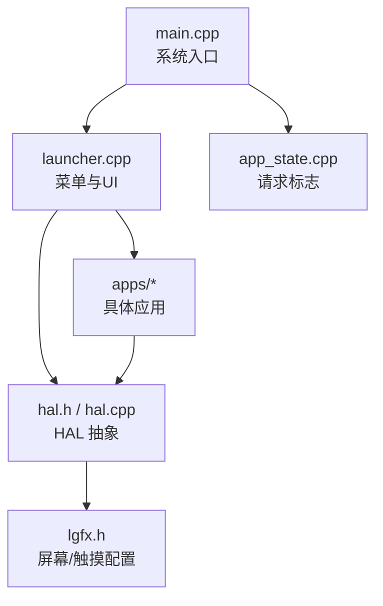
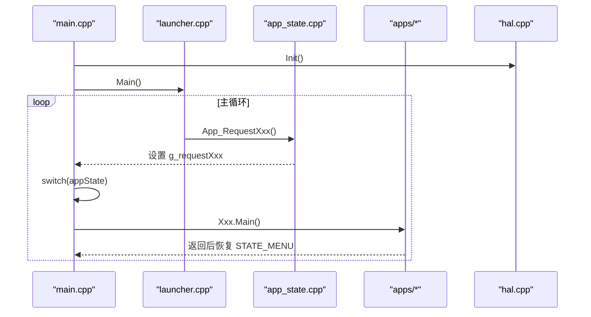
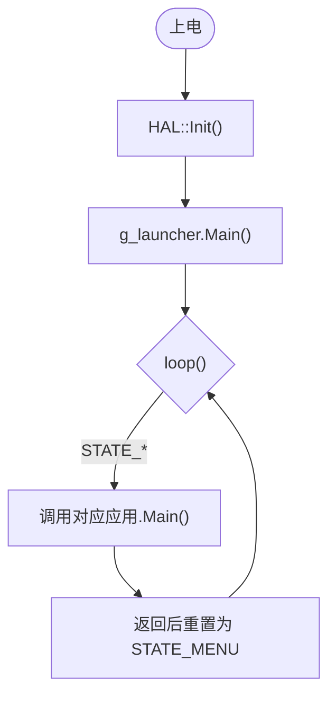
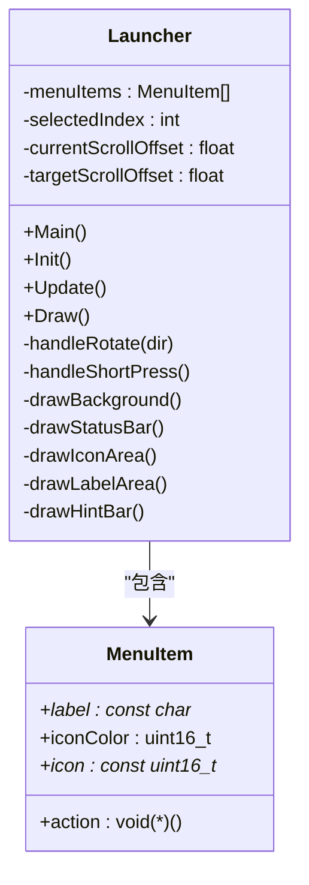
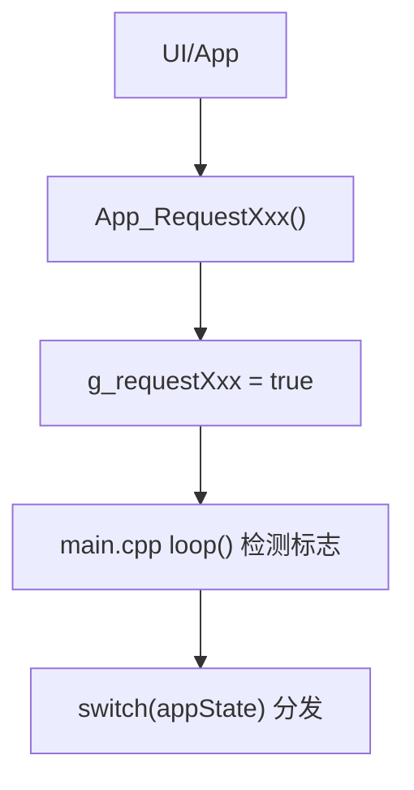
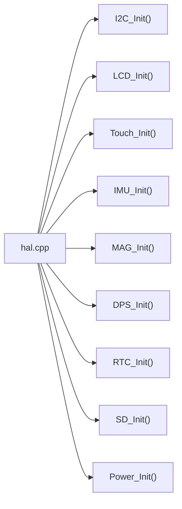
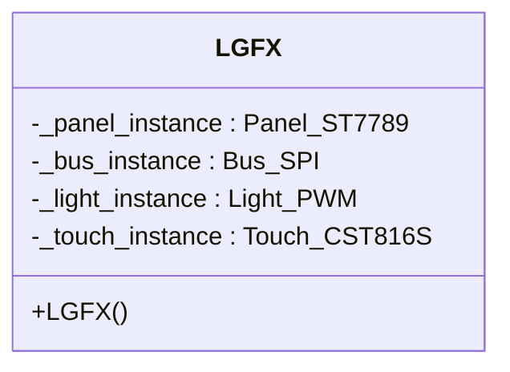
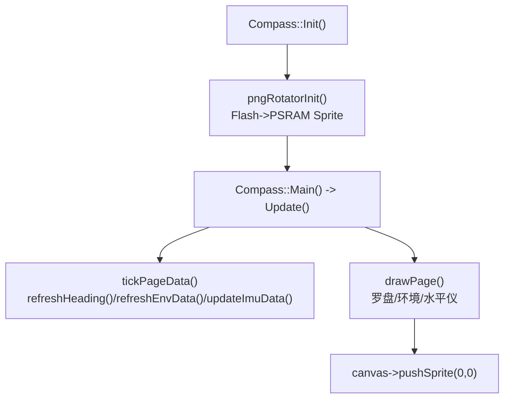
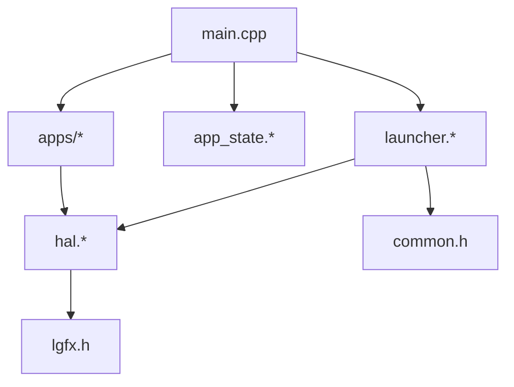

# 开发者指南

<cite>
**本文引用的文件**   
- [platformio.ini](file://platformio.ini)
- [main.cpp](file://src/main.cpp)
- [launcher.h](file://src/launcher.h)
- [launcher.cpp](file://src/launcher.cpp)
- [app_state.h](file://src/app_state.h)
- [app_state.cpp](file://src/app_state.cpp)
- [common.h](file://src/common.h)
- [lgfx.h](file://include/lgfx.h)
- [hal.h](file://src/hal/hal.h)
- [hal.cpp](file://src/hal/hal.cpp)
- [hal_config.h](file://src/hal/hal_config.h)
- [Compass.h](file://src/apps/Compass.h)
- [Compass.cpp](file://src/apps/Compass.cpp)
</cite>

## 目录
1. [简介](#简介)
2. [项目结构](#项目结构)
3. [核心组件](#核心组件)
4. [架构总览](#架构总览)
5. [详细组件分析](#详细组件分析)
6. [依赖关系分析](#依赖关系分析)
7. [性能与内存优化](#性能与内存优化)
8. [调试与故障排除](#调试与故障排除)
9. [测试与质量保证](#测试与质量保证)
10. [贡献规范与流程](#贡献规范与流程)
11. [结论](#结论)

## 简介
本指南面向 ESP32 NullPod 固件的开发者，覆盖开发环境搭建、工具链配置、代码规范与最佳实践、应用扩展方法、硬件适配与引脚配置、调试技巧、性能分析与内存优化、常见问题排查、测试与质量保证以及贡献流程。目标是帮助你在最短路径内完成功能开发与迭代，同时保证系统稳定与可维护性。

## 项目结构
项目采用“应用 + HAL（硬件抽象层）+ 启动器”的分层组织：
- src/main.cpp：系统入口，负责 HAL 初始化与主循环状态机调度。
- src/launcher.*：菜单与启动器 UI，封装交互与页面绘制。
- src/app_state.*：跨模块的请求标志与请求函数，用于解耦 UI 与应用切换。
- include/lgfx.h：屏幕与触摸驱动配置（LovyanGFX）。
- src/hal/*：HAL 接口与实现，统一 LCD、I2C、IMU、MAG、DPS、RTC、SD、电源、蜂鸣器、RGB LED、编码器、音频、蓝牙等能力。
- src/apps/*：具体应用（如罗盘、游戏、文件管理等）。
- data/*：Web 资源（可选）。
- partitions/*：分区表（LittleFS）。
- platformio.ini：PlatformIO 工程配置。

图表来源
- [main.cpp:1-209](file://src/main.cpp#L1-L209)
- [launcher.cpp:1-444](file://src/launcher.cpp#L1-L444)
- [app_state.cpp:1-37](file://src/app_state.cpp#L1-L37)
- [hal.h:1-215](file://src/hal/hal.h#L1-L215)
- [hal.cpp:1-72](file://src/hal/hal.cpp#L1-L72)
- [lgfx.h:1-118](file://include/lgfx.h#L1-L118)

章节来源
- [platformio.ini:1-31](file://platformio.ini#L1-L31)
- [main.cpp:1-209](file://src/main.cpp#L1-L209)

## 核心组件
- 系统入口 main.cpp：调用 HAL::Init()，进入 Launcher.Main()；loop() 根据 AppState 分发到各应用。
- 启动器 launcher.*：定义菜单项、图标、滚动动画、长按关机提示、状态栏刷新；通过 App_Request* 触发应用切换。
- 应用状态 app_state.*：提供 volatile 请求标志与统一的 App_Request* 接口，避免直接耦合。
- HAL 抽象 hal.h/hal.cpp：统一设备初始化、传感器读取、显示与输入、电源管理、日志等。
- 屏幕与触摸 lgfx.h：基于 LovyanGFX 配置 SPI 面板、背光、触摸控制器与坐标映射。
- 示例应用 Compass：展示多页面、PNG 旋转表盘、磁力计校准、气压/海拔/温度、水平仪等复杂交互。

章节来源
- [main.cpp:1-209](file://src/main.cpp#L1-L209)
- [launcher.h:1-153](file://src/launcher.h#L1-L153)
- [launcher.cpp:1-444](file://src/launcher.cpp#L1-L444)
- [app_state.h:1-42](file://src/app_state.h#L1-L42)
- [app_state.cpp:1-37](file://src/app_state.cpp#L1-L37)
- [hal.h:1-215](file://src/hal/hal.h#L1-L215)
- [hal.cpp:1-72](file://src/hal/hal.cpp#L1-L72)
- [lgfx.h:1-118](file://include/lgfx.h#L1-L118)

## 架构总览
系统以“事件驱动的请求标志 + 主循环状态机”为核心，UI 与应用之间通过 App_Request* 进行松耦合通信。HAL 屏蔽底层差异，LGFX 提供图形与触摸能力。

图表来源
- [main.cpp:18-209](file://src/main.cpp#L18-L209)
- [launcher.cpp:57-79](file://src/launcher.cpp#L57-L79)
- [app_state.cpp:21-36](file://src/app_state.cpp#L21-L36)

## 详细组件分析

### 系统入口与状态机（main.cpp）
- 职责：初始化 HAL，首次进入菜单；在 loop() 中根据 AppState 分发到对应应用；处理全局请求标志并切换状态。
- 关键点：
  - setup() 中调用 HAL::Init() 与 g_launcher.Main()。
  - loop() 使用 switch(appState) 分支调用各应用 Main()，并在应用返回后回到菜单。
  - 支持多种请求标志（g_requestScreenSaver/g_requestWiFi 等），由 UI 或应用置位。

图表来源
- [main.cpp:18-209](file://src/main.cpp#L18-L209)

章节来源
- [main.cpp:1-209](file://src/main.cpp#L1-L209)

### 启动器与菜单（launcher.h / launcher.cpp）
- 职责：渲染菜单、图标、标签、提示栏；处理编码器旋转与短按；长按电源键关机；每秒刷新状态栏。
- 关键点：
  - MenuItem 数组定义菜单项与回调 action。
  - Update() 中处理编码器事件、长按关机逻辑、平滑滚动插值。
  - drawStatusBar() 获取时间、电量、WiFi 图标等。
  - 通过 App_Request* 触发应用切换。

图表来源
- [launcher.h:85-153](file://src/launcher.h#L85-L153)
- [launcher.cpp:1-444](file://src/launcher.cpp#L1-L444)

章节来源
- [launcher.h:1-153](file://src/launcher.h#L1-L153)
- [launcher.cpp:1-444](file://src/launcher.cpp#L1-L444)

### 应用状态与请求机制（app_state.h / app_state.cpp）
- 职责：声明 volatile 请求标志与 App_Request* 函数，供 UI 与应用调用。
- 关键点：
  - 所有请求标志均为 volatile，确保跨中断/线程安全。
  - App_Request* 仅置位标志，不直接耦合应用实现。

图表来源
- [app_state.h:1-42](file://src/app_state.h#L1-L42)
- [app_state.cpp:1-37](file://src/app_state.cpp#L1-L37)
- [main.cpp:128-209](file://src/main.cpp#L128-L209)

章节来源
- [app_state.h:1-42](file://src/app_state.h#L1-L42)
- [app_state.cpp:1-37](file://src/app_state.cpp#L1-L37)

### 硬件抽象层（hal.h / hal.cpp / hal_config.h）
- 职责：统一初始化与访问 LCD、I2C、Touch、IMU、MAG、DPS、RTC、SD、Power、Buzzer、RGB、Encoder、Audio、BT 等。
- 关键点：
  - HAL::Init() 顺序初始化各子系统，打印构建信息与内存信息。
  - HAL::logMemory() 输出堆与 PSRAM 使用情况。
  - hal_config.h 集中定义引脚、分辨率、NVS Key、日志宏等。

图表来源
- [hal.cpp:4-25](file://src/hal/hal.cpp#L4-L25)
- [hal.h:101-212](file://src/hal/hal.h#L101-L212)
- [hal_config.h:1-123](file://src/hal/hal_config.h#L1-L123)

章节来源
- [hal.h:1-215](file://src/hal/hal.h#L1-L215)
- [hal.cpp:1-72](file://src/hal/hal.cpp#L1-L72)
- [hal_config.h:1-123](file://src/hal/hal_config.h#L1-L123)

### 屏幕与触摸配置（lgfx.h）
- 职责：基于 LovyanGFX 配置 SPI 总线、ST7789 面板、PWM 背光、CST816S 触摸。
- 关键点：
  - 定义 LCD_MOSI/MISO/SCLK/DC/CS/RST/BL 等引脚。
  - 设置面板宽高、偏移、旋转、RGB 顺序、反转等。
  - 配置触摸 I2C 端口、地址、引脚、频率与坐标范围。

图表来源
- [lgfx.h:34-115](file://include/lgfx.h#L34-L115)

章节来源
- [lgfx.h:1-118](file://include/lgfx.h#L1-L118)

### 示例应用：罗盘（Compass.h / Compass.cpp）
- 职责：展示多页面（罗盘、环境信息、水平仪）、PNG 表盘旋转、磁力计校准、气压/海拔/温度、陀螺仪校准、零位持久化。
- 关键点：
  - pngRotatorInit() 从 Flash 解码 PNG 到 PSRAM Sprite，减少 SRAM 占用。
  - refreshHeading() 从 HAL::MAG_GetInfo 计算方位角并进行指数平滑。
  - drawEnvPage() 每 1s 刷新一次环境数据，节流降低负载。
  - Level 页面使用 IMU 角度，结合零位偏移与死区判断气泡位置。
  - 通过 Preferences 持久化水平仪零位。

图表来源
- [Compass.cpp:40-95](file://src/apps/Compass.cpp#L40-L95)
- [Compass.cpp:222-263](file://src/apps/Compass.cpp#L222-L263)
- [Compass.cpp:271-339](file://src/apps/Compass.cpp#L271-L339)
- [Compass.cpp:341-457](file://src/apps/Compass.cpp#L341-L457)
- [Compass.cpp:470-539](file://src/apps/Compass.cpp#L470-L539)
- [Compass.cpp:622-753](file://src/apps/Compass.cpp#L622-L753)

章节来源
- [Compass.h:1-131](file://src/apps/Compass.h#L1-L131)
- [Compass.cpp:1-753](file://src/apps/Compass.cpp#L1-L753)

## 依赖关系分析
- main.cpp 依赖 launcher、app_state 与各应用头文件。
- launcher 依赖 HAL、common、app_state。
- apps 依赖 HAL 提供的传感器与显示能力。
- HAL 依赖 Arduino、Preferences、LovyanGFX（通过 lgfx.h）。

图表来源
- [main.cpp:1-13](file://src/main.cpp#L1-L13)
- [launcher.cpp:1-3](file://src/launcher.cpp#L1-L3)
- [hal.h:1-10](file://src/hal/hal.h#L1-L10)
- [lgfx.h:1-8](file://include/lgfx.h#L1-L8)

章节来源
- [main.cpp:1-209](file://src/main.cpp#L1-L209)
- [launcher.cpp:1-444](file://src/launcher.cpp#L1-L444)
- [hal.h:1-215](file://src/hal/hal.h#L1-L215)
- [lgfx.h:1-118](file://include/lgfx.h#L1-L118)

## 性能与内存优化
- 使用 PSRAM 存储大图与中间缓冲：
  - 罗盘应用将 PNG 解码到 PSRAM Sprite，避免 SRAM 碎片与不足。
  - 建议在需要大缓冲区的应用中复用 setPsram(true)。
- 节流与增量更新：
  - 环境数据每 1s 刷新一次，避免频繁 I2C 与浮点运算。
  - 状态栏每秒重绘一次，减少不必要的 pushSprite。
- 绘图优化：
  - 使用半透明背景与局部刷新，避免整屏重绘。
  - 合理设置 LCD 写入频率与 PWM 背光频率，平衡性能与功耗。
- 内存监控：
  - 使用 HAL::logMemory() 输出堆与 PSRAM 使用情况，定位泄漏与峰值。

章节来源
- [Compass.cpp:40-95](file://src/apps/Compass.cpp#L40-L95)
- [Compass.cpp:329-339](file://src/apps/Compass.cpp#L329-L339)
- [launcher.cpp:189-196](file://src/launcher.cpp#L189-L196)
- [hal.cpp:56-71](file://src/hal/hal.cpp#L56-L71)

## 调试与故障排除
- 串口调试：
  - 启动时打印构建时间与内存信息，便于确认编译选项与内存布局。
  - 应用内部可通过 Serial.printf 输出关键状态（如罗盘的 PNG 加载、校准状态）。
- 常见现象与对策：
  - 屏幕无显示：检查 lgfx.h 引脚与面板参数；确认 HAL::LCD_Init() 被调用。
  - 触摸异常：检查 I2C 地址与引脚；确认 Touch_Init() 与 CST816S 配置正确。
  - 传感器无数据：确认 I2C 扫描结果；检查 HAL::IMU_Init()/MAG_Init()/DPS_Init() 是否成功。
  - 内存不足：使用 HAL::logMemory() 分析堆与 PSRAM；将大图移至 PSRAM；减少临时对象分配。
  - 长按关机无效：检查 isReturn() 与长按阈值逻辑；确认 Backlight_Off() 与 PowerOff() 调用。

章节来源
- [hal.cpp:4-25](file://src/hal/hal.cpp#L4-L25)
- [hal.cpp:56-71](file://src/hal/hal.cpp#L56-L71)
- [launcher.cpp:109-155](file://src/launcher.cpp#L109-L155)
- [Compass.cpp:40-95](file://src/apps/Compass.cpp#L40-L95)

## 测试与质量保证
- 单元测试建议：
  - 对 HAL 的 I2C 读写、传感器数据解析进行模拟测试。
  - 对 Launcher 的滚动与按键处理进行边界用例验证。
- 集成测试：
  - 全链路测试：菜单选择 -> 应用启动 -> 传感器数据 -> 返回菜单。
  - 压力测试：长时间运行应用，观察内存与帧率。
- 质量门禁：
  - 编译通过且无警告。
  - 内存峰值低于阈值（例如 SRAM < 70%，PSRAM < 80%）。
  - 关键交互（旋转、短按、长按）行为一致。

[本节为通用指导，不直接分析具体文件]

## 贡献规范与流程
- 代码风格：
  - 命名：类 PascalCase，函数 camelCase，常量 UPPER_SNAKE_CASE。
  - 注释：关键逻辑添加中文注释，说明意图与边界条件。
  - 错误处理：对外部资源（I2C、SPI、文件系统）失败时返回明确状态并记录日志。
- 提交规范：
  - 提交信息格式：类型(模块): 描述（例如 feat(hal): 新增气压读数接口）。
  - 变更最小化：每次提交聚焦单一功能或修复。
- 审查流程：
  - 提交 PR 前本地编译并通过基础测试。
  - 至少一名维护者审查通过后合并。

[本节为通用指导，不直接分析具体文件]

## 结论
本指南梳理了 ESP32 NullPod 的系统架构、核心组件与扩展方法，提供了开发环境搭建、硬件适配、调试与性能优化策略，以及测试与贡献流程。遵循本文档的实践，你将能高效地开发新应用、适配新硬件，并保持系统的稳定性与可维护性。