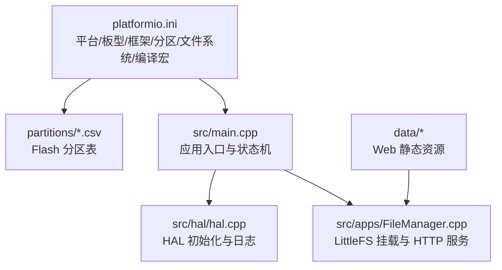
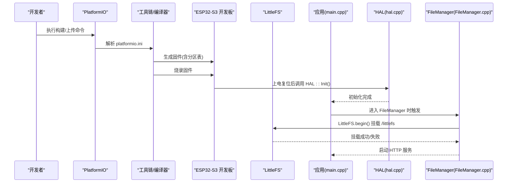
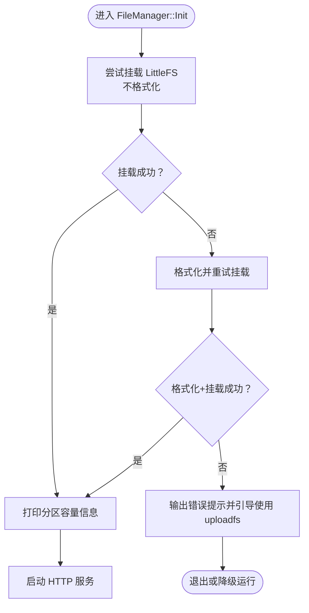
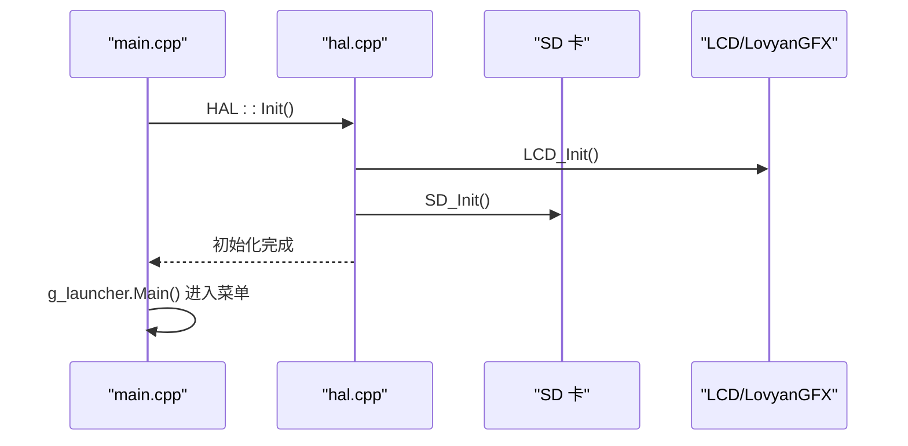
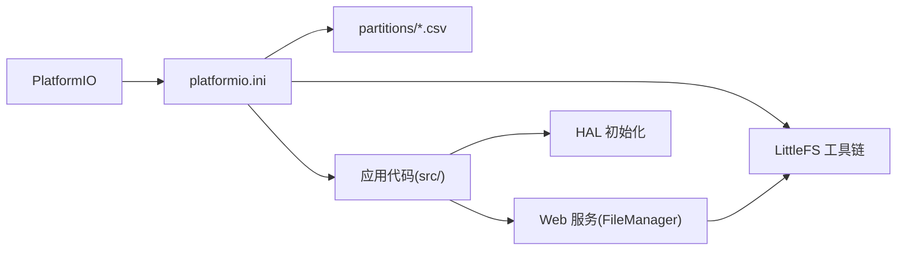

# 构建与部署

<cite>
**本文引用的文件**   
- [platformio.ini](file://platformio.ini)
- [custom_16MB_littlefs.csv](file://partitions/custom_16MB_littlefs.csv)
- [custom_8MB_littlefs.csv](file://partitions/custom_8MB_littlefs.csv)
- [main.cpp](file://src/main.cpp)
- [hal.cpp](file://src/hal/hal.cpp)
- [FileManager.cpp](file://src/apps/FileManager.cpp)
</cite>

## 目录
1. [简介](#简介)
2. [项目结构](#项目结构)
3. [核心组件](#核心组件)
4. [架构总览](#架构总览)
5. [详细组件分析](#详细组件分析)
6. [依赖关系分析](#依赖关系分析)
7. [性能考虑](#性能考虑)
8. [故障排查指南](#故障排查指南)
9. [结论](#结论)
10. [附录](#附录)

## 简介
本指南面向 ESP32 NullPod 项目的构建与部署，覆盖 PlatformIO 环境搭建、项目配置、Flash 分区表与 LittleFS 文件系统使用、编译与烧录流程、调试技巧、常见问题与优化建议，以及自动化构建与持续集成示例。文档以仓库现有配置和源码为依据，帮助开发者快速完成本地构建、固件烧录与资源上传，并稳定地集成到 CI 流水线中。

## 项目结构
本项目采用 PlatformIO + Arduino 框架开发，关键目录与职责如下：
- platformio.ini：PlatformIO 工程配置，定义平台、板型、框架、分区表、文件系统、编译宏等。
- partitions/：自定义 Flash 分区表，提供 8MB 与 16MB 两种布局，均启用 LittleFS。
- src/：应用主程序与 HAL 抽象层，包含启动入口、硬件初始化、应用调度与文件系统管理。
- data/：Web 前端资源（HTML/CSS/JS），用于通过 LittleFS 提供 Web UI。
- lib/：第三方库（如 LovyanGFX、WiFiManager、NimBLE 等）。



图表来源
- [platformio.ini:11-31](file://platformio.ini#L11-L31)
- [custom_16MB_littlefs.csv:1-12](file://partitions/custom_16MB_littlefs.csv#L1-L12)
- [main.cpp:19-24](file://src/main.cpp#L19-L24)
- [hal.cpp:4-25](file://src/hal/hal.cpp#L4-L25)
- [FileManager.cpp:458-512](file://src/apps/FileManager.cpp#L458-L512)

章节来源
- [platformio.ini:11-31](file://platformio.ini#L11-L31)
- [custom_16MB_littlefs.csv:1-12](file://partitions/custom_16MB_littlefs.csv#L1-L12)
- [custom_8MB_littlefs.csv:1-12](file://partitions/custom_8MB_littlefs.csv#L1-L12)
- [main.cpp:19-24](file://src/main.cpp#L19-L24)
- [hal.cpp:4-25](file://src/hal/hal.cpp#L4-L25)
- [FileManager.cpp:458-512](file://src/apps/FileManager.cpp#L458-L512)

## 核心组件
- 构建与运行环境
  - 平台：espressif32
  - 板型：esp32-s3-devkitc-1
  - 框架：Arduino
  - 串口监视器波特率：115200
- 内存与外设
  - PSRAM 启用宏与类型定义
  - QIO/OPI Flash 模式
- 文件系统与分区
  - 默认使用 16MB 分区表，LittleFS 作为文件系统
  - 支持 OTA 双槽（app0/app1）
- 应用入口与 HAL
  - main.cpp 负责应用状态机与模块调度
  - hal.cpp 负责系统初始化、设备驱动与日志输出

章节来源
- [platformio.ini:11-31](file://platformio.ini#L11-L31)
- [main.cpp:19-24](file://src/main.cpp#L19-L24)
- [hal.cpp:4-25](file://src/hal/hal.cpp#L4-L25)

## 架构总览
下图展示从 PlatformIO 配置到运行时初始化的整体流程，包括分区表选择、文件系统挂载与应用启动。



图表来源
- [platformio.ini:11-31](file://platformio.ini#L11-L31)
- [custom_16MB_littlefs.csv:1-12](file://partitions/custom_16MB_littlefs.csv#L1-L12)
- [hal.cpp:4-25](file://src/hal/hal.cpp#L4-L25)
- [FileManager.cpp:458-512](file://src/apps/FileManager.cpp#L458-L512)

## 详细组件分析

### PlatformIO 工程配置（platformio.ini）
- 环境与目标
  - 平台：espressif32 @ ~6.5.0
  - 板型：esp32-s3-devkitc-1
  - 框架：arduino
  - 监视器波特率：115200
- 内存与存储
  - board_build.arduino.memory_type = qio_opi：启用 QIO/OPI Flash 模式
  - board_upload.flash_size = 16MB：声明物理 Flash 大小
- 分区与文件系统
  - board_build.partitions = partitions/custom_16MB_littlefs.csv：使用自定义 16MB 分区表
  - board_build.filesystem = littlefs：启用 LittleFS 文件系统
- 编译宏
  - ARDUINO_USB_MODE=1：启用 USB 模式
  - ARDUINO_USB_CDC_ON_BOOT=1：开机启用 CDC 串口
  - CORE_DEBUG_LEVEL=3：开启较详细的调试日志
  - BOARD_HAS_PSRAM / ESP32S3_PSRAM_ENABLED：启用 PSRAM
- 嵌入文件
  - board_build.embed_files：将指定图片直接嵌入固件（例如 compass_dial.png、woodfish.png）

章节来源
- [platformio.ini:11-31](file://platformio.ini#L11-L31)

### Flash 分区表（partitions/*.csv）
- 16MB 布局（默认）
  - nvs：非易失性存储
  - otadata：OTA 数据区
  - app0/app1：双 OTA 应用槽（各约 4MB）
  - littlefs：Web 资源与媒体文件（约 7.875MB）
  - coredump：崩溃转储
- 8MB 布局（可选）
  - 双 OTA 槽缩小至约 2.75MB
  - LittleFS 分区约 2.375MB
- 兼容性说明
  - SubType 保留为 spiffs 以保持工具链兼容；实际由 LittleFS 按名称挂载

章节来源
- [custom_16MB_littlefs.csv:1-12](file://partitions/custom_16MB_littlefs.csv#L1-L12)
- [custom_8MB_littlefs.csv:1-12](file://partitions/custom_8MB_littlefs.csv#L1-L12)

### LittleFS 文件系统使用
- 挂载与格式化
  - 首次尝试不格式化挂载；若失败则带格式化参数重试
  - 挂载点路径：/littlefs
  - 卷标：littlefs
- 错误处理
  - 若挂载/格式化失败，提示检查分区表与文件系统配置，并指导使用 uploadfs 任务上传资源
- 资源访问
  - Web 服务器在路由未命中时尝试返回 LittleFS 中的静态资源（如 favicon.ico、图片等）



图表来源
- [FileManager.cpp:458-512](file://src/apps/FileManager.cpp#L458-L512)

章节来源
- [FileManager.cpp:458-512](file://src/apps/FileManager.cpp#L458-L512)

### 应用入口与 HAL 初始化
- 应用入口（main.cpp）
  - setup() 中调用 HAL::Init() 并完成系统初始化
  - loop() 中根据全局状态切换不同应用模块（菜单、传感器、游戏、文件管理等）
- HAL 初始化（hal.cpp）
  - 初始化串口、电源、LCD、I2C、输入、编码器、RTC、IMU、SD、磁力计、气压计等
  - 输出系统就绪信息与内存统计



图表来源
- [main.cpp:19-24](file://src/main.cpp#L19-L24)
- [hal.cpp:4-25](file://src/hal/hal.cpp#L4-L25)

章节来源
- [main.cpp:19-24](file://src/main.cpp#L19-L24)
- [hal.cpp:4-25](file://src/hal/hal.cpp#L4-L25)

## 依赖关系分析
- 构建期依赖
  - PlatformIO 解析 platformio.ini，选择 espressif32 平台与 esp32-s3-devkitc-1 板型
  - 根据 board_build.partitions 注入分区表
  - 根据 board_build.filesystem 启用 LittleFS 工具链支持
- 运行期依赖
  - HAL 初始化顺序影响后续模块可用性（如 LCD、I2C、SD）
  - FileManager 依赖 WiFi 与 LittleFS 提供 Web 功能
  - 嵌入式图片通过 embed_files 直接打包进固件，减少文件系统压力



图表来源
- [platformio.ini:11-31](file://platformio.ini#L11-L31)
- [custom_16MB_littlefs.csv:1-12](file://partitions/custom_16MB_littlefs.csv#L1-L12)
- [FileManager.cpp:458-512](file://src/apps/FileManager.cpp#L458-L512)

章节来源
- [platformio.ini:11-31](file://platformio.ini#L11-L31)
- [custom_16MB_littlefs.csv:1-12](file://partitions/custom_16MB_littlefs.csv#L1-L12)
- [FileManager.cpp:458-512](file://src/apps/FileManager.cpp#L458-L512)

## 性能考虑
- Flash 与内存
  - 使用 QIO/OPI Flash 模式提升读取带宽
  - 启用 PSRAM 宏，确保运行时能利用外部内存
- 分区规划
  - 16MB 布局下，OTA 槽与 LittleFS 空间充足，适合内置较多资源的应用
  - 8MB 布局适用于资源受限场景，需权衡 OTA 与文件系统大小
- 资源组织
  - 将频繁访问且体积较大的静态资源放入 LittleFS，降低固件体积
  - 对极小且高频的资源可通过 embed_files 直接嵌入固件，减少文件系统开销
- 调试级别
  - CORE_DEBUG_LEVEL=3 提供较详细日志，便于定位问题；发布时可适当降低以提升性能

[本节为通用性能建议，不直接分析具体文件]

## 故障排查指南
- LittleFS 挂载失败
  - 现象：提示挂载失败，需要格式化或检查分区表与文件系统配置
  - 排查步骤：
    - 确认 platformio.ini 中 board_build.partitions 指向正确的分区表
    - 确认 board_build.filesystem = littlefs
    - 使用 PlatformIO 的 uploadfs 任务上传 data 目录内容
- 无法访问 Web UI
  - 现象：热点已启动但浏览器无法加载页面
  - 排查步骤：
    - 确认 data 目录下 HTML/CSS/JS 文件存在且命名正确
    - 确认 LittleFS 已成功挂载并显示分区容量
    - 检查路由未命中时的静态资源回退逻辑是否生效
- 串口无输出或波特率异常
  - 现象：监视器无输出或乱码
  - 排查步骤：
    - 确认 monitor_speed = 115200
    - 确认 ARDUINO_USB_CDC_ON_BOOT=1 已启用
- 构建时报分区冲突或文件系统不支持
  - 现象：工具链报错找不到 LittleFS 或分区表无效
  - 排查步骤：
    - 确认分区表文件格式正确（CSV 列名与字段完整）
    - 确认 SubType 保持为 spiffs 以兼容工具链
    - 清理 .pio 缓存后重新构建

章节来源
- [FileManager.cpp:458-512](file://src/apps/FileManager.cpp#L458-L512)
- [platformio.ini:11-31](file://platformio.ini#L11-L31)

## 结论
通过 PlatformIO 与 Arduino 框架，结合自定义分区表与 LittleFS，NullPod 项目在 ESP32-S3 平台上实现了稳定的应用调度、丰富的 Web 管理与良好的扩展性。遵循本指南进行环境搭建、配置调整、资源上传与调试，可显著提升构建效率与部署稳定性。建议在 CI 中固化构建与上传脚本，并对分区与资源进行版本化管理，以确保团队协作的一致性。

[本节为总结性内容，不直接分析具体文件]

## 附录

### 构建与部署步骤
- 安装 PlatformIO
  - 参考官方文档安装 PlatformIO CLI 或 IDE
- 克隆与准备
  - 将仓库克隆到本地
  - 确保 data 目录包含 Web 资源（index.html、style.css、app.js 等）
- 构建与上传
  - 构建固件：pio run
  - 上传固件：pio run -t upload
  - 上传 LittleFS 资源：pio run -t uploadfs
- 监视与调试
  - 打开串口监视器：pio device monitor
  - 观察系统启动日志与 LittleFS 挂载信息

章节来源
- [platformio.ini:11-31](file://platformio.ini#L11-L31)
- [FileManager.cpp:458-512](file://src/apps/FileManager.cpp#L458-L512)

### 常见构建问题与解决方案
- 分区表路径错误
  - 现象：构建失败提示找不到分区表
  - 解决：确认 board_build.partitions 指向 partitions/custom_16MB_littlefs.csv
- 文件系统类型不匹配
  - 现象：LittleFS 工具链不可用
  - 解决：确认 board_build.filesystem = littlefs
- 资源未上传导致 Web UI 缺失
  - 现象：热点可用但页面空白
  - 解决：执行 pio run -t uploadfs 上传 data 目录

章节来源
- [platformio.ini:11-31](file://platformio.ini#L11-L31)
- [FileManager.cpp:458-512](file://src/apps/FileManager.cpp#L458-L512)

### 自动化构建与持续集成示例
以下示例基于 GitHub Actions，演示如何在 CI 中安装 PlatformIO、构建固件与上传 LittleFS 资源。可根据你的 CI 平台（GitLab CI、Azure Pipelines 等）进行适配。

- GitHub Actions 示例（.github/workflows/build.yml）
  - 触发条件：push 或 pull_request
  - 步骤：
    - 设置 Python 环境
    - 安装 PlatformIO
    - 缓存 PlatformIO 包与构建产物
    - 执行构建与资源上传（如需自动上传到设备，可在具备物理接口的 Runner 上执行）

```yaml
name: Build and Upload LittleFS

on:
  push:
    branches: [ main ]
  pull_request:
    branches: [ main ]

jobs:
  build:
    runs-on: ubuntu-latest
    steps:
      - uses: actions/checkout@v4

      - name: Set up Python
        uses: actions/setup-python@v5
        with:
          python-version: '3.x'

      - name: Install PlatformIO
        run: pip install --upgrade platformio

      - name: Cache PlatformIO packages
        uses: actions/cache@v4
        with:
          path: ~/.platformio
          key: ${{ runner.os }}-pio-pio-${{ hashFiles('**/platformio.ini') }}

      - name: Build firmware
        run: pio run

      - name: Upload LittleFS resources
        run: pio run -t uploadfs
```

[本节为概念性示例，不直接分析具体文件]