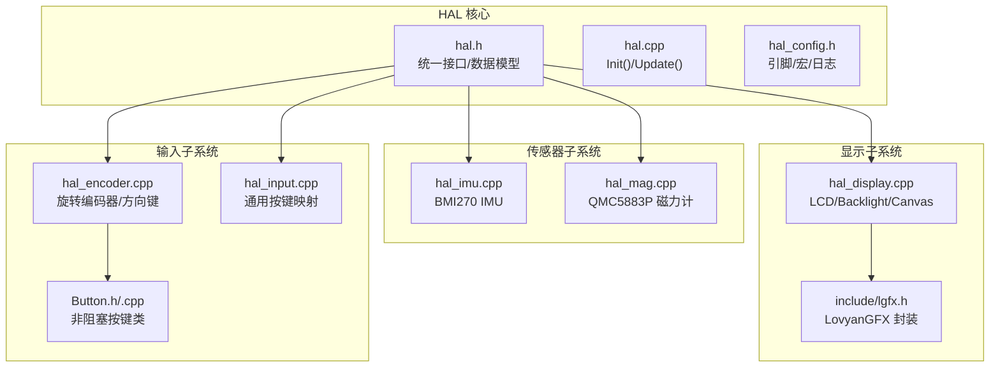
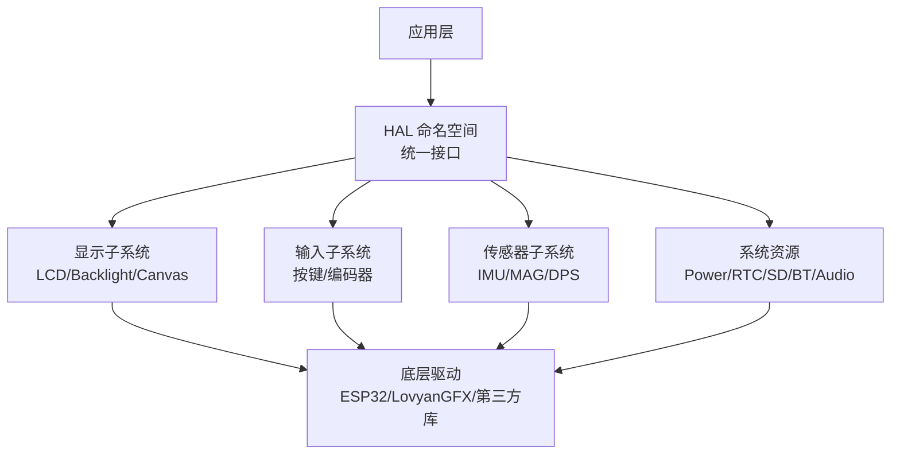
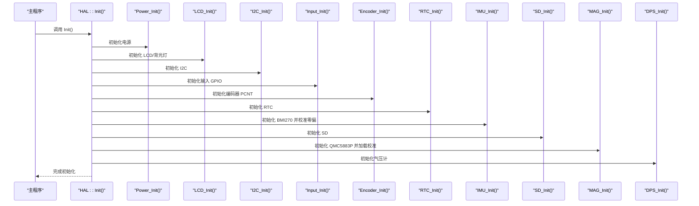
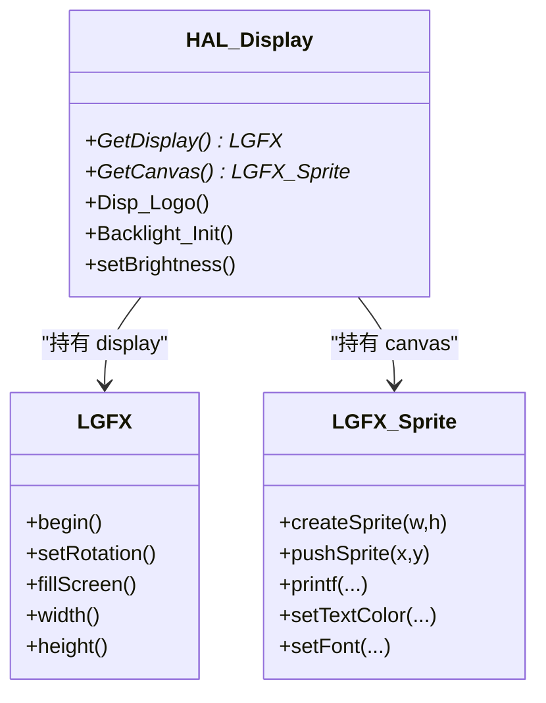
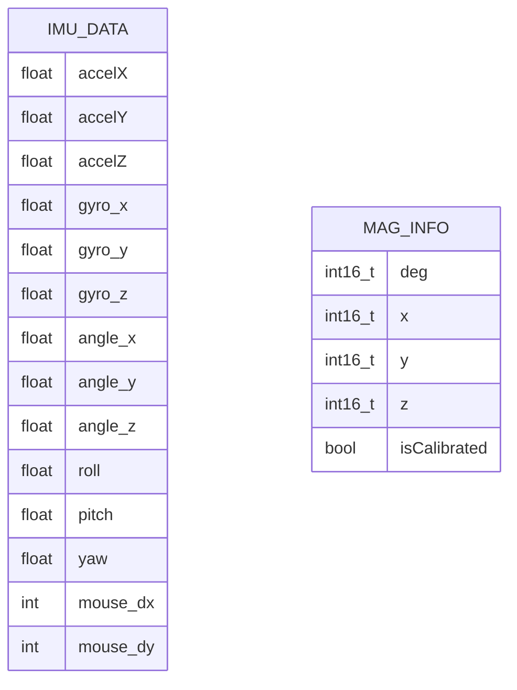
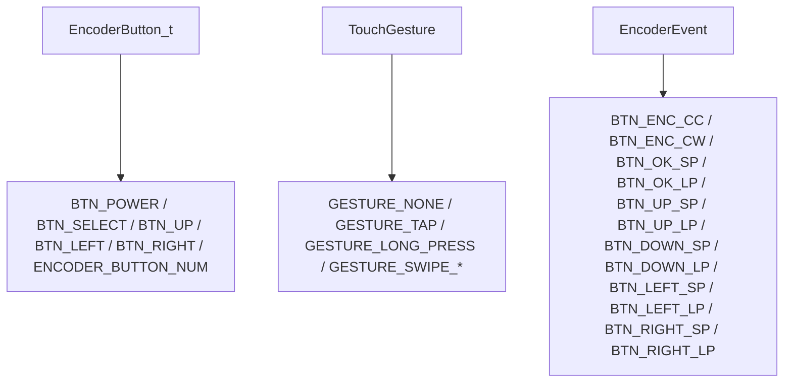
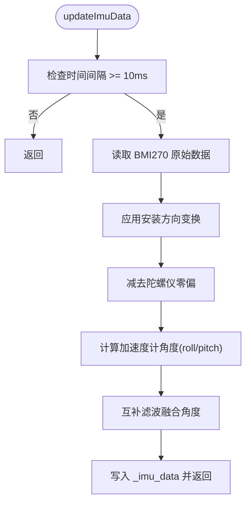
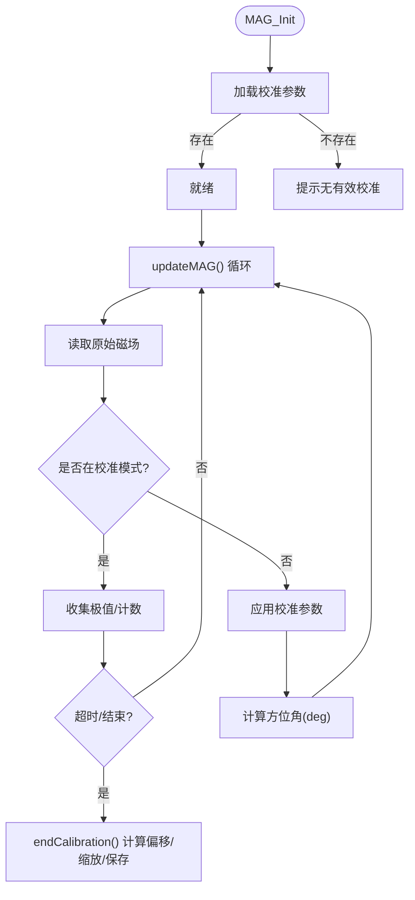
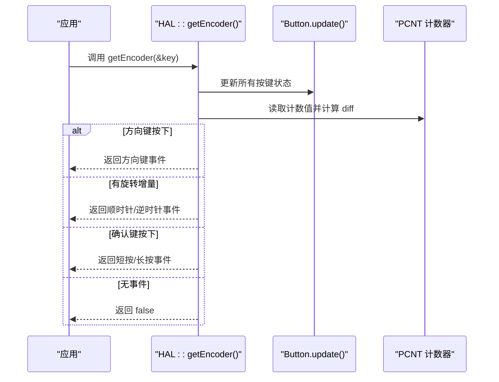
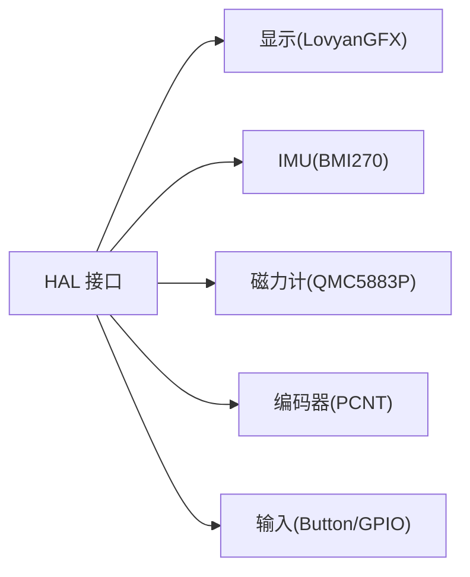

# HAL 核心接口

<cite>
**本文引用的文件**   
- [hal.h](file://src/hal/hal.h)
- [hal.cpp](file://src/hal/hal.cpp)
- [hal_config.h](file://src/hal/hal_config.h)
- [hal_display.cpp](file://src/hal/hal_display.cpp)
- [hal_imu.cpp](file://src/hal/hal_imu.cpp)
- [hal_mag.cpp](file://src/hal/hal_mag.cpp)
- [hal_encoder.cpp](file://src/hal/hal_encoder.cpp)
- [hal_input.cpp](file://src/hal/hal_input.cpp)
- [Button.h](file://src/hal/Button.h)
- [Button.cpp](file://src/hal/Button.cpp)
- [lgfx.h](file://include/lgfx.h)
</cite>

## 目录
1. [简介](#简介)
2. [项目结构](#项目结构)
3. [核心组件](#核心组件)
4. [架构总览](#架构总览)
5. [详细组件分析](#详细组件分析)
6. [依赖关系分析](#依赖关系分析)
7. [性能与实时性](#性能与实时性)
8. [故障排查指南](#故障排查指南)
9. [结论](#结论)
10. [附录：配置与引脚参考](#附录配置与引脚参考)

## 简介
本文件面向 HAL（硬件抽象层）核心接口，系统化说明整体架构、统一接口规范、关键初始化流程 Init() 与 Update()、全局显示对象 display 与 canvas 的管理机制，以及 IMU、磁力计、编码器、输入等模块的数据结构与行为。文档同时提供使用示例与最佳实践、配置项与引脚定义参考，帮助应用开发者快速集成并稳定运行。

## 项目结构
HAL 相关代码集中在 src/hal 目录下，按功能拆分：
- hal.h：统一接口声明、枚举与数据结构
- hal.cpp：系统级初始化与更新调度
- hal_config.h：引脚、宏与日志工具
- hal_display.cpp：LCD/背光/画布管理
- hal_imu.cpp：IMU 采集、校准与角度融合
- hal_mag.cpp：磁力计采集与校准参数持久化
- hal_encoder.cpp：旋转编码器与方向键事件
- hal_input.cpp：通用按键映射与状态
- Button.h/.cpp：非阻塞按键类
- include/lgfx.h：屏幕与触摸驱动封装

图表来源
- [hal.h:1-215](file://src/hal/hal.h#L1-L215)
- [hal.cpp:1-72](file://src/hal/hal.cpp#L1-L72)
- [hal_config.h:1-123](file://src/hal/hal_config.h#L1-L123)
- [hal_display.cpp:1-127](file://src/hal/hal_display.cpp#L1-L127)
- [hal_imu.cpp:1-182](file://src/hal/hal_imu.cpp#L1-L182)
- [hal_mag.cpp:1-297](file://src/hal/hal_mag.cpp#L1-L297)
- [hal_encoder.cpp:1-129](file://src/hal/hal_encoder.cpp#L1-L129)
- [hal_input.cpp:1-59](file://src/hal/hal_input.cpp#L1-L59)
- [Button.h:1-183](file://src/hal/Button.h#L1-L183)
- [lgfx.h:1-118](file://include/lgfx.h#L1-L118)

章节来源
- [hal.h:1-215](file://src/hal/hal.h#L1-L215)
- [hal.cpp:1-72](file://src/hal/hal.cpp#L1-L72)
- [hal_config.h:1-123](file://src/hal/hal_config.h#L1-L123)

## 核心组件
- 统一接口命名空间 HAL：集中暴露 LCD、I2C、Touch、Input、IMU、MAG、DPS、RTC、SD、Power、Buzzer、RGB、Encoder、Audio、BT、System 等能力。
- 全局显示对象：display 与 canvas 为全局实例，canvas 作为离屏缓冲，减少闪烁并提升绘制效率。
- 数据模型与枚举：ImuData_t、MAG_Info_t、TouchGesture、EncoderButton_t、EncoderEvent 等，用于跨模块传递标准化数据。
- 非阻塞按键类 Button：支持短按/长按/连发/持续按住，适合在 loop 或定时器中调用 update()。

章节来源
- [hal.h:10-12](file://src/hal/hal.h#L10-L12)
- [hal.h:31-92](file://src/hal/hal.h#L31-L92)
- [hal_display.cpp:5-6](file://src/hal/hal_display.cpp#L5-L6)
- [Button.h:48-183](file://src/hal/Button.h#L48-L183)

## 架构总览
HAL 采用“分层 + 模块化”设计：
- 顶层：HAL 命名空间统一入口，屏蔽底层驱动差异
- 中间层：各子模块（显示、输入、传感器、电源等）独立实现
- 底层：ESP32 外设与第三方库（LovyanGFX、BMI270、QMC5883P 等）

图表来源
- [hal.h:101-212](file://src/hal/hal.h#L101-L212)
- [hal_display.cpp:18-42](file://src/hal/hal_display.cpp#L18-L42)
- [hal_encoder.cpp:37-71](file://src/hal/hal_encoder.cpp#L37-L71)
- [hal_imu.cpp:57-74](file://src/hal/hal_imu.cpp#L57-L74)
- [hal_mag.cpp:233-246](file://src/hal/hal_mag.cpp#L233-L246)

## 详细组件分析

### 初始化与更新流程：Init() 与 Update()
- Init() 负责顺序初始化各子系统：串口、电源、LCD、I2C、输入、编码器、RTC、IMU、SD、磁力计、气压计、蜂鸣器提示音等。
- Update() 当前为占位实现，预留了 Touch/IMU/MAG/Encoder 的周期性更新入口，便于上层按需启用。

图表来源
- [hal.cpp:4-25](file://src/hal/hal.cpp#L4-L25)
- [hal_display.cpp:18-42](file://src/hal/hal_display.cpp#L18-L42)
- [hal_imu.cpp:57-74](file://src/hal/hal_imu.cpp#L57-L74)
- [hal_mag.cpp:233-246](file://src/hal/hal_mag.cpp#L233-L246)

章节来源
- [hal.cpp:4-33](file://src/hal/hal.cpp#L4-L33)

### 全局对象 display 与 canvas 管理机制
- display 是 LovyanGFX 设备实例，负责面板、总线、触摸等底层配置。
- canvas 是基于 display 的离屏精灵（Sprite），用于双缓冲绘制，减少闪烁。
- HAL 提供 GetDisplay() 与 GetCanvas() 获取指针，供上层绘制。

图表来源
- [hal_display.cpp:5-6](file://src/hal/hal_display.cpp#L5-L6)
- [hal_display.cpp:44-52](file://src/hal/hal_display.cpp#L44-L52)
- [hal_display.cpp:62-79](file://src/hal/hal_display.cpp#L62-L79)
- [hal_display.cpp:81-127](file://src/hal/hal_display.cpp#L81-L127)
- [lgfx.h:34-115](file://include/lgfx.h#L34-L115)

章节来源
- [hal_display.cpp:5-6](file://src/hal/hal_display.cpp#L5-L6)
- [hal_display.cpp:44-52](file://src/hal/hal_display.cpp#L44-L52)
- [lgfx.h:34-115](file://include/lgfx.h#L34-L115)

### 数据结构与枚举

#### 关键数据结构
- ImuData_t：包含加速度、角速度、欧拉角（roll/pitch/yaw）、鼠标增量等字段，用于 IMU 数据输出。
- MAG_Info_t：包含方位角与三轴磁场值及校准状态标志。

图表来源
- [hal.h:31-47](file://src/hal/hal.h#L31-L47)
- [hal.h:57-64](file://src/hal/hal.h#L57-L64)

章节来源
- [hal.h:31-47](file://src/hal/hal.h#L31-L47)
- [hal.h:57-64](file://src/hal/hal.h#L57-L64)

#### 枚举类型
- EncoderButton_t：编码器的逻辑按键编号（如电源、选择、上下左右）。
- TouchGesture：触摸手势（轻点、长按、四向滑动）。
- EncoderEvent：编码器事件（顺时针/逆时针旋转、确认键短/长按、方向键短/长按）。

图表来源
- [hal.h:19-28](file://src/hal/hal.h#L19-L28)
- [hal.h:66-75](file://src/hal/hal.h#L66-L75)
- [hal.h:78-92](file://src/hal/hal.h#L78-L92)

章节来源
- [hal.h:19-28](file://src/hal/hal.h#L19-L28)
- [hal.h:66-75](file://src/hal/hal.h#L66-L75)
- [hal.h:78-92](file://src/hal/hal.h#L78-L92)

### IMU 模块（BMI270）
- 上电自动进行陀螺仪零偏校准，采样静置数据求平均。
- 固定采样率控制（100Hz），通过互补滤波融合加速度计与陀螺仪角度。
- 支持安装方向变换（正面/反面），修正 roll/pitch/yaw 符号。
- 提供鼠标增量计算接口，将角度变化映射为 dx/dy。

图表来源
- [hal_imu.cpp:88-149](file://src/hal/hal_imu.cpp#L88-L149)
- [hal_imu.cpp:151-173](file://src/hal/hal_imu.cpp#L151-L173)

章节来源
- [hal_imu.cpp:57-74](file://src/hal/hal_imu.cpp#L57-L74)
- [hal_imu.cpp:88-173](file://src/hal/hal_imu.cpp#L88-L173)

### 磁力计模块（QMC5883P）
- 支持在线校准：记录 X/Y/Z 最大最小值，计算硬铁偏移与软铁缩放，并保存到 Preferences。
- 上电自动加载已保存的校准参数；可选择上电即校准。
- 提供方位角与三轴磁场值查询接口。

图表来源
- [hal_mag.cpp:233-246](file://src/hal/hal_mag.cpp#L233-L246)
- [hal_mag.cpp:248-274](file://src/hal/hal_mag.cpp#L248-L274)
- [hal_mag.cpp:143-197](file://src/hal/hal_mag.cpp#L143-L197)

章节来源
- [hal_mag.cpp:233-297](file://src/hal/hal_mag.cpp#L233-L297)

### 编码器与输入（PCNT + Button）
- 使用 ESP32 PCNT 硬件解码 A/B 相脉冲，统计旋转增量。
- 方向键与确认键通过 Button 类进行非阻塞扫描，支持短按/长按/连发。
- getEncoder() 统一事件优先级：方向键 > 旋转 > 确认键。

图表来源
- [hal_encoder.cpp:37-71](file://src/hal/hal_encoder.cpp#L37-L71)
- [hal_encoder.cpp:74-128](file://src/hal/hal_encoder.cpp#L74-L128)
- [Button.cpp:28-70](file://src/hal/Button.cpp#L28-L70)

章节来源
- [hal_encoder.cpp:37-128](file://src/hal/hal_encoder.cpp#L37-L128)
- [Button.h:48-183](file://src/hal/Button.h#L48-L183)
- [Button.cpp:1-169](file://src/hal/Button.cpp#L1-L169)

### 通用按键映射（Input）
- 将物理按键映射到逻辑按键编号（电源、选择、上下左右）。
- 提供 GetButton() 检测按键状态，并在按下/释放时触发蜂鸣提示。
- 提供 isReturn()/isEnter() 快捷方法。

章节来源
- [hal_input.cpp:1-59](file://src/hal/hal_input.cpp#L1-L59)

## 依赖关系分析
- HAL 对外暴露统一接口，内部依赖具体驱动与第三方库。
- 显示子系统依赖 LovyanGFX（LGFX），并通过 canvas 提供离屏缓冲。
- IMU 依赖 BMI270 库；磁力计依赖 QMC5883PCompass；编码器依赖 ESP32 PCNT 驱动。
- 输入子系统依赖 Button 类与 GPIO 配置。

图表来源
- [hal.h:101-212](file://src/hal/hal.h#L101-L212)
- [hal_display.cpp:1-6](file://src/hal/hal_display.cpp#L1-L6)
- [hal_imu.cpp:1-3](file://src/hal/hal_imu.cpp#L1-L3)
- [hal_mag.cpp:19-21](file://src/hal/hal_mag.cpp#L19-L21)
- [hal_encoder.cpp:1-4](file://src/hal/hal_encoder.cpp#L1-L4)

章节来源
- [hal.h:101-212](file://src/hal/hal.h#L101-L212)

## 性能与实时性
- IMU 固定 100Hz 采样，通过时间阈值控制避免频繁读取，降低 CPU 占用。
- 编码器使用 PCNT 硬件解码，减少软件开销，提高响应实时性。
- 显示采用离屏缓冲 canvas，批量 pushSprite 减少闪烁与重复刷新。
- 磁力计校准过程包含超时保护与有效性校验，避免长时间阻塞。

[本节为通用指导，不直接分析具体文件]

## 故障排查指南
- 初始化失败
  - IMU 初始化失败：检查 I2C 地址与连线，查看日志错误信息。
  - 磁力计无有效校准：调用 MAG_ClearCalibration() 后重新校准。
- 触摸/显示异常
  - 检查背光 PWM 通道与引脚配置，确认亮度设置未为 0。
  - 确认 LovyanGFX 引脚定义与硬件一致。
- 编码器无响应
  - 检查 PCNT 单元与 GPIO 配置是否正确。
  - 确认方向键与确认键的 Button 实例已正确创建并 update()。
- 内存不足
  - 使用 logMemory() 打印堆与 PSRAM 使用情况，优化大对象分配。

章节来源
- [hal_imu.cpp:57-74](file://src/hal/hal_imu.cpp#L57-L74)
- [hal_mag.cpp:131-139](file://src/hal/hal_mag.cpp#L131-L139)
- [hal_display.cpp:81-127](file://src/hal/hal_display.cpp#L81-L127)
- [hal_encoder.cpp:37-71](file://src/hal/hal_encoder.cpp#L37-L71)
- [hal.cpp:56-71](file://src/hal/hal.cpp#L56-L71)

## 结论
HAL 层通过统一的命名空间接口与清晰的分层架构，屏蔽了底层驱动差异，提供了稳定的显示、输入、传感器与系统资源管理能力。配合非阻塞按键类与硬件解码（PCNT），在保证实时性的同时降低了 CPU 负载。建议在上层应用中遵循本文档的最佳实践，合理调用 Init()/Update()，并使用 canvas 进行高效绘制。

[本节为总结性内容，不直接分析具体文件]

## 附录：配置与引脚参考

### 配置选项
- 屏幕分辨率与旋转：LCD_H_RES、LCD_V_RES、LCD_ROTATION
- 背光控制：PWM 频率、通道、位数、初始亮度
- NVS 配置命名空间与键名：CONFIG_NAMESPACE、LCD_BK_BRIGHTNESS_KEY、LCD_BK_TIME_OUT_KEY、WIFI_SSID_KEY、WIFI_PASSWORD_KEY
- 日志宏：HAL_LOGI/W/E 与 HAL_LOGGER_INIT/HAL_LOG/HAL_LOG_TAG_*

章节来源
- [hal_config.h:7-22](file://src/hal/hal_config.h#L7-L22)
- [hal_config.h:67-77](file://src/hal/hal_config.h#L67-L77)
- [hal_config.h:79-123](file://src/hal/hal_config.h#L79-L123)

### 引脚定义参考
- LCD：MOSI/MISO/SCLK/DC/CS/RST/BL
- 电源：BOOT/KEY/HOLD
- 编码器：UP/DOWN/LEFT/RIGHT/CHA/CHB/SEL
- SD：CS/MOSI/MISO/CLK
- I2C：SCL/SDA
- 触摸：SCL/SDA/RST/IRQ
- 电池 ADC：BAT_ADC
- 蜂鸣器：BUZZER
- RGB：RGB
- IR：IR

章节来源
- [hal_config.h:7-66](file://src/hal/hal_config.h#L7-L66)

### 接口使用示例与最佳实践
- 初始化与更新
  - 在 setup() 中调用 HAL::Init()，在 loop() 中按需调用 HAL::Update() 或具体模块的 updateXxx()。
- 显示绘制
  - 使用 HAL::GetCanvas() 获取 canvas，在帧末调用 pushSprite(0,0) 刷新。
  - 使用 HAL::setBrightness() 调整背光，避免频繁写 Flash，可缓存亮度值。
- IMU 使用
  - 定期调用 HAL::updateImuData()，然后读取 HAL::getImuData() 或 HAL::imu_get_roll()/pitch()/yaw()。
  - 如需鼠标移动，调用 HAL::updateMouseDelta(sensitivity)。
- 磁力计使用
  - 首次使用时可调用 HAL::MAG_StartCalibration()，旋转设备约 30 秒后调用 HAL::MAG_StopCalibration()。
  - 查询 HAL::MAG_GetInfo() 获取方位角与三轴值。
- 编码器与按键
  - 在 loop() 中调用 HAL::getEncoder(&key)，根据 key 分发事件。
  - 使用 HAL::GetButton() 检测通用按键，或使用 Button 类的 pressed()/held()/repeated() 组合。
- 系统资源
  - 使用 HAL::logMemory() 监控内存，避免 OOM。
  - 使用 HAL::isSwipeOut()/isReturn()/isEnter() 处理用户交互。

[本节为通用指导，不直接分析具体文件]