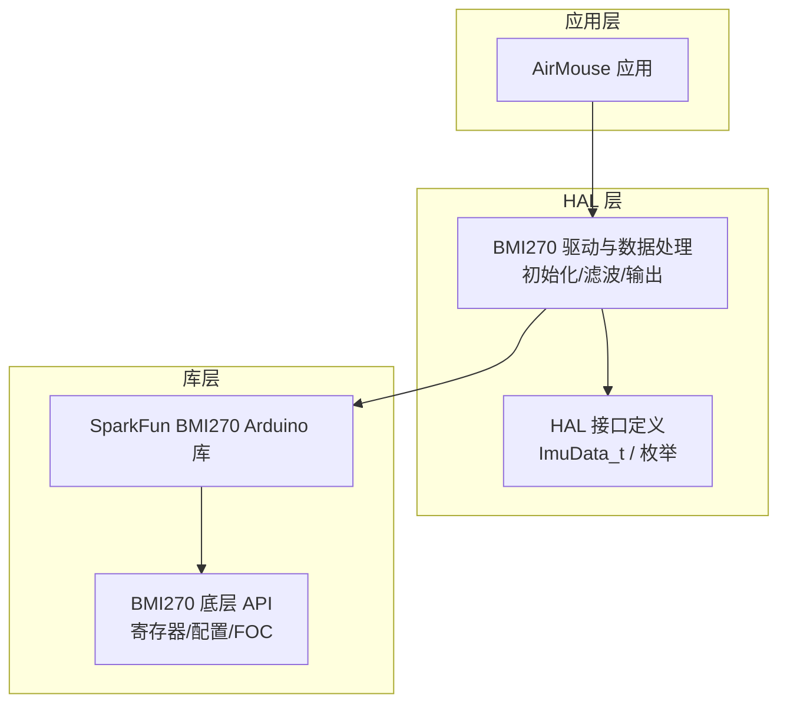
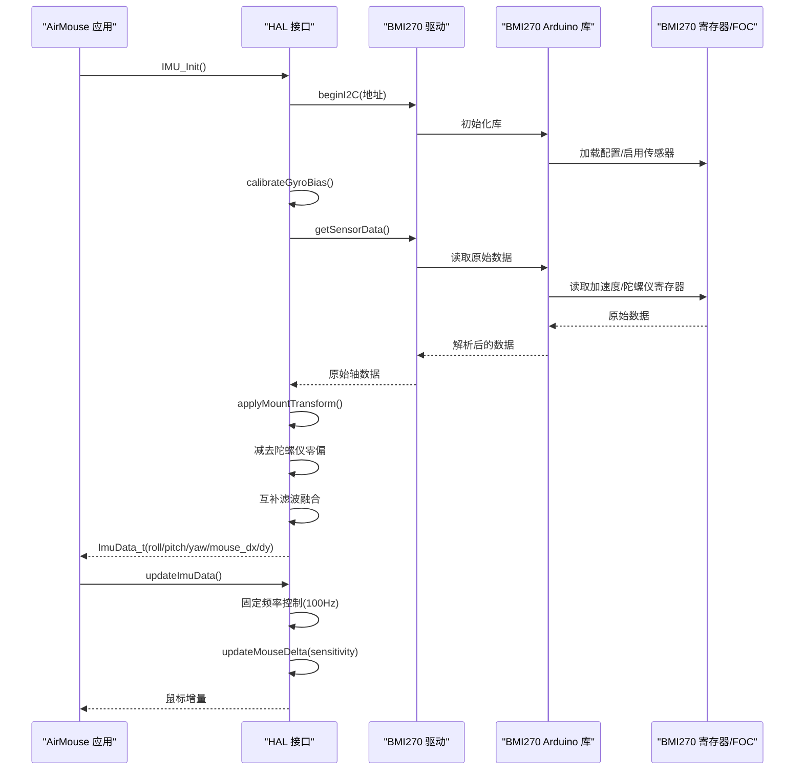
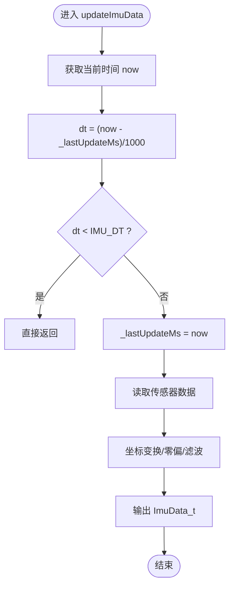
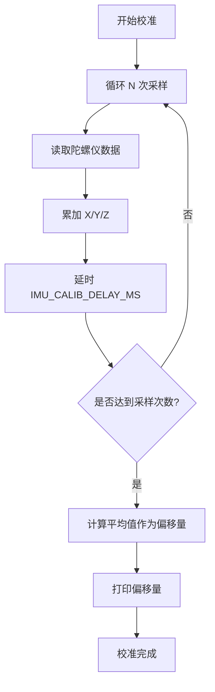
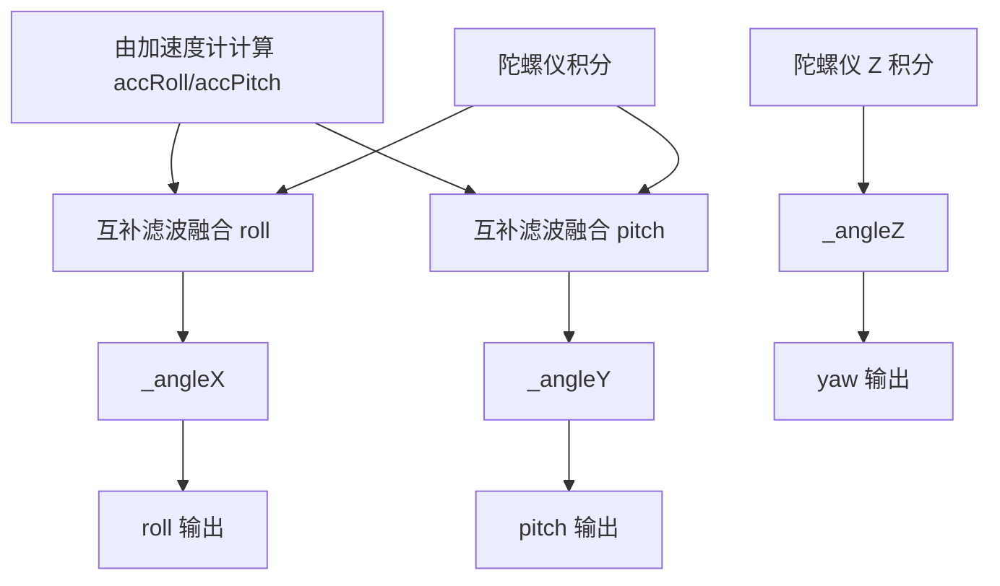
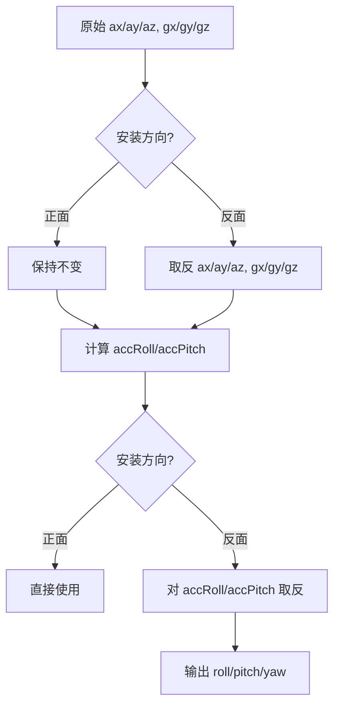
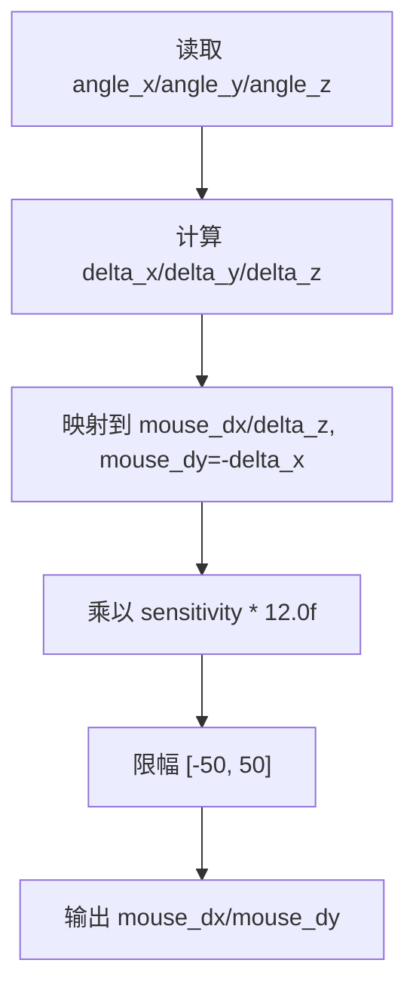

# IMU 惯性测量单元

<cite>
**本文引用的文件**   
- [hal_imu.cpp](file://src/hal/hal_imu.cpp)
- [hal.h](file://src/hal/hal.h)
- [AirMouse.cpp](file://src/apps/AirMouse.cpp)
- [AirMouse.h](file://src/apps/AirMouse.h)
- [bmi270.c](file://lib/SparkFun BMI270 Arduino Library/src/bmi270_api/bmi270.c)
- [bmi2.c](file://lib/SparkFun BMI270 Arduino Library/src/bmi270_api/bmi2.c)
</cite>

## 目录
1. [简介](#简介)
2. [项目结构](#项目结构)
3. [核心组件](#核心组件)
4. [架构总览](#架构总览)
5. [详细组件分析](#详细组件分析)
6. [依赖关系分析](#依赖关系分析)
7. [性能与精度考量](#性能与精度考量)
8. [故障排查指南](#故障排查指南)
9. [结论](#结论)
10. [附录：API 使用示例与参数调优](#附录api-使用示例与参数调优)

## 简介
本技术文档围绕 ESP32 平台上的 BMI270 IMU 模块，系统性说明以下要点：
- BMI270 初始化与 I2C 通信配置
- 固定采样率控制（100Hz）
- 陀螺仪零偏校准算法（上电静置、偏移量计算）
- 互补滤波实现（陀螺仪积分 + 加速度计角度融合）
- 安装方向变换矩阵与坐标系统转换
- 姿态角 roll/pitch/yaw 计算方法与平移补偿
- 空中鼠标模式下的增量计算与灵敏度调节
- 完整 API 使用示例与参数调优建议

该文档面向开发者与系统集成人员，既提供代码级细节，也给出可操作的实践指导。

## 项目结构
IMU 相关逻辑主要位于 HAL 层与应用层：
- HAL 层负责传感器驱动、数据更新、滤波与输出封装
- 应用层（空中鼠标）消费 HAL 提供的姿态与鼠标增量数据

图表来源
- [hal.h:31-54](file://src/hal/hal.h#L31-L54)
- [hal_imu.cpp:1-182](file://src/hal/hal_imu.cpp#L1-L182)
- [bmi270.c:50-62](file://lib/SparkFun BMI270 Arduino Library/src/bmi270_api/bmi270.c#L50-L62)
- [bmi2.c:5047-5153](file://lib/SparkFun BMI270 Arduino Library/src/bmi270_api/bmi2.c#L5047-L5153)

章节来源
- [hal.h:31-54](file://src/hal/hal.h#L31-L54)
- [hal_imu.cpp:1-182](file://src/hal/hal_imu.cpp#L1-L182)

## 核心组件
- HAL::IMU_Init：初始化 BMI270，I2C 连接，执行上电静置零偏校准，记录初始时间戳
- updateImuData：以 100Hz 固定频率读取原始数据，进行安装方向变换、零偏减法、互补滤波，输出姿态角与原始轴数据
- updateMouseDelta：基于互补滤波角度增量计算鼠标 dx/dy，并限制最大移动范围
- HAL 接口与数据结构：ImuData_t 包含原始轴、滤波后角度、姿态角、鼠标增量等字段；ImuMountDir_t 表示安装方向

章节来源
- [hal.h:31-54](file://src/hal/hal.h#L31-L54)
- [hal.h:130-140](file://src/hal/hal.h#L130-L140)
- [hal_imu.cpp:31-74](file://src/hal/hal_imu.cpp#L31-L74)
- [hal_imu.cpp:88-149](file://src/hal/hal_imu.cpp#L88-L149)
- [hal_imu.cpp:151-182](file://src/hal/hal_imu.cpp#L151-L182)

## 架构总览
下图展示从应用层到传感器驱动的调用链与数据流：

图表来源
- [hal_imu.cpp:57-74](file://src/hal/hal_imu.cpp#L57-L74)
- [hal_imu.cpp:88-149](file://src/hal/hal_imu.cpp#L88-L149)
- [hal_imu.cpp:151-182](file://src/hal/hal_imu.cpp#L151-L182)
- [bmi270.c:50-62](file://lib/SparkFun BMI270 Arduino Library/src/bmi270_api/bmi270.c#L50-L62)
- [bmi2.c:5047-5153](file://lib/SparkFun BMI270 Arduino Library/src/bmi270_api/bmi2.c#L5047-L5153)

## 详细组件分析

### BMI270 初始化与 I2C 通信设置
- I2C 地址：通过常量 BMI2_I2C_PRIM_ADDR 指定主 I2C 地址
- 初始化流程：
  - 调用 beginI2C 建立 I2C 通信
  - 若失败则记录错误日志并返回
  - 启动后延时等待稳定，随后执行陀螺仪零偏校准
  - 记录初始更新时间戳用于后续固定频率控制

关键实现要点
- 使用 SparkFun BMI270 Arduino 库封装 I2C 访问与寄存器操作
- 库内部通过 bmi270_config_file 与底层 API 完成传感器配置与使能

章节来源
- [hal_imu.cpp:57-74](file://src/hal/hal_imu.cpp#L57-L74)
- [bmi270.c:50-62](file://lib/SparkFun BMI270 Arduino Library/src/bmi270_api/bmi270.c#L50-L62)

### 采样率控制（100Hz）
- 固定采样率常量：IMU_SAMPLE_RATE_HZ = 100.0f
- 时间步长常量：IMU_DT = 1.0f / IMU_SAMPLE_RATE_HZ
- 在 updateImuData 中：
  - 计算当前时间与上次更新时间差 dt
  - 若 dt < IMU_DT 直接返回，保证 100Hz 上限
  - 否则更新 _lastUpdateMs 并继续处理

图表来源
- [hal_imu.cpp:88-98](file://src/hal/hal_imu.cpp#L88-L98)

章节来源
- [hal_imu.cpp:5-8](file://src/hal/hal_imu.cpp#L5-L8)
- [hal_imu.cpp:88-98](file://src/hal/hal_imu.cpp#L88-L98)

### 陀螺仪零偏校准算法（上电静置）
- 校准目标：估算静止状态下各轴的零偏（offset），用于后续数据减法
- 流程：
  - 提示用户保持设备静止
  - 循环采集 IMU_CALIB_SAMPLES 次（默认 200 次）
  - 每次采集间隔 IMU_CALIB_DELAY_MS（默认 5ms），累计三轴值
  - 计算平均值作为 _gyroOffsetX/Y/Z
- 结果：打印偏移量并标记校准完成

图表来源
- [hal_imu.cpp:31-55](file://src/hal/hal_imu.cpp#L31-L55)

章节来源
- [hal_imu.cpp:31-55](file://src/hal/hal_imu.cpp#L31-L55)

### 互补滤波算法（陀螺仪积分 + 加速度计角度融合）
- 系数：COMP_FILT_GYRO_COEF = 0.98f，COMP_FILT_ACC_COEF = 0.02f
- 步骤：
  - 从加速度计计算 roll/pitch 角度（atan2 公式）
  - 对 roll/pitch 使用互补滤波：大部分来自陀螺仪积分，小部分来自加速度计角度
  - yaw 仅使用陀螺仪积分（无磁力计）
- 注意：安装方向为反面时，对 roll/pitch 角度符号做额外翻转

图表来源
- [hal_imu.cpp:118-149](file://src/hal/hal_imu.cpp#L118-L149)

章节来源
- [hal_imu.cpp:10-12](file://src/hal/hal_imu.cpp#L10-L12)
- [hal_imu.cpp:118-149](file://src/hal/hal_imu.cpp#L118-L149)

### 安装方向变换矩阵与坐标系统转换
- 支持两种安装方向：正面（Z 朝上）与反面（PCB 反面，180° 翻转）
- 变换规则：
  - 反面安装时对加速度与陀螺仪数据取反
  - 对加速度计角度（accRoll/accPitch）在反面安装时再取反
  - 最终 roll/pitch/yaw 根据安装方向调整符号
- 目的：统一坐标系，确保上层应用在不同安装方式下获得一致的姿态语义

图表来源
- [hal_imu.cpp:76-86](file://src/hal/hal_imu.cpp#L76-L86)
- [hal_imu.cpp:124-140](file://src/hal/hal_imu.cpp#L124-L140)

章节来源
- [hal.h:49-54](file://src/hal/hal.h#L49-L54)
- [hal_imu.cpp:76-86](file://src/hal/hal_imu.cpp#L76-L86)
- [hal_imu.cpp:124-140](file://src/hal/hal_imu.cpp#L124-L140)

### 姿态角（roll、pitch、yaw）计算方法与平移补偿
- roll/pitch：由加速度计角度经互补滤波得到，考虑安装方向符号修正
- yaw：仅由陀螺仪 Z 轴积分得到（无磁力计）
- 平移补偿：在本实现中未显式进行重力矢量分解或动态平移补偿；如需更高精度，可在加速度计角度计算前进行动态分量剔除或引入磁力计进行航向校正

章节来源
- [hal_imu.cpp:118-149](file://src/hal/hal_imu.cpp#L118-L149)

### 空中鼠标模式下的增量计算与灵敏度调节
- 增量来源：基于互补滤波角度增量（_imu_data.angle_x/y/z 的差分）
- 映射关系：
  - mouse_dx 对应 yaw 增量（delta_z）
  - mouse_dy 对应 roll 增量（delta_x）并取负号
- 灵敏度：由外部传入 sensitivity 参数，乘以固定缩放因子（12.0f）
- 限幅：将 dx/dy 限制在 [-50, 50] 范围内，避免过大抖动

图表来源
- [hal_imu.cpp:151-173](file://src/hal/hal_imu.cpp#L151-L173)

章节来源
- [hal_imu.cpp:151-173](file://src/hal/hal_imu.cpp#L151-L173)
- [AirMouse.cpp:65-71](file://src/apps/AirMouse.cpp#L65-L71)
- [AirMouse.h:32](file://src/apps/AirMouse.h#L32)

## 依赖关系分析
- HAL 层依赖 SparkFun BMI270 Arduino 库进行 I2C 访问与数据读取
- 库层依赖 BMI270 底层 API（bmi270.c/bmi2.c）完成寄存器配置、FOC 与偏移补偿
- 应用层 AirMouse 通过 HAL 接口获取 IMU 数据并发送 HID 鼠标事件

图表来源
- [hal.h:130-140](file://src/hal/hal.h#L130-L140)
- [hal_imu.cpp:1-4](file://src/hal/hal_imu.cpp#L1-L4)
- [bmi270.c:50-62](file://lib/SparkFun BMI270 Arduino Library/src/bmi270_api/bmi270.c#L50-L62)
- [bmi2.c:5047-5153](file://lib/SparkFun BMI270 Arduino Library/src/bmi270_api/bmi2.c#L5047-L5153)

章节来源
- [hal.h:130-140](file://src/hal/hal.h#L130-L140)
- [hal_imu.cpp:1-4](file://src/hal/hal_imu.cpp#L1-L4)
- [bmi270.c:50-62](file://lib/SparkFun BMI270 Arduino Library/src/bmi270_api/bmi270.c#L50-L62)
- [bmi2.c:5047-5153](file://lib/SparkFun BMI270 Arduino Library/src/bmi270_api/bmi2.c#L5047-L5153)

## 性能与精度考量
- 采样率与延迟：
  - 固定 100Hz 控制避免高频抖动，同时降低 CPU 负载
  - 校准期间短延时（5ms）平衡响应与稳定性
- 互补滤波系数：
  - 高权重陀螺仪积分提升响应速度，低权重加速度计角度抑制漂移
  - 可根据应用场景微调 COMP_FILT_GYRO_COEF/ACC_COEF
- 安装方向：
  - 正确设置安装方向可减少符号翻转带来的误差
- 鼠标增量限幅：
  - 限制最大移动范围防止极端抖动影响用户体验

[本节为通用指导，不直接分析具体文件]

## 故障排查指南
- I2C 初始化失败：
  - 检查 I2C 地址是否正确（BMI2_I2C_PRIM_ADDR）
  - 确认硬件连线与上拉电阻
- 校准效果不佳：
  - 确保上电静置期间设备完全静止
  - 增加采样次数或延长校准时间
- 姿态角异常：
  - 检查安装方向枚举是否与实际装配一致
  - 验证互补滤波系数是否合理
- 鼠标移动不稳定：
  - 调整灵敏度参数（MOUSE_SENSITIVITY）
  - 检查增量限幅阈值是否合适

章节来源
- [hal_imu.cpp:57-74](file://src/hal/hal_imu.cpp#L57-L74)
- [hal_imu.cpp:31-55](file://src/hal/hal_imu.cpp#L31-L55)
- [hal_imu.cpp:124-140](file://src/hal/hal_imu.cpp#L124-L140)
- [hal_imu.cpp:151-173](file://src/hal/hal_imu.cpp#L151-L173)

## 结论
本项目在 ESP32 平台上实现了基于 BMI270 的 IMU 数据采集与处理链路，涵盖初始化、I2C 通信、固定采样率控制、零偏校准、互补滤波、安装方向变换以及空中鼠标增量输出。通过 HAL 层封装与库层抽象，系统在易用性与可扩展性之间取得良好平衡。实际应用中可根据场景需求微调滤波系数、灵敏度与限幅参数，以获得更稳定的姿态估计与鼠标操控体验。

[本节为总结性内容，不直接分析具体文件]

## 附录：API 使用示例与参数调优

### API 使用示例
- 初始化 IMU：
  - 调用 HAL::IMU_Init() 完成 I2C 初始化与零偏校准
- 周期性更新数据：
  - 在应用主循环中调用 HAL::updateImuData()
  - 获取姿态角：HAL::imu_get_roll()/pitch()/yaw()
  - 获取原始轴数据：HAL::getImuData().accelX/Y/Z, gyroX/Y/Z
- 空中鼠标模式：
  - 调用 HAL::updateMouseDelta(MOUSE_SENSITIVITY)
  - 获取鼠标增量：HAL::imu_get_mouse_dx()/dy()
  - 通过 BLE HID 发送移动事件

章节来源
- [hal.h:130-140](file://src/hal/hal.h#L130-L140)
- [hal_imu.cpp:57-74](file://src/hal/hal_imu.cpp#L57-L74)
- [hal_imu.cpp:88-149](file://src/hal/hal_imu.cpp#L88-L149)
- [hal_imu.cpp:151-182](file://src/hal/hal_imu.cpp#L151-L182)
- [AirMouse.cpp:65-71](file://src/apps/AirMouse.cpp#L65-L71)

### 参数调优指南
- 互补滤波系数：
  - 提高陀螺仪权重（如 0.98→0.99）可提升响应速度但可能增加漂移
  - 提高加速度计权重（如 0.02→0.05）可抑制漂移但降低响应速度
- 采样率：
  - 当前固定 100Hz，如需更高实时性可适当提高（需评估功耗与 CPU 占用）
- 鼠标灵敏度：
  - 增大 MOUSE_SENSITIVITY 提升移动灵敏度，过小则迟钝
  - 结合增量限幅阈值平衡稳定性与响应范围
- 安装方向：
  - 确保 ImuMountDir_t 与实际装配一致，避免姿态角符号错误

章节来源
- [hal_imu.cpp:10-12](file://src/hal/hal_imu.cpp#L10-L12)
- [hal_imu.cpp:5-8](file://src/hal/hal_imu.cpp#L5-L8)
- [AirMouse.h:32](file://src/apps/AirMouse.h#L32)
- [hal.h:49-54](file://src/hal/hal.h#L49-L54)