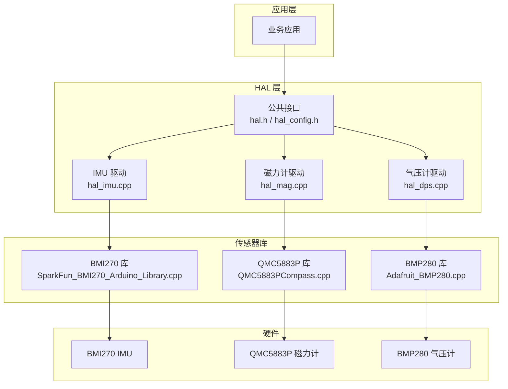
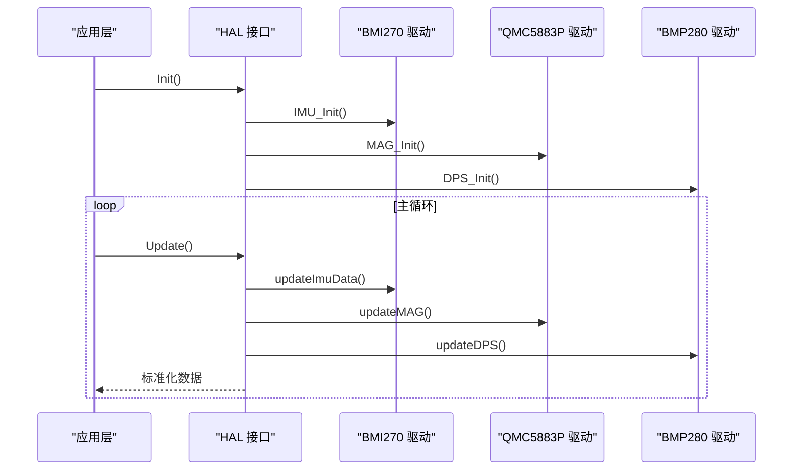
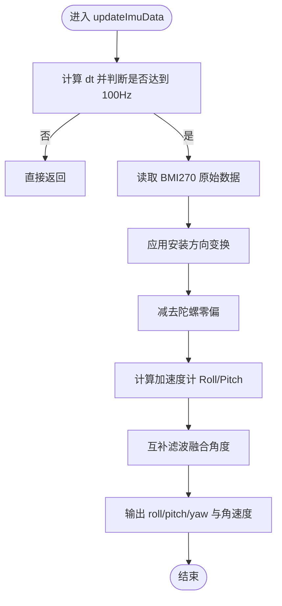
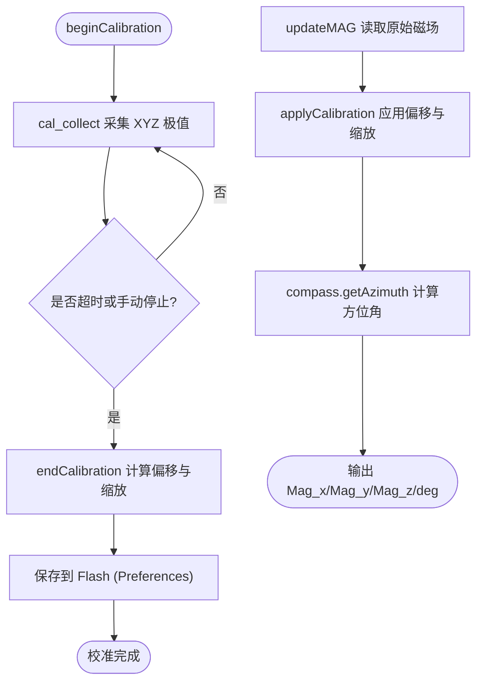
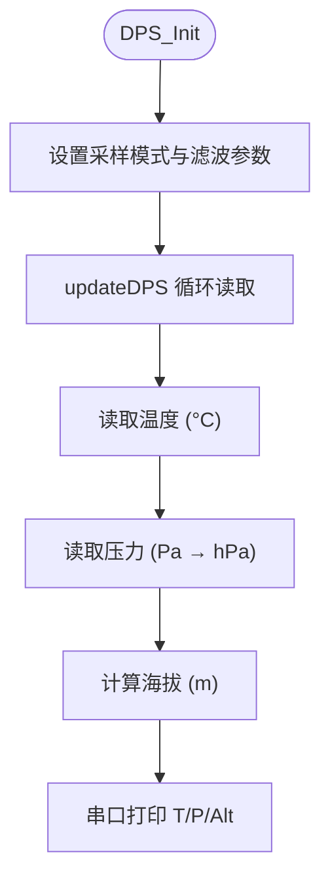
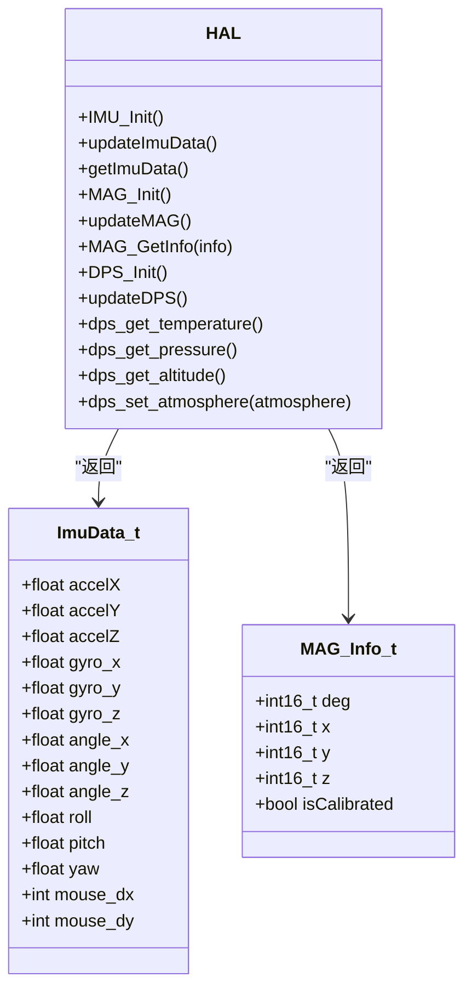

# 传感器模块

<cite>
**本文引用的文件**   
- [hal_imu.cpp](file://src/hal/hal_imu.cpp)
- [hal_mag.cpp](file://src/hal/hal_mag.cpp)
- [hal_dps.cpp](file://src/hal/hal_dps.cpp)
- [hal.h](file://src/hal/hal.h)
- [hal_config.h](file://src/hal/hal_config.h)
- [SparkFun_BMI270_Arduino_Library.cpp](file://lib/SparkFun BMI270 Arduino Library/src/SparkFun_BMI270_Arduino_Library.cpp)
- [bmi270.c](file://lib/SparkFun BMI270 Arduino Library/src/bmi270_api/bmi270.c)
- [QMC5883PCompass.cpp](file://lib/QMC5883PCompass/src/QMC5883PCompass.cpp)
- [QMC5883PCompass.h](file://lib/QMC5883PCompass/src/QMC5883PCompass.h)
- [Adafruit_BMP280.cpp](file://lib/Adafruit BMP280 Library/Adafruit_BMP280.cpp)
</cite>

## 目录
1. [简介](#简介)
2. [项目结构](#项目结构)
3. [核心组件](#核心组件)
4. [架构总览](#架构总览)
5. [详细组件分析](#详细组件分析)
6. [依赖关系分析](#依赖关系分析)
7. [性能与功耗考虑](#性能与功耗考虑)
8. [故障排查指南](#故障排查指南)
9. [结论](#结论)
10. [附录：API 使用示例与参数调优](#附录api-使用示例与参数调优)

## 简介
本技术文档面向 ESP32 平台上的传感器子系统，覆盖 IMU（BMI270）、磁力计（QMC5883P）和气压计（BMP280）。重点说明：
- IMU 的初始化、数据采集、零偏校准与互补滤波姿态解算。
- 磁力计的硬铁/软铁校准流程、Flash 持久化与方位角计算。
- 气压传感器的温度补偿、压力转换与海拔高度估算。
- 传感器数据的滤波与噪声抑制策略。
- 各传感器的 API 调用方式、安装方向配置与校准步骤。
- 参数调优建议与常见问题定位方法。

## 项目结构
传感器相关代码位于 HAL 层，分别由三个驱动文件实现：
- IMU：[hal_imu.cpp](file://src/hal/hal_imu.cpp)
- 磁力计：[hal_mag.cpp](file://src/hal/hal_mag.cpp)
- 气压计：[hal_dps.cpp](file://src/hal/hal_dps.cpp)
- 公共接口与数据结构：[hal.h](file://src/hal/hal.h)、[hal_config.h](file://src/hal/hal_config.h)
- 第三方库：
  - BMI270：[SparkFun_BMI270_Arduino_Library.cpp](file://lib/SparkFun BMI270 Arduino Library/src/SparkFun_BMI270_Arduino_Library.cpp)、[bmi270.c](file://lib/SparkFun BMI270 Arduino Library/src/bmi270_api/bmi270.c)
  - QMC5883P：[QMC5883PCompass.cpp](file://lib/QMC5883PCompass/src/QMC5883PCompass.cpp)、[QMC5883PCompass.h](file://lib/QMC5883PCompass/src/QMC5883PCompass.h)
  - BMP280：[Adafruit_BMP280.cpp](file://lib/Adafruit BMP280 Library/Adafruit_BMP280.cpp)

图表来源
- [hal_imu.cpp:1-182](file://src/hal/hal_imu.cpp#L1-L182)
- [hal_mag.cpp:1-297](file://src/hal/hal_mag.cpp#L1-L297)
- [hal_dps.cpp:1-57](file://src/hal/hal_dps.cpp#L1-L57)
- [hal.h:31-157](file://src/hal/hal.h#L31-L157)

章节来源
- [hal_imu.cpp:1-182](file://src/hal/hal_imu.cpp#L1-L182)
- [hal_mag.cpp:1-297](file://src/hal/hal_mag.cpp#L1-L297)
- [hal_dps.cpp:1-57](file://src/hal/hal_dps.cpp#L1-L57)
- [hal.h:31-157](file://src/hal/hal.h#L31-L157)

## 核心组件
- IMU（BMI270）
  - 初始化：I2C 连接检测、启用加速度计与陀螺仪、上电静置零偏校准。
  - 数据采集：固定 100Hz 采样率控制；读取原始加速度与角速度。
  - 坐标变换：支持正面/反面安装方向映射。
  - 姿态解算：加速度计角度 + 互补滤波融合陀螺积分；Yaw 仅积分。
  - 鼠标增量：基于角度差值生成 dx/dy，带限幅。
- 磁力计（QMC5883P）
  - 初始化：I2C 初始化、滑动平滑滤波开启。
  - 校准流程：采集 XYZ 极值，计算硬铁偏移与软铁缩放，保存至 Flash（Preferences），上电自动加载。
  - 方位角：基于校准后的 X/Y 计算方位角，支持磁偏角修正。
- 气压计（BMP280）
  - 初始化：正常模式、温度与压力过采样、IIR 滤波、待机时间设置。
  - 数据读取：温度、压力（Pa→hPa）、海拔高度（基于海平面气压参考）。
  - 大气压设定：允许用户更新本地海平面气压以改善海拔估算精度。

章节来源
- [hal_imu.cpp:57-179](file://src/hal/hal_imu.cpp#L57-L179)
- [hal_mag.cpp:233-292](file://src/hal/hal_mag.cpp#L233-L292)
- [hal_dps.cpp:10-56](file://src/hal/hal_dps.cpp#L10-L56)

## 架构总览
传感器子系统采用“HAL 封装 + 第三方库”的分层设计：
- HAL 层负责设备初始化、数据周期采集、滤波与算法融合、对外 API 暴露。
- 第三方库负责底层寄存器访问、基础数据处理与部分内置滤波。
- 应用层通过 HAL 接口获取标准化数据，无需感知具体传感器细节。

图表来源
- [hal.h:101-157](file://src/hal/hal.h#L101-L157)
- [hal_imu.cpp:57-179](file://src/hal/hal_imu.cpp#L57-L179)
- [hal_mag.cpp:233-292](file://src/hal/hal_mag.cpp#L233-L292)
- [hal_dps.cpp:10-56](file://src/hal/hal_dps.cpp#L10-L56)

## 详细组件分析

### IMU（BMI270）组件分析
- 初始化流程
  - I2C 连接检查与设备启动。
  - 上电后延时并执行陀螺零偏校准（静置约 1 秒）。
  - 记录更新时间戳用于固定频率控制。
- 数据采集与处理
  - 固定 100Hz 采样率控制，未到时间直接返回。
  - 读取原始加速度与角速度。
  - 安装方向坐标变换（支持正面/反面翻转）。
  - 减去陀螺零偏。
  - 计算加速度计 Roll/Pitch 角度。
  - 互补滤波融合：Roll/Pitch 由加速度计与陀螺积分融合；Yaw 仅陀螺积分。
  - 输出标准化角度与角速度，以及鼠标增量。
- 姿态解算算法
  - 标准互补滤波：权重系数为陀螺 0.98、加速度 0.02。
  - Yaw 无磁力计辅助，存在漂移风险。

图表来源
- [hal_imu.cpp:88-149](file://src/hal/hal_imu.cpp#L88-L149)

章节来源
- [hal_imu.cpp:5-179](file://src/hal/hal_imu.cpp#L5-L179)
- [SparkFun_BMI270_Arduino_Library.cpp:9-45](file://lib/SparkFun BMI270 Arduino Library/src/SparkFun_BMI270_Arduino_Library.cpp#L9-L45)
- [bmi270.c:50-62](file://lib/SparkFun BMI270 Arduino Library/src/bmi270_api/bmi270.c#L50-L62)

### 磁力计（QMC5883P）组件分析
- 初始化流程
  - 初始化传感器并开启滑动平滑滤波（步数 10，高级模式）。
  - 从 Flash 加载已保存的校准参数。
  - 可选上电即进入校准模式。
- 校准流程
  - beginCalibration：开始采集，初始化极值为反向边界。
  - cal_collect：持续采集 XYZ 最大值/最小值，统计采样次数，超时自动结束。
  - endCalibration：有效性检查（最少采样次数与各轴范围阈值），计算硬铁偏移与软铁缩放，保存到 Preferences。
- 数据读取与方位角
  - updateMAG：读取原始磁场，若在校准中则采集数据；应用校准得到 cx/cy/cz；调用库函数 getAzimuth 计算方位角。
  - getAzimuth：atan2(Y, X) 转换为角度，叠加磁偏角修正，归一化到 0~360°。

图表来源
- [hal_mag.cpp:143-197](file://src/hal/hal_mag.cpp#L143-L197)
- [hal_mag.cpp:248-292](file://src/hal/hal_mag.cpp#L248-L292)
- [QMC5883PCompass.cpp:439-444](file://lib/QMC5883PCompass/src/QMC5883PCompass.cpp#L439-L444)

章节来源
- [hal_mag.cpp:23-297](file://src/hal/hal_mag.cpp#L23-L297)
- [QMC5883PCompass.cpp:129-152](file://lib/QMC5883PCompass/src/QMC5883PCompass.cpp#L129-L152)
- [QMC5883PCompass.cpp:219-266](file://lib/QMC5883PCompass/src/QMC5883PCompass.cpp#L219-L266)
- [QMC5883PCompass.cpp:274-378](file://lib/QMC5883PCompass/src/QMC5883PCompass.cpp#L274-L378)
- [QMC5883PCompass.cpp:439-444](file://lib/QMC5883PCompass/src/QMC5883PCompass.cpp#L439-L444)

### 气压计（BMP280）组件分析
- 初始化流程
  - I2C 地址检测与设备启动。
  - 设置工作模式为 NORMAL，温度过采样 x2，压力过采样 x16，IIR 滤波 x4，待机时间 63ms（ODR≈10Hz）。
- 数据读取与处理
  - 温度：直接读取摄氏度。
  - 压力：读取 Pa 并转换为 hPa。
  - 海拔：基于本地海平面气压参考计算近似海拔（米）。
  - 可动态设置 local_atmosphere 以适配不同地区天气站数据。
- 温度补偿与压力转换
  - 库内部先读取温度并计算 t_fine，再按芯片校准系数进行压力换算。
  - 海拔公式使用标准大气模型近似。

图表来源
- [hal_dps.cpp:10-36](file://src/hal/hal_dps.cpp#L10-L36)
- [Adafruit_BMP280.cpp:281-324](file://lib/Adafruit BMP280 Library/Adafruit_BMP280.cpp#L281-L324)

章节来源
- [hal_dps.cpp:1-57](file://src/hal/hal_dps.cpp#L1-L57)
- [Adafruit_BMP280.cpp:281-354](file://lib/Adafruit BMP280 Library/Adafruit_BMP280.cpp#L281-L354)

## 依赖关系分析
- HAL 层对第三方库的依赖：
  - BMI270：通过 SparkFun 库进行 I2C 初始化、特征使能与配置读取。
  - QMC5883P：通过 QMC5883PCompass 库进行 I2C 读取、平滑滤波、校准与方位角计算。
  - BMP280：通过 Adafruit 库进行温度/压力/海拔计算。
- 数据结构与接口：
  - ImuData_t 提供统一的 IMU 数据视图（加速度、角速度、角度、鼠标增量）。
  - MAG_Info_t 提供统一的磁力计数据视图（XYZ、方位角、校准状态）。
  - HAL 命名空间统一暴露初始化、更新与查询接口。

图表来源
- [hal.h:31-64](file://src/hal/hal.h#L31-L64)
- [hal.h:101-157](file://src/hal/hal.h#L101-L157)

章节来源
- [hal.h:31-157](file://src/hal/hal.h#L31-L157)

## 性能与功耗考虑
- IMU
  - 固定 100Hz 采样率，避免频繁唤醒与 CPU 抖动。
  - 互补滤波系数偏向陀螺（0.98），有利于短期响应，但长期需磁力计或外部参考抑制漂移。
  - 鼠标增量限幅（±50）防止异常跳变。
- 磁力计
  - 滑动平滑滤波（步数 10，高级模式）降低噪声，但引入一定延迟。
  - 校准过程需要足够旋转范围与时长，否则结果无效。
- 气压计
  - 过采样与 IIR 滤波提升稳定性，但增加计算与功耗。
  - 待机时间 63ms 平衡 ODR 与功耗。

[本节为通用指导，不直接分析具体文件]

## 故障排查指南
- IMU 初始化失败
  - 现象：串口打印“IMU init failed!”。
  - 可能原因：I2C 地址错误、接线问题、传感器未供电。
  - 处理：检查 I2C 地址与连线，确认电源与电平匹配。
- 磁力计校准无效
  - 现象：校准提示“采样不足或旋转范围不够”。
  - 可能原因：旋转幅度不足、采样时间太短、环境磁场干扰。
  - 处理：缓慢画“8”字覆盖各方向，确保至少 30 秒；清除旧校准后重试。
- 气压计未找到
  - 现象：串口打印“BMP280 not found! Check wiring / address.”。
  - 可能原因：I2C 地址错误或接线错误。
  - 处理：确认地址 0x77，检查 SDA/SCL 连线与上拉电阻。
- 方位角异常
  - 现象：方位角跳变或不准确。
  - 可能原因：未校准、磁偏角未设置、附近金属干扰。
  - 处理：重新校准，设置磁偏角，远离强磁体与金属。

章节来源
- [hal_imu.cpp:57-74](file://src/hal/hal_imu.cpp#L57-L74)
- [hal_mag.cpp:170-197](file://src/hal/hal_mag.cpp#L170-L197)
- [hal_dps.cpp:10-18](file://src/hal/hal_dps.cpp#L10-L18)

## 结论
该传感器模块在 HAL 层提供了清晰、稳定的 IMU、磁力计与气压计接口。IMU 采用互补滤波进行姿态解算，磁力计具备完整的硬铁/软铁校准与 Flash 持久化能力，气压计提供温度补偿与海拔估算。整体架构分层明确，便于扩展与维护。实际应用中应根据安装方向与使用场景调整参数，定期校准以保证精度。

[本节为总结性内容，不直接分析具体文件]

## 附录：API 使用示例与参数调优

### IMU API 与使用要点
- 初始化
  - 调用 HAL::IMU_Init() 完成设备初始化与零偏校准。
- 数据采集
  - 在主循环中调用 HAL::updateImuData()，随后通过 HAL::getImuData() 获取标准化数据。
- 鼠标增量
  - 调用 HAL::updateMouseDelta(sensitivity) 生成 dx/dy，sensitivity 可根据手感调节。
- 安装方向配置
  - 默认 IMU_MOUNT_REAR（反面安装），如需正面安装请修改全局变量 _mountDir 为 IMU_MOUNT_NORMAL。
- 参数调优
  - 互补滤波系数：COMP_FILT_GYRO_COEF 与 COMP_FILT_ACC_COEF 可按噪声特性微调。
  - 采样率：IMU_SAMPLE_RATE_HZ 固定为 100Hz，如需更高/更低需同步调整 IMU_DT。
  - 零偏校准样本数：IMU_CALIB_SAMPLES 与间隔 IMU_CALIB_DELAY_MS 影响校准速度与稳定性。

章节来源
- [hal_imu.cpp:5-179](file://src/hal/hal_imu.cpp#L5-L179)
- [hal.h:130-140](file://src/hal/hal.h#L130-L140)

### 磁力计 API 与校准流程
- 初始化
  - 调用 HAL::MAG_Init()，自动加载已保存校准参数。
- 校准流程
  - 调用 HAL::MAG_StartCalibration() 进入校准模式。
  - 缓慢旋转传感器画“8”字约 30 秒。
  - 调用 HAL::MAG_StopCalibration() 结束校准并保存参数。
  - 可通过 HAL::MAG_ClearCalibration() 清除旧校准。
- 数据读取
  - 在主循环中调用 HAL::updateMAG()，随后通过 HAL::MAG_GetInfo(&info) 获取 XYZ 与方位角。
- 参数调优
  - 平滑滤波：compass.setSmoothing(10, true)，步数越大越平滑但延迟越高。
  - 磁偏角：可通过库函数 setMagneticDeclination(degrees, minutes) 设置当地磁偏角。
  - 校准阈值：CAL_MIN_SAMPLES 与 CAL_DEVIATION_THRESHOLD 控制有效性判定。

章节来源
- [hal_mag.cpp:23-297](file://src/hal/hal_mag.cpp#L23-L297)
- [QMC5883PCompass.cpp:129-152](file://lib/QMC5883PCompass/src/QMC5883PCompass.cpp#L129-L152)
- [QMC5883PCompass.cpp:439-444](file://lib/QMC5883PCompass/src/QMC5883PCompass.cpp#L439-L444)

### 气压计 API 与海拔估算
- 初始化
  - 调用 HAL::DPS_Init() 完成设备初始化与采样配置。
- 数据读取
  - 在主循环中调用 HAL::updateDPS()，或通过 dps_get_temperature()/dps_get_pressure()/dps_get_altitude() 单独读取。
- 海拔估算
  - 使用 dps_set_atmosphere(local_hpa) 设置本地海平面气压，提高海拔估算精度。
- 参数调优
  - 过采样与滤波：SAMPLING_X2（温度）、SAMPLING_X16（压力）、FILTER_X4（IIR），可根据功耗与精度需求调整。
  - 待机时间：STANDBY_MS_63 平衡 ODR 与功耗。

章节来源
- [hal_dps.cpp:10-56](file://src/hal/hal_dps.cpp#L10-L56)
- [Adafruit_BMP280.cpp:281-324](file://lib/Adafruit BMP280 Library/Adafruit_BMP280.cpp#L281-L324)

### 传感器安装方向配置与校准步骤
- IMU 安装方向
  - 默认反面安装（IMU_MOUNT_REAR），坐标系翻转；如 PCB 正面朝上，改为 IMU_MOUNT_NORMAL。
  - 安装方向会影响 Roll/Pitch/Yaw 符号，需在应用层注意。
- IMU 零偏校准
  - 上电静置约 1 秒，期间不要移动设备。
  - 可通过 HAL::imu_calibrate_gyro() 重新校准。
- 磁力计校准
  - 进入校准模式后缓慢画“8”字，覆盖所有方向。
  - 校准完成后参数自动保存至 Flash，下次上电自动加载。
- 气压计校准
  - 根据当地天气站数据设置海平面气压，以提高海拔估算精度。

章节来源
- [hal_imu.cpp:16-179](file://src/hal/hal_imu.cpp#L16-L179)
- [hal_mag.cpp:143-197](file://src/hal/hal_mag.cpp#L143-L197)
- [hal_dps.cpp:7-56](file://src/hal/hal_dps.cpp#L7-L56)