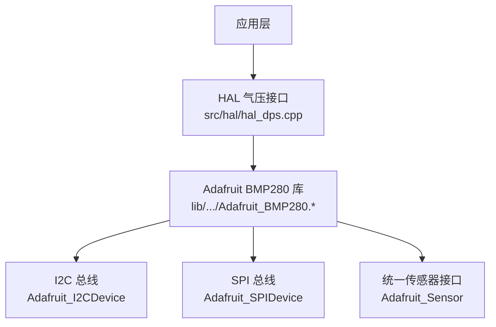
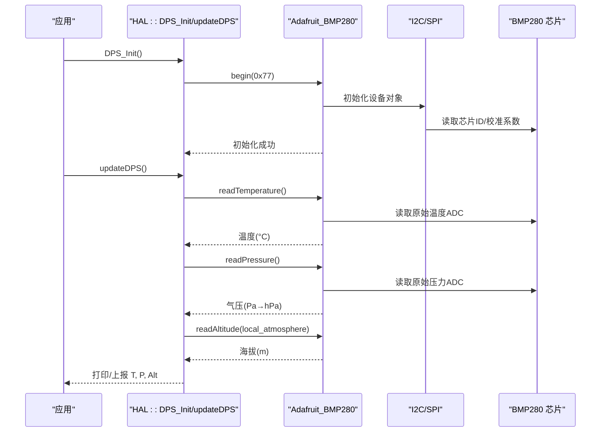
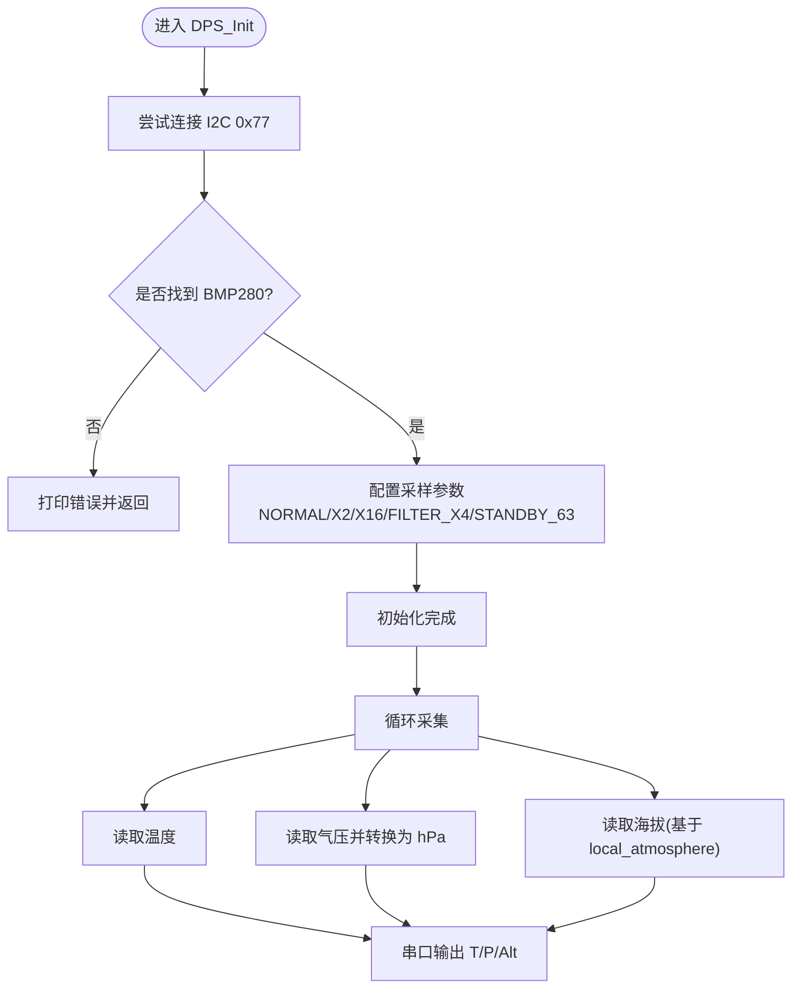
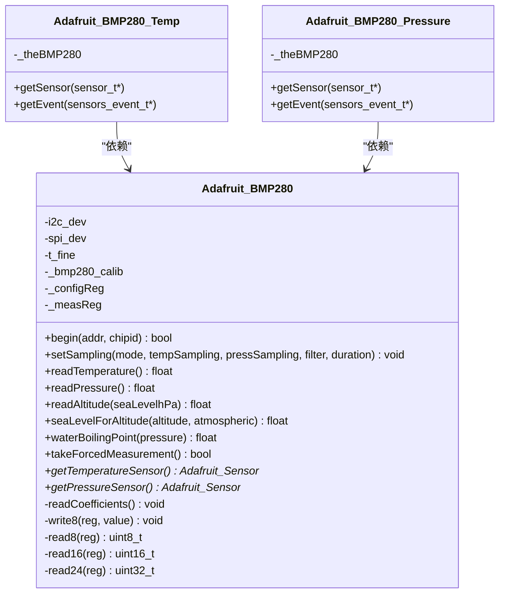
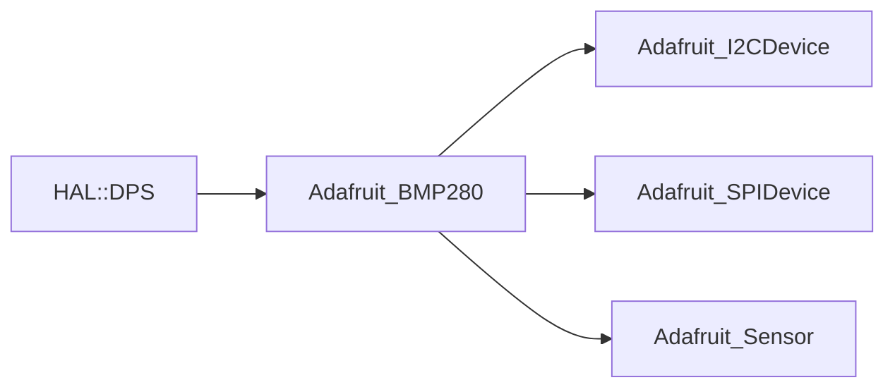

# 气压传感器模块

<cite>
**本文引用的文件**   
- [hal_dps.cpp](file://src/hal/hal_dps.cpp)
- [Adafruit_BMP280.h](file://lib/Adafruit BMP280 Library/Adafruit_BMP280.h)
- [Adafruit_BMP280.cpp](file://lib/Adafruit BMP280 Library/Adafruit_BMP280.cpp)
</cite>

## 目录
1. [简介](#简介)
2. [项目结构](#项目结构)
3. [核心组件](#核心组件)
4. [架构总览](#架构总览)
5. [详细组件分析](#详细组件分析)
6. [依赖关系分析](#依赖关系分析)
7. [性能与精度优化](#性能与精度优化)
8. [故障排查指南](#故障排查指南)
9. [结论](#结论)
10. [附录：API 使用示例与最佳实践](#附录api-使用示例与最佳实践)

## 简介
本技术文档围绕 ESP32 平台上的气压传感器模块，聚焦于 BMP280 气压传感器的初始化配置、I2C 通信设置、温度补偿算法、压力到海拔高度的转换公式、大气压模型与标准海平面气压参考值的使用。同时说明高度测量的精度影响因素与误差补偿方法，提供温度数据读取与环境监测能力，并给出气压趋势分析与天气预报算法的基础思路。最后提供完整的 API 使用示例与精度优化建议，帮助开发者在工程实践中获得稳定可靠的气压与高度测量结果。

## 项目结构
本项目将气压传感器驱动封装在 HAL 层中，通过 Adafruit BMP280 库完成底层 I2C/SPI 访问、校准系数读取与物理量计算。HAL 层对外暴露统一的接口用于获取温度、气压与估算海拔，并提供本地海平面气压的设定能力。

图表来源
- [hal_dps.cpp:1-56](file://src/hal/hal_dps.cpp#L1-L56)
- [Adafruit_BMP280.h:24-34](file://lib/Adafruit BMP280 Library/Adafruit_BMP280.h#L24-L34)
- [Adafruit_BMP280.h:208-214](file://lib/Adafruit BMP280 Library/Adafruit_BMP280.h#L208-L214)

章节来源
- [hal_dps.cpp:1-56](file://src/hal/hal_dps.cpp#L1-L56)
- [Adafruit_BMP280.h:24-34](file://lib/Adafruit BMP280 Library/Adafruit_BMP280.h#L24-L34)

## 核心组件
- HAL 气压接口（DPS）
  - 负责 BMP280 初始化、采样参数配置、温度/气压/海拔读取与本地海平面气压管理。
- Adafruit BMP280 驱动库
  - 实现 I2C/SPI 通信、寄存器读写、工厂校准系数读取、温度补偿、压力换算、海拔估算等。

关键职责划分
- HAL 层：面向应用的简洁 API、本地海平面气压管理与日志输出。
- 库层：硬件抽象、校准与物理量计算、统一传感器事件封装。

章节来源
- [hal_dps.cpp:10-56](file://src/hal/hal_dps.cpp#L10-L56)
- [Adafruit_BMP280.h:118-206](file://lib/Adafruit BMP280 Library/Adafruit_BMP280.h#L118-L206)

## 架构总览
下图展示从应用调用到传感器读数的完整流程，包括初始化、采样配置、温度补偿、压力换算与海拔估算。

图表来源
- [hal_dps.cpp:10-36](file://src/hal/hal_dps.cpp#L10-L36)
- [Adafruit_BMP280.cpp:86-109](file://lib/Adafruit BMP280 Library/Adafruit_BMP280.cpp#L86-L109)
- [Adafruit_BMP280.cpp:248-305](file://lib/Adafruit BMP280 Library/Adafruit_BMP280.cpp#L248-L305)
- [Adafruit_BMP280.cpp:315-324](file://lib/Adafruit BMP280 Library/Adafruit_BMP280.cpp#L315-L324)

## 详细组件分析

### HAL 气压接口（DPS）
- 初始化
  - 通过 I2C 地址 0x77 启动 BMP280，若失败则提示检查接线或地址。
  - 配置工作模式为 NORMAL，温度过采样 X2，压力过采样 X16，IIR 滤波 X4，待机时间 STANDBY_MS_63，以获得约 10Hz 的数据更新率。
- 数据采集
  - 读取温度（°C）、气压（Pa 转 hPa）、海拔（m）。
  - 使用本地海平面气压 local_atmosphere 作为参考进行海拔估算。
- 对外 API
  - dps_get_temperature()：返回温度（°C）。
  - dps_get_pressure()：返回气压（hPa）。
  - dps_get_altitude()：返回海拔（m）。
  - dps_set_atmosphere(float)：设置本地海平面气压（hPa），默认值为 1013.25。

图表来源
- [hal_dps.cpp:10-36](file://src/hal/hal_dps.cpp#L10-L36)

章节来源
- [hal_dps.cpp:10-56](file://src/hal/hal_dps.cpp#L10-L56)

### Adafruit BMP280 驱动库
- I2C/SPI 初始化与设备探测
  - begin() 根据构造方式选择 I2C 或 SPI，建立设备对象，读取芯片 ID 并校验，随后读取工厂校准系数并写入采样配置。
- 寄存器与数据结构
  - 定义校准寄存器偏移、控制/配置寄存器位域结构体，以及统一传感器接口类（温度/气压）。
- 温度补偿算法
  - readTemperature() 先读取原始温度 ADC，结合 dig_T1/T2/T3 校准系数进行线性与非线性补偿，得到 t_fine，再换算为摄氏度。
- 压力换算与温度关联
  - readPressure() 必须先调用 readTemperature() 以获取 t_fine；随后读取原始压力 ADC，结合 dig_P1~P9 校准系数进行多项式补偿，最终输出 Pa。
- 海拔估算与大气压模型
  - readAltitude(seaLevelhPa) 使用标准大气压模型公式，将当前气压与海平面参考气压比较，估算海拔高度。
  - seaLevelForAltitude(altitude, atmospheric) 提供由已知海拔和当地气压反推海平面气压的能力。
- 统一传感器事件
  - Adafruit_BMP280_Temp/Pressure 实现 getSensor/getEvent，便于上层以统一接口获取温度/气压事件。

图表来源
- [Adafruit_BMP280.h:87-113](file://lib/Adafruit BMP280 Library/Adafruit_BMP280.h#L87-L113)
- [Adafruit_BMP280.h:118-206](file://lib/Adafruit BMP280 Library/Adafruit_BMP280.h#L118-L206)
- [Adafruit_BMP280.h:208-264](file://lib/Adafruit BMP280 Library/Adafruit_BMP280.h#L208-L264)
- [Adafruit_BMP280.cpp:86-109](file://lib/Adafruit BMP280 Library/Adafruit_BMP280.cpp#L86-L109)
- [Adafruit_BMP280.cpp:228-242](file://lib/Adafruit BMP280 Library/Adafruit_BMP280.cpp#L228-L242)
- [Adafruit_BMP280.cpp:248-305](file://lib/Adafruit BMP280 Library/Adafruit_BMP280.cpp#L248-L305)
- [Adafruit_BMP280.cpp:315-354](file://lib/Adafruit BMP280 Library/Adafruit_BMP280.cpp#L315-L354)

章节来源
- [Adafruit_BMP280.h:24-34](file://lib/Adafruit BMP280 Library/Adafruit_BMP280.h#L24-L34)
- [Adafruit_BMP280.h:118-206](file://lib/Adafruit BMP280 Library/Adafruit_BMP280.h#L118-L206)
- [Adafruit_BMP280.cpp:86-109](file://lib/Adafruit BMP280 Library/Adafruit_BMP280.cpp#L86-L109)
- [Adafruit_BMP280.cpp:228-305](file://lib/Adafruit BMP280 Library/Adafruit_BMP280.cpp#L228-L305)
- [Adafruit_BMP280.cpp:315-354](file://lib/Adafruit BMP280 Library/Adafruit_BMP280.cpp#L315-L354)

## 依赖关系分析
- HAL 层依赖 Adafruit_BMP280 库提供的 begin/setSampling/readTemperature/readPressure/readAltitude 等方法。
- 库层依赖 I2C/SPI 总线抽象（Adafruit_I2CDevice/Adafruit_SPIDevice）与统一传感器接口（Adafruit_Sensor）。
- 校准系数读取与温度/压力补偿逻辑集中在库层，HAL 层仅做参数配置与结果处理。

图表来源
- [hal_dps.cpp:1-56](file://src/hal/hal_dps.cpp#L1-L56)
- [Adafruit_BMP280.h:24-34](file://lib/Adafruit BMP280 Library/Adafruit_BMP280.h#L24-L34)
- [Adafruit_BMP280.h:208-214](file://lib/Adafruit BMP280 Library/Adafruit_BMP280.h#L208-L214)

章节来源
- [hal_dps.cpp:1-56](file://src/hal/hal_dps.cpp#L1-L56)
- [Adafruit_BMP280.h:208-214](file://lib/Adafruit BMP280 Library/Adafruit_BMP280.h#L208-L214)

## 性能与精度优化
- 采样与滤波
  - 温度过采样 X2、压力过采样 X16、IIR 滤波 X4、待机时间 63ms，可获得约 10Hz 的稳定更新率，兼顾功耗与精度。
- 本地海平面气压校正
  - 使用 dps_set_atmosphere() 设置当地实时海平面气压（例如来自气象站或网络天气服务），可显著降低海拔估算的系统误差。
- 温度影响
  - 温度变化会影响气压读数与热漂移；确保传感器远离热源，必要时增加软件滤波（滑动平均/指数平滑）。
- 环境因素
  - 风速、湿度、快速气压波动（如门开关、空调启停）会引入短期噪声；可通过时间窗口统计（均值、方差）识别异常。
- 数据质量监控
  - 对连续气压序列计算一阶差分与二阶差分，检测突变点；对超出阈值的样本进行剔除或降权。
- 海拔稳定性
  - 在海平面附近，气压变化对应的高度变化更敏感；在高海拔地区，相同气压差对应的高度差更大，需结合当地气压模型与地形修正。

[本节为通用指导，不直接分析具体文件]

## 故障排查指南
- 无法检测到 BMP280
  - 现象：初始化失败，串口打印未找到传感器。
  - 排查：确认 I2C 地址是否为 0x77，检查 SDA/SCL 连线与上拉电阻，确认供电与电平匹配。
- 读数异常或跳变大
  - 现象：温度/气压/海拔剧烈波动。
  - 排查：检查传感器安装位置（避免热源/风道），调整滤波等级或软件滤波策略，确认本地海平面气压设置正确。
- 海拔偏差较大
  - 现象：海拔估算与实际不符。
  - 排查：更新 local_atmosphere 为最新海平面气压；考虑地形与局部微气候影响；对比多个时间点的气压趋势判断系统漂移。

章节来源
- [hal_dps.cpp:10-18](file://src/hal/hal_dps.cpp#L10-L18)

## 结论
本模块通过 HAL 层与 Adafruit BMP280 库协作，实现了稳定的气压与温度采集、温度补偿、压力换算与海拔估算。通过合理配置采样与滤波参数、动态设置本地海平面气压、并结合气压趋势分析，可在多种环境下获得可靠的监测结果。建议在工程中持续校准参考气压、实施数据质量监控与滤波策略，以提升整体精度与鲁棒性。

[本节为总结性内容，不直接分析具体文件]

## 附录：API 使用示例与最佳实践

### 初始化与基本用法
- 初始化
  - 调用 DPS_Init() 完成 BMP280 的 I2C 初始化与采样参数配置。
- 周期采集
  - 调用 updateDPS() 获取温度、气压与海拔，并通过串口输出或上报至应用层。
- 本地海平面气压设置
  - 调用 dps_set_atmosphere(hpa) 设置当地海平面气压（单位 hPa），默认值为 1013.25。

章节来源
- [hal_dps.cpp:10-56](file://src/hal/hal_dps.cpp#L10-L56)

### 温度与环境监测
- 温度读取
  - 使用 dps_get_temperature() 获取当前环境温度（°C）。
- 环境监测建议
  - 定期记录温度与气压，观察相关性；当温度快速变化时，气压可能出现短期漂移，应结合滤波与阈值判断。

章节来源
- [hal_dps.cpp:38-41](file://src/hal/hal_dps.cpp#L38-L41)

### 气压趋势分析与天气预报基础
- 趋势分析
  - 维护最近 N 个气压样本，计算均值与方差；当方差增大且均值出现明显下降趋势时，可能预示天气转阴或降雨。
- 预报算法基础
  - 基于气压变化率（ΔP/Δt）与方向（上升/下降）进行分类：
    - 气压持续上升：天气趋于晴朗。
    - 气压持续下降：天气趋于阴雨。
    - 气压波动加剧：天气不稳定。
- 数据清洗
  - 剔除异常点（如短时尖峰），采用滑动窗口与稳健统计（中位数、MAD）提升趋势估计的可靠性。

[本节为概念性内容，不直接分析具体文件]

### 精度优化建议
- 硬件层面
  - 保证良好的 I2C 布线与上拉，避免长距离走线与强干扰源靠近。
  - 传感器远离发热元件与气流直吹位置。
- 软件层面
  - 合理设置过采样与滤波参数；在应用层叠加滑动平均/指数平滑。
  - 动态更新 local_atmosphere，尽量使用权威气象数据源。
  - 对气压序列进行异常检测与自适应滤波，提高长期稳定性。

[本节为通用指导，不直接分析具体文件]