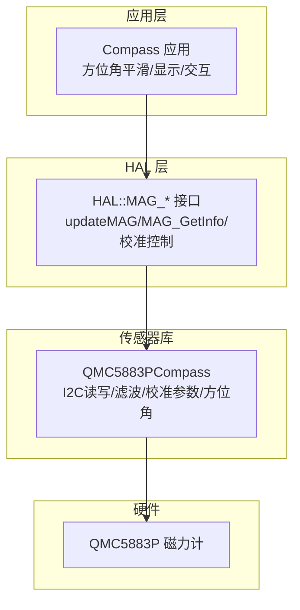
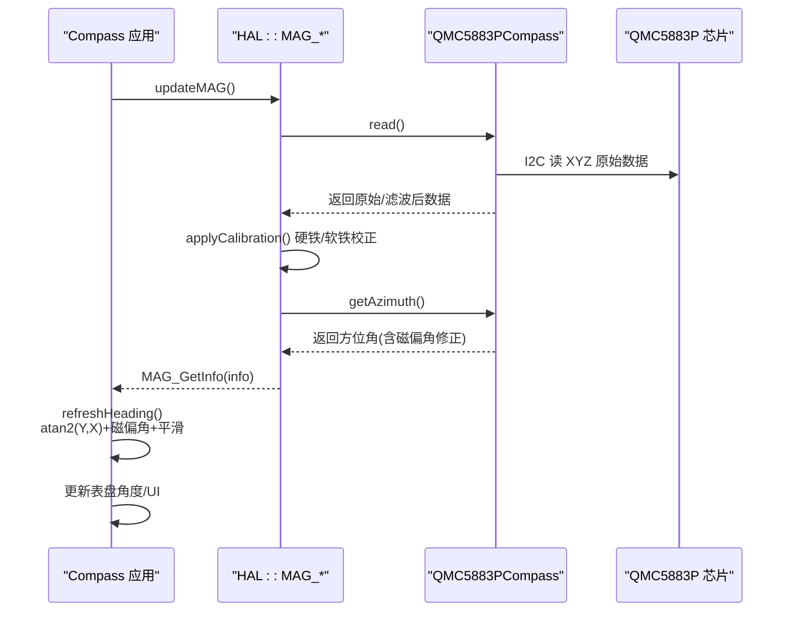
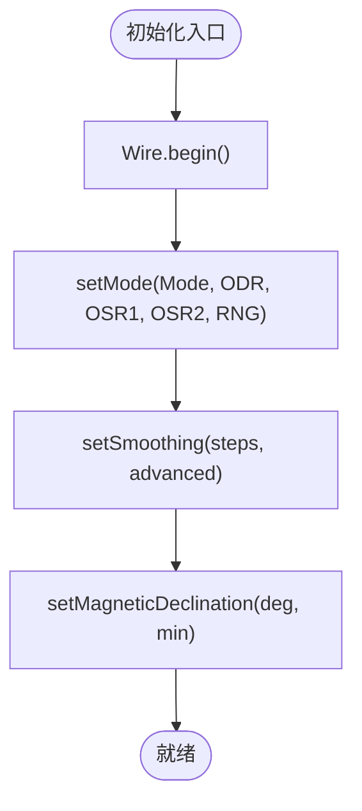
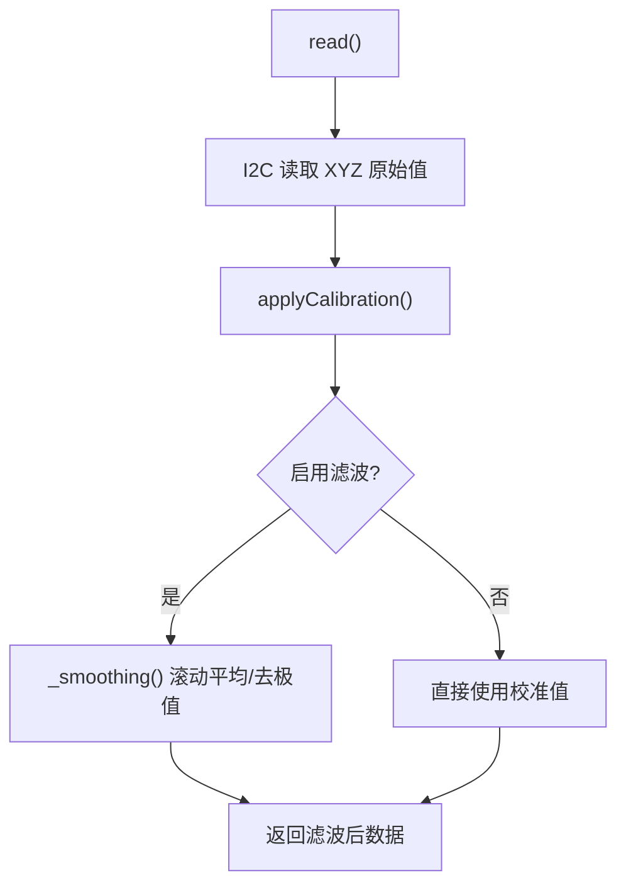
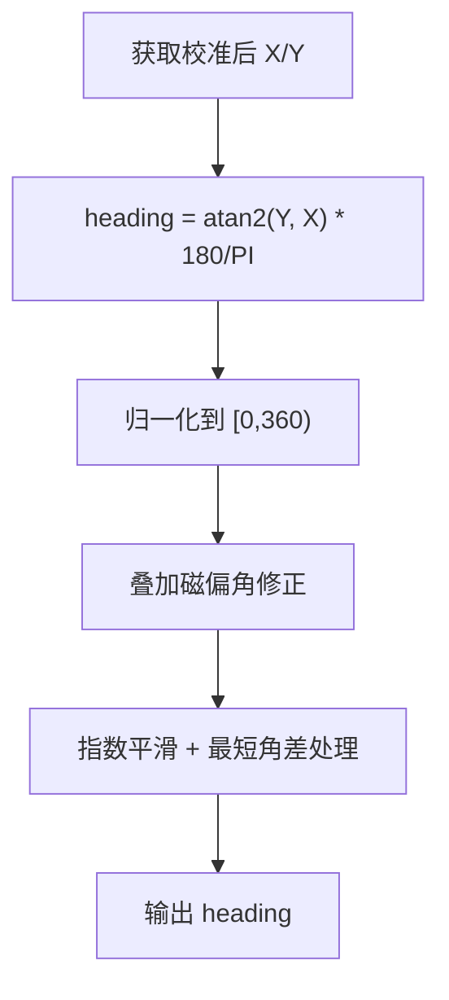
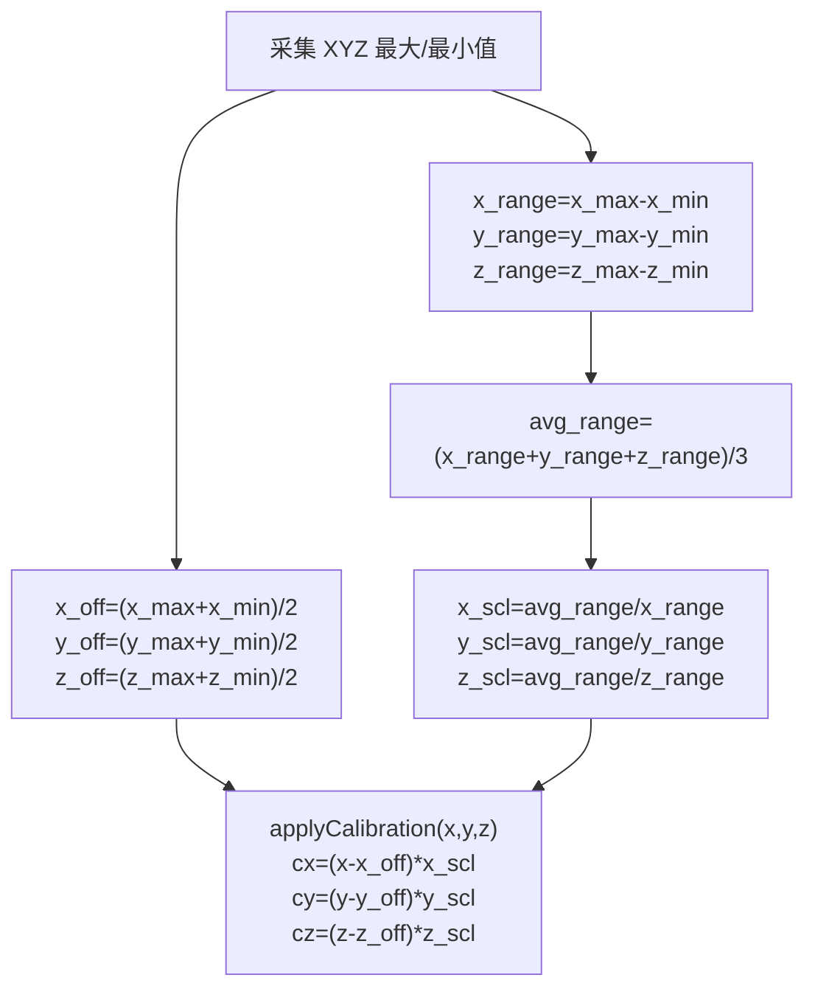
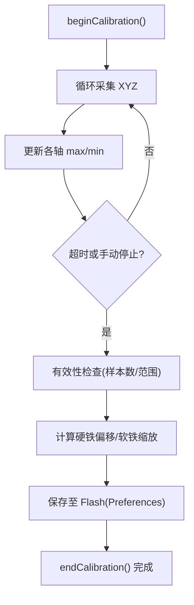
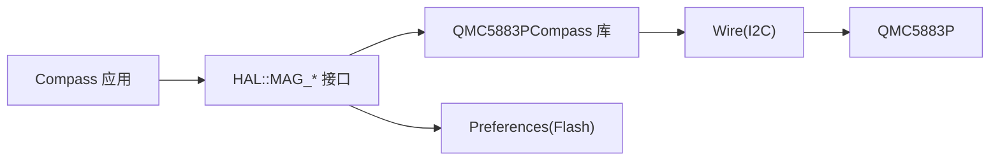

# 磁力计模块

<cite>
**本文引用的文件**   
- [Compass.cpp](file://src/apps/Compass.cpp)
- [Compass.h](file://src/apps/Compass.h)
- [QMC5883PCompass.h](file://lib/QMC5883PCompass/src/QMC5883PCompass.h)
- [QMC5883PCompass.cpp](file://lib/QMC5883PCompass/src/QMC5883PCompass.cpp)
- [hal.h](file://src/hal/hal.h)
- [hal_mag.cpp](file://src/hal/hal_mag.cpp)
</cite>

## 目录
1. [简介](#简介)
2. [项目结构](#项目结构)
3. [核心组件](#核心组件)
4. [架构总览](#架构总览)
5. [详细组件分析](#详细组件分析)
6. [依赖关系分析](#依赖关系分析)
7. [性能与实时性](#性能与实时性)
8. [故障排查指南](#故障排查指南)
9. [结论](#结论)
10. [附录：API 使用示例与调试技巧](#附录api-使用示例与调试技巧)

## 简介
本技术文档围绕 QMC5883P 磁力计模块，系统说明其在 ESP32 平台上的初始化配置、数据读取流程、磁场强度数据处理算法、方位角（heading）计算与磁北校正方法、硬铁/软铁干扰补偿、校准步骤与最佳实践，以及与 IMU 数据融合实现三维航向计算的方案。文档同时提供 API 使用示例和调试技巧，帮助开发者快速集成并优化磁力计功能。

## 项目结构
本项目中磁力计相关代码主要分布在以下位置：
- 应用层罗盘界面与方位角处理：src/apps/Compass.cpp/.h
- HAL 抽象层磁力计驱动与校准：src/hal/hal_mag.cpp，接口定义在 src/hal/hal.h
- QMC5883P 第三方库封装：lib/QMC5883PCompass/src/QMC5883PCompass.{h,cpp}

图表来源
- [Compass.cpp:222-263](file://src/apps/Compass.cpp#L222-L263)
- [hal_mag.cpp:233-297](file://src/hal/hal_mag.cpp#L233-L297)
- [QMC5883PCompass.cpp:73-77](file://lib/QMC5883PCompass/src/QMC5883PCompass.cpp#L73-L77)

章节来源
- [Compass.cpp:1-753](file://src/apps/Compass.cpp#L1-L753)
- [hal_mag.cpp:1-297](file://src/hal/hal_mag.cpp#L1-L297)
- [QMC5883PCompass.cpp:1-498](file://lib/QMC5883PCompass/src/QMC5883PCompass.cpp#L1-L498)

## 核心组件
- Compass 应用类：负责 UI 页面管理、方位角刷新与平滑、表盘旋转绘制、水平仪等。
- HAL 磁力计抽象：封装 QMC5883P 的初始化、采样、校准、Flash 持久化，以及对外暴露 MAG_Info_t 数据结构。
- QMC5883PCompass 库：提供 I2C 寄存器访问、模式设置、原始数据读取、滚动平均/高级滤波、硬铁偏移与软铁缩放校准、磁偏角修正、方位角计算。

章节来源
- [Compass.h:43-126](file://src/apps/Compass.h#L43-L126)
- [hal.h:56-64](file://src/hal/hal.h#L56-L64)
- [hal.h:142-149](file://src/hal/hal.h#L142-L149)
- [QMC5883PCompass.h:7-31](file://lib/QMC5883PCompass/src/QMC5883PCompass.h#L7-L31)

## 架构总览
磁力计数据流与控制流如下：
- 应用层每帧调用 HAL::updateMAG() 驱动一次磁力计采样；随后通过 HAL::MAG_GetInfo() 获取已校准的 X/Y/Z 与方位角。
- Compass 根据校准后的 X/Y 计算 heading，并进行指数平滑与磁偏角修正，最终用于表盘旋转与 UI 显示。
- 校准流程由应用层触发（长按或串口命令），HAL 层采集各轴最大最小值，计算硬铁偏移与软铁缩放，并保存到 Flash。

图表来源
- [Compass.cpp:222-263](file://src/apps/Compass.cpp#L222-L263)
- [hal_mag.cpp:248-283](file://src/hal/hal_mag.cpp#L248-L283)
- [QMC5883PCompass.cpp:274-296](file://lib/QMC5883PCompass/src/QMC5883PCompass.cpp#L274-L296)
- [QMC5883PCompass.cpp:439-444](file://lib/QMC5883PCompass/src/QMC5883PCompass.cpp#L439-L444)

## 详细组件分析

### QMC5883P 初始化与配置
- I2C 初始化与默认模式：init() 内部调用 Wire.begin() 并设置工作模式、输出速率、过采样率与量程。
- 可配置项：setADDR() 修改 I2C 地址；setMode() 设置 Mode/ODR/OSR1/OSR2/RNG；setSmoothing() 启用滚动平均与可选的高级滤波（剔除极值）。
- 磁偏角修正：setMagneticDeclination() 设置磁偏角，getAzimuth() 会在计算方位角时自动加上该值。

图表来源
- [QMC5883PCompass.cpp:73-77](file://lib/QMC5883PCompass/src/QMC5883PCompass.cpp#L73-L77)
- [QMC5883PCompass.cpp:113-117](file://lib/QMC5883PCompass/src/QMC5883PCompass.cpp#L113-L117)
- [QMC5883PCompass.cpp:147-152](file://lib/QMC5883PCompass/src/QMC5883PCompass.cpp#L147-L152)
- [QMC5883PCompass.cpp:129-132](file://lib/QMC5883PCompass/src/QMC5883PCompass.cpp#L129-L132)

章节来源
- [QMC5883PCompass.cpp:73-77](file://lib/QMC5883PCompass/src/QMC5883PCompass.cpp#L73-L77)
- [QMC5883PCompass.cpp:113-117](file://lib/QMC5883PCompass/src/QMC5883PCompass.cpp#L113-L117)
- [QMC5883PCompass.cpp:129-132](file://lib/QMC5883PCompass/src/QMC5883PCompass.cpp#L129-L132)
- [QMC5883PCompass.cpp:147-152](file://lib/QMC5883PCompass/src/QMC5883PCompass.cpp#L147-L152)

### 数据读取与滤波
- 数据读取：read() 通过 I2C 从设备寄存器读取 XYZ 原始数据，随后应用校准与可选滤波。
- 滤波策略：_smoothing() 维护历史窗口，支持基础平均与“高级”模式（剔除窗口内最大值与最小值后再平均）。
- 数据访问：getX()/getY()/getZ() 优先返回滤波结果，否则返回校准后数据。

图表来源
- [QMC5883PCompass.cpp:274-296](file://lib/QMC5883PCompass/src/QMC5883PCompass.cpp#L274-L296)
- [QMC5883PCompass.cpp:311-316](file://lib/QMC5883PCompass/src/QMC5883PCompass.cpp#L311-L316)
- [QMC5883PCompass.cpp:336-378](file://lib/QMC5883PCompass/src/QMC5883PCompass.cpp#L336-L378)
- [QMC5883PCompass.cpp:387-429](file://lib/QMC5883PCompass/src/QMC5883PCompass.cpp#L387-L429)

章节来源
- [QMC5883PCompass.cpp:274-296](file://lib/QMC5883PCompass/src/QMC5883PCompass.cpp#L274-L296)
- [QMC5883PCompass.cpp:311-316](file://lib/QMC5883PCompass/src/QMC5883PCompass.cpp#L311-L316)
- [QMC5883PCompass.cpp:336-378](file://lib/QMC5883PCompass/src/QMC5883PCompass.cpp#L336-L378)
- [QMC5883PCompass.cpp:387-429](file://lib/QMC5883PCompass/src/QMC5883PCompass.cpp#L387-L429)

### 方位角计算与磁北校正
- 库级方位角：getAzimuth() 使用 atan2(Y, X) 计算方位角，并叠加磁偏角修正。
- 应用级方位角：Compass::refreshHeading() 基于 HAL::MAG_GetInfo() 提供的已校准 X/Y 计算 heading，进行 0/360 归一化，并可叠加本地磁偏角（示例中减去约 7°），再进行指数平滑。

图表来源
- [QMC5883PCompass.cpp:439-444](file://lib/QMC5883PCompass/src/QMC5883PCompass.cpp#L439-L444)
- [Compass.cpp:222-263](file://src/apps/Compass.cpp#L222-L263)

章节来源
- [QMC5883PCompass.cpp:439-444](file://lib/QMC5883PCompass/src/QMC5883PCompass.cpp#L439-L444)
- [Compass.cpp:222-263](file://src/apps/Compass.cpp#L222-L263)

### 硬铁与软铁干扰补偿
- 硬铁偏移：在校准过程中记录各轴的最大/最小值，硬铁偏移为 (max + min)/2。
- 软铁缩放：以三轴范围平均值作为基准，对各轴按 range 比例进行缩放，使椭圆回归单位圆。
- 应用方式：applyCalibration() 对原始数据进行“减偏移 × 缩放”的线性变换；HAL 层将结果缓存并通过 MAG_GetInfo() 提供给上层。

图表来源
- [hal_mag.cpp:143-197](file://src/hal/hal_mag.cpp#L143-L197)
- [hal_mag.cpp:61-76](file://src/hal/hal_mag.cpp#L61-L76)

章节来源
- [hal_mag.cpp:61-76](file://src/hal/hal_mag.cpp#L61-L76)
- [hal_mag.cpp:143-197](file://src/hal/hal_mag.cpp#L143-L197)

### 校准流程与最佳实践
- 启动校准：beginCalibration() 初始化统计变量，进入采集循环。
- 数据采集：cal_collect() 持续记录 XYZ 最大/最小值，超时自动结束。
- 有效性检查：要求最少采样次数与各轴范围阈值，避免无效校准。
- 参数计算与持久化：计算硬铁偏移与软铁缩放，写入 Preferences（Flash），上电自动加载。
- 最佳实践：
  - 校准期间缓慢画“8”字，覆盖所有方向，确保三轴充分激励。
  - 保持环境无强磁性物体靠近，避免局部干扰导致椭球畸变。
  - 校准完成后验证 heading 稳定性与指向准确性，必要时微调磁偏角。

图表来源
- [hal_mag.cpp:143-197](file://src/hal/hal_mag.cpp#L143-L197)
- [hal_mag.cpp:199-230](file://src/hal/hal_mag.cpp#L199-L230)
- [hal_mag.cpp:81-129](file://src/hal/hal_mag.cpp#L81-L129)

章节来源
- [hal_mag.cpp:143-197](file://src/hal/hal_mag.cpp#L143-L197)
- [hal_mag.cpp:199-230](file://src/hal/hal_mag.cpp#L199-L230)
- [hal_mag.cpp:81-129](file://src/hal/hal_mag.cpp#L81-L129)

### 与 IMU 数据融合实现三维航向
- 当前实现：Compass 应用层仅使用磁力计的 X/Y 计算 heading，未直接融合 IMU 的 yaw。IMU 数据主要用于水平仪与姿态显示。
- 融合建议：
  - 使用互补滤波或卡尔曼滤波，将磁力计 heading 与 IMU yaw 融合，提高动态稳定性与抗干扰能力。
  - 在倾斜状态下引入加速度计重力向量进行磁向量投影校正，避免俯仰/翻滚导致的 heading 偏差。
  - 结合地磁模型与磁偏角地图，实现更精确的地理北向对齐。

[本节为概念性说明，不直接分析具体源码文件]

## 依赖关系分析
- 应用层依赖 HAL 抽象接口，屏蔽底层传感器差异。
- HAL 层依赖 QMC5883PCompass 库进行 I2C 通信与基础信号处理。
- 校准参数通过 Preferences 持久化，避免每次上电重复校准。

图表来源
- [Compass.cpp:222-263](file://src/apps/Compass.cpp#L222-L263)
- [hal_mag.cpp:233-297](file://src/hal/hal_mag.cpp#L233-L297)
- [QMC5883PCompass.cpp:73-77](file://lib/QMC5883PCompass/src/QMC5883PCompass.cpp#L73-L77)

章节来源
- [Compass.cpp:222-263](file://src/apps/Compass.cpp#L222-L263)
- [hal_mag.cpp:233-297](file://src/hal/hal_mag.cpp#L233-L297)
- [QMC5883PCompass.cpp:73-77](file://lib/QMC5883PCompass/src/QMC5883PCompass.cpp#L73-L77)

## 性能与实时性
- 采样频率：Compass 应用层限制磁力计刷新间隔为 COMPASS_MAG_REFRESH_MS（默认 50ms），即约 20Hz。
- 滤波开销：QMC5883PCompass 的高级滤波会遍历历史窗口并剔除极值，增加 CPU 占用；可根据场景选择基础平均或关闭滤波。
- 显示刷新：UI 渲染采用节流策略（约 60fps 上限），避免频繁重绘造成卡顿。
- 内存使用：PNG 表盘解码与 Sprite 使用 PSRAM，降低 SRAM 压力。

章节来源
- [Compass.h:19-20](file://src/apps/Compass.h#L19-L20)
- [Compass.cpp:670-680](file://src/apps/Compass.cpp#L670-L680)
- [QMC5883PCompass.cpp:336-378](file://lib/QMC5883PCompass/src/QMC5883PCompass.cpp#L336-L378)

## 故障排查指南
- 无法读取磁力计：
  - 检查 I2C 地址与接线；确认 Wire.begin() 成功。
  - 使用 I2C_Scan() 扫描设备是否存在。
- 方位角漂移或不稳定：
  - 检查是否已完成校准且 valid 标志有效。
  - 调整 setSmoothing 参数或关闭高级滤波以降低延迟。
  - 检查周围是否有强磁性物体或金属结构。
- 校准失败：
  - 确保画“8”字覆盖足够范围，满足 CAL_MIN_SAMPLES 与各轴范围阈值。
  - 查看串口日志中的 range 与计数信息，确认数据分布合理。
- 显示异常：
  - 检查 PNG 资源是否完整，Sprite 创建是否成功。
  - 确认 canvas 与 display 初始化顺序正确。

章节来源
- [hal_mag.cpp:170-197](file://src/hal/hal_mag.cpp#L170-L197)
- [hal_mag.cpp:286-297](file://src/hal/hal_mag.cpp#L286-L297)
- [Compass.cpp:40-95](file://src/apps/Compass.cpp#L40-L95)

## 结论
本模块通过 HAL 抽象层与 QMC5883PCompass 库协同工作，实现了磁力计的初始化、采样、滤波、硬铁/软铁校准与方位角计算。应用层在此基础上进行磁偏角修正与指数平滑，提供稳定的 heading 输出与直观的 UI 展示。配合 IMU 数据融合，可进一步提升三维航向精度与鲁棒性。

## 附录：API 使用示例与调试技巧
- 初始化与配置
  - 调用 HAL::MAG_Init() 完成 QMC5883P 初始化与校准参数加载。
  - 如需更改 I2C 地址或工作模式，可在 init 前调用 QMC5883PCompass::setADDR() 与 setMode()。
- 数据读取
  - 每帧调用 HAL::updateMAG() 驱动采样。
  - 通过 HAL::MAG_GetInfo(&info) 获取 info.x/info.y/info.z 与 info.deg。
- 方位角计算
  - 应用层使用 atan2(info.y, info.x) 计算 heading，并进行归一化与磁偏角修正。
  - 可使用指数平滑与最短角差处理抑制跳变。
- 校准操作
  - 长按或串口命令触发 HAL::MAG_StartCalibration()，结束后调用 HAL::MAG_StopCalibration()。
  - 可通过 HAL::MAG_ClearCalibration() 清除 Flash 中的校准数据。
  - 使用 HAL::MAG_GetCalStatus() 打印当前校准状态。
- 调试技巧
  - 串口打印 raw/calibrated/heading 三组数据，观察校准前后变化。
  - 在 UI 左上角状态灯指示校准状态（黄闪=校准中，绿=已校准，灰=未校准）。
  - 若 heading 不稳定，适当增大平滑系数或降低采样频率。

章节来源
- [hal_mag.cpp:233-297](file://src/hal/hal_mag.cpp#L233-L297)
- [Compass.cpp:150-183](file://src/apps/Compass.cpp#L150-L183)
- [Compass.cpp:222-263](file://src/apps/Compass.cpp#L222-L263)
- [Compass.cpp:710-738](file://src/apps/Compass.cpp#L710-L738)