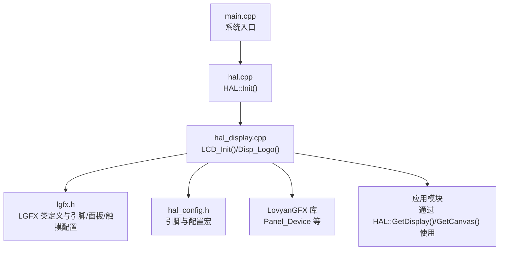
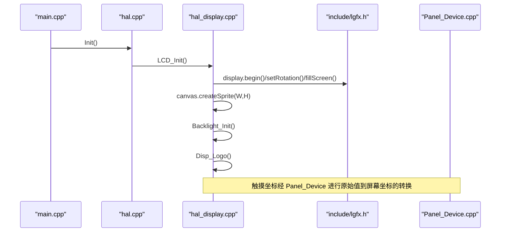
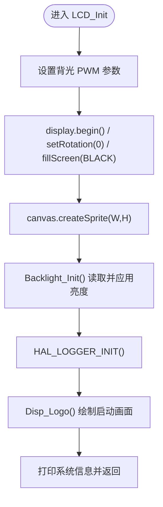
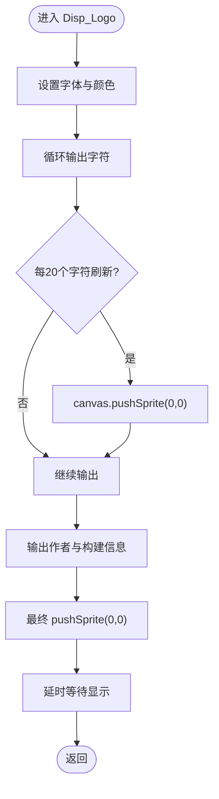
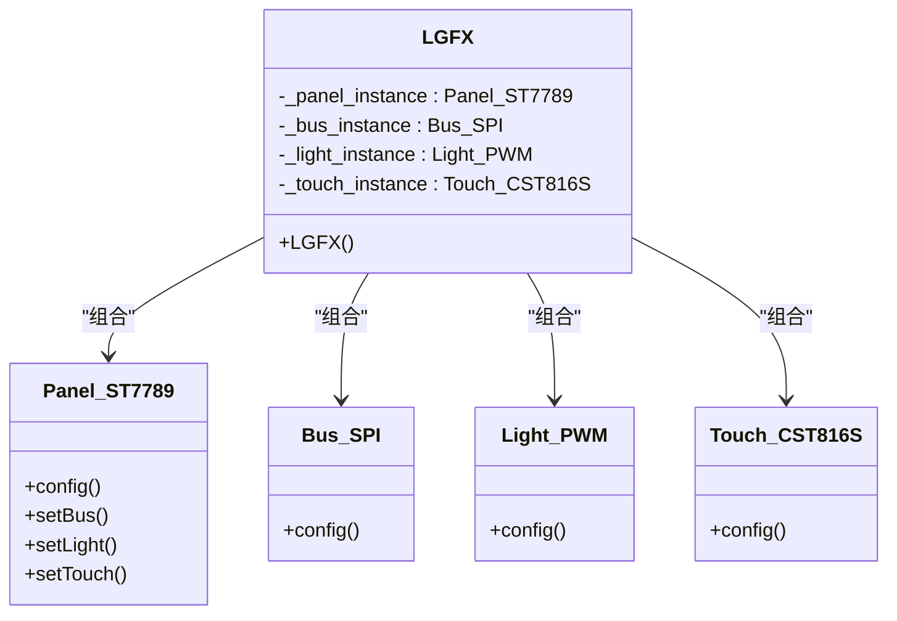
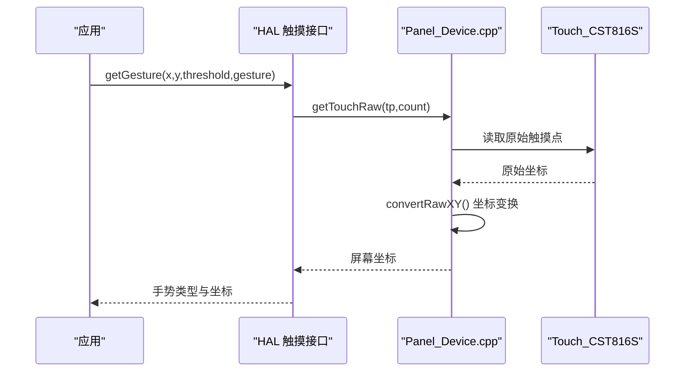
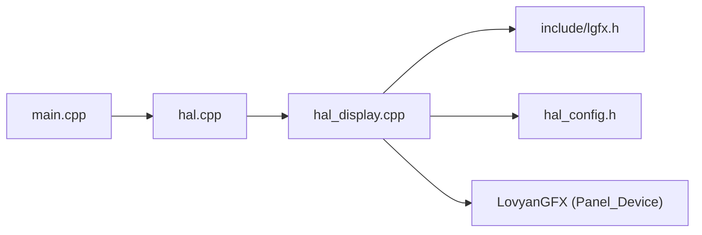

# 显示控制

<cite>
**本文引用的文件**   
- [include/lgfx.h](file://include/lgfx.h)
- [src/hal/hal_display.cpp](file://src/hal/hal_display.cpp)
- [src/hal/hal_config.h](file://src/hal/hal_config.h)
- [src/hal/hal.h](file://src/hal/hal.h)
- [src/hal/hal.cpp](file://src/hal/hal.cpp)
- [src/main.cpp](file://src/main.cpp)
- [lib/LovyanGFX/src/lgfx/v1/panel/Panel_Device.cpp](file://lib/LovyanGFX/src/lgfx/v1/panel/Panel_Device.cpp)
</cite>

## 目录
1. [简介](#简介)
2. [项目结构](#项目结构)
3. [核心组件](#核心组件)
4. [架构总览](#架构总览)
5. [详细组件分析](#详细组件分析)
6. [依赖关系分析](#依赖关系分析)
7. [性能与优化](#性能与优化)
8. [故障排查指南](#故障排查指南)
9. [结论](#结论)

## 简介
本技术文档面向显示控制系统，聚焦以下目标：
- 详细说明 LCD 初始化流程 LCD_Init() 与启动画面 Disp_Logo() 的实现。
- 文档化 LovyanGFX（LGFX）图形库的集成方式与配置选项。
- 解释显示缓冲区管理，包括 GetDisplay() 与 GetCanvas() 的使用场景。
- 说明触摸显示集成的工作原理。
- 提供图形绘制 API 的使用示例与性能优化建议。
- 给出显示配置参数调优指南。

## 项目结构
本项目在 ESP32 平台上使用 LovyanGFX 驱动 ST7789 SPI 屏，并通过 I2C 接入 CST816S 触摸芯片。HAL 层封装了显示、背光、日志输出等能力；应用通过 HAL 接口访问显示资源。

图表来源
- [src/main.cpp:19-24](file://src/main.cpp#L19-L24)
- [src/hal/hal.cpp:4-25](file://src/hal/hal.cpp#L4-L25)
- [src/hal/hal_display.cpp:18-42](file://src/hal/hal_display.cpp#L18-L42)
- [include/lgfx.h:34-114](file://include/lgfx.h#L34-L114)
- [src/hal/hal_config.h:7-22](file://src/hal/hal_config.h#L7-L22)

章节来源
- [src/main.cpp:19-24](file://src/main.cpp#L19-L24)
- [src/hal/hal.cpp:4-25](file://src/hal/hal.cpp#L4-L25)

## 核心组件
- LGFX 设备类与硬件抽象
  - include/lgfx.h：定义 LGFX 类，组合 SPI Bus、ST7789 Panel、PWM 背光、CST816S 触摸，并设置分辨率、偏移、旋转、I2C 地址与时钟等。
  - src/hal/hal_display.cpp：实例化 display 与 canvas，完成 LCD_Init()、Disp_Logo()、背光初始化与亮度持久化。
  - src/hal/hal.h：暴露 HAL 接口，包括 LCD_Init()、Disp_Logo()、GetDisplay()、GetCanvas() 以及触摸相关函数。
  - src/hal/hal_config.h：集中定义引脚、分辨率、NVS 键名与日志宏。

- LovyanGFX 图形库
  - lib/LovyanGFX：底层实现 Panel_Device、Touch 转换、事务管理等。

章节来源
- [include/lgfx.h:34-114](file://include/lgfx.h#L34-L114)
- [src/hal/hal_display.cpp:18-79](file://src/hal/hal_display.cpp#L18-L79)
- [src/hal/hal.h:101-125](file://src/hal/hal.h#L101-L125)
- [src/hal/hal_config.h:7-22](file://src/hal/hal_config.h#L7-L22)

## 架构总览
下图展示从系统启动到显示初始化的调用链，以及显示与触摸在 LovyanGFX 中的协作关系。

图表来源
- [src/main.cpp:19-24](file://src/main.cpp#L19-L24)
- [src/hal/hal.cpp:4-25](file://src/hal/hal.cpp#L4-L25)
- [src/hal/hal_display.cpp:18-79](file://src/hal/hal_display.cpp#L18-L79)
- [include/lgfx.h:34-114](file://include/lgfx.h#L34-L114)
- [lib/LovyanGFX/src/lgfx/v1/panel/Panel_Device.cpp:458-474](file://lib/LovyanGFX/src/lgfx/v1/panel/Panel_Device.cpp#L458-L474)

## 详细组件分析

### LCD 初始化流程 LCD_Init()
职责与步骤：
- 初始化背光 PWM 通道与引脚，读取保存的亮度值并写入。
- 调用 display.begin() 启动 LGFX 设备，设置旋转方向，清屏为黑色。
- 创建与屏幕尺寸一致的离屏缓冲 canvas（LGFX_Sprite）。
- 初始化日志输出，显示启动 Logo，打印系统信息（Flash/RAM/PSRAM）。

关键点：
- 背光频率与 PWM 位宽在 hal_display.cpp 中设定，亮度值通过 Preferences 持久化。
- canvas 用于双缓冲/离屏绘制，减少闪烁与总线竞争。

图表来源
- [src/hal/hal_display.cpp:18-42](file://src/hal/hal_display.cpp#L18-L42)
- [src/hal/hal_display.cpp:81-92](file://src/hal/hal_display.cpp#L81-L92)

章节来源
- [src/hal/hal_display.cpp:18-42](file://src/hal/hal_display.cpp#L18-L42)
- [src/hal/hal_display.cpp:81-92](file://src/hal/hal_display.cpp#L81-L92)

### 启动画面 Disp_Logo()
职责与步骤：
- 设置字体与前景/背景色。
- 逐字符输出 ASCII Logo，每若干字符刷新一次 canvas 到屏幕，避免长时间占用总线。
- 输出作者与构建时间信息，最后一次性 pushSprite 到屏幕并延时。

要点：
- 使用 canvas 作为离屏缓冲，降低闪烁。
- 分块 pushSprite 可提升长文本输出的流畅性。

图表来源
- [src/hal/hal_display.cpp:54-79](file://src/hal/hal_display.cpp#L54-L79)

章节来源
- [src/hal/hal_display.cpp:54-79](file://src/hal/hal_display.cpp#L54-L79)

### LGFX 图形库集成与配置
- 引脚与总线
  - SPI MOSI/MISO/SCLK/DC/CS/RST/BUSY 引脚在 include/lgfx.h 中定义，Bus_SPI 配置写频 40MHz。
- 面板 Panel_ST7789
  - 开启 invert 与 RGB 顺序，设置 panel_width/height、offset_x/y、offset_rotation。
- 背光 Light_PWM
  - 代码中注释掉默认背光配置，实际由 HAL 层通过 LEDC 控制。
- 触摸 Touch_CST816S
  - I2C 端口、地址、SDA/SCL、RST/INT 引脚、I2C 时钟频率均在此配置。
  - 将触摸实例绑定到面板，使坐标自动按屏幕旋转与翻转进行转换。

图表来源
- [include/lgfx.h:34-114](file://include/lgfx.h#L34-L114)

章节来源
- [include/lgfx.h:9-31](file://include/lgfx.h#L9-L31)
- [include/lgfx.h:44-75](file://include/lgfx.h#L44-L75)
- [include/lgfx.h:90-114](file://include/lgfx.h#L90-L114)

### 显示缓冲区管理：GetDisplay() 与 GetCanvas()
- GetDisplay()
  - 返回全局 display 指针，用于直接操作屏幕（如 fillScreen、drawXxx）。
  - 适用于全屏填充、即时绘制或需要直接访问底层面板的场景。
- GetCanvas()
  - 返回全局 canvas（LGFX_Sprite），即离屏缓冲。
  - 推荐用于复杂 UI 合成、动画帧渲染、批量绘制后一次性 pushSprite，以减少闪烁与总线占用。

典型用法模式：
- 应用获取 display 与 canvas 指针，先在 canvas 上绘制，再 pushSprite 到屏幕。
- 对频繁更新的区域，可使用局部 pushSprite 或 clip 矩形优化。

章节来源
- [src/hal/hal_display.cpp:44-52](file://src/hal/hal_display.cpp#L44-L52)
- [src/hal/hal.h:108-112](file://src/hal/hal.h#L108-L112)

### 触摸显示集成工作原理
- 触摸控制器 CST816S 通过 I2C 连接，坐标范围映射到屏幕分辨率。
- LovyanGFX 内部在 Panel_Device 中对原始触摸坐标进行旋转变换与翻转处理，确保与应用坐标系一致。
- 应用可通过 HAL 提供的 getGesture/getTouch 等方法获取手势与坐标。

图表来源
- [lib/LovyanGFX/src/lgfx/v1/panel/Panel_Device.cpp:458-474](file://lib/LovyanGFX/src/lgfx/v1/panel/Panel_Device.cpp#L458-L474)
- [include/lgfx.h:90-114](file://include/lgfx.h#L90-L114)

章节来源
- [lib/LovyanGFX/src/lgfx/v1/panel/Panel_Device.cpp:458-474](file://lib/LovyanGFX/src/lgfx/v1/panel/Panel_Device.cpp#L458-L474)
- [include/lgfx.h:90-114](file://include/lgfx.h#L90-L114)

### 图形绘制 API 使用示例与最佳实践
- 基础绘制
  - 全屏填充：使用 display.fillScreen(color)。
  - 几何图形：drawRect、drawLine、drawCircle 等。
  - 文本绘制：setFont、setTextColor、printf/drawString。
- 离屏缓冲
  - 在 canvas 上完成复杂绘制后，pushSprite(0,0) 一次性输出。
  - 对于动态 UI，优先使用 canvas 合成，减少闪烁。
- 图像加载
  - LovyanGFX 支持 BMP/JPG/PNG/QOI 等格式，可直接 drawBmp/drawJpg/drawPng。
- 事务与裁剪
  - 大量绘制时，合理使用 beginTransaction/endTransaction 与 setClipRect 减少总线开销。

参考路径（不展示代码内容）：
- LovyanGFX README 中关于 fillScreen、drawRect、drawLine、sprite.pushSprite 的示例说明。

章节来源
- [lib/LovyanGFX/README.md:220-328](file://lib/LovyanGFX/README.md#L220-L328)
- [lib/LovyanGFX/README.md:401-452](file://lib/LovyanGFX/README.md#L401-L452)

### 显示配置参数调优指南
- SPI 写频
  - 当前设置为 40MHz，可根据布线质量与稳定性调整（提高可提升吞吐，过低影响刷新率）。
- 面板偏移与旋转
  - offset_x/offset_y 用于校正物理像素偏移；offset_rotation 适配不同安装方向。
- 触摸校准
  - x_min/x_max/y_min/y_max 需与实际触摸范围匹配；若出现坐标错位，检查 offset_rotation 与 bus_shared。
- 背光 PWM
  - 频率与位宽影响亮度平滑度与功耗；当前使用 44100Hz、9bit，可在 HAL 层调整。
- 内存与 PSRAM
  - 大分辨率或高分辨率纹理建议使用 PSRAM；观察 Free RAM/PSRAM 以评估容量是否足够。

章节来源
- [include/lgfx.h:44-75](file://include/lgfx.h#L44-L75)
- [include/lgfx.h:90-114](file://include/lgfx.h#L90-L114)
- [src/hal/hal_display.cpp:8-14](file://src/hal/hal_display.cpp#L8-L14)
- [src/hal/hal_display.cpp:81-92](file://src/hal/hal_display.cpp#L81-L92)

## 依赖关系分析
- main.cpp 调用 HAL::Init()，后者依次初始化电源、显示、I2C、输入、编码器、RTC、IMU、SD、磁力计、气压传感器等。
- HAL 层通过 HAL::LCD_Init() 完成显示与背光初始化，并调用 Disp_Logo() 展示启动画面。
- LGFX 类组合 Bus_SPI、Panel_ST7789、Light_PWM、Touch_CST816S，并将触摸绑定到面板。
- LovyanGFX 的 Panel_Device 负责触摸坐标的原始值到屏幕坐标的转换。

图表来源
- [src/main.cpp:19-24](file://src/main.cpp#L19-L24)
- [src/hal/hal.cpp:4-25](file://src/hal/hal.cpp#L4-L25)
- [src/hal/hal_display.cpp:18-42](file://src/hal/hal_display.cpp#L18-L42)
- [include/lgfx.h:34-114](file://include/lgfx.h#L34-L114)
- [lib/LovyanGFX/src/lgfx/v1/panel/Panel_Device.cpp:458-474](file://lib/LovyanGFX/src/lgfx/v1/panel/Panel_Device.cpp#L458-L474)

章节来源
- [src/main.cpp:19-24](file://src/main.cpp#L19-L24)
- [src/hal/hal.cpp:4-25](file://src/hal/hal.cpp#L4-L25)

## 性能与优化
- 使用离屏缓冲
  - 所有复杂 UI 先在 canvas 上绘制，再 pushSprite 到屏幕，减少闪烁与总线争用。
- 批量绘制与事务
  - 对大量绘制操作，使用 beginTransaction/endTransaction 包裹，减少 SPI 切换开销。
- 裁剪区域
  - 使用 setClipRect 仅更新必要区域，降低带宽压力。
- 图像解码
  - 尽量使用预缩放或合适格式的图像，避免运行时解码过大图片。
- 背光与功耗
  - 合理设置背光 PWM 频率与占空比，平衡亮度与功耗。
- 内存管理
  - 监控 Free RAM/PSRAM，避免分配过大的临时缓冲；必要时释放不再使用的 Sprite。

[本节为通用指导，无需特定文件引用]

## 故障排查指南
- 屏幕无显示
  - 检查 SPI 引脚与 CS/DC/RST 配置是否正确；确认 display.begin() 成功执行。
- 显示倒置或偏移
  - 检查 offset_rotation、offset_x/y 与 rotation 设置是否与硬件安装一致。
- 触摸坐标异常
  - 核对 I2C 地址、SDA/SCL 引脚、x_min/x_max/y_min/y_max 与 offset_rotation。
  - 确认 Panel_Device 的坐标转换逻辑未被覆盖。
- 背光不亮或亮度异常
  - 检查 LEDC 通道、引脚与 PWM 位宽；确认 Preferences 中保存的亮度值有效。
- 刷新卡顿或闪烁
  - 改用 canvas 离屏绘制；减少频繁 pushSprite；合并绘制批次。

章节来源
- [include/lgfx.h:44-75](file://include/lgfx.h#L44-L75)
- [include/lgfx.h:90-114](file://include/lgfx.h#L90-L114)
- [src/hal/hal_display.cpp:81-92](file://src/hal/hal_display.cpp#L81-L92)
- [lib/LovyanGFX/src/lgfx/v1/panel/Panel_Device.cpp:458-474](file://lib/LovyanGFX/src/lgfx/v1/panel/Panel_Device.cpp#L458-L474)

## 结论
本项目基于 LovyanGFX 实现了稳定的 ST7789 SPI 屏驱动与 CST816S 触摸集成。通过 HAL 层封装，应用可以便捷地访问显示与触摸能力。LCD_Init() 与 Disp_Logo() 提供了清晰的启动流程；GetDisplay()/GetCanvas() 明确了直接与离屏绘制的分工。结合合理的 SPI 频率、面板偏移、触摸校准与背光 PWM 配置，可获得稳定且高效的显示体验。建议在 UI 开发中优先采用离屏缓冲与批量绘制策略，以获得更流畅的交互效果。